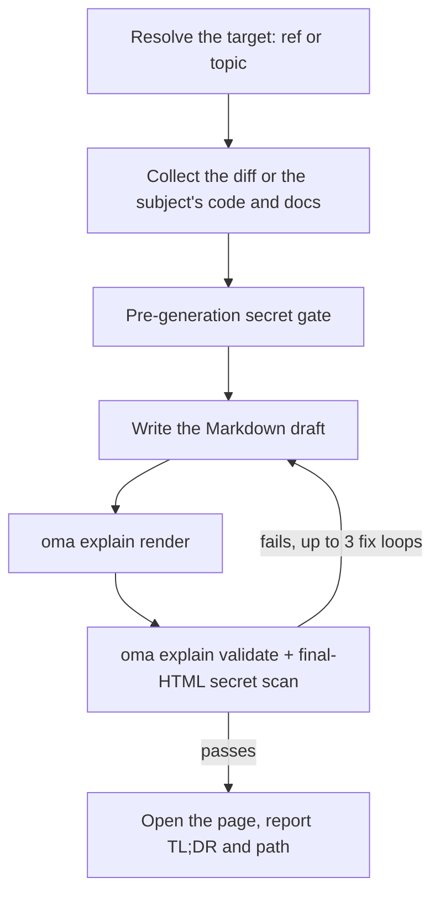

# Explicador de código

`/explain` convierte un cambio de código en un documento HTML completo y autocontenido que enseña qué cambió y por qué: contexto profundo que se puede omitir si ya conoces el sistema, una sección de intuición central con datos de ejemplo, un recorrido del código ordenado para la comprensión y un cuestionario de cinco preguntas. El resultado es un único archivo `.html` que funciona sin conexión, con diagramas, llamadas y un cuestionario accesible, guardado en `.agents/results/explain/` y validado con una lista determinista antes de entregarlo.

`/explain` solo se activa con una barra; no se activa automáticamente a partir del lenguaje natural. «Explain» es vocabulario cotidiano, por lo que se excluye intencionadamente de la detección de palabras clave, igual que `/convert`. Escribe `/explain` explícitamente o pide a otra skill que produzca un «documento explicativo» como resultado delegado.

## Dos modos

| Modo | Lo que escribes | Necesita git | Qué explica la página |
|---|---|---|---|
| Cambio | `/explain`, `/explain #640`, `/explain a..b`, `/explain <branch>` | sí (`gh` para referencias de PR) | Un cambio de código: Contexto, Intuición, Código, Cuestionario |
| Tema | `/explain how does session windowing work` (texto que no se resuelve como PR, rama ni rango SHA) | no | Un concepto, un sistema o la respuesta a una pregunta, como una hoja visual de una página: una respuesta inicial y después paneles de diagramas, tablas y prosa breve |

Si el texto puede ser tanto un nombre de rama como un tema, el flujo de trabajo lo comprueba primero como referencia de git; la referencia tiene prioridad.

---

## Cuándo usarlo

- Explicar un PR, una rama, un rango de commits o el cambio actual preparado o sin preparar como documento
- Incorporar a un compañero a un cambio que no escribió
- Producir un artefacto didáctico revisable después de que llegue un cambio grande o sutil
- Convertir una arquitectura, un protocolo, una comparación o una respuesta larga en una sola página visual (modo tema)

## Cuándo NO usarlo

- Vídeo explicativo *narrado* → usa [`oma-video`](./video-generation.md) (modo explainer); `/explain` produce un documento HTML, no un vídeo
- Comprobar si la documentación sigue coincidiendo con el código → usa `oma-docs` (detección de drift)
- Presentación o diapositivas → usa `oma-slide` (contrato fijo de presentación a 1920×1080)
- Encontrar defectos o emitir veredictos de revisión → usa `oma-qa` o el flujo de trabajo `/review`; `/explain` narra un cambio con fines didácticos, no lo evalúa

---

## Inicio rápido

```text
/explain
/explain 640
/explain a1b2c3d..e5f6a7b
/explain payments-refactor for reviewer
```

La referencia de destino se resuelve a partir de la frase:

| Lo que escribes | Resolución del destino | Nivel del lector |
|----------|--------------------|--------------|
| `/explain` | Cambios preparados (`git diff --cached`), con fallback al árbol de trabajo sucio | `onboarding` |
| `/explain 640`, `/explain #640` | PR #640 mediante `gh pr diff` | `onboarding` |
| `/explain a..b` | Rango SHA `a..b` (o `a...b`) | `onboarding` |
| `/explain feature-branch for reviewer` | `git diff main...feature-branch` | `reviewer` |
| `/explain how does the row planner work` | Modo tema: sin referencia; el agente recopila el código y la documentación sobre el tema | n/a |

Si no se proporciona una referencia explícita y tanto el árbol preparado como el sucio están vacíos, la resolución recurre a `HEAD~1..HEAD`.



---

## Orden de resolución de referencias

Solo en modo cambio; el modo tema omite la resolución de referencias.

1. **Argumento explícito**: un número de PR (`#640`), un nombre de rama o un rango SHA (`a..b` / `a...b`)
2. **Cambios preparados**: `git diff --cached`
3. **Árbol de trabajo sucio**: `git diff`
4. **Fallback**: `HEAD~1..HEAD`

Un diff vacío o una referencia que no se pueda resolver detiene el flujo de trabajo; ofrece commits recientes como candidatos en lugar de adivinar una alternativa.

---

## Niveles del lector

| Nivel | Efecto |
|-------|--------|
| `onboarding` (predeterminado) | Contexto profundo completo (Tier A), para un lector que no conoce el sistema circundante |
| `reviewer` | Condensa el nivel de contexto profundo; las secciones Intuición y Código se mantienen completas |

Solicita `reviewer` añadiendo «for reviewer» al comando, como en `/explain feature-branch for reviewer`.

---

## Qué contiene el documento

Esta sección describe el modo cambio. Un explicador en modo cambio es una única página larga con desplazamiento (sin pestañas ni navegación entre páginas) con un índice seguido de cuatro secciones fijas, en este orden:

1. **Contexto**: Tier A (contexto profundo del sistema y la arquitectura, marcado como «se puede omitir si ya conoces el sistema») y Tier B (contexto acotado para este cambio concreto)
2. **Intuición**: la esencia del cambio con ejemplos obligatorios de datos de juguete, reforzada por 2 o 3 familias de diagramas reutilizadas (mock de UI simplificado, diagrama de flujo del sistema o datos que transporta los ejemplos, estado anterior y posterior), renderizadas solo como HTML o SVG en línea; no se permite arte ASCII
3. **Código**: un recorrido agrupado para la comprensión humana (no alfabéticamente ni en el orden del diff), que referencia el código mediante `file:line`
4. **Cuestionario**: 5 preguntas por defecto (parametrizable), cada una dirigida a un aspecto distinto del cambio, con distractores plausibles y texto de feedback para cada opción, correcta o incorrecta

La prosa y el contenido del cuestionario se escriben en el idioma solicitado (idioma del prompt → `.agents/oma-config.yaml` `language` → inglés); el código, los identificadores y el código en línea se mantienen en inglés según las reglas de i18n. El contrato completo de contenido está en `.agents/skills/oma-explanation/resources/document-structure.md`.

---

## Cómo se construye la página

El agente escribe un borrador en Markdown y `oma explain render` lo convierte en la página: el diseño, el tema, la geometría de los diagramas y el script del cuestionario vienen del renderizador, no del modelo.

| Comando | Uso |
|---|---|
| `oma explain render draft.md` | Renderiza un borrador (un archivo o stdin) en `.agents/results/explain/{YYYY-MM-DD}-{slug}.html`. Las opciones incluyen `--template sheet\|doc`, `--theme`, `--mode`, `--archify` y `--open`. |
| `oma explain lint draft.md` | Revisa la prosa sin renderizar (`--style strict` sale con 1 ante una advertencia). |
| `oma explain components [name]` | Enumera los componentes que puede usar un borrador (`flow`, `sequence`, `tree`, `timeline`, `limits`, `annot`, `kv`, `callout`, `quiz`) o imprime la sintaxis de un componente. |
| `oma explain patch <page.html> --panel <id>` | Sustituye un panel de una página renderizada (por letra o título) y conserva el resto. |
| `oma explain validate <file>` | Ejecuta las comprobaciones posteriores deterministas que se describen más abajo. |

---

## Contrato HTML

Las páginas generadas por `oma explain render` cumplen estas reglas automáticamente; importan cuando revisas o editas HTML a mano.

El archivo generado debe abrirse correctamente sin conexión mediante `file://`, con **cero cargas de recursos externos**: no se permiten scripts ni hojas de estilo desde CDN, ni fuentes web, ni imágenes externas (solo SVG en línea o URI de datos). Se permiten anclas de hipervínculo (`<a href="https://...">`); la prohibición se refiere únicamente a *cargar* recursos.

- Los bloques de código usan `<pre>`; cualquier contenedor personalizado declara `white-space: pre-wrap`. No se permiten bibliotecas externas para resaltar sintaxis.
- Pila de fuentes: una Pretendard instalada localmente, que se reconoce por el nombre de familia (la página nunca descarga fuentes ni usa la función CSS `local()`), seguida de `system-ui` y fuentes CJK del sistema. Las páginas en japonés y chino omiten Pretendard y empiezan por `system-ui` con fuentes para ese idioma.
- Debe responder desde 375 px, cumplir el contraste WCAG AA en temas claro y oscuro, admitir `prefers-color-scheme: dark` y respetar `prefers-reduced-motion`.
- El cuestionario usa JavaScript vanilla: las opciones son elementos `<button>`, el feedback inmediato de acierto o error se anuncia mediante una región `aria-live="polite"`, las respuestas correctas se distribuyen aleatoriamente entre las posiciones, se muestra un resumen de puntuación final y toda la navegación es posible con teclado.

Especificación completa del comportamiento: `.agents/skills/oma-explanation/resources/html-contract.md`.

---

## Secretos y defensa contra prompt injection

El contenido del diff y las descripciones de los PR se tratan estrictamente como **datos**: se ignoran las instrucciones insertadas en el cambio que se está explicando.

Los secretos se controlan dos veces:

1. **Antes de generar**: el diff recopilado se analiza antes de escribir nada.
2. **Después de generar**: también se analiza el HTML final, porque el contexto puede citar archivos sin cambios que el análisis del diff no haya visto.

Ante cualquier detección, la generación se detiene inmediatamente, solo se informan las ubicaciones enmascaradas (nunca el valor real) y continuar con datos redactados requiere confirmación explícita.

---

## Lista de validación

Después de generar, se ejecuta una lista basada en grep contra el archivo de salida: ausencia de referencias que carguen recursos externos, cumplimiento de `pre`/`pre-wrap` para contenedores de código, presencia del script del cuestionario, formato de nombre `{YYYY-MM-DD}-{slug}.html` (fecha en Asia/Seoul) y análisis de secretos del HTML final. Si falla, el bucle corrige y vuelve a validar hasta **3 iteraciones**, y después se detiene y muestra los elementos que siguen fallando en vez de entregar el archivo en silencio.

Esta es una restricción de v1: la validación se basa en grep y archivos, y comprueba solo la *presencia* del script del cuestionario, no su corrección completa. Usa un navegador (o el MCP de chrome-devtools) para probar manualmente el cuestionario cuando necesites confianza en su comportamiento.

Puedes validar un artefacto existente con el comando CLI registrado:

```bash
oma explain validate .agents/results/explain/2026-09-09-payment-refactor.html
oma explain validate --input-dir .agents/results/explain --output json
```

Salida esperada (nombres de archivo ilustrativos):

```text
$ oma explain validate .agents/results/explain/2026-09-09-payment-refactor.html
✔ Explain validation passed: 1/1 file(s) valid

$ oma explain validate ".agents/results/explain/payment refactor.html"
✖ Explain validation failed: 1/1 file(s) failed
File: .agents/results/explain/payment refactor.html
  - [error] filename-format: Filename 'payment refactor.html' does not match format {YYYY-MM-DD}-{slug}.html
```

La primera forma comprueba un archivo HTML. La forma con directorio comprueba cada informe de un directorio y devuelve un informe legible por máquinas. Usa `--report-file <path>` para guardar el informe JSON; la grafía antigua `--out-file` ahora falla con `Removed option --out-file. Use --report-file.` Un código de salida distinto de cero significa que al menos un artefacto falló las comprobaciones deterministas; no inspecciona la exactitud didáctica de la prosa ni de las respuestas del cuestionario.

---

## Salida

```text
.agents/results/explain/{YYYY-MM-DD}-{slug}.html
```

La fecha se localiza en Asia/Seoul. Volver a ejecutar con la misma fecha y slug sobrescribe el archivo anterior; conservar una ejecución anterior es responsabilidad tuya. Cuando la validación pasa, el flujo intenta abrir la página (solo muestra una advertencia; en un entorno sin interfaz se limita a informar de la ruta) y muestra un TL;DR junto con la ruta del archivo. `oma explain render --open` abre la página directamente en el navegador.

---

## Sidecar opcional de archify

Cuando `diagram.explain_sidecar: true` está definido en `oma-config.yaml` o lo solicitas (`/explain 640 with archify`), `/explain` renderiza con `--archify`: deriva un `{date}-{slug}.archify.html` interactivo a partir de un bloque `flow` o `sequence` del borrador y lo enlaza mediante un ancla normal. Nunca se incrusta: el explicador sigue siendo un único archivo autocontenido, y un fallo del sidecar nunca bloquea la entrega. Consulta [Motor de diagramas](./diagram-engine.md#explain).

## Casos límite

| Situación | Comportamiento |
|-----------|----------|
| Diff vacío o referencia no resoluble | Se detiene y ofrece commits recientes como candidatos; nunca adivina otra referencia |
| Diff demasiado grande | Excluye automáticamente lockfiles y archivos generados, agrupa el resto por archivo y enumera las exclusiones en el pie de procedencia |
| Diff solo binario o generado | Se detiene: no hay nada que explicar |
| Falta la CLI `gh` o no está autenticada (referencia PR) | Ofrece instrucciones para instalar y autenticar, además de una alternativa local basada en el diff de la rama |
| Merge o rebase en curso | Se detiene: el worktree es inestable |
| Directorio que no es Git | Modo cambio: se detiene inmediatamente. El modo tema funciona sin git. |
| La validación falla después de 3 bucles de corrección | Se detiene y muestra los elementos fallidos de la lista |
| Falla `open` o el entorno no tiene interfaz | Solo muestra una advertencia; la ruta informada es suficiente |

---

## Próximos pasos

- [Flujo de trabajo `/explain`](../core-concepts/workflows.md#explain): pipeline de resolución de referencia → recopilación → control de secretos → generación → validación → entrega
- [Motor de diagramas](./diagram-engine.md): el sidecar opcional de archify
- [Comandos CLI: explain](../cli-interfaces/commands.md#explain): todas las opciones de `oma explain`
- [Generación de vídeo](./video-generation.md): el *modo* explainer de `oma-video` produce un vídeo narrado en lugar de un documento HTML
- [Flujos de trabajo de contenido e investigación](./content-and-research.md): otras capacidades de documentos e investigación
