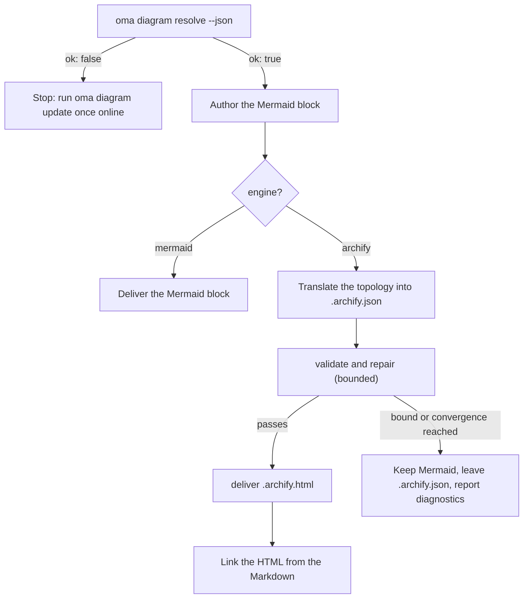

# Motor de diagramas

`/architecture` (ADR, recomendaciones y revisiones) y `/explain` (explicadores de cambios de código) generan diagramas estructurales. En `/architecture` siempre son bloques **Mermaid** dentro del artefacto Markdown (`/explain` dibuja sus propios diagramas SVG en línea) y, siempre que se puede resolver [archify](https://github.com/tt-a1i/archify), también se genera un **diagrama HTML interactivo y validado** junto al artefacto: tema claro u oscuro, paneo y zoom, búsqueda, trazado de relaciones, exportación PNG/SVG/WebM y renderizado desde una especificación JSON tipada.

Mermaid sigue siendo la SSOT textual en Markdown y en los diffs de Git. archify produce un artefacto derivado.

---

<a id="always-the-latest-archify--nothing-to-install"></a>
## Instalar archify {#install-archify}

archify es una skill de agente con licencia MIT (Node ≥ 18 y cero dependencias de runtime). oh-my-agent usa la copia instalada mediante la [skills CLI](https://github.com/vercel-labs/skills) y no mantiene ninguna copia propia:

- `oma diagram update` instala archify cuando falta (`bunx skills add tt-a1i/archify --skill archify -g -y`) y, en caso contrario, lo actualiza (`bunx skills update archify -g -y`).
- `oma diagram resolve` solo lee los directorios de skills instalados y nunca accede a la red. Sin una instalación, `auto` recurre a Mermaid e indica el comando de instalación.
- `oma update` no instala archify.

```bash
# Illustrative output; the version, install path, and quality can vary.
oma diagram update
oma diagram resolve
# engine:   archify  (requested: auto)
# reason:   archify 2.15.0 via home:~/.agents/skills
# root:     /Users/you/.agents/skills/archify
# bin:      /Users/you/.agents/skills/archify/bin/archify.mjs
# version:  2.15.0
# quality:  showcase
# sidecar:  off (explain)
```

Orden de resolución (gana el primer resultado, idéntico en todos los runtimes de proveedor):

1. `diagram.archify.path` en `oma-config.yaml`: anclaje explícito
2. Variable de entorno `ARCHIFY_HOME`: anclaje explícito
3. Directorios de skills instalados: proyecto `.agents` / `.claude` / `.codex` / `.cursor` / `.qwen` / `.kiro` / `.gemini` / `.copilot` `/skills/archify`, después los mismos bajo `~`, y después `~/.config/agents/skills/archify` y `~/.raven/workspace/skills/archify`

<!-- oma-docs:ignore-start -->
Para que haya un resultado, el directorio de archify instalado o anclado debe contener `bin/archify.mjs`.
<!-- oma-docs:ignore-end -->

Las versiones anteriores mantenían su propia copia en `~/.cache/oma-diagram/`. Ya no se lee; puedes eliminarla.

---

## Configuración {#configuration}

Sección dispersa en `.agents/oma-config.yaml` (las claves ausentes usan los valores mostrados):

```yaml
diagram:
  engine: auto                # auto | archify | mermaid
  explain_sidecar: false      # /explain also writes an archify sidecar
  archify:
    path: null                # explicit install dir (pin)
    quality: showcase         # showcase | standard  → --quality
    open: false               # pass --open to deliver
```

`archify.managed`, `archify.channel` y `archify.check_interval_min` están obsoletos: se siguen validando, pero se ignoran, y `resolve` muestra una advertencia mientras estén definidos.

### Qué motor se ejecuta {#which-engine-runs}

Una sola decisión abarca el valor de configuración, si archify se resuelve y lo que entrega el flujo de trabajo. «Se resuelve» significa que algún paso del [orden de resolución](#always-the-latest-archify--nothing-to-install) encuentra una instalación: un anclaje o un directorio de skill instalado.

| `diagram.engine` | ¿Se resuelve archify? | `oma diagram resolve --json` | Resultado de `/architecture` |
|---|---|---|---|
| `auto` (predeterminado) | sí | `engine: archify`, `ok: true` | Bloque Mermaid + `.archify.html` enlazado |
| `auto` | no (archify no está instalado) | `engine: mermaid`, `ok: true` | Solo Mermaid; el informe menciona `oma diagram update` |
| `archify` | sí | `engine: archify`, `ok: true` | Bloque Mermaid + `.archify.html` enlazado |
| `archify` | no | `engine: mermaid`, `ok: false`, código de salida 1 | El flujo se detiene con la sugerencia `oma diagram update` en vez de degradar silenciosamente |
| `mermaid` | no se comprueba | `engine: mermaid`, `ok: true` | Solo Mermaid; archify nunca se llama |

`oma diagram resolve --engine <auto|archify|mermaid>` sobrescribe la configuración para una llamada, y un prompt puede hacer lo mismo para una ejecución (`/explain 640 with archify`).

---

## CLI {#cli}

```bash
oma diagram resolve [--engine auto|archify|mermaid] [--json]
oma diagram update  [--json]
oma diagram archify <archify args…>
```

`oma diagram update` fuerza una actualización y termina con código 1 cuando no se puede resolver ninguna instalación de archify.

`oma diagram archify` ejecuta el ejecutable de archify resuelto con `ARCHIFY_UPDATE_CHECK_DISABLED=1` (sin red) y propaga el código de salida, por lo que `validate` / `deliver` / `visual-check` se comportan exactamente como documenta archify:

```bash
oma diagram archify guide "show the auth request lifecycle" --json
oma diagram archify validate architecture adr-auth.archify.json --quality showcase --json
oma diagram archify deliver  architecture adr-auth.archify.json adr-auth.archify.html --quality showcase --json
oma diagram archify visual-check adr-auth.archify.html --json   # exit 2 = no Chrome (skipped), or archify itself could not be resolved
```

`--json` en `resolve` devuelve `{ ok, requested, engine, quality, open, explainSidecar, archify?: { root, bin, version, source }, reason, probed, warnings }`; `source` es `config:…`, `env:…` o una etiqueta de directorio de skill como `home:~/.agents/skills`; `warnings` enumera las claves obsoletas ignoradas. `--refresh` y `--offline` se aceptan como no-ops obsoletos.

---

## Cómo lo usan los flujos de trabajo {#how-the-workflows-use-it}

El protocolo compartido vive en `.agents/skills/_shared/conditional/diagram-engine.md`. `/architecture` sigue esta secuencia:

1. `oma diagram resolve --json`
2. Escribe primero el bloque Mermaid (siempre).
3. Si `engine: archify`: traduce la topología Mermaid al IR JSON de archify (`architecture` / `sequence` / `dataflow` / `lifecycle` / `workflow`), leyendo solo el esquema correspondiente y un ejemplo de la instalación.
4. `validate` → reparar → `deliver`, de forma acotada: se detiene cuando la especificación pasa, cuando se activa la regla de convergencia de archify, después de 3 intentos de reparación, tras 10 minutos en total o cuando se repite el mismo diagnóstico. Las etiquetas semánticas nunca se eliminan solo para pasar.
5. Enlaza el HTML; nunca lo incrustes.



### `/architecture` {#architecture}

Solo para decisiones estructurales (límites, dependencias y flujo de datos). La salida se guarda junto al artefacto Markdown bajo `.agents/results/architecture/`:

```text
adr-notification-service.md            # Mermaid block + "Interactive:" link
adr-notification-service.archify.json  # frozen spec (kept even on failure)
adr-notification-service.archify.html  # delivered viewer
```

### `/explain` {#explain}

Es opcional, porque el contrato del explicador (un único archivo autocontenido con temas basados en variables CSS) no permite incrustar un segundo documento HTML completo. Actívalo con `diagram.explain_sidecar: true`, pasa `oma explain render --archify` o pídelo en el prompt («with archify»). No hay bloque Mermaid ni JSON escrito a mano: el renderizador deriva la especificación de archify a partir de un bloque `flow` o `sequence` del borrador (el panel marcado con `{archify}`), ejecuta `deliver` (con un único fallback de la calidad `showcase` a `standard`) y enlaza `{date}-{slug}.archify.html` con un `<a href>` sencillo. El comando informa `linked`, `skipped` (con el motivo) o `failed` (primer diagnóstico). El flujo de trabajo no repite el ciclo ante un sidecar fallido, y un fallo del sidecar nunca bloquea el explicador.

---

## Pósteres de stack (stack-diagram) {#stack-posters-stack-diagram}

Cuando el diagrama es una topología de stack tecnológico o de infraestructura cuyos nodos son productos de proveedores (AWS, Vercel, Postgres, …) y pides logotipos, `/architecture` toma la **ruta stack** en lugar de archify. Ejecuta la skill de agente upstream [Caru-ini/stack-diagram](https://github.com/Caru-ini/stack-diagram) (MIT; Python 3.9+, acceso a red para los logotipos) del mismo modo en que `oma-slide` ejecuta ppt-master: no hay comando de oma ni clave de configuración. La tabla de rutas vive en `.agents/skills/_shared/conditional/diagram-engine.md`.

- Resolución: primero el catálogo de skills del runtime; si no, `bunx skills use caru-ini/stack-diagram@stack-diagram`. Si no se puede resolver, el flujo de trabajo recurre a la decisión archify ↔ Mermaid anterior y lo indica.
- Salida: `<artifact-stem>.stack.html` junto al artefacto Markdown, enlazado en la sección Diagrama como `Stack: …`. El bloque Mermaid sigue siendo la SSOT.
- Solo HTML. La exportación PNG y la comprobación de capturas de pantalla del upstream necesitan Playwright + Chromium; oma nunca los instala ni los ejecuta.
- La subida a la galería del upstream (`share.py`) se omite salvo que pidas publicar explícitamente.
- Límites: 2 intentos de build, 5 minutos en total; una ejecución limpia de `build.py` es el criterio de aceptación.
- `/explain` nunca toma esta ruta; su sidecar se deriva del borrador en el código.

Escribe «archify» en el prompt para forzar la ruta estructural, o «stack-diagram» / «with logos» para forzar la ruta stack.

---

## Modos de fallo {#failure-modes}

El caso de archify no resoluble se cubre en la [tabla de decisión del motor](#which-engine-runs). Los casos restantes:

| Situación | Resultado |
|---|---|
| `oma diagram update` falla (sin conexión o falta `bunx`) | Se muestra el error de la skills CLI; una instalación existente sigue funcionando |
| `validate` nunca converge | Mermaid sigue siendo el diagrama entregado; el último `.archify.json` queda para una persona y los diagnósticos se informan literalmente |
| Falta Chrome para `visual-check` | Se informa como `skipped`, nunca como aprobado |
| `oma diagram archify …` termina con código 2 | Falta Chrome (`visual-check`) o no se pudo resolver archify; comprueba primero `oma diagram resolve --json` |

---

## Próximos pasos {#next-steps}

- [Explicador de código](./code-explainer.md): el flujo de trabajo `/explain` y su sidecar opcional de archify
- [Flujo de trabajo `/architecture`](../core-concepts/workflows.md#architecture): ADR y revisiones que incluyen el bloque Mermaid
- [Semántica de oma-config.yaml](./oma-config-semantics.md): cómo se combina la sección `diagram:`
- [Comandos CLI: diagram](../cli-interfaces/commands.md#diagram): lista completa de opciones
- [Investigación de mercado](./market-research.md): el mismo patrón de instalación mediante la skills CLI para el motor last30days
- upstream de archify: [tt-a1i/archify](https://github.com/tt-a1i/archify)
- upstream de stack-diagram: [Caru-ini/stack-diagram](https://github.com/Caru-ini/stack-diagram)
