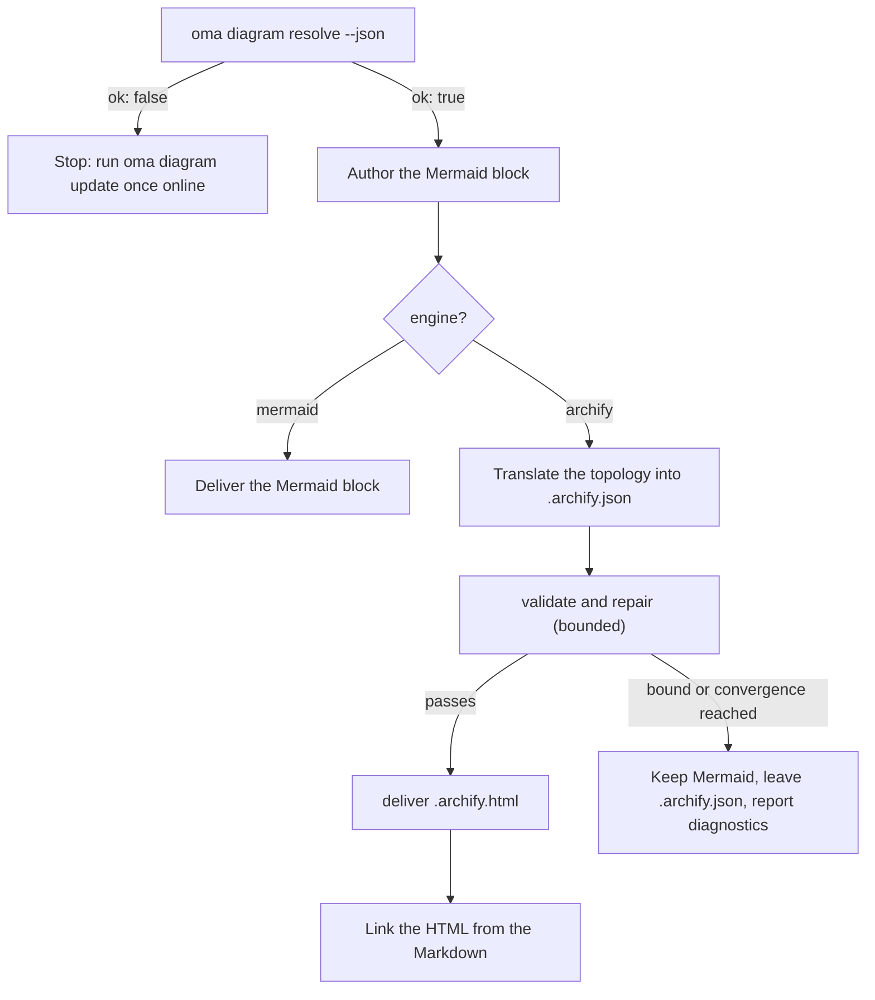

# Motor de diagramas

`/architecture` (ADR, recomendaciones y revisiones) y `/explain` (explicadores de cambios de código) generan diagramas estructurales. En `/architecture` siempre son bloques **Mermaid** dentro del artefacto Markdown (`/explain` dibuja sus propios diagramas SVG en línea) y, siempre que se puede resolver [archify](https://github.com/tt-a1i/archify), que es lo normal, también se genera un **diagrama HTML interactivo y validado** junto al artefacto: tema claro u oscuro, paneo y zoom, búsqueda, trazado de relaciones, exportación PNG/SVG/WebM y renderizado desde una especificación JSON tipada.

Mermaid sigue siendo la SSOT textual en Markdown y en los diffs de Git. archify produce un artefacto derivado.

---

## Siempre la última versión de archify, sin instalar nada {#always-the-latest-archify--nothing-to-install}

archify es una skill de agente con licencia MIT (Node ≥ 18 y cero dependencias de runtime). oh-my-agent no depende de una copia que instalaras una vez; mantiene su **propia copia gestionada** y sigue la última versión:

- Caché: `~/.cache/oma-diagram/archify/<tag>/` más un puntero `state.json`.
- Antes de cada uso, `oma diagram resolve` pregunta a GitHub por la última etiqueta de release (limitado a una vez por `check_interval_min`, 60 minutos por defecto), descarga el tarball de fuentes si existe una etiqueta más nueva (directorio atómico por etiqueta; las etiquetas antiguas se eliminan) y, si no, reutiliza la copia en caché.
- Los fallos de red nunca son fatales: se usa la copia en caché y se informa como `stale` con el motivo. Solo una primera ejecución sin red y sin caché recurre a una copia de la skill instalada por el usuario y, después, a Mermaid.

```bash
# Illustrative output; the release tag, cache path, and quality can vary.
oma diagram update          # force a check / download now
oma diagram resolve
# engine:   archify  (requested: auto)
# reason:   archify 2.15.0 via managed:v2.15.0 (current)
# root:     /Users/you/.cache/oma-diagram/archify/v2.15.0
# bin:      /Users/you/.cache/oma-diagram/archify/v2.15.0/bin/archify.mjs
# version:  2.15.0
# quality:  showcase
# sidecar:  off (explain)
oma diagram resolve --offline   # never touch the network
```

Orden de resolución (gana el primer resultado, idéntico en todos los runtimes de proveedor):

1. `diagram.archify.path` en `oma-config.yaml`: anclaje explícito que desactiva auto-latest
2. Variable de entorno `ARCHIFY_HOME`: anclaje explícito
3. **Última versión gestionada** (`~/.cache/oma-diagram/archify`)
4. Directorios de skills instalados por el usuario: proyecto `.agents` / `.claude` / `.codex` / `.cursor` / `.qwen` / `.kiro` `/skills/archify`, después los mismos bajo `~`, además de `~/.raven/workspace/skills/archify`

<!-- oma-docs:ignore-start -->
Para que haya un resultado, la instalación gestionada o anclada de archify debe contener `bin/archify.mjs`.
<!-- oma-docs:ignore-end -->

---

## Configuración

Sección dispersa en `.agents/oma-config.yaml` (las claves ausentes usan los valores mostrados):

```yaml
diagram:
  engine: auto                # auto | archify | mermaid
  explain_sidecar: false      # /explain also writes an archify sidecar
  archify:
    managed: true             # false = never download; use pins / skill dirs only
    channel: stable           # stable (latest GitHub Release) | main (HEAD of main)
    check_interval_min: 60    # minutes between remote checks; 0 = every call
    path: null                # explicit install dir (pin)
    quality: showcase         # showcase | standard  → --quality
    open: false               # pass --open to deliver
```

### Qué motor se ejecuta {#which-engine-runs}

Una sola decisión abarca el valor de configuración, si archify se resuelve y lo que entrega el flujo de trabajo. «Se resuelve» significa que algún paso del [orden de resolución](#always-the-latest-archify--nothing-to-install) encuentra una instalación: un anclaje, la última copia gestionada o un directorio de skill instalado por el usuario.

| `diagram.engine` | ¿Se resuelve archify? | `oma diagram resolve --json` | Resultado de `/architecture` |
|---|---|---|---|
| `auto` (predeterminado) | sí | `engine: archify`, `ok: true` | Bloque Mermaid + `.archify.html` enlazado |
| `auto` | no (por ejemplo, primera ejecución sin conexión, o `managed: false` sin directorio de skill) | `engine: mermaid`, `ok: true` | Solo Mermaid; el informe indica ejecutar `oma diagram update` una vez con conexión |
| `archify` | sí | `engine: archify`, `ok: true` | Bloque Mermaid + `.archify.html` enlazado |
| `archify` | no | `engine: mermaid`, `ok: false`, código de salida 1 | El flujo se detiene con la sugerencia `oma diagram update` en vez de degradar silenciosamente |
| `mermaid` | no se comprueba | `engine: mermaid`, `ok: true` | Solo Mermaid; archify nunca se llama |

`oma diagram resolve --engine <auto|archify|mermaid>` sobrescribe la configuración para una llamada, y un prompt puede hacer lo mismo para una ejecución (`/explain 640 with archify`).

---

## CLI

```bash
oma diagram resolve [--engine auto|archify|mermaid] [--refresh] [--offline] [--json]
oma diagram update  [--json]
oma diagram archify <archify args…>
```

`oma diagram update` fuerza una actualización y termina con código 1 cuando no se puede resolver ninguna instalación de archify.

`oma diagram archify` ejecuta el ejecutable de archify resuelto con `ARCHIFY_UPDATE_CHECK_DISABLED=1` (sin red) y propaga el código de salida, por lo que `validate` / `deliver` / `visual-check` se comportan exactamente como documenta archify:

```bash
oma diagram archify guide "show the auth request lifecycle" --json
oma diagram archify validate architecture adr-auth.archify.json --quality showcase --json
oma diagram archify deliver  architecture adr-auth.archify.json adr-auth.archify.html --quality showcase --json
oma diagram archify visual-check adr-auth.archify.html --json   # exit 2 = no Chrome (skipped), or archify itself could not be resolved
```

`--json` en `resolve` devuelve `{ ok, requested, engine, quality, open, explainSidecar, archify?: { root, bin, version, source, status?, note? }, reason, probed }`; `source` es `managed:<tag>`, `config:…`, `env:…` o una etiqueta de directorio de skill; `status` (`fresh` / `current` / `stale`) y `note` se establecen para las copias gestionadas.

---

## Cómo lo usan los flujos de trabajo

El protocolo compartido vive en `.agents/skills/_shared/conditional/diagram-engine.md`. `/architecture` sigue esta secuencia:

1. `oma diagram resolve --json`
2. Escribe primero el bloque Mermaid (siempre).
3. Si `engine: archify`: traduce la topología Mermaid al IR JSON de archify (`architecture` / `sequence` / `dataflow` / `lifecycle` / `workflow`), leyendo solo el esquema correspondiente y un ejemplo de la instalación.
4. `validate` → reparar → `deliver`, de forma acotada: se detiene cuando la especificación pasa, cuando se activa la regla de convergencia de archify, después de 3 intentos de reparación, tras 10 minutos en total o cuando se repite el mismo diagnóstico. Las etiquetas semánticas nunca se eliminan solo para pasar.
5. Enlaza el HTML; nunca lo incrustes.



### `/architecture`

Solo para decisiones estructurales (límites, dependencias y flujo de datos). La salida se guarda junto al artefacto Markdown bajo `.agents/results/architecture/`:

```text
adr-notification-service.md            # Mermaid block + "Interactive:" link
adr-notification-service.archify.json  # frozen spec (kept even on failure)
adr-notification-service.archify.html  # delivered viewer
```

### `/explain` {#explain}

Es opcional, porque el contrato del explicador (un único archivo autocontenido con temas basados en variables CSS) no permite incrustar un segundo documento HTML completo. Actívalo con `diagram.explain_sidecar: true`, pasa `oma explain render --archify` o pídelo en el prompt («with archify»). No hay bloque Mermaid ni JSON escrito a mano: el renderizador deriva la especificación de archify a partir de un bloque `flow` o `sequence` del borrador (el panel marcado con `{archify}`), ejecuta `deliver` (con un único fallback de la calidad `showcase` a `standard`) y enlaza `{date}-{slug}.archify.html` con un `<a href>` sencillo. El comando informa `linked`, `skipped` (con el motivo) o `failed` (primer diagnóstico). El flujo de trabajo no repite el ciclo ante un sidecar fallido, y un fallo del sidecar nunca bloquea el explicador.

---

## Modos de fallo

El caso de archify no resoluble se cubre en la [tabla de decisión del motor](#which-engine-runs). Los casos restantes:

| Situación | Resultado |
|---|---|
| Falla la comprobación de actualización (sin conexión o con límite de frecuencia) | Se usa la copia en caché y se informa como `stale` con el motivo |
| `validate` nunca converge | Mermaid sigue siendo el diagrama entregado; el último `.archify.json` queda para una persona y los diagnósticos se informan literalmente |
| Falta Chrome para `visual-check` | Se informa como `skipped`, nunca como aprobado |
| `oma diagram archify …` termina con código 2 | Falta Chrome (`visual-check`) o no se pudo resolver archify; comprueba primero `oma diagram resolve --json` |

---

## Próximos pasos

- [Explicador de código](./code-explainer.md): el flujo de trabajo `/explain` y su sidecar opcional de archify
- [Flujo de trabajo `/architecture`](../core-concepts/workflows.md#architecture): ADR y revisiones que incluyen el bloque Mermaid
- [Semántica de oma-config.yaml](./oma-config-semantics.md): cómo se combina la sección `diagram:`
- [Comandos CLI: diagram](../cli-interfaces/commands.md#diagram): lista completa de opciones
- [Investigación de mercado](./market-research.md): el mismo patrón de última versión gestionada para el motor last30days
- upstream de archify: [tt-a1i/archify](https://github.com/tt-a1i/archify)
