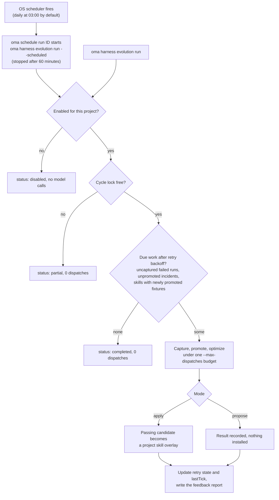

# Evolución del harness del proyecto

OMA puede recopilar evidencia de las ejecuciones de agentes rastreadas y procesar los fallos en un ciclo de retroalimentación programado. Los cambios automáticos de skills están **desactivados hasta que los actives en un proyecto**. Cada ciclo tiene un presupuesto finito de llamadas de modelo, y un cambio aplicado debe superar los gates de evaluación de skills existentes.

La ruta automatizada mejora los documentos de las skills. Los cambios en el procedimiento del optimizador o del maintainer siguen siendo una [metaoptimización](./skill-opt.md#meta-optimization-the-procedure-as-the-candidate) independiente que se invoca manualmente.

## Activar un proyecto

Ejecuta desde la raíz del proyecto:

```bash
# Example allowance: at most 300 model dispatches per scheduled cycle
oma harness evolution enable --max-dispatches 300

# Evaluate proposals without applying them
oma harness evolution enable --max-dispatches 300 --mode propose

# Choose a schedule in the operating system's local time
oma harness evolution enable --max-dispatches 300 --cron "0 3 * * *"

oma harness evolution status --json
```

`enable` imprime la configuración guardada y el ID del trabajo del programador:

```json
{
  "enabled": true,
  "scheduleId": "sch_abcdefgh2345",
  "mode": "apply",
  "maxDispatches": 300
}
```

`status --json` devuelve `config`, `schedule` (la entrada del programador, o `exists: false`), `pending` (el número de reintentos sin terminar), `conflicts` (conflictos de superposición por skill) y `state` (reintentos y `lastTick`).

La programación predeterminada es diaria a las 03:00, hora local, y el modo predeterminado es `apply`. `--max-dispatches` es obligatorio al activar y debe ser un entero positivo. El valor del ejemplo es un cupo de llamadas, no una estimación de precio ni una promesa de que un ciclo terminará. Las suites de fixtures más grandes y la calificación repetida consumen más llamadas.

<!-- oma-docs:ignore-start -->
La configuración se guarda en `.agents/evolution/harness-evolution.json`. La evidencia generada, el estado de los reintentos y el bloqueo del ciclo se almacenan en `.agents/state/harness-evolution/`.
<!-- oma-docs:ignore-end -->

Activar la evolución registra un trabajo integrado en el [programador del sistema operativo](./scheduled-agents.md) con el que OMA ya cuenta; aparece en `oma schedule list` con el agente `__builtin__`. Al dispararse, `oma schedule run <id>` inicia `oma harness evolution run --scheduled` en este proyecto y lo detiene a los 60 minutos, así que dimensiona `--max-dispatches` para un ciclo que quepa en una hora. Volver a activarla actualiza el trabajo del proyecto en lugar de crear otro. Detén la programación con `oma harness evolution disable` en lugar de `oma schedule delete`, para que la configuración guardada siga siendo coherente.

```bash
# Run one cycle now under the saved mode and budget
oma harness evolution run --json

# Stop future cycles; retain evidence and applied improvements
oma harness evolution disable
```

`run --json` devuelve `status` (`completed`, `partial` o `disabled`), `dispatchesUsed` y `maxDispatches`. Cuando otro ciclo tiene el bloqueo, `run` devuelve `partial` con 0 despachos. Un ciclo que se detiene con un error, como un cupo agotado, termina con ese error y registra `partial` o `failed` en `state.lastTick`.

Un proyecto desactivado no ejecuta trabajo de modelo mediante el comando de evolución, ni siquiera ante una invocación programada tardía. Desactivar no revierte los cambios ya aplicados.

## Qué ocurre automáticamente

El ciclo se ejecuta por el programador o de forma manual.




1. **Registrar la evidencia de finalización.** Las ejecuciones rastreadas por OMA dejan referencias locales a su resultado y a su evidencia de verificación. Este paso de finalización no realiza llamadas de modelo adicionales. Completar varias veces la misma ejecución no crea evidencia duplicada.
2. **Recopilar los fallos según la programación.** El ciclo analiza las ejecuciones fallidas elegibles, deriva las expectativas de sus contratos de tarea registrados y comprueba que un fixture de regresión propuesto rechaza realmente la salida fallida conservada.
3. **Optimizar las skills afectadas.** Los incidentes se agrupan por skill. Cada skill se optimiza con las comprobaciones existentes de entrenamiento, validación, prueba final, aislamiento y transferencia negativa.
4. **Aplicar o informar.** En modo `apply`, un candidato que supera las comprobaciones se convierte en una superposición de skill del proyecto. En modo `propose`, el ciclo registra el resultado sin instalarlo.
5. **Informar de los cambios.** Usa status y el historial de promociones existente para inspeccionar los resultados. Los cambios aplicados también alimentan el aviso de evolución de la sesión siguiente.

OMA no observa automáticamente cada conversación nativa ni cada corrección del usuario. La entrada es la evidencia de las ejecuciones que OMA realmente rastrea. Una ejecución sin una salida conservada o sin un contrato de aceptación puede requerir una [especificación de incidente](./harness-incidents.md#capture-an-incident) redactada a mano.

## Presupuesto y reintentos

El ciclo comparte un único cupo de llamadas entre la captura, la redacción de rúbricas, el enrutamiento, la calificación, la optimización de skills, las tareas vecinas y la evaluación final. Cada llamada de modelo se descuenta del cupo antes de despacharse. Las llamadas que reintenta la capa de ejecución también cuentan. El límite más estricto de la constitución de una skill sigue aplicándose.

Cuando el cupo se agota, la evaluación queda incompleta y el candidato afectado no puede aplicarse. El informe registra el consumo y el trabajo pendiente. Solo se ejecuta un ciclo de proyecto a la vez.

Crear un fixture no marca como completa la optimización del incidente. Una optimización interrumpida o fallida sigue pendiente y puede reanudarse tras un intervalo de espera (backoff) sin duplicar el fixture. El backoff se duplica en cada intento fallido: 2, 4, 8, … minutos, hasta 1024 minutos (unas 17 horas). Un resultado completamente evaluado y sin ningún cambio aceptable se registra como procesado, de modo que la misma evidencia no desencadene optimizaciones repetidas sin límite. La evidencia nueva puede desencadenar otro intento.

Pasar del modo de propuesta al modo de aplicación hace que las propuestas no aplicadas pasen a ser elegibles para su procesamiento. Aplicar sigue requiriendo una evaluación actual y que el contenido de origen no haya cambiado; una propuesta antigua no es una instrucción de escritura incondicional.

## Superposiciones persistentes de skills

Los cambios automáticos se almacenan por separado de las definiciones de skills gestionadas, en el área de evolución del proyecto que pertenece al usuario, `.agents/evolution/skills/<skill>/` (con un registro `overlay.json`). La evaluación y los enlaces de skills de proveedor locales del proyecto usan el cuerpo efectivo seleccionado entre la base gestionada y su superposición elegible. Las instalaciones de proveedor basadas en HOME no se redirigen a una superposición del proyecto. Una copia no gestionada en un directorio de proveedor del proyecto debe resolverse antes de la aplicación automática. Los recursos de la skill siguen disponibles en sus rutas relativas.

Una superposición registra la base con la que se evaluó. Después de `oma update`:

- Una base sin cambios sigue usando su superposición.
- Una base modificada conserva la superposición, pero la marca como conflicto y usa la base actualizada. La evaluación anterior no puede establecer que la superposición sea segura sobre la base nueva.

Una edición realizada mientras se ejecuta la optimización impide que el candidato sobrescriba ese contenido modificado. Status informa de los conflictos para su revisión.

## Inspeccionar y deshacer

```bash
oma harness evolution status --json
oma skill promotions --all
oma skill rollback --skill oma-docs
```

Los registros de promoción conservan los hashes del candidato y del padre, la evidencia de evaluación y un parche revisable. Revertir la primera superposición restablece el uso de la base gestionada; revertir una superposición posterior restablece la superposición anterior. Las ediciones desconocidas se conservan: la reversión se niega a descartar contenido que ya no coincide con el candidato registrado.

El `oma skill optimize --apply` manual sigue escribiendo el `SKILL.md` gestionado, pero se niega mientras haya una superposición del proyecto activa para esa skill (`[oma skill opt] an active project overlay owns this skill; ...`). Revierte primero la superposición con `oma skill rollback --skill <id>`, o deja que el ciclo de evolución aplique el cambio. La evolución programada selecciona explícitamente la ruta de aplicación mediante superposiciones.

## Alcance de la evidencia

Una prueba de software aprobada confirma el cableado y las reglas de evaluación. No establece que los cambios automáticos repetidos mejoren con el tiempo el trabajo real de un proyecto. Inspecciona las promociones, los costes, las regresiones y el historial de reversiones reales antes de aumentar el cupo o ampliar la automatización. La promoción de procedimientos L5 no la invoca este bucle de retroalimentación programado.

## Consulta también

- [Casos de regresión de incidentes](./harness-incidents.md): captura, promueve y reproduce los incidentes que procesa este ciclo.
- [Optimización de skills](./skill-opt.md): los gates que supera cada cambio aplicado.
- [Agentes programados](./scheduled-agents.md): el programador del sistema operativo que dispara el ciclo.
