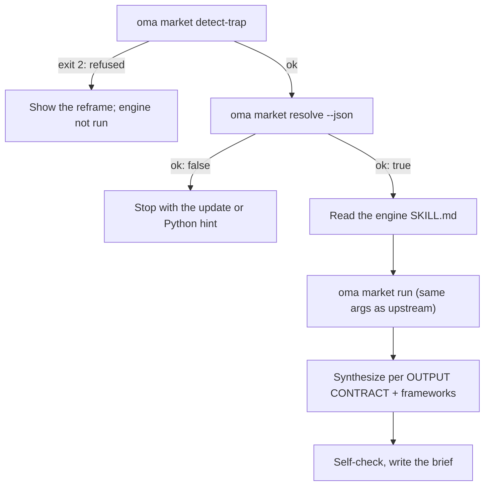

# Investigación de mercado

`oma-market` responde «¿qué dice realmente la gente sobre X en los últimos N días?»: puntos de dolor, tendencias, percepción de competidores y descubrimiento, a partir de fuentes comunitarias con cifras reales de interacción: Reddit (votos y comentarios destacados), X, transcripciones de YouTube, TikTok, Instagram, Hacker News, Polymarket, GitHub, arXiv, Techmeme, Digg, LinkedIn, StockTwits, Bluesky, la web y más.

La investigación se ejecuta en el motor upstream [**last30days**](https://github.com/mvanhorn/last30days-skill) (MIT, Python 3.12+). oh-my-agent no lo bifurca: mantiene una **copia gestionada siempre actualizada**, controla cada ejecución y añade encima una capa de marcos estratégicos. La cadencia de releases, el número de estrellas y la cobertura de proveedores pertenecen al proyecto upstream y pueden cambiar.

---

## Inicio rápido

Pídeselo a tu agente en lenguaje natural. Frases como «investigación de mercado», «puntos de dolor», «análisis de competidores», «voz del cliente» o «detección de tendencias» activan la skill `oma-market`:

```text
Encuentra los principales puntos de dolor que reportan los desarrolladores sobre los contenedores remotos de VS Code en los últimos 30 días.
Compara la percepción de la comunidad sobre Cursor vs Windsurf en los últimos 90 días, frameworks swot,5f.
```

| Ajusta con | Efecto |
|---|---|
| «A vs B», o `--vs B` | Intención de competidor: flujo de comparación upstream + SWOT + 5 fuerzas de Porter |
| `--days 7`, `30`, `90` o `180` | Ventana de investigación |
| `--intent pain`, `trend`, `competitor` o `discovery` | Sustituye la clasificación automática de la intención |
| `--frameworks none`, o una lista como `swot,5f,pestel` | Desactiva las secciones de marcos o las elige |

El resultado es un único informe en `.agents/results/market/{topic-slug}-{YYYYMMDD}.md`. Su primera línea es el badge del motor (`🌐 last30days v<version> · synced <date>`), seguida de clusters de evidencia ordenados con enlaces, las secciones de marcos y el pie del motor, que enumera las fuentes omitidas.

| Funciona sin claves | Necesita el asistente de configuración upstream (claves o cookies) |
|---|---|
| Reddit, Hacker News, GitHub, Polymarket, arXiv, Techmeme, Digg, web | X, transcripciones de YouTube, TikTok, Instagram y otras fuentes con clave; las fuentes omitidas se enumeran en el pie |

---

## Siempre el motor más reciente (requiere Python 3.12+) {#always-the-latest-engine--nothing-to-install}

```bash
# Illustrative output; the release tag, cache path, and Python version vary.
oma market resolve
# engine:   last30days
# reason:   last30days 3.21.1 via managed:v3.21.1 (current)
# root:     ~/.cache/oma-market/last30days/v3.21.1
# skill:    ~/.cache/oma-market/last30days/v3.21.1/SKILL.md
# version:  3.21.1
# python:   python3.14 (3.14.7, PATH)
# save_dir: <workspace>/.agents/results/market/raw
```

- Caché: `~/.cache/oma-market/last30days/<tag>/` + `state.json`.
- Antes de cada uso, `resolve` consulta a GitHub por la última versión (limitado a una vez por `check_interval_min`, 60 minutos por defecto), descarga una etiqueta nueva en su propio directorio (elimina las antiguas) y, si no, reutiliza la caché. Los fallos de red reutilizan la copia guardada e informan `stale`.
- Python: `LAST30DAYS_PYTHON` → `market.python` → `python3.14`, `python3.13`, `python3.12`, `python3`, `python` en PATH (debe ser ≥ 3.12) → `uv python find '>=3.12'`. Si no encuentra ninguno, `resolve` no queda en estado ok y muestra la sugerencia de instalación; la skill se detiene en vez de degradarse a una investigación solo con búsqueda web.
- La configuración del motor y las claves API viven en `~/.config/last30days/` (las escribe el asistente de configuración upstream con tu consentimiento), así que sobreviven a las actualizaciones del motor.

Orden de resolución (gana el primer resultado): `market.path` → `LAST30DAYS_HOME` → **última versión gestionada** → copias instaladas por el usuario (`.agents|.claude|.codex|.cursor|.qwen|.kiro/skills/last30days` en el proyecto y bajo `~`, después la caché del plugin de Claude Code).

```bash
oma market update            # force a check / download now
oma market resolve --offline # never touch the network
oma market run -- --help     # the engine's own flags (without `--`, oma prints its own help)
```

---

## Configuración

```yaml
market:
  managed: true                   # false = never download; pins / skill dirs only
  channel: stable                 # stable (latest Release) | main (HEAD)
  check_interval_min: 60          # 0 = check on every call
  path: null                      # explicit engine dir (pin)
  python: null                    # interpreter override
  save_dir: .agents/results/market/raw
```

---

## Cómo funciona una ejecución



1. `oma market detect-trap "<topic>"`: rechaza temas que activen trampas de palabras clave o compras demográficas (código 2) y sugiere un replanteamiento. Un tema vacío o de más de 200 caracteres termina con el código 4.
2. `oma market resolve --json`: motor y Python; se detiene con `ok: false`.
3. El agente lee de principio a fin el `SKILL.md` del motor resuelto y lo sigue: asistente de configuración inicial, resolución previa a la investigación de handles, subreddits y hashtags (cuando WebSearch está disponible), planificación de consultas y gate de precondiciones.
4. `oma market run "<topic>" <flags> --emit=compact`: argumentos idénticos a la llamada upstream `python3 scripts/last30days.py`; añade `--save-dir` desde `market.save_dir`.
5. La síntesis sigue el CONTRATO DE SALIDA upstream (badge en la primera línea, clusters de evidencia ordenados y LAWs 1–8); después oma añade secciones de marcos que citan solo clusters del motor:

| Intención | Preparación del motor | Marcos |
|---|---|---|
| pain | tema con forma de queja, `--days 30`, `--deep` cuando los datos sean escasos | SWOT |
| trend | `--days 7/30/90/180`, `--discover "<domain>"` para «qué está de moda» | SWOT |
| competitor | `"A vs B"` → flujo de comparación upstream | SWOT + 5 fuerzas de Porter |
| discovery | `--discover` y después seguimientos `--drill` | SWOT + PESTEL |

6. Haz la autocomprobación y escribe `.agents/results/market/{topic-slug}-{YYYYMMDD}.md`.

---

## Modos de fallo

| Situación | Resultado |
|---|---|
| detect-trap rechaza el tema | Se muestra un replanteamiento y no se ejecuta el motor. `--force` solo después de que el usuario confirme de nuevo explícitamente |
| No hay motor en caché y estás sin conexión | `ok: false` → ejecuta `oma market update` una vez con conexión |
| No hay Python 3.12+ | `ok: false` con sugerencia de instalación (brew / apt / `uv python install 3.12`), o define `LAST30DAYS_PYTHON` / `market.python`; no hay sustituto de solo búsqueda web |
| Falla la comprobación de la versión | Se usa el motor en caché y se informa como `stale` |
| Fuentes sin claves | El motor las omite y las enumera en el pie; actívalas mediante el asistente de configuración upstream |

---

## Próximos pasos

- [Flujos de contenido e investigación](./content-and-research.md): elige la capacidad adecuada para otras tareas de investigación y documentación
- [Motor de diagramas](./diagram-engine.md): el mismo patrón de última versión gestionada para archify
- [Semántica de oma-config.yaml](./oma-config-semantics.md): cómo se combina la sección `market:`
- [Comandos de la CLI: market](../cli-interfaces/commands.md#market): lista completa de opciones
- Upstream: [mvanhorn/last30days-skill](https://github.com/mvanhorn/last30days-skill)
