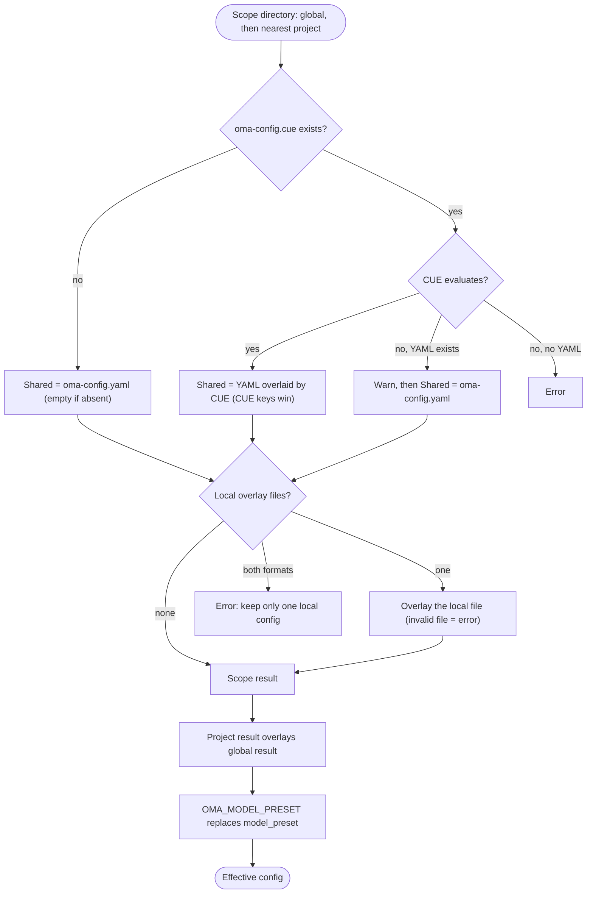

## Visión general

OMA lee los valores predeterminados globales de `$OMA_HOME/.agents/` (por defecto `~/.oma/.agents/`)
y después aplica encima el `.agents/` de proyecto más cercano que encuentre por encima del directorio de trabajo.
Cada ámbito puede tener estas capas:

- **Compartida**: `.agents/oma-config.yaml` y `.agents/oma-config.cue`. Cuando existen ambos y el archivo CUE se evalúa, cada clave que define el archivo CUE sobrescribe la misma clave del archivo YAML; las claves que solo están en el YAML se mantienen como valores predeterminados. Cuando el archivo CUE no se puede evaluar, OMA muestra una advertencia y usa solo el archivo YAML.
- **Local**: `.agents/oma-config.local.cue` o `.agents/oma-config.local.yaml` (un solo archivo, aplicado sobre el resultado compartido; mantenlo privado).

La configuración compartida y local del proyecto sobrescribe la configuración global. Nunca se combinan
raíces de proyecto ancestrales distintas; un `.agents/` vacío más cercano sigue siendo un límite
de proyecto. Los valores predeterminados globales no cambian la identidad del proyecto. Consulta la
[referencia de configuración](/docs/guide/configuration-reference) para ver las claves admitidas y sus valores predeterminados.

## Flujo de resolución

OMA ejecuta los mismos pasos para el ámbito global y para el ámbito de proyecto más cercano, y después combina los dos resultados:



Cuando no se encuentra ningún `.agents/` de proyecto, o el recorrido llega al propio directorio `.agents/` global, solo se usa el resultado global.

## Tabla de precedencia {#precedence-table}

Las filas posteriores tienen prioridad. Los mapas normales se combinan de forma recursiva; los arrays, escalares y `null` sustituyen al valor anterior.

| Orden | Capa | Regla |
|:-----:|-------|------|
| 1 | `oma-config.yaml` global | Valores predeterminados bajo el archivo CUE global cuando existen ambos. |
| 2 | `oma-config.cue` global | Sobrescribe el YAML global clave por clave. Si la evaluación falla (por ejemplo, falta la CLI `cue`) y existe el YAML, OMA imprime `[config] CUE evaluation failed at ... Falling back to oma-config.yaml` y usa solo el YAML. |
| 3 | `oma-config.local.cue` o `oma-config.local.yaml` global | Un solo archivo. Un archivo local mal formado es un error. |
| 4 | `oma-config.yaml` del proyecto | El `.agents/` de proyecto más cercano en el directorio de trabajo o por encima de él. |
| 5 | `oma-config.cue` del proyecto | Sobrescribe la fila 4 clave por clave, con el mismo fallback que la fila 2. |
| 6 | `oma-config.local.cue` o `oma-config.local.yaml` del proyecto | Un solo archivo. Un archivo local mal formado es un error. |
| 7 | `OMA_MODEL_PRESET` | Un valor no vacío sustituye a `model_preset` para ese proceso. Un valor vacío es un error. |

:::tip[¿Qué archivo edito?]
Si existe `.agents/oma-config.cue`, una clave definida allí sobrescribe la misma clave de `oma-config.yaml`. Cambia esa clave en el archivo CUE o coloca un valor específico de la máquina en una capa local. `oma doctor --profile` enumera los archivos que cargó en **Configuration sources**.
:::

Para una sobrescritura local del proyecto, incluye solo las hojas que cambian en el archivo local. Por ejemplo, puedes mantener fuera del archivo compartido una elección local de modelo:

```yaml
# .agents/oma-config.local.yaml
model_preset: claude
agents:
  backend:
    model: anthropic/claude-sonnet-4-6
```

Ejecuta el comando desde el proyecto para que se seleccione el directorio `.agents/` más cercano. Si el archivo local está mal formado, la operación falla de forma explícita; corrígelo o elimínalo antes de volver a intentarlo.

## Comprobar la configuración

```bash
oma doctor --profile                           # loaded files, resolved preset, per-role model and CLI
cue export --out json .agents/oma-config.cue   # what the CUE layer evaluates to (requires the cue CLI)
```

| Síntoma o mensaje | Causa | Solución |
|--------------------|-------|-----|
| Un cambio en el YAML no tiene efecto | `oma-config.cue` define la misma clave | Cambia la clave en el archivo CUE o sobrescríbela en un archivo local |
| `[config] CUE evaluation failed at ... Falling back to oma-config.yaml` | Falta la CLI `cue` o el archivo CUE no se evalúa | Instala `cue` o corrige el error que informa `cue export` |
| `Both local CUE and YAML configs exist in ...; keep only one local config.` | Hay dos archivos de capa local | Elimina uno de ellos |
| `OMA_MODEL_PRESET must be non-empty` | La variable está exportada pero vacía | `unset OMA_MODEL_PRESET` |
| `Unknown model_preset "..."` | Errata o falta una entrada en `custom_presets` | Usa un preset que aparezca en el mensaje de error |
| `Legacy preset name "..." is no longer valid` | Una clave anterior al cambio de nombre, como `claude-only` | Cámbiale el nombre como indica el mensaje o ejecuta `oma update` |
| `[model-registry] User inline model "..." failed validation` | Una entrada de `models:` incompleta o no válida | Consulta [Insertar slugs de modelos](/docs/guide/per-agent-models#inlining-model-slugs) |

## Valores predeterminados

| Clave | Valor predeterminado | Cuándo se aplica |
|-----|---------|--------------|
| `auto_update_cli` | `true` | Faltan ambos archivos o falta la clave |
| `serena.mode` | `bridge` | Faltan ambos archivos o falta la clave |
| `serena.auto_update` | `true` | Faltan ambos archivos o falta la clave |
| `telemetry` | `false` | Faltan ambos archivos o falta la clave |
| `language` | `en` | Faltan ambos archivos o falta la clave |
| `model_preset` | Obligatorio | La plantilla de proyecto distribuida usa `auto`; el esquema exige un valor no vacío. |
| `translation_voice` | `balanced` | Faltan ambos archivos o falta la clave |
| `timezone` | Zona horaria del sistema | Faltan ambos archivos o falta la clave |

## Motivo del orden de lectura

Edita `~/.oma/.agents/oma-config.yaml` (con `OMA_HOME` definido: `<OMA_HOME>/.agents/oma-config.yaml`)
para los valores predeterminados de todo el usuario. Los archivos compartidos y locales del proyecto sobrescriben esos valores
sin heredar proyectos ancestrales no relacionados. Si un proyecto selecciona `none`
para la memoria semántica, esa elección sobrescribe la selección global de AgentMemory.

## Notas

- `language` en `oma-config.yaml` controla el idioma de las respuestas del agente. **No** se usa para determinar los mensajes de advertencia de instalación o actualización: estos usan la locale del sistema (`$LANG`) porque `oma-config.yaml` todavía no se ha cargado al instalar.
- `auto_update_cli` usa las sobrescrituras del proyecto antes que los valores predeterminados globales y queda activado por defecto cuando ningún ámbito lo define.
- `telemetry` (valor predeterminado `false`) se asigna a la exclusión de telemetría propia de cada proveedor, escrita por `oma install` / `oma update` / `oma link`: Claude `DISABLE_TELEMETRY` + `CLAUDE_CODE_DISABLE_FEEDBACK_SURVEY`, Gemini/Qwen `privacy.usageStatisticsEnabled`, Codex `analytics.enabled` + `feedback.enabled`, Grok `[features] telemetry` y Antigravity (agy) `enableTelemetry` en `~/.gemini/antigravity-cli/settings.json`. Establecer `telemetry: true` vuelve a aceptar la telemetría al eliminar la exclusión de oma para ese proveedor.
- `diagram` (motores `auto` / `archify` / `mermaid`, `explain_sidecar`, `archify.managed|channel|check_interval_min|path|quality|open`) es una sección dispersa de sobrescritura de skills, como `video` / `image`; consulta [Motor de diagramas](/docs/guide/diagram-engine).
- `video.hyperframes.check_interval_min` limita la frecuencia de las comprobaciones de la última versión de la toolchain de HyperFrames por ejecución y de heygen-com/hyperframes (`oma video compose`, `oma update`). El esquema CUE distribuido todavía no define `video.hyperframes`, así que `cue export` lo rechaza dentro del bloque del esquema (`field not allowed`); defínelo en `oma-config.yaml` o en una capa YAML local.
- `market` (`managed|channel|check_interval_min|path|python|save_dir`) configura el motor siempre actualizado `last30days` que utiliza `oma market`; consulta [Investigación de mercado](/docs/guide/market-research).
- El esquema tipado del runtime cubre `providers`, `free`, `agents`, `models`, `custom_presets`, `vendors`, `session`, `docs` y las secciones dispersas de skills. Las plantillas distribuidas también contienen bloques propiedad de los consumidores, como `scm`, `memory`, `serena_reaper` y `mcp`; cada consumidor es responsable de sus claves anidadas. No deduzcas una clave a partir de esta lista: usa la [referencia de configuración](/docs/guide/configuration-reference) y la guía de la funcionalidad para ese bloque.
- Editar `oma-config.yaml` directamente es seguro. `oma install` y `oma update` usan reemplazos de campos a nivel de regex y conservan las claves editadas por el usuario que no gestionan (por ejemplo, las sobrescrituras personalizadas de `agents:` y `session.quota_cap`).
- `oma update` también añade las claves de nivel superior que define la plantilla distribuida pero que faltan en tu archivo (con los valores predeterminados de la plantilla), bajo un marcador `# Added by oma update`. Las claves que ya tienes nunca se modifican: el contenido existente permanece idéntico byte por byte. Las claves que hayas eliminado de forma deliberada volverán a aparecer con el valor predeterminado de la plantilla; establece el valor explícitamente en lugar de eliminar la clave si quieres excluirla.
