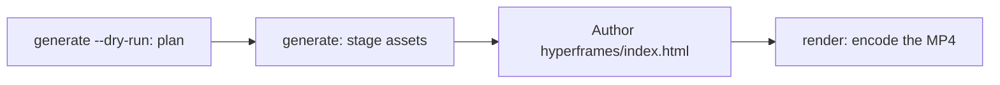

# Generación de vídeo

`oma-video` es el router de vídeo de oh-my-agent. A partir de un brief de una línea, compone un guion, narración, elementos visuales y subtítulos, y después registra el plan en un directorio de ejecución. Las etapas de proveedor no requieren necesariamente una clave y pueden usar alternativas locales o deterministas; un MP4 real sigue necesitando un compositor funcional y una composición válida.

La skill se activa con «shorts», «reels», «screencast» o con frases como «make a video», «explainer video», «demo video», «walkthrough video» o «video from README», o cuando otra skill necesita un vídeo como efecto secundario.

> **En resumen:** `oma video generate` planifica una ejecución y prepara los recursos. Con el compositor HyperFrames predeterminado no codifica un MP4: escribe `<runDir>/hyperframes/index.html` (el flujo de trabajo `/video` lo hace por ti) y después ejecuta `oma video render <runDir>`. En la primera ejecución, empieza con `oma video doctor --install`.

---

## Cuándo usarlo {#when-to-use}

- Convertir un brief, README, código o datos en un clip corto.
- Producir un explicador narrado o una grabación de demostración/recorrido.
- Cualquier pipeline reproducible de «brief → `.mp4`» que quieras volver a ejecutar de forma determinista.

## Cuándo NO usarlo {#when-not-to-use}

- Imágenes fijas individuales → usa [`oma-image`](/docs/guide/image-generation).
- Emisión o streaming de pantalla en directo → queda fuera del alcance (oma nunca graba la pantalla; tú aportas la grabación).
- Narración de audio independiente → usa `oma-voice`.

---

## Modos de un vistazo {#modes-at-a-glance}

| Modo | Relación de aspecto | Qué compone |
|------|---------------------|-------------|
| `shorts` | 9:16 | Clip vertical de formato corto (guion → narración → elementos visuales → subtítulos). |
| `explainer` | 16:9 | Explicador horizontal a partir de un README, código o brief de datos. |
| `demo` | derivada | Recorrido construido a partir de tu propia grabación de pantalla, proporcionada con `--capture <file>`. `--source web --url <url>` solo guarda la URL enmascarada como contexto; oma nunca abre un navegador, graba la pantalla ni automatiza el inicio de sesión. |

El modo elige valores predeterminados razonables; pasa los flags pertinentes cuando necesites valores diferentes.

---

## Inicio rápido {#quick-start}

En un agente, `/video three quick tips for better focus` ejecuta por ti todos los pasos siguientes. A mano, el pipeline tiene cuatro pasos:



```bash
oma video doctor --install   # first run only: HyperFrames toolchain, Chrome Headless Shell, Pretendard

# 1. Plan from an agent-authored script (schema: .agents/skills/oma-video/resources/script-schema.md)
oma video generate "three quick tips for better focus" --mode shorts --script ./script.json --dry-run --output json

# 2. Stage assets (narration needs --voice <profile>; the default is a silent video)
oma video generate "three quick tips for better focus" --mode shorts --script ./script.json --output json

# 3. Author <runDir>/hyperframes/index.html per its AUTHORING.md, then encode
oma video compose <runDir>
oma video render <runDir> --output json

# Demo from your own recording; without --polish the recording itself becomes the output
oma video generate "product walkthrough" --mode demo --capture ./capture.mp4
```

<!-- oma-docs:ignore-start -->

| Paso | Comando | Resultado |
|---|---|---|
| Planificar | `generate --dry-run` | `script.json`, `render-spec.json`, `manifest.json`; sin renderizado |
| Preparar recursos | `generate` | elementos visuales, subtítulos, audio y música opcionales, un scaffold `hyperframes/` y la advertencia `composition pending` |
| Escribir | editar `hyperframes/index.html` | la composición |
| Renderizar | `render <runDir>` | `{mode}-{slug}.mp4` y un manifiesto actualizado |

<!-- oma-docs:ignore-end -->

Sin `--script`, la CLI construye un esqueleto determinista de tres escenas a partir del texto del brief. `--locale` define la etiqueta de idioma de la narración y los subtítulos, pero no los traduce; escribe el brief o el `script.json` en el idioma de destino.

Cada ejecución imprime su directorio de ejecución. Un `--seed` fijo estabiliza las entradas deterministas de planificación; la salida de los proveedores live y las imágenes capturadas aún pueden variar. Vuelve a renderizar un directorio de ejecución existente cuando necesites reutilizar su especificación de renderizado y sus recursos guardados.

Otras herramientas que ejecutan `oma video generate --output json` interpretan un sobre JSON de stdout: `{exitCode, runDir, manifestPath, scriptPath, renderSpecPath, warnings, error}`. No existe ninguna clave `outputs`; lee las rutas de salida y recursos del manifiesto en `manifestPath`.

---

## HyperFrames siempre actualizado: tú escribes la composición {#always-latest-hyperframes--you-author-the-composition}

oh-my-agent **no incluye código de composición de HyperFrames**. Cada ejecución obtiene su propio proyecto en `<runDir>/hyperframes/`, preparado por `oma video compose` con la versión más reciente de HyperFrames publicada en npm (la caché del toolchain está en `~/.cache/oma-video/hyperframes/<version>/`, compartida mediante un enlace simbólico a `node_modules`) y con [heygen-com/hyperframes](https://github.com/heygen-com/hyperframes) en HEAD (`~/.cache/oma-video/hyperframes-skills/`). El agente escribe el código de composición generado siguiendo el `AUTHORING.md` del scaffold, las skills y la especificación del modo en `.agents/skills/oma-video/resources/hyperframes-authoring/`.

```bash
oma video generate "…"                     # → render-spec.json + <runDir>/hyperframes/ (composition pending)
oma video compose <runDir> --output json   # refresh scaffold / print the contract (idempotent)
#   author hyperframes/index.html as instructed by AUTHORING.md
oma video render <runDir> --output json    # lint → render with the cached HyperFrames CLI → ffprobe; exit 1 on any failure
```

- Las comprobaciones de versión más reciente (npm + GitHub) están limitadas por `video.hyperframes.check_interval_min` (60 de forma predeterminada; `0` = comprobar en cada compose). `oma update` respeta el intervalo; `oma video doctor --upgrade` fuerza una comprobación; las ejecuciones sin conexión usan el toolchain en caché e informan `stale`.
- La reproducibilidad vive en el directorio de ejecución: `render-spec.json`, el código de composición escrito y la versión del toolchain registrada en los metadatos del paquete HyperFrames generado. Volver a renderizar la misma ejecución reutiliza ese contrato de renderizado; una ejecución nueva comprueba la versión más reciente de HyperFrames.
- Un fallo de lint o renderizado **no** se oculta detrás de un placeholder (eso solo existe para `OMA_VIDEO_MOCK=1`): `oma video render` termina con código 1 y los diagnósticos, y el agente corrige la composición usando las skills más recientes. Un fallo en una versión nueva de HyperFrames es un error de composición, nunca un motivo para fijar la versión.

```yaml
video:
  hyperframes:
    check_interval_min: 60    # 0 = check on every compose
```

---

## Referencia de la CLI {#cli-reference}

```bash
oma video generate <brief...> [options]
oma video doctor [--install|--upgrade|--install-mpt|--install-strudel]  # toolchain readiness / provisioning
oma video compose <runDir>       # prepare HTML project and authoring contract
oma video render <runDir>        # re-render from render-spec.json (deterministic)
oma video provider list         # provider availability + key/fallback status
```

### Flags principales {#key-flags}

| Flag | Propósito |
|------|-----------|
| `--mode <m>` | `shorts` \| `explainer` \| `demo`. |
| `--aspect <a>` | `9:16` \| `16:9` \| `1:1` \| `auto`. |
| `--locale <lang>` | Etiqueta de idioma de narración/subtítulos. |
| `--captions <s>` | `tiktok` \| `lower-third` \| `none` (alineación sin clave). |
| `--visual <m>` | `auto` \| `generate` \| `stock` \| `aigc` \| `slide`. |
| `--voice <profile>` | Voz de narración o `none` (la predeterminada; si se omite, el vídeo se renderiza sin sonido con una temporización de subtítulos estimada). |
| `--music <mode>` | `upbeat`, `calm`, `cinematic`, `lofi`, `piano` o `none`. |
| `--compositor <c>` | `hyperframes` (predeterminado) \| `mpt`. |
| `--capture <path>` | Tu grabación para el modo demo: `.mp4`, `.mov`, `.webm` o `.mkv`, guardada dentro del proyecto. |
| `--source <k>` | Fuente de captura demo: `file` o `web` (predeterminada: `file`). |
| `--url <url>` | URL de contexto para `--source web`, que se guarda enmascarada en `manifest.json`. Obligatoria con `--source web`; nunca inicia una captura y no sustituye a `--capture`. |
| `--polish` | Superpone la composición HyperFrames sobre las imágenes capturadas. |
| `--device`, `--ready-selector`, `--show-cursor`, `--capture-timeout`, `--capture-stop` | Se aceptan, pero no se usan: oma no controla un navegador ni graba la pantalla. |
| `--output-dir <path>` | Directorio base de salida. Las rutas fuera de `$PWD` requieren `--allow-external-output`. |
| `--allow-external-output` | Permite rutas de salida fuera de `$PWD`. |
| `--max-usd <n>` | Límite de coste (`0.2` de forma predeterminada). Cuando la estimación acumulada lo alcanza, la ejecución se detiene con código 1; vuelve a ejecutar con `-y` o con un valor más alto. |
| `--duration <sec>` | Duración objetivo en segundos (1–180) o `auto`. |
| `--seed <n>` | Semilla determinista. |
| `--dry-run` | Emite el guion, la especificación de renderizado y el manifiesto, y omite el renderizado. |
| `--script <path>` | `script.json` escrito por el agente para inyectar (sobrescribe el esqueleto; controla la narración, el texto en pantalla y los prompts visuales de cada escena). |
| `-y, --yes` | Permite proveedores cuya estimación alcanza `--max-usd` (igual que `OMA_VIDEO_YES=1`). |
| `--timeout <sec>` | Límite de tiempo en segundos enteros para cada llamada a un proveedor visual o de música (`600` de forma predeterminada). No se interpretan sufijos de unidad: `2m` significa 2 segundos. |
| `--output <f>` | Salida de la CLI: `text` (predeterminada) o `json`. |
| `--no-brief-in-manifest` | Guarda un SHA-256 del brief en lugar del brief sin procesar. |

---

## Proveedores con claves opcionales {#key-optional-providers}

Las etapas de proveedor se resuelven en una **rama real** y, cuando la etapa lo admite, en una **alternativa determinista**. Por ello, la falta de claves puede dejar una ejecución planificada con temporización estimada o recursos locales. El compositor es una etapa final obligatoria y no tiene una alternativa de placeholder normal:

| Capacidad | Rama real (qué la habilita) | Alternativa |
|-----------|-----------|-------------|
| script | `script.json` escrito por el agente y pasado con `--script <path>` (el flujo de trabajo `/video` lo escribe) | esqueleto determinista de tres escenas a partir del texto del brief |
| voice | `oma-voice` (Voicebox, local) con `--voice <profile>` | vídeo sin sonido con temporización estimada (`--voice none`, el valor predeterminado) |
| visual | `oma-image`, `oma-slide` y clips de stock de Pexels cuando `PEXELS_API_KEY` está definida | recurso placeholder |
| visual: `aigc` | aún no está conectado; `RUNNINGHUB_API_KEY` habilita el proveedor, que sigue escribiendo placeholders | recurso placeholder |
| caption | `.srt` y `.vtt` alineados con `timing.json`, en el idioma del guion | igual; la traducción a `--locale` aún no está conectada |
| music | fondo musical de Strudel tras `oma video doctor --install-strudel` | sin pista de música |
| capture | una grabación que aportas con `--capture <file>` | ninguna: sin `--capture`, el modo demo imprime instrucciones de grabación y termina con código 3 |
| compositor | HyperFrames (gestionado) o MoneyPrinterTurbo | sin alternativa de compositor; la ejecución falla con diagnósticos |

No se automatizan credenciales: tú realizas cualquier inicio de sesión en pantalla mientras grabas; las URL y los tokens de consulta se enmascaran en los registros y en el manifiesto.

Los subtítulos se renderizan como **indicaciones estáticas por ventana**: una sola línea de subtítulo activa en el fotograma actual, ajustada mediante CSS, sin animación por palabra.

---

## Toolchain y `doctor` {#toolchain-and-doctor}

El toolchain pesado (el `node_modules` del proyecto HyperFrames gestionado, la fuente Pretendard integrada, el checkout de MoneyPrinterTurbo, el proyecto de música de Strudel y Chrome Headless Shell) se **provisiona bajo demanda**, nunca se distribuye dentro del paquete. Un `doctor` sin flags solo informa: nunca instala nada:

```bash
oma video doctor
```

Informa sobre `node`, `chromium`, `ffmpeg`, `ffprobe`, `hyperframes-toolchain`, `hyperframes-skills`, `pretendard-font`, `mpt-project`, `strudel`, `voicebox`, `oma-image`, `pixelle` y `cap`, y muestra la indicación de instalación para lo que falte. Ejecuta `oma video doctor --output json` para obtener la lista autorizada. La línea base requiere Node.js 22+, el toolchain de HyperFrames y su navegador Chrome, FFmpeg/FFprobe y `oma-image`. Un MP4 real también requiere HTML escrito.

Usa los flags de instalación para provisionar el toolchain:

```bash
oma video doctor --install             # warm the latest HyperFrames toolchain + Chrome Headless Shell + Pretendard + heygen-com/hyperframes
oma video doctor --upgrade             # force a latest-version check now
oma video doctor --install-mpt         # MoneyPrinterTurbo checkout (clone + venv + deps) for --compositor mpt
oma video doctor --install-strudel     # Strudel music renderer for --music (installs AGPL-3.0-or-later packages locally)
```

`--install` también descarga la fuente Pretendard integrada (versión fijada) en la caché compartida del toolchain; esto forma parte del límite de determinismo. Ante un fallo de red, avisa y el renderizado vuelve a las fuentes del sistema; las diferencias de navegador y de sistema operativo aún pueden afectar a la salida codificada.

---

## Estructura de salida {#output-layout}

```text
.agents/results/videos/{timestamp}-{shortid}-{mode}/
├── script.json          # scenes + narration
├── render-spec.json     # the deterministic render contract
├── timing.json          # per-segment timing (voicebox-stt or estimated)
├── captions.srt / .vtt
├── audio/narration-01.wav     # one track; absent when the video is silent
├── music/                     # pattern.strudel, bgm.wav, bgm.mp3 (with --music and Strudel installed)
├── visuals/scene-*.{png,svg,…}
├── hyperframes/         # index.html, AUTHORING.md, local assets and toolchain link
├── {mode}-{slug}.mp4    # the rendered output (slug derived from the script title)
└── manifest.json        # providers, assets, cost, warnings
```

El `render-spec.json` y los recursos son el límite de determinismo.

---

## Solución de problemas {#troubleshooting}

<!-- oma-docs:ignore-start -->

| Síntoma | Causa / solución |
|---------|-----------------|
| No se produce ningún MP4 | Falló una comprobación del compositor, de la composición o del toolchain. Ejecuta `oma video doctor`, después `oma video compose <runDir>` y corrige la composición indicada antes de volver a ejecutar `oma video render <runDir>`. |
| La narración está en silencio (`source: estimated`) | `--voice` es `none` de forma predeterminada, o Voicebox no está disponible. Pasa `--voice <profile>` con un perfil de la app Voicebox e inicia el servidor `oma-voice`, o acepta la temporización estimada. |
| La ejecución demo termina con código 3 e instrucciones de grabación | No se indicó ningún archivo `--capture` (tampoco con `--source web`); oma no graba la pantalla. Graba el flujo con Cap, QuickTime u OBS, guárdalo dentro del proyecto y vuelve a ejecutar con `--capture ./walkthrough.mp4`. |
| Se rechaza `--capture` (código 4) | El archivo no existe, está fuera del directorio del proyecto o no es `.mp4` / `.mov` / `.webm` / `.mkv`. Copia la grabación dentro del proyecto, por ejemplo en `./captures/demo.mp4`. |
| La ejecución se detiene en el límite de coste (código 1) | La estimación acumulada alcanzó `--max-usd`. Vuelve a ejecutar con `-y` o con un `--max-usd` más alto. |
| `--out path "…" is outside $PWD. Use --allow-external-out to override.` (código 1) | `--output-dir` apunta fuera del proyecto. Vuelve a ejecutar con `--allow-external-output` (el mensaje aún muestra el nombre antiguo del flag) o elige un directorio dentro del proyecto. |
| `oma video doctor` indica que falta `oma-image` | Si el detalle dice `Removed option --format. Use --output.`, la propia sonda de disponibilidad falló y no dice nada de tus proveedores; compruébalos directamente con `oma image doctor`. En caso contrario, no hay ningún proveedor de imágenes listo, así que los elementos visuales recurren a placeholders: ejecuta `oma image doctor` y configura un proveedor. |
| El primer renderizado es lento | El navegador HyperFrames o el checkout de MPT se provisiona una vez; las ejecuciones posteriores reutilizan la caché. |

<!-- oma-docs:ignore-end -->

---

## Próximos pasos {#next-steps}

- [Flujo de trabajo `/video`](../core-concepts/workflows.md#video): el pipeline brief → guion → recursos → render-spec → HyperFrames.
- [Generación de imágenes](./image-generation.md): el router de imágenes fijas que se reutiliza como proveedor visual de vídeo.
- [Flujos de trabajo de contenido e investigación](./content-and-research.md): voz, diapositivas y otras capacidades de contenido.
- [Comandos de la CLI: video](../cli-interfaces/commands.md#video): la lista completa de opciones de `oma video`.
