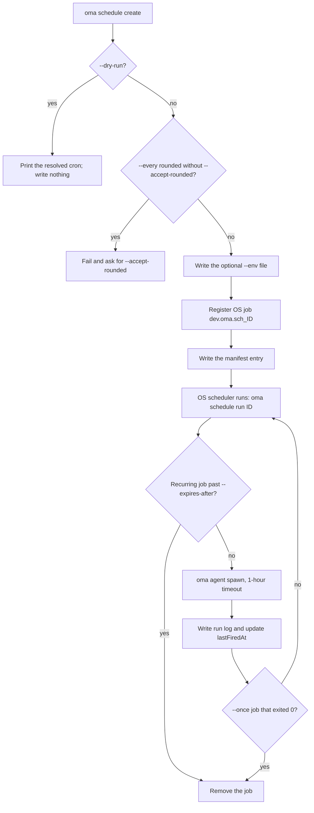
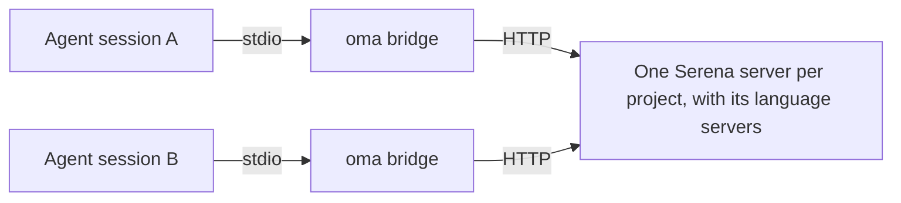
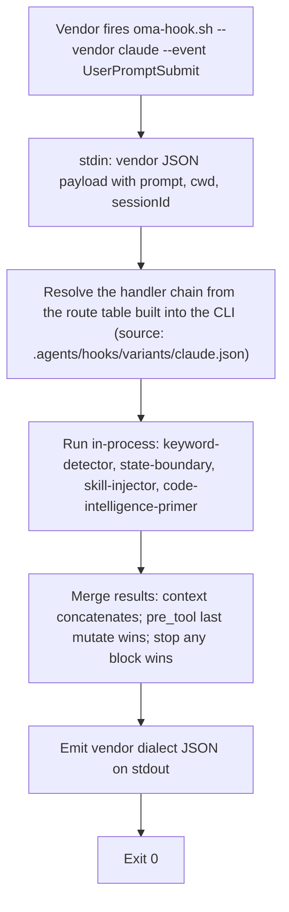

# Commandes CLI

Après une installation globale (`bun install --global oh-my-agent`), utilisez `oma` ou `oh-my-agent`. Pour une utilisation ponctuelle sans installation, lancez `npx oh-my-agent`.

La variable d’environnement `OH_MY_AG_OUTPUT_FORMAT` peut être définie à `json` pour faire du JSON la sortie par défaut des commandes qui utilisent les options partagées `--json` / `--output`. Une option `--output text` explicite reste prioritaire.

Si une commande échoue avec `Unknown command`, `Unexpected argument` ou `Removed option`, consultez [Formes supprimées](#aliases) sur cette page ; pour les problèmes d’installation, de hooks et d’exécution, consultez [Dépannage](../guide/troubleshooting.md).

## Commencer par une tâche {#start-with-a-task}

Choisissez la plus petite commande qui répond à votre question. Chaque commande ci-dessous affiche un chemin ou un rapport que vous pouvez examiner avant de passer à l’étape suivante.

| Tâche | Commencez ici | Résultat attendu |
|:-----|:-----------|:----------------|
| Installer ou réparer un projet | `oma install` puis `oma doctor` | Ressources installées et rapport d’état ; utilisez `oma doctor --profile` si le sujet est la résolution du modèle. |
| Trouver une commande ou une option depuis un agent | `oma describe` ou `oma describe "image generate"` | JSON décrivant les arguments, options et commandes imbriquées. |
| Générer une image | `oma image generate "<prompt>" --output json` | Chemins des images et manifeste dans `.agents/results/images/`. |
| Préparer ou produire une vidéo | `oma video generate "<brief>" --dry-run` | Répertoire d’exécution contenant les artefacts de planification ; ne composez et ne produisez qu’après avoir écrit la composition. |
| Créer un explicateur de code interactif | `/explain` | Artefact HTML autonome validé sous `.agents/results/explain/`. |
| Résoudre un moteur de diagrammes | `oma diagram resolve --output json` | Moteur Mermaid ou archify sélectionné et justification. |
| Rechercher des signaux communautaires | `oma market detect-trap "<topic>"` | Résultat de précontrôle ; poursuivez avec `oma market resolve --output json` et l’exécution amont uniquement si le contrôle réussit. |
| Convertir ou inspecter un article | `oma scholar search "<query>"` | Résultats de recherche issus de Knows, OpenAlex ou Semantic Scholar ; récupérez un sidecar avec `oma scholar get`. |
| Créer une présentation | `oma slide create --output-dir <dir>` | Répertoire de travail pouvant être écrit, validé, regroupé et exporté. |
| Examiner la dérive documentaire | `oma docs verify --json` | Rapport structuré des références rompues et index de références régénéré. |
| Planifier un agent récurrent | `oma schedule create backend "<task>" --every 2h --dry-run` | Expression cron résolue ; rien n’est enregistré tant que vous ne relancez pas la commande sans `--dry-run`. |
| Contrôler la qualité d’une compétence ou du harnais | `oma skill lint` ou `oma skill audit` | Rapports hors ligne ; consultez [Choisir une commande de compétence ou de harnais](#choosing-a-skill-or-harness-command) avant toute commande qui appelle des modèles. |

Les noms canoniques ci-dessous proviennent de `oma describe`. Seuls ces chemins séparés par des espaces sont acceptés : les anciennes formes comme `slide new`, `slide viewer`, `image list-vendors`, `video list-providers`, les formes avec deux-points comme `agent:parallel` et les noms courts `viz`, `s` et `img` échouent avec `Unknown command` ou `Unexpected argument`. Voir [Alias et formes supprimées](#aliases).

## Surface actuelle des commandes {#current-command-surface}

Cette carte permet de parcourir plus facilement les références détaillées ci-dessous et de découvrir les familles moins courantes. Utilisez `--help` de chaque famille ou `oma describe <path>` pour connaître la grammaire exacte des arguments ; [Options CLI](./options.md) contient la matrice complète des options du registre.

| Famille | Chemins enregistrés |
|:-------|:-----------------|
| `install` | `install` |
| `describe` | `describe` |
| `uninstall` | `uninstall` |
| `update` | `update`, `update mcp` |
| `link` | `link` |
| `intel` | `intel`, `intel suggest` |
| `market` | `market`, `market detect-trap`, `market resolve`, `market update`, `market run` |
| `doctor` | `doctor` |
| `profile` | `profile`, `profile list`, `profile show`, `profile create`, `profile use`, `profile run` |
| `home` | `home`, `home migrate` |
| `retro` | `retro` |
| `recap` | `recap` |
| `docs` | `docs`, `docs verify`, `docs sync`, `docs i18n`, `docs lint` |
| `emit` | `emit` |
| `cleanup` | `cleanup` |
| `bridge` | `bridge` |
| `verify` | `verify`, `verify agent`, `verify triggers` |
| `vault` | `vault`, `vault store`, `vault get`, `vault list`, `vault delete` |
| `star` | `star` |
| `visualize` | `visualize` |
| `search` | `search`, `search providers`, `search web`, `search fetch`, `search meta`, `search media`, `search archive`, `search trust`, `search code`, `search doctor`, `search api`, `search api fetch`, `search api search`, `search rss`, `search rss fetch`, `search rss google` |
| `harness` | `harness`, `harness eval`, `harness incident`, `harness incident scan`, `harness incident capture`, `harness incident show`, `harness incident export`, `harness incident promote`, `harness incident reproduce`, `harness feedback`, `harness evolution`, `harness evolution enable`, `harness evolution status`, `harness evolution disable`, `harness evolution run` |
| `slide` | `slide`, `slide validate`, `slide bundle`, `slide edit`, `slide doctor`, `slide create`, `slide preview`, `slide export`, `slide export pdf`, `slide export png`, `slide export pptx`, `slide import`, `slide import pptx`, `slide asset`, `slide asset fetch-video`, `slide style`, `slide style list`, `slide style preview`, `slide style get` |
| `scholar` | `scholar`, `scholar search`, `scholar resolve`, `scholar get`, `scholar lint` |
| `image` | `image`, `image generate`, `image doctor`, `image vendor`, `image vendor list` |
| `video` | `video`, `video generate`, `video doctor`, `video compose`, `video render`, `video provider`, `video provider list` |
| `serena` | `serena`, `serena check`, `serena setup`, `serena reap`, `serena daemon`, `serena daemon gc`, `serena reaper`, `serena reaper enable`, `serena reaper disable` |
| `explain` | `explain`, `explain render`, `explain lint`, `explain patch`, `explain components`, `explain validate` |
| `diagram` | `diagram`, `diagram resolve`, `diagram update`, `diagram archify` |
| `help` | `help` |
| `version` | `version` |
| `dashboard` | `dashboard`, `dashboard terminal`, `dashboard web` |
| `auth` | `auth`, `auth status` |
| `hook` | `hook`, `hook run`, `hook probe` |
| `state` | `state`, `state emit`, `state migrate`, `state get`, `state list`, `state repair`, `state verify`, `state decisions`, `state decisions list`, `state inject-log`, `state inject-log list`, `state inject-log get`, `state summary`, `state trajectory`, `state heal-check`, `state activate`, `state archive`, `state purge` |
| `ralph` | `ralph`, `ralph verify` |
| `goal` | `goal`, `goal set` |
| `stats` | `stats`, `stats get`, `stats reset` |
| `agent` | `agent`, `agent context`, `agent resume`, `agent begin`, `agent verify`, `agent finish`, `agent spawn`, `agent status`, `agent parallel`, `agent review` |
| `model` | `model`, `model check`, `model probe`, `model propose` |
| `memory` | `memory`, `memory keys`, `memory init`, `memory setup`, `memory daemon`, `memory daemon status`, `memory daemon start`, `memory daemon stop`, `memory daemon restart`, `memory service`, `memory service install`, `memory service uninstall`, `memory status`, `memory retry`, `memory retry drain`, `memory import`, `memory maintain`, `memory maintain backup`, `memory maintain prune`, `memory maintain vacuum`, `memory gc`, `memory upgrade` |
| `skill` | `skill`, `skill audit`, `skill lint`, `skill eval`, `skill optimize`, `skill meta-optimize`, `skill procedure`, `skill evolution-stats`, `skill promotions`, `skill rollback`, `skill matrix` |
| `schedule` | `schedule`, `schedule create`, `schedule list`, `schedule delete`, `schedule run`, `schedule sync` |

D’autres processus OMA appellent quelques points d’entrée internes (`agent parallel-supervisor`, `hook script`, `schedule inspect`, `schedule builtin-evolution-add`). Ils fonctionnent toujours, mais l’aide et `oma describe` les masquent ; vous n’avez pas besoin de les lancer à la main.

Lorsqu’une commande délègue ses arguments restants à un autre outil, le registre laisse volontairement ses options ouvertes. Cela concerne `market run` et `diagram archify` ; consultez l’aide amont résolue avant d’exécuter une opération qui modifie des données ou utilise le réseau.

---

## Configuration et installation {#setup--installation}

### install

`oma` sans argument lance l’installateur interactif. `oma install` est la forme explicite et accepte des options de sélection des fournisseurs.

```bash
oma
oma install
oma install --web-search native --code-intelligence gortex --semantic-memory agentmemory
```

| Option | Valeurs acceptées |
|:-------|:----------------|
| `--web-search <provider>` | `native`, `brave` |
| `--code-intelligence <provider>` | `serena`, `gortex` |
| `--semantic-memory <provider>` | `agentmemory`, `honcho`, `none` |
| `--honcho-url <url>` | Origine de l’API Honcho (valeur par défaut pour une nouvelle connexion : `http://127.0.0.1:8000`) |
| `--honcho-workspace <id>` | ID de workspace Honcho (valeur par défaut pour une nouvelle connexion : `oma`) |

`--web-search`, `--code-intelligence` et `--semantic-memory` conservent le choix de fournisseur enregistré lorsqu’ils sont omis. `--honcho-url` et `--honcho-workspace` configurent une nouvelle connexion Honcho lorsque ce fournisseur est sélectionné. L’option racine `-y, --yes` ignore les invites et utilise les valeurs par défaut ; `--global` cible `$OMA_HOME/.agents/` (par défaut `~/.oma/.agents/`). L’installation de projet reste dans `<cwd>/.agents/` même lorsque `OMA_HOME` est défini.

**Ce que fait la commande :**
1. Recherche un ancien répertoire `.agent/` et le migre vers `.agents/` s’il existe.
2. Détecte les outils concurrents et propose de les supprimer.
3. Demande le type de projet (All, Fullstack, Frontend, Backend, Mobile, DevOps, Custom).
4. Si le backend est sélectionné, demande la variante de langage (Python, Node.js, Rust, Other).
5. Demande si des liens symboliques GitHub Copilot sont souhaités.
6. Télécharge la dernière archive depuis le registre.
7. Installe les ressources partagées, workflows, configurations et compétences sélectionnées.
8. Installe les adaptations de fournisseur pour les fournisseurs sélectionnés (paramètres locaux au projet ; aucune écriture silencieuse au niveau HOME).
9. Crée les liens symboliques CLI.
10. Propose une configuration git **globale** recommandée (confirmation facultative) :
    - `rerere.enabled=true` — réutilisation des conflits de fusion multi-agents
    - `init.defaultBranch=main` — branche par défaut cohérente pour les nouveaux dépôts
    - Entièrement ignorée avec `--yes` / CI (des indications de correction manuelle sont affichées à la place)
11. Propose de configurer MCP lorsque cela s’applique.
12. Demande une étoile GitHub si `gh` est authentifié.

**Exemple :**
```bash
cd /path/to/my-project
oma
# Follow the interactive prompts
```

### doctor

Contrôle de santé des installations CLI, des configurations MCP et de l’état des compétences.

```text
oma doctor [--json] [--output <format>] [--profile] [--heal-check <agent-type>]
```

**Options :**

| Option | Description |
|:-----|:-----------|
| `--json` | Affiche la sortie au format JSON. La commande sort avec le code `1` lorsque le compteur `issues` du rapport est supérieur à zéro. |
| `--output <format>` | Format de sortie (`text` ou `json`) |
| `--profile` | Affiche la matrice de santé des profils. Elle indique le slug de modèle résolu, le CLI et l’état d’authentification de chaque agent selon le `model_preset` actif et les surcharges `agents:`. Voir [Modèles par agent](../guide/per-agent-models.md). |
| `--heal-check <agent-type>` | Inclut dans le rapport le contrôle de la garde d’auto-réparation pour cet agent. |

**Contrôles effectués :**
- Installations CLI : `claude`, `codex`, `qwen`, `agy`, `grok`, `kiro-cli`, `kimi` et `pi` (version et chemin).
- État d’authentification de chaque CLI.
- Configuration MCP de Claude Code (`~/.claude.json`) et de Codex (`~/.codex/config.toml`).
- Compétences installées : compétences présentes et état de chacune.
- Répertoire du magasin de mémoire : existence de `.agents/state/memories/` et nombre de fichiers (les projets plus anciens utilisent en repli le chemin historique `.serena/memories/`).
- Marqueurs de double installation (projet et globale) et avertissements associés.
- Configuration git **globale** recommandée (`gitRecommended` dans le JSON) :
  - `rerere.enabled=true`
  - `init.defaultBranch=main`
  - Chaque divergence est comptée dans le total des problèmes (`issues` dans le JSON)
- Fichier de contexte des fournisseurs du projet (bloc OMA de `AGENTS.md` lorsque Codex, Qwen ou Claude Code ≥ 2.1.277 est installé).
- AgentMemory, état/santé des hooks, diagnostics du reaper Serena et compteurs d’incidents associés.

**Réparation automatique :** si des compétences manquantes sont détectées, `doctor` propose de les installer de manière interactive. Si la configuration git recommandée est absente ou incorrecte, il propose les mêmes corrections globales facultatives que install/update.

**Exemples :**
```bash
# Interactive text output
oma doctor

# JSON output for CI pipelines
oma doctor --json

# Pipe to jq for specific checks
oma doctor --json | jq '.clis[] | select(.installed == false)'

# Inspect the profile resolution matrix
oma doctor --profile
```

### update

Met à jour les compétences vers la dernière version du registre.

```text
oma update [-f, --force] [--with-new-skills] [--ci] [-y, --yes] [--all] [--vendor <vendors>]
```

**Options :**

| Option | Description |
|:-----|:-----------|
| `-f, --force` | Écrase les fichiers de configuration personnalisés (`oma-config.yaml`, `mcp.json`, répertoires `stack/`) |
| `--with-new-skills` | Installe les compétences ajoutées dans cette version ; sans cette option, seules les compétences déjà installées sont actualisées. |
| `--ci` | Exécute en mode CI non interactif (ignore les invites, sortie en texte simple) |
| `-y, --yes` | Ignore les invites. La portée des fournisseurs reste inchangée : seuls les répertoires existants sont mis à jour, sauf avec `--all` ou `--vendor`. |
| `--all` | Crée ou met à jour tous les fournisseurs pris en charge au niveau du projet. |
| `--vendor <vendors>` | Crée ou met à jour des fournisseurs précis. Accepte une liste séparée par des virgules, comme `claude,qwen`. |

**Ce que fait la commande :**
1. Récupère `prompt-manifest.json` depuis le registre pour vérifier la dernière version.
2. Compare avec la version locale dans `.agents/skills/_version.json`.
3. Quitte si la version est déjà à jour.
4. Télécharge et extrait la dernière archive.
5. Préserve les fichiers personnalisés par l’utilisateur (sauf avec `--force`).
6. Copie les nouveaux fichiers dans `.agents/`.
7. Restaure les fichiers préservés.
8. Met à jour les adaptations de fournisseurs et actualise les liens symboliques. Par défaut, seuls les répertoires de fournisseurs déjà présents dans le projet sont touchés.
9. Propose la configuration git **globale** recommandée (comme lors de l’installation : `rerere.enabled`, `init.defaultBranch`). Elle est ignorée avec `--yes` / `--ci`.

**Exemples :**
```bash
# Standard update (preserves config)
oma update

# Force update (resets all config to defaults)
oma update --force

# CI mode (no prompts, no spinners)
oma update --ci

# CI mode with force
oma update --ci --force

# Update existing vendors without prompts
oma update --yes

# Create/update every supported project-scoped vendor
oma update --all

# Create/update only Claude and Qwen integrations
oma update --vendor claude,qwen

# Also refresh browser MCP selections
oma update mcp --ci
```

`oma update mcp` possède ses propres options `--yes`, `--ci`, `--all` et `--vendor <vendors>`. Elle sélectionne les serveurs MCP de navigateur pris en charge (Aside, Chrome DevTools ou Firefox DevTools) pour les fournisseurs sélectionnés au niveau du projet.

### uninstall

Prévisualise ou supprime les fichiers appartenant à OMA depuis la racine d’installation sélectionnée :

```bash
oma uninstall --dry-run
oma uninstall --yes
```

`--dry-run` liste les suppressions sans modifier les fichiers. `--yes` ignore l’invite de confirmation. La commande préserve `oma-config.yaml`, `mcp.json` et les compétences écrites par l’utilisateur selon la description enregistrée de la commande. Si la prévisualisation inclut un fichier dont vous avez encore besoin, arrêtez-vous et conservez la sortie dry-run pour examen.

### link

Régénère les fichiers natifs des fournisseurs à partir de la source de vérité `.agents/` sans réinstaller.

```text
oma link [vendors...] [--dry-run] [--global]
```

`--dry-run` prévisualise ce qui serait écrit sans modifier les fichiers.

**Exemples :**

```bash
# Preview the files link would write
oma link --dry-run

# Regenerate all configured vendors
oma link

# Regenerate only Claude and Codex files
oma link claude codex

# Regenerate the global install (~/.oma/.agents/) from any directory
oma link opencode --global
```

Sans `--global`, link cible `<cwd>/.agents/` ; avec cette option, il cible `~/.oma/.agents/` (ou `$OMA_HOME/.agents/`). `OMA_HOME` ne modifie pas la cible du projet. Voir [Installation globale](../guide/global-install.md).

**Ce que fait la commande :**
1. Reconstruit les fichiers d’agents natifs des fournisseurs depuis `.agents/agents/`
2. Actualise les hooks et les paramètres locaux des fournisseurs sélectionnés
3. Régénère le bloc d’intégration `AGENTS.md` pour chaque fournisseur configuré, Claude Code compris. `CLAUDE.md` et `GEMINI.md` ne sont jamais créés ni dotés d’un bloc OMA. Claude Code ≥ 2.1.277 lit `AGENTS.md` nativement, mais l’ignore dès lors qu’un `CLAUDE.md` existe ; lorsqu’un `CLAUDE.md` appartenant à l’utilisateur est présent, link ajoute donc une seule ligne d’import `@AGENTS.md` ; `oma update` supprime aussi l’ancien bloc OMA de `CLAUDE.md` dès que cette version est détectée
4. Actualise la liaison MCP de Cursor et les liens symboliques des compétences CLI lorsque c’est pertinent

Utilisez cette commande après avoir modifié `.agents/agents/`, `.agents/workflows/`, `.agents/rules/` ou les définitions de hooks.

**Comportement des modèles :**
- La délégation native vers le même fournisseur utilise le modèle défini dans le fichier d’agent généré pour ce fournisseur.
- La délégation de repli externe utilise le `default_model` de chaque fournisseur dans `.agents/skills/oma-orchestration/config/cli-config.yaml`.

**Comportement de la délégation :**
- Si le fournisseur cible correspond à l’environnement d’exécution actuel et que cet environnement prend en charge les agents natifs par rôle, OMA utilise la délégation native.
- Sinon, OMA revient à `oma agent spawn`.

### Reconfigurer une installation existante {#setup-workflow}

Il n’existe pas de workflow `/setup`. Pour modifier un projet installé, relancez `oma install`, utilisez `oma update mcp` pour les seuls serveurs MCP de navigateur, ou lancez `/tools` dans une session d’agent pour activer ou désactiver des outils MCP. Vérifiez la résolution des modèles par agent avec `oma doctor --profile` ; les modèles épinglés par agent se trouvent sous `agents:` dans `.agents/oma-config.yaml` ([Modèles par agent](../guide/per-agent-models.md)).

---

## Surveillance et métriques {#monitoring--metrics}

### dashboard terminal {#dashboard}

Démarre le tableau de bord terminal pour surveiller les agents en temps réel.

```text
oma dashboard terminal [--project-root <path>]
```

Surveille `<project>/.agents/state/memories/`, où le projet est `--project-root` (par défaut : le répertoire courant). Il n’y a pas de repli automatique vers l’ancien chemin `.serena/memories/`. L’interface en caractères de boîte affiche l’état des sessions, le tableau des agents et le flux d’activité. Elle se met à jour à chaque modification de fichier. Appuyez sur `Ctrl+C` pour quitter.

Le répertoire de mémoires peut être remplacé par la variable d’environnement `MEMORIES_DIR`.

**Exemple :**
```bash
# Standard usage
oma dashboard terminal

# Custom memories directory
MEMORIES_DIR=/path/to/.agents/state/memories oma dashboard terminal
```

### dashboard web

Démarre le tableau de bord web.

```text
oma dashboard web [--project-root <path>]
```

Démarre un serveur HTTP à l’adresse `http://127.0.0.1:9847` avec une connexion WebSocket pour les mises à jour en direct. Ouvrez l’URL affichée dans un navigateur pour voir le tableau de bord.

**Variables d’environnement :**

| Variable | Valeur par défaut | Description |
|:---------|:--------|:-----------|
| `DASHBOARD_PORT` | `9847` | Port du serveur HTTP/WebSocket |
| `MEMORIES_DIR` | `<project-root>/.agents/state/memories` | Chemin du répertoire de mémoires ; prioritaire sur `--project-root` |

**Exemple :**
```bash
# Standard usage
oma dashboard web

# Custom port
DASHBOARD_PORT=8080 oma dashboard web
```

### stats

Affiche les métriques de productivité.

```text
oma stats get [--json] [--output <format>]
oma stats reset [--json] [--output <format>]
```

**Options :**

| Option | Description |
|:-----|:-----------|
| `--json` | Affiche au format JSON |
| `--output <format>` | Format de sortie (`text` ou `json`) |

**Métriques suivies :**
- Nombre de sessions
- Compétences utilisées (avec fréquence)
- Tâches terminées
- Durée totale des sessions
- Fichiers modifiés, lignes ajoutées, lignes supprimées
- Horodatage de la dernière mise à jour

**Télémétrie des coûts** (agrégée sur chaque fichier `session-cost-*.md` sous `.agents/state/memories/`) :
- Nombre total de tokens d’entrée (approximation fondée sur les caractères du prompt, sans tokens de sortie pour l’instant)
- Nombre total de délégations
- Estimation en USD selon une table prudente de tarifs par token d’entrée et fournisseur (Claude 3 $/M, Codex 5 $/M, Gemini 0,3 $/M, Qwen 0 $/M, Cursor 5 $/M, Antigravity 0,3 $/M)
- Répartition par fournisseur (tokens · délégations · USD)

L’estimation est un plancher, pas un montant fidèle à la facturation. Configurez `session.quota_cap` dans `.agents/oma-config.yaml` pour imposer des budgets stricts au lancement ; consultez la page Pourquoi oh-my-agent dans les guides de démarrage pour l’arsenal axé sur la qualité auquel ces plafonds appartiennent.

Les métriques sont stockées dans `.agents/state/metrics.json` ; un ancien `.serena/metrics.json` est lu lorsqu’il existe. Les données sont collectées à partir des statistiques git et des fichiers de mémoire.

**Exemples :**
```bash
# View current metrics
oma stats get

# JSON output
oma stats get --json

# Reset all metrics
oma stats reset
```

### recap

Récapitule l’historique des conversations des outils IA à travers les sessions Claude, Codex, Gemini, Antigravity, Qwen, Cursor et Grok.

```text
oma recap [--window <period>] [--date <date>] [--tool <tools>] [--top <n>] [--sort <metric>] [--mermaid] [--graph] [--json] [--output <format>]
```

**Options :**

| Option | Description | Valeur par défaut |
|:-----|:-----------|:--------|
| `--window <period>` | Période : `1d`, `3d`, `7d`, `2w`, `30d` | `1d` |
| `--date <date>` | Date précise (`YYYY-MM-DD`) ; prioritaire sur `--window` | |
| `--tool <tools>` | Filtre séparé par des virgules : `grok,claude,codex,gemini,qwen,cursor,antigravity` | tous |
| `--top <n>` | Affiche les N premiers projets/sujets | |
| `--sort <metric>` | Trie selon `count` ou `duration` | `count` |
| `--mermaid` | Affiche un diagramme de Gantt Mermaid | |
| `--graph` | Ouvre un graphe interactif dans le navigateur | |
| `--json` / `--output <format>` | Sortie lisible par machine | `text` |

**Exemples :**

```bash
oma recap                                     # Today (1d)
oma recap --window 7d                         # Last week
oma recap --date 2026-04-20 --tool grok,claude
oma recap --window 7d --mermaid > week.mmd
oma recap --window 30d --graph                # Interactive browser graph
```

### retro

Rétrospective d’ingénierie avec métriques et tendances.

```text
oma retro [window] [--json] [--output <format>] [--interactive] [--compare]
```

**Arguments :**

| Argument | Description | Valeur par défaut |
|:---------|:-----------|:--------|
| `window` | Période `<n>h`, `<n>d` ou `<n>w` (par exemple `24h`, `7d`, `2w`). Les mois ne sont pas acceptés ; utilisez `30d`. | 7 derniers jours |

**Options :**

| Option | Description |
|:-----|:-----------|
| `--json` | Affiche au format JSON |
| `--output <format>` | Format de sortie (`text` ou `json`) |
| `--interactive` | Mode interactif avec saisie manuelle |
| `--compare` | Compare la période actuelle avec la période précédente de même durée |

**Contenu affiché :**
- Résumé publiable (métriques sur une ligne)
- Tableau récapitulatif (commits, fichiers modifiés, lignes ajoutées/supprimées, contributeurs)
- Tendances par rapport à la dernière rétrospective (si un instantané précédent existe)
- Classement des contributeurs
- Répartition horaire des commits (histogramme)
- Sessions de travail
- Répartition des types de commits (feat, fix, chore, etc.)
- Zones sensibles (fichiers les plus modifiés)

**Exemples :**
```bash
# Last 7 days (default)
oma retro

# Last 30 days
oma retro 30d

# Last 2 weeks
oma retro 2w

# Compare with previous period
oma retro 7d --compare

# Interactive mode
oma retro --interactive

# JSON for automation
oma retro 7d --json
```

---

## Home global, sessions et profils locaux {#global-home-sessions-and-local-profiles}

### home migrate

Copie les définitions globales et les métadonnées d’exécution appartenant à OMA vers le home unifié :

```bash
oma home migrate --dry-run --json
oma home migrate --json
oma schedule sync
```

`OMA_HOME` sélectionne la racine de stockage globale, par défaut `~/.oma`. Les définitions utilisent son `.agents/` ; les planifications utilisent `schedule/` ; Serena et l’index des noms de clés du vault utilisent `state/`. Le stockage des profils utilise `u/`, sauf si `OMA_STATE_HOME` sélectionne explicitement une autre racine de profils.

La migration préserve le contenu d’origine, ignore les copies identiques, fusionne les noms de clés du vault et signale les conflits de destination ou les données en cours d’utilisation. Les répertoires de compétences vérifiés comme appartenant à OMA peuvent être archivés sous `$OMA_HOME/backup/legacy-global-skills/` avant que leurs anciens chemins de découverte ne deviennent des liens gérés vers les copies migrées. Les compétences de l’utilisateur et les liens étrangers restent en place. La migration ne déplace ni l’authentification des fournisseurs, ni les secrets du Trousseau du système, ni les données de mémoire externes. L’installation et la mise à jour globales exécutent automatiquement cette migration. L’enregistrement des tâches système est distinct : lancez `oma schedule sync` après la migration lorsque des planifications existent.

### state list

Répertorie les sessions de workflow OMA du projet courant. La découverte globale explicite répertorie les sessions de tous les projets dans le profil local sélectionné :

```bash
oma state list
oma state list --all-projects --json
oma state list --all-projects --project /path/to/project
oma state list --all-projects --search migration
```

`--all-projects` est en lecture seule. Il ne peut pas être combiné avec l’activation ou la maintenance d’une session. Les lectures et écritures de sessions normales restent limitées au projet. Les sessions historiques d’autres dépôts doivent d’abord être migrées vers le stockage du home avant d’apparaître dans la liste agrégée.

### profile

Gère les profils de stockage locaux sous `~/.oma/u/<slot>/`. Les emplacements sont des entiers décimaux non négatifs ; ils sont distincts des presets de modèles et des comptes de connexion aux fournisseurs.

```bash
oma profile list --json
oma profile create 1
oma profile show
eval "$(oma profile use 1 --shell zsh)"
oma profile show
oma profile run 1 -- oma state list --all-projects --json
```

`profile use` affiche l’activation du shell ; son évaluation définit `OMA_PROFILE` dans le shell courant. Exécutée seule, elle ne modifie pas le shell parent, les applications déjà lancées ni un paramètre CLI distinct par défaut. Les commandes CLI et les hooks de fournisseurs lancés depuis le shell activé héritent du même profil. Le profil par défaut est `0` ; le stockage suit `OMA_HOME` (par défaut `~/.oma`). Un `OMA_STATE_HOME` explicite ne remplace que le stockage des profils.
`profile run <slot> -- <command> [args...]` sélectionne le profil uniquement pour cette commande et ses enfants. Le séparateur laisse les options enfants comme `--help` et `--json` attachées à la commande enfant.

---

## Gestion des agents {#agent-management}

### agent spawn

Lance un processus d’agent secondaire.

```text
oma agent spawn <agent-id> <prompt> <session-id> [--vendor <vendor>] [-w <workspace>] [--isolation <mode>]
```

**Arguments :**

| Argument | Obligatoire | Description |
|:---------|:---------|:-----------|
| `agent-id` | Oui | Type d’agent. L’un de : `orchestrator`, `architecture`, `qa`, `pm`, `backend`, `frontend`, `mobile`, `db`, `debug`, `refactor`, `docs`, `tf-infra`, `explore` |
| `prompt` | Oui | Description de la tâche. Peut être un texte inline ou un chemin de fichier. |
| `session-id` | Oui | Identifiant de session (format `session-YYYYMMDD-HHMMSS`) |

**Options :**

| Option | Description |
|:-----|:-----------|
| `--vendor <vendor>` | Surcharge du fournisseur CLI : `antigravity`, `claude`, `codex`, `cursor`, `opencode`, `qwen`, `grok`, `pi` |
| `-w, --workspace <path>` | Répertoire de travail de l’agent. Détecté automatiquement depuis la configuration du monorepo s’il est omis. |
| `--resumed-from <run-id>` | Relie une nouvelle tentative à l’ID de l’exécution précédente. |
| `--task-id <id>` | ID de tâche issu du plan de session. Par défaut, l’ID de l’agent. |
| `--isolation <mode>` | Mode d’isolation par lancement. Prend actuellement en charge `worktree` : crée un worktree git à `${tmpdir}/oma-worktrees/{sessionId}/{agentId}` sur la branche `oma/{sessionId}/{agentId}` et y exécute l’agent. Le worktree est conservé après la fin ; les commandes de fusion ou de suppression sont affichées pour une revue manuelle (aucune fusion automatique). |
| `--read-only` | Limite l’agent lancé aux outils non destructifs et supprime les options d’auto-approbation. Utilisé en interne par `oma skill eval --live` pour les deux bras d’évaluation. |
| `--fallback-vendors <vendors>` | Active une chaîne ordonnée, séparée par des virgules, d’au plus trois fournisseurs CLI configurés. La continuation exige un échec reconnu lié au quota, à la limitation de débit ou à une panne transitoire, ainsi qu’un nouveau point de contrôle de transmission sûre. |

**Ordre de résolution du fournisseur :** option `--vendor` > surcharge `agents:` dans `oma-config.yaml` > valeurs par défaut des agents du `model_preset` actif.

**Résolution du prompt :** si l’argument du prompt est le chemin d’un fichier existant, son contenu est utilisé ; sinon l’argument est traité comme texte inline. Les protocoles d’exécution propres au fournisseur sont ajoutés automatiquement.

**Codes de sortie :**

| Code | Signification |
|:-----|:--------|
| `0` | L’enregistrement d’exécution s’est terminé avec l’état `completed`. |
| `3` | Le processus du fournisseur s’est terminé avec le code 0, mais l’exécution ne s’est pas terminée comme une exécution `completed` vérifiée (par exemple `partial`, `blocked` ou `failed`), et un événement `blocker.raised` avec le code `spawn.incomplete-result` est enregistré. Également renvoyé lorsqu’un successeur `--fallback-vendors` ne peut pas démarrer. Le lancement ne doit pas être considéré comme terminé. |
| `130` | Interrompu (Ctrl+C ou SIGTERM). |
| autre | Le processus du fournisseur lui-même a échoué ; son code de sortie est propagé. |

Voir [Résultats et reprise des agents](../guide/agent-results-and-resume.md) pour l’enregistrement d’exécution et la revendication qui déterminent `completed`.

**Exemples :**
```bash
# Inline prompt, auto-detect workspace
oma agent spawn backend "Implement /api/users CRUD endpoint" session-20260324-143000

# Prompt from file, explicit workspace
oma agent spawn frontend ./prompts/dashboard.md session-20260324-143000 -w ./apps/web

# Override vendor to Claude
oma agent spawn backend "Implement auth" session-20260324-143000 --vendor claude -w ./api

# Allow a prepared task handoff to another configured vendor
oma agent spawn backend "Implement auth" session-20260324-143000 --vendor claude --fallback-vendors codex,qwen -w ./api

# Mobile agent with auto-detected workspace
oma agent spawn mobile "Add biometric login" session-20260324-143000

# Run inside an isolated git worktree (useful for hypothesis spawns or
# when parallel agents would touch shared files)
oma agent spawn backend "Try a Drizzle-based rewrite" session-20260324-143000 --isolation worktree
```

**Bascule entre fournisseurs :** les candidats de repli doivent avoir une entrée dans la configuration CLI installée. Chaque tentative utilise la configuration de modèle de son fournisseur cible et passe par les contrôles de quota de session existants. Le proxy multi-fournisseurs `pi` est exclu de cette première fonction de repli. Aucun nouvel identifiant de fournisseur ni route d’API payante n’est créé.

Lorsque le repli est activé, la tâche reçoit l’instruction de préparer un enregistrement de transmission sûr, propre à l’exécution, sous `.agents/results/`. Un successeur lit cet enregistrement et vérifie l’espace de travail avant de poursuivre le travail restant. Un quota épuisé sans point de contrôle exploitable s’arrête avec un enregistrement needs-review. Une annulation, un échec ordinaire ou une exécution terminée ne déclenche pas de nouvelle tentative. `--read-only` ne dispense pas de cette exigence de point de contrôle.

Les événements de session enregistrent la raison de la transition ainsi que les fournisseurs source et cible ; chaque tentative possède sa propre identité d’exécution et renvoie vers son prédécesseur. Cela s’applique aux sous-processus lancés par `oma agent spawn` ; la commande ne change pas automatiquement une conversation interactive existante dans une application fournisseur. Omettre `--fallback-vendors` conserve l’exécution habituelle avec un seul fournisseur.

### agent status

Vérifie l’état d’un ou plusieurs agents secondaires.

```text
oma agent status <session-id> [agent-ids...] [--project-root <path>]
```

**Arguments :**

| Argument | Obligatoire | Description |
|:---------|:---------|:-----------|
| `session-id` | Oui | Identifiant de session à vérifier |
| `agent-ids` | Non | Liste d’identifiants d’agents séparés par des espaces. Si elle est omise, aucune sortie n’est produite. |

**Options :**

| Option | Description | Valeur par défaut |
|:-----|:-----------|:--------|
| `--project-root <path>` | Projet dont les enregistrements d’exécution, mémoires et fichiers PID sont vérifiés | Répertoire courant |

**Valeurs d’état :**
- `running`, `completed`, `partial`, `blocked`, `failed` : état du dernier enregistrement d’exécution de cet agent dans la session. Un enregistrement `running` dont le processus d’exécution a disparu est signalé comme `failed`.
- `stale` : l’exécution est enregistrée comme `completed`, mais ses éléments de preuve ne sont plus valides.
- `legacy-<status>`, `unverified`, `legacy-completed` : lus depuis un ancien fichier `result-<agent>.md` ou un fichier d’état temporaire lorsqu’aucun enregistrement d’exécution n’existe.
- `running` / `crashed` depuis un fichier PID : le processus est actif, ou il a disparu.
- `crashed` : aucun enregistrement d’exécution, fichier de résultat, fichier d’état ni fichier PID n’a été trouvé.

**Format de sortie :** une ligne par agent : `{agent-id}:{status}`

**Exemples :**
```bash
# Check specific agents
oma agent status session-20260324-143000 backend frontend

# Output:
# backend:running
# frontend:completed

# Check another project
oma agent status session-20260324-143000 qa --project-root /path/to/project
```

### agent parallel

Exécute plusieurs agents secondaires en parallèle.

```text
oma agent parallel [tasks...] [--session-id <id>] [--vendor <vendor>] [-i, --inline] [--no-wait]
```

**Arguments :**

| Argument | Obligatoire | Description |
|:---------|:---------|:-----------|
| `tasks` | Oui | Soit le chemin d’un fichier de tâches YAML, soit des spécifications inline avec `--inline` |

**Options :**

| Option | Description |
|:-----|:-----------|
| `--session-id <id>` | Rattache les résultats à une session existante ; les valeurs YAML `id` deviennent les ID de tâche |
| `--vendor <vendor>` | Surcharge du fournisseur CLI pour tous les agents |
| `-i, --inline` | Mode inline : spécifie les tâches comme arguments `agent:task[:workspace]` |
| `--no-wait` | Mode en arrière-plan (lance les agents et revient immédiatement) |

**Format du fichier de tâches YAML :**
```yaml
tasks:
  - id: user-api        # optional task ID
    agent: backend
    task: "Implement user API"
    workspace: ./api    # optional, auto-detected if omitted
  - agent: frontend
    task: "Build user dashboard"
    workspace: ./web
```

`id`, `agent`, `task` et `workspace` appartiennent au même élément de liste ; indentez-les donc sous le `-`.

**Format des tâches inline :** `agent:task` ou `agent:task:workspace` (le workspace doit être `.` ou commencer par `./` ou `/`).

**Répertoire des résultats :** `<project-root>/.agents/results/parallel-<timestamp>-<id>/` contient les fichiers journaux de chaque agent.

**Exemples :**
```bash
# From YAML file
oma agent parallel tasks.yaml

# Inline mode
oma agent parallel --inline "backend:Implement auth API:./api" "frontend:Build login:./web"

# Background mode (no wait)
oma agent parallel tasks.yaml --no-wait

# Override vendor for all agents
oma agent parallel tasks.yaml --vendor claude
```

### agent review

Effectue une revue de code avec un CLI IA externe (codex, claude, qwen ou grok).

```text
oma agent review [--vendor <vendor>] [-p <prompt>] [-w <path>] [--no-uncommitted]
```

**Options :**

| Option | Description |
|:-----|:-----------|
| `--vendor <vendor>` | Fournisseur CLI : `codex`, `claude`, `qwen` ou `grok`. Par défaut, `codex` lorsque le fournisseur résolu n’est pas pris en charge. |
| `-p, --prompt <prompt>` | Prompt de revue personnalisé. Sans cette option, un prompt de revue par défaut est utilisé. |
| `-w, --workspace <path>` | Chemin à examiner. Par défaut, le répertoire courant. |
| `--no-uncommitted` | Ignore la revue des modifications non commitées. Avec cette option, seules les modifications commitées dans la session sont examinées. |

**Ce que fait la commande :**
- Détecte automatiquement l’identifiant de session courant depuis l’environnement ou l’activité git récente.
- Pour `codex`, utilise la sous-commande native `codex review`.
- Pour `claude` et `qwen`, construit une demande de revue fondée sur un prompt et lance le CLI avec le prompt de revue.
- Par défaut, examine les modifications non commitées dans le répertoire de travail.
- Avec `--no-uncommitted`, limite la revue aux modifications commitées dans la session courante.

**Exemples :**
```bash
# Review uncommitted changes with default vendor
oma agent review

# Review with codex (uses native codex review command)
oma agent review --vendor codex

# Review with claude using a custom prompt
oma agent review --vendor claude -p "Focus on security vulnerabilities and input validation"

# Review a specific path
oma agent review -w ./apps/api

# Review only committed changes (skip working tree)
oma agent review --no-uncommitted

# Review committed changes in a specific workspace with qwen
oma agent review --vendor qwen -w ./apps/web --no-uncommitted
```

### goal set {#goal-set}

Associe un contrat d’objectif à un workflow persistant actif (orchestrate, ultrawork, work, ralph). Le contrat est appliqué mécaniquement par le hook Stop du mode persistant : la fin ne dépend plus du seul jugement du modèle.

```text
oma goal set [--workflow <name>] [--session-id <id>] [--gate <keyword>] [--budget-minutes <n>] [--description <text>]
```

Passez au moins l’une des options `--gate`, `--budget-minutes` ou `--description` ; sinon, la commande échoue avec `Nothing to set`. Voir [Workflow persistant](../getting-started/glossary.md#persistent-workflow) et [Porte d’arrêt](../getting-started/glossary.md#stop-gate) dans le glossaire.

**Options :**

| Option | Description |
|:-----|:-----------|
| `--gate <keyword>` | Porte d’arrêt déterministe : `typecheck`, `test` ou `lint`. Se mappe vers le script de même nom dans package.json, exécuté comme tableau argv sans shell. Tant qu’elle est définie, le hook Stop n’autorise la fin du workflow **que si ce script réussit** ; en cas d’échec, il bloque avec la fin de la sortie pour que l’agent sache quoi corriger. Les commandes libres sont refusées — la valeur de la garde réside dans un fichier d’état modifiable par l’agent, et exécuter des chaînes arbitraires depuis ce fichier contournerait la couche d’autorisation. |
| `--budget-minutes <n>` | Budget en temps réel mesuré depuis l’activation du workflow. Une fois dépassé, le hook Stop désactive le workflow et autorise un arrêt honnête et partiel (verdict machine enregistré comme `gate.failed` avec `gate: "budget"` dans la trace des événements de session). |
| `--description <text>` | Description humaine de l’objectif. Informatif uniquement. |
| `--workflow <name>` | Workflow ciblé lorsque plusieurs workflows persistants sont actifs. |
| `--session-id <id>` | Suffixe d’ID de session fournisseur du fichier d’état ; nécessaire uniquement lorsque plusieurs workflows persistants sont actifs. |

**Notes de comportement :**
- Garde réussie → le workflow est désactivé, `gate.passed` est émis et l’arrêt est autorisé.
- Chaque exécution de la garde dispose d’un budget de 25 secondes (`OMA_GATE_TIMEOUT_MS` peut seulement le réduire). Échec de la garde et dépassement du délai comptent tous deux dans la limite de renforcement (5) ; une garde durablement en échec ne peut donc pas bloquer les arrêts indéfiniment. L’expiration de péremption à 2 heures reste le dernier filet de sécurité. Ne préférez `--gate test` que si le script `test` se termine largement dans ce budget.
- Sans contrat d’objectif, le mode persistant se comporte exactement comme auparavant (seuls les prompts de renforcement s’appliquent) : le contrat est entièrement facultatif.

**Exemples :**
```bash
# After starting /ultrawork: require typecheck to pass before the session may end
oma goal set --gate typecheck

# Bound an autonomous run: stop honestly after 2 hours even if incomplete
oma goal set --workflow ultrawork --gate typecheck --budget-minutes 120
```

---

## Agents planifiés {#scheduled-agents}

### Cycle de vie d’une planification {#schedule-lifecycle}

Une tâche planifiée passe par les commandes ci-dessous. C’est le planificateur du système, et non un processus `oma` en cours d’exécution, qui déclenche chaque exécution.



| Étape | Déclenchée par | Ce qui se passe | Enregistrée dans |
|:------|:-------------|:-------------|:------------|
| Aperçu | `schedule create ... --dry-run` | Résout l’expression cron et affiche l’éventuelle note d’arrondi de `--every` | stdout uniquement |
| Enregistrement | `schedule create` | Écrit le fichier `--env` lorsqu’il est demandé, enregistre la tâche système, puis écrit l’entrée du manifeste | Planificateur du système ; `~/.oma/schedule/schedules.json` ; `~/.oma/schedule/env/<id>` |
| Déclenchement | Planificateur du système | Lance `oma schedule run <id>` ; une tâche récurrente qui a dépassé son âge `--expires-after` est supprimée au lieu d’être exécutée | — |
| Exécution | `schedule run` | Lance `oma agent spawn` pour la tâche avec un délai d’une heure | `~/.oma/schedule/runs/<id>/` |
| Enregistrement du résultat | `schedule run` | Met à jour `lastFiredAt` ; supprime une tâche `--once` uniquement après une exécution sortie avec le code 0 | manifeste |
| Inspection et réparation | `schedule list`, `schedule sync` | Compare le manifeste au planificateur du système et répare la dérive | — |
| Suppression | `schedule delete <id>` | Supprime la tâche du manifeste et du planificateur du système | — |

`~/.oma` est la valeur par défaut de `OMA_HOME`. Pour des symptômes comme une tâche qui ne se déclenche jamais, consultez [Dépannage](../guide/troubleshooting.md).

### schedule create

Enregistre une tâche d’agent planifiée. Exactement une des options `--cron` et `--every` est obligatoire.

```text
oma schedule create <agent-id> <prompt> (--cron <expr> | --every <phrase>) [--vendor <vendor>] [-w <path>] [--once] [--expires-after <duration>] [--env <KEY1,KEY2>] [--dry-run] [--accept-rounded]
```

**Arguments :**

| Argument | Obligatoire | Description |
|:---------|:---------|:-----------|
| `agent-id` | Oui | ID d’agent transmis à `oma agent spawn` au moment du déclenchement, par exemple `backend`, `frontend`, `qa` ou un alias de fichier d’agent comme `qa-reviewer`. Il n’est validé qu’au déclenchement de la tâche. |
| `prompt` | Oui | Description de la tâche transmise à l’agent au moment du déclenchement |

**Options :**

| Option | Description |
|:-----|:-----------|
| `--cron "<expr>"` | Expression cron à 5 champs (par exemple `"0 9 * * *"`). Mutuellement exclusive avec `--every`. |
| `--every "<phrase>"` | Intervalle en langage naturel : `5m`, `2h`, `1d`, `every 20m`, `every 5 minutes`. Une valeur qui ne correspond pas à un pas cron exact (par exemple `7m`) est arrondie, et la tâche n’est **pas** enregistrée sans l’ajout de `--accept-rounded`. Mutuellement exclusive avec `--cron`. |
| `--vendor <vendor>` | Surcharge du fournisseur CLI transmise à `oma agent spawn` : `antigravity`, `claude`, `codex`, `cursor`, `opencode`, `qwen`, `grok`, `pi`. Détection automatique par défaut. |
| `-w, --workspace <path>` | Répertoire de travail de l’agent. Par défaut, le répertoire courant au moment de l’enregistrement. |
| `--once` | Mode à exécution unique : se déclenche une fois, puis se supprime après une exécution réussie. |
| `--expires-after <duration>` | Supprime une tâche récurrente lors de son premier déclenchement après cet âge. Indiquez des jours entiers avec l’unité `d`, par exemple `30d` ; `0` signifie jamais. Un nombre nu comme `30` et des valeurs comme `12h` ou `2w` sont refusés. |
| `--env <KEY1,KEY2>` | Capture les variables d’environnement nommées dans `~/.oma/schedule/env/<id>` (0600) pour injection à l’exécution. Seules les clés listées sont capturées, jamais tout l’environnement. |
| `--dry-run` | Affiche le cron résolu et l’éventuelle note d’arrondi sans créer de tâche système, d’entrée de manifeste ni de fichier d’environnement. |
| `--accept-rounded` | Enregistre un intervalle arrondi par `--every`, après examen de l’aperçu. |

**Ce que fait la commande :**
1. Analyse et valide l’expression cron (ou convertit la phrase `--every` en cron). Avec `--dry-run`, elle s’arrête ici.
2. Avec `--env`, écrit les variables listées dans `~/.oma/schedule/env/<id>`.
3. Enregistre la tâche auprès du planificateur du système : launchd sur macOS ; sur Linux, un minuteur systemd `--user`, ou la crontab de l’utilisateur lorsque systemd n’est pas disponible ; le Planificateur de tâches (`schtasks`) sur Windows ; crontab sur les autres systèmes POSIX. La tâche système appelle `oma schedule run <id>` à l’intervalle configuré.
4. Écrit la tâche dans `~/.oma/schedule/schedules.json` (manifeste global, permissions 0600).

**Exemples :**
```bash
# Exact cron: weekdays at 9 AM
oma schedule create qa-reviewer "Run QA review on latest changes" --cron "0 9 * * 1-5"

# Natural language: every 2 hours
oma schedule create backend "Check for slow queries" --every "2h"

# One-shot, pinned vendor and workspace
oma schedule create pm "Generate sprint plan" --cron "0 9 * * 1" --once --vendor claude -w /path/to/project

# Capture specific env vars for the job
oma schedule create backend "Sync external data" --cron "0 * * * *" --env SYNC_API_KEY,SYNC_TARGET_URL

# Expire a recurring job after 30 days
oma schedule create backend "Check for slow queries" --every "2h" --expires-after 30d

# Preview a rounded interval, then register it
oma schedule create backend "Check logs" --every 7m --dry-run
oma schedule create backend "Check logs" --every 7m --accept-rounded
```

L’aperçu pour `--every 7m` affiche :

```text
Preview: requested interval resolves to */6 * * * *
Note: Requested every 7m -- 7 is not a divisor of 60; rounded to every 6m (*/6 * * * *).
Preview only: no OS job, manifest entry, or env file was written.
```

Voir le [guide des agents planifiés](../guide/scheduled-agents.md) pour le parcours complet.

### schedule list

Liste toutes les tâches planifiées de tous les projets, regroupées par projet, avec l’état de dérive du système d’exploitation.

```text
oma schedule list [--json] [--output <format>]
```

**Options :**

| Option | Description |
|:-----|:-----------|
| `--json` | Affiche au format JSON |
| `--output <format>` | Format de sortie (`text` ou `json`) |

**États de dérive :**

| État | Signification | Réparation |
|:------|:--------|:-------|
| `synced` | L’entrée du manifeste et la tâche système concordent | — |
| `stale` | L’enregistrement système invoque une commande que le CLI actuel n’accepte plus | `oma schedule sync` (`oma update` le fait aussi) |
| `missing-in-os` | Une entrée du manifeste n’a pas de tâche système | `oma schedule sync` |
| `orphan-in-os` | Le système possède une tâche absente du manifeste | `oma schedule sync --prune` |

**Exemples :**
```bash
oma schedule list
oma schedule list --json | jq '.jobs[] | select(.drift != "synced")'
```

### schedule delete

Supprime une tâche planifiée du manifeste et du planificateur du système.

```text
oma schedule delete <id>
```

**Arguments :**

| Argument | Obligatoire | Description |
|:---------|:---------|:-----------|
| `id` | Oui | Identifiant de tâche fourni par `schedule list` (format : `sch_` suivi de 12 caractères parmi `a-z` et `2-7`) |

**Exemple :**
```bash
oma schedule delete sch_k7d2mq4xa3pz
```

### schedule run

Exécute une tâche planifiée par identifiant. C’est le point d’entrée appelé par le planificateur du système au moment du déclenchement. Cette commande n’est normalement pas lancée à la main, mais elle permet de déboguer une tâche.

```text
oma schedule run <id>
```

**Ce que fait la commande :**
1. Recherche `<id>` dans le manifeste (sort avec un code non nul s’il est introuvable).
2. Supprime une tâche récurrente dont l’âge `--expires-after` est dépassé, au lieu de l’exécuter.
3. Charge les variables d’environnement capturées depuis `~/.oma/schedule/env/<id>` et les injecte.
4. Appelle `oma agent spawn <agentId> <prompt> schedule-<id>-<epoch-ms> [--vendor <vendor>] --workspace <workspace>` avec un délai d’une heure. `--vendor` n’est transmis que si la tâche en définit un.
5. Écrit le résultat dans `~/.oma/schedule/runs/<id>/<timestamp>.md`.
6. Met à jour `lastFiredAt` dans le manifeste. Une tâche `--once` n’est supprimée qu’après une exécution sortie avec le code 0 ; une tâche unique en échec se déclenche de nouveau à sa prochaine échéance.
7. Échoue explicitement en cas d’expiration de l’authentification : sort avec un code non nul et affiche `re-auth required: <vendor>` sur stderr. Les autres échecs sortent aussi avec un code non nul. Ne réussit jamais silencieusement.

**Exemple :**
```bash
# Invoke manually to debug a job
oma schedule run sch_k7d2mq4xa3pz
```

### schedule sync

Ressynchronise le manifeste avec le planificateur du système. Répare les dérives après une migration du système ou une réinitialisation du planificateur.

```text
oma schedule sync [--prune]
```

**Options :**

| Option | Description |
|:-----|:-----------|
| `--prune` | Supprime également les tâches système absentes du manifeste (orphan-in-os). Sans `--prune`, les tâches orphelines sont signalées mais conservées. |

**Exemples :**
```bash
# Repair missing-in-os jobs
oma schedule sync

# Repair missing-in-os AND remove orphans
oma schedule sync --prune
```

---

## Gestion de la mémoire {#memory-management}

### memory init

Initialise le schéma du magasin de mémoire de coordination.

```text
oma memory init [--json] [--output <format>] [--force]
```

**Options :**

| Option | Description |
|:-----|:-----------|
| `--json` | Affiche au format JSON |
| `--output <format>` | Format de sortie (`text` ou `json`) |
| `--force` | Écrase les fichiers de schéma vides ou existants |

**Ce que fait la commande :** crée la structure de répertoires `.agents/state/memories/` et les fichiers de schéma initiaux utilisés par les agents et les workflows pour lire et écrire l’état de coordination.

**Exemples :**
```bash
# Initialize memory
oma memory init

# Force overwrite existing schema
oma memory init --force
```

---

## Intégrations et utilitaires {#integration--utilities}

### auth status

Vérifie l’état d’authentification de tous les CLI pris en charge.

```text
oma auth status [--json] [--output <format>]
```

**Options :**

| Option | Description |
|:-----|:-----------|
| `--json` | Affiche au format JSON |
| `--output <format>` | Format de sortie (`text` ou `json`) |

**Contrôles :** GitHub CLI (`gh`), Claude CLI, Codex CLI, Command Code, Cursor CLI, Qwen CLI, Antigravity CLI (`agy`), Grok, Kimi Code CLI, Kiro CLI, pi et OpenCode CLI. `--json` affiche un booléen par clé, par exemple `{ "github": true, "claude": true, "codex": false, ... }`.

**Exemples :**
```bash
oma auth status
oma auth status --json
```

### bridge

Fait transiter le protocole MCP stdio vers un serveur Serena partagé par projet.

```text
oma bridge [url] [--context <name>]
```

**Arguments :**

| Argument | Obligatoire | Description |
|:---------|:---------|:-----------|
| `url` | Non | Se connecte à un endpoint géré par l’appelant au lieu de résoudre un daemon partagé. `OMA_BRIDGE_URL` a le même effet. |

**Options :**

| Option | Description |
|:-----|:-----------|
| `--context <name>` | Contexte Serena du daemon (par défaut `ide`) ; les daemons sont indexés par ce contexte |

**Ce que fait la commande :** c’est ce qu’exécute par défaut l’entrée MCP Serena de chaque fournisseur — vous ne la lancez pas manuellement. Le transport stdio de Serena donne à chaque session d’agent son propre processus Python et une pile complète de serveur de langage, si bien que le coût augmente avec le nombre de sessions ouvertes. Le bridge ramène ce coût à un serveur par projet : il résout la racine du projet depuis le répertoire de travail, démarre un serveur HTTP Serena épinglé par `--project` lorsqu’aucun serveur ne tourne, puis relaie la session vers celui-ci.

L’épinglage de `--project` est important : un serveur démarré sans cette option expose l’outil `activate_project`, qui permet à n’importe quelle session de changer le projet sous-jacent de toutes les autres.

**Architecture :**



**Cycle de vie :** la première session démarre le serveur, les suivantes le réutilisent et chaque proxy s’enregistre comme client. Lorsque la dernière session se détache, le serveur reste chaud pendant 10 minutes — un redémarrage se rattache — puis il est arrêté au prochain démarrage d’un bridge. Il n’existe pas de repli automatique vers stdio : si le serveur partagé ne peut pas démarrer, la connexion MCP échoue avec `Shared Serena is unavailable for <root>`. Lancez `oma doctor`, puis réessayez la connexion MCP.

Désactivez ce comportement avec `serena.mode: stdio` dans `.agents/oma-config.yaml`.

**Exemple :**
```bash
# Connect to a server you manage yourself
oma bridge http://localhost:12341/mcp
```

### verify

Vérifie la sortie d’un agent secondaire selon les critères attendus.

```text
oma verify agent <agent-type> [-w <workspace>] [--session-id <id>] [--task-id <id>] [--run-id <id>] [--json] [--output <format>]
oma verify triggers [--corpus <path>] [--max-false-fire <pct>] [--max-missed-fire <pct>] [--json] [--output <format>]
```

**Arguments de `verify agent` :**

| Argument | Obligatoire | Description |
|:---------|:---------|:-----------|
| `agent-type` | Oui | L’un de : `backend`, `frontend`, `mobile`, `qa`, `debug`, `pm` |

**Options :**

| Option | Description | Valeur par défaut |
|:-----|:-----------|:--------|
| `-w, --workspace <path>` | Espace de travail à vérifier | Répertoire courant |
| `--session-id <id>` | Sélectionne le plan de session et les rapports | |
| `--task-id <id>` | Sélectionne la portée et le rapport d’une tâche ; nécessite un ID de session ou d’exécution | |
| `--run-id <id>` | Sélectionne le rapport exact d’une exécution ; déduit la session et la tâche de son reçu local | |
| `--json` | Affiche au format JSON | |
| `--output <format>` | Format de sortie (`text` ou `json`) | |

**Ce que fait la commande :** exécute les contrôles configurés pour le type d’agent indiqué, y compris les tests, les inspections statiques et le respect de la portée. Les contrôles de code du workspace inspectent toujours le workspace lorsqu’une tâche ou une exécution est sélectionnée.

Lorsque plusieurs plans de session ou reçus d’exécution correspondent, la vérification échoue et demande une identité explicite au lieu de choisir un fichier par son nom. Une nouvelle exécution sans rapport ne peut pas réutiliser le rapport d’une exécution antérieure. `--run-id` vérifie l’agent et le workspace du reçu avant d’utiliser sa session et sa tâche. Sans reçu local, fournissez les trois ID. Les anciens rapports TDD sans portée ne sont acceptés qu’avec l’ancien plan `.agents/plan.json`.

`verify triggers` mesure la précision du détecteur de mots-clés sur un corpus de prompts annoté. Les seuils en pourcentage sont des gardes. Le chemin enregistré est `verify agent` ; l’ancienne forme au niveau racine `oma verify <agent-type>` est refusée avec `Unexpected argument`.

**Contrôles communs (tous les types d’agents) :**
- **Contrôle de portée** : lit les portées de tâche dans `.agents/results/plan-{sessionId}.json`. Compare les fichiers modifiés par `git diff` aux motifs de portée définis. Échoue si des fichiers hors de la portée attribuée à l’agent sont modifiés.
- **Précontrôle de charte** : vérifie que le rapport de résultat sélectionné contient un bloc `CHARTER_CHECK:` correctement rempli, sans espace réservé non renseigné.
- **Éléments de preuve TDD** : exige que le rapport sélectionné de chaque tâche concernée contienne l’ID exact de la tâche ainsi que ses propres entrées `red:` et `green:` non vides. Les rapports d’une autre session ou d’une nouvelle tentative ne peuvent pas remplacer le rapport sélectionné.
- **Secrets codés en dur** : analyse les fichiers `.py`, `.ts`, `.tsx`, `.js`, `.dart` à la recherche de motifs comme `password = "..."` et `api_key = "..."` (les fichiers de test et d’exemple sont exclus).
- **Commentaires TODO/FIXME** : compte les commentaires `TODO`, `FIXME`, `HACK` et `XXX` (avertit si l’un d’eux est trouvé).

**Contrôles propres à chaque agent :**

| Type d’agent | Contrôles supplémentaires |
|:-----------|:-----------------|
| `backend` | Validation de syntaxe, détection d’injection SQL (motifs de SQL brut) et tests, à partir des commandes `verify` de `.agents/skills/oma-backend/stack/stack.yaml` (écrit par `/stack-set`). Ignorés si ce fichier est absent |
| `frontend` | Validation de syntaxe et tests à partir des commandes `verify` de `.agents/skills/oma-frontend/stack/stack.yaml` (ou de `.agents/skills/angular-developer/stack/stack.yaml` si cette compétence est installée) ; sans ce fichier, compilation TypeScript (`tsc --noEmit`) et tests frontend (`vitest`). Toujours : détection des styles inline (`style={{`, avertissement seulement), usage du type `any` (échec au-delà de 3) |
| `mobile` | Validation de syntaxe et tests à partir des commandes `verify` de `.agents/skills/oma-mobile/stack/stack.yaml` ; sans ce fichier, analyse Flutter/Dart (`flutter analyze` ou `dart analyze`) et tests Flutter (`flutter test`) |
| `qa` | Aucune vérification mécanique ; enregistre une seule vérification `QA Report` en `PASS` |
| `debug` | Exécute les tests Python ou frontend selon le type de projet détecté |
| `pm` | Vérifie que `.agents/results/plan-{sessionId}.json` existe et contient un JSON valide |

**Format de sortie :**
Chaque contrôle signale `PASS`, `FAIL`, `WARN` ou `SKIP` avec un message détaillé. Le résultat global est `ok: true` uniquement si aucun contrôle n’échoue.

**Exemples :**
```bash
# Verify backend output in default workspace
oma verify agent backend

# Verify frontend in specific workspace
oma verify agent frontend -w ./apps/web

# JSON output for CI
oma verify agent backend --json

# Verify one run's scope and evidence
oma verify agent backend --run-id run-123 --json
```

### hook run {#hook}

Distribue un événement de hook fournisseur via le point d’entrée unique des hooks oma. C’est l’ABI canonique appelée par l’enveloppe `oma-hook.sh` générée pour chaque fournisseur. La commande peut aussi servir à déboguer ou tester isolément des chaînes de gestionnaires.

```text
oma hook run --vendor <v> --event <nativeEvent> [--matcher <tool>]
```

**Options :**

| Option | Obligatoire | Description |
|:-----|:---------|:-----------|
| `--vendor <v>` | Oui | Identité du fournisseur. L’un de : `antigravity`, `claude`, `codex`, `commandcode`, `cursor`, `grok`, `kimi`, `kiro` ou `qwen`. (Le fournisseur `pi` n’est **pas** valide ici : il utilise le bridge `installPiExtension` en processus au lieu de `oma hook run`.) |
| `--event <e>` | Oui | Nom de l’événement de hook natif enregistré dans les paramètres du fournisseur (par exemple `UserPromptSubmit`, `PreToolUse`, `Stop`) |
| `--matcher <m>` | Non | Nom d’outil ou matcher facultatif transmis par l’enregistrement du hook (par exemple `Bash`) |

**Contrat stdin / stdout :**
- **stdin** : payload JSON natif du fournisseur (le même objet que celui transmis aux processus de hook).
- **stdout** : JSON dans le dialecte du fournisseur (ou texte brut pour les prompts kiro) lorsqu’un gestionnaire s’active ; vide lorsqu’aucun gestionnaire ne produit de sortie.
- **code de sortie** : toujours `0` (tolérance aux pannes — les erreurs sont écrites sur stderr et l’agent n’est jamais bloqué).

**Flux des données à l’exécution :**



**Déboguer des chaînes de gestionnaires isolément :**

```bash
# Test what keyword-detector injects for a given prompt (Claude)
echo '{"prompt":"orchestrate the auth feature","cwd":"/path/to/project"}' \
  | oma hook run --vendor claude --event UserPromptSubmit

# Test a Bash pre_tool block (Claude): scm-guard denies staging a likely-secret file
echo '{"tool_name":"Bash","tool_input":{"command":"git add .env"},"cwd":"/path/to/project"}' \
  | oma hook run --vendor claude --event PreToolUse --matcher Bash

# Test persistent-mode Stop enforcement (Codex)
echo '{"cwd":"/path/to/project"}' \
  | oma hook run --vendor codex --event Stop

# Test Antigravity prompt-time injection (agy fires PreInvocation)
echo '{"prompt":"brainstorm","cwd":"/path/to/project"}' \
  | oma hook run --vendor antigravity --event PreInvocation
```

Une sortie stdout vide signifie que la chaîne n’a rien fait pour cet événement. Un nom d’événement que la table de routage du fournisseur n’enregistre pas (par exemple `BeforeTool` pour `antigravity`) exécute une chaîne vide et n’affiche rien. Un objet JSON sur stdout est le dialecte du fournisseur que recevrait la session d’agent.

**Notes de portée :**
- Les entrées `statusLine`/hud ne passent pas par `oma hook run` (l’affichage du chemin critique reste sur un chemin `bun` direct).
- Le fournisseur pi utilise son bridge en processus `installPiExtension`, et non `oma hook run`.
- Les livraisons en double issues d’une double installation projet + globale sont écartées dans `oma hook run` (charge utile identique lancée par un wrapper `oma-hook.sh` différent) ; les événements distincts, y compris les appels d’outils parallèles, s’exécutent toujours.

Voir `cli/commands/hook/command.ts` pour l’implémentation du routeur et `cli/commands/hook/probe/` pour la matrice de compatibilité par fournisseur.

**Exemples :**
```bash
# Inspect Claude keyword-detection output for a real prompt
echo '{"prompt":"plan the new checkout feature","cwd":"'$(pwd)'"}' \
  | oma hook run --vendor claude --event UserPromptSubmit

# Verify a Qwen Stop event fires the persistent-mode block
echo '{"cwd":"'$(pwd)'"}' | oma hook run --vendor qwen --event Stop

# Check Antigravity hook output format
echo '{"prompt":"brainstorm","cwd":"'$(pwd)'"}' \
  | oma hook run --vendor antigravity --event PreInvocation
```

`oma hook script --vendor <v> --script <name>` exécute un gestionnaire de hook installé via l’adaptateur de mémoire du CLI.

---

### hook probe

Sonde la compatibilité des hooks par fournisseur et affiche une matrice de couverture.

```text
oma hook probe [--vendor <list>] [--output <fmt>] [--hooks-dir <dir>]
```

**Options :**

| Option | Description | Valeur par défaut |
|:-----|:-----------|:--------|
| `--vendor <list>` | Fournisseurs à sonder, séparés par des virgules | `claude,codex,cursor,grok,kimi,kiro,qwen,antigravity` |
| `--output <fmt>` | Format de sortie : `text`, `md` ou `json` | `text` |
| `--hooks-dir <dir>` | Remplace le répertoire `.agents/hooks/core` | Détecté automatiquement |

**Ce que la commande contrôle :** pour chaque fournisseur, vérifie si les scripts de hook fondamentaux (`keyword-detector`, `persistent-mode`, etc.) sont présents et si le JSON de variante mappe correctement les événements vers les chaînes de gestionnaires. Le code de sortie vaut `1` si un fournisseur signale l’état `failed`.

**Exemples :**
```bash
# Text matrix for all vendors
oma hook probe

# Markdown matrix (useful in CI PR comments)
oma hook probe --output md

# JSON for programmatic consumption
oma hook probe --output json | jq '.results[] | select(.status == "failed")'

# Probe a subset of vendors
oma hook probe --vendor claude,codex,antigravity
```

---

### vault

Gère les clés API et autres secrets dans le trousseau du système (Trousseau macOS, Secret Service Linux ou Gestionnaire d’identifiants Windows), avec l’appui de `@napi-rs/keyring`. Les valeurs n’apparaissent jamais dans l’historique shell ni dans les fichiers d’environnement ; seuls les noms de clés sont suivis dans `~/.oma/state/vault-index.json` afin que `oma vault list` puisse les énumérer sans exposer les secrets.

```text
oma vault store <name> [--value <value>]
oma vault get <name>
oma vault list [--json]
oma vault delete <name>
```

**Sous-commandes :**

| Sous-commande | Description |
|:------------|:-----------|
| `store <name>` | Demande une valeur secrète (saisie masquée) et l’écrit sous `name` dans le trousseau système. `--value <value>` accepte une valeur inline pour un usage non interactif (visible dans l’historique shell ; préférez l’invite). |
| `get <name>` | Affiche la valeur stockée sur stdout sans décoration afin de pouvoir l’utiliser dans les shells : `export ANTHROPIC_API_KEY=$(oma vault get anthropic)`. Sort avec le code `2` si la clé n’existe pas. |
| `list` | Liste les noms de clés stockés avec leur horodatage `createdAt`. Les valeurs ne sont jamais affichées. |
| `delete <name>` | Supprime le secret du trousseau et de l’index. L’ancienne forme `vault rm` est refusée. |

**Règles des noms de clés :** 1 à 64 caractères parmi `[A-Za-z0-9._-]`. Exemples : `anthropic`, `openai-prod`, `github_pat`, `sentry.dsn`.

**Dépendance native :** le module natif `@napi-rs/keyring` est chargé à la demande ; s’il ne peut pas être chargé (par exemple sur Linux sans interface graphique avec `libsecret` ou `gnome-keyring`), la commande affiche une erreur explicite avec une indication d’installation au lieu d’un repli silencieux.

**Exemples :**
```bash
# Store with a hidden interactive prompt
oma vault store anthropic

# Non-interactive (note: value is visible in shell history)
oma vault store openai --value sk-test-...

# Use in a shell pipeline
export ANTHROPIC_API_KEY=$(oma vault get anthropic)
oma agent spawn backend "Refactor /api/auth" session-20260517-150000

# List entries (names only)
oma vault list

# Remove
oma vault delete anthropic
```

### cleanup

Nettoie les processus d’agents secondaires orphelins et les fichiers temporaires.

```text
oma cleanup [--dry-run] [-y, --yes] [--json] [--output <format>]
```

**Options :**

| Option | Description |
|:-----|:-----------|
| `--dry-run` | Affiche ce qui serait nettoyé sans modifier les fichiers |
| `-y, --yes` | Ignore les invites de confirmation et nettoie tout |
| `--json` | Affiche au format JSON |
| `--output <format>` | Format de sortie (`text` ou `json`) |

**Ce que la commande nettoie :**
- Fichiers `subagent-*.pid` orphelins dans le répertoire temporaire du système (`os.tmpdir()` : généralement `/tmp` sur Linux, `$TMPDIR` sur macOS, `%TEMP%` sur Windows).
- Fichiers `subagent-*.log` orphelins dans le même répertoire.
- **Serveurs de langage Serena orphelins** — lorsqu’un client MCP (par exemple Claude) se termine, son `serena start-mcp-server` est réadopté par init et ses enfants LSP (`tsserver`, `pyright`, …, des centaines de Mo) continuent de tourner sans client. Ils sont récupérés ici. Le cas *inactif mais encore attaché* est traité séparément par [`serena reap`](#serena).
- Répertoires Gemini Antigravity (brain, implicit, knowledge) sous `.gemini/antigravity/`.

**Exemples :**
```bash
# Preview what would be cleaned
oma cleanup --dry-run

# Clean with confirmation prompts
oma cleanup

# Clean everything without prompts
oma cleanup --yes

# JSON output for automation
oma cleanup --json
```

### serena

Récupère la mémoire des serveurs de langage Serena propres à chaque projet. Serena lance une pile LSP (`tsserver`, `pyright`, …, environ 300 Mo) pour chaque projet ouvert et la conserve active pendant toute la session ; plusieurs projets ouverts font rapidement monter cette consommation. Le reaper arrête les enfants LSP inactifs ; Serena se répare et les relance au prochain appel d’outil, sans redémarrage.

```text
oma serena reap [--dry-run] [--quiet]
oma serena reaper enable [--dry-run]
oma serena reaper disable [--dry-run]
oma serena daemon gc [--quiet]
oma serena check [--project <path>] [--dart-sdk <path>] [--timeout <duration>] [--staged]
oma serena setup
```

**Sous-commandes :**

| Commande | Description |
|:--------|:-----------|
| `serena reap` | Récupère maintenant les LSP inactifs. Une exécution interactive agit toujours ; `--quiet` (chemin planifié) respecte l’activation facultative `enabled`. |
| `serena reap --dry-run` | Prévisualise les cibles et la mémoire qui serait libérée — aucun processus n’est arrêté. |
| `serena reaper enable` | Installe une tâche en arrière-plan qui exécute `serena reap --quiet` toutes les 5 minutes (launchd / minuteur systemd / Planificateur de tâches Windows). |
| `serena reaper disable` | Supprime la tâche en arrière-plan. |
| `serena daemon gc` | Arrête les daemons Serena partagés restés sans client pendant la période de grâce d’inactivité. `--quiet` supprime la sortie pour la tâche de nettoyage périodique. |
| `serena check` | Analyse un package Dart via le LSP Serena partagé et géré. `--project` vaut par défaut `apps/mobile` ; `--timeout` (par défaut `60s`) s’applique au démarrage et à l’analyse ; `--staged` refuse les entrées qui diffèrent de l’index Git. |
| `serena setup` | Répare l’adaptateur géré et installe le lanceur de compatibilité `oma-dart-check`. |

**Politique :** `lru` (par défaut) conserve actifs les projets les plus récemment utilisés, au nombre de `keepWarm`, et récupère les autres ; `idle` récupère tout projet inactif depuis plus de `idleMinutes`. Une fenêtre `graceSeconds` protège les appels d’outils en cours.

**Configuration** (`.agents/oma-config.yaml`, activation facultative — désactivée par défaut) :

```yaml
serena_reaper:
  enabled: false     # gates the scheduled (--quiet) path; interactive reap always runs
  policy: lru        # lru | idle
  keepWarm: 2        # LRU: keep this many most-recently-active projects warm
  idleMinutes: 10    # idle threshold / LRU secondary floor
  graceSeconds: 90   # in-flight protection; SIGTERM→SIGKILL window
```

Les diagnostics (état KEEP/REAP par projet et source du signal d’activité) sont affichés par [`oma doctor`](#doctor). Les LSP Serena orphelins (client mort) sont récupérés par [`oma cleanup`](#cleanup) quel que soit ce paramètre.

**Exemples :**
```bash
# See what would be reclaimed across all open projects
oma serena reap --dry-run

# Reap idle LSPs once, right now
oma serena reap

# Turn on automatic 5-minute background reaping
#   (set serena_reaper.enabled: true in oma-config.yaml first)
oma serena reaper enable

# Turn it back off
oma serena reaper disable
```

### visualize

Visualise la structure du projet sous forme de graphe de dépendances.

```text
oma visualize [--focus <node-or-path>] [--affected <paths...>] [--json] [--output <format>]
```

**Options :**

| Option | Description |
|:-----|:-----------|
| `--focus <node-or-path>` | Sélectionne uniquement les références requises (transitivement) par le nœud ou le chemin |
| `--affected <paths...>` | Trouve les définitions, workflows et contrôles touchés par les modifications de ces chemins |
| `--json` | Affiche au format JSON |
| `--output <format>` | Format de sortie (`text` ou `json`) |

**Ce que fait la commande :** analyse la structure du projet et génère un graphe de dépendances montrant les relations entre compétences, agents, workflows et ressources partagées.

**Exemples :**
```bash
oma visualize
oma visualize --json
```

### search

Primitives de recherche mécaniques couvrant la récupération, les métadonnées, RSS, les médias, le code et l’évaluation de confiance. La plupart des sous-commandes écrivent du JSON sur stdout (mis en forme avec `--pretty`) ; `rss google` affiche une URL.

```text
oma search <subcommand> ...
```

**Sous-commandes :**

| Sous-commande | Rôle |
|:-----------|:--------|
| `fetch <url>` | Récupère une URL via un pipeline à escalade automatique (api → probe → impersonate → browser → archive) |
| `api fetch <url>` | Récupère via le gestionnaire d’API de plateforme correspondant (la première stratégie essayée par `fetch`) |
| `api search <query>` | Diffuse une recherche par mots-clés vers les plateformes compatibles (`--platforms <list>`) |
| `meta <url>` | Extrait les métadonnées OGP / JSON-LD / Schema.org |
| `rss fetch <url>` | Découvre et analyse un flux RSS / Atom |
| `rss google <query>` | Construit une URL RSS Google News pour une requête (`--locale`, par défaut `en-US`) |
| `web <query>` | Recherche avec le fournisseur web sélectionné (`--provider`, `--limit`, `--timeout`) |
| `providers` | Liste les fournisseurs enregistrés sans requête réseau |
| `media <url>` | Extrait les métadonnées multimédias via `yt-dlp` (1858 sites) |
| `archive <url>` | Récupère via le repli AMP / archive.today / Wayback |
| `trust <domain>` | Résout le niveau ou score de confiance d’un domaine |
| `code <query>` | Recherche du code via `gh` (GitHub) ou `glab` (GitLab) |
| `doctor` | Vérifie les dépendances (Chrome, `python3` + `curl_cffi`, `yt-dlp`, `gh`) |

**Options communes des sous-commandes URL/requête :**

| Option | Description | Valeur par défaut |
|:-----|:-----------|:--------|
| `--timeout <duration>` | Délai par stratégie, par exemple `15s` (non accepté par `trust` ni `code`) | `15s` (`30s` pour `media`) |
| `--locale <value>` | En-tête `Accept-Language` | `en-US,en;q=0.9` |
| `--pretty` | Met en forme la sortie JSON | `false` |

**Options supplémentaires de `fetch` :**

| Option | Description |
|:-----|:-----------|
| `--only <strategies>` | Stratégies à exécuter, séparées par des virgules (`api,probe,impersonate,browser,archive`) |
| `--skip <strategies>` | Stratégies à ignorer, séparées par des virgules |
| `--include-archive` | Ajoute la stratégie d’archive comme dernier repli |

**Options supplémentaires de `media` :**

| Option | Description |
|:-----|:-----------|
| `--subs` | Écrit les sous-titres |
| `--sub-lang <list>` | Langues des sous-titres, séparées par des virgules (par défaut : `en`) |
| `--format <spec>` | Spécification de format yt-dlp |

**Options supplémentaires de `code` :**

| Option | Description | Valeur par défaut |
|:-----|:-----------|:--------|
| `--host <github\|gitlab>` | Hôte | `github` |
| `--language <lang>` | Filtre de langage | |
| `--repo <owner/repo>` | Limite à un dépôt | |
| `--limit <n>` | Nombre maximal de résultats | `20` |

**Codes de sortie :** `0` OK, `1` erreur, `2` bloqué, `3` introuvable, `4` entrée invalide, `5` authentification requise, `6` délai dépassé.

**Exemples :**

```bash
# Auto-escalating fetch
oma search fetch https://example.com/article --pretty

# Force a single strategy
oma search fetch https://example.com --only browser

# Cross-platform keyword search via API handlers
oma search api search "RAG patterns" --platforms hackernews,reddit

# Find a repo's trust score
oma search trust github.com

# Code search (defaults to GitHub)
oma search code "useEffect cleanup" --language ts --limit 10

# Verify your local dependencies
oma search doctor
```

Le registre expose aussi les assistants explicites de découverte suivants :

```bash
# Inspect which providers are registered without making a network request
oma search providers --json

# Use the selected web provider with bounded output
oma search web "latest browser automation" --limit 10 --timeout 30s --pretty

# Fetch metadata and feeds directly
oma search meta https://example.com/article --pretty
oma search media https://example.com/video --subs --sub-lang en --pretty
oma search archive https://example.com/article --pretty

# Platform API and RSS routes
oma search api fetch https://example.com/article --pretty
oma search api search "RAG patterns" --platforms hackernews,reddit --pretty
oma search rss fetch https://example.com/feed.xml --pretty
oma search rss google "browser automation"
```

`search` émet du JSON même sans `--json` (sauf `rss google`, qui affiche une URL). `--pretty` ne modifie que la présentation ; il ne modifie pas le schéma du résultat. `search web` accepte `--provider`, `--limit`, `--timeout`, `--json` et `--pretty`. Si une stratégie est bloquée ou qu’une dépendance manque, utilisez le tableau des codes de sortie ci-dessus et relancez `oma search doctor` avant de changer de stratégie.

### image

Génère des images IA avec plusieurs fournisseurs et une délégation parallèle tenant compte de l’authentification.

```text
oma image <subcommand> ...
```

**Sous-commandes :**

| Sous-commande | Rôle |
|:-----------|:--------|
| `generate <prompt...>` | Génère des images via `pollinations` (flux/zimage, gratuit), `codex` (gpt-image-2 via OAuth ChatGPT) ou `antigravity` (nano-banana via l’abonnement Gemini Code Assist, sans clé) |
| `doctor` | Vérifie l’authentification et l’état d’installation pour chaque fournisseur |
| `vendor list` | Liste les fournisseurs enregistrés et les modèles pris en charge |

**Options de `image generate` :**

| Option | Description | Valeur par défaut |
|:-----|:-----------|:--------|
| `--vendor <name>` | `auto` \| `pollinations` \| `codex` \| `antigravity` \| `all` | `auto` |
| `--size <size>` | Toute valeur `WxH` dont les bords sont divisibles par 16, de 16 à 3840, et le rapport d’aspect de 1:3 à 3:1 ; `auto` est aussi accepté. | `1024x1024` |
| `--quality <level>` | `low` \| `medium` \| `high` \| `auto` | `auto` |
| `-n, --count <n>` | Nombre d’images (1..5) | `1` |
| `--output-dir <path>` | Répertoire de sortie | `.agents/results/images/{timestamp}-{shortid}/` (suffixe `-compare` lorsque plusieurs fournisseurs s’exécutent) |
| `--allow-external-output` | Autorise les chemins de sortie hors de `$PWD` | `false` |
| `--model <name>` | Surcharge de modèle propre au fournisseur ; ignorée par `antigravity`, dont le modèle est opaque. | Valeur par défaut du fournisseur |
| `--timeout <duration>` | Délai par image | `180s` |
| `-r, --reference <path>` | Image(s) de référence ; répétable ou séparée par des virgules. Pris en charge par `codex` et `antigravity`, refusé par `pollinations`. Chaque fichier ≤5 Mo en PNG/JPEG/GIF/WebP (validation des octets magiques), 10 au maximum. | |
| `-y, --yes` | Ignore la confirmation de coût | `false` |
| `--no-prompt-in-manifest` | Stocke le SHA256 du prompt au lieu du texte brut | `false` |
| `--dry-run` | Affiche le plan et l’estimation du coût ; n’exécute rien | `false` |
| `--output <format>` | Format de sortie CLI : `text` \| `json` | `text` |

Chaque exécution écrit un `manifest.json` à côté des images générées ; il enregistre le fournisseur, le modèle, le prompt (ou son hash), la taille, la qualité et le coût.

**Exemples :**

```bash
# Needs at least one authenticated vendor: POLLINATIONS_API_KEY (free key),
# a Codex login, or a signed-in agy. Check first with: oma image doctor
oma image generate "minimalist sunrise over mountains"

# Specific vendor + size + count, skip cost prompt
oma image generate "logo concept" --vendor codex --size 1024x1024 -n 3 -y

# All vendors in parallel for comparison
oma image generate "cat astronaut" --vendor all

# Cost estimate without spending
oma image generate "test prompt" --dry-run

# Use a reference image to guide style / subject (codex or antigravity)
oma image generate "same otter in dramatic lighting" --vendor codex -r ~/Downloads/otter.jpeg

# Multiple references (repeatable or comma-separated)
oma image generate "blend these styles" --vendor antigravity -r a.png -r b.png
oma image generate "blend these styles" --vendor antigravity -r a.png,b.png

# Per-vendor doctor check
oma image doctor --output json
```

### video

Planifie, écrit et produit des vidéos courtes, explicatives et de démonstration. `generate` crée le brief, le script, la spécification de rendu et le manifeste d’exécution ; une composition et un compositeur fonctionnel sont nécessaires avant de produire un véritable MP4.

```text
oma video generate "three ways to reduce build times" --mode shorts --dry-run --output json
oma video generate "product walkthrough" --mode demo --capture ./capture.mp4 --output json
oma video doctor --output json
oma video provider list --output json
oma video compose <runDir> --output json
oma video render <runDir> --output json
```

`generate` accepte `--mode shorts|explainer|demo`, `--aspect`, `--locale`, `--captions`, `--visual`, `--voice`, `--music`, `--duration`, `--compositor hyperframes|mpt`, `--capture`, `--source file|web`, `--url`, `--device`, `--ready-selector`, `--show-cursor`, `--polish`, `--capture-timeout` et `--capture-stop duration:<seconds>|selector:<css>`. Utilisez `--source web --url <url>` pour une capture navigateur ; `--source file` est la valeur par défaut. `--output-dir` choisit la racine d’exécution, `--allow-external-output` autorise un chemin hors de `$PWD`, `--max-usd` fixe un plafond de coût, `-y, --yes` ignore la confirmation du coût, `--seed` stabilise les entrées de planification, `--timeout` limite chaque appel à un fournisseur visuel ou musical, `--script` injecte un `script.json` rédigé par l’agent et `--no-brief-in-manifest` stocke un hash du brief au lieu de son texte. `--dry-run` s’arrête après la planification. `--output text|json` contrôle l’enveloppe CLI.

`doctor` vérifie la chaîne d’outils HyperFrames/MPT en cache et accepte `--install`, `--upgrade`, `--install-mpt` et `--install-strudel`. `provider list` indique la disponibilité des fournisseurs et l’état des clés. `compose` crée ou actualise la composition d’exécution et affiche le contrat d’écriture ; `render` exécute le lint, produit le rendu et sonde la sortie. L’absence du compositeur, de la composition ou d’une dépendance de la chaîne d’outils est une erreur. Le chemin réservé aux tests `OMA_VIDEO_MOCK=1` est le seul mode de remplacement ; une exécution normale ne substitue jamais un MP4 texte ou minuscule.

Une sortie JSON réussie contient `runDir`, `manifestPath`, `scriptPath` et `renderSpecPath` ; le manifeste enregistre les fournisseurs sélectionnés, les entrées et les ressources générées. Après `compose`, écrivez la composition générée selon son `AUTHORING.md`, puis relancez `render`. Si une clé fournisseur est indisponible, lancez `oma video doctor` ; si la capture échoue, vérifiez l’URL, le sélecteur, l’appareil et le délai ; si le rendu échoue, corrigez les diagnostics de composition avant de réessayer.

### star

Ajoute une étoile à oh-my-agent sur GitHub.

```text
oma star
```

Aucune option. Le CLI `gh` doit être installé et authentifié. La commande ajoute une étoile au dépôt `first-fluke/oh-my-agent`.

**Exemple :**
```bash
oma star
```

### describe

Décrit les commandes CLI au format JSON pour l’introspection à l’exécution.

```text
oma describe [command-path]
```

**Arguments :**

| Argument | Obligatoire | Description |
|:---------|:---------|:-----------|
| `command-path` | Non | Commande à décrire. Si omis, décrit le programme racine. |

**Ce que fait la commande :** affiche un objet JSON contenant le nom, la description, les arguments, les options et les sous-commandes de la commande. Les agents IA l’utilisent pour comprendre les capacités CLI disponibles. Les chemins utilisent des espaces, par exemple `skill eval` ; les formes avec deux-points et les autres formes supprimées renvoient `Unknown command`.

**Exemples :**
```bash
# Describe all commands
oma describe

# Describe a specific command
oma describe "agent spawn"

# Describe a subcommand
oma describe "agent parallel"
```

---

## Commandes de recherche et d’artefacts {#research-and-artifact-commands}

Ces familles sont utiles lorsque la sortie est un artefact de recherche, une présentation ou un rapport. Elles restent volontairement courtes ici ; les guides liés expliquent le workflow et les choix de récupération.

### intel suggest

Propose du travail produit à partir de signaux du marché et du dépôt :

```bash
oma intel suggest --topic "developer onboarding" --target ./my-product --dry-run
oma intel suggest --config .agents/intel.yaml --json
```

`--config` fournit la configuration complète. Pour une exécution ponctuelle, `--topic`, `--target`, `--repos`, `--since` et `--last-commits` choisissent les entrées. `--output-dir` contrôle les rapports locaux et `--fixture` fournit un jeu JSON local pour une revue déterministe. `--create-issue` crée les candidats acceptés dans GitHub et exige une cible configurée ainsi qu’une confirmation ; associez `--base-repo <owner/name>` pour sélectionner le dépôt et n’utilisez `--yes` que dans un contexte d’automatisation déjà approuvé. `--dry-run` et `--json` sont des chemins d’inspection sûrs.

### market

La famille market délègue au moteur amont `last30days` résolu. Commencez par la garde et le résolveur :

```bash
TOPIC="browser automation pain points"
oma market detect-trap "$TOPIC"
oma market resolve --output json
oma market run "$TOPIC" --days 30 --emit=compact
```

`market detect-trap` renvoie le code 2 avec une reformulation pour les sujets piégés par les mots-clés ou trop larges ; `--force` contourne cette garde uniquement si l’utilisateur veut explicitement poursuivre. `market resolve` accepte `--refresh` et `--offline`, tandis que `market update` actualise le cache du moteur géré. `market run` transmet ses arguments restants au moteur Python résolu et ajoute `--save-dir` depuis `market.save_dir` lorsqu’un sujet est fourni. Lisez [Recherche de marché](../guide/market-research.md) avant de choisir les options amont ; sa sortie `--help` appartient au moteur géré et évolue avec la version.

### docs

Utilisez la famille docs pour examiner la dérive documentaire. Les commandes produisent des rapports ; `sync` liste les candidats pour l’agent hôte et ne modifie pas les fichiers.

```bash
oma docs verify --json
oma docs verify --no-urls --report-file .agents/results/docs-drift.md
oma docs sync HEAD~3..HEAD --json
oma docs i18n --json --min-severity HIGH
oma docs lint --json --locales ko,ja
```

`verify` contrôle les références locales et régénère `docs/generated/doc-refs.json` ; `--urls-sync` attend le passage URL facultatif de `lychee`. `sync` utilise par défaut les modifications indexées, puis `HEAD~1..HEAD`, et émet des candidats `{doc, changedFiles, matchedRefs}`. `i18n` signale la dérive structurelle entre l’anglais et la traduction, tandis que `lint` signale les problèmes de style des documents traduits. Aucune de ces sous-commandes ne modifie automatiquement la documentation.

### slide

`oma slide` travaille sur un répertoire de fragments HTML de diapositives en 1920×1080. Le plus petit parcours fonctionnel est :

```bash
oma slide create --output-dir .agents/results/slides/demo
# author slide-01.html and meta.json in that directory
oma slide validate --workspace .agents/results/slides/demo --output json
oma slide preview --workspace .agents/results/slides/demo
oma slide bundle --workspace .agents/results/slides/demo
```

La porte de qualité signale les débordements, chevauchements et problèmes de taille de police. Utilisez `--slide <file>` pour une vérification sur une seule diapositive et `--report-file <path>` avec la sortie JSON. N’exportez qu’après validation :

```text
oma slide export pdf --workspace <dir> --output-file <file> --mode capture
oma slide export png --workspace <dir> --output-dir <dir> --resolution 1080p
oma slide export pptx --workspace <dir> --output-file <file>
```

L’export PPTX est expérimental et repose sur des trames rasterisées. `slide import pptx <file>`, `slide asset fetch-video <url>` et `slide style list|preview|get <slug>` couvrent les ressources d’entrée et la découverte de styles. Utilisez [oma-slide](../guide/content-and-research.md#slides-and-presentations) pour les choix d’écriture et les contraintes de scène fixe.

### scholar

Recherche des articles et des métadonnées de travaux, puis valide les sidecars avant partage :

```bash
oma scholar search "vision language action" --limit 10
oma scholar resolve "Attention Is All You Need"
oma scholar get --section statements "knows:generated/reconvla/1.0.0"
oma scholar get "10.48550/arXiv.1706.03762"
oma scholar lint paper.knows.yaml
```

`search` peut limiter les résultats OpenAlex avec `--year-min` et forcer les fournisseurs de repli avec `--always-fallback`. `get --section` accepte `statements`, `evidence`, `relations`, `artifacts` ou `citation`. `lint --lenient` transforme les références croisées pendantes en avertissements ; `--fail-on-warning` fait échouer la CI en cas d’avertissement. Le CLI interroge d’abord Knows, puis les replis OpenAlex et Semantic Scholar ; il n’envoie pas les sidecars en amont.

### explain

`/explain` est le workflow de rédaction. La CLI effectue le rendu du brouillon écrit par le workflow et valide le résultat :

```bash
oma explain render draft.md --archify
oma explain render draft.md --template doc --theme card
oma explain lint draft.md
oma explain components flow
oma explain patch .agents/results/explain/2026-09-09-change.html --panel C panel.md
oma explain validate .agents/results/explain/2026-09-09-change.html
oma explain validate --input-dir .agents/results/explain --output json --report-file .agents/results/explain/report.json
```

`render` transforme un brouillon Markdown (un fichier, ou stdin avec `-`) en une page HTML autonome enregistrée dans `.agents/results/explain/{YYYY-MM-DD}-{slug}.html` ; `--output-file` indique un autre chemin. Le brouillon ne contient que le contenu : un panneau par titre `## `, plus des blocs de composants (`flow`, `sequence`, `tree`, `timeline`, `limits`, `annot`, `kv`, `callout`, `quiz`). Le moteur de rendu calcule la disposition des diagrammes, répartit les panneaux en lignes et applique le thème (`--theme blueprint|card`, `--mode auto|light|dark`). `--style off|warn|strict` règle la vérification du texte ; avec `strict`, un seul avertissement fait échouer le rendu. `--archify` dérive un diagramme archify interactif d’un bloc `flow` ou `sequence` et ajoute le lien ; si cette étape échoue, la page est tout de même écrite. `components [name]` affiche la syntaxe d’un composant. `patch` remplace un seul panneau à partir du brouillon intégré à la page. `render --template sheet|doc` choisit entre une grille de panneaux et une colonne avec sommaire. `lint` vérifie le texte d’un brouillon sans en effectuer le rendu.

Passez un fichier ou `--input-dir`, jamais les deux. La validation couvre le contrat HTML autonome et signale les échecs lisibles par machine ; elle n’évalue pas l’exactitude de l’explication. Voir [Explicateur de code](../guide/code-explainer.md).

### diagram

Résolvez le moteur avant qu’un workflow n’émette un diagramme structurel :

```text
oma diagram resolve --output json
oma diagram resolve --engine mermaid --offline
oma diagram update
oma diagram archify validate architecture <stem>.archify.json --quality showcase --json
oma diagram archify deliver architecture <stem>.archify.json <stem>.archify.html --quality showcase --json
```

`diagram resolve` accepte `--engine auto|archify|mermaid`, `--refresh` et `--offline`. `diagram update` actualise la copie archify gérée. `diagram archify` transmet les arguments restants à l’exécutable amont résolu et propage son code de sortie. Mermaid reste la source de vérité Markdown ; le HTML est un artefact dérivé. Voir [Moteur de diagrammes](../guide/diagram-engine.md).

## Inspection de l’état, des modèles et de la mémoire {#state-model-and-memory-inspection}

Les familles suivantes exposent l’état durable des workflows ainsi que les diagnostics des modèles et fournisseurs. Préférez `--dry-run` pour les actions de type nettoyage et `--json` lorsqu’un autre programme consommera le résultat.

### state

```text
oma state list --json
oma state list --all-projects --project /path/to/project --search migration
oma state get <session-id> --json
oma state trajectory <session-id>
oma state trajectory <session-id> --open
oma state decisions list work --json
oma state verify --workflow work --checkpoint remediation-choice --instance <finding-id> --json
oma state archive --older-than 90d --dry-run --json
oma state purge --older-than 90d --dry-run --json
```

`state verify` exige `--workflow`, `--checkpoint` et `--instance` ; listez les points de contrôle d’un workflow avec `state decisions list <workflow>`. `state summary [session-id]` exporte un résumé de session vers le magasin de coordination, et `state heal-check --agent <type>` indique si l’auto-réparation est autorisée pour un agent.

`state emit` enregistre un événement [L1](../getting-started/glossary.md#l1-and-l2-memory) avec une catégorie et des métadonnées de session explicites. `state migrate` déplace les sessions historiques vers le profil sélectionné. `state repair` répare les fichiers d’état malformés. `state decisions list` et `state inject-log list|get` inspectent les décisions obligatoires et les entrées d’audit des injections. `state trajectory` associe les événements L1 d’une session aux transcriptions des sessions des fournisseurs dans lesquelles elle s’est exécutée. Le résultat est un journal unique, tour par tour, des prompts, des réponses du modèle, des appels d’outils, des durées et de l’utilisation des tokens ; `--open` l’affiche dans le tableau de bord web, à l’adresse `/trajectory`. Les transcriptions sont lues dans le stockage de sessions de chaque fournisseur : Claude Code, Codex, Antigravity, Grok, Qwen Code, Kiro, pi, Command Code, Kimi, DeepSeek Harness et Cursor. `CLAUDE_CONFIG_DIR`, `CODEX_HOME`, `KIMI_SHARE_DIR` et `DSH_HOME` sont pris en compte. Kiro n’horodate que les prompts, et Cursor n’enregistre ni horodatage ni résultat d’outil ; une transcription Cursor est donc affichée en entier au lieu d’être limitée à la session. Un fournisseur sans transcription lisible n’apparaît qu’avec ses événements L1. `state activate`, `state archive` et `state purge` sont des actions explicites ; les anciens indicateurs booléens sont rejetés. N’archivez ou ne purgez qu’après examen d’un dry-run, car ces commandes modifient l’état local.

### model

```bash
oma model check --json
oma model check --owner openai --fail-on-drift
oma model probe openai/gpt-5 --timeout 30s --json
oma model propose --owner anthropic --json
```

`model check` compare le registre aux listes de fournisseurs en direct et peut sonder les nouveaux candidats. `model probe` teste un slug auprès du CLI de son fournisseur. `model propose` produit un correctif `models:` pour `oma-config` ; utilisez `--write` uniquement si vous voulez modifier la configuration. La disponibilité du fournisseur et le quota peuvent faire échouer les sondes même lorsqu’une entrée du registre est valide.

### agent evidence commands

Les exécutions natives d’agents suivent une séquence appuyée par des éléments de preuve :

```bash
SESSION_ID="session-$(date +%Y%m%d-%H%M%S)"
oma agent context docs --difficulty Medium
oma agent begin docs docs "$SESSION_ID" --workspace .
# Use the runId and claimPath printed by begin.
oma agent verify "<run-id>" --required
# Or record one check and its real exit code
oma agent verify "<run-id>" -- bun run test
oma agent finish "<run-id>" "<claim-path>"
# Inspect, then resume a session
oma agent resume "$SESSION_ID" --dry-run
```

`agent context` charge le contexte sélectionné par graphe ; `begin` démarre une exécution et affiche un ID d’exécution généré ainsi qu’un chemin de revendication ; `verify` reçoit cet ID et lance les contrôles épinglés (`--required`), les restreint avec `--affected`, ou exécute la commande placée après `--` et enregistre son code de sortie ; `finish` reçoit l’ID d’exécution et le chemin du fichier de revendication. `agent resume <session-id> --dry-run` signale les tâches prêtes et réutilisables, tandis que `agent resume <session-id> --max-attempts <n>` (par défaut `3`) ne réessaie que les tâches autorisées par le plan. `agent verify` et `agent resume` acceptent `--project-root <path>` pour cibler un autre projet. Voir [Résultats et reprise des agents](../guide/agent-results-and-resume.md) pour la forme du plan et de la revendication. Ces commandes appartiennent au contrat d’exécution OMA ; le travail utilisateur ordinaire peut utiliser `agent spawn`, `agent parallel` ou `agent review`.

### memory

```bash
oma memory status --json
oma memory keys --kind connection --dry-run --json
oma memory init --json
oma memory setup --port 3111 --dry-run --json
oma memory import --source claude --since 7d --dry-run --json
oma memory gc --scope sessions --keep 20 --dry-run --json
```

`memory gc --scope` accepte `all` (par défaut), `sessions` ou `serena`. `--max-age <duration>` nécessite une unité, par exemple `50d` ; `0` désactive l’élagage fondé sur l’âge.

`memory keys` configure les identifiants de connexion Honcho ou d’embedding ; `--dry-run` prévisualise les destinations sans lire ni écrire de clés. `memory setup` prépare un endpoint AgentMemory et peut éventuellement l’installer ou le démarrer avec `--install` ou `--start`. `memory daemon` et `memory service` gèrent l’intégration avec un processus local ou un service système. `memory maintain backup|prune|vacuum`, `memory retry drain`, `memory upgrade` et `memory gc` sont des actions de maintenance ; inspectez leur sortie JSON ou dry-run avant de les appliquer.

## Gestion des compétences {#skill-management}

### Choisir une commande de compétence ou de harnais {#choosing-a-skill-or-harness-command}

Commencez par les commandes hors ligne. Les commandes marquées **direct** appellent des modèles via les CLI de fournisseurs configurés, ce qui consomme du quota ou de l’argent ; la plupart affichent un aperçu du coût et demandent confirmation, sauf si vous passez `--yes`.

| Objectif | Commande | Appels de modèle | Écritures | Prérequis |
|:-----|:--------|:------------|:-------|:-------------|
| Contrôler le chevauchement des descriptions entre compétences | `oma skill audit` | Aucun | Rien | Compétences installées |
| Vérifier l’écriture de SKILL.md | `oma skill lint [--skill <id>]` | Aucun | Rien | Compétences installées |
| Rejouer les verdicts d’utilité enregistrés | `oma skill eval --skill <id>` (simulé, par défaut) | Aucun | Rien | Fixtures de tâches dans `.agents/eval/<id>/` avec des `_rollouts/` enregistrés ; au moins 5 tâches notables pour une décision |
| Mesurer l’utilité d’une compétence | `oma skill eval --skill <id> --live [--record]` | **Direct** : un bras de référence et un bras de traitement par tâche (répétés avec `--trials`), plus des appels au juge | `_rollouts/` uniquement avec `--record` | Fixtures de tâches |
| Proposer des modifications de SKILL.md | `oma skill optimize --skill <id> --live` | **Direct**, à chaque époque | Éléments d’évolution ; SKILL.md reste inchangé | Au moins 5 fixtures de tâches |
| Appliquer une modification qui améliore | `oma skill optimize --skill <id> --live --apply` | **Direct**, à chaque époque | SKILL.md (l’original est d’abord sauvegardé) ; les compétences `oma-*` exigent aussi `--yes` | Le gain de validation et le gain du test final progressent tous deux strictement |
| Annuler la dernière modification appliquée | `oma skill rollback --skill <id>` | Aucun | SKILL.md | Une promotion enregistrée |
| Examiner l’historique d’évolution | `oma skill promotions --skill <id>`, `oma skill evolution-stats --skill <id>` | Aucun | Rien | Exécutions d’optimisation enregistrées |
| Ajuster l’optimiseur lui-même | `oma skill meta-optimize --skill <ids...> --live` | **Direct**, nombreuses exécutions internes (`--live` est obligatoire) | Fichier de procédure uniquement avec `--apply` | Compétences mises de côté avec fixtures |
| Vérifier la découverte native des compétences | `oma skill matrix [--live]` | **Direct** uniquement avec `--live` (lance les CLI `claude` et `codex`) ; sinon affiche le plan | Un rapport JSON uniquement avec `--report <path>` | CLI des fournisseurs installés |
| Rejouer une comparaison de harnais | `oma harness eval --suite <yaml> --candidate <dir>` (simulé, par défaut) | Aucun | Rien | Une exécution enregistrée correspondant à la suite, à la référence et à la candidate |
| Comparer une surcouche de harnais | `oma harness eval --suite <yaml> --candidate <dir> --live [--record]` | **Direct** : un bras de référence et un bras candidat par tâche | Un enregistrement uniquement avec `--record` | Suite et fixtures dans le projet |
| Transformer une exécution échouée en fixture | `oma harness incident scan`, puis `capture --spec <file>`, puis `promote <id>` | `promote` uniquement : un appel de routage lorsque `--skill` est omis ; avec `--draft`, un brouillon de grille par l’opt-agent et un contrôle du juge | Enregistrement d’incident ; fixture de régression | Une exécution d’agent en échec, bloquée ou partielle |
| Optimiser les compétences à l’origine d’incidents | `oma harness feedback [--live \| --apply]` | **Direct** uniquement avec `--live` ou `--apply` | Fixtures ; modifications SKILL.md acceptées uniquement avec `--apply` | Incidents capturés, ou `--scan-runs` |
| Exécuter le feedback selon une planification | `oma harness evolution enable --max-dispatches <n>` | **Direct**, jusqu’au budget de chaque exécution planifiée | Une tâche planifiée (voir [Agents planifiés](#scheduled-agents)) ; `--mode apply` par défaut, ou `--mode propose` | Un planificateur du système |

`skill optimize` sans `--live` sort avec le code `1` : le CLI n’a aucune source de propositions enregistrées pour une optimisation simulée. Pour rejouer des évaluations hors ligne, utilisez `oma skill eval`. Pour les résultats « no coverage » ou « insufficient », consultez [Dépannage](../guide/troubleshooting.md).

### skill audit {#skills-audit}

Contrôle les compétences installées à la recherche de descriptions qui se chevauchent, de généralités qui capturent tout et de dégradation du routage liée à la taille de la bibliothèque.

```text
oma skill audit [--json] [--output <format>]
```

**Options :**

| Option | Description |
|:-----|:-----------|
| `--json` | Affiche du JSON pour la CI/CD |
| `--output <format>` | Format de sortie (`text` ou `json`) |

**Contrôles effectués :**
- **Similarité par paire des descriptions** : similarité cosinus TF-IDF entre chaque paire de compétences installées. Avertit à ≥ 60 %, échoue à ≥ 75 %.
- **Détection des généralités attrape-tout** : signale toute compétence dont la similarité moyenne avec les autres est une valeur aberrante positive (≥ moyenne + 1,5 × écart-type), ce qui indique une description trop générique susceptible de détourner le routage.
- **Dégradation liée à la taille de la bibliothèque** : avertit lorsque plus de 60 compétences sont installées (la précision du routage diminue logarithmiquement à mesure que la bibliothèque grandit).
- **Contrôle du périmètre** : avertit lorsqu’une compétence s’étend en bundle — plus de 20 documents de référence (fichiers `.md` autres que `SKILL.md`, arbres vendus exclus) ou un corps de `SKILL.md` de plus de 25 000 caractères. Les compétences ciblées sont plus efficaces que les bundles (SkillsBench, arXiv:2602.12670) ; la correction consiste à scinder, pas à supprimer.

**Codes de sortie :** `0` si tous les résultats sont dans la zone d’avertissement ou s’il n’y en a aucun ; `1` si au moins une paire est dans la zone d’échec.

**Exemples :**
```bash
oma skill audit
oma skill audit --json | jq '.findings'
```

### skill lint {#skills-lint}

Détecte les défauts d’écriture propres à une compétence : des défauts de qualité dans un unique `SKILL.md`, contrairement à `skill audit` qui contrôle les relations *entre* compétences. La vérification s’appuie sur la taxonomie des défauts de compétence d’arXiv:2607.01456 (plus de 99 % des fichiers SKILL.md observés dans la nature présentent au moins un défaut).

```text
oma skill lint [--skill <id>] [--json] [--output <format>]
```

**Options :**

| Option | Description |
|:-----|:-----------|
| `--skill <id>` | Vérifie une seule compétence |
| `--json` | Affiche du JSON pour la CI/CD |
| `--output <format>` | Format de sortie (`text` ou `json`) |

**Défauts génériques (toutes les compétences) :**

| Défaut | Gravité | Signification |
|:------|:---------|:--------|
| `missing-name` | fail | Nom `name` absent ou vide dans le frontmatter |
| `missing-description` | fail | Description `description` absente ou vide dans le frontmatter — le routage en dépend |
| `weak-description` | warn | Description de moins de 40 caractères — trop mince pour router |
| `body-too-long` | warn | Corps de SKILL.md de plus de 500 lignes — déplacer le détail dans `resources/` avec divulgation progressive |
| `template-placeholder` | warn | Texte `{Placeholder}` résiduel hors des spans de code |
| `broken-reference` | fail | Référence vers un fichier `resources/`, `config/`, `scripts/` ou `assets/` inexistant |
| `verbose-description` | warn | Description de plus de 350 caractères — y garder les déclencheurs et exclusions de routage, et déplacer les détails opérationnels dans les références |
| `malformed-frontmatter` | fail | SKILL.md ne commence pas par un mapping de frontmatter YAML valide |
| `invalid-directory`, `missing-skill-file`, `unreadable-skill-file` | fail | La compétence sélectionnée avec `--skill` n’est pas un répertoire, n’a pas de SKILL.md ou ne peut pas être lue |

**Défauts SSL-lite** (la validation SSL-lite est obligatoire lorsqu’un nom déclaré de compétence ou son nom de répertoire/alias exposé commence par `oma-`, même sans `## Scheduling` ; un alias sans préfixe ne peut pas contourner un nom déclaré en `oma-`. Les compétences ordinaires sans préfixe adoptent le format en incluant `## Scheduling`) :

| Défaut | Gravité | Signification |
|:------|:---------|:--------|
| `ssl-structure` | fail | Sections de premier niveau différentes de `Scheduling / Structural Flow / Logical Operations / References` |
| `canonical-path` | fail | Il n’existe pas exactement un `### Canonical command path` ou `### Canonical workflow path` |
| `missing-boundaries` | warn | Aucun `### When NOT to use` — les compétences sans limites détournent le routage |
| `empty-failure-recovery` | warn | `### Failure and recovery` absent ou vide (les puces et lignes de tableau sont acceptées) — encode les mécanismes d’échec selon SkillLens |

**Codes de sortie :** `0` en l’absence de défaut de gravité fail ; `1` si au moins un défaut fail est présent.

**Exemples :**
```bash
oma skill lint
oma skill lint --skill oma-scholar
oma skill lint --json | jq '.smells'
```

### skill eval {#skills-eval}

Mesure l’utilité d’une compétence : son chargement améliore-t-il réellement les résultats de tâches conservées ? C’est le pendant *utilité* de `skill audit` (qui mesure le chevauchement des limites de description). Là où `audit` demande « deux compétences sont-elles redondantes ? », `eval` demande « cette compétence aide-t-elle ? ».

```text
oma skill eval [--skill <id>] [--mock | --live] [--record] [--yes]
               [--task-dir <path>] [--max-tasks <n>] [--trials <n>]
               [--neg-transfer] [--routing] [--require-coverage]
               [--json] [--output <format>]
```

**Options :**

| Option | Description |
|:-----|:-----------|
| `--skill <id>` | Identifiant de compétence à évaluer (nom simple, sans séparateurs de chemin). Par défaut : `_all`. |
| `--mock` | Rejoue les exécutions enregistrées depuis `_rollouts/` (par défaut ; déterministe, sans délégation LLM). Sûr pour la CI. |
| `--live` | Délégation d’agent en direct — lance deux bras (référence et traitement) par tâche via la délégation interne. Affiche un aperçu du coût et demande confirmation sans `--yes`. |
| `--record` | Écrit les exécutions directes capturées (y compris les verdicts du juge) dans `_rollouts/` pour un futur rejeu `--mock`. Pertinent uniquement avec `--live`. |
| `--yes` | Ignore la confirmation de l’aperçu du coût. Pertinent uniquement avec `--live`. |
| `--task-dir <path>` | Remplace le répertoire des fixtures de tâches (il doit se trouver dans la racine du workspace). Par défaut : `.agents/eval/<skill>/`. |
| `--max-tasks <n>` | Plafonne le nombre de tâches évaluées (dans l’ordre de tri déterministe). |
| `--trials <n>` | Répète chaque bras n fois en ordre alterné (1–10 ; uniquement avec `--live`). |
| `--neg-transfer` | Échantillonne aussi des tâches voisines du même domaine pour détecter un transfert négatif (désactivé par défaut). |
| `--routing` | Mesure l’activation : quelle compétence installée le modèle chargerait pour chaque tâche (`--live` mesure ; le mode simulé rejoue l’enregistrement). |
| `--require-coverage` | Sort avec un code non nul lorsque moins de 5 tâches sont trouvées (évite un succès silencieux en CI). |
| `--json` | Affiche du JSON pour la CI/CD |
| `--output <format>` | Format de sortie (`text` ou `json`) |

**Fonctionnement :**

Pour chaque fixture de tâche dans `.agents/eval/<skill>/` :
1. **Bras de référence** — le prompt de tâche est délégué sans charger la compétence.
2. **Bras de traitement** — `SKILL.md` est ajouté au début du prompt, puis celui-ci est délégué.
3. Chaque bras est noté par son vérificateur (juge par défaut ; assert ou regex pour les activations déterministes).
4. `utilityLift = weighted_mean(treatment scores) − weighted_mean(baseline scores)`.

**Décisions :**

| Décision | Condition |
|:---------|:---------|
| `pass` | `utilityLift ≥ 5%` |
| `warn` | `0% < utilityLift < 5%` |
| `fail` | `utilityLift ≤ 0%` (code de sortie 1) |
| `insufficient` | Moins de 5 tâches notables (code de sortie 1 uniquement avec `--require-coverage`) |

**Mode recommandé :** utilisez `--live` avec les vérificateurs juge pour mesurer l’utilité réelle d’une compétence. Utilisez `--mock` pour rejouer hors ligne des verdicts de juge enregistrés ou pour exécuter des contrôles de contrat déterministes `assert`/`regex`.

**Sélection du mode :** seuls les indicateurs choisissent le mode. Une exécution n’est directe que si `--live` est passé ; le rejeu simulé est la valeur par défaut. Aucune variable d’environnement ne remplace ce comportement ; n’utilisez donc pas `--live` dans les commandes de CI.

**Codes de sortie :** `0` pour pass ou warn ; `1` pour fail ou insufficient avec `--require-coverage`.

**Exemples :**
```bash
# Replay recorded rollouts (CI-safe)
oma skill eval --skill oma-scholar

# Live run with cost preview
oma skill eval --skill oma-scholar --live

# Live run, record results for future mock replay, skip prompt
oma skill eval --skill oma-scholar --live --record --yes

# JSON output for CI
oma skill eval --skill oma-scholar --json

# Fail CI when no tasks exist
oma skill eval --skill oma-scholar --require-coverage

# Limit to 10 tasks
oma skill eval --skill oma-scholar --max-tasks 10
```

Voir le [guide d’évaluation de l’utilité des compétences](../guide/skill-eval.md) pour le format des fixtures `.agents/eval/` et les types de vérificateurs.

---

### skill optimize {#skills-opt}

Optimise le `SKILL.md` d’une compétence avec une évolution persistante de style WikiSkill. Un mainteneur consolide les éléments observables des exécutions dans une connaissance délimitée, un proposeur émet des modifications ajoutées/supprimées/remplacées et les résultats rejetés persistent entre les exécutions. Les candidats doivent améliorer strictement le découpage de validation conservé ; `--apply` exige en plus une amélioration stricte sur le découpage final de test détenu par le runner. Base de recherche : WikiSkill (arXiv:2608.27454).

```text
oma skill optimize [--skill <id>] --live [--dry-run | --apply]
                   [--max-epochs <n>] [--edits-per-epoch <k>] [--lr <chars>]
                   [--memory <mode>] [--yes] [--json] [--output <format>]
```

**Options :**

| Option | Valeur par défaut | Description |
|:-----|:--------|:-----------|
| `--skill <id>` | `_all` | Identifiant de compétence à optimiser (nom simple, sans séparateurs de chemin). |
| `--dry-run` | **oui (par défaut)** | Propose les modifications et affiche le diff sans modifier `SKILL.md` ; les éléments d’évolution générés sont tout de même enregistrés. |
| `--apply` | — | Applique les modifications acceptées ; sauvegarde l’original avant une écriture atomique et n’écrit qu’une amélioration validée. |
| `--mock` | — | Non exécutable depuis le CLI : l’optimisation n’a aucune source de propositions enregistrées et sort avec le code `1`. Pour rejouer des évaluations, utilisez `oma skill eval --mock`. |
| `--live` | obligatoire | Délégation d’optimiseur LLM en direct — entraîne de vrais appels de modèle à chaque époque. Affiche un aperçu du coût et demande confirmation sans `--yes`. |
| `--max-epochs <n>` | `8` | Nombre maximal d’époques d’optimisation. |
| `--edits-per-epoch <k>` | `4` | Nombre de modifications candidates proposées par époque. |
| `--lr <chars>` | `600` | Budget de taux d’apprentissage textuel : variation nette maximale de caractères par modification. |
| `--memory <mode>` | `recall` | `recall` réutilise la connaissance d’évolution persistante ; `none` part d’une mémoire vide pour une comparaison à budget égal. |
| `--yes` | — | Ignore la confirmation de l’aperçu du coût (uniquement avec `--live`). |
| `--json` | — | Affiche du JSON pour la CI/CD. |
| `--output <format>` | `text` | Format de sortie (`text` ou `json`). |

**Dépendance stricte :** nécessite au moins 5 fixtures de tâches dans `.agents/eval/<skill>/`. Affiche un message clair si ce nombre n’est pas atteint. Voir le [guide d’évaluation de l’utilité des compétences](../guide/skill-eval.md) pour les écrire.

**Découpage entraînement/validation/test :** les fixtures sont réparties de manière déterministe à 60/20/20. Le mainteneur et le proposeur ne voient que les éléments TRAIN, la sélection des candidats utilise les tâches VALIDATION conservées et le découpage TEST détenu par le runner reste caché jusqu’à la fin de l’évolution. `--apply` n’écrit que si le gain de validation et le gain du test final progressent strictement.

**Note SSOT :** les compétences dont l’identifiant commence par `oma-` sont écrasées par `oma update`. Pour ces compétences, `--apply` est déconseillé — utilisez le `--dry-run` par défaut et transmettez le diff proposé en amont. Pour les compétences `oma-*`, `--apply` n’écrit que si `--yes` est aussi passé ; sinon, il affiche un avertissement et n’écrit rien. Les compétences écrites par l’utilisateur s’appliquent librement.

**Codes de sortie :** `0` si l’optimisation est terminée ; `1` si les fixtures sont insuffisantes, si l’exécution a lieu sans `--live` ou si un argument est invalide.

**Exemples :**
```bash
# Propose edits with a cost preview (SKILL.md unchanged)
oma skill optimize --skill oma-scholar --live

# Skip confirmation and apply only if validation and final-test lift improve
# (--yes is also required to apply to an oma-* skill)
oma skill optimize --skill oma-scholar --live --apply --yes

# JSON output
oma skill optimize --skill oma-scholar --live --json

# Tune epochs and edits budget
oma skill optimize --skill oma-scholar --live --max-epochs 4 --edits-per-epoch 2 --lr 300

# Offline alternative: replay recorded evaluations
oma skill eval --skill oma-scholar --json
```

Voir le [guide d’optimisation des compétences](../guide/skill-opt.md) pour le parcours complet et les garde-fous SSOT / surapprentissage.

---

### harness eval

Compare une surcouche `.agents/` candidate avec le harnais OMA courant sur des tâches de dépôt appariées et isolées. L’agent cible et la route fournisseur restent fixes ; des contrôles déterministes notent les fichiers et la sortie produits par chaque bras.

```text
oma harness eval --suite <path> --candidate <path> [--partition <name>]
                 [--mock | --live | --action <mode>] [--transcript <path>]
                 [--record] [--record-file <path>] [--yes]
                 [--timeout <duration>] [--require-coverage]
                 [--json] [--output <format>]
```

| Option | Description |
|:-----|:------------|
| `--suite <path>` | Suite YAML obligatoire. La suite et les workspaces de fixtures doivent se trouver dans la racine du projet. |
| `--candidate <path>` | Racine candidate obligatoire contenant une surcouche `.agents/` limitée. |
| `--partition <name>` | `validation` (par défaut) ou `final-test`. |
| `--mock` | Inspecte les verdicts enregistrés qui correspondent à la suite, à la référence et à la candidate (par défaut ; aucun rejeu d’agent). |
| `--action <mode>` | `inspect`, `rescore`, `fixture-replay` ou `rerun`. |
| `--transcript <path>` | Transcription de fixture d’outils pour `fixture-replay`. |
| `--live` | Exécute les bras de référence et candidat avec l’agent cible de la suite. |
| `--record` | Conserve une exécution directe pour un futur rejeu simulé. Nécessite `--live`. |
| `--record-file <path>` | Remplace le chemin d’enregistrement ; il doit rester dans la racine du projet. |
| `--yes` | Ignore la confirmation du coût de l’exécution directe. |
| `--timeout <duration>` | Délai par bras avec une unité, identique pour la référence et la candidate. Par défaut : `15m`. L’ancienne forme `--timeout-minutes` est refusée. |
| `--require-coverage` | Sort avec un code non nul lorsque moins de cinq tâches appariées sont notables. |
| `--json` | Affiche l’évaluation complète au format JSON. |
| `--output <format>` | Format de sortie (`text` ou `json`). |

**Porte de décision :** pass exige au moins 5 tâches appariées notées, un gain d’au moins 5 points de pourcentage et zéro régression. Avec au moins 5 paires, toute régression ou tout gain négatif échoue, et un gain inférieur à 5 points sans régression donne `warn`. Une erreur de délégation échoue toujours. Une couverture inférieure au minimum donne `insufficient` et ne sort avec un code non nul qu’avec `--require-coverage`.

**Isolation :** les fichiers candidats peuvent remplacer uniquement le contenu de `.agents/agents`, `.agents/rules`, `.agents/skills` et `.agents/workflows` dans le bras candidat temporaire. Hooks, configuration, état, fixtures d’évaluation, liens symboliques, variantes de fournisseurs, modifications protégées du frontmatter d’exécution des agents et fichiers du harnais fournisseur appartenant aux fixtures sont refusés. Une branche échoue si elle modifie des définitions protégées pendant l’exécution. La découverte de fournisseurs fondée sur HOME est refusée pour l’évaluation directe. La route de l’agent principal est fixe ; l’épinglage du modèle des sous-agents imbriqués n’est pas encore appliqué.

```bash
# Generate a live measurement and recording
oma harness eval --suite harness-eval/suite.yaml --candidate candidate --live --record

# Replay the same measurement in CI
oma harness eval --suite harness-eval/suite.yaml --candidate candidate --mock --require-coverage --json
```

Voir le [guide d’évaluation du harnais](../guide/harness-eval.md) pour le schéma de suite, les contrôles pris en charge, le modèle d’isolation et les limites actuelles.

### harness incident promote

Transforme un incident capturé en fixture de régression pour la compétence que l’agent en échec a exercée.

```text
oma harness incident promote <id> [--skill <id>] [--draft] [--force] [--json]
```

Sans `--skill`, un appel de routage direct choisit la compétence, et la compétence de la définition d’agent sert de repli. `--draft` demande à l’opt-agent de rédiger une grille d’évaluation pour le juge lorsque les contrôles ne sont pas des assertions sur la sortie. `--force` admet une fixture qui ne peut pas être validée par rapport à la sortie observée.

Les autres commandes d’incident :

| Commande | Rôle | Options principales |
|:--------|:--------|:------------|
| `oma harness incident scan` | Liste les exécutions d’agent en échec, bloquées ou partielles qu’aucun incident capturé ne référence encore | `--limit <n>`, `--skeleton <run-id>` (affiche un squelette de spécification) |
| `oma harness incident capture --spec <path>` | Capture un incident à partir d’une spécification JSON | `--run <id>` importe les métadonnées observables d’une exécution d’agent |
| `oma harness incident show <id>` | Affiche la provenance de l’incident | `--json` |
| `oma harness incident export <id>` | Exporte la fixture de l’incident | `--json` |
| `oma harness incident reproduce <id> --candidate <path>` | Évalue une surcouche `.agents/` candidate sur l’incident ; sans `--action`, démarre une nouvelle exécution directe | `--action inspect\|rescore\|fixture-replay\|rerun`, `--record`, `--record-file`, `--transcript`, `--yes`, `--timeout <duration>` (`15m`) |

### harness feedback

Promeut chaque incident non promu et, avec `--live` ou `--apply`, optimise chaque compétence touchée contre sa suite agrandie.

```text
oma harness feedback [--scan-runs] [--live] [--apply] [--max-epochs <n>] [--incident <ids...>] [--json]
```

`--apply` implique `--live` et n’écrit que les modifications acceptées qui passent toutes les gardes. `--max-epochs` vaut `1` par défaut. `--scan-runs` capture d’abord comme incidents les exécutions échouées non capturées, à partir de leurs contrats de tâche.

Voir le [guide des cas de régression d’incident](../guide/harness-incidents.md).

### harness evolution

Planifie des cycles de feedback budgétés pour le projet courant.

```text
oma harness evolution enable --max-dispatches <n> [--cron <expr>] [--mode apply|propose]
oma harness evolution status
oma harness evolution run
oma harness evolution disable
```

`enable` enregistre une tâche planifiée (cron par défaut `0 3 * * *`, mode par défaut `apply`) avec un budget fini de délégations de modèle par exécution ; `disable` la supprime. `run` démarre immédiatement un cycle, et `status` affiche la configuration et sa tâche planifiée. Voir le [guide d’évolution du harnais](../guide/harness-evolution.md).

---

### help

Affiche les informations d’aide.

```text
oma help
```

Affiche le texte d’aide complet avec toutes les commandes disponibles.

### version

Affiche le numéro de version.

```text
oma version
```

Affiche la version CLI actuelle et quitte.

---

## Dépannage {#troubleshooting}

| Symptôme | Cause | Correction |
|:--------|:------|:----|
| `Unknown command: ... Use oma --help.` | Un alias court (`viz`, `s`, `img`), une forme avec deux-points (`agent:parallel`, `memory:init`) ou un pluriel `skills audit` / `lint` / `eval` / `opt` | Utilisez le chemin canonique indiqué dans [Alias et formes supprimées](#aliases) |
| `Unexpected argument for oma <path>. Use oma <replacement>.` | Une sous-commande renommée, comme `vault rm`, `search api <url>` ou `verify backend` | `vault delete`, `search api fetch <url>`, `verify agent backend` |
| `Removed option -r. Use --project-root.` (également `--root`, `--session`, `--timeout-minutes`, `--max-age-days`) | L’option a été renommée | Utilisez la forme affichée par le message : `--project-root`, `--session-id`, `--timeout`, `--expires-after` ou `--max-age` |
| `Invalid duration: 30. Include a unit, e.g. 30s or 2m.` | Une option de durée comme `--expires-after` ou `--max-age` a reçu un nombre nu | Ajoutez une unité, par exemple `30d` |
| `Interval was rounded. Review with --dry-run, then re-run with --accept-rounded to register it.` | La valeur `--every` ne correspond pas à un pas cron exact | Prévisualisez avec `--dry-run`, puis ajoutez `--accept-rounded` ou utilisez `--cron` |
| `Nothing to set: pass at least one of --gate, --budget-minutes, --description` | `oma goal set` a été lancé sans contrat | Ajoutez `--gate`, `--budget-minutes` ou `--description` |

Pour les problèmes d’installation, de fournisseurs, de hooks, de tableau de bord et de planification, consultez le [guide de dépannage](../guide/troubleshooting.md).

---

## Variables d’environnement {#environment-variables}

| Variable | Description | Utilisée par |
|:---------|:-----------|:--------|
| `OH_MY_AG_OUTPUT_FORMAT` | Définie à `json` pour faire du JSON la sortie par défaut ; une option `--output text` explicite reste prioritaire | Commandes qui utilisent les options partagées `--json` / `--output` |
| `DASHBOARD_PORT` | Port du tableau de bord web | `dashboard web` |
| `MEMORIES_DIR` | Remplace le chemin du répertoire de mémoires | `dashboard terminal`, `dashboard web` |
| `OMA_BRIDGE_URL` | Connecte `oma bridge` à un endpoint Serena géré par l’appelant, comme l’argument `url` | `bridge` |
| `OMA_GATE_TIMEOUT_MS` | Réduit le budget de 25 secondes de la porte d’arrêt définie par `oma goal set --gate` | Hook Stop du mode persistant |
| `OMA_HOOK_DEDUP` | Définie à `0` pour désactiver la suppression des livraisons en double dans `oma hook run`. | `hook run` |
| `OMA_HOOK_DEDUP_DIR` | Remplace le répertoire privé de revendications utilisé pour supprimer les livraisons de hooks en double (par défaut : `$XDG_RUNTIME_DIR/oma-hook-dedup`, sinon `<tmpdir>/oma-hook-dedup-<uid>`). | `hook run` |

`oma skill eval` n’a aucune surcharge d’environnement pour son mode ; seul `--live` rend une exécution directe.

---

## Alias et formes supprimées {#aliases}

`oma` est le seul alias : c’est le nom court du binaire `oh-my-agent`, et les deux sont installés avec le package.

Les anciennes formes sont refusées avec `Unknown command`, `Unexpected argument` ou `Removed option`. Utilisez la forme canonique :

| Ancienne forme | Utiliser |
|:-------------|:----|
| `viz`, `s`, `img`, `vid`, `sl` | `visualize`, `search`, `image`, `video`, `slide` |
| Formes avec deux-points comme `agent:parallel`, `memory:init`, `schedule:add` | `agent parallel`, `memory init`, `schedule create` |
| `skills audit`, `skills lint`, `skills eval`, `skills opt`, `skills matrix` | `skill audit`, `skill lint`, `skill eval`, `skill optimize`, `skill matrix` |
| `verify <agent-type>` | `verify agent <agent-type>` |
| `vault rm` | `vault delete` |
| `search api <url>`, `search api:search`, `search rss <url>`, `search rss:google` | `search api fetch <url>`, `search api search`, `search rss fetch <url>`, `search rss google` |
| `slide new`, `slide viewer`, `image list-vendors`, `video list-providers` | `slide create`, `slide preview`, `image vendor list`, `video provider list` |
| `-r`, `--root` | `--project-root` |
| `--session` | `--session-id` |
| `--timeout-minutes <n>` | `--timeout <duration>` |
| `--max-age-days <n>` | `--expires-after <duration>` (`schedule create`) ou `--max-age <duration>` (`memory gc`) |

Seuls `schedule:run` et `serena daemon:gc` sont encore résolus, afin que les entrées du planificateur du système enregistrées par d’anciennes versions continuent de fonctionner.
