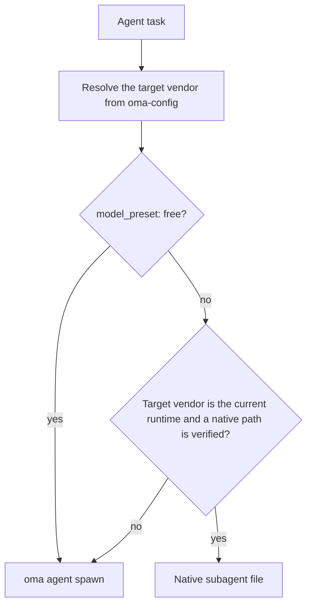
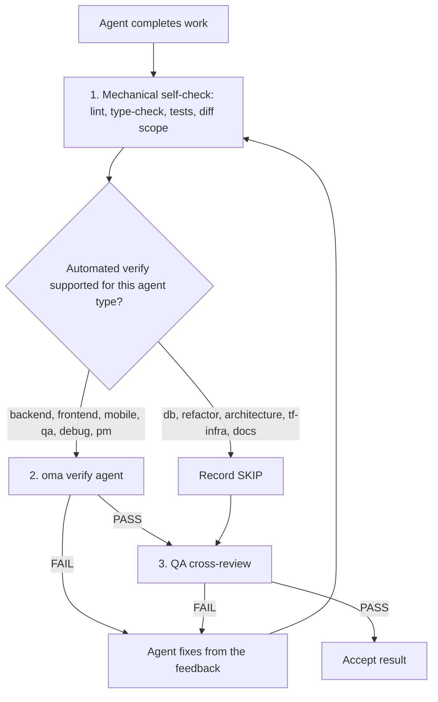

# Agents

OMA sépare les [compétences](../getting-started/glossary.md#skill), les rôles de dispatch et les [définitions d’agents](../getting-started/glossary.md#agent-definition). Une compétence route et charge les indications du domaine ; un rôle canonique est l’identité runtime utilisée pour le dispatch ; une définition suivie dans le dépôt donne au sous-agent une persona propre au fournisseur. Ces couches se recouvrent volontairement : utilisez la limite de la tâche et les critères d’acceptation pour décider si une seule compétence suffit.

---

## Catalogue des compétences {#skill-catalog}

Ce tableau est la liste de référence des compétences installées. Il est généré à partir du frontmatter de chaque `.agents/skills/<name>/SKILL.md` par `cli/scripts/generate-skill-catalog.mjs` ; exécutez le script avec `--check` pour détecter une dérive. La section `## References` du SKILL.md de chaque compétence liste ses fichiers de ressources et indique quand les lire.

<!-- oma:generated skill-catalog:start -->
<!-- Generated from SKILL.md frontmatter under .agents/skills by cli/scripts/generate-skill-catalog.mjs. Do not edit this block by hand. -->

| Skill | Use it for |
|---|---|
| [`oma-academic-writing`](https://github.com/first-fluke/oh-my-agent/blob/main/.agents/skills/oma-academic-writing/SKILL.md) | Draft and revise academic prose against a rubric, evidence, and citation requirements. Use for essays, reports, literature reviews, or academic style audits. |
| [`oma-architecture`](https://github.com/first-fluke/oh-my-agent/blob/main/.agents/skills/oma-architecture/SKILL.md) | Evaluate system boundaries and architectural tradeoffs. Use for architecture decisions, design reviews, and ADRs. |
| [`oma-backend`](https://github.com/first-fluke/oh-my-agent/blob/main/.agents/skills/oma-backend/SKILL.md) | Implement server APIs, authentication, and application data access. Schema modeling and query tuning use oma-db. |
| [`oma-brainstorm`](https://github.com/first-fluke/oh-my-agent/blob/main/.agents/skills/oma-brainstorm/SKILL.md) | Explore goals, constraints, and alternative approaches before choosing a design. Use when the user requests ideation or design exploration. |
| [`oma-coordination`](https://github.com/first-fluke/oh-my-agent/blob/main/.agents/skills/oma-coordination/SKILL.md) | Coordinate assigned specialist tasks and handoffs manually. Use when supervising a multi-agent project step by step. |
| [`oma-db`](https://github.com/first-fluke/oh-my-agent/blob/main/.agents/skills/oma-db/SKILL.md) | Design schemas and migrations, tune queries, or plan vector retrieval and database operations. Application API implementation uses oma-backend. |
| [`oma-debug`](https://github.com/first-fluke/oh-my-agent/blob/main/.agents/skills/oma-debug/SKILL.md) | Diagnose a reproducible failure, fix its cause, and verify the regression. Use for crashes, incorrect behavior, and failing tests. |
| [`oma-design`](https://github.com/first-fluke/oh-my-agent/blob/main/.agents/skills/oma-design/SKILL.md) | Define or review a visual system, DESIGN.md, or redesign direction. Use for typography, layout, color, motion, and interaction design decisions. |
| [`oma-dev-workflow`](https://github.com/first-fluke/oh-my-agent/blob/main/.agents/skills/oma-dev-workflow/SKILL.md) | Configure development tasks, git hooks, CI/CD, or release automation. Use when creating or fixing a repository development workflow. |
| [`oma-docs`](https://github.com/first-fluke/oh-my-agent/blob/main/.agents/skills/oma-docs/SKILL.md) | Check documentation references, sync docs to code changes, and detect translation drift. Use for documentation maintenance in a repository. |
| [`oma-explanation`](https://github.com/first-fluke/oh-my-agent/blob/main/.agents/skills/oma-explanation/SKILL.md) | Create an offline HTML explanation of a code change (diff, PR, branch) or of a topic, system, or question. Use when a visual walkthrough document is requested. |
| [`oma-frontend`](https://github.com/first-fluke/oh-my-agent/blob/main/.agents/skills/oma-frontend/SKILL.md) | Implement or modify web UI in React, Next.js, or Angular. Use for components, pages, styles, forms, and frontend state or data flows. |
| [`oma-hwp`](https://github.com/first-fluke/oh-my-agent/blob/main/.agents/skills/oma-hwp/SKILL.md) | Convert Hangul HWP, HWPX, or HWPML documents to Markdown with kordoc. Use for text, table, and image extraction from these formats. |
| [`oma-image`](https://github.com/first-fluke/oh-my-agent/blob/main/.agents/skills/oma-image/SKILL.md) | Generate raster images or reference-guided variations through the OMA image CLI. Use for image assets or explicit vendor comparisons; pixel editing uses an editor. |
| [`oma-market`](https://github.com/first-fluke/oh-my-agent/blob/main/.agents/skills/oma-market/SKILL.md) | Research customer pain points, trends, and competitors through the OMA market engine. Use for market discovery or voice-of-customer analysis. |
| [`oma-mobile`](https://github.com/first-fluke/oh-my-agent/blob/main/.agents/skills/oma-mobile/SKILL.md) | Implement Flutter, React Native, or native Swift apps. Use for mobile screens, widgets, platform integrations, and application data flows. |
| [`oma-observability`](https://github.com/first-fluke/oh-my-agent/blob/main/.agents/skills/oma-observability/SKILL.md) | Design or troubleshoot telemetry, SLOs, and incident diagnostics. Route to the relevant signal, system boundary, or vendor guide. |
| [`oma-orchestration`](https://github.com/first-fluke/oh-my-agent/blob/main/.agents/skills/oma-orchestration/SKILL.md) | Dispatch and supervise parallel specialist agents with durable task state. Use when automated multi-agent execution is requested. |
| [`oma-pdf`](https://github.com/first-fluke/oh-my-agent/blob/main/.agents/skills/oma-pdf/SKILL.md) | Extract PDF text, headings, tables, and images into Markdown using opendataloader-pdf. Use for PDF parsing, not PDF layout creation. |
| [`oma-pm`](https://github.com/first-fluke/oh-my-agent/blob/main/.agents/skills/oma-pm/SKILL.md) | Turn product requirements into scoped tasks with dependencies and acceptance criteria. Use for implementation planning and prioritization. |
| [`oma-qa`](https://github.com/first-fluke/oh-my-agent/blob/main/.agents/skills/oma-qa/SKILL.md) | Review changes for correctness, security, accessibility, and performance. Use for scoped quality reviews or verification plans; bug fixes use oma-debug. |
| [`oma-recap`](https://github.com/first-fluke/oh-my-agent/blob/main/.agents/skills/oma-recap/SKILL.md) | Summarize AI conversation histories for a specified date or period. Use for daily work recaps and cross-tool activity summaries. |
| [`oma-refactor`](https://github.com/first-fluke/oh-my-agent/blob/main/.agents/skills/oma-refactor/SKILL.md) | Restructure existing code while preserving observable behavior. Use for targeted technical debt or hotspot work with characterization tests. |
| [`oma-scholar`](https://github.com/first-fluke/oh-my-agent/blob/main/.agents/skills/oma-scholar/SKILL.md) | Search academic literature and generate, validate, or compare Knows paper sidecars. Use for claim/evidence analysis and literature synthesis. |
| [`oma-scm`](https://github.com/first-fluke/oh-my-agent/blob/main/.agents/skills/oma-scm/SKILL.md) | Manage Git branches, merges, conflicts, commits, and release baselines. Use for repository history and change-management operations. |
| [`oma-search`](https://github.com/first-fluke/oh-my-agent/blob/main/.agents/skills/oma-search/SKILL.md) | Find external documentation, web sources, or remote code with citations. Local code navigation uses the configured code tools. |
| [`oma-security`](https://github.com/first-fluke/oh-my-agent/blob/main/.agents/skills/oma-security/SKILL.md) | Scan application source, agent skills, and MCP components; run penetration tests against scoped web test deployments, validate findings, and configure scan gates. Use oma-qa for broad quality reviews and domain skills for remediation. |
| [`oma-skill-creation`](https://github.com/first-fluke/oh-my-agent/blob/main/.agents/skills/oma-skill-creation/SKILL.md) | Create or revise OMA skills and their references. Use for skill routing, execution contracts, conditional loading, and authoring validation. |
| [`oma-slide`](https://github.com/first-fluke/oh-my-agent/blob/main/.agents/skills/oma-slide/SKILL.md) | Create, import, revise, or export presentation decks through the OMA slide CLI. Use for HTML slides and PDF, PNG, or PPTX deck delivery. |
| [`oma-tf-infra`](https://github.com/first-fluke/oh-my-agent/blob/main/.agents/skills/oma-tf-infra/SKILL.md) | Create or review Terraform infrastructure and plans. Use for cloud resources, IAM, networking, state management, and infrastructure changes. |
| [`oma-translation`](https://github.com/first-fluke/oh-my-agent/blob/main/.agents/skills/oma-translation/SKILL.md) | Translate or revise localized UI strings and prose while preserving meaning, terminology, placeholders, and structure. |
| [`oma-video`](https://github.com/first-fluke/oh-my-agent/blob/main/.agents/skills/oma-video/SKILL.md) | Create videos through the OMA video CLI, or analyze and edit existing clips with media tools. Use for frame extraction, visual analysis, silence cuts, dubbing assembly, scripts, and composition; audio-only work uses oma-voice. |
| [`oma-voice`](https://github.com/first-fluke/oh-my-agent/blob/main/.agents/skills/oma-voice/SKILL.md) | Generate or transcribe speech with Voicebox, or process existing audio locally. Use for narration, transcripts, timed speech, and loudness conversion; video editing uses oma-video. |
<!-- oma:generated skill-catalog:end -->

---

## Rôles de dispatch {#dispatch-roles}

Le runtime effectue le dispatch par rôle canonique. Chaque rôle, à l’exception d’`orchestrator`, possède une définition suivie dans le dépôt sous `.agents/agents/`, dont le frontmatter `skills:` nomme les compétences qu’elle charge. La première compétence listée est responsable de la tâche.

| Rôle | Fichier de définition | Également accepté | Compétences |
|------|-----------------------|-------------------|--------|
| `orchestrator` | aucun (rôle runtime de coordination) | | |
| `pm` | `pm-planner.md` | `pm-planner` | oma-pm |
| `architecture` | `architecture-reviewer.md` | `architecture-reviewer` | oma-architecture |
| `qa` | `qa-reviewer.md` | `qa-reviewer` | oma-qa |
| `backend` | `backend-engineer.md` | `backend-engineer` | oma-backend |
| `frontend` | `frontend-engineer.md` | `frontend-engineer` | oma-frontend, oma-design |
| `mobile` | `mobile-engineer.md` | `mobile-engineer` | oma-mobile |
| `db` | `db-engineer.md` | `db-engineer` | oma-db |
| `debug` | `debug-investigator.md` | `debug-investigator` | oma-debug |
| `refactor` | `refactor-engineer.md` | `refactor-engineer` | oma-refactor |
| `docs` | `docs-curator.md` | `docs-curator` | oma-docs |
| `tf-infra` | `tf-infra-engineer.md` | `tf-infra-engineer` | oma-tf-infra |
| `explore` | `research-explorer.md` | `research-explorer`, `explorer` | oma-search, oma-market, oma-scholar |

Un suffixe final `-agent` est également accepté (`qa-agent` se résout en `qa`).

### Fichiers d’agents natifs {#native-agent-files}

Les définitions d’agents sous `.agents/agents/` sont la source de vérité. OMA les projette vers des fichiers natifs du fournisseur pour les runtimes qui prennent en charge les sous-agents personnalisés :

| Runtime | Fichiers d’agents natifs |
|---------|--------------------------|
| Claude Code | `.claude/agents/<name>.md` |
| Codex CLI | `.codex/agents/<name>.toml` |
| Cursor | `.cursor/agents/` |
| OpenCode | `.opencode/agents/` |
| Kiro | `.kiro/agents/` |
| Grok | `.grok/agents/` |
| CommandCode | `.commandcode/agents/` |
| Qwen Code | `.qwen/agents/` |

pi n’a pas de système de fichiers d’agents : `oma agent spawn` intègre donc la persona de la définition directement dans le prompt. Les fichiers générés sont rafraîchis par `oma link`, `oma install` et `oma update`.

### Dispatch d’un rôle {#how-a-role-is-dispatched}

Lorsqu’un workflow associe un agent au même fournisseur que le runtime courant, il utilise d’abord le fichier d’agent natif de ce runtime. Les tâches inter-fournisseurs se rabattent sur `oma agent spawn`.



> **Dispatch du modèle par agent :** le fournisseur, le modèle et l’effort de chaque rôle proviennent de `.agents/oma-config.yaml` (ou de `.agents/oma-config.cue`, avec une surcouche `.local` facultative). Avec `model_preset: auto`, valeur par défaut des nouvelles installations, les rôles sans surcharge `agents:` suivent les réglages natifs d’agent et de modèle du runtime courant ; `model_preset: free` passe toujours par `oma agent spawn`. Voir [Modèles par agent](../guide/per-agent-models.md) pour la configuration et [`oma doctor --profile`](../cli-interfaces/commands.md#doctor) pour inspecter la matrice active.

---

## Catégories de compétences {#agent-categories}

| Catégorie | Compétences | Responsabilité |
|----------|--------|----------------|
| **Idéation** | oma-brainstorm | Explorer des idées, proposer des approches et produire des documents de conception |
| **Architecture** | oma-architecture | Frontières système/module/service, analyses ADR/ATAM/CBAM et décisions de compromis |
| **Planification** | oma-pm | Décomposer les exigences, découper les tâches, définir les contrats d’API et attribuer les priorités |
| **Implémentation** | oma-frontend, oma-backend, oma-mobile, oma-db | Écrire du code dans les domaines respectifs |
| **Design** | oma-design | Systèmes de design, DESIGN.md, tokens, typographie, couleurs, animations et accessibilité |
| **Infrastructure** | oma-tf-infra | Provisionnement Terraform multi-cloud, IAM, optimisation des coûts et policy-as-code |
| **DevOps** | oma-dev-workflow | Task runner mise, CI/CD, migrations, coordination des releases et automatisation de monorepo |
| **Observabilité** | oma-observability | Pipelines d’observabilité, routage de traçabilité, signaux MELT+P (metrics/logs/traces/profiles/cost/audit/privacy), SLO, investigation d’incidents et réglage du transport |
| **Qualité** | oma-qa | Audit de sécurité (OWASP), performance, accessibilité (WCAG) et revue de qualité du code |
| **Débogage** | oma-debug | Reproduction de bugs, analyse de cause profonde, corrections minimales et tests de régression |
| **Localisation** | oma-translation | Traduction contextuelle préservant le ton, le registre et les termes du domaine |
| **Coordination** | oma-orchestration, oma-coordination | Orchestration multi-agents automatisée et manuelle |
| **Git** | oma-scm | Génération de Conventional Commits et découpage de commits par fonctionnalité |
| **Recherche et récupération** | oma-search | Routeur de recherche par intention avec scoring de confiance (docs Context7, web, code `gh`/`glab`, intelligence locale du code) |
| **Rétrospective** | oma-recap | Analyse de l’historique de conversations inter-outils et résumés thématiques du travail |
| **Traitement de documents** | oma-hwp, oma-pdf | Conversion HWP/HWPX/HWPML et PDF en Markdown pour ingestion LLM/RAG |
| **Documentation** | oma-docs | Maintenance de la documentation : références cassées, docs touchées par un diff, dérive des traductions et lint des docs traduites |
| **Explication** | oma-explanation | Explications HTML hors ligne d’un changement de code (diff, PR, branche, plage de commits) ou d’un sujet, d’un système ou d’une question |
| **Écriture académique** | oma-academic-writing, oma-scholar | Rédaction/audit de prose académique de niveau publication, et recherche, lecture critique et peer review académiques avec sidecars Knows |
| **Sécurité** | oma-security | Analyse du code source applicatif, des packages de compétences d’agents, des composants MCP et des déploiements web de test autorisés (Deepsec, scanners Cisco, ARTEX), avec validation indépendante des constats et gates CI |
| **Refactoring** | oma-refactor | Restructuration incrémentale préservant le comportement, ciblage de hotspots, filets de tests de caractérisation et commits réservés au refactoring |
| **Recherche de marché** | oma-market | Recherche de pain points, tendances, concurrents et découverte depuis les signaux communautaires, avec frameworks SWOT/Porter 5F/PESTEL choisis automatiquement selon l’intention |
| **Création de compétences** | oma-skill-creation | Création et validation de compétences OMA au format SSL-lite |
| **Génération de médias** | oma-image, oma-slide, oma-video, oma-voice | Images IA, decks HTML, vidéos courtes/explicatives/démonstration et TTS/STT local |

---

## Référence détaillée des agents {#detailed-agent-reference}

Ces résumés présentent le domaine et les règles clés de chaque compétence. Le SKILL.md de la compétence fait foi : sa section `## References` liste les fichiers de ressources et la condition de lecture de chacun ; cette page ne recopie donc pas ces listes.

### oma-brainstorm

**Domaine :** Idéation orientée design avant planification ou implémentation.

**Quand l’utiliser :** explorer une idée de fonctionnalité, comprendre l’intention de l’utilisateur et comparer des approches. À utiliser avant `/plan` pour les demandes complexes ou ambiguës.

**Quand NE PAS l’utiliser :** exigences claires (utiliser oma-pm), implémentation (utiliser les agents du domaine), revue de code (utiliser oma-qa).

**Règles fondamentales :**
- aucune implémentation ni planification avant l’approbation du design ;
- une question de clarification à la fois (pas de lots) ;
- comparer deux ou trois approches viables lorsque des alternatives éclairent la décision ; si les contraintes en laissent moins, expliquer pourquoi au lieu d’inventer des options ;
- présenter le design section par section, en ne tranchant que les choix importants encore ouverts ;
- appliquer YAGNI : ne concevoir que le nécessaire.

**Workflow :** 7 phases : Contexte, Questions, Approches (éventuellement amorcées par TRIZ-lite), Design, Revue à l’aveugle, Documentation (enregistre dans `docs/plans/designs/`), Transition vers `/plan`.

---

### oma-architecture

**Domaine :** Architecture logicielle/système : frontières de modules et de services, analyse des compromis, synthèse des parties prenantes et enregistrements de décisions.

**Quand l’utiliser :** choisir ou revoir une architecture système, définir les frontières module/service/propriété, comparer des options d’architecture avec des compromis explicites, enquêter sur les problèmes architecturaux (amplification des changements, dépendances cachées, APIs maladroites), prioriser les investissements d’architecture ou les refactorings, rédiger des recommandations d’architecture ou des ADR.

**Quand NE PAS l’utiliser :** systèmes visuels/de design (utiliser oma-design), planification de fonctionnalité et décomposition des tâches (utiliser oma-pm), implémentation Terraform (utiliser oma-tf-infra), diagnostic de bug (utiliser oma-debug), revue de sécurité/performance/accessibilité (utiliser oma-qa).

**Méthodologies :** routage diagnostique, comparaison design-twice, analyse de risques façon ATAM, priorisation façon CBAM, enregistrements de décisions façon ADR.

**Règles fondamentales :**
- diagnostiquer le problème architectural avant de choisir une méthode ;
- employer la méthodologie suffisante la plus légère pour la décision en cours ;
- distinguer design architectural, design UI/visuel et livraison Terraform ;
- consulter les agents parties prenantes uniquement lorsque la décision est assez transversale pour en justifier le coût ;
- privilégier la qualité de la recommandation au théâtre du consensus : consulter largement, décider explicitement ;
- chaque recommandation doit énoncer hypothèses, compromis, risques et étapes de validation ;
- tenir compte des coûts par défaut : coût d’implémentation, coût d’exploitation, complexité d’équipe, coût des changements futurs.

---

### oma-pm

**Domaine :** Gestion de produit : analyse des exigences, décomposition des tâches et contrats API.

**Quand l’utiliser :** décomposer une fonctionnalité complexe, déterminer la faisabilité, prioriser le travail et définir les contrats API.

**Règles fondamentales :**
- API-first : définir les contrats avant les tâches d’implémentation ;
- chaque tâche possède agent, titre, critères d’acceptation, priorité et dépendances ;
- minimiser les dépendances pour maximiser le parallélisme ;
- sécurité et tests font partie de chaque tâche (et non de phases séparées) ;
- chaque tâche doit être réalisable par un seul agent ;
- produire le plan JSON et un task board propre à la session pour la compatibilité avec l’orchestrateur.

**Sortie :** `.agents/results/plan-{sessionId}.json` avec des niveaux de priorité numériques (`1` = indépendant, les niveaux inférieurs s’exécutent en premier), ainsi que le rapport propre au run `result-{agentId}-{taskId}-{runId}-{sessionId}.md` dans le magasin mémoire configuré.

---

### oma-frontend

**Domaine :** UI Web en React/Next.js ou Angular avec TypeScript. Les projets React utilisent FSD-lite ; les projets Angular suivent `resources/angular-rules.md`.

**Quand l’utiliser :** interfaces, composants, logique client, styling, validation de formulaires et intégration API.

**Stack technique :**
- React + Next.js (Server Components par défaut, Client Components pour l’interactivité) ;
- TypeScript (strict) ;
- TailwindCSS v4 + shadcn/ui (primitives en lecture seule, extension par cva/wrappers) ;
- FSD-lite : racine `src/` + fonctionnalités `src/features/*/` (aucun import inter-feature).

**Bibliothèques (projets React/Next.js) :**
| Usage | Bibliothèque |
|-------|-------------|
| Dates | luxon |
| Styling | TailwindCSS v4 + shadcn/ui |
| Hooks | ahooks ou @mantine/hooks |
| Utilitaires | es-toolkit |
| Types | type-fest |
| État URL | nuqs |
| État serveur | TanStack Query (hooks générés par orval lorsqu’une spécification OpenAPI existe) |
| État client | Jotai ou Zustand, choisi selon l’intention, sans valeur par défaut (usage réduit) |
| Formulaires | @tanstack/react-form + Zod |
| Authentification | better-auth |
| Animation | motion (`motion/react`) pour les nouveaux projets |

**Règles fondamentales :**
- shadcn/ui en priorité, extension via cva, ne jamais modifier directement `components/ui/*` ;
- mapping 1:1 des design tokens, sans couleurs codées en dur ;
- proxy des requêtes : conserver une convention `proxy.ts` Next.js 16+ existante ; vérifier la version installée et le routage avant de proposer un renommage en `middleware.ts` ;
- pas de prop drilling au-delà de 3 niveaux : utiliser la bibliothèque d’état client du projet (atoms Jotai ou store Zustand) ;
- imports absolus `@/` obligatoires ;
- objectif FCP < 1 s ;
- breakpoints responsifs : 320 px, 768 px, 1024 px, 1440 px.

**Checklist de qualité :**
- accessibilité : labels ARIA, titres sémantiques, navigation clavier ;
- mobile : vérifié sur des viewports mobiles ;
- performance : pas de CLS, chargement rapide ;
- résilience : Error Boundaries et Loading Skeletons ;
- tests : logique couverte par Vitest ;
- qualité : typecheck et lint passent.

---

### oma-backend

**Domaine :** API, logique serveur, authentification et opérations de base de données.

**Quand l’utiliser :** API REST/GraphQL, migrations, auth, logique métier serveur et jobs de fond.

**Architecture :** Router (HTTP) -> Service (logique métier) -> Repository (accès aux données) -> Models.

**Détection de stack :** lire les manifestes (pyproject.toml, package.json, Cargo.toml, go.mod, etc.) pour déterminer langage et framework. Si les conventions du projet manquent, demander à l’utilisateur d’exécuter `/stack-set`, qui matérialise les références `stack/` depuis le schéma et les modèles livrés.

**Règles fondamentales :**
- architecture propre : aucune logique métier dans les handlers de routes ;
- valider toutes les entrées avec la bibliothèque de validation du projet ;
- requêtes paramétrées uniquement (jamais d’interpolation de chaîne SQL) ;
- JWT + Argon2id pour l’authentification (bcrypt acceptable pour la compatibilité avec l’existant) ; limiter le débit des endpoints d’authentification ;
- asynchrone lorsque c’est pris en charge et annotations de type sur toutes les signatures ;
- exceptions personnalisées via un module d’erreur centralisé ;
- stratégie de chargement ORM explicite, limites de transaction et cycle de vie sûr.

<!-- oma-docs:ignore-start -->
Les fichiers propres au projet `stack/stack.yaml`, `stack/tech-stack.md`, les snippets et les modèles d’API sont générés par `/stack-set` lorsque nécessaire ; ils sont absents tant que la stack n’est pas matérialisée.
<!-- oma-docs:ignore-end -->

---

### oma-mobile

**Domaine :** Applications mobiles multiplateformes et natives (Flutter, React Native et iOS natif Swift).

**Quand l’utiliser :** applications mobiles natives (iOS + Android), patterns UI propres au mobile, fonctionnalités de plateforme (caméra, GPS, notifications push), architecture offline-first ; applications iOS natives Swift avec SwiftUI et `swift-openapi-generator`.

**Architecture :** Clean Architecture : domain -> data -> presentation. Pour Swift iOS : structure `App/Core/Features/Shared`.

**Stacks techniques :**
- Flutter/Dart : Riverpod/Bloc (gestion d’état), Dio avec intercepteurs (API), GoRouter (navigation), Material Design 3 (Android) + iOS HIG ;
- iOS natif Swift (iOS 17+) : SwiftUI + `@Observable` (framework Observation), clients API Apple `swift-openapi-generator`, structure `App/Core/Features/Shared`.

**Règles fondamentales :**
- Riverpod/Bloc pour la gestion d’état (pas de `setState` brut pour la logique complexe) ;
- libérer tous les contrôleurs dans `dispose()` ;
- Dio avec intercepteurs pour les appels API, avec gestion du mode hors ligne ;
- objectif 60 fps et tests sur les deux plateformes ;
- en Swift, préférer `@Observable` à `ObservableObject` sur iOS 17+, et générer les clients API depuis des spécifications OpenAPI avec `swift-openapi-generator`.

**Seeds de plateforme :** `variants/` fournit `flutter/`, `react-native/` et `swift-ios/`, chacun avec `stack.yaml`, `tech-stack.md`, `snippets.md` et un modèle d’API, ainsi que le `stack.schema.json` partagé. Ce sont des points de départ pour `/stack-set`, pas une lecture requise pour modifier du code existant.

---

### oma-db

**Domaine :** Architecture de bases SQL, NoSQL et vectorielles.

**Quand l’utiliser :** schéma, ERD, normalisation, index, transactions, capacité, sauvegardes, migrations, architecture vectorielle/RAG, revue d’anti-patterns et conception conforme (ISO 27001/27002/22301).

**Workflow par défaut :** Explorer (entités, patterns d’accès, volume) -> Concevoir (schéma, contraintes, transactions) -> Optimiser (index, partitionnement, archivage, anti-patterns).

**Règles fondamentales :**
- choisir d’abord le modèle, puis le moteur ;
- 3NF par défaut pour le relationnel ; documenter les compromis BASE pour le distribué ;
- documenter les trois couches de schéma : externe, conceptuelle, interne ;
- traiter l’intégrité comme une priorité : entité, domaine, référentielle, règle métier ;
- la concurrence n’est jamais implicite : définir frontières de transactions et niveaux d’isolation ;
- les bases vectorielles servent à la recherche, pas de source de vérité ;
- ne jamais traiter la recherche vectorielle comme remplacement direct de la recherche lexicale.

**Livrables requis :** résumé du schéma externe, schéma conceptuel, schéma interne, tableau des normes de données, glossaire, estimation de capacité et stratégie de sauvegarde/récupération. Pour vectoriel/RAG : politique de version des embeddings, de découpage et de recherche hybride.

---

### oma-design

**Domaine :** Systèmes de design, UI/UX et gestion de DESIGN.md.

**Quand l’utiliser :** créer ou réviser des systèmes de design et DESIGN.md, refondre un site ou une application existants (en préservant ou en remaniant entièrement), landing pages, design tokens, palettes de couleurs, typographie, mises en page responsives et revue d’accessibilité.

**Workflow :** 7 phases : Setup (collecte de contexte) -> Extract (optionnel, depuis des URL de référence) -> Enhance (enrichissement d’un prompt vague) -> Propose (2–3 directions de design) -> Generate (DESIGN.md + tokens) -> Audit (responsive, WCAG, Nielsen, contrôle AI slop) -> Handoff.

**Application des anti-patterns (« no AI slop ») :**
- typographie : stack de polices système par défaut ; pas de Google Fonts par défaut sans justification ;
- couleur : pas de dégradés violet-bleu, d’orbes/blobs en dégradé ou de blanc pur sur noir pur ;
- mise en page : pas de cartes imbriquées, de layout uniquement desktop ou de statistiques génériques à 3 métriques ;
- animation : pas d’easing rebond partout, pas d’animations > 800 ms, respecter prefers-reduced-motion ;
- composants : pas de glassmorphisme partout, alternatives clavier/tactile pour tout élément interactif.

**Règles fondamentales :**
- réutiliser `.design-context.md` et `DESIGN.md` lorsqu’ils existent ; ne créer `.design-context.md` que lorsqu’une véritable phase de découverte éclaire la décision ;
- pour un site ou une application existants, suivre `resources/redesign-protocol.md` et classer en Preserve ou Overhaul avant de proposer ;
- stack de polices système par défaut (polices CJK-ready pour ko/ja/zh) ;
- WCAG AA minimum pour tous les designs ;
- responsive-first (mobile par défaut) ;
- présenter 2–3 directions et obtenir confirmation.

---

### oma-tf-infra

**Domaine :** Infrastructure-as-code avec Terraform et multi-cloud.

**Quand l’utiliser :** provisionnement sur AWS/GCP/Azure/Oracle Cloud, configuration Terraform, authentification CI/CD (OIDC), CDN/load balancers/stockage/réseau, gestion de l’état et infrastructure conforme ISO.

**Détection cloud :** lire les fournisseurs Terraform et les préfixes de ressources (`google_*` = GCP, `aws_*` = AWS, `azurerm_*` = Azure, `oci_*` = Oracle Cloud). Inclut une table complète de correspondance des ressources multi-cloud.

**Règles fondamentales :**
- agnostique vis-à-vis du fournisseur : détecter le cloud depuis le contexte du projet ;
- état distant avec versionnement et verrouillage ;
- OIDC d’abord pour l’authentification CI/CD ;
- toujours planifier (plan) avant d’appliquer (apply) ;
- IAM au moindre privilège ;
- taguer tout (Environment, Project, Owner, CostCenter) ;
- aucun secret dans le code ;
- épingler les versions de tous les fournisseurs et modules ;
- pas d’auto-approve en production.

---

### oma-dev-workflow

**Domaine :** Automatisation monorepo et CI/CD.

**Quand l’utiliser :** lancer des serveurs de développement, exécuter lint/format/typecheck sur l’ensemble des applications, migrations de base de données, génération d’API, builds i18n, builds de production, optimisation CI/CD et validation pre-commit.

**Règles fondamentales :**
- toujours utiliser les tâches `mise run` plutôt que les commandes directes du gestionnaire de paquets ;
- lint/test uniquement sur les applications modifiées ;
- valider les messages de commit avec commitlint ;
- la CI doit ignorer les applications inchangées ;
- ne jamais utiliser les commandes directes du gestionnaire de paquets lorsque des tâches mise existent.

---

### oma-observability

**Domaine :** Routeur d’observabilité et de traçabilité par intention, à travers couches, frontières et signaux.

**Quand l’utiliser :**
- mise en place du pipeline : OTel SDK + Collector + backend fournisseur ;
- traçabilité entre frontières de services et de domaines : propagateurs W3C, baggage, multi-tenant, multi-cloud ;
- réglage du transport : seuils UDP/MTU, OTLP gRPC vs HTTP, topologie Collector DaemonSet vs sidecar, recettes de sampling ;
- investigation d’incidents : localisation en 6 dimensions (code / service / couche / hôte / région / infra) ;
- sélection de catégories de fournisseurs : OSS full-stack vs SaaS commercial vs spécialiste haute cardinalité vs spécialiste profiling ;
- observability-as-code : dashboards Grafana Jsonnet, CRD PrometheusRule, YAML OpenSLO, alertes de burn-rate SLO ;
- méta-observabilité : santé propre du pipeline, dérive d’horloge, garde-fous de cardinalité, matrice de rétention ;
- couverture des signaux MELT+P : metrics, logs, traces, profiles, cost, audit, privacy ;
- migrations de pipelines de logs évaluées au regard du support upstream actuel et des exigences du projet.

**Quand NE PAS l’utiliser :** observabilité LLM ops / gen_ai (utiliser Langfuse, Arize Phoenix, LangSmith, Braintrust), lineage de pipelines de données (OpenLineage + Marquez, dbt test, Airflow lineage), télémétrie de couche physique IoT / datacenter (Nlyte, Sunbird, Device42), orchestration de chaos engineering (Chaos Mesh, Litmus, Gremlin, ChaosToolkit), infrastructure GPU / TPU (NVIDIA DCGM Exporter), supply chain logicielle (sigstore, in-toto, SLSA), workflow de réponse aux incidents / paging (PagerDuty, OpsGenie, Grafana OnCall), mise en place mono-fournisseur déjà couverte par la compétence propre à ce fournisseur.

**Règles fondamentales :**
- classer l’intention avant le routage : setup | migrate | investigate | alert | trace | tune | route ;
- catégorie d’abord, pas registre de fournisseurs : déléguer aux compétences propres aux fournisseurs via `resources/vendor-categories.md` ; ne pas dupliquer la documentation des fournisseurs ;
- le réglage du transport est l’avantage distinctif : les seuils UDP/MTU, le choix du protocole OTLP, la topologie du Collector et les recettes de sampling apportent une profondeur que les autres compétences ne couvrent pas ;
- la méta-observabilité est non négociable : valider la santé propre du pipeline, la synchronisation d’horloge (dérive < 100 ms), la cardinalité et la rétention avant de déclarer la mise en place terminée ;
- préférence CNCF en priorité : Prometheus, Jaeger, Thanos, Fluent Bit, OpenTelemetry, Cortex, OpenCost, OpenFeature, Flagger, Falco ;
- Fluentd reste un projet CNCF Graduated ; le guide CNCF 2025-10 de passage de Fluentd à Fluent Bit est un guide de migration, pas une dépréciation. Choisir Fluentd, Fluent Bit ou l’OTel Collector selon la charge de travail, les plugins et les exigences d’exploitation ;
- W3C Trace Context comme propagateur par défaut ; le traduire selon le cloud (AWS X-Ray `X-Amzn-Trace-Id`, GCP Cloud Trace, Datadog, Cloudflare, Linkerd) ;
- la confidentialité avant les fonctionnalités : masquage des PII, règles de baggage tenant compte du sampling, audit immuable SOC2/ISO + effacement GDPR/PIPA appliqués dès la collecte, pas seulement au stockage.

---

### oma-qa

**Domaine :** Assurance qualité couvrant sécurité, performance, accessibilité et qualité du code.

**Quand l’utiliser :** revue finale avant déploiement, audit de sécurité, analyse de performance, conformité d’accessibilité et analyse de couverture de tests.

**Ordre de priorité de la revue :** Sécurité > Performance > Accessibilité > Qualité du code.

**Niveaux de sévérité :**
- **CRITICAL** : brèche de sécurité ou risque de perte de données ;
- **HIGH** : bloque le lancement ;
- **MEDIUM** : à corriger dans ce sprint ;
- **LOW** : backlog.

**Règles fondamentales :**
- chaque constat doit contenir fichier:ligne, description et correction ;
- exécuter d’abord les outils automatisés (npm audit, bandit, lighthouse) ;
- aucun faux positif : chaque constat doit être reproductible ;
- fournir du code de remédiation, pas seulement des descriptions.

---

### oma-debug

**Domaine :** Diagnostic et correction de bugs.

**Quand l’utiliser :** bugs signalés par les utilisateurs, plantages, problèmes de performance, défaillances intermittentes, conditions de concurrence et bugs de régression.

**Méthodologie :** reproduire d’abord, diagnostiquer ensuite. Ne jamais deviner une correction.

**Règles fondamentales :**
- identifier la cause profonde, pas seulement les symptômes ;
- correction minimale : ne modifier que ce qui est nécessaire ;
- accompagner chaque correction d’un test de régression ;
- rechercher ailleurs des motifs similaires ;
- documenter dans `.agents/results/`.

**Outils d’intelligence du code (Gortex ou Serena) :**
- `find_symbol("functionName")` ou navigation de symboles Gortex : localiser la fonction ;
- `find_referencing_symbols("Component")` ou analyse d’impact Gortex : trouver toutes les utilisations ;
- `search_for_pattern("error pattern")` ou recherche Gortex : trouver les problèmes similaires.

---

### oma-translation

**Domaine :** Traduction multilingue contextuelle.

**Quand l’utiliser :** traduire des chaînes UI, de la documentation ou des textes marketing, revoir des traductions existantes et créer des glossaires.

**Flux en six scènes :** Prepare, Acquire, Reason, Act, Verify et Finalize. La méthode de traduction suit quatre étapes : lire le sens et la syntaxe protégée, choisir le registre, reconstruire dans la langue cible et préserver le style de l’auteur lorsqu’il doit l’être.

**Règles fondamentales :**
- parcourir d’abord les fichiers de locale existants pour respecter leurs conventions ;
- traduire le sens et non les mots ;
- préserver les connotations émotionnelles ;
- ne jamais produire de traduction mot à mot ;
- ne jamais mélanger les registres au sein d’un même texte ;
- conserver tels quels les termes propres au domaine.

---

### oma-orchestration

**Domaine :** Coordination automatisée de plusieurs agents via lancement CLI.

**Quand l’utiliser :** fonctionnalités complexes nécessitant plusieurs agents en parallèle, exécution automatisée et implémentation full-stack.

**Valeurs de configuration par défaut :**

| Réglage | Défaut | Description |
|---------|--------|-------------|
| MAX_PARALLEL | 3 | Nombre maximal de sous-agents simultanés |
| MAX_RECOVERY_ATTEMPTS | 3 | Total des reprises et des hypothèses d’exploration par tâche, tentative initiale comprise |
| POLL_INTERVAL | 30s | Intervalle de vérification de l’état des runs `oma agent spawn` (les sous-agents natifs de Claude Code répondent de façon synchrone) |

**Phases du workflow :** Plan → References (sélection des références par tâche) → Setup (artefacts de session et de task board) → Execute (dispatch des tâches prêtes dans la limite de MAX_PARALLEL) → Monitor → Verify (boucle de revue) → Collect (claims et rapports propres aux runs).

**Boucle de revue inter-agents :** voir [Flux d’orchestration](#orchestration-flow) pour le diagramme et les limites de la boucle.

**Preuves de session :** consigner, lorsque c’est utile, les corrections importantes et les constats de revue arbitrés, avec cause, impact et vérification. Aucun score de pénalité ni aucune pause déclenchée par un score ne s’applique.

---

### oma-scm

**Domaine :** Gestion de configuration logicielle (SCM) et Git : branches, fusions, worktrees, baselines, préparation aux audits et Conventional Commits.

**Quand l’utiliser :** après des changements de code (`/scm`), en cas de conflit de fusion, pour les stratégies de branche, releases/tags ou toute question de gestion de configuration du dépôt.

**Types de commit :** feat, fix, docs, style, refactor, perf, test, chore, build, ci, revert.

**Workflow des commits :** analyser les changements → séparer par fonctionnalité si nécessaire → type → scope → description (impératif, moins de 72 caractères, minuscules, sans point final) → commiter avec des chemins explicites.

**Règles :**
- ne pas utiliser `git add -A` ni `git add .` sans autorisation explicite ;
- ne jamais commiter de fichiers de secrets ;
- toujours spécifier les fichiers au staging ;
- écrire le message dans un fichier et commiter avec `git commit -F <message-file>` ;
- ne pas réécrire un historique partagé sans autorisation explicite ; utiliser `--force-with-lease`, jamais `--force` seul ;
- n’inclure les trailers de co-auteur que si la configuration effective `scm.co_author` les active et fournit le nom et l’adresse e-mail.

---

### oma-coordination

**Domaine :** Guide de coordination manuelle de plusieurs agents, étape par étape.

**Quand l’utiliser :** travail multi-domaines où l’on veut superviser étape par étape le lancement, le suivi, l’alignement des contrats et la QA plutôt qu’une orchestration entièrement automatisée.

**Quand NE PAS l’utiliser :** exécution parallèle entièrement automatisée (utiliser oma-orchestration), tâches dans un seul domaine (utiliser directement l’agent de domaine).

**Règles fondamentales :**
- réutiliser un plan valide ; n’appeler oma-pm que lorsque la décomposition ou les contrats doivent changer ;
- lancer en parallèle les tâches indépendantes d’un même niveau de priorité, chacune dans son propre workspace ou avec `--isolation worktree` ;
- mettre à jour les contrats des frontières d’API modifiées avant le travail frontend ou mobile qui en dépend ;
- la revue QA est toujours l’étape finale ;
- renvoyer les défauts QA bloquants et les lacunes de vérification requises à l’agent responsable, puis relancer les contrôles concernés.

**Workflow :** Plan (réutilisé ou PM) → lancement par niveau de priorité → surveillance → revue QA → correction des problèmes → livraison.

**Différence avec oma-orchestration :** la coordination est manuelle et guidée (l’utilisateur contrôle le rythme) ; l’orchestrateur est automatisé (les agents sont lancés et s’exécutent avec une intervention minimale de l’utilisateur).

---

### oma-search

**Domaine :** Routeur de recherche par intention avec scoring de confiance du domaine. Route vers Context7 (docs), recherche web native, `gh`/`glab` (code) et intelligence locale du code (Gortex ou Serena).

**Quand l’utiliser :** trouver la documentation officielle de bibliothèques/frameworks, recherche web de tutoriels/exemples/comparaisons/solutions, recherche de code GitHub/GitLab pour des motifs d’implémentation, toute requête dont le canal de recherche est incertain (routage automatique), autres compétences ayant besoin d’une infrastructure de recherche (invocation partagée).

**Quand NE PAS l’utiliser :** exploration d’une base de code uniquement locale (utiliser directement le MCP d’intelligence du code), analyse de l’historique Git ou du blame (utiliser oma-scm), recherche d’architecture complète (utiliser oma-architecture, qui peut invoquer cette compétence en interne).

**Règles fondamentales :**
- un `--docs`, `--code` ou `--web` explicite sélectionne la route ; sinon, classer l’intention avec `resources/intent-rules.md` ;
- une requête, une meilleure route ; éviter le multi-route redondant sauf si l’intention est ambiguë ;
- noter la confiance de chaque résultat ; tous les résultats non locaux reçoivent des étiquettes de confiance de domaine issues du registre ;
- autres flags : `--strict` filtre les résultats par confiance après le scoring, `--wide` conserve les résultats étiquetés de confiance inférieure et `--gitlab` sélectionne GitLab comme hôte de code ;
- échouer en avançant : si la route principale échoue, basculer proprement (docs→web, web→stratégies `oma search fetch`) ;
- aucun MCP supplémentaire requis : Context7 pour la documentation, la recherche native du runtime pour le web, le CLI pour le code, le fournisseur configuré (Gortex ou Serena) pour le local ;
- recherche web indépendante du fournisseur : utiliser ce que fournit le runtime courant (WebSearch, Google, Bing) ;
- confiance au niveau du domaine uniquement ; pas de score par sous-chemin ou par page.

---

### oma-recap

**Domaine :** Analyse d’historique de conversations entre plusieurs outils IA (Claude, Codex, Gemini, Antigravity, Qwen, Cursor, Grok) avec résumés quotidiens ou périodiques thématiques.

**Quand l’utiliser :** résumer une journée ou une période d’activité de travail, comprendre le flux de travail entre plusieurs outils IA, analyser les patterns de changement d’outil entre sessions, préparer des standups quotidiens / rétros hebdomadaires / journaux de travail.

**Quand NE PAS l’utiliser :** rétrospective des changements de code basée sur les commits Git (utiliser `oma retro`), monitoring des agents en temps réel (utiliser `oma dashboard terminal`), métriques de productivité (utiliser `oma stats get`).

**Processus :**
1. résoudre la date ou la fenêtre de temps à partir d’une entrée en langage naturel (today, yesterday, last Monday, date explicite) ;
2. récupérer les données de conversation avec `oma recap --date YYYY-MM-DD --json` pour un jour calendaire ou `oma recap --window 7d --json` pour une fenêtre glissante (`1d`, `3d`, `7d`, `2w`, `30d`) ; affiner avec `--tool` ;
3. regrouper par contenu (projets et thèmes), et non par outil ; une fenêtre de 3 jours ou plus regroupe par projet plutôt que par jour ;
4. extraire les thèmes (fonctionnalités travaillées, bugs corrigés, outils explorés) ;
5. produire le résumé quotidien/périodique thématique.

---

### oma-hwp

**Domaine :** Conversion HWP / HWPX / HWPML (traitement de texte coréen) vers Markdown avec `kordoc`.

**Quand l’utiliser :** convertir des documents HWP coréens (`.hwp`, `.hwpx`, `.hwpml`) en Markdown, préparer des documents gouvernementaux/d’entreprise coréens pour le contexte d’un LLM ou du RAG, extraire le contenu structuré (tableaux, titres, listes, images, notes de bas de page, hyperliens) d’un HWP.

**Quand NE PAS l’utiliser :** fichiers PDF (utiliser oma-pdf), XLSX/DOCX (hors périmètre), génération/édition de HWP (hors périmètre), fichiers déjà textuels (utiliser directement l’outil Read).

**Règles fondamentales :**
- utiliser `bunx kordoc@latest` pour l’exécution (aucune installation requise) ; toujours passer `@latest` ou une version fixée ;
- le format de sortie par défaut est Markdown ;
- sans répertoire de sortie, écrire dans le même répertoire que l’entrée ;
- kordoc gère la préservation de la structure (titres, tableaux, tableaux imbriqués, notes de bas de page, hyperliens, images) ;
- les défenses de sécurité (ZIP bomb, XXE, SSRF, XSS) sont fournies par kordoc ; ne pas en ajouter de personnalisées ;
- pour un HWP chiffré ou verrouillé par DRM, signaler clairement la limitation à l’utilisateur ;
- post-traiter avec `resources/flatten-tables.ts` pour convertir les blocs HTML `<table>` en pipe tables GFM et retirer les caractères Private Use Area des polices Hancom.

---

### oma-pdf

**Domaine :** Conversion PDF vers Markdown avec `opendataloader-pdf`.

**Quand l’utiliser :** convertir des documents PDF en Markdown pour le contexte d’un LLM ou du RAG, extraire le contenu structuré (tableaux, titres, listes) des PDF, préparer des données PDF pour leur consommation par l’IA.

**Quand NE PAS l’utiliser :** générer/créer des PDF (utiliser les outils documentaires appropriés), modifier des PDF existants (hors périmètre), simple lecture de fichiers déjà textuels (utiliser directement l’outil Read).

**Règles fondamentales :**
- utiliser `uvx opendataloader-pdf` pour l’exécution (aucune installation requise) ;
- le format de sortie par défaut est Markdown ;
- sans répertoire de sortie, écrire dans le même répertoire que le PDF d’entrée ;
- préserver la structure du document (titres, tableaux, listes, images) ;
- pour les PDF scannés, utiliser le mode hybride avec OCR ;
- toujours exécuter `uvx mdformat` sur la sortie pour normaliser le formatage Markdown ;
- valider que le Markdown produit est lisible et bien structuré ;
- signaler à l’utilisateur tout problème de conversion (tableaux manquants, texte corrompu).

---

### oma-academic-writing

**Domaine :** Prose académique anglaise de niveau publication : rédaction, révision et audit d’essais, rapports, sections d’analyse, résumés exécutifs, conclusions et revues de littérature.

**Quand l’utiliser :** rédiger ou réviser des rapports/essais/sections d’analyse académiques, rédiger des executive summaries, des conclusions ou des revues de littérature, réécrire une prose qui sonne IA en anglais académique naturel, polir un brouillon jusqu’à une qualité de rubric top-band (HD, A, top-band), relire une prose pour la variété des phrases / la qualité des verbes / le hedging / la conformité anti-IA.

**Quand NE PAS l’utiliser :** traduction (utiliser oma-translation), découverte de sources / collecte de citations / recherche de littérature (utiliser oma-scholar), analyse de rubric et décomposition de tâches (utiliser oma-pm), documentation de code / README / texte de référence d’API (utiliser la compétence de domaine concernée), texte informel ou marketing, rédaction académique non anglaise (rédiger en anglais, puis transmettre à oma-translation).

**Modes :** `draft` (titre + prose + Writing Notes + Claim-Evidence Map), `revise` (original + version révisée + liste des changements), `review` (rapport de conformité PASS/FAIL sur la structure des phrases, la qualité des verbes, l’anti-IA, la spécificité, le hedging, la clarté des paragraphes, le rythme et l’alignement claim/evidence).

**Règles fondamentales :**
- citation avant jugement : citer le texte littéral de la rubric/contrainte avant d’appliquer toute règle ;
- chaque phrase doit être vérifiable ; ne jamais inventer de données, de statistiques ni de citations ;
- les verbes génériques interdits (`show`, `have`, `make`, `do`, `get`, `use`, …) ne doivent pas être des verbes principaux ;
- varier le type, la longueur et le début des phrases ; jamais 3 phrases de même type ou plus à la suite ;
- calibrer la force du hedge sur celle des preuves ; pas de première personne (`I think`/`I believe`) ;
- chaque claim renvoie à une preuve dans la Claim-Evidence Map ; atténuer ou retirer les claims non étayés.

**Workflow :** 6 étapes — READ (lire la rubric/le brouillon et citer les contraintes), PLAN (planifier les paragraphes en Topic-Support-Conclude), DRAFT (rédiger selon les quatre protocoles), AUDIT (auditer avec la checklist anti-IA), REVERSE-OUTLINE + construction de la Claim-Evidence Map, POLISH (lecture à voix haute, cohésion, spécificité, nombre de mots, rythme).

---

### oma-security

**Domaine :** Analyse et validation de sécurité du code source applicatif, des packages de compétences d’agents, des composants MCP et des déploiements web de test autorisés.

**Quand l’utiliser :** analyser un dépôt ou un diff de code source ; inspecter un package de compétence, ou un serveur ou une configuration MCP ; mener un test d’intrusion borné contre un déploiement de test concret et autorisé ; valider les candidats d’un scanner ; configurer un gate CI propre à un moteur ; diagnostiquer les credentials, la couverture, les matchers, le quota ou l’état de reprise d’un scanner.

**Quand NE PAS l’utiliser :** revue générale de correction, de performance, d’accessibilité ou de qualité (utiliser oma-qa), comparaisons d’outils ou recherche sans exécution (utiliser oma-search), décisions d’architecture de sécurité (utiliser oma-architecture), remédiation dans le code produit (utiliser oma-debug ou la compétence backend/frontend/mobile/infrastructure responsable).

**Moteur par défaut selon la cible :**

| Cible | Moteur par défaut |
|-------|-------------------|
| Code source applicatif ou diff de code source | Deepsec (Cisco AI Deep SAST lorsqu’il est explicitement sélectionné) |
| Répertoire ou package de compétence d’agent | Cisco Skill Scanner |
| Source, configuration ou serveur MCP | Cisco MCP Scanner |
| Déploiement web de test | ARTEX |
| Reproduction locale bornée | Méthode de validation Cloudflare (sans réseau externe) |

**Règles fondamentales :**
- une analyse générale de dépôt ne sélectionne que le code source ; les analyses de compétences, de MCP et du runtime ne sont pas ajoutées implicitement ;
- un résultat en échec ou vide ne sélectionne jamais automatiquement un autre moteur, un autre modèle ou un analyseur payant ;
- préserver et reprendre l’état `.deepsec/` existant ; ne jamais réinitialiser pour effacer un run en échec ou bruité ;
- une clé ou un outil installé n’autorise ni appels payants ni périmètre élargi ; réutiliser l’autorisation existante selon la politique d’exécution partagée ;
- chaque candidat unique est confié à un nouveau vérificateur qui ne l’a pas découvert ; `confirmed` exige une preuve observée indépendante ;
- aucun résultat n’établit qu’une cible est sûre ; un gate ne peut pas passer tant que des contrôles requis restent incomplets.

**Sortie :** un répertoire `.agents/results/security/<run-id>/` par invocation, avec `run.json`, `findings.json` et `report.md` (plus `runtime.json` pour l’exécution web et `gate.json` pour la CI).

---

### oma-docs

**Domaine :** Maintenance de la documentation en quatre modes : `verify` (références cassées ; régénère `docs/generated/doc-refs.json`), `sync` (docs qui référencent des fichiers modifiés dans un diff), `i18n` (dérive des traductions) et `lint` (problèmes de style dans les docs traduites).

**Quand l’utiliser :** après un refactor, un renommage ou une suppression de fichier, pour trouver les références obsolètes dans les docs ; avant une release, pour confirmer que les commandes CLI, les chemins de fichiers et les clés de configuration existent toujours ; après un git diff important, pour trouver quelles docs référencent des fichiers modifiés ; contrôles courants de dérive des traductions.

**Quand NE PAS l’utiliser :** recherche générale dans le code source (utiliser oma-search), implémentation applicative (utiliser le spécialiste responsable), traduction d’un texte connu (utiliser oma-translation).

**Règles fondamentales :**
- les demandes de revue seule produisent des propositions ; une demande de modification ciblée déjà formulée autorise à appliquer ces corrections sans nouvelle approbation fichier par fichier ;
- le CLI émet des données structurées ; le LLM hôte fait la synthèse et la rédaction des patches. Ne pas inventer de constats CLI ni appeler l’API LLM d’un fournisseur depuis le CLI docs ;
- les fichiers contenant des secrets (`.env*`, clés privées, credentials) n’apparaissent jamais dans les rapports de diff ni dans les patches ;
- respecter les blocs ignore, `oma-docs: skip` et les exclusions configurées ;
- la vérification des URL est déléguée à `lychee` (facultatif) ; le hook de workflow ne s’exécute que si `docs.auto_verify` est activé et reste warn-only.

**Workflow :** `oma docs verify --json`, `oma docs sync <range> --json`, `oma docs i18n --json` ou `oma docs lint --json` → inspecter les résultats structurés → vérifier chaque correction par rapport au code actuel → appliquer les corrections autorisées → relancer les contrôles concernés. `verify` sort avec le code 0 lorsque tout est propre et 1 lorsqu’il trouve des références cassées.

---

### oma-explanation

**Domaine :** Explications HTML hors ligne et autonomes, en deux modes : le mode changement (un diff, une PR, une branche ou une plage de commits, avec contexte, intuition, parcours du code et quiz de cinq questions) et le mode sujet (un concept, un système ou une question présenté sous forme de fiche visuelle d’une page).

**Quand l’utiliser :** expliquer un diff, une pull request, une branche ou une plage de commits, ou bien un sujet, un système ou une question, sous la forme d’une page HTML unique utilisable hors ligne.

**Workflow :** le modèle rédige un brouillon Markdown ; `oma explain render` le transforme en un fichier HTML unique sous `.agents/results/explain/{YYYY-MM-DD}-{slug}.html`, et `oma explain validate` le vérifie. La compétence ne s’active que par `/explain`, en la nommant ou par délégation ; elle est exclue des indications par mots-clés.

**Quand NE PAS l’utiliser :** page documentaire classique, implémentation live ou deck de slides (utiliser `oma-slide` pour les présentations).

---

### oma-image

**Domaine :** Génération d’images IA multi-fournisseurs avec dispatch parallèle tenant compte de l’authentification (Codex `gpt-image-2`, modèles de la famille Gemini « nano-banana » d’Antigravity via `agy`, le modèle exact étant sélectionné en interne, Pollinations flux/zimage).

**Quand l’utiliser :** générer des images, des assets visuels, des illustrations, des photos produit, du concept art ou des mockups ; comparer les sorties de plusieurs modèles d’image pour un même prompt ; produire des images à partir de prompts dans des workflows d’éditeur.

**Quand NE PAS l’utiliser :** édition d’une image existante ou retouche photo, génération de vidéos ou d’audio (utiliser oma-video / oma-voice), composition vectorielle/SVG en ligne à partir de données structurées, simple redimensionnement d’assets ou conversion de format.

**Règles fondamentales :**
- clarifier avant d’invoquer : si le sujet/style/composition/usage est ambigu, poser d’abord la question ou amplifier le prompt et montrer à l’utilisateur la version enrichie ;
- dispatch tenant compte de l’authentification : ne lancer que les fournisseurs authentifiés ; avec `--vendor all`, chaque fournisseur demandé doit être disponible ;
- garde de coût : confirmer avant les runs dont le coût estimé est ≥ $0.20 (`--yes`/`OMA_IMAGE_YES=1` pour contourner) ; `pollinations` et `antigravity`, par défaut, sont gratuits ;
- sécurité du chemin : une sortie hors de `$PWD` nécessite `--allow-external-output` ; `n` max = 5 ;
- sorties consignées : chaque run écrit `manifest.json` à côté des images, avec le prompt, le fournisseur/modèle, les entrées et les métadonnées des artefacts ; il consigne des données de reproductibilité, sans promettre des images identiques au pixel près ;
- transmettre automatiquement les images de référence jointes via `--reference <path>` (codex/antigravity).

**Workflow :** PREPARE (clarifier/amplifier le prompt, choisir le fournisseur) → ACQUIRE (valider l’authentification, les références, le chemin de sortie) → ACT (`oma image generate`) → VERIFY (manifest, fichiers, code de sortie) → FINALIZE (chemins de sortie + avertissements).

---

### oma-market

**Domaine :** Recherche de marché par signaux communautaires : pain points, tendances, positionnement concurrentiel et découverte. Elle utilise le moteur upstream [`last30days`](https://github.com/mvanhorn/last30days-skill) (Reddit, X, YouTube, TikTok, Instagram, HN, Polymarket, GitHub, arXiv, Techmeme, Digg, LinkedIn, StockTwits, Bluesky, web et autres), qu’oma maintient automatiquement à la dernière version publiée.

**Quand l’utiliser :** extraire de vrais pain points d’utilisateurs à partir de posts communautaires, détecter des tendances dans une catégorie sur une fenêtre de 7/30/90/180 jours, analyser le sentiment concurrentiel et le positionnement SWOT / Porter 5F, découverte ouverte (`--discover`), recherche personne/entreprise/ticker, signaux de recrutement et drills de suivi.

**Quand NE PAS l’utiliser :** recherche web générale sans cadrage marché (utiliser directement oma-search), littérature académique (utiliser oma-scholar), dashboards live ou monitoring planifié (encapsuler cette compétence avec `oma schedule <action>`).

**Règles fondamentales :**
- detect-trap d’abord : ne jamais lancer le moteur sans preflight (`--force` uniquement après reconfirmation explicite de l’utilisateur) ;
- un seul moteur, toujours le dernier : `oma market resolve` rafraîchit la copie gérée (`~/.cache/oma-market/last30days/<tag>/`) avant l’utilisation ; une copie obsolète installée par l’utilisateur n’est qu’un fallback lorsque rien n’est en cache hors ligne ;
- suivre le `SKILL.md` du moteur résolu à la lettre ; la seule substitution est `oma market run <args>` à la place de l’appel brut `python3 scripts/last30days.py` ;
- jamais de WebSearch seul : sans moteur, sans Python 3.12+ ou avec une sortie non nulle → s’arrêter et signaler ;
- les sources à clé ne sont activées que via l’assistant de configuration upstream, avec le consentement de l’utilisateur ; les sources ignorées restent visibles dans le pied de page ;
- les frameworks ne citent que les clusters du moteur ; badge en première ligne et LAWs upstream appliqués avant l’écriture du fichier ;
- un seul brief par run dans `.agents/results/market/{topic-slug}-{YYYYMMDD}.md` ; le framework bascule automatiquement selon l’intention (pain/trend → SWOT, competitor → SWOT + Porter 5F, discovery → SWOT + PESTEL).

**Workflow :** detect-trap → `oma market resolve` → lire le `SKILL.md` upstream → étapes de pré-recherche upstream (assistant setup, résolution handle/subreddit, plan de requêtes) → `oma market run … --emit=compact` → synthétiser selon l’OUTPUT CONTRACT upstream → ajouter les frameworks → auto-vérifier → écrire.

---

### oma-refactor

**Domaine :** Refactoring préservant le comportement : restructuration incrémentale sûre, avec ciblage des code smells/SATD/hotspots, filets de sécurité de tests de caractérisation et commits réservés au refactoring.

**Quand l’utiliser :** exécuter un refactoring sur des fichiers/modules précis (extraire, déplacer, renommer, décomposer, aligner les idiomes), refactoring préparatoire avant une fonctionnalité, sauvetage de code legacy/brownfield (découverte de seams + tests de caractérisation), sélection des cibles de refactoring par hotspot (churn × complexité), audit pour savoir si le code peut être refactoré maintenant en toute sécurité.

**Quand NE PAS l’utiliser :** corriger un bug signalé ou un comportement défaillant (utiliser oma-debug ; un refactoring ne doit pas changer le comportement), audit de sécurité/performance/accessibilité (utiliser oma-qa), conception système / frontières de modules / ADR (utiliser oma-architecture), conception de schéma DB ou mécanique de migration (utiliser oma-db), découpage / staging de commits (utiliser oma-scm), optimisation de performance comme objectif.

**Règles fondamentales :**
- préservation du comportement : le contrat du consommateur (en tenant compte de la loi de Hyrum) est inviolable ; le tuning est un effet de bord, jamais un objectif ;
- vérifiable : ne jamais restructurer sans filet ; si le filet de sécurité manque ou est faible, écrire D’ABORD des tests de caractérisation (golden-master) dans des commits séparés ;
- incrémental : une transformation nommée par commit ; en cas d’échecs répétés, utiliser Mikado (consigner le prérequis, revert complet, récursion) ;
- séparé (deux casquettes) : ne jamais mêler de changements de comportement aux commits de refactoring (type `refactor:` uniquement) ;
- économique : la lisibilité est l’objectif dominant ; ne pas refactorer du code destiné à être supprimé ni du code froid à faible churn ;
- toute déviation de convention passe par la voie ADR d’oma-architecture, pas par une modification locale ; toutes les métriques sont des proxies (Goodhart).

**Workflow :** PREPARE (classer green/brownfield, portes de taille, classement hotspot) → ACQUIRE (lire le code via les outils de symboles, collecter métriques + signaux Git) → REASON (planifier la séquence de transformations atomiques / expand-contract) → ACT (une transformation engine-first) → VERIFY (relancer les tests inchangés → commit, ou revert Mikado) → FINALIZE (delta de métriques + verdict de lisibilité).

---

### oma-scholar

**Domaine :** Compagnon de recherche académique fondé sur la spécification de sidecar `.knows.yaml` de Knows : générer, valider, relire, interroger et comparer des sidecars structurés d’articles, ainsi que la récupération depuis knows.academy.

**Quand l’utiliser :** lecture d’articles économe en tokens via les sidecars (~700 tokens pour les claims seuls contre ~10 K pour un PDF complet), génération de `.knows.yaml` depuis des brouillons/LaTeX/notes, validation de la structure des sidecars avant partage, production de peer reviews sous forme de sidecars, interrogation ou résumé de sidecars existants, comparaison structurelle de deux articles, recherche/récupération depuis knows.academy.

**Quand NE PAS l’utiliser :** recherche web générale ou contenu non académique (utiliser oma-search), traduction d’articles (utiliser oma-translation), simple parsing de PDF sans sidecar (utiliser oma-pdf), workflow complet de peer review avec système éditorial.

**Modes :** Generate, Validate, Review, Analyze, Compare, Remote (search/fetch).

**Règles fondamentales :**
- la spécification cible est v0.9.0 / profil `paper@1` ; le LLM hôte génère les sidecars (ne jamais faire de shell-out vers un SDK LLM externe) ;
- anti-fabrication : si DOI/venue/year n’est pas visible dans la source, omettre entièrement la clé ; ne jamais écrire `doi: TODO` ni deviner ;
- noms de champs exacts, un seul objet `provenance.actor`, enums fermés, nombres non quotés ;
- les claims étayés par des preuves utilisent `supported_by` ; les définitions et les questions ouvertes peuvent rester ancrées dans la source. `oma scholar lint` avertit en dessous de 1.5 relation par statement, mais ce ratio est un diagnostic, pas un quota ;
- valider avant partage (`oma scholar lint`) ; utiliser `--lenient` pour les sidecars tiers ;
- knows.academy → fallback OpenAlex pour les articles anciens/non-2026 ; l’API proxy publique ne nécessite aucune authentification.

**Workflow :** PREPARE (mode + source) → ACQUIRE (métadonnées, sections ou texte local) → REASON (extraire claims/evidence/relations) → ACT (generate/lint/review/analyze/compare/fetch) → VERIFY (schéma, enums, IDs, relations) → FINALIZE (sidecar/rapport/résumé avec réserves).

---

### oma-skill-creation

**Domaine :** Créer et valider des compétences OMA au format Markdown SSL-lite (Scheduling / Structural Flow / Logical Operations / References).

**Quand l’utiliser :** créer une nouvelle compétence sous `.agents/skills/{name}/SKILL.md`, mettre à jour une compétence existante au format SSL-lite, ajouter un chemin canonique de commande/workflow à une compétence riche en exécution, auditer si une compétence contient assez de détails de routage/exécution/validation/récupération, décider si les exemples vont inline ou dans `resources/`.

**Quand NE PAS l’utiliser :** installer des compétences tierces dans `$CODEX_HOME/skills` (externe), créer un bundle de plugin Codex (externe), écrire un plan de projet général sans rapport avec la création de compétences (utiliser oma-pm), modifier directement du code produit/infrastructure/frontend/backend/mobile (utiliser la compétence spécialisée correspondante).

**Règles fondamentales :**
- conserver exactement les quatre sections de premier niveau : Scheduling, Structural Flow, Logical Operations, References ;
- conserver un frontmatter YAML avec des `name` et `description` clairs ; lancer `oma skill audit` après modification de la description (warning ≥ 60 %, échec ≥ 75 % de collision cosinus TF-IDF) ;
- inclure des frontières `When NOT to use` concrètes, avec des routes croisées vers les compétences adjacentes ;
- ajouter exactement un chemin canonique inline (`Canonical command path` pour les commandes fragiles/répétables, `Canonical workflow path` pour les flux de jugement/recherche) ;
- placer le détail long propre aux variantes dans `resources/`, pas dans le corps principal ; ne pas créer de docs README/changelog/install dans une compétence.

**Workflow :** PREPARE (but, déclencheurs, frontières, entrées/sorties, dépendances) → ACQUIRE (lire 1–3 compétences analogues + conventions) → REASON (inline vs `resources/`) → ACT (rédiger depuis le modèle SSL-lite) → VERIFY (contrôles de structure/routage/exécution/format) → FINALIZE (fichiers modifiés + rapport de validation).

---

### oma-slide

**Domaine :** Génération de decks HTML riches en animations sur une scène fixe 1920×1080, avec validate/bundle/export déterministes vers PDF/PNG/PPTX par le CLI `oma slide`.

**Quand l’utiliser :** créer une nouvelle présentation à partir d’un sujet ou d’un plan, améliorer ou reformater un deck existant, générer du HTML slide par slide avec animations et esthétique issue de la design-doctrine, exporter un deck en PDF/PNG/PPTX, appliquer un preset de style nommé, exporter vers Canva ou en importer.

**Quand NE PAS l’utiliser :** création de document simple sans slides, génération d’image seule (utiliser directement oma-image), définition de marque/design system (utiliser oma-design), opérations CLI déterministes (validate/bundle/export) sans génération (appeler directement le CLI `oma slide`).

**Règles fondamentales :**
- la compétence rédige le HTML ; le CLI fait tout le reste (scaffold, validate, bundle, export) ;
- assets locaux uniquement : aucune URL distante dans ``/`<video src>`, seulement `./assets/<file>` ;
- CJK → police Pretendard requise sur toute slide en coréen/japonais/chinois ;
- wrapper `prefers-reduced-motion`, états de focus visibles et `data-om-validate` requis sur chaque slide ;
- 3 itérations d’auto-correction au maximum lors de la validation, puis présenter le diff à l’utilisateur ;
- déléguer la génération d’images à oma-image ; Canva MCP est facultatif et n’est provisionné automatiquement qu’avec le consentement explicite de l’utilisateur.

**Workflow :** 7 phases — DETECT (mode), DISCOVER (clarifier + évaluer les assets), STYLE (3 previews live → choix de l’utilisateur), GENERATE (`slide-NN.html` en 1920×1080), VALIDATE (`oma slide validate`, ≤3 boucles d’auto-correction), REVIEW (viewer + éditeur bbox optionnel), DELIVER (`bundle` + export PDF/PNG/PPTX optionnel).

---

### oma-video

**Domaine :** Générer des vidéos courtes, explicatives ou de démo humaine via le CLI `oma video`, en composant script → narration → visuels → sous-titres → rendu HyperFrames.

**Quand l’utiliser :** générer des vidéos courtes (shorts/reels, 9:16) à partir d’un sujet, des explainers (16:9/9:16) à partir d’un README/code/données, des démos/walkthroughs à partir d’une capture d’écran (`--source file`) ou d’une capture web supervisée en mode headed de n’importe quelle URL d’application web (`--source web`), refaire le rendu d’un run existant de façon déterministe.

**Quand NE PAS l’utiliser :** générer une image fixe unique (utiliser oma-image), générer un deck de slides (utiliser oma-slide ; video l’appelle en interne pour les frames d’explainer), générer uniquement de l’audio parlé (utiliser oma-voice), montage non linéaire d’un mp4 fini existant, live streaming (la capture web supervisée reste dans le périmètre).

**Règles fondamentales :**
- clarifier ou inférer le mode avant d’invoquer ; montrer à l’utilisateur le plan inféré plutôt que de rendre silencieusement à partir d’un brief vague ;
- la configuration des fournisseurs est facultative pour les fallbacks d’assets pris en charge ; les fournisseurs payants (Pexels, Pixelle) ne s’activent automatiquement que lorsque leur clé d’environnement est présente, alors qu’une panne du compositeur n’est jamais remplacée par une vidéo de fallback ;
- garde de coût à ≥ `$0.20` (`--yes`/`OMA_VIDEO_YES=1` pour contourner) ; limites de 180 s de durée / 40 scènes ;
- les entrées du rendu sont enregistrées dans `render-spec.json`, les assets, le seed et le Pretendard embarqué ; `OMA_VIDEO_MOCK=1` est un harnais de test pour les fixtures golden, pas un livrable utilisateur ;
- la démo est human-in-the-loop : la capture web ouvre uniquement un navigateur headed et enregistre pendant qu’un humain pilote le parcours — AUCUNE automatisation d’identifiants ; `--url` et tokens masqués dans les logs/manifest ;
- sécurité du chemin (`--allow-external-output` pour une sortie hors de `$PWD`).

**Workflow :** PREPARE (mode/aspect/locale, clarifier/amplifier le brief) → ACQUIRE (sonder la disponibilité des fournisseurs, valider le chemin de capture, vérifier le coût) → ACT (script → voice ∥ visuals ∥ captions → render-spec → render) → VERIFY (schéma, hashes du manifest, code de sortie, mp4) → FINALIZE (run-dir + chemin du mp4 + avertissements de couverture).

---

### oma-voice

**Domaine :** Text-to-speech et speech-to-text local-first via le serveur MCP Voicebox : entièrement sur l’appareil, sans cloud, clé API ni coût par appel.

**Quand l’utiliser :** générer de courts audios de notification pour la fin de tâche ou les blocages d’un agent, produire des voiceovers/narrations/assets audio (mp3 ou wav), transcrire des fichiers audio locaux (mp3, wav, m4a, webm, flac) vers Markdown, comparer des profils vocaux en relançant le même texte avec différents identifiants de profil.

**Quand NE PAS l’utiliser :** TTS cloud ou voix cloud multilingues haute fidélité, dictée micro en temps réel dans le terminal (utiliser la dictée par raccourci clavier de Voicebox), envoi d’échantillons de clonage de voix / création de profil (réalisés dans l’interface de l’application desktop Voicebox), vidéo/musique/sound design.

**Règles fondamentales :**
- Voicebox requis : en cas d’échec du handshake ou de `GET /health`, sortir avec une indication unique d’installation/lancement ; ne pas réessayer ni relancer automatiquement ;
- profil requis : si `voicebox_list_profiles` est vide, orienter l’utilisateur vers l’interface de l’application, puis sortir ;
- limites de longueur : le TTS plafonne à 5000 caractères par appel (avertissement à 2000), le STT à 30 minutes ; la v1 ne découpe pas automatiquement ;
- transparence de l’invocation automatique : les notifications ne se déclenchent que lorsque la tâche dépasse `auto_notify_after_sec` (60 s par défaut) ; toujours annoncer l’intention en une ligne ;
- sécurité du chemin (avertir + confirmer pour une sortie hors de `$PWD`) ; SIGINT n’écrit aucune sortie partielle ;
- manifest requis à chaque génération ; aucune garde de coût (Voicebox est gratuit).

**Workflow :** PREPARE (valider texte/audio/langue/chemin/profil) → ACQUIRE (clarifier une fois si un signal manque) → ACT (MCP `voicebox_speak` ou `voicebox_transcribe`) → VERIFY (présence de l’audio/de la transcription + champs du manifest) → FINALIZE (écrire `manifest.json`, indiquer le chemin).

---

## Autorisation et clarification {#charter-preflight-charter_check}

Les agents n’affichent pas de bloc preflight fixe. Chaque définition de `.agents/agents/` renvoie à `.agents/skills/_shared/core/execution-policy.md`, que `oma agent spawn` injecte dans le prompt de chaque sous-agent avec `.agents/skills/_shared/runtime/result-contract.md`.

| Situation | Ce que fait l’agent |
|-----------|---------------------|
| L’objectif et l’autorisation sont clairs ; il reste des détails courants | Applique les conventions du dépôt, énonce les hypothèses lourdes de conséquences et poursuit |
| Une préférence pourrait améliorer le résultat | Pose une seule question concise et facultative, et poursuit le travail indépendant |
| Une information manquante change sensiblement la correction ou le périmètre | Pose la question précise et ne met en pause que le travail qui en dépend |
| Une action exige une autorisation qui n’a pas encore été donnée | Prépare le résultat à examiner, explique l’action, puis demande |

Un sous-agent lancé ne peut pas interroger directement l’utilisateur. Il signale le fait manquant exact et tout travail indépendant déjà réalisé dans un résultat structuré `blocked` ou `partial`, et le coordinateur répond à partir du contexte existant ou interroge l’utilisateur. Voir `.agents/skills/_shared/core/clarification-protocol.md`.

---

## Chargement des compétences {#two-layer-skill-loading}

Un agent lit intégralement le SKILL.md de la compétence responsable et lit les fichiers `resources/` un par un, uniquement lorsque la tâche remplit le déclencheur indiqué pour chacun : les sections de checklist pour une vérification non résolue, un guide de résolution d’erreurs seulement après un échec observé, `common-checklist.md` seulement pour une revue transversale large. La difficulté fixe un budget de taille souple ; elle n’ajoute jamais de compétences ni de checklists complètes. Voir [Compétences](./skills.md) pour le modèle de chargement et [Chargement des ressources selon la tâche](./skills.md#resource-loading-by-task).

---

## Exécution dans un périmètre {#scoped-execution}

Les agents opèrent avec des limites de domaine strictes :

- un agent frontend ne modifie pas le backend ;
- un agent backend ne touche pas aux composants UI ;
- un agent DB n’implémente pas les endpoints API ;
- les agents documentent les dépendances hors périmètre pour les autres agents.

Lorsqu’une tâche relevant d’un autre domaine apparaît pendant l’exécution, l’agent la consigne dans son fichier de résultat comme élément d’escalade au lieu d’essayer de la traiter.

---

## Stratégie de workspace {#workspace-strategy}

Pour les projets multi-agents, des workspaces séparés évitent les conflits de fichiers :

```text
./apps/api → backend agent workspace
./apps/web → frontend agent workspace
./apps/mobile → mobile agent workspace
```

Les workspaces se définissent avec le flag `-w` lors du lancement des agents :

```bash
oma agent spawn backend "Implement auth API" session-01 -w ./apps/api
oma agent spawn frontend "Build login form" session-01 -w ./apps/web
```

`-w` est facultatif ; le workspace est détecté automatiquement s’il est omis. Utilisez `--task-id` pour que chaque run corresponde à sa tâche du plan, `--isolation worktree` pour donner à chaque lancement son propre worktree git, et `--read-only` pour limiter une passe de revue à des outils non destructifs :

```bash
oma agent spawn backend prompts/auth-api.md session-01 --task-id task-2 --isolation worktree
oma agent spawn qa prompts/review.md session-01 --task-id task-5 --read-only
```

---

## Flux d’orchestration {#orchestration-flow}

Lors d’un workflow multi-agents (`/orchestrate` ou `/work`) :

1. **L’agent PM** décompose la demande en tâches avec des niveaux de priorité numériques (`1` = aucune dépendance ; les niveaux inférieurs s’exécutent en premier), des dépendances et des critères d’acceptation. Un plan existant valide est réutilisé.
2. **Session initialisée :** ID de session généré, `orchestrator-session-{sessionId}.md` et `task-board-{sessionId}.md` créés dans le magasin mémoire configuré.
3. **Tâches de niveau 1** lancées en parallèle (jusqu’à MAX_PARALLEL agents simultanés).
4. **Progression surveillée :** pour les runs `oma agent spawn`, l’orchestrateur interroge les fichiers `progress-{agentId}-{taskId}-{runId}-{sessionId}.md` propres aux runs à chaque POLL_INTERVAL ; les sous-agents natifs de Claude Code répondent de façon synchrone.
5. **Niveaux suivants** lancés lorsque leurs dépendances sont terminées.
6. **Boucle de revue** exécutée pour chaque agent terminé (voir ci-dessous).
7. **Résultats collectés** dans les fichiers de résultat propres aux runs et les claims structurées.
8. **Rapport final** avec résumé de session, fichiers modifiés et problèmes restants.

### Boucle de revue inter-agents {#agent-to-agent-review-loop}

Source : `.agents/skills/oma-orchestration/SKILL.md` (PHASE 4.5).



L’auto-vérification est uniquement mécanique. La qualité du design et les critères d’acceptation sont jugés lors de la revue croisée QA, car les agents ont tendance à surestimer leur propre production.

| Compteur | Max | En cas de dépassement |
|----------|-----|-----------------------|
| Cycles d’auto-vérification et de correction | 3 | Passer malgré tout à la revue croisée |
| Rejets en revue croisée | 2 | Signaler à l’utilisateur avec l’historique des revues |
| Itérations totales de la boucle | 5 | Arrêter la récupération ; conserver les contrôles en échec et renvoyer `partial` ou `failed` |

---

## Définitions des agents {#agent-definitions}

`.agents/agents/` contient 12 définitions de sous-agents suivies dans le dépôt et faisant foi, une par rôle du tableau [Rôles de dispatch](#dispatch-roles). Chaque fichier définit l’identité de l’agent et ses `skills:`, une section de protocole d’exécution qui renvoie à la politique d’exécution partagée et au contrat de résultat, ainsi que des règles de domaine ; certains ajoutent un résumé d’architecture ou de processus. Ils sont utilisés pour lancer des sous-agents via l’outil Task/Agent (Claude Code) ou le CLI, et OMA les projette vers les [fichiers d’agents natifs](#native-agent-files) de chaque runtime.

---

## État runtime (magasin mémoire du projet) {#runtime-state-project-memory-store}

Pendant une session d’orchestration, les agents se coordonnent par des fichiers mémoire partagés dans `.agents/state/memories/` (les projets anciens se rabattent sur l’ancien chemin `.serena/memories/`). Modifiez le chemin ou les noms d’outils avec `memoryConfig` dans `.agents/mcp.json`, et non dans le `.mcp.json` à la racine du dépôt, qui est la liste des serveurs MCP de Claude Code :

| Fichier | Propriétaire | Rôle | Autres |
|---------|--------------|------|--------|
| `orchestrator-session-{sessionId}.md` | Orchestrator | ID de session, état, heure de début, suivi des phases | Lecture seule |
| `task-board-{sessionId}.md` | Orchestrator | Affectations, priorités et mises à jour de statut | Lecture seule |
| `progress-{agentId}-{taskId}-{runId}-{sessionId}.md` | Ce run | Progression tour par tour : actions, fichiers lus/modifiés, statut | Lu par l’orchestrateur |
| `result-{agentId}-{taskId}-{runId}-{sessionId}.md` | Ce run | Sortie finale : statut (completed/failed), résumé, fichiers modifiés, checklist des critères d’acceptation | Lu par l’orchestrateur |
| `session-metrics-{sessionId}.md` | Orchestrator | Preuves de session facultatives : corrections importantes, reprises de travail, constats de revue arbitrés | Lu par QA |
| `lessons-{sessionId}.md` | Orchestrator | Leçons de la session étayées par des preuves | Lu par tous |
| `experiment-ledger-{sessionId}.md` | Orchestrator/QA | Preuves pour de véritables expériences | Lu par tous |

Les outils mémoire sont configurables. Par défaut, les agents lisent et écrivent directement ces fichiers de coordination avec leurs outils natifs (`Read`, `Write`, `Edit`), mais des outils et un chemin de base personnalisés peuvent être définis dans `.agents/mcp.json` :

```json
{
  "memoryConfig": {
    "provider": "file",
    "basePath": ".agents/state/memories",
    "tools": {
      "read": "Read",
      "write": "Write",
      "edit": "Edit"
    }
  }
}
```

Les tableaux de bord (`oma dashboard terminal` et `oma dashboard web`) surveillent ces fichiers mémoire pour le suivi en temps réel.

---

## Voir aussi {#related}

- [Compétences](./skills.md) : comment une compétence est sélectionnée et comment ses ressources sont chargées
- [Workflows](./workflows.md) : workflows slash qui lisent les compétences
- [Exécution parallèle](./parallel-execution.md)
- [Résultats d’agents et reprise](../guide/agent-results-and-resume.md) : le cycle de vie `oma agent begin` → `oma agent verify` → `oma agent finish`
- [Modèles par agent](../guide/per-agent-models.md)
- [Surveillance par dashboard](../guide/dashboard-monitoring.md)
