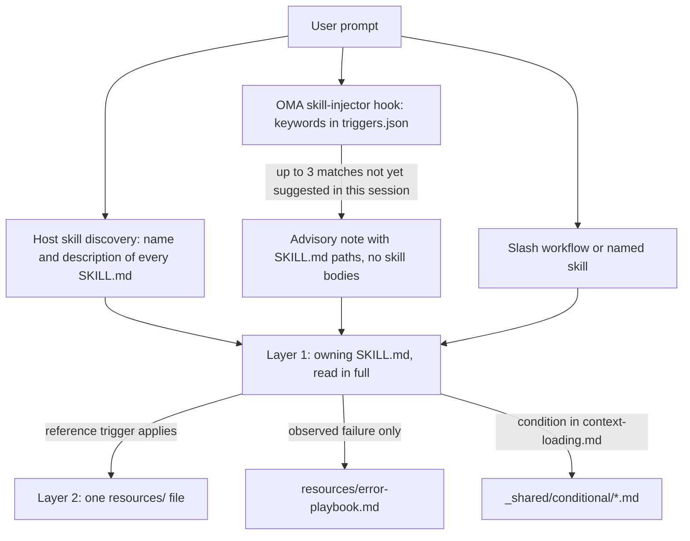
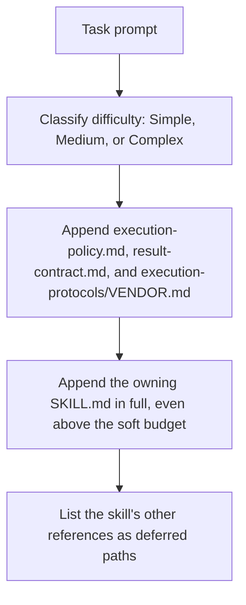

# Compétences

Les [compétences](../getting-started/glossary.md#skill) sont des ensembles de connaissances structurés qui fournissent à un rôle de dispatch les indications de son domaine. Elles regroupent des protocoles d’exécution, des références de stack, des modèles de code, des guides de résolution d’erreurs, des listes de contrôle qualité et, lorsque la compétence en fournit, des exemples. L’ensemble suit une architecture en deux couches conçue pour économiser des tokens. Pour la liste des compétences installées, voir le [catalogue des compétences](./agents.md#skill-catalog).

---

## La conception en deux couches {#the-two-layer-design}

Une compétence entre dans le contexte par étapes. La sélection ne présente au modèle qu’un chemin ou une description ; le SKILL.md responsable est lu intégralement une fois la compétence choisie ; les fichiers complémentaires sont lus un par un lorsque leur déclencheur s’applique.



Sources : `.agents/hooks/core/skill-injector.ts`, `.agents/skills/_shared/core/skill-routing.md` et `.agents/skills/_shared/core/context-loading.md`.

### Couche 1 : SKILL.md (lue lorsque la compétence est sélectionnée)

Chaque compétence possède un fichier `SKILL.md` à sa racine. Le hook d’injection transmet une **référence de chemin**, et non le contenu : une compétence non sélectionnée ne coûte donc rien au-delà de sa `description`. Chaque `SKILL.md` comporte un frontmatter YAML et les mêmes quatre sections de premier niveau ; `oma skill lint` signale une compétence qui en omet une ou dont le corps dépasse 500 lignes.

| Partie | Contenu |
|--------|---------|
| Frontmatter | `name` et une `description` de routage (ce que fait la compétence et quand l’utiliser) |
| `## Scheduling` | Objectif, signature d’intention, quand l’utiliser, quand NE PAS l’utiliser, entrées et sorties attendues, dépendances |
| `## Structural Flow` | Transitions, échec et récupération, états de sortie |
| `## Logical Operations` | Chemin canonique de commande ou de workflow, périmètre des ressources, garde-fous |
| `## References` | Fichiers de la couche 2, chacun avec la condition qui justifie sa lecture |

Frontmatter actuel d’`oma-frontend` :

```yaml
---
name: oma-frontend
description: "Implement or modify web UI in React, Next.js, or Angular. Use for components, pages, styles, forms, and frontend state or data flows."
---
```

Les runtimes hôtes présentent au modèle la `description` de chaque compétence : elle est donc rédigée comme une phrase de routage. Le hook de mots-clés d’OMA ne la lit pas ; ses mots-clés se trouvent dans `.agents/hooks/core/triggers.json`.

### Couche 2 : resources/ (chargée à la demande)

Le répertoire `resources/` contient les connaissances d’exécution détaillées. Ces fichiers ne sont chargés que lorsque :
1. l’hôte ou le workflow a sélectionné la compétence (par exemple via une correspondance native ou une commande explicite) ;
2. la tâche en cours remplit la condition de chargement de la référence.

Ce chargement à la demande est régi par le guide de chargement du contexte (`.agents/skills/_shared/core/context-loading.md`), qui distingue les instructions d’entrée des références sélectionnées selon la tâche.

### Ce qu’injecte `oma agent spawn`

Le dispatch CLI assemble lui-même le prompt du sous-agent : celui-ci démarre donc avec les contrats et la compétence responsable déjà en contexte :



Source : `cli/commands/agent/spawn-status.ts`, `cli/platform/agent-config/loaders.ts` et `cli/platform/context-loader.ts`. Les sous-agents natifs reçoivent le même contexte de tâche via `oma agent context <agent-id>` et lisent eux-mêmes la politique et le contrat de résultat si le runtime ne les a pas fournis.

---

## Exemple de structure de fichiers {#file-structure-example}

```text
.agents/skills/oma-frontend/
├── SKILL.md                          ← Layer 1: read when selected
└── resources/
    ├── execution-protocol.md         ← Layer 2: step-by-step workflow
    ├── tech-stack.md                 ← Layer 2: detailed technology specs
    ├── tailwind-rules.md             ← Layer 2: Tailwind conventions
    ├── angular-rules.md              ← Layer 2: Angular-specific conventions
    ├── snippets.md                   ← Layer 2: copy-paste code patterns
    ├── error-playbook.md             ← Layer 2: error recovery procedures
    └── checklist.md                  ← Layer 2: quality verification checklist

.agents/skills/oma-backend/
├── SKILL.md
├── resources/
│   ├── execution-protocol.md
│   ├── orm-reference.md              ← Domain-specific (ORM queries, N+1, transactions)
│   ├── checklist.md
│   └── error-playbook.md
└── variants/                          ← Starter seeds for /stack-set
    ├── stack.schema.json
    ├── node/
    ├── python/
    └── rust/

.agents/skills/oma-mobile/
├── SKILL.md
├── resources/
│   ├── execution-protocol.md
│   ├── tech-stack.md
│   ├── screen-template.dart
│   ├── screen-template.swift         ← Swift native iOS screen template
│   ├── screen-template.tsx            ← React Native screen template
│   ├── checklist.md
│   └── error-playbook.md
└── variants/                          ← Platform seeds for /stack-set
    ├── README.md
    ├── stack.schema.json
    ├── flutter/                       ← stack.yaml, tech-stack.md, snippets.md, api-template.dart
    ├── react-native/                  ← stack.yaml, tech-stack.md, snippets.md, api-template.ts
    └── swift-ios/                     ← stack.yaml, tech-stack.md, snippets.md, api-template.swift

.agents/skills/oma-design/
├── SKILL.md
├── resources/
│   ├── execution-protocol.md
│   ├── anti-patterns.md
│   ├── asset-strategy.md
│   ├── checklist.md
│   ├── design-md-spec.md
│   ├── design-tokens.md
│   ├── getdesign-fetcher.md
│   ├── prompt-enhancement.md
│   ├── redesign-protocol.md
│   ├── stitch-integration.md
│   └── error-playbook.md
└── reference/                         ← Deep reference material
    ├── typography.md
    ├── color-and-contrast.md
    ├── spatial-design.md
    ├── motion-design.md
    ├── responsive-design.md
    ├── component-patterns.md
    ├── accessibility.md
    ├── visual-hierarchy.md
    └── shader-and-3d.md
```

---

## Types de ressources par compétence {#per-skill-resource-types}

| Type de ressource | Motif de nom de fichier | Rôle | Quand elle est chargée |
|-------------------|-------------------------|------|------------------------|
| **Execution Protocol** | `execution-protocol.md` | Workflow étape par étape : Analyze -> Plan -> Implement -> Verify | L’opération sélectionnée a besoin des détails de sa commande ou de son contrat |
| **Tech Stack** | `tech-stack.md` | Spécifications techniques détaillées, versions, configuration | Framework sélectionné ou décision de stack |
| **Error Playbook** | `error-playbook.md` | Étapes allant du symptôme à la récupération ; une information ou une autorité manquante ne met en pause que l’action qui en dépend | Uniquement après un échec observé |
| **Checklist** | `checklist.md` | Vérification qualité propre au domaine | Sections pertinentes, pour une vérification non résolue |
| **Snippets** | `snippets.md` | Motifs de code prêts à copier-coller | Implémentation ou forme de sortie peu familière |
| **Examples** | `examples.md` | Exemples input/output commentés (oma-pm, oma-db, oma-tf-infra, oma-observability, oma-search) | Implémentation ou forme de sortie peu familière |
| **Variants** | répertoire `variants/` | Seeds de départ par langage/framework. Le backend fournit `node`, `python` et `rust` ; le mobile fournit `flutter`, `react-native` et `swift-ios`. `/stack-set` les utilise pour générer le `stack/` du projet. | Lors de la mise en place d’une stack correspondante |
| **Templates** | `screen-template.{dart,swift,tsx}` (oma-mobile), `variants/*/api-template.*` | Code de base pour un nouvel écran ou un nouveau module d’API | Lors de la création de ce fichier |
| **Domain Reference** | `orm-reference.md`, `anti-patterns.md`, etc. | Connaissances approfondies pour des sous-tâches précises | Selon le type de tâche |

---

## Ressources partagées (_shared/) {#shared-resources-_shared}

Tous les agents partagent les fondations de `.agents/skills/_shared/`. Elles sont réparties en trois catégories.

### Ressources fondamentales (`.agents/skills/_shared/core/`)

| Ressource | Rôle | Quand elle est chargée |
|-----------|------|------------------------|
| **`execution-policy.md`** | Règles d’autorisation, de clarification, de vérification et d’achèvement pour chaque compétence et chaque workflow. | Injectée dans chaque prompt `oma agent spawn` ; les agents natifs la lisent si elle n’est pas fournie |
| **`skill-routing.md`** | Route selon le résultat de la tâche, la responsabilité et les dépendances réelles ; aucune chaîne d’agents obligatoire ni quota de tours. | Référencée par les compétences d’orchestration et de coordination |
| **`context-loading.md`** | Entrée de la compétence responsable, références conditionnelles et limites de chargement du runtime. | Lors de la composition du contexte |
| **`prompt-structure.md`** | Guide les transmissions de tâches peu familières avec un objectif, un contexte, des contraintes réelles et des preuves d’acceptation ; aucun modèle obligatoire pour les tâches directes. | Lors de la composition d’une transmission peu familière ; pas un préchargement obligatoire |
| **`clarification-protocol.md`** | Résout les détails courants à partir du contexte et ne demande que les informations manquantes importantes ou une autorisation. | Lorsque les exigences sont ambiguës |
| **`code-intelligence.md`** | Utiliser la capacité d’intelligence du code configurée pour la recherche, la navigation et l’analyse d’impact dans le code. | Recherche ou navigation dans le code |
| **`test-approach.md`** | `test_approach` par tâche issu du plan PM et bloc `TDD_EVIDENCE` pour les tâches `tdd`. | Tâches dont le plan définit `test_approach` |
| **`context-budget.md`** | Estimations de taille des fichiers, mesure réelle des prompts, lectures ciblées et checkpoints. | Tâches longues ou diagnostic de la surcharge de contexte |
| **`difficulty-guide.md`** | Choisit la profondeur de planification et les livrables selon les dépendances et les besoins de vérification. | Lorsque la décomposition nécessite une estimation de difficulté |
| **`quality-principles.md`** | Indications sur le périmètre, la maintenabilité, les preuves et une vérification proportionnée. | Au début des workflows axés qualité (ultrawork) |
| **`vendor-detection.md`** | Résout le fournisseur cible de chaque agent depuis la configuration et choisit entre le dispatch natif et `oma agent spawn`. | Lorsque les détails du dispatch ne sont pas résolus |
| **`session-metrics.md`** | Preuves de session facultatives, sans score de pénalité conversationnel ni d’évaluateur. | Rétrospective demandée ou correction importante |
| **`common-checklist.md`** | Vérifications transversales applicables ; aucune limite globale du nombre de lignes ni exigence généralisée de catch. | Revue transversale lorsque c’est pertinent |
| **`lessons-learned.md`** | Consigne et applique des leçons étayées par des preuves, avec des conditions de version et de déclenchement ; aucun seuil RCA automatique. | Référencée après les erreurs et à la fin d’une session |
| **`anti-ai-prose.md`** | Diagnostics de prose partagés. | Audits de prose académique et revues de style des traductions |
| **`stack-verify.schema.json`** | Définitions `verify:` partagées, réutilisées par les schémas de stack backend et mobile. | Validation des schémas de stack |
| **`api-contracts/`** | Modèle de contrat facultatif. Réutilisez les schémas du projet ; les contrats générés se trouvent en dehors des sources de la compétence. | Lorsqu’un travail traversant des frontières est planifié |

### Ressources d’exécution (`.agents/skills/_shared/runtime/`)

| Ressource | Rôle |
|-----------|------|
| **`result-contract.md`** | Identité du run, chemin des claims et contrat d’achèvement des résultats d’agent. Injecté dans chaque prompt `oma agent spawn` ; les agents natifs le suivent avec `oma agent begin`, `oma agent verify` et `oma agent finish`. |
| **`memory-protocol.md`** | Format et opérations des fichiers mémoire pour les sous-agents CLI. Définit les protocoles On Start, During Execution et On Completion, avec outils mémoire configurables (lecture/écriture/édition) et extension de suivi d’expériences. |
| **`event-spec.md`** | Contrat des événements de workflow durables, ajoutés à `events.jsonl` sous le profil home d’OMA et inspectés avec `oma state get` ou `oma state list`. |
| **`execution-protocols/claude.md`** | Patterns d’exécution propres à Claude Code, injectés par `oma agent spawn` lorsque le fournisseur est claude. |
| **`execution-protocols/antigravity.md`** | Patterns d’exécution de l’Antigravity CLI (`agy`). |
| **`execution-protocols/codex.md`** | Patterns d’exécution du Codex CLI. |
| **`execution-protocols/commandcode.md`** | Patterns d’exécution de CommandCode. |
| **`execution-protocols/grok.md`** | Patterns d’exécution de Grok. |
| **`execution-protocols/kimi.md`** | Patterns d’exécution de Kimi Code. |
| **`execution-protocols/kiro.md`** | Patterns d’exécution de Kiro. |
| **`execution-protocols/opencode.md`** | Patterns d’exécution de l’extension OpenCode. |
| **`execution-protocols/pi.md`** | Patterns d’exécution de l’extension pi. |
| **`execution-protocols/qwen.md`** | Patterns d’exécution du Qwen CLI. |

Les protocoles propres aux fournisseurs sont injectés automatiquement pour les agents lancés par CLI avec `oma agent spawn`. Les sous-agents natifs utilisent les règles d’intégration du fournisseur sélectionné.

### Ressources conditionnelles (`.agents/skills/_shared/conditional/`)

Elles ne sont chargées que lorsque les conditions d’exécution correspondantes sont réunies :

| Ressource | Condition | Chargée par |
|-----------|-----------|-------------|
| **`quality-score.md`** | Un baseline défini ou une comparaison d’expériences est nécessaire | Orchestrator (la transmet au prompt QA) |
| **`experiment-ledger.md`** | Une hypothèse réelle est comparée à un baseline ou à une autre approche | Coordinateur (tient le registre partagé ; les agents parallèles écrivent des résultats propres à la tâche ou au run, qu’il fusionne) |
| **`exploration-loop.md`** | La récupération échoue à plusieurs reprises et des alternatives méritent d’être testées dans la limite du budget | Orchestrator (inline, avant les agents d’hypothèses) |
| **`diagram-engine.md`** | Un workflow s’apprête à produire un diagramme structurel (architecture, séquence, flux de données, cycle de vie) | Le workflow qui produit le diagramme |

Ces ressources sont différées jusqu’à ce que leurs déclencheurs respectifs s’appliquent. La difficulté seule ne les injecte pas.

---

## Comment une compétence est sélectionnée {#how-skills-route-via-skill-routingmd}

Trois chemins amènent une compétence dans le contexte. Aucun d’eux ne démarre à lui seul un workflow ni n’autorise une délégation.

1. **Découverte native de l’hôte.** Les runtimes qui prennent en charge les compétences listent le `name` et la `description` de chaque compétence ; le modèle lit le SKILL.md dont la description correspond au résultat demandé.
2. **Indication par mots-clés d’OMA.** Là où OMA installe son hook de prompt, `skill-injector` compare le prompt aux mots-clés multilingues de `.agents/hooks/core/triggers.json` et ajoute une note consultative `[OMA SKILLS DETECTED: ...]` qui liste jusqu’à trois chemins de SKILL.md. Pour « Build a login form with Tailwind CSS », seul le mot-clé `tailwind` correspond : la note suggère donc `oma-frontend`.
3. **Invocation explicite.** Un workflow slash comme `/plan`, `/review` ou `/debug`, ou le nom de la compétence dans le prompt.

### Responsabilité selon le résultat

Une seule compétence responsable traite une tâche délimitée ; n’ajoutez une transmission que lorsqu’une autre compétence apporte une capacité distincte. Ce tableau reflète `.agents/skills/_shared/core/skill-routing.md`. Pour les autres domaines, choisissez parmi les descriptions des compétences installées dans le [catalogue des compétences](./agents.md#skill-catalog).

| Résultat demandé | Compétence responsable |
|------------------|-------------------|
| API applicative, authentification serveur, logique de service et d’accès aux données | oma-backend |
| Schéma, conception de migrations, indexation, optimisation des requêtes, opérations de base de données | oma-db |
| Composants Web, pages, formulaires, état client | oma-frontend |
| Écrans mobiles, widgets, intégration de plateforme | oma-mobile |
| Frontières système, compromis d’architecture, ADR | oma-architecture |
| Diagnostiquer et corriger un comportement incorrect | oma-debug |
| Revoir la correction, la sécurité, l’accessibilité, la performance | oma-qa |
| Système visuel, DESIGN.md, direction de refonte | oma-design |
| Idéation ou exploration d’alternatives demandée | oma-brainstorm |
| Exigences, dépendances, critères d’acceptation | oma-pm |
| Exécution parallèle de spécialistes demandée | oma-orchestration |
| Coordination multi-agents manuelle demandée | oma-coordination |
| Branches Git, commits, fusions, historique du dépôt | oma-scm |

### Dépendances entre compétences

Il n’existe pas de chaîne d’exécution fixe. Ordonnez le travail selon les dépendances réelles :

- Tranchez une décision d’architecture ou de produit encore ouverte avant le travail qui en dépend. Les décisions déjà prises n’ont pas à repasser par l’architecture, le brainstorming ou le PM.
- Le travail backend et client peut avancer indépendamment lorsque leur contrat d’API commun est utilisable. S’il manque, réglez d’abord cette frontière avec les responsables concernés.
- La revue peut commencer sur une partie terminée et vérifiable pendant que l’implémentation indépendante se poursuit. Ne revoyez pas un artefact instable comme preuve finale.
- Un bug découvert pendant l’implémentation peut être corrigé par son responsable. Ajoutez une aide au débogage lorsque le diagnostic le justifie ; aucune chaîne implémentation → débogage n’est imposée.
- Pour un défaut transversal, identifiez à partir des preuves le contrat défaillant et son responsable. Une incohérence d’API ne signifie pas automatiquement que le backend doit changer.

### Quand une indication de compétence n’apparaît pas

Tous ces comportements proviennent de `.agents/hooks/core/skill-injector.ts`.

| Symptôme | Cause | Que faire |
|----------|-------|-----------|
| Aucune note `[OMA SKILLS DETECTED]` | Le prompt commence par `/`, un [workflow persistant](../getting-started/glossary.md#persistent-workflow) est actif pour la session, ou le message est un message d’agent relayé | Comportement attendu : le workflow gère le contexte. Nommez la compétence si vous en avez besoin |
| Une compétence attendue manque dans la note | Seules les 3 meilleures correspondances sont listées (10 points par mot-clé correspondant) | Utilisez un terme plus précis ou nommez la compétence |
| Une compétence suggérée plus tôt n’est plus suggérée | Un chemin de SKILL.md n’est suggéré qu’une fois par session ; l’enregistrement dans `.agents/state/skill-sessions.json` expire après une heure sans nouvelle suggestion | La suggestion précédente reste valable |
| Un mot-clé est ignoré | Le texte placé dans des blocs de code, entre backticks ou entre guillemets doubles est retiré avant la comparaison | Mentionnez le terme en texte brut |
| oma-academic-writing, oma-docs, oma-explanation, oma-scholar ou oma-skill-creation n’est jamais suggéré | Ces compétences n’ont aucun mot-clé dans `triggers.json` | Utilisez `/docs` ou `/explain`, ou nommez la compétence ; la découverte de l’hôte voit toujours leurs descriptions |
| L’indication nomme une compétence sans rapport | La correspondance repose sur des mots-clés et reste consultative | Énoncez le résultat voulu ; la note demande au modèle d’exercer son jugement |

---

## Calcul des économies de tokens {#token-savings-math}

Mesurez le coût en contexte avant d’annoncer des économies. Les mots simple, medium et complex désignent deux choses différentes :

- **Scénarios du script** (`routed`, `simple`, `medium`, `complex`, `all`) : comparaisons cumulatives de taille de fichiers affichées par `scripts/measure-skill-context.ts`. Ce ne sont pas des politiques de chargement, et `all` n’est qu’un plafond.
- **Difficulté du chargeur** (Simple, Medium, Complex) : sélectionne le budget souple du contexte qu’injecte le dispatch CLI. Voir [Chargement des ressources selon la tâche](#resource-loading-by-task).

```bash
bun scripts/measure-skill-context.ts
bun scripts/measure-skill-context.ts --skills oma-pm,oma-backend,oma-frontend --json
oma agent context backend --difficulty Medium
```

Le script fournit des estimations (octets UTF-8 / 4). `routed` correspond à l’entrée seule ; `simple`, `medium` et `complex` ajoutent, pour comparaison, des fichiers hypothétiques de protocole, d’exemples et de stack. Ces noms sont conservés pour la compatibilité avec le script, et non comme des instructions de préchargement. Un checkout neuf peut utiliser un seed de plateforme comme proxy de taille ; il ne charge pas toutes les plateformes.

La commande de contexte affiche l’injection réelle du contexte de la tâche : un en-tête `## Task context (graph-selected, approximately N tokens)`, le SKILL.md responsable et la liste des références différées. Elle n’inclut pas le reste de la conversation ni l’ensemble des instructions de l’hôte ou du runtime, et un prompt lancé est plus volumineux, car `oma agent spawn` y ajoute aussi la politique d’exécution, le contrat de résultat et le protocole du fournisseur. Utilisez un prompt assemblé ou la télémétrie d’usage pour mesurer le nombre total de tokens d’entrée, la latence et le coût sur un modèle précis. Ne les déduisez pas de la taille du dépôt ni des comptages de miroirs générés.

## Chargement des ressources selon la tâche {#resource-loading-by-task}

Chaque niveau de difficulté commence par la compétence responsable. Le graphe est un index de références ; l’adjacence n’autorise pas le chargement d’un autre spécialiste, d’un guide de résolution d’erreurs ou d’un workflow d’expériences conditionnel.

Le chargeur utilise des budgets souples de 1 500 / 4 000 / 8 000 tokens estimés pour Simple / Medium / Complex. Une entrée qui dépasse le budget est conservée et le dépassement est signalé. Les références complémentaires restent différées, sauf sélection explicite une fois leur déclencheur de tâche résolu. Une entrée requise n’est jamais remplacée par des documents plus petits sans rapport.

La vérification s’adapte au risque de la tâche et aux exigences du projet. Une étiquette de difficulté n’impose ni suite de tests complète, ni réponse preflight fixe, ni seconde approbation d’un travail déjà autorisé.

## Cartes de chargement du contexte (par agent) {#context-loading-task-maps-per-agent}

Voici des exemples de références à consulter lorsque la tâche en a besoin. Utilisez l’index actuel de la compétence responsable et ne sélectionnez que les sections applicables :

### Agent backend

<!-- oma-docs:ignore-start -->

| Type de tâche | Ressources requises |
|---------------|--------------------|
| Création d’une API CRUD | `stack/snippets.md` et `stack/api-template.*` du projet (générés par `/stack-set`) lorsqu’ils existent ; sinon, le code existant du projet |
| Authentification | `stack/snippets.md` + `stack/tech-stack.md` lorsqu’ils existent |
| Migration de base | `stack/snippets.md` lorsqu’il existe ; la conception de schéma revient à oma-db |
| Optimisation des performances | `orm-reference.md` et les exemples correspondants fournis par la compétence |
| Modification d’un code existant | Fournisseur d’intelligence du code du projet et ressources d’exécution pertinentes |

<!-- oma-docs:ignore-end -->

`variants/node`, `variants/python` et `variants/rust` sont des seeds de départ pour `/stack-set` ; les agents ne les lisent pas pour modifier du code existant.

### Agent frontend

| Type de tâche | Ressources requises |
|---------------|--------------------|
| Création d’un composant | snippets.md + motifs de composants existants du projet |
| Implémentation d’un formulaire | snippets.md (formulaire + Zod) |
| Intégration API | snippets.md (TanStack Query) |
| Styling | tailwind-rules.md |
| Mise en page | snippets.md (grid) |

### Agent design

| Type de tâche | Ressources requises |
|---------------|--------------------|
| Création d’un système de design | reference/typography.md + reference/color-and-contrast.md + reference/spatial-design.md + design-md-spec.md |
| Design d’une landing page | reference/component-patterns.md + reference/motion-design.md + prompt-enhancement.md |
| Audit design | checklist.md + anti-patterns.md |
| Export de tokens de design | design-tokens.md |
| Effets 3D / shaders | reference/shader-and-3d.md + reference/motion-design.md |
| Revue d’accessibilité | reference/accessibility.md + checklist.md |

### Agent QA

| Type de tâche | Ressources requises |
|---------------|--------------------|
| Revue de sécurité | checklist.md (section Security) |
| Revue de performance | checklist.md (section Performance) |
| Revue d’accessibilité | checklist.md (section Accessibility) |
| Audit complet | checklist.md (toutes les sections), plus iso-quality.md lorsqu’une revue fondée sur des normes est demandée |
| Comparaison d’une métrique définie | quality-score.md (conditionnel) |

---

## Composition du prompt de l’orchestrateur {#orchestrator-prompt-composition}

Lorsque l’orchestrateur rédige le prompt d’un sous-agent (`oma-orchestration/resources/subagent-prompt-template.md`), il ne fournit que les données de la tâche : rôle de l’agent, ID de tâche, workspace, chemins autorisés, description de la tâche, critères d’acceptation, références de la tâche avec leurs conditions de chargement et contraintes importantes.

- Pour le dispatch CLI, `oma agent spawn` injecte déjà `execution-policy.md`, `result-contract.md`, le protocole d’exécution du fournisseur et le SKILL.md responsable : le prompt ne les répète donc pas.
- Pour le dispatch natif, transmettez les chemins de ces fichiers et de la compétence responsable si le runtime ne les a pas fournis.
- N’ajoutez une section d’error-playbook qu’après un échec observé, et `runtime/memory-protocol.md` uniquement lorsque l’agent coordonne ou reprend un état de tâche durable.

Cette composition ciblée évite de charger des ressources inutiles et maximise le contexte disponible pour le travail réel du sous-agent.

---

## Preuves de session et revue rétrospective {#session-evidence-and-retrospective-review}

Les enregistrements de session consignent les corrections importantes, les changements de périmètre, les reprises de travail et les constats de revue arbitrés, preuves à l’appui. Une clarification nécessaire n’entraîne aucune pénalité. Les anciens scores pondérés CD et EA, ainsi que les règles de RCA déclenchées par seuil, ont été supprimés ; il s’agissait d’instructions de prompt, et non de métriques calculées par la CLI.

Réutilisez les résultats de tâche existants lorsque c’est possible. Un fichier distinct `session-metrics-{sessionId}.md` est facultatif dans le magasin de coordination configuré. Un échec répété ou une rétrospective demandée peut justifier une leçon, mais un échec de contrôle ordinaire ou un constat contesté n’en établit pas automatiquement une. Conservez les journaux historiques ; ne les réécrivez pas dans le nouveau format.

`oma stats` rend compte de la productivité et des synthèses de l’usage et du coût enregistrés. `oma retro` regroupe en suggestions les événements réels de porte, de blocage et de décision manquante. Aucune des deux ne calcule de scores CD/EA à partir de ces artefacts Markdown.

## Décomposition des tâches et récupération du contexte {#task-decomposition-and-context-recovery}

Planifiez en fonction des dépendances et des comportements vérifiables indépendamment. Un nombre fixe de sprints, un nombre de fichiers et des estimations de tours ne déterminent ni la profondeur de la revue ni l’achèvement. Regroupez les tests et la gestion des erreurs avec le comportement qu’ils vérifient.

En cas de blocage observé ou de perte de contexte utile, enregistrez le travail terminé, les critères restants, les chemins pertinents et les preuves de vérification avant de reprendre ou de relancer le dispatch. Préservez le travail existant et évitez de dupliquer une tentative en cours. À lui seul, un ratio tours/progression n’impose pas de réinitialisation.

## Mesure et exploration conditionnelles {#conditional-measurement-and-exploration}

Un baseline défini ou une comparaison d’expériences active les indications de mesure ; la simple présence de tests ou de lint ne les active pas. Consignez des métriques comparables avec leurs unités, leur méthode, leur révision et leurs preuves. Les vérifications requises de correction et de sécurité restent indépendantes. OMA ne comporte aucune formule composite par défaut, aucune porte fondée sur une note alphabétique ni aucun rollback déclenché par un score.

Une expérience réelle consigne son hypothèse, les preuves du baseline et du candidat, les vérifications requises, la décision et les fichiers dont elle a la charge. Des échecs répétés peuvent justifier de tester un autre mécanisme dans la limite du budget de récupération existant. Isolez les changements de l’expérience, préservez les modifications sans rapport et vérifiez le candidat intégré avant de relancer la porte.

---

## Voir aussi {#related}

- [Agents](./agents.md) : catalogue des compétences, rôles de dispatch, définitions et fichiers d’agents natifs
- [Workflows](./workflows.md) : workflows slash qui lisent les compétences
- [Structure du projet](./project-structure.md) : emplacement de `.agents/skills/` après l’installation
- [Résultats d’agents et reprise](../guide/agent-results-and-resume.md) : le cycle de vie natif `oma agent begin` → `oma agent finish`
- [Évaluation des compétences](../guide/skill-eval.md) et [Optimisation des compétences](../guide/skill-opt.md)
- Création : utilisez la compétence `oma-skill-creation`, puis exécutez `oma skill lint` et `oma skill audit`
