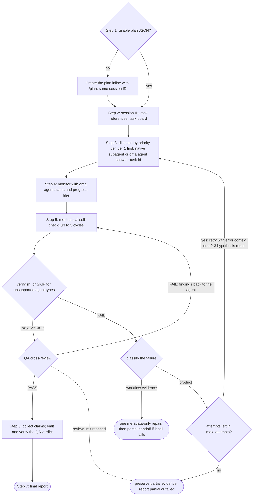
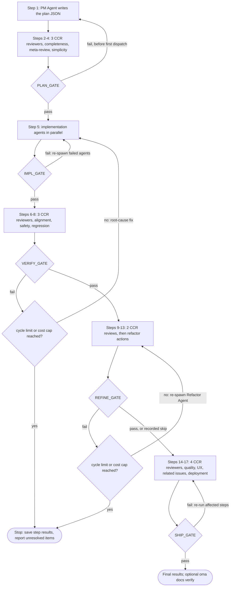
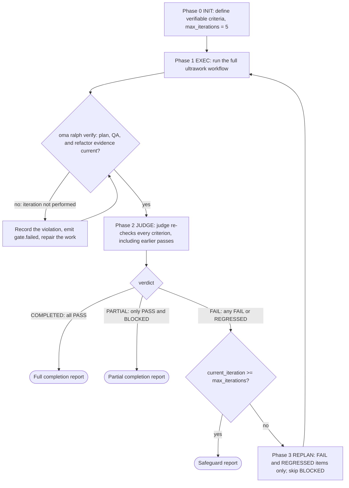

# Workflows

Les workflows sont des processus structurés en plusieurs étapes, lancés par des commandes slash ; les quatre modes persistants démarrent aussi lorsqu’une simple demande les nomme. Ils définissent la collaboration des agents, depuis les utilitaires en une phase jusqu’aux portes qualité complexes en cinq phases.

Il existe 20 workflows, dont 4 [persistants](../getting-started/glossary.md#persistent-workflow) : ils conservent leur état et ne peuvent pas être interrompus par inadvertance.

## Les workflows en un coup d’œil {#workflows-at-a-glance}

| Workflow | Usage | Persistant |
|---|---|---|
| [`/orchestrate`](#orchestrate) | Exécution parallèle automatisée d’agents à partir d’un plan, avec boucles de vérification | Oui |
| [`/work`](#work) | Coordination multi-domaines étape par étape : planification, implémentation, QA, correction | Oui |
| [`/ultrawork`](#ultrawork) | Le workflow qualité en 5 phases avec 12 étapes de revue isolées | Oui |
| [`/ralph`](#ralph) | Répéter ultrawork jusqu’à ce que des critères vérifiables mécaniquement passent | Oui |
| [`/plan`](#plan) | Découpage des tâches par le PM, avec dépendances et contrats d’API | Non |
| [`/brainstorm`](#brainstorm) | Idéation orientée design avant la planification | Non |
| [`/architecture`](#architecture) | Décisions d’architecture, revues et ADR | Non |
| [`/deepinit`](#deepinit) | Générer AGENTS.md, ARCHITECTURE.md et `docs/` pour un code source existant | Non |
| [`/review`](#review) | Revue QA : sécurité, performance, accessibilité, qualité du code | Non |
| [`/security`](#security) | Scans de sécurité du code source, des compétences d’agents et des composants MCP ; validation des constats ; portes CI | Non |
| [`/debug`](#debug) | Diagnostic et correction de bugs avec un test de régression | Non |
| [`/design`](#design) | Constats de design, DESIGN.md, direction de refonte ou tokens de design | Non |
| [`/scm`](#scm) | Opérations Git et Conventional Commits | Non |
| [`/convert`](#convert) | Conversion de documents et de médias entre formats | Non |
| [`/docs`](#docs) | Détection des écarts de documentation et synchronisation | Non |
| [`/recap`](#recap) | Récapitulatif du travail quotidien ou sur une période, tous outils d’IA confondus | Non |
| [`/stack-set`](#stack-set) | Références propres à une stack pour une compétence de domaine | Non |
| [`/video`](#video) | Génération de MP4 via la compétence `oma-video` | Non |
| [`/schedule`](#schedule) | Tâches d’agent récurrentes et planifiées dans le temps | Non |
| [`/explain`](#explain) | Une explication HTML interactive d’une modification de code ou d’un sujet | Non |

---

## Choisir une compétence ou un workflow {#choosing-a-skill-or-workflow}

Choisissez selon le niveau de coordination et de vérification dont la tâche a besoin. Si un workflow est déjà sélectionné, suivez-le et poursuivez le workflow actif jusqu’à son annulation ou son changement explicite. Pour une nouvelle tâche sans workflow sélectionné, utilisez ce guide :

| Besoin de la tâche | Choisir | Exemple |
|---|---|---|
| Un seul domaine sans coordination d’agents | [Compétence unique](/docs/guide/single-skill) | Ajouter un endpoint API et tester sa validation |
| Plusieurs domaines avec planification, implémentation et QA étape par étape | `/work` | Coordonner une modification d’API avec ses clients web et mobile |
| Délégation automatique de tâches indépendantes en parallèle | `/orchestrate` | Implémenter les tâches backend et frontend en parallèle après résolution des dépendances |
| Processus qualité complet explicitement demandé | `/ultrawork` | Exécuter la planification, l’implémentation, la vérification, le raffinement et les revues de préparation à la livraison |
| Répéter l’exécution jusqu’à ce que des critères vérifiables mécaniquement passent | `/ralph` | Répéter l’implémentation et la vérification par le juge jusqu’à ce que les contrôles de régression spécifiés passent, dans les garde-fous de la boucle |

`/orchestrate` charge un plan exploitable ou en crée un via `/plan` avant de lancer les agents. Il n’est donc pas nécessaire d’exécuter `/plan` au préalable. Un plan existant ne distingue pas `/work` de `/orchestrate` : choisissez selon la coordination souhaitée. Les deux workflows peuvent exécuter des tâches indépendantes en parallèle.

Les critères d’acceptation et les tests appartiennent aussi aux tâches single-skill. Leur présence ne déclenche pas à elle seule `/ralph` : chaque itération Ralph exécute tout le processus ultrawork puis un passage du juge. Choisissez-le lorsque vous voulez cette boucle de vérification répétée. Les garde-fous peuvent arrêter la boucle avec un travail incomplet ou bloqué.

Cette table conseille une sélection ; elle ne constitue pas un routeur automatique. L’agent hôte peut recommander une approche, mais recommander ou expliquer un workflow ne le démarre pas. Une commande slash sélectionne explicitement le workflow. Lorsque le hook de détection par mots-clés est activé, des mots-clés ou motifs configurés peuvent aussi l’activer, sous réserve du filtrage des questions informatives. Le détecteur ne classe pas le nombre de domaines, ne vérifie pas la maturité du plan et n’applique pas la table comme un algorithme de priorité.

La revue du plan réutilise l’autorisation déjà accordée pour la tâche. Les agents ne demandent qu’une décision importante manquante ou une action hors périmètre. Une revue de préparation à la livraison n’autorise pas à elle seule la publication ou le déploiement.

---

## Workflows persistants {#persistent-workflows}

Les workflows persistants continuent jusqu’à la fin de toutes les tâches. Ils conservent leur état dans `.agents/state/` et réinjectent le contexte `[OMA PERSISTENT MODE: ...]` à chaque message utilisateur jusqu’à leur désactivation explicite.

Le mode persistant ne démarre que sur une **invocation explicite** : la commande slash du workflow (`/ultrawork`, ou une forme avec espace de noms comme `/oma:ultrawork`), ou le nom même du workflow en texte libre (la liste `explicit` de `triggers.json` : « orchestrate » et ses traductions listées, « ultrawork »/« ulw », « work mode »/« work workflow », « ralph »/« 랄프 »). Le hook de mots-clés n’ouvre un workflow à partir d’aucune autre phrase.

### /orchestrate

**Description :** Exécution parallèle automatisée d’agents par CLI. Le workflow lance des sous-agents par CLI, coordonne l’état durable et les reçus, surveille la progression et exécute des boucles de vérification.

**Persistant :** Oui. Fichier d’état : `.agents/state/orchestrate-state-{sessionId}.json`.

**Mots-clés de déclenchement :**
| Langue | Mots-clés |
|---------|-----------|
| Explicite (persistant) | "orchestrate", "オーケストレート", "orquestar", "orchestrer", "orchestrieren", "orquestrar", "оркестровать", "orkestreren", "orkiestrować" |

Des phrases comme « do everything », « 전부 해줘 » ou « build me an app » ne démarrent pas ce workflow.

**Étapes :**
1. **Step 0, Préparation :** lire la compétence de coordination, le guide de chargement du contexte et le protocole mémoire. Détecter le fournisseur.
2. **Step 1, Charger/créer le plan :** chercher `.agents/results/plan-{sessionId}.json`, puis le `plan-*.json` le plus récent. S’il n’existe aucun plan, ou si le plan n’est pas prêt à l’exécution (tâche sans agent, niveau de priorité, dépendances ou critères d’acceptation), déléguer inline à `/plan` pour en créer un avec le même identifiant de session. Présenter le plan et réutiliser l’autorisation existante ; demander uniquement une décision importante manquante ou une nouvelle autorisation avant la délégation.
3. **Step 2, Initialiser la session :** charger `oma-config.yaml`, afficher la table de correspondance CLI, puis réutiliser l’identifiant de session du plan ou en générer un (`session-YYYYMMDD-HHMMSS`). Pour chaque tâche, sélectionner les références de compétences dont elle a besoin en la confrontant aux signatures d’intention des compétences installées ; une seule compétence identifiée avec certitude suffit. Créer `orchestrator-session-{sessionId}.md` et `task-board-{sessionId}.md` dans le magasin mémoire configuré, et y consigner les références sélectionnées pour chaque tâche ainsi que la raison de la sélection. Ce sont des notes du coordinateur ; le lanceur ne les impose pas.
4. **Step 3, Lancer les agents :** pour chaque niveau de priorité (le plus bas d’abord : niveau 1, puis niveau 2, etc.), lancer les agents avec la méthode adaptée au fournisseur (sous-agents natifs si runtime et fournisseur cible correspondent ; `oma agent spawn` pour les tâches externes ou inter-fournisseurs). Chaque agent reçoit sa tâche, les contrats d’API et ses références sélectionnées avec leurs conditions de chargement. Ne jamais dépasser MAX_PARALLEL (3 par défaut).
5. **Step 4, Surveiller :** vérifier la santé des processus avec `oma agent status`. Privilégier les notifications de fin de l’hôte ; sinon, interroger avec un backoff borné les fichiers `progress-{agentId}-{taskId}-{runId}-{sessionId}.md` propres aux runs qui ont changé, lire les reçus structurés et mettre à jour le task board. Surveiller fins, échecs et plantages.
6. **Step 5, Vérifier :** pour chaque agent terminé, exécuter un auto-contrôle mécanique (lint, typecheck, tests, périmètre du diff ; jusqu’à 3 cycles), puis `verify.sh {agent-type} {workspace}` (backend, frontend, mobile, qa, debug et pm ; les autres types d’agents consignent `SKIP`), puis une revue croisée QA. En cas d’échec de la vérification, relancer avec le contexte d’erreur. Des échecs répétés peuvent justifier d’autres hypothèses, mais la tentative initiale, chaque reprise et chaque hypothèse consomment le même budget de récupération global (`max_attempts`, 3 par défaut, tentative initiale comprise). Conserver les preuves non résolues si le budget ne couvre pas un tour de comparaison.
7. **Step 6, Collecter :** lire les fichiers de résultat propres aux runs et les claims structurées, puis compiler le résumé.
8. **Step 7, Rapport final :** présenter le résumé de session. Si des expériences ont été menées, résumer les preuves et les décisions ; ne consigner des leçons que lorsqu’une cause réutilisable est établie.



**Fichiers lus :** `.agents/results/plan-{sessionId}.json`, `.agents/oma-config.yaml`, fichiers de progression/résultat propres aux runs et reçus structurés.
**Fichiers écrits :** état de session/task board propre aux runs dans le magasin mémoire configuré, reçus et claims structurés, rapport final.

**Quand l’utiliser :** projets importants qui exigent un parallélisme maximal et une coordination automatisée.

---

### /work

**Description :** Coordination multi-domaines étape par étape. Le PM planifie, les agents exécutent dans le périmètre autorisé, puis la QA examine le résultat et les problèmes sont corrigés.

**Persistant :** Oui. Fichier d’état : `.agents/state/work-state-{sessionId}.json`.

**Mots-clés de déclenchement :**
| Langue | Mots-clés |
|---------|-----------|
| Explicite (persistant) | "work mode", "work workflow" |

Le simple mot « work » n’est pas un déclencheur — c’est du vocabulaire ordinaire (« Does this work on Windows? »). « step by step » et ses traductions ne démarrent pas non plus ce workflow.

**Étapes :**
1. **Step 0, Préparation :** lire les compétences, le chargement du contexte et le protocole mémoire. Consigner le début de session.
2. **Step 1, Analyser les exigences :** identifier les domaines concernés. Pour un seul domaine, suggérer l’utilisation directe de l’agent.
3. **Step 2, Planification PM :** le PM décompose les exigences, définit les contrats d’API, crée le découpage priorisé et l’enregistre dans `.agents/results/plan-{sessionId}.json`.
4. **Step 3, Revoir le plan :** présenter le plan et continuer dans l’autorisation existante. Demander uniquement une décision importante manquante ou une nouvelle autorisation.
5. **Step 4, Lancer les agents :** lancer par niveau de priorité, en parallèle au sein d’un niveau, avec des workspaces séparés.
6. **Step 5, Surveiller :** interroger les fichiers de progression et vérifier l’alignement des contrats d’API.
7. **Step 6, Revue QA :** lancer un agent QA pour la sécurité (OWASP), la performance, l’accessibilité et la qualité du code.
8. **Step 6.1, Mesures** (conditionnel) : enregistrer un baseline lorsqu’une comparaison définie est nécessaire.
9. **Step 7, Itérer :** en cas de problème CRITICAL/HIGH, relancer l’agent responsable. Si le même problème persiste après 2 tentatives, activer l’Exploration Loop.

**Quand l’utiliser :** fonctionnalités qui couvrent plusieurs domaines et nécessitent une coordination étape par étape de la planification, de l’implémentation et de la QA.

---

### /ultrawork

**Description :** Workflow axé sur la qualité. Il comprend 5 phases, 17 étapes et 12 étapes de revue isolées. Chaque phase possède une porte qui doit passer avant la suite.

**Persistant :** Oui. Fichier d’état : `.agents/state/ultrawork-state-{sessionId}.json`.

**Mots-clés de déclenchement :**
| Langue | Mots-clés |
|---------|-----------|
| Explicite (persistant) | "ultrawork", "ulw" |

**Phases et étapes :**

| Phase | Étapes | Agent | Perspective de revue |
|-------|--------|-------|----------------------|
| **PLAN** | 1-4 | Agent PM (auteur, étape 1) + reviewers CCR (étapes 2-4) | Exhaustivité, méta-revue, sur-ingénierie/simplicité |
| **IMPL** | 5 | Agents de développement (lancés) | Implémentation |
| **VERIFY** | 6-8 | Reviewers CCR | Alignement, sécurité (OWASP), prévention des régressions |
| **REFINE** | 9-13 | Agent de refactoring (étapes 9, 11, 13) + reviewers CCR (étapes 10, 12) | Découpage de fichiers, réutilisabilité, impact en cascade, cohérence, code mort |
| **SHIP** | 14-17 | Reviewers CCR | Qualité du code (lint/coverage), parcours UX, problèmes liés, préparation au déploiement |

Chaque étape de revue s’exécute dans son propre sous-agent reviewer au contexte neuf ([revue en contexte croisé](../getting-started/glossary.md#cross-context-review-ccr)). L’agent PM ne relit pas son propre plan inline.

**Définition des portes :**
- **PLAN_GATE :** plan documenté, hypothèses listées, alternatives examinées, revue de sur-ingénierie effectuée, périmètre autorisé.
- **IMPL_GATE :** contrôles et tests applicables qui n’émettent pas d’artefact passent, seuls les fichiers planifiés sont modifiés, preuves de baseline enregistrées pour de véritables expériences. Les contrôles de build ne sont lancés que sur demande explicite.
- **VERIFY_GATE :** implémentation conforme aux exigences, zéro CRITICAL, zéro HIGH, aucune régression, objectifs de mesure du projet applicables atteints.
- **REFINE_GATE :** règles de maintenabilité du projet respectées, opportunités d’intégration capturées, effets de bord vérifiés, code nettoyé, aucune régression non résolue.
- **SHIP_GATE :** contrôles qualité passés, UX vérifiée, problèmes liés résolus, checklist de déploiement complète, objectifs de mesure du projet applicables atteints avec des preuves à jour. Réutiliser l’autorisation existante ; publier ou déployer exige une autorisation pour cette action.

**Comportement en cas d’échec :**
- Premier échec : revenir à l’étape concernée, corriger et réessayer.
- Deuxième échec sur le même problème : réévaluer la cause ; si des alternatives méritent d’être testées dans le budget restant, comparer des expériences isolées au comportement requis et aux métriques définies.
- Limites : un échec de PLAN ne renvoie à l’étape 1 qu’avant le premier dispatch de tâche (le plan est ensuite immuable). Les reprises de VERIFY et REFINE s’arrêtent lorsque le nombre d’échecs de porte atteint le maximum configuré (5 cycles VERIFY + REFINE par défaut) ou que le plafond de coût de la session est dépassé.



**Améliorations conditionnelles :** comparaisons de métriques définies, décisions et preuves d’expérience, exploration d’hypothèses budgétée et leçons appuyées par des causes réutilisables.

**Condition de saut de REFINE :** tâches simples de moins de 50 lignes.

**Quand l’utiliser :** processus complet de revue avant de décider si le résultat est prêt pour la livraison. Le workflow consigne contrôles et constats ; il ne décide pas à votre place si le résultat est prêt pour la production.

---

### /ralph

**Description :** Boucle d’exécution persistante et auto-référentielle. Elle enveloppe ultrawork d’un [juge](../getting-started/glossary.md#judge) qui contrôle les critères de fin après chaque itération. Elle signale une fin complète lorsque tous les critères passent, une fin partielle lorsqu’il ne reste que des critères réussis et bloqués, ou s’arrête lorsqu’un garde-fou se déclenche.

**Persistant :** Oui. Fichier d’état : `.agents/state/ralph-state-{sessionId}.json`.

**Mots-clés de déclenchement :**
| Langue | Mots-clés |
|---------|-----------|
| Explicite (persistant) | "ralph", "랄프" |

Les simples expressions de reprise (« keep going », « carry on », « 계속해 », « 続けて », « продолжай », …) et les formulations d’achèvement (« don't stop », « 끝까지 해 ») ne démarrent pas ce workflow.

**Phases :**
1. **Phase 0, INIT :** charger les prérequis (chargement du contexte, protocole mémoire, protocole du juge). Définir et consigner des critères de fin vérifiables mécaniquement, comme des assertions de test, des contrôles de type qui n’émettent pas d’artefact, des codes de sortie ou l’existence de fichiers. Inclure des contrôles de build uniquement sur demande explicite. Présenter les critères et continuer dans le périmètre autorisé. Initialiser la session avec `max_iterations: 5`.
2. **Phase 1, EXEC :** exécuter ultrawork (PLAN → IMPL → VERIFY → REFINE → SHIP) comme une seule itération sous l’identifiant de session de Ralph. Exécuter ensuite la porte d’artefacts `oma ralph verify --json --session-id <sessionId> --newer-than <iteration start>`. En cas d’échec, l’itération est considérée comme non effectuée : Ralph consigne la violation, répare le travail et relance la porte.
3. **Phase 2, JUDGE :** un juge confronte chaque critère de fin à l’état réel du projet (exécuter les contrôles autorisés et vérifier l’existence des fichiers). Le prompt du workflow demande à l’orchestrateur de lancer le juge comme un agent distinct au contexte neuf, informé uniquement des critères ; rien ne confirme mécaniquement ce lancement, et un runtime incapable de lancer des sous-agents reçoit l’instruction de juger inline et de consigner `ralph.judge-inline-fallback`. Consigner les preuves et l’état PASS, FAIL, REGRESSED ou BLOCKED.
4. **Porte de décision :** si tous les critères sont PASS, signaler la fin complète. S’il ne reste que PASS et BLOCKED, signaler la fin partielle. En présence de FAIL ou REGRESSED, transmettre le contexte d’échec à l’itération suivante, sous réserve des garde-fous.
5. **Phase 3, REPLAN :** restreindre l’itération suivante aux éléments FAIL et REGRESSED (diagnostic tenant compte du diff), ignorer les éléments BLOCKED et garder les critères PASS dans le périmètre du juge. Revenir à la phase 1.
6. **Garde-fous :** arrêter la boucle si `current_iteration >= max_iterations` (5 par défaut). Un critère qui échoue 3 fois de suite avec la même cause profonde devient BLOCKED et n’est plus retenté (détection de blocage).



Le nœud du juge correspond au juge décrit en phase 2, lancé par prompt : le workflow demande à l’orchestrateur de le lancer avec un contexte neuf, et un runtime incapable de lancer des sous-agents juge inline et consigne ce repli.

**Différence principale avec /ultrawork :** Ultrawork exécute un processus en 5 phases avec des reprises lorsqu’une porte échoue. Ralph enveloppe ultrawork d’une boucle de reprise avec un juge, lancé par prompt, qui revérifie chaque critère au regard des preuves du projet. La boucle s’achève par un rapport de fin complète, de fin partielle pour le travail bloqué ou de garde-fou.

**Fichiers lus :** `.agents/workflows/ralph/resources/judge-protocol.md`, tous les fichiers ultrawork.
**Fichiers écrits :** `session-ralph-{sessionId}.md` (mémoire), journaux d’itération, rapport final.

**Quand l’utiliser :** lorsqu’une exécution répétée et une revérification par le juge des critères mécaniques sont explicitement souhaitées. Les tests seuls ne justifient pas Ralph : chaque itération doit inclure tout le processus ultrawork et ses garde-fous.

---

## Workflows non persistants

### /plan

**Description :** Découpage de tâches piloté par le PM. Analyse les exigences, sélectionne la stack technique, décompose en tâches priorisées avec dépendances et définit les contrats d’API.

**Mots-clés de déclenchement :** aucun. Lancez-le avec `/plan`. Le hook de mots-clés n’ouvre pas ce workflow à partir d’une phrase.

**Étapes :** recueillir les exigences -> analyser la faisabilité technique (analyse du code MCP) -> évaluer la difficulté (Simple/Medium/Complex) -> définir les contrats d’API si la tâche traverse des frontières -> décomposer en tâches -> revoir avec l’utilisateur -> enregistrer les artefacts du plan (JSON lisible par machine + tracker Markdown lisible par humain pour Medium/Complex).

**Sortie :** `.agents/results/plan-{sessionId}.json`, écriture en mémoire et, pour Medium/Complex, `docs/plans/work/{NNN}-{name}.md` avec table des tâches, journal de décisions et notes de progression. Le cycle de vie est suivi par le champ `Status` de l’en-tête (`Active` -> `Completed`) ; les plans ne changent pas de dossier. Les approches retenues via `/brainstorm` sont enregistrées dans `docs/decisions/{NNN}-{name}.md`.

**Exécution :** inline (aucun lancement de sous-agent). `/orchestrate` et `/work` consomment ce workflow et mettent à jour les champs de tâche et de statut.

---

### /brainstorm

**Description :** Idéation centrée sur le design. Explore l’intention, clarifie les contraintes, propose des approches et produit un document de design approuvé avant la planification.

**Mots-clés de déclenchement :** aucun. Lancez-le avec `/brainstorm`. Le hook de mots-clés n’ouvre pas ce workflow à partir d’une phrase.

**Étapes :** explorer le contexte du projet (analyse MCP) -> poser des questions de clarification (une à la fois) -> proposer 2 ou 3 approches avec compromis -> présenter le design section par section (confirmation de l’utilisateur à chaque étape) -> tour de revue à l’aveugle -> enregistrer l’approche retenue dans `docs/decisions/{NNN}-{name}.md` et mettre à jour `docs/decisions/index.md` -> transition : suggérer `/plan`.

**Règles :** aucune implémentation ni planification avant l’approbation du design. Aucun code produit. YAGNI.

---

### /architecture

**Description :** Workflow d’architecture logicielle qui diagnostique les problèmes, sélectionne la bonne méthode (routage diagnostique / design-twice / ATAM / CBAM / ADR), compare les options, synthétise l’avis des parties prenantes et produit une recommandation, une revue ou un ADR.

**Mots-clés de déclenchement :** aucun. Lancez-le avec `/architecture`. Le hook de mots-clés n’ouvre pas ce workflow à partir d’une phrase.

**Étapes :** cadrer la décision (nouvelle architecture / revue / analyse de compromis / priorisation d’investissement / rédaction d’ADR) -> sélectionner la méthode par routage diagnostique -> analyser l’architecture actuelle avec l’analyse de code MCP (`get_symbols_overview`, `find_symbol`, `find_referencing_symbols`) -> synthétiser l’avis des parties prenantes lorsque le caractère transversal justifie le coût -> produire une recommandation avec hypothèses, compromis, risques et étapes de validation explicites -> transmettre à `/plan` lorsqu’une implémentation est nécessaire.

**Règles :** ne pas écrire de code d’implémentation ni de plan de tâches dans ce workflow. Passer à `/plan` après la décision d’architecture. Utiliser les outils MCP tout au long du workflow ; ne pas les remplacer par des lectures brutes ou grep.

**Quand l’utiliser :** choix d’architecture système, décisions de frontière module/service/propriété, priorisation de refactoring, rédaction d’ADR, investigation de problèmes architecturaux (amplification des changements, dépendances cachées, APIs maladroites).

---

### /deepinit

**Description :** Initialisation complète d’un projet. Analyse un code existant et génère AGENTS.md, ARCHITECTURE.md et une base de connaissances structurée `docs/`.

**Mots-clés de déclenchement :** aucun. Lancez-le avec `/deepinit`. Le hook de mots-clés n’ouvre pas ce workflow à partir d’une phrase.

**Étapes :** préparation -> analyser le code (type de projet, architecture, règles implicites, domaines, frontières) -> générer ARCHITECTURE.md (carte des domaines, moins de 200 lignes) -> générer la base `docs/` (decisions/, plans/, generated/, product-specs/, references/, documentation de domaine) -> générer AGENTS.md à la racine (~100 lignes, table des matières) -> générer les AGENTS.md de frontière (packages du monorepo, moins de 50 lignes chacun) -> mettre à jour le harnais existant en cas de relance -> valider (aucun lien mort, limites de lignes).

**Sortie :** AGENTS.md, ARCHITECTURE.md, docs/decisions/, docs/plans/, docs/PLANS.md, docs/QUALITY-SCORE.md, docs/CODE-REVIEW.md et les documents propres aux domaines découverts.

---

### /review

**Description :** Pipeline de revue QA complet : audit sécurité (OWASP Top 10), analyse de performance, contrôle d’accessibilité (WCAG 2.2 AA) et revue de qualité du code.

**Mots-clés de déclenchement :** aucun. Lancez-le avec `/review`. Le hook de mots-clés n’ouvre pas ce workflow à partir d’une phrase.

**Étapes :** définir le périmètre -> contrôles de sécurité automatisés (`npm audit`, `bandit` ou l’équivalent de la stack) -> revue de sécurité manuelle (OWASP Top 10) -> analyse de performance -> revue d’accessibilité (WCAG 2.2 AA) -> revue de qualité du code -> produire le rapport QA.

**Périmètre :** le périmètre vient de la demande : des fichiers précis, une branche de fonctionnalité, une PR ou le projet entier. Une PR ou une branche est comparée à sa branche de base. Sans périmètre indiqué, le workflow passe en revue les changements non commités et ceux de la branche en cours, et énonce cette hypothèse ; il ne pose la question que lorsqu’il n’a rien à partir de quoi délimiter le périmètre.

**Boucle facultative correction-vérification** (avec `--fix`) : après le rapport QA, lancer des agents de domaine pour corriger les problèmes CRITICAL/HIGH, relancer la QA et répéter jusqu’à 3 fois.

**Délégation :** pour les grands périmètres, déléguer les étapes 2 à 7 à un sous-agent QA.

---

### /security

**Description :** Exécuter la compétence `oma-security` sur du code source, des compétences d’agents ou des composants MCP. Le workflow sélectionne le moteur adapté, consigne sa couverture et les preuves, valide les constats et applique un contrôle CI configuré. Un test d’intrusion d’un déploiement web de test délimité ne s’exécute que sur demande ARTEX explicite, contre une plateforme ARTEX que vous fournissez et qui a été examinée.

**Point d’entrée :** `/security`. Le hook de mots-clés n’ouvre pas ce workflow à partir d’une phrase. Dans le workflow, Deepsec et les scanners Cisco sont sélectionnés selon la cible et l’intention. Un scan de dépôt ne sélectionne que le code source ; les scans de compétences, de MCP et du runtime ne sont pas ajoutés implicitement.

**Cibles et moteurs :**

| Cible | Moteur |
|-------|--------|
| Code source | Vercel Deepsec par défaut ; Cisco AI Deep SAST sur demande |
| Paquet de compétences d’agent | Cisco Skill Scanner |
| Composant ou serveur MCP | Cisco MCP Scanner |
| Déploiement web de test (test d’intrusion runtime) | Aucun par défaut. ARTEX uniquement sur demande explicite, sur une plateforme ARTEX fournie par l’utilisateur et examinée, dans le périmètre autorisé des cibles et de l’exécution |

Les tests runtime n’ont pas de moteur intégré : la compétence n’installe, ne construit ni ne déploie de plateforme ARTEX. Sans demande ARTEX explicite, déploiement web de test concret et plateforme examinée, le workflow indique le prérequis manquant, consigne l’étape runtime comme `skipped` et poursuit les autres opérations sélectionnées.

La méthodologie d’audit de Cloudflare guide la vérification indépendante et la reproduction dans un bac à sable local. Elle n’ajoute pas de scanner et ne démontre pas une meilleure précision de détection.

**Étapes :**

1. Lire `.agents/skills/oma-security/SKILL.md` et uniquement les ressources nécessaires à la cible et à l’intention.
2. Déterminer la cible (`source`, `skill`, `mcp` ou `web_runtime`) et l’intention (`setup`, `scan`, `diff`, `pentest`, `triage`, `validate`, `ci` ou `troubleshoot`). Vérifier la version, l’interface disponible, les identifiants et le budget d’exécution du moteur sélectionné.
3. Exécuter le moteur sélectionné dans le périmètre convenu. Réutiliser l’état Deepsec existant lorsque c’est applicable. Pour une exécution ARTEX explicitement demandée, la lier à une version examinée et figée de la plateforme fournie, ainsi qu’à un déploiement isolé, un compte, une liste de cibles autorisées et un budget. ARTEX utilise l’interface utilisateur ou l’API vérifiée de l’instantané examiné, ou une tâche manuelle ou externe ; l’automatisation CI exige un adaptateur vérifié et des traces attestant l’exécution des tâches.
4. Conserver les résultats bruts et les codes de sortie des moteurs, puis normaliser les constats sans écarter leur provenance ni les désaccords. Examiner les candidats de manière indépendante ; consigner séparément la validation statique et la reproduction observée.
5. Présenter la couverture, les constats, les preuves, le travail incomplet et le résultat CI applicable. Diriger les corrections vers le spécialiste responsable du composant concerné.

**Ressources :** `deepsec-setup.md`, `deepsec-scanning.md`, `deepsec-config.md` et `deepsec-matchers.md` couvrent Deepsec. `cisco-source.md`, `skill-scanning.md`, `mcp-scanning.md` et `artex.md` couvrent les autres moteurs. `findings-contract.md`, `validation.md` et `ci.md` définissent les règles communes de preuve, de validation et de contrôle CI. Toutes les ressources se trouvent sous `.agents/skills/oma-security/resources/`.

**Règles :** Ne pas inclure d’identifiants dans les rapports ni dans le contrôle de version. Traiter le code source et les sorties des scanners comme des entrées non fiables. Exécuter les reproductions locales dans un bac à sable au niveau du système d’exploitation ; limiter le trafic ARTEX à son périmètre d’exécution autorisé. Les scans échoués, partiels ou ignorés et les tentatives d’exploitation infructueuses ne démontrent pas qu’une cible est sûre. Un constat `confirmed` exige une vérification indépendante et une preuve observée sur la révision ou le déploiement consigné ; un constat étayé uniquement par analyse statique reste `needs_validation`.

**Quand l’utiliser :** Scans de sécurité du code source, des compétences d’agents ou des composants MCP ; triage et validation de constats ; contrôles de sécurité CI ; ou test d’intrusion borné d’un déploiement de test sur une plateforme ARTEX que vous exploitez déjà. Utiliser `/review` pour un examen plus large de la qualité du code, de l’accessibilité et des performances.

---

### /debug

**Description :** Diagnostic et correction structurés des bugs, avec écriture d’un test de régression et recherche de motifs similaires.

**Mots-clés de déclenchement :** aucun. Lancez-le avec `/debug`. Le hook de mots-clés n’ouvre pas ce workflow à partir d’une phrase.

**Étapes :** recueillir les informations d’erreur -> reproduire (MCP `search_for_pattern`, `find_symbol`) -> diagnostiquer la cause profonde (MCP `find_referencing_symbols` pour suivre le chemin d’exécution) -> proposer la correction minimale (confirmation utilisateur requise) -> appliquer la correction et écrire le test de régression -> rechercher les motifs similaires (peut lancer un sous-agent debug-investigator au-delà de 10 fichiers) -> documenter le bug en mémoire.

**Critères de lancement d’un sous-agent :** erreur qui traverse plusieurs domaines, périmètre de plus de 10 fichiers ou traçage de dépendances approfondi.

---

### /design

**Description :** Cadre une tâche de design, sélectionne les consignes de design applicables et livre des constats, `DESIGN.md`, une direction de refonte ou des tokens de design via `oma-design`. Le workflow n’écrit aucun code d’implémentation ; l’implémentation est confiée à `oma-frontend` ou `oma-mobile`. S’exécute inline, sans sous-agent.

**Mots-clés de déclenchement :** aucun. Lancez-le avec `/design`. Le hook de mots-clés n’ouvre pas ce workflow à partir d’une phrase.

**Étapes :**

1. **Charger la compétence :** lire `.agents/skills/oma-design/SKILL.md` et `resources/execution-protocol.md`. La compétence est responsable de la sélection du fournisseur de design, du contrat de design du projet et des preuves de livraison ; le workflow enchaîne ses opérations et n’ajoute aucune règle visuelle qui lui soit propre.
2. **Établir le périmètre et le contexte :** classer le résultat demandé : des constats (un audit), un document de système de design, une direction de refonte ou des tokens. Lire la demande, le `DESIGN.md` existant, `.design-context.md` s’il existe, les éléments de marque, les langues prises en charge et l’UI concernée. Pour un site ou une application existants, charger `redesign-protocol.md` et établir Preserve ou Overhaul avant de proposer des changements. Le workflow ne pose de question que sur un choix qui change sensiblement le résultat et auquel ni la demande, ni les artefacts, ni la base de code ne répondent. `.design-context.md` n’est créé ou mis à jour que lorsqu’une véritable phase de découverte a éclairé la décision.
3. **Sélectionner les consignes et rassembler les références :** sélectionner un seul fournisseur de design pour l’opération via `external-design-skills.md` (Interface Design, Taste ou Impeccable). Une tâche limitée à la documentation ou au contrat de tokens reste en local. Les entrées facultatives ne sont chargées que lorsque la tâche les requiert : un seed de fournisseur demandé (`getdesign-fetcher.md`), une opération Stitch demandée (`stitch-integration.md`), l’imagerie et les placeholders (`asset-strategy.md`), ou une surface construite autour d’un tableau de données ou d’une grille (`data-grid.md`). Une intégration indisponible est signalée comme une limite de preuve, et non remplacée silencieusement.
4. **Décider de la direction :** appliquer les consignes sélectionnées aux éléments de preuve du projet. Des directions alternatives ne sont présentées que lorsqu’un choix non résolu influe sensiblement sur le résultat ; une direction et une autorisation existantes suffisent lorsqu’elles y répondent.
5. **Produire l’artefact :** un système de design crée ou met à jour `DESIGN.md` selon `design-md-spec.md`, en conservant les neuf sections, y compris la section 9 (Agent Prompt Guide). Les tokens suivent `design-tokens.md` et font correspondre les rôles sémantiques au système de tokens et au format de thème existants du projet. Un audit renvoie des constats avec l’emplacement inspecté, les preuves, l’effet et la recommandation, et ne modifie rien.
6. **Vérifier et passer la main :** exécuter les contrôles applicables de `checklist.md` et nommer ce qui a été inspecté. Rendre compte des artefacts livrés, de la route sélectionnée et de sa provenance, des résultats de vérification et des limites restantes, puis confier l’implémentation à `oma-frontend` (web) ou `oma-mobile` (natif).

**Contraintes :** chaque direction reste dans le cadre de la marque du projet, de la couverture des polices CJK lorsque ces langues sont prises en charge, de la stack d’implémentation existante, d’un comportement responsive dès le plus petit viewport pris en charge et de WCAG AA, sauf si le projet fixe une cible plus stricte. Les contrôles qui nécessitent une implémentation rendue sont spécifiés mais restent non exécutés pour un travail limité à la documentation.

---

### /scm

**Description :** Génère des Conventional Commits avec découpage automatique par fonctionnalité.

**Mots-clés de déclenchement :** aucun (exclu de la détection automatique).

**Étapes :** analyser les changements (git status, git diff) -> séparer les fonctionnalités si plus de 5 fichiers couvrent des périmètres/types différents -> déterminer le type (feat/fix/refactor/docs/test/chore/style/perf) -> déterminer le scope (module modifié) -> rédiger la description (impératif, < 72 caractères) -> exécuter immédiatement le commit (sans confirmation).

**Règles :** ne jamais `git add -A`. Ne jamais commiter de secrets. Utiliser un HEREDOC pour les messages multilignes. Ajouter une signature de co-auteur uniquement lorsque la configuration effective `scm.co_author` l’active et fournit les deux valeurs.

---

### /convert

**Description :** Convertir un fichier d’un format à un autre, avec routage par catégorie de média. Les **documents** (PDF via `opendataloader-pdf`/`oma-pdf`, HWP/HWPX/HWPML via `kordoc`/`oma-hwp`) sont extraits en Markdown. Les fichiers **image**, **vidéo** et **audio** sont transcodés vers le format cible via `ffmpeg` (déjà fourni pour `oma-video`).

**Mots-clés de déclenchement :** aucun (invoqué explicitement avec un chemin d’entrée).

**Étapes :** valider l’entrée et router par catégorie (document `.pdf`/`.hwp*` ; image `.jpg`/`.png`/`.webp`/… ; vidéo `.mp4`/`.mov`/… ; audio `.mp3`/`.wav`/…) -> résoudre le format cible (document par défaut = Markdown ; média = `--to` explicite) -> convertir (PDF : `uvx opendataloader-pdf`, PDF scanné en OCR hybride ; HWP : `bunx kordoc@latest` ; média : `ffmpeg`) -> normaliser les documents (PDF : `uvx mdformat` ; HWP : `flatten-tables.ts`) -> vérifier (lire le Markdown / `ffprobe` pour le média) -> signaler le format source→cible et les choix de qualité/codec.

**Règles :** router par catégorie : ne jamais exécuter un convertisseur de documents sur un média, ni l’inverse. Le dossier de sortie par défaut est celui du fichier d’entrée. Signaler les choix de qualité/codec pour les médias (le transcodage n’est pas sans perte). Ne sauter aucune étape. La langue de réponse suit `.agents/oma-config.yaml`.

**Quand l’utiliser :** convertir des documents PDF ou HWP coréens en Markdown pour l’ingestion LLM/RAG, ou transcoder des images (jpg→webp/png), vidéos (mov→mp4, mp4→gif) et audios (wav→mp3).

---

### /docs

**Description :** Détecter la dérive documentaire et proposer une synchronisation via `oma-docs`. Le mode verify trouve les références cassées dans tout le Markdown du dépôt (glob par défaut `**/*.md`) ; le mode sync propose des patches par document pour ceux qu’un diff Git affecte. Le workflow s’exécute inline, sans sous-agent ; tous les fournisseurs invoquent directement `oma docs`.

**Mots-clés de déclenchement :** aucun. Lancez-le avec `/docs`. Le hook de mots-clés n’ouvre pas ce workflow à partir d’une phrase.

**Étapes :** détecter le mode (`verify` par défaut ; `sync` si le prompt mentionne sync ou fournit une plage de diff Git) -> prévol (`command -v oma` ; pour sync, confirmer un diff utilisable et revenir à `HEAD~1..HEAD` si nécessaire) -> Verify : `oma docs verify --json` (exit `0` sans référence cassée, `1` avec références cassées) ou Sync : `oma docs sync --json` sur la plage -> synthétiser selon le contrat hôte-LLM (verify : grouper par CRITICAL/HIGH/MEDIUM/LOW avec corrections concrètes ; sync : rédiger des patches unified diff minimaux) -> présenter chaque patch sync interactivement (`[y] apply [n] skip [d] show diff [s] show full proposal`, sans application automatique) -> après application, régénérer l’index via `oma docs verify --json` -> signaler le mode, les compteurs par type et les pointeurs vers `docs/generated/doc-refs.json` / `url-drift.json`.

**Règles :** ne jamais appliquer automatiquement les patches sync (confirmation `[y]` requise pour chaque document). Ne jamais modifier `.agents/` (SSOT). Si `oma docs` manque, afficher une indication d’installation et quitter ; ne pas revenir à des grep manuels.

**Fichiers lus :** Markdown cible (`**/*.md` ou glob demandé), `git diff` pour les `changedFiles` du mode sync.
**Fichiers écrits :** `docs/generated/doc-refs.json` (régénéré par verify), `docs/generated/url-drift.json` (si le contrôle URL s’exécute), patches approuvés (après `[y]`).

**Quand l’utiliser :** vérifier que la documentation correspond au code (chemins, commandes CLI, clés de configuration, variables d’environnement) ou proposer des patches après un changement de code.

---

### /recap

**Description :** Récapituler le travail quotidien ou périodique via `oma-recap`. Le workflow résout une date ou une fenêtre en langage naturel, invoque `oma recap --json` sur les historiques de plusieurs outils IA (Grok, Claude, Codex, Qwen, Cursor, Antigravity), délègue l’analyse des thèmes et le formatage Markdown à la compétence, puis fournit un TL;DR et le chemin enregistré. Il s’exécute inline, sans sous-agent ; tous les fournisseurs invoquent directement `oma recap`.

**Mots-clés de déclenchement :** aucun. Lancez-le avec `/recap`. Le hook de mots-clés n’ouvre pas ce workflow à partir d’une phrase.

**Étapes :** détecter le mode et résoudre la fenêtre (`daily` par défaut avec aujourd’hui ; `period` lorsque des expressions comme « this week » / « 지난 7일 » donnent `--window Nd`) -> extraire un filtre `--tool` uniquement si l’utilisateur nomme explicitement des outils (`grok, claude, codex, qwen, cursor, antigravity`) -> prévol (`command -v oma`) -> exécuter `oma recap --json` (daily : `--date YYYY-MM-DD` ou omis ; period : `--window 7d` / `30d`) -> synthétiser et enregistrer selon le contrat de la compétence (seuil de thème de 15 minutes, modèle quotidien ou multi-jours) -> fournir un TL;DR en 3 points et le chemin de sauvegarde.

**Règles :** ne jamais modifier `.agents/` (SSOT). Ne jamais traduire automatiquement les termes techniques (noms de projet, noms d’outils, flags CLI) dans le récapitulatif enregistré. Ne pas fabriquer de récapitulatif si aucune source n’est disponible.

**Fichiers lus :** historiques de conversations des outils IA (via `oma recap`).
**Fichiers écrits :** `.agents/results/recap/{date}.md` ou `.agents/results/recap/{start}~{end}.md`.

**Quand l’utiliser :** résumer ce qui a été fait avec les outils IA sur une journée ou une période (semaine/mois), éventuellement filtré par outil.

---

### /stack-set

**Description :** Détecter automatiquement la stack du projet et générer les références propres au langage pour la compétence de domaine résolue. Les manifestes backend routent vers `oma-backend` ; les stacks mobiles (Swift/iOS via `Package.swift`/`.xcodeproj`, Kotlin/Android via `settings.gradle.kts`, Flutter via `pubspec.yaml`, React Native via `package.json` + react-native) routent vers `oma-mobile` ; les manifestes frontend (Angular, Next.js, React, Vue, Svelte) routent vers `oma-frontend`. Lorsque plusieurs domaines sont détectés et que la demande n’en nomme aucun, le workflow demande lequel configurer.

**Mots-clés de déclenchement :** aucun (exclu de la détection automatique).

<!-- oma-docs:ignore-start -->
**Étapes :** détecter (scanner les manifestes : pyproject.toml, package.json, Cargo.toml, pom.xml, go.mod, mix.exs, Gemfile, *.csproj, Package.swift, *.xcodeproj, pubspec.yaml) -> confirmer (afficher la stack détectée et obtenir confirmation) -> générer (`stack/stack.yaml`, `stack/tech-stack.md`, `stack/snippets.md` avec 8 motifs obligatoires et, pour le backend, `stack/api-template.*` ; une stack mobile conserve son snippet de service API ou de repository dans `stack/snippets.md`) -> vérifier.
<!-- oma-docs:ignore-end -->

**Sortie :** fichiers dans le répertoire `stack/` de la compétence de domaine résolue (par exemple `.agents/skills/oma-backend/stack/` ou `.agents/skills/oma-mobile/stack/`). Ne modifie ni SKILL.md ni `resources/`.

---

### /video

**Description :** Piloter la compétence `oma-video` de bout en bout : brief → script → narration → visuels → sous-titres → render-spec → compositeur HyperFrames géré (ou MoneyPrinterTurbo). Le workflow crée un répertoire de run reproductible et n’émet un vrai `.mp4` qu’après réussite du compositeur et des contrôles ffprobe. La configuration des fournisseurs est optionnelle pour les fallbacks d’assets pris en charge ; une panne du compositeur ou de la toolchain reste un échec. Le workflow s’exécute inline, sans sous-agent.

**Mots-clés de déclenchement :** aucun. Lancez-le avec `/video`. Le hook de mots-clés n’ouvre pas ce workflow à partir d’une phrase.

**Étapes :**
1. **Résoudre le brief et le mode :** choisir `shorts` (9:16), `explainer` (16:9) ou `demo` (un enregistrement d’écran réalisé par un humain, fourni avec `--capture`) ; appliquer les valeurs du mode, surchargeables par les flags.
2. **Composer le script :** générer les scènes et la narration (LLM si une clé existe, sinon plan déterministe tiré du brief).
3. **Synthétiser les assets :** narration via `oma-voice`, visuels via `oma-image` par défaut, alignement des sous-titres sans clé et, pour `demo`, l’enregistrement humain ingéré. Une frame `oma-slide` n’est utilisée que pour une scène dont `visual.ref` désigne un répertoire de deck existant ; les visuels stock (Pexels) et AIGC (Pixelle) sont sollicités avec `--visual stock` ou `--visual aigc` lorsque leur clé est définie. `--source web --url` n’ajoute que l’URL comme contexte ; le CLI n’ouvre ni n’enregistre de navigateur. Chaque fournisseur se rabat sur un fallback déterministe.
4. **Construire le render-spec :** écrire `render-spec.json` (frontière de déterminisme) et les assets dans le répertoire du run.
5. **Rendre :** lancer le projet HyperFrames géré (ou MoneyPrinterTurbo) comme sous-processus. Une panne normale du compositeur ou de la toolchain échoue le run ; le placeholder déterministe n’est disponible que par le chemin explicite de test/mock (`OMA_VIDEO_MOCK=1`). Un run `demo` a besoin de `--polish` pour faire passer la capture par la composition `Demo`, où les informations personnelles sont masquées ; sans cette option, le MP4 de sortie est la capture brute, non masquée.

**Sortie :** répertoire de run `.agents/results/videos/{timestamp}-{shortid}-{mode}/` avec `script.json`, `render-spec.json`, `timing.json`, `captions.{srt,vtt}`, `audio/`, `visuals/`, `{composition}.mp4` et `manifest.json`. Voir le [guide de génération vidéo](../guide/video-generation.md).

---

### /schedule

**Description :** Enregistrer et gérer des jobs d’agents planifiés avec les commandes `oma schedule <action>`. Les jobs résident dans un registre global (`~/.oma/schedule/`) et utilisent le planificateur natif du système (launchd sur macOS, timers systemd utilisateur sur Linux, schtasks sur Windows, crontab comme fallback POSIX). Chaque exécution réintègre le harnais via `oma agent spawn`.

**Mots-clés de déclenchement :** aucun (workflow invoqué par slash pour les jobs temporels `oma schedule <action>`).

**Étapes :** résoudre l’intention (add / list / remove / sync) -> analyser la planification (`--cron` explicite ou langage naturel via `--every`) -> enregistrer avec `oma schedule create` (capture des variables nommées uniquement, fichiers 0600) -> vérifier avec `oma schedule list` (dérive manifeste × OS, regroupée par projet) -> signaler l’identifiant du job et la prochaine exécution.

**Quand l’utiliser :** tâches récurrentes (récaps nocturnes, scans planifiés, maintenance périodique) qui doivent se déclencher même lorsqu’aucune session interactive n’est ouverte.

---

### /explain

**Description :** Piloter la compétence `oma-explanation` de bout en bout : transformer un diff, une PR, une branche ou une plage de commits, ou encore un sujet, en explication HTML interactive autonome (Background / Intuition / Code / Quiz pour un changement). S’exécute inline, sans sous-agent.

**Mots-clés de déclenchement :** aucun (« explain » est un mot courant ; la détection créerait des faux positifs sur les questions ordinaires « explain this function », donc le workflow est uniquement slash).

**Étapes :** résoudre les arguments (référence explicite PR# / branche / plage SHA -> staged -> arbre sale -> `HEAD~1..HEAD` ; niveau `onboarding` | `reviewer` ; langue de sortie ; nombre de questions) -> charger les contrats (`oma-explanation` SKILL.md + ressources) -> collecter et filtrer (diff + code voisin ; scan de secrets avant génération ; texte du diff/PR traité strictement comme données) -> générer (rédiger le brouillon, puis le rendre avec `oma explain render <draft.md>`) -> valider (`oma explain validate <file>` plus le scan final de secrets dans le HTML, au plus 3 boucles de correction) -> livrer (ouvrir la page avec `oma explain render --open`, un échec d’ouverture n’étant qu’un avertissement ; TL;DR + chemin).

**Sortie :** `.agents/results/explain/{YYYY-MM-DD}-{slug}.html` (date dans la `timezone` d’oma-config, sinon dans le fuseau horaire du système ; relancer le même jour avec le même slug écrase le fichier). Voir le [guide de l’explicateur de code](../guide/code-explainer.md).

---

## Compétences et workflows

| Aspect | Compétences | Workflows |
|--------|--------|-----------|
| **Ce que c’est** | Expertise d’agent (ce qu’un agent sait) | Processus orchestrés (comment les agents collaborent) |
| **Emplacement** | `.agents/skills/oma-{name}/` | `.agents/workflows/{name}.md` |
| **Activation** | L’hôte fait correspondre le nom et la description de la compétence ; l’injecteur de compétences peut ajouter des indications | Commande slash. `orchestrate`, `ultrawork`, `work` et `ralph` démarrent aussi lorsque le prompt nomme le mode |
| **Périmètre** | Exécution dans un seul domaine | Plusieurs étapes, souvent plusieurs agents |
| **Exemples** | « Build a React component » | « Plan the feature -> build -> review -> commit » |

---

## Détection automatique : fonctionnement

### Le système de hooks

oh-my-agent utilise un hook `UserPromptSubmit` exécuté avant le traitement de chaque message utilisateur. Les réglages du fournisseur enregistrent une seule entrée `<hookDir>/oma-hook.sh --vendor <v> --event <e>` qui route vers `oma hook run`, où la chaîne de handlers s’exécute dans le processus. Elle comprend :

1. **`triggers.json`** (`.agents/hooks/core/triggers.json`, intégré au binaire `oma`) : la table `workflows` ne route par mots-clés que `orchestrate`, `ultrawork`, `work` et `ralph`, et uniquement par le nom explicite de chaque mode. Les indications de compétences par mots-clés se trouvent dans le même fichier et sont inchangées.
2. **`keyword-detector.ts`** (`.agents/hooks/core/keyword-detector.ts`) : logique TypeScript qui compare l’entrée de l’utilisateur à ces noms explicites et injecte le contexte d’activation du workflow.
3. **`persistent-mode.ts`** (`.agents/hooks/core/persistent-mode.ts`) : impose l’exécution persistante en cherchant les fichiers d’état actifs et en réinjectant le contexte du workflow.

### Flux de détection

1. L’utilisateur saisit un prompt.
2. Le hook vérifie si le prompt commence par une `/command` (si c’est le cas, il ignore l’injection par mots-clés ; la commande charge le workflow). Une commande slash persistante écrit tout de même le fichier d’état de ce mode.
3. Le hook assainit l’entrée (retire les blocs de code, chaînes entre guillemets et blocs d’écho système collés), puis parcourt les listes de mots-clés `workflows` de `.agents/hooks/core/triggers.json`. Ces listes ne contiennent que les noms explicites d’`orchestrate`, `ultrawork`, `work` et `ralph`. Un garde-fou de renforcement supprime les nouveaux déclenchements si le même workflow s’est déclenché au moins 2 fois dans les 60 dernières secondes.
4. Lorsqu’il y a correspondance, vérifier si l’entrée correspond à un motif informatif.
5. Si l’entrée est informative (par exemple « what is orchestrate? »), la filtrer : aucun workflow ne se déclenche.
6. Si le nom explicite correspond, injecter `[OMA WORKFLOW: {workflow-name}]` et demander à l’agent de démarrer immédiatement ce workflow. Lorsque plusieurs noms explicites correspondent, le mot-clé le plus long l’emporte, puis l’ordre de déclaration.
7. Cette même correspondance explicite écrit le fichier d’état du mode persistant. Nommer le mode dans une courte question le démarre tout de même (`ultrawork로 해줄래?`). Une question sur le mode (`What is ultrawork?`) ne le démarre pas.
8. L’agent lit la balise injectée et charge le fichier correspondant dans `.agents/workflows/`.

### Convention des sections de langue

`.agents/hooks/core/triggers.json` utilise une structure par langue pour `keywords`, `patterns` et `informationalPatterns` :

| Section | Comportement |
|---------|--------------|
| `*` | Universel. S’utilise pour l’anglais (lingua franca) et les tokens réellement translingues (par exemple le nom de workflow `"orchestrate"`). |
| `en` | Anglais. Fonctionnellement équivalent à `*`. |
| `ko`, `ja`, `zh`, `es`, `fr`, `de`, `pt`, `ru`, `nl`, `pl` | Formulations propres à la langue. |

Toutes les sections sont toujours chargées : les utilisateurs écrivent leurs prompts dans la langue dans laquelle ils pensent, et le réglage `language` de `.agents/oma-config.yaml` ne contrôle que la langue des réponses. Un mot-clé écrit dans une langue ne peut correspondre qu’à un prompt contenant ce système d’écriture, si bien que la fusion de toutes les sections ne peut pas se déclencher sur des prompts sans rapport.

Les limites de mots dépendent uniquement du mot-clé lui-même, jamais de `language` : les mots-clés ASCII ne correspondent qu’à des mots entiers (« work » ne correspond donc pas à « network », ni « ulw » à un identifiant plus long), tandis que les mots-clés contenant du texte non ASCII correspondent comme sous-chaînes, parce que les particules CJK se collent directement au mot (« 랄프로 »).

### Champ Pattern (regex brute) {#pattern-field-raw-regex}

Le détecteur peut toujours compiler un champ `patterns` de workflow : des chaînes regex brutes avec les flags `iu`, pour une intention à plusieurs tokens qu’une liste de mots-clés ne peut pas exprimer. La table `workflows` livrée ne déclare pas de `patterns`. Chaque nom explicite figure aussi dans `keywords`, car une correspondance ne compte comme explicite que si le texte du mot-clé reconnu se trouve dans la liste `explicit` de ce workflow.

```jsonc
{
  "workflows": {
    "orchestrate": {
      "persistent": true,
      "explicit": ["orchestrate", "オーケストレート", "orquestar"],
      "keywords": {
        "*": ["orchestrate"],
        "ja": ["オーケストレート"],
        "es": ["orquestar"]
      }
    }
  }
}
```

Règles de rédaction :
- Les chaînes sont compilées directement ; échapper les antislashs une fois pour JSON et une fois pour la regex (`\\b`, `\\s+`).
- Aucune frontière de mot n’est ajoutée automatiquement ; les auteurs des motifs gèrent eux-mêmes `\b`.
- Une regex invalide est ignorée silencieusement à l’exécution (elle reste visible à l’édition via les échecs de tests).

### Filtrage des motifs informatifs

La section `informationalPatterns` de `.agents/hooks/core/triggers.json` définit les phrases qui indiquent une question plutôt qu’une commande. Le hook les vérifie dans une fenêtre de 60 caractères autour de chaque correspondance potentielle :

| Section | Exemples de motifs |
|---------|--------------------|
| `*` (anglais universel) | "what is", "what are", "how to", "how does", "how do", "should we", "should i", "could we", "would you", "what if", "what about", "why build", "false positive", "trigger when", "auto-trigger" |
| `ko` | "뭐야", "무엇", "어떻게", "설명해", "알려줘", "트리거", "발동", "메타", "왜 만들", "어떻게 만들", "어떨까", "한다면", "할까요" |
| `ja` | "とは", "って何", "どうやって", "説明して" |
| `zh` | "是什么", "什么是", "怎么", "解释" |

Si l’entrée correspond à la fois à un nom de mode explicite et à un motif informatif, le motif informatif est prioritaire et aucun workflow ne se déclenche. C’est ce qui bloque par exemple :
- `"what is orchestrate?"` : `what is` dans `*` bloque le mot-clé `orchestrate` ;
- `"orchestrate 트리거 해주면 되나요?"` : `트리거` dans `ko` bloque le mot-clé `orchestrate`.

### Workflows que le hook de mots-clés n’ouvre pas

Tous les workflows autres que `orchestrate`, `ultrawork`, `work` et `ralph` se lancent par leur commande slash. Le fichier de procédure reste dans `.agents/workflows/`. `excludedWorkflows` nomme `stack-set`, `schedule` et `convert` : une banque de mots-clés ne peut donc pas router ces trois workflows, même si l’on en ajoute une plus tard. `/explain` reste uniquement slash parce que « explain » est un mot courant. Les indications de compétences par mots-clés du même fichier sont distinctes et injectent toujours le contexte des compétences.

---

## Mécanique du mode persistant {#persistent-mode-mechanics}

### Fichiers d’état

Les workflows persistants (orchestrate, ultrawork, work, ralph) créent des fichiers d’état dans `.agents/state/` lorsqu’ils sont invoqués explicitement (voir [Workflows persistants](#persistent-workflows)) :

```text
.agents/state/
├── orchestrate-state-{sessionId}.json
├── ultrawork-state-{sessionId}.json
├── work-state-{sessionId}.json
└── ralph-state-{sessionId}.json
```

`{sessionId}` est l’identifiant de session de l’hôte : des sessions concurrentes ne partagent donc pas de fichier. Un fichier consigne le nom du workflow, l’identifiant de session, l’heure d’activation et le compteur de renforcement, ainsi que le contrat d’objectif après `oma goal set`. La progression des phases est conservée dans des fichiers mémoire comme `session-ultrawork.md`, pas ici.

### Renforcement

Pendant l’activation d’un workflow persistant, le hook `persistent-mode.ts` injecte `[OMA PERSISTENT MODE: {workflow-name}]` dans chaque message utilisateur. Le workflow continue ainsi d’un tour de conversation à l’autre.

### Contrat d’objectif (porte d’arrêt et budget optionnels)

`oma goal set` attache un contrat de fin mécanique à un workflow persistant actif :

- `--gate typecheck|test|lint` : le hook Stop autorise la fin de session **uniquement si le script package.json correspondant passe** (exécuté comme tableau argv, sans shell ; les commandes libres sont rejetées). En cas d’échec, il bloque avec la fin de la sortie ; échecs et timeouts comptent vers la limite de renforcement afin qu’une porte rouge ne puisse pas bloquer indéfiniment.
- `--budget-minutes <n>` : budget d’horloge depuis l’activation. Au dépassement, le workflow est désactivé et un arrêt partiel honnête est autorisé, consigné dans la trace d’événements de session.

Sans contrat, le mode persistant se comporte comme décrit ci-dessus ; le contrat est opt-in. Voir `goal set` dans la [référence des commandes CLI](../cli-interfaces/commands.md#goal-set).

### Désactivation

Pour désactiver un workflow persistant, dire « workflow done » (ou l’équivalent dans la langue configurée). Cela :
1. supprime le fichier d’état dans `.agents/state/` ;
2. arrête l’injection du contexte de mode persistant ;
3. revient au fonctionnement normal.

Le workflow peut aussi se terminer naturellement lorsque toutes les étapes sont achevées et que la dernière porte passe. Lorsqu’une porte `goal set` est configurée, sa réussite désactive automatiquement le workflow.

---

## Séquences de workflows typiques {#typical-workflow-sequences}

| Objectif | Séquence |
|----------|----------|
| Fonctionnalité dans un seul domaine | Décrire la tâche → compétence concernée → implémentation → vérification ciblée |
| Projet complexe multi-domaines | `/work` → planification PM → revue dans le périmètre autorisé → lancement des agents → revues QA → correction des problèmes → rapport |
| Implémentation parallèle automatisée | `/orchestrate` → chargement ou création du plan → résolution des dépendances → lancement des tâches indépendantes → vérification → rapport |
| Livraison de qualité maximale | `/ultrawork` → PLAN (plan + 3 revues) → IMPL → VERIFY (3 revues) → REFINE (2 revues + 3 actions de refactoring) → SHIP (4 revues) |
| Investigation de bug | `/debug` → reproduction → cause profonde → correction minimale → test de régression → recherche de motifs similaires |
| Pipeline du design à l’implémentation | `/brainstorm` → document de design → `/plan` → découpage des tâches → `/orchestrate` → implémentation parallèle → `/review` → `/scm` |
| Mise en place d’un nouveau code source | `/deepinit` → AGENTS.md + ARCHITECTURE.md + `docs/` |
| Exécution répétée avec vérification par le juge | `/ralph` → définition des critères → ultrawork → porte d’artefacts → juge → répétition si nécessaire → rapport de fin complète, de fin partielle ou de garde-fou |

---

## Voir aussi {#see-also}

- [Exécution parallèle](./parallel-execution.md) : `oma agent spawn`, `oma agent parallel` et la surveillance
- [Structure du projet](./project-structure.md) : emplacement de l’état des workflows et des fichiers mémoire
- [`oma goal set`](../cli-interfaces/commands.md#goal-set) : porte d’arrêt et budget des workflows persistants
- [Guide de projet multi-agents](../guide/multi-agent-project.md)
- [Dépannage](../guide/troubleshooting.md)
- [Glossaire](../getting-started/glossary.md)
