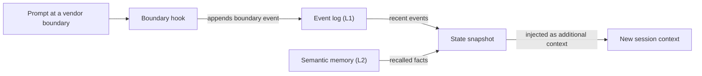

# Glossaire

Chaque entrée donne une définition courte et renvoie à la page qui traite le terme en détail. Lorsqu’un mot a des sens différents selon les parties d’OMA, l’entrée le précise.

## Éléments de base {#building-blocks}

### Compétence {#skill}

Une compétence est un ensemble de connaissances de domaine situé dans `.agents/skills/oma-<name>/`. Son `SKILL.md` entre dans le contexte lorsque la compétence est routée, et les fichiers de `resources/` ne sont chargés que lorsque la tâche en a besoin. Une compétence guide la façon dont un agent travaille dans un domaine ; elle ne définit pas de processus en plusieurs étapes. Voir [Compétences](../core-concepts/skills.md).

### Workflow {#workflow}

Un workflow est un processus en plusieurs étapes défini dans `.agents/workflows/<name>.md`. Vous le démarrez avec sa commande slash, par exemple `/plan` ou `/orchestrate` ; lorsque le hook de détection par mots-clés est activé, une phrase de déclenchement correspondante peut aussi l’injecter. Les workflows coordonnent une ou plusieurs compétences et agents. Voir [Workflows](../core-concepts/workflows.md) et [Choisir une compétence ou un workflow](../core-concepts/workflows.md#choosing-a-skill-or-workflow).

### Définition d’agent {#agent-definition}

Une définition d’agent est un fichier de sous-agent versionné dans `.agents/agents/`, par exemple `backend-engineer.md` ou `qa-reviewer.md`. Elle fixe l’identité de l’agent, les compétences qu’il charge (frontmatter `skills:`), une section de protocole d’exécution et des règles de domaine. OMA projette ces fichiers dans les formats natifs des fournisseurs, comme `.claude/agents/*.md` et `.codex/agents/*.toml`. La documentation emploie aussi « agent » pour un rôle de dispatch (`backend`, `qa`, `explore`) et pour une compétence comme `oma-backend`. Voir [Définitions d’agents](../core-concepts/agents.md#agent-definitions).

## Presets {#presets}

### Preset de compétences {#skill-preset}

Un preset de compétences est l’ensemble de compétences que l’installateur ajoute à un projet, par exemple `all`, `fullstack`, `backend` ou `research`. Les ressources partagées `_shared/` sont installées avec chaque preset. Un preset de compétences n’a aucune influence sur le modèle qui exécute un agent. Voir [Presets](./installation.md#presets).

### Preset de modèles {#model-preset}

Le preset de modèles est la valeur `model_preset` de `.agents/oma-config.yaml` (ou `.cue`). Il détermine le fournisseur et le modèle utilisés par chaque agent. `auto`, la valeur par défaut des nouvelles installations, suit les réglages d’agents et de modèles propres au runtime courant ; les presets fixes comme `claude`, `codex` ou `mixed` les figent. Les surcharges `agents.<id>` ont priorité sur le preset, sauf avec `free`, où `free.model` remplace les modèles fixés par agent. Voir [Presets intégrés](../guide/per-agent-models.md#built-in-presets).

## Exécution des workflows {#workflow-execution}

### Workflow persistant {#persistent-workflow}

Un workflow persistant continue de s’exécuter d’un tour à l’autre jusqu’à ce que son travail soit terminé ou que vous le désactiviez. Les workflows persistants sont `/orchestrate`, `/work`, `/ultrawork` et `/ralph`, et seule une invocation explicite active le mode persistant. Tant que l’un d’eux est actif, un hook réinjecte `[OMA PERSISTENT MODE: ...]` à chaque prompt, et le hook Stop empêche la session de se terminer jusqu’à ce qu’une limite de renforcement ou un délai d’inactivité soit atteint. Dites `workflow done` pour le désactiver. Voir [Mécanique du mode persistant](../core-concepts/workflows.md#persistent-mode-mechanics).

### Porte d’arrêt {#stop-gate}

Une porte d’arrêt est un contrôle de fin facultatif que vous attachez à un workflow persistant actif avec `oma goal set --gate typecheck|test|lint`. Le hook Stop n’autorise alors la fin du workflow que lorsque le script `package.json` portant ce nom passe. Les échecs de la porte comptent dans la limite de renforcement : une porte en échec ne peut donc pas bloquer l’arrêt indéfiniment. Voir [`goal set`](../cli-interfaces/commands.md#goal-set).

## Sessions et état {#sessions-and-state}

« Session » a deux sens dans OMA : la session qu’OMA suit lui-même, et la session de conversation du CLI ou de l’IDE d’IA que vous utilisez. Distinguez-les lorsque vous lisez des fichiers d’état ou des options de commande.

### Session OMA {#oma-session}

Une session OMA est un travail qu’OMA suit sous son propre identifiant de session, indépendamment de toute conversation du fournisseur. L’orchestration utilise cet identifiant pour nommer le plan, le task board, les fichiers de progression et de résultat ainsi que les enregistrements d’exécution des agents ; l’orchestrateur le génère au format `session-YYYYMMDD-HHMMSS`. L’état des workflows utilise un identifiant de session OMA (`sid`) comme clé du [journal d’événements](#event-log), que `oma state list` et `oma state get <sid>` permettent d’inspecter. Voir [Stratégie des identifiants de session](../guide/multi-agent-project.md#session-id-strategy).

### Identifiant de session fournisseur {#vendor-session-id}

Un identifiant de session fournisseur est l’identifiant de conversation attribué par le CLI ou l’IDE d’IA, par exemple un identifiant de session Claude Code ou Codex. OMA l’enregistre comme `vendorSid` dans les événements, et les fichiers d’état du mode persistant sont indexés par cet identifiant (`.agents/state/<workflow>-state-<vendor-session-id>.json`). Lorsqu’une session OMA est active et qu’un prompt arrive depuis une autre session fournisseur, un autre fournisseur ou une session qui vient d’être compactée, un hook enregistre un événement `boundary` et injecte un instantané de l’état afin que le travail se poursuive dans le nouveau contexte. Voir [`state`](../cli-interfaces/commands.md#state).

Si la mémoire sémantique n’est pas disponible, l’instantané n’utilise que les événements locaux.

### Journal d’événements {#event-log}

Le journal d’événements est l’enregistrement en ajout seul d’une session OMA, stocké sous forme de `events.jsonl` dans `${OMA_STATE_HOME:-~/.oma}/u/<profile>/sessions/<sid>/`. Chaque ligne est un événement, par exemple `session.created`, `workflow.phase`, `gate.passed`, `decision.made` ou `session.ended`. Les workflows ajoutent les décisions requises avec `oma state emit` et les vérifient avec `oma state verify` ; lisez le journal avec `oma state get` ou `oma state trajectory` plutôt qu’en ouvrant le fichier. Voir [`state`](../cli-interfaces/commands.md#state).

## Revue et preuves {#review-and-evidence}

### Juge {#judge}

« Juge » a deux sens. Dans `/ralph`, le juge est la phase qui suit chaque itération ultrawork : il confronte chaque critère de fin à l’état réel du projet et consigne PASS, FAIL, REGRESSED ou BLOCKED. Un agent lancé séparément, avec un contexte neuf, l’exécute, de sorte que l’orchestrateur n’évalue pas son propre travail. Dans l’évaluation et l’optimisation des compétences, `judge` est le type de vérificateur par défaut : un modèle note la sortie d’un bras au regard d’une grille et renvoie PASS ou FAIL. Voir [/ralph](../core-concepts/workflows.md#ralph) et [le vérificateur judge](../guide/skill-eval.md#judge-default).

### Revue en contexte croisé (CCR) {#cross-context-review-ccr}

La revue en contexte croisé (Cross-Context Review) est la règle selon laquelle chaque étape de revue de `/ultrawork` s’exécute dans un sous-agent reviewer neuf, au contexte isolé. Le reviewer ne reçoit que les artefacts à examiner, référencés par leur chemin (diff, fichiers modifiés, plan, résultats précédents, sortie des tests), ainsi que le guide de cette revue ; il ne voit jamais l’historique de la session principale ni le raisonnement de l’implémenteur. Chaque reviewer rédige un verdict structuré que le coordinateur de la phase collecte. Voir [/ultrawork](../core-concepts/workflows.md#ultrawork).

### Charter {#charter}

Le charter est le bloc de preflight `CHARTER_CHECK` que les agents d’implémentation rédigeaient autrefois avant d’écrire du code. Les définitions d’agents actuelles n’exigent plus de sortie de preflight fixe. Les agents suivent à la place la politique d’exécution partagée : ils énoncent les hypothèses importantes, ne posent de question que lorsqu’une information manquante modifie l’exactitude ou le périmètre, et ne suspendent que le travail qui dépend de la réponse. Un sous-agent lancé ne peut pas vous interroger directement ; il signale donc l’information manquante dans un résultat `blocked` ou `partial`. Voir [Autorisation et clarification](../core-concepts/agents.md#charter-preflight-charter_check).

### Enregistrement d’exécution et claim {#run-record-and-claim}

Un enregistrement d’exécution est le reçu lisible par machine d’une tentative d’agent, stocké dans le répertoire d’état par projet du profil, `~/.oma/u/<profile>/projects/<project-hash>/agent-runs/` (les versions antérieures utilisaient `.agents/state/agent-runs/`) ; `oma agent begin` le crée et prend un instantané du contrat de la tâche. La claim est le rapport de l’agent lui-même, au chemin `.claim.json` correspondant, avec un statut `completed`, `partial`, `blocked` ou `failed`, ainsi que les fichiers modifiés, le travail non résolu et les artefacts. `oma agent finish` confronte la claim au contrat courant, aux reçus de vérification et aux empreintes des artefacts : une claim aux preuves périmées ne reste donc pas à l’état completed. Voir [Résultats et reprise des agents](../guide/agent-results-and-resume.md).

## Mémoire et fournisseurs {#memory-and-providers}

### Mémoire L1 et L2 {#l1-and-l2-memory}

L1 est le [journal d’événements](#event-log) : l’état local des workflows, en ajout seul, que lisent `oma state verify` et l’instantané de frontière. L2 est la mémoire sémantique, c’est-à-dire des faits rappelés servis par le fournisseur `providers.semantic_memory` sélectionné : `agentmemory` (par défaut), `honcho` ou `none`. Les décisions requises résident dans L1 ; elles survivent donc aux frontières de session sans L2. « L1 » et « L2 » ont aussi d’autres sens : la couche 1 et la couche 2 d’une compétence sont son `SKILL.md` et son répertoire `resources/` chargé à la demande, et `oma docs verify` signale des « L2 references », c’est-à-dire les références de fichiers, d’URL, de CLI, de scripts, d’environnement et de configuration qu’il extrait de la documentation. Voir [`memory`](../cli-interfaces/commands.md#memory) et [Mémoire sémantique Honcho](../guide/configuration-reference.md#honcho-semantic-memory).

### Fournisseur de capacité {#capability-provider}

Un fournisseur de capacité est l’outil ou le service externe qu’OMA utilise pour une capacité donnée, sélectionné sous `providers` dans `.agents/oma-config.yaml`. Les capacités sont la documentation (`docs`, par défaut `context7`), la recherche web (`web`, par défaut `native`), l’intelligence du code (`code_intelligence`, par défaut `serena`) et la mémoire sémantique (`semantic_memory`, par défaut `agentmemory`). Exécutez `oma link` après avoir changé de fournisseur. Voir [Clés de premier niveau](../guide/configuration-reference.md#top-level-keys) et [Valeurs par défaut importantes](./important-defaults.md).

## Plans et fichiers source {#plans-and-source-files}

### Plan {#plan}

Un plan est le découpage des tâches lisible par machine situé dans `.agents/results/plan-<sessionId>.json`, rédigé par `/plan` et consommé par `/orchestrate` et `/work` ; `/orchestrate` en crée un lorsqu’aucun plan exploitable n’existe. Chaque tâche indique son agent, son workspace, ses dépendances, ses critères d’acceptation et les contrôles requis, et les enregistrements d’exécution prennent un instantané de ce contrat. Il n’a aucun rapport avec la résolution des modèles par agent qu’affiche `oma doctor --profile`, que certaines pages appellent un plan hérité. Voir [/plan](../core-concepts/workflows.md#plan) et [Démarrer une exécution native](../guide/agent-results-and-resume.md#start-a-native-run).

### SSOT {#ssot}

La source unique de vérité (SSOT, single source of truth) est le répertoire `.agents/` : `<project>/.agents/` pour une installation de projet, ou `~/.oma/.agents/` pour une installation globale. Les compétences, les workflows, les définitions d’agents, les règles et la configuration s’y trouvent, et `oma install`, `oma update` et `oma link` génèrent à partir de lui les fichiers natifs des fournisseurs (`.claude/`, `.codex/` et autres). Modifiez `.agents/` et exécutez `oma link` plutôt que de modifier les fichiers générés. Certaines pages emploient SSOT pour une source plus restreinte, comme le manifeste des agents planifiés. Voir [.agents/ : la source de vérité](../core-concepts/project-structure.md#agents-the-source-of-truth).
