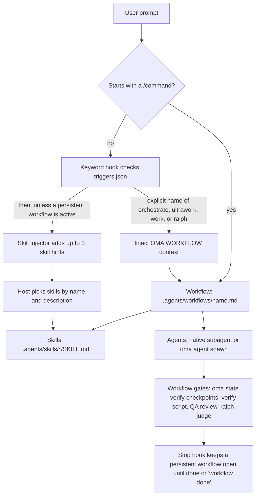

# Introduction

oh-my-agent est un framework d'orchestration multi-agents pour les IDE et outils CLI propulsés par l'IA. Au lieu de dépendre d'un seul assistant IA pour tout, oh-my-agent répartit le travail entre 33 paquets de compétences et 13 rôles canoniques de dispatch. Douze fichiers de définition de sous-agents versionnés fournissent des personas réutilisables pour l'implémentation, la revue, la planification, le débogage, la documentation, la recherche et l'infrastructure. `research-explorer.md` correspond au rôle canonique `explore` ; `orchestrator` est un rôle de coordination du runtime sans fichier de définition distinct.

OMA effectue des vérifications mécaniques lorsque vous les appelez ou que vous sélectionnez un workflow qui les inclut. `oma verify agent <agent-type>` exécute les vérifications du type d'agent sélectionné ; `/ralph` ajoute une vérification fondée sur les artefacts et une boucle de [juge](./glossary.md#judge) ; les hooks Stop des fournisseurs activés (la [porte d'arrêt](./glossary.md#stop-gate)) peuvent maintenir un workflow ouvert pendant l'exécution de ses vérifications configurées. Le simple chargement d'une compétence ne constitue pas une acceptation, et un prompt ordinaire n'exécute pas automatiquement toutes les portes du workflow. Appuyez-vous sur les critères d'acceptation du workflow et sur les fichiers produits pour décider de ce qui est terminé.

L'ensemble du système réside dans un répertoire `.agents/` portable au sein de votre projet. Passez de Claude Code à Codex CLI, Antigravity CLI ou IDE, Cursor, OpenCode et d'autres outils pris en charge : la configuration de vos agents reste avec votre code.

Si vous découvrez OMA, commencez par le [Démarrage rapide](./quick-start.md), puis lisez les [Valeurs par défaut importantes](./important-defaults.md). L'installation crée la [SSOT](./glossary.md#ssot) et les intégrations des fournisseurs ; la première vérification utile est `oma doctor`, et la première tâche utile est une petite modification dans un seul domaine. Passez à `/work` ou `/orchestrate` uniquement lorsque la tâche nécessite une coordination.

---

## Le paradigme multi-agents {#the-multi-agent-paradigm}

Les assistants de codage IA traditionnels prennent souvent en charge le frontend, le backend, la base de données, la sécurité et l'infrastructure depuis un même contexte de prompt. Cela peut entraîner :

- **Dilution du contexte** : charger les connaissances de chaque domaine gaspille la fenêtre de contexte
- **Responsabilités floues** : une tâche couvrant plusieurs domaines n'a pas de frontière explicite pour chaque partie
- **Coordination manuelle** : les fonctionnalités complexes qui touchent plusieurs domaines nécessitent des transferts choisis par l'hôte ou l'utilisateur

oh-my-agent résout ce problème par la spécialisation :

1. **Chaque compétence a un domaine principal.** La compétence frontend connaît React/Next.js, shadcn/ui, TailwindCSS v4 et l'architecture FSD-lite. La compétence backend connaît le pattern Repository-Service-Router, les requêtes paramétrées et l'authentification JWT. Les domaines peuvent se recouper à leurs frontières ; utilisez donc les critères d'acceptation de la tâche pour décider si une deuxième compétence ou un workflow de coordination est nécessaire.

2. **Les agents peuvent s'exécuter en parallèle.** Pendant qu'un agent backend construit une API, un agent frontend peut travailler dans son propre workspace. L'orchestrateur coordonne le travail à l'aide de fichiers durables propres à l'exécution et de reçus.

3. **Les indications de qualité sont intégrées.** Les compétences contiennent des checklists de domaine, des guides de résolution d'erreurs et des règles de [charter](./glossary.md#charter). Le charter preflight délimite le périmètre avant l'écriture du code ; la revue QA s'exécute lorsque le workflow sélectionné l'inclut ou lorsque vous la demandez.

---

## Le catalogue actuel : 33 compétences, 12 définitions, 20 workflows {#the-current-catalog-33-skills-12-definitions-20-workflows}

Le catalogue sépare trois éléments qu'il est facile de confondre :

- **Les [compétences](./glossary.md#skill)** sont les 33 paquets de connaissances de domaine sous `.agents/skills/*/SKILL.md`. Elles partent d'une intention en langage naturel et chargent progressivement leurs ressources.
- **Les [définitions d'agents](./glossary.md#agent-definition)** sont les 12 fichiers sous `.agents/agents/`. Elles fournissent des personas de sous-agents propres aux fournisseurs et référencent une ou plusieurs compétences.
- **Les [workflows](./glossary.md#workflow)** sont les 20 définitions de processus sous `.agents/workflows/`. Quatre sont [persistants](./glossary.md#persistent-workflow) (`orchestrate`, `work`, `ultrawork` et `ralph`) ; les autres produisent un rapport sans maintenir un mode persistant actif.

Les sections suivantes conservent le catalogue détaillé des compétences. Lorsqu'un nom ou une description change, le frontmatter du fichier `SKILL.md` actif fait foi.

Les 12 fichiers de définition versionnés couvrent les 13 rôles du runtime grâce aux alias : `research-explorer.md` correspond à `explore`, tandis que `orchestrator` existe uniquement au runtime. Les autres fichiers de définition correspondent aux rôles nommés dans [Agents](../core-concepts/agents.md).

### Idéation, architecture et planification {#ideation-architecture-and-planning}

| Agent | Rôle | Capacités clés |
|-------|------|-----------------|
| **oma-brainstorm** | Idéation axée sur le design | Explore l'intention de l'utilisateur, propose 2 à 3 approches avec analyse des compromis et produit des documents de conception avant toute écriture de code. Le workflow `/brainstorm` exécute 7 étapes : Context, Questions, Approaches, Design, Blind Review, Documentation (`docs/decisions/`), Transition vers `/plan`. |
| **oma-architecture** | Spécialiste de l'architecture système | Frontières entre modules, services et responsabilités, analyse des compromis et synthèse des parties prenantes. Méthodes : routage diagnostique, comparaison design-twice, analyse des risques façon ATAM, priorisation façon CBAM et enregistrements de décisions façon ADR. Prend les coûts en compte par défaut. |
| **oma-pm** | Chef de produit | Décompose les exigences en tâches priorisées et dépendances. Définit les contrats d'API. Produit `.agents/results/plan-{sessionId}.json` comme transmission à l'orchestrateur ; l'orchestrateur crée et détient le task board. Prend en charge les concepts ISO 21500, le cadrage des risques ISO 31000 et la gouvernance ISO 38500. |

### Implémentation {#implementation}

| Agent | Rôle | Stack technique et ressources |
|-------|------|----------------------|
| **oma-frontend** | Spécialiste UI/UX | React, Next.js, TypeScript, TailwindCSS v4, shadcn/ui et architecture FSD-lite. Bibliothèques : luxon (dates), ahooks ou @mantine/hooks (hooks), es-toolkit (utilitaires), Jotai/Zustand (état client), TanStack Query via les hooks générés par orval (état serveur), @tanstack/react-form + Zod (formulaires), better-auth (authentification) et nuqs (état d'URL). Ressources : `execution-protocol.md`, `tech-stack.md`, `tailwind-rules.md`, `snippets.md`, `angular-rules.md`, `error-playbook.md` et `checklist.md`. |
| **oma-backend** | Spécialiste API et serveur | Architecture propre (Router-Service-Repository-Models). Indépendant du stack : détecte Python/Node.js/Rust/Go/Java/Elixir/Ruby/.NET à partir des manifestes du projet. JWT + Argon2id pour l'authentification. Presets fournis : Python (Litestar avec SQLAlchemy 2 (async) via Advanced Alchemy, modèles msgspec, authentification JWT intégrée), Node.js (NestJS + Prisma, testé avec Vitest) et Rust (Axum + SQLx) ; un projet installé avec l'ancien preset FastAPI conserve FastAPI. Ressources : `execution-protocol.md`, `orm-reference.md`, `checklist.md`, `error-playbook.md`, ainsi que la référence de stack (`stack/` lorsqu'elle est présente, sinon le répertoire `variants/<language>/` correspondant). Prend en charge `/stack-set` pour générer des références `stack/` propres au langage. |
| **oma-mobile** | Mobile multiplateforme | Flutter, Dart, Riverpod/Bloc pour la gestion d'état, Dio avec intercepteurs pour les appels API et GoRouter pour la navigation. Architecture propre : domain-data-presentation. Material Design 3 (Android) + iOS HIG. Objectif de 60 fps. Prend aussi en charge React Native, iOS natif avec Swift (SwiftUI + `@Observable` sous iOS 17+, le générateur de clients API Apple `swift-openapi-generator`, l'organisation `App/Core/Features/Shared`) et Android natif avec Kotlin (Jetpack Compose, Hilt, clients `*Api` générés sur Ktor). Ressources : `execution-protocol.md`, `tech-stack.md`, `checklist.md`, `error-playbook.md` ; les fichiers `stack.yaml`, `tech-stack.md` et `snippets.md` (modèles d'écran, d'état, de couche de données et d'API) de chaque plateforme se trouvent dans `variants/<platform>/`. La compétence lit `stack/` lorsque `/stack-set` l'a généré, sinon la variante correspondante. |
| **oma-db** | Architecture de bases de données | Modélisation SQL, NoSQL et vectorielle. Conception de schémas (3NF par défaut), normalisation, indexation, transactions, planification de capacité et stratégie de sauvegarde. Prend en charge une conception tenant compte des normes ISO 27001/27002/22301. Ressources : `execution-protocol.md`, `document-templates.md`, `anti-patterns.md`, `vector-db.md`, `migration-playbook.md`, `query-tuning.md`, `iso-controls.md`, `checklist.md`, `error-playbook.md`, `examples.md`. |

### Design {#design}

| Agent | Rôle | Capacités clés |
|-------|------|-----------------|
| **oma-design** | Système visuel et direction du design | Définit ou revoit un système visuel, `DESIGN.md` ou une direction de refonte : décisions de typographie, de mise en page, de couleur, de mouvement et d'interaction. Résout l'intention de design du projet et charge une compétence de design externe par opération (Interface Design pour les interfaces produit, Impeccable pour la critique, l'audit et le polissage, Taste pour les autres directions artistiques web) ; les tâches limitées à la documentation ou aux contrats de tokens restent locales. Conserve la marque, la stack et la couverture des polices CJK existantes, avec WCAG AA comme cible d'accessibilité par défaut. Ne pose de questions que sur un choix matériel non résolu et ne présente des directions alternatives que lorsqu'une option reste ouverte. N'écrit aucun code d'implémentation ; transmet à `oma-frontend` ou `oma-mobile`. Entrées Stitch et getdesign facultatives. Ressources : `execution-protocol.md`, `external-design-skills.md`, `product-interface-review.md`, `redesign-protocol.md`, `design-md-spec.md`, `design-tokens.md`, `data-grid.md`, `asset-strategy.md`, `getdesign-fetcher.md`, `stitch-integration.md`, `checklist.md`, `error-playbook.md`. |

### Infrastructure, DevOps et observabilité {#infrastructure-devops-and-observability}

| Agent | Rôle | Capacités clés |
|-------|------|-----------------|
| **oma-tf-infra** | Infrastructure-as-code | Terraform multi-cloud (AWS, GCP, Azure, Oracle Cloud). Authentification OIDC en priorité, IAM au moindre privilège, policy-as-code (OPA/Sentinel) et optimisation des coûts. Prend en charge les contrôles IA ISO/IEC 42001, la continuité ISO 22301 et la documentation d'architecture ISO/IEC/IEEE 42010. Ressources : `multi-cloud-examples.md`, `cost-optimization.md`, `policy-testing-examples.md`, `iso-42001-infra.md` et `checklist.md`. |
| **oma-dev-workflow** | Automatisation des tâches de monorepo | Task runner mise, pipelines CI/CD, migrations de bases de données, coordination des releases, git hooks et validation pre-commit. Configure aussi les outils de lint, de formatage et de typecheck propres au langage ainsi que commitlint. Ressources : `mise-basics.md`, `tooling-profiles.md`, `validation-pipeline.md`, `example-task-wiring.md` (migrations, génération de clients API, builds i18n), `release-coordination.md`, `troubleshooting.md`. |
| **oma-observability** | Routeur d'observabilité basé sur l'intention | Couverture des signaux MELT+P (metrics/logs/traces/profiles/cost/audit/privacy), réglage du transport (UDP/MTU, OTLP gRPC vs HTTP, topologie du Collector, sampling), propagation du W3C Trace Context, gestion des SLO et alertes burn-rate, investigation d'incidents (localisation en 6 dimensions), méta-observabilité (santé interne, synchronisation d'horloge, cardinalité, rétention). Les ressources se chargent selon leurs déclencheurs ; Fluentd, Fluent Bit ou l'OTel Collector est choisi en fonction de la charge de travail, des plugins et des exigences opérationnelles. |

### Qualité et débogage {#quality-and-debugging}

| Agent | Rôle | Capacités clés |
|-------|------|-----------------|
| **oma-qa** | Assurance qualité | Audit de sécurité (OWASP Top 10), analyse de performance, accessibilité (WCAG 2.2 AA) et revue de qualité du code. Sévérités : CRITICAL/HIGH/MEDIUM/LOW avec fichier:ligne et code de remédiation. Prend en charge les caractéristiques de qualité ISO/IEC 25010 et l'alignement des tests ISO/IEC 29119. Les analyses par scanner et les tests d'intrusion relèvent d'`oma-security`. Ressources : `execution-protocol.md`, `iso-quality.md`, `checklist.md`, `error-playbook.md`. |
| **oma-debug** | Diagnostic et correction des bugs | Méthodologie « reproduire d'abord ». Analyse de la cause profonde, corrections minimales, tests de régression obligatoires et recherche de motifs similaires. Utilise les outils d'intelligence du code (Gortex ou Serena) pour suivre les symboles. Ressources : `execution-protocol.md`, `checklist.md`, `debugging-checklist.md` (rapport de bug condensé, référence des outils, routage de transmission), `bug-report-template.md` (bugs complexes ou CRITICAL/HIGH), `error-playbook.md`. |
| **oma-refactor** | Refactoring qui préserve le comportement | Restructuration incrémentale sûre, protégée par des tests de caractérisation. Ciblage des points chauds (complexité × fréquence de modification), sélection des code smells et SATD, retour selon la méthode Mikado en cas d'échec, expand-contract pour les changements avec état, commits limités au refactoring (aucun changement de comportement mélangé). Transformations d'abord pilotées par le moteur (renommage IDE, jscodeshift/ast-grep), métriques avec `uvx lizard` / `uvx radon`. Le critère de réussite est la lisibilité ; les métriques restent des indicateurs indirects. |

### Localisation, coordination et Git {#localization-coordination-and-git}

| Agent | Rôle | Capacités clés |
|-------|------|-----------------|
| **oma-translation** | Traduction contextuelle | La méthode de traduction comporte quatre étapes : lire le sens et la syntaxe protégée, choisir le registre, reconstruire dans la langue cible et préserver le style de l'auteur lorsqu'il a sa place. Profils par langue cible (`resources/lang/{code}.md`) avec registre et règles typographiques. Ressources : `translation-rubric.md`, `anti-ai-patterns.md`, `style-skills.md`, `lang/{ko,ja,zh,en}.md`. |
| **oma-orchestration** | Coordinateur multi-agents automatisé | Lance des sous-agents CLI en parallèle, coordonne par des fichiers durables de session, de tableau de tâches, de progression et de résultat, et surveille les boucles de vérification. Valeurs par défaut : MAX_PARALLEL 3 et MAX_RECOVERY_ATTEMPTS 3 (relances et hypothèses d'exploration par tâche, tentative initiale incluse) ; l'interrogation de progression utilise un backoff borné et uniquement lorsque les notifications de fin ne sont pas disponibles. Sélectionne les références de compétences par tâche et les enregistre comme notes de coordination. Inclut une boucle de revue entre agents et des preuves de session facultatives. Ressources : `subagent-prompt-template.md`, `memory-schema.md`. |
| **oma-scm** | SCM (gestion de configuration logicielle) + Git | Gère les stratégies de branches, les flux de merge/rebase/conflit, les workspaces et le suivi de l'état des releases. Guide aussi la rédaction de commits Conventional Commits avec un staging sûr ; les trailers de co-auteur proviennent de la configuration effective `scm.co_author` lorsqu'elle est activée. |
| **oma-coordination** | Règles de coordination partagées | Règles de coordination pour le travail multi-agents : réutilisation du plan, alignement des contrats, responsabilité des workspaces et transmission QA. Chargées par les workflows `/work`, `/orchestrate` et `/ultrawork`, et également utilisables pour la coordination manuelle étape par étape avec `oma agent spawn` : réutiliser ou créer le plan, lancer les tâches de même priorité dans des workspaces séparés, surveiller les fichiers de progression et de résultat propres à l'exécution, aligner les contrats d'API et de données avant le travail frontend/mobile et terminer par une revue QA. `oma-orchestration` assure l'exécution automatisée. |

### Recherche, rétrospective et traitement de documents {#search-retrospective-and-document-processing}

| Agent | Rôle | Capacités clés |
|-------|------|-----------------|
| **oma-search** | Routeur de recherche pour sources externes | Sélectionne une route principale par requête : `docs` (Context7, découverte sur site officiel si nécessaire), `web` (le fournisseur `native`, `brave` ou `exa` configuré), `code` (`oma search code` via `gh`/`glab`) ou `fetch` (une URL connue). Retourne les sources avec la route, le fournisseur réel, l'état de lecture du contenu, les preuves à l'appui et les limites ; il n'attribue pas de scores de confiance numériques. Une autre route n'est ajoutée que si une lacune probatoire l'exige, et l'échec d'un fournisseur explicite est signalé plutôt que remplacé silencieusement. Options : `--docs`, `--code`, `--web`, `--strict`, `--wide`, `--gitlab`. La navigation locale dans le code utilise les outils de code configurés. |
| **oma-recap** | Rétrospective de travail inter-outils | Analyse les historiques de conversation issus de Grok, Claude, Codex, Gemini, Qwen, Cursor et Antigravity. Résout les dates ou fenêtres saisies en langage naturel, regroupe par contenu de travail (par projet pour les fenêtres de 3 jours ou plus), extrait les thèmes, produit des synthèses quotidiennes ou périodiques et note lorsque la CLI limite à 30 jours une fenêtre demandée. |
| **oma-hwp** | HWP/HWPX/HWPML → Markdown | Conversion de documents Hangul via `bunx kordoc@latest`. Préserve titres, tableaux (y compris imbriqués), notes de bas de page, hyperliens et images. Supprime les caractères Hancom de la zone d'usage privé au moyen du post-processeur `flatten-tables.ts`. |
| **oma-pdf** | PDF → Markdown | Conversion de PDF via `uvx opendataloader-pdf`. Préserve l'ordre de lecture des titres, tableaux, listes et images ; mode hybride OCR pour les scans ; sortie normalisée avec `uvx mdformat`. |

### Rédaction académique et recherche {#academic-and-research-writing}

| Agent | Rôle | Capacités clés |
|-------|------|-----------------|
| **oma-academic-writing** | Prose académique en anglais de niveau publication | Rédige, révise et audite des essais, rapports, abstracts, résumés exécutifs, conclusions et revues de littérature. Applique des recommandations sur la structure des phrases (rythme, débuts, cohésion de paragraphe), le choix des verbes (`academic-verb-guide.md` : sens exact et force probatoire), la modalisation adaptée aux preuves et l'audit anti-IA de la prose. Cite les contraintes de rubric fournies avant de juger et utilise une Claim-Evidence Map et le reverse outlining. Modes : `draft` / `revise` / `review`. |
| **oma-scholar** | Compagnon de sidecar pour articles scientifiques | Recherche, génère, valide, révise et compare des articles scientifiques avec la spécification de sidecar Knows `.knows.yaml` (v0.9.0 / `paper@1`). Accès économe en tokens aux claims/evidence/relations (~700 tokens pour les claims seuls contre ~10K pour le PDF complet). `oma scholar search/resolve/get/lint` sur knows.academy, avec repli vers OpenAlex et Semantic Scholar pour les articles absents de knows.academy. Protection contre la fabrication : les champs inconnus sont omis au lieu d'être devinés. |

### Sécurité {#security}

| Agent | Rôle | Capacités clés |
|-------|------|-----------------|
| **oma-security** | Analyse et validation de sécurité | Analyse le code source applicatif, les compétences d'agents et les composants MCP, valide les constats et configure les gates d'analyse. Moteurs par défaut selon la cible : Deepsec pour le code source applicatif ou les diffs, Cisco Skill Scanner pour les paquets de compétences d'agents et Cisco MCP Scanner pour les composants MCP. Les tests d'intrusion à l'exécution n'ont pas de moteur par défaut : un test d'intrusion d'un déploiement web de test délimité ne s'exécute que sur une demande explicite ARTEX, sur une plateforme ARTEX fournie par l'utilisateur et préalablement vérifiée. Utilisez `oma-qa` pour les revues de qualité générales et les compétences de domaine pour la remédiation. |

### Documentation et méta-outillage {#documentation-and-meta-tooling}

| Agent | Rôle | Capacités clés |
|-------|------|-----------------|
| **oma-docs** | Détecteur de dérive documentaire | Le mode `verify` vérifie de manière déterministe les références cassées dans `docs/**/*.md` (chemins de fichiers, commandes CLI, clés de configuration, variables d'environnement et scripts) et renvoie 0/1 ; le mode `sync` met en relation un diff Git avec les documents candidats et rédige des propositions de patch par le LLM hôte, confirmées document par document (jamais appliquées automatiquement). La vérification d'URL est déléguée à `lychee` ; la CLI produit du JSON structuré et le LLM hôte réalise toute la synthèse (aucun appel de SDK fournisseur). Ne modifie jamais `.agents/`. |
| **oma-skill-creation** | Spécialiste de l'écriture de compétences au format SSL-lite | Crée, met à jour et audite des compétences OMA au format SSL-lite avec quatre sections obligatoires (Scheduling / Structural Flow / Logical Operations / References). Classe le type de compétence, insère un seul chemin canonique inline, impose les routes `When NOT to use` entre compétences et exécute `oma skill audit` pour repérer les collisions de descriptions (avertissement à ≥ 60 %, échec à ≥ 75 % de similarité cosinus TF-IDF). Déplace les variantes détaillées dans `resources/`. |
| **oma-explanation** | Explicateur de changements et de sujets | Transforme un diff, une PR, une branche ou une plage de commits en un explicateur HTML autonome hors ligne avec les sections Background, Intuition, Code et Quiz, ou explique un sujet sous forme de fiche visuelle sur une page. Le modèle rédige un brouillon, `oma explain render` écrit la page sous `.agents/results/explain/`, `oma explain validate` la vérifie et `oma explain render --open` l'ouvre. |

### Études de marché {#market-research}

| Agent | Rôle | Capacités clés |
|-------|------|-----------------|
| **oma-market** | Renseignement sur les signaux des communautés | Exécute le moteur amont `last30days` (Reddit avec de vrais votes et commentaires, X, transcriptions YouTube, TikTok, HN, Polymarket, GitHub, arXiv, Techmeme, Bluesky, web et plus) via `oma market run` ; le moteur est une installation via la CLI skills (`oma market update`), oma protège chaque exécution avec `detect-trap`, classe l'intention (douleur / tendance / concurrent / découverte) et ajoute les cadres SWOT / 5 forces de Porter / PESTEL. Produit un brief conforme à LAW dans `.agents/results/market/{slug}-{YYYYMMDD}.md`. |

### Médias et génération de contenu {#media-and-content-generation}

| Agent | Rôle | Capacités clés |
|-------|------|-----------------|
| **oma-image** | Routeur d'images IA multi-fournisseurs | Dispatch parallèle tenant compte de l'authentification vers Codex (`gpt-image-2` via OAuth ChatGPT, CLI en priorité), les modèles Gemini « nano-banana » d'Antigravity via la CLI `agy` + Gemini Code Assist (le modèle exact est choisi en interne), et Pollinations (`flux`/`zimage` gratuits). Résout le brief à partir des détails fournis et des valeurs par défaut raisonnables et ne pose de questions que sur un choix matériel manquant, jusqu'à 10 images de référence, garde-fou de coût (confirmation à partir de 0,20 $), `manifest.json` pour la reproductibilité. Les paramètres se trouvent sous `image:` dans `.agents/oma-config.yaml`. CLI : `oma image generate`, `oma image doctor` et `oma image vendor list`. |
| **oma-slide** | Générateur de présentations HTML animées | Génère des présentations distinctives et conformes aux règles anti-« AI slop », écrites sur une scène fixe de 1920×1080, puis valide la géométrie, regroupe en HTML autonome et exporte vers PDF/PNG/PPTX via la CLI `oma slide`. Presets de style et modèles marqués, règle CJK→Pretendard, `prefers-reduced-motion` et focus visible obligatoires, boucle de validation avec auto-correction limitée à 3 passages. Délègue les images à `oma-image` ; import/export Canva facultatif via MCP. CLI : `oma slide create`, `oma slide style get`, `oma slide asset fetch-video`, `oma slide validate`, `oma slide bundle`, `oma slide export pdf|png|pptx`. |
| **oma-video** | Routeur de vidéos courtes, explicatives et de démonstration | Crée des shorts/reels (9:16), des vidéos explicatives (16:9) et des démonstrations enregistrées par un humain (16:9) via la CLI `oma video`. Le bus d'assets déterministe (`script.json` → `timing.json` → `render-spec.json`) alimente un compositeur HyperFrames géré ; les fournisseurs d'assets peuvent utiliser des replis locaux, tandis qu'une composition ou une toolchain manquante, ainsi que les erreurs de rendu, font échouer l'exécution. Les visuels stock et AIGC sont accessibles avec `--visual stock|aigc` ; un visuel slide nécessite que `visual.ref` pointe vers un deck existant. Une démonstration nécessite `--polish` pour produire une vidéo masquée et livrable ; sans cette option, la sortie reste la capture brute. La capture humaine n'automatise jamais les identifiants. Les paramètres se trouvent sous `video:` dans `.agents/oma-config.yaml`. |
| **oma-voice** | TTS et STT local par défaut | Pilote le serveur Voicebox MCP pour les notifications sur l'appareil, le TTS d'assets et la transcription sans appels cloud ni coût par appel. Le TTS produit par défaut du WAV et peut être transcodé localement en MP3 ; la transcription accepte des chemins audio ou du base64. Les appels TTS sont limités à 5000 caractères et les entrées STT à 30 minutes ; les exécutions persistées d'assets et de transcriptions écrivent un manifeste. |

---

## Modèle de divulgation progressive {#progressive-disclosure-model}

oh-my-agent utilise une architecture de compétences en deux couches pour éviter l'épuisement de la fenêtre de contexte :

**Couche 1 : SKILL.md (chargée lorsque la compétence est routée)**
Contient l'identité de l'agent, les conditions de routage, les règles fondamentales et les indications « quand utiliser / quand NE PAS utiliser ». C'est tout ce qui est chargé lorsque l'agent n'est pas activement sollicité.

**Couche 2 : resources/ (chargées à la demande)**
Contient les protocoles d'exécution, les références de stack technique, les extraits de code, les guides de résolution d'erreurs, les checklists et les exemples. Ces ressources ne sont chargées que lorsque l'agent est invoqué pour une tâche, et même dans ce cas uniquement celles qui correspondent au type de tâche (selon l'évaluation de difficulté et le mapping tâche-ressource dans `context-loading.md`).

La quantité de contexte économisée dépend des compétences et de la tâche : mesurez-la plutôt que de supposer un chiffre. Voir les [mathématiques de l'économie de tokens](../core-concepts/skills.md#token-savings-math) pour le script et ce que couvrent ses estimations.

---

## .agents/ : la source unique de vérité (SSOT) {#.agents-the-single-source-of-truth-ssot}

Tout ce dont oh-my-agent a besoin réside dans le répertoire `.agents/` :

```text
.agents/
├── oma-config.yaml   # Shared preferences and provider/model settings
├── oma-config.cue    # Optional schema-backed configuration
├── mcp.json          # MCP server configuration
├── skills/           # 33 skill directories + _shared resources
│   ├── _shared/      # Core resources used by all agents
│   └── oma-{skill}/  # Per-skill SKILL.md + resources/variants
├── workflows/        # 20 workflow definitions
├── agents/           # 12 subagent definitions
├── hooks/            # Hook sources, including core/triggers.json
├── rules/            # Project rules projected into vendor files
├── results/          # Plans (plan-{sessionId}.json) and agent results
└── state/            # Active workflow state files
```

Le répertoire `.claude/` existe uniquement comme couche d'intégration IDE. Il contient des symlinks qui pointent vers `.agents/`, ainsi que des hooks pour la détection des mots-clés et la barre d'état HUD. Le répertoire `.agents/state/memories/` conserve l'état de coordination du runtime pendant les sessions d'orchestration (les projets plus anciens utilisent en repli le chemin historique `.serena/memories/`).

Cette architecture rend la configuration de vos agents :
- **Portable** : vous pouvez changer d'IDE sans reconfiguration
- **Versionnée** : vous pouvez versionner `.agents/` avec votre code
- **Partageable** : les membres de l'équipe disposent de la même configuration d'agents

---

## IDE et outils CLI pris en charge {#supported-ides-and-cli-tools}

oh-my-agent fonctionne avec les IDE et CLI sélectionnés grâce à leur chargement natif des compétences et des prompts ou aux fichiers d'intégration générés :

| Outil | Méthode d'intégration | Agents parallèles |
|-------|-----------------------|-------------------|
| **Claude Code** | Compétences natives + outil Agent | Outil Agent pour un vrai parallélisme |
| **Antigravity CLI/IDE** | Compétences et paramètres MCP projetés pour `agy` | `oma agent spawn` |
| **Codex CLI** | Chargement automatique des compétences | Requêtes parallèles arbitrées par le modèle |
| **Cursor** | Compétences via l'intégration `.cursor/` | `@agent-name` + `oma agent spawn` |
| **OpenCode** | Compétences + pont de plugin in-process + sous-agents générés (`.opencode/agents/`) | `oma agent spawn --vendor opencode` |
| **Kimi Code CLI** | Hooks + compétences dans `~/.kimi-code/` (écriture dans HOME soumise au consentement ; lit aussi nativement les compétences SSOT `.agents/skills/`) ; serveur MCP Serena limité au projet | `oma agent spawn --vendor kimi` |

Le lancement des agents s'adapte au fournisseur sélectionné grâce à la détection du fournisseur et à la configuration active. Les runtimes d'un même fournisseur peuvent utiliser des sous-agents natifs ; le travail inter-fournisseurs se rabat sur `oma agent spawn`. Voir [Exécution parallèle](../core-concepts/parallel-execution.md) pour les règles de dispatch.

---

## Cheminement d'une requête {#how-a-request-flows}

Le diagramme montre ce qui se passe entre un prompt et un résultat terminé. Le hook de mots-clés, l'injecteur de compétences et le hook Stop ne s'exécutent que sur les hôtes dont l'intégration des hooks est activée. Le hook de mots-clés et l'injecteur de compétences s'exécutent l'un après l'autre sur le même prompt, et leurs contextes injectés sont combinés.



Sources : `.agents/hooks/core/keyword-detector.ts` (saut des commandes slash, correspondance des déclencheurs, suggestion persistante), `.agents/hooks/core/skill-injector.ts`, `.agents/hooks/core/persistent-mode.ts` et les fichiers de workflow sous `.agents/workflows/`. Tous les workflows n'ont pas toutes les portes : `/orchestrate` exécute le script de vérification, `/review` exécute la revue QA et `/ralph` ajoute le [juge](./glossary.md#judge).

---

## Système de routage des compétences {#skill-routing-system}

L'hôte choisit une compétence à partir des noms et descriptions des compétences installées. La carte de routage d'OMA (`.agents/skills/_shared/core/skill-routing.md`) définit quelle compétence possède quel résultat ; routez selon le résultat demandé et ses dépendances, pas selon un simple mot-clé. Choisir une compétence ne démarre pas de workflow et n'autorise pas de délégation.

| Résultat demandé | Compétence responsable |
|---|---|
| API applicative, authentification serveur, logique de service et d'accès aux données | oma-backend |
| Schéma, conception de migrations, indexation, optimisation de requêtes, opérations de base de données | oma-db |
| Composants web, pages, formulaires, état client | oma-frontend |
| Écrans mobiles, widgets, intégration plateforme | oma-mobile |
| Frontières système, compromis d'architecture, ADR | oma-architecture |
| Diagnostiquer et corriger un comportement incorrect | oma-debug |
| Revue de l'exactitude, de la sécurité, de l'accessibilité et des performances | oma-qa |
| Système visuel, DESIGN.md, direction de refonte | oma-design |
| Idéation demandée ou exploration d'alternatives | oma-brainstorm |
| Exigences, dépendances, critères d'acceptation | oma-pm |
| Exécution parallèle de spécialistes demandée | oma-orchestration |
| Coordination multi-agents manuelle demandée | oma-coordination |
| Branches Git, commits, merges, historique du dépôt | oma-scm |

Pour les autres domaines, l'hôte choisit parmi les descriptions des compétences installées. Le travail multi-domaines n'a pas de chaîne fixe : une décision d'architecture ou de produit non tranchée est résolue en premier, puis le travail backend et client peut avancer en parallèle dès que leur contrat d'API commun est utilisable.

---

## Barre d'état HUD {#hud-statusline}

Dans Claude Code, oh-my-agent affiche dans la barre d'état un indicateur persistant `[OMA]` qui montre :
- le nom du modèle (par exemple Opus ou Sonnet)
- l'utilisation du contexte avec un code couleur (vert < 70 %, jaune 70-85 %, rouge > 85 %)
- l'état du workflow actif (lorsqu'un workflow persistant est en cours)

Le HUD est alimenté par `.claude/hooks/hud.ts` grâce à la fonctionnalité `statusLine` de Claude Code.

---

## Détection automatique {#automatic-workflow-detection}

Une commande slash démarre un workflow. Pour une demande simple, le système de hooks d'oh-my-agent analyse votre saisie à partir des tables de mots-clés définies dans `.agents/hooks/core/triggers.json` (intégré au binaire `oma` et partagé par tous les fournisseurs), qui couvrent 11 langues (anglais, coréen, japonais, chinois, espagnol, français, allemand, portugais, russe, néerlandais et polonais).

- **Indices de compétence** (par exemple « run a security audit ») → l'injecteur de compétences cite jusqu'à trois compétences correspondantes ; la note est informative et ne démarre aucun workflow
- **Workflows persistants** (`orchestrate`, `work`, `ultrawork`, `ralph`) → ne démarrent depuis du texte libre que lorsque le prompt utilise le nom explicite du workflow (par exemple `ultrawork: add rate limiting`)
- **Tous les autres workflows** → démarrent uniquement depuis leur `/command`
- **Saisie informationnelle** (par exemple « what is orchestrate? ») → filtrée, aucun workflow déclenché
- **`/command` explicite** → le hook ignore la détection pour éviter les doublons
- **Workflows persistants actifs** → le contexte est réinjecté à chaque message jusqu'à ce que vous disiez « workflow done »

Chaque événement de hook passe par l'ABI canonique `oma hook run` : le fournisseur déclenche `oma-hook.sh --vendor <v> --event <nativeEvent>`, qui route l'événement vers la chaîne de handlers in-process et écrit le dialecte propre au fournisseur sur stdout (toujours avec le code 0, en fail-open).

---

## Prise en charge multi-fournisseurs {#cross-vendor-support}

Les fournisseurs compatibles avec les hooks partagent la même ABI `oma hook run`, tandis que les fournisseurs d'extension utilisent leur pont in-process :

| Fournisseur | Livraison des hooks | Barre d'état |
|----------|----------|----------|
| **Claude Code** | `oma-hook.sh --vendor claude --event UserPromptSubmit` / `PreToolUse` / `Stop` | `bun .claude/hooks/hud.ts` (direct, inchangé) |
| **Codex CLI** | `oma-hook.sh --vendor codex --event UserPromptSubmit` / `PreToolUse` / `Stop` | — |
| **Qwen Code** | `oma-hook.sh --vendor qwen --event UserPromptSubmit` / `PreToolUse` / `Stop` | chemin `bun` via `ui.statusLine` |
| **Cursor** | `oma-hook.sh --vendor cursor --event beforeSubmitPrompt` / `preToolUse` / `stop` | — |
| **Grok** | `oma-hook.sh --vendor grok --event UserPromptSubmit` / `PreToolUse` / `Stop` | — |
| **Kiro** | `oma-hook.sh --vendor kiro --event userPromptSubmit` / `preToolUse` / `stop` | — |
| **Kimi Code** | `oma-hook.sh --vendor kimi --event UserPromptSubmit` / `PreToolUse` / `Stop` (TOML global uniquement `[[hooks]]` dans `~/.kimi-code/config.toml`) | — |
| **Antigravity** | `.agents/hooks.json` → `bun .agents/hooks/core/*.ts` (`PreInvocation` / `PostToolUse` / `Stop`) | `statusLine` → `~/.gemini/antigravity-cli/settings.json` |
| **CommandCode** | `oma-hook.sh --vendor commandcode --event SessionStart` / `PostToolUse` / `Stop` | — |
| **OpenCode** | Pont in-process (`installOpencodePlugin`) — non routé par `oma hook run` | — |
| **pi** | Pont in-process (`installPiExtension`) — non routé par `oma hook run` | — |

Le répertoire `.agents/` reste la source de vérité. L'installation lie ou projette ses compétences, workflows, hooks et définitions d'agents vers les fournisseurs sélectionnés ; les capacités varient selon le fournisseur. Les sous-agents natifs du même fournisseur et les agents inter-fournisseurs lancés par la CLI lisent tous cette source.

---

## Et ensuite {#what-is-next}

- **[Installation](./installation.md)** : trois méthodes d'installation, presets, configuration CLI et vérification
- **[Agents](/docs/core-concepts/agents)** : plongée dans les 33 compétences, les 13 rôles de dispatch et la politique d'autorisation et de clarification
- **[Compétences](/docs/core-concepts/skills)** : explication de l'architecture en deux couches
- **[Workflows](/docs/core-concepts/workflows)** : les 20 workflows, leurs déclencheurs et leurs phases
- **[Guide d'utilisation](/docs/guide/usage)** : exemples réels, de la tâche unique à l'orchestration complète
