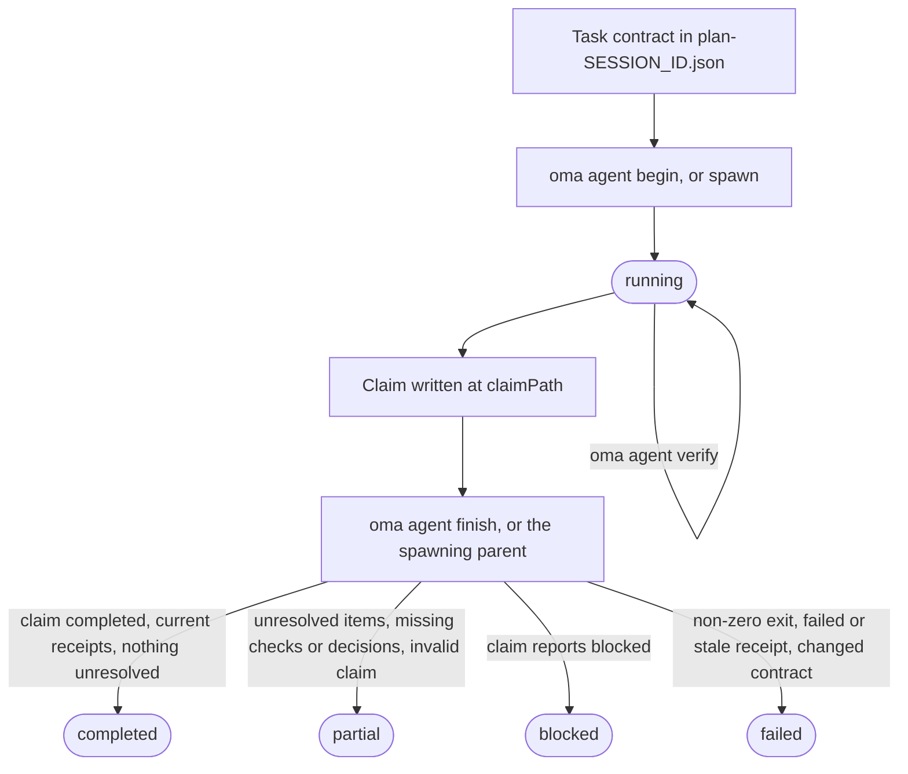
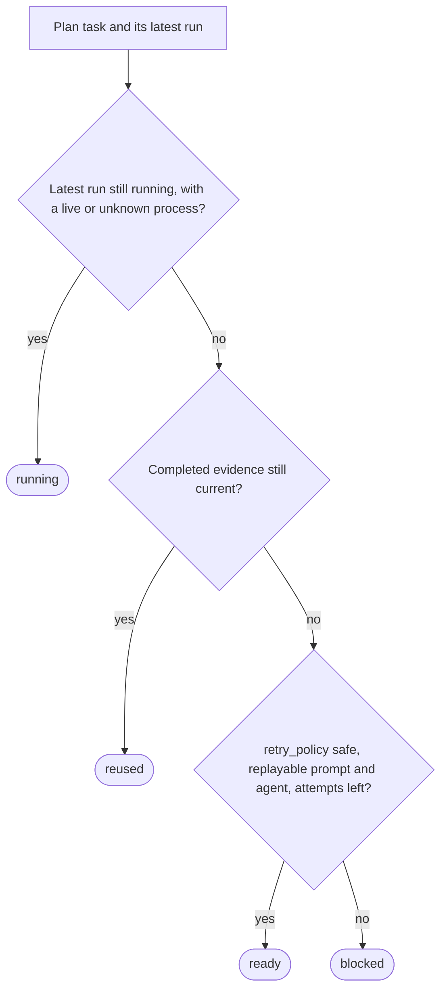

# Résultats d’agents et reprise

OMA traite un résultat d’agent comme un petit enregistrement de preuves, pas seulement comme le code de sortie du processus. Une exécution enregistre les identifiants de tâche et de session, l’empreinte de l’espace de travail, les reçus de vérification, les fichiers modifiés, le travail non résolu et les hachages d’artefacts. Un coordinateur peut ainsi réutiliser une tâche terminée tant que son contrat d’acceptation et ses entrées correspondent encore.

Utilisez directement ce cycle lorsque vous exécutez un agent natif. Les workflows et `oma agent spawn` créent les mêmes enregistrements pour vous et laissent la finalisation de l’exécution gérée au coordinateur parent. Pour les termes employés ici, consultez [Enregistrement d’exécution et claim](../getting-started/glossary.md#run-record-and-claim) et [Plan](../getting-started/glossary.md#plan) dans le glossaire.

## Le cycle de vie en un coup d’œil

| Étape | Commande | Enregistre | À conserver |
| --- | --- | --- | --- |
| 1. Contrat | Modifier `.agents/results/plan-SESSION_ID.json` | `acceptance_criteria` et `required_checks` de la tâche | ID de session, ID de tâche |
| 2. Démarrage | `oma agent begin AGENT TASK SESSION_ID --workspace .` | Enregistrement d’exécution au statut `running` | `runId`, `claimPath` |
| 3. Contexte (facultatif) | `oma agent context AGENT --difficulty Medium` | Rien | Contexte de l’invite |
| 4. Vérification | `oma agent verify RUN_ID --required` | Un reçu par vérification | Code de sortie |
| 5. Claim | Écrire le JSON à `claimPath` | Fichier de claim | Rien |
| 6. Fin | `oma agent finish RUN_ID CLAIM_PATH` | Statut final | `status` |
| 7. Récupération | `oma agent resume SESSION_ID --dry-run`, puis sans `--dry-run` | Point de contrôle de récupération et bail de session | Statut par tâche |

`oma agent spawn` et `oma agent parallel` effectuent les étapes 2 et 6 pour vous : le processus parent démarre l’exécution et la finalise lorsque l’enfant se termine.



Un claim peut aussi rapporter directement `partial` ou `failed`. La fin ne surclasse jamais un claim : elle rétrograde un claim `completed` dont les preuves ne tiennent pas, et un code de sortie non nul rend toute exécution `failed`.

## Démarrer une exécution native {#start-a-native-run}

Définissez d’abord la tâche, ses `acceptance_criteria` et ses `required_checks` dans un plan à `.agents/results/plan-SESSION_ID.json`. Pour une petite vérification générique de projet, le plan peut contenir une seule tâche comme celle-ci :

```json
{
  "tasks": [
    {
      "id": "docs",
      "agent": "docs",
      "task": "Review README.md and report any documentation issues",
      "workspace": ".",
      "acceptance_criteria": [
        { "id": "diff-clean", "description": "The current Git diff has no whitespace errors" }
      ],
      "required_checks": [
        { "id": "whitespace", "criteria": ["diff-clean"], "command": ["git", "diff", "--check"], "cwd": "." }
      ],
      "retry_policy": "manual"
    }
  ]
}
```

Cette vérification ne prouve que l’absence d’erreurs d’espaces dans le diff Git ; remplacez la tâche, le critère et la vérification par le véritable contrat d’acceptation du projet. Depuis la racine du projet, commencez l’exécution :

```bash
oma agent begin docs docs SESSION_ID --workspace .
```

Remplacez `SESSION_ID` par l’identifiant de session utilisé dans le plan. La commande affiche un JSON contenant un UUID `runId` généré et un `claimPath`, par exemple :

```json
{
  "runId": "<generated-run-id>",
  "taskId": "docs",
  "sessionId": "<your-session-id>",
  "status": "running",
  "claimPath": ".agents/state/agent-runs/<generated-run-id>.claim.json"
}
```

Les valeurs entre chevrons sont des placeholders ; utilisez les valeurs réelles affichées par votre exécution. Un démarrage réussi crée l’enregistrement de l’exécution sous `.agents/state/agent-runs/` et capture un instantané du contrat de tâche. Le chemin du claim est toujours le chemin de l’enregistrement d’exécution avec `.claim.json` à la place de `.json`.

## Charger le contexte et exécuter la tâche

Chargez les références sélectionnées par le graphe avant de modifier :

```bash
oma agent context docs --difficulty Medium
```

La difficulté doit être `Simple`, `Medium` ou `Complex`. La commande affiche le contexte assemblé pour l’agent sélectionné. Si aucun contexte fondé sur le graphe n’existe, corrigez la définition de tâche ou poursuivez avec le chemin de recherche natif documenté par le projet ; ne fabriquez pas de reçu de contexte.

Exécutez la tâche dans l’espace de travail enregistré par `begin`. Gardez le plan de session fixe pendant l’exécution. Si la tâche modifie ses critères d’acceptation ou ses vérifications requises, commencez une nouvelle exécution après avoir mis à jour le plan.

## Enregistrer la vérification

Lancez chaque vérification épinglée au contrat d’acceptation :

```bash
oma agent verify RUN_ID --required
```

Remplacez `RUN_ID` par l’UUID renvoyé par `begin`. La commande exécute l’argv déclaré et enregistre le code de sortie réel ainsi que les empreintes de l’espace de travail avant et après. Une seule commande exacte peut être enregistrée lorsque le contrat de la tâche inclut cette vérification :

```bash
oma agent verify RUN_ID -- git diff --check
```

Utilisez la forme à commande exacte uniquement pour une vérification qui appartient au contrat de la tâche ; sinon, gardez les `required_checks` du plan et utilisez `--required` afin que le reçu prouve les critères d’acceptation déclarés.

Utilisez `--affected PATH...` uniquement lorsque le graphe fournit une sélection complète de tests pour ces chemins. Les vérifications s’exécutent en série pour chaque exécution. Un code de sortie non nul ou une modification de l’espace de travail pendant une vérification invalide ce reçu.

## Écrire et terminer le claim

Pour les tâches qui choisissent un contrat d’API, une politique d’authentification, un modèle de données, une stratégie de migration, un propriétaire d’état, un périmètre d’accès à l’infrastructure ou toute autre décision dont dépend le travail ultérieur, déclarez `required_decisions` dans la tâche avant la répartition :

```json
"required_decisions": [
  {
    "subject": "db.migration-strategy",
    "description": "Choose the compatibility window and rollback strategy for the account migration."
  }
]
```

Omettez ce champ pour les tâches qui suivent une décision existante. Les exigences sont épinglées avec le contrat de tâche et ne peuvent être ni supprimées ni modifiées après la répartition. Listez les sujets suggérés pour un agent avec `oma state decisions list --agent db-engineer --json`. Ces sujets sont des choix à utiliser lorsqu’ils sont pertinents ; le catalogue ne rend pas chaque choix obligatoire.

Écrivez le fichier de claim au chemin exact affiché par `begin` :

```json
{
  "status": "completed",
  "changedFiles": [],
  "unresolved": [],
  "artifacts": []
}
```

`status` vaut `completed`, `partial`, `blocked` ou `failed`. Les chemins sont relatifs à la racine du projet et chaque artefact doit être un fichier ordinaire situé dans l’espace de travail. Utilisez `verificationSkipped` uniquement pour une revue précise qui n’a pas de vérification exécutable ; cela ne transforme pas une vérification échouée en réussite.

Incluez les décisions substantielles dans le tableau facultatif `decisions` du claim :

```json
"decisions": [
  {
    "subject": "db.migration-strategy",
    "decision": "Use an expand-and-contract migration; retain the old column for one release.",
    "rationale": "Both deployed app versions must work during the rollout; rollback switches reads to the retained column.",
    "alternatives": ["Replace the column during a maintenance window"],
    "evidence": ["docs/account-migration.md"]
  }
]
```

Le parent stocke chaque décision comme un événement `decision.made` dans la session de l’exécution et y rattache les ID réels d’agent, de tâche et d’exécution. Une décision requise manquante maintient le résultat à l’état partiel, y compris lorsque les vérifications exécutables réussissent. Les décisions provenant d’une autre tâche ou d’une autre tentative ne peuvent pas satisfaire l’exigence. Le reçu épingle les ID des événements de décision et les hachages de leur contenu ; la réutilisation vérifie que ces événements existent toujours, sont valides et ont un contenu inchangé. Les décisions facultatives sont également enregistrées. Les agents en lecture seule renvoient le même tableau dans leur claim `OMA_RESULT_JSON` afin que le parent puisse le conserver.

Finalisez une exécution native après avoir écrit le claim :

```bash
oma agent finish RUN_ID CLAIM_PATH
```

Remplacez les deux valeurs par celles du JSON renvoyé par `begin`. `CLAIM_PATH` est le chemin `.claim.json` généré ; n’inventez pas de nouveau nom de fichier.

La commande de fin valide le claim, le contrat courant, les reçus courants et les hachages d’artefacts. Un claim terminé avec des preuves obsolètes devient failed ou partial. La commande refuse de finaliser une exécution gérée dont le processus parent possède le cycle de vie.

## Comportement des exécutions créées et natives

`oma agent spawn` et `oma agent parallel` créent une exécution, injectent l’identité d’exécution et les instructions de résultat dans l’invite enfant, puis laissent le parent capturer le code de sortie de l’enfant. Un enfant doit écrire son claim et signaler ses artefacts ; le parent finalise le reçu géré. Un enfant en lecture seule renvoie une ligne `OMA_RESULT_JSON: {...}` ; le parent la conserve, et son explication `verificationSkipped` reste distincte d’une vérification exécutable.

Les fichiers de résultat lisibles dans `.agents/results/` et les notes mémoire dans `.agents/state/memories/` aident les personnes à suivre l’avancement. Le reçu lisible par machine dans `.agents/state/agent-runs/` est la preuve utilisée pour la réutilisation et la reprise.

## Inspecter la récupération avant de réessayer

Commencez par demander ce qu’OMA ferait :

```bash
oma agent resume SESSION_ID --dry-run
```

Le rapport classe chaque tâche comme `reused`, `ready`, `running` ou `blocked` et inclut la raison :



Une dépendance qui n’est pas `reused` ramène une tâche dépendante `reused` à `ready` (ou à `blocked` lorsqu’elle ne peut pas être rejouée), et une tâche `ready` dont la dépendance est `blocked` ou `running` devient `blocked`. Un reçu terminé valide n’est réutilisé que lorsque son contrat, ses entrées, les hachages d’artefacts et les preuves de dépendances restent actuels. Un processus géré actif, ou une exécution native sans preuve de vivacité, n’est pas dupliqué.

Lorsque le rapport indique que l’exécution est sûre, reprenez les tâches prêtes dans l’ordre des dépendances :

```bash
oma agent resume SESSION_ID
```

La relecture automatique exige `retry_policy: "safe"` ainsi qu’une invite et un agent rejouables dans le plan ou la répartition enregistrée. La valeur par défaut est `manual`. `--max-attempts` vaut par défaut `3`, tentative initiale comprise :

```bash
oma agent resume SESSION_ID --max-attempts 2
```

OMA écrit le point de contrôle de récupération sous `.agents/state/agent-resume/` et utilise un bail de session afin que deux coordinateurs ne puissent pas réessayer la même session. Il épingle le plan pendant la récupération. Si le plan change, si une dépendance change ou si une tentative ultérieure modifie une entrée antérieure, les tâches concernées deviennent bloquées et nécessitent une nouvelle exécution de vérification.

La reprise commence une nouvelle tentative ; elle ne restaure pas la conversation interrompue avec le modèle. Avant de reprendre une exécution native interrompue, marquez l’ancienne exécution `partial` ou `failed` avec son résultat réel et son travail non résolu. Examinez ensuite le rapport de simulation et ne réessayez que les tâches qui disposent d’un chemin de rejeu sûr.

## Exemples de récupération

| Situation | Action | Résultat attendu |
| --- | --- | --- |
| Une vérification requise a échoué | Corrigez la tâche, relancez `oma agent verify RUN_ID --required`, puis terminez avec un nouveau claim. | Le reçu le plus récent remplace le résultat en échec lorsque l’empreinte de l’espace de travail est actuelle. |
| Le processus est mort avant un claim | Marquez l’exécution partial ou failed, puis lancez `oma agent resume SESSION_ID --dry-run`. | L’ancienne tentative est conservée ; une tâche sûre est `ready`, tandis qu’une tâche manuelle est `blocked`. |
| Une dépendance a changé | Relancez la dépendance et examinez à nouveau le rapport. | La réutilisation dépendante est invalidée même si ses propres fichiers sont inchangés. |
| Le plan ou les entrées ont changé | Commencez une nouvelle exécution une fois le plan stabilisé. | La nouvelle exécution capture le nouveau contrat ; les anciennes preuves ne sont pas réutilisées. |
| Une tâche nécessite une décision | Enregistrez-la comme `blocked` avec une explication. | La reprise la laisse bloquée jusqu’à ce que la décision et l’invite soient disponibles. |

## Étapes suivantes

- Messages d’erreur de `begin`, `verify`, `finish` et `resume` : [Dépannage](./troubleshooting.md#find-your-error)
- Erreurs d’analyse, outils fournisseur manquants, état du tableau de bord, plannings et données d’évaluation obsolètes : [Dépannage](./troubleshooting.md)
- Suivre les exécutions gérées pendant leur travail : [Surveillance par tableau de bord](./dashboard-monitoring.md)
- Définir des plans avec des contrats de tâche : [Projets multi-agents](./multi-agent-project.md)
