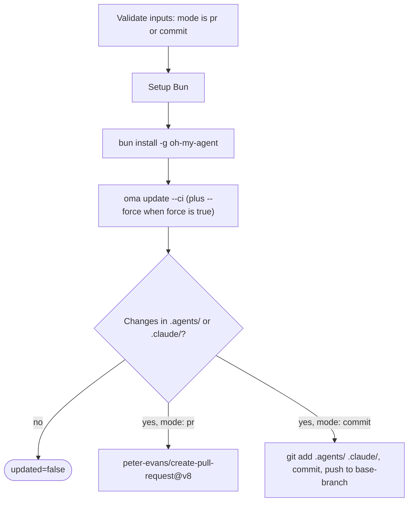

# Guide : mises à jour automatiques

## Vue d'ensemble

L'action GitHub oh-my-agent (`first-fluke/oma-update-action@v1`) met automatiquement à jour les compétences d'agents de votre projet en exécutant `oma update` dans la CI. Elle propose deux modes : créer une pull request pour revue ou effectuer un commit direct sur une branche.

---

## Configuration rapide

<!-- oma-docs:ignore-start -->
Ajoutez ce fichier à votre projet sous `.github/workflows/update-oh-my-agent.yml` :
<!-- oma-docs:ignore-end -->

```yaml
name: Update oh-my-agent

on:
  schedule:
    - cron: '0 9 * * 1'  # Every Monday at 9am UTC
  workflow_dispatch:        # Allow manual trigger

permissions:
  contents: write
  pull-requests: write

jobs:
  update:
    runs-on: ubuntu-latest
    steps:
      - uses: actions/checkout@v4

      - uses: first-fluke/oma-update-action@v1
```

C'est la configuration minimale. Lorsqu'un composant installé change, l'action doit terminer avec `updated=true`, une sortie de version et une pull request. Lorsqu'aucun fichier ne change, elle termine avec `updated=false` et sans pull request.

---

## Toutes les entrées de l'action

| Entrée | Type | Obligatoire | Valeur par défaut | Description |
|:------|:-----|:---------|:--------|:-----------|
| `mode` | string | Non | `"pr"` | Méthode d'application des changements. `"pr"` crée une pull request. `"commit"` pousse directement vers la branche de base. |
| `base-branch` | string | Non | `"main"` | Branche de base de la PR (en mode `pr`) ou branche cible des commits directs (en mode `commit`). Elle ne change pas ce qui est récupéré ; définissez `ref:` d'`actions/checkout` sur la même branche. |
| `force` | string | Non | `"false"` | Transmet `--force` à `oma update`. Lorsque la valeur est `"true"`, écrase les fichiers de configuration personnalisés (`oma-config.yaml`, `mcp.json`) et les répertoires `stack/`. Ils sont normalement préservés. |
| `pr-title` | string | Non | `"chore(deps): update oh-my-agent skills"` | Titre personnalisé de la pull request. Utilisé uniquement en mode `pr`. |
| `pr-labels` | string | Non | `"dependencies,automated"` | Étiquettes séparées par des virgules à ajouter à la PR. Utilisé uniquement en mode `pr`. |
| `commit-message` | string | Non | `"chore(deps): update oh-my-agent skills"` | Message de commit personnalisé. Utilisé dans les deux modes (message du commit de PR ou du commit direct). |
| `token` | string | Non | `${{ github.token }}` | Jeton GitHub utilisé pour créer les PR. Utilisez un Personal Access Token (PAT) si la PR doit déclencher d'autres workflows (le `GITHUB_TOKEN` par défaut ne déclenche pas les workflows sur les PR qu'il crée). |

---

## Toutes les sorties de l'action

| Sortie | Type | Description | Disponible |
|:-------|:-----|:-----------|:----------|
| `updated` | string | `"true"` si des changements ont été détectés après l'exécution de `oma update`. `"false"` si tout était déjà à jour. | Toujours |
| `version` | string | Version d'oh-my-agent après la mise à jour. Lue dans `.agents/skills/_version.json`. | Lorsque `updated` vaut `"true"` |
| `pr-number` | string | Numéro de la pull request. | Uniquement en mode `pr` lorsqu'une PR est créée |
| `pr-url` | string | URL complète de la pull request créée. | Uniquement en mode `pr` lorsqu'une PR est créée |

---

## Exemples détaillés

### Exemple 1 : mode PR par défaut

La configuration la plus courante. Elle crée une PR chaque lundi lorsqu'une mise à jour est disponible.

```yaml
name: Update oh-my-agent

on:
  schedule:
    - cron: '0 9 * * 1'
  workflow_dispatch:

permissions:
  contents: write
  pull-requests: write

jobs:
  update:
    runs-on: ubuntu-latest
    steps:
      - uses: actions/checkout@v4

      - uses: first-fluke/oma-update-action@v1
        id: update

      - name: Summary
        if: steps.update.outputs.updated == 'true'
        run: |
          echo "Updated to version ${{ steps.update.outputs.version }}"
          echo "PR: ${{ steps.update.outputs.pr-url }}"
```

**Ce qui se passe :**

- Le dépôt est récupéré.
- Bun est installé, puis oh-my-agent est installé globalement.
- `oma update --ci` est exécuté.
- L'action vérifie si `.agents/` ou `.claude/` ont changé.
- Si des changements existent, `peter-evans/create-pull-request@v8` crée une PR sur la branche `chore/update-oh-my-agent`.
- La PR reçoit les étiquettes `dependencies,automated` et contient le nouveau numéro de version dans son corps.

### Exemple 2 : mode commit direct avec PAT

Pour les équipes qui veulent appliquer les mises à jour immédiatement, sans étape de revue de PR. Un PAT est utilisé afin que le commit puisse déclencher les workflows en aval.

```yaml
name: Update oh-my-agent (Direct)

on:
  schedule:
    - cron: '0 6 * * *'  # Daily at 6am UTC
  workflow_dispatch:

permissions:
  contents: write

jobs:
  update:
    runs-on: ubuntu-latest
    steps:
      - uses: actions/checkout@v4
        with:
          ref: develop
          token: ${{ secrets.OH_MY_AGENT_PAT }}

      - uses: first-fluke/oma-update-action@v1
        with:
          mode: commit
          token: ${{ secrets.OH_MY_AGENT_PAT }}
          commit-message: "chore: auto-update oh-my-agent skills"
          base-branch: develop
```

**Ce qui se passe :**

- La branche `develop` est récupérée avec un PAT. `ref: develop` est obligatoire : `base-branch` ne définit que la cible du push, et l'action pousse le `HEAD` produit par la récupération, quel qu'il soit.
- `oma update --ci` est exécuté.
- Si des changements existent, git est configuré avec l'identité `github-actions[bot]`, puis un commit est créé directement sur `develop`.
- Le PAT garantit que le commit déclenche les workflows qui écoutent les push sur `develop`.

**Important :** utilisez `secrets.OH_MY_AGENT_PAT` (un PAT à granularité fine avec l'autorisation Contents: Write) plutôt que `github.token`. Le `GITHUB_TOKEN` par défaut crée des commits qui ne déclenchent pas les autres workflows, ce qui peut casser les pipelines CI qui attendent des événements push.

### Exemple 3 : notification conditionnelle

Mettez à jour oh-my-agent avec une notification Slack lorsqu'une nouvelle version est disponible.

```yaml
name: Update oh-my-agent

on:
  schedule:
    - cron: '0 9 * * 1'
  workflow_dispatch:

permissions:
  contents: write
  pull-requests: write

jobs:
  update:
    runs-on: ubuntu-latest
    steps:
      - uses: actions/checkout@v4

      - uses: first-fluke/oma-update-action@v1
        id: update

      - name: Notify Slack
        if: steps.update.outputs.updated == 'true'
        uses: slackapi/slack-github-action@v2
        with:
          webhook: ${{ secrets.SLACK_WEBHOOK }}
          webhook-type: incoming-webhook
          payload: |
            {
              "text": "oh-my-agent updated to v${{ steps.update.outputs.version }}. PR: ${{ steps.update.outputs.pr-url }}"
            }

      - name: Skip notification
        if: steps.update.outputs.updated == 'false'
        run: echo "Already up to date, no notification needed."
```

**Point clé :** utilisez `steps.update.outputs.updated == 'true'` pour n'exécuter les étapes suivantes que lorsqu'une mise à jour réelle a eu lieu. Cela évite le bruit des exécutions « aucun changement ».

### Exemple 4 : mode force avec des étiquettes personnalisées

Pour les projets qui veulent réinitialiser tous les fichiers de configuration à leurs valeurs par défaut lors d'une mise à jour.

```yaml
name: Update oh-my-agent (Force)

on:
  workflow_dispatch:  # Manual trigger only for force updates

permissions:
  contents: write
  pull-requests: write

jobs:
  update:
    runs-on: ubuntu-latest
    steps:
      - uses: actions/checkout@v4

      - uses: first-fluke/oma-update-action@v1
        with:
          force: 'true'
          pr-title: "chore(deps): force-update oh-my-agent skills (reset configs)"
          pr-labels: "dependencies,automated,force-update"
          commit-message: "chore(deps): force-update oh-my-agent skills"
```

**Avertissement :** le mode force écrase `oma-config.yaml`, `mcp.json` et les répertoires `stack/`. Utilisez-le uniquement si vous voulez réinitialiser toutes les personnalisations à leurs valeurs par défaut. Pour les mises à jour ordinaires, omettez l'entrée `force`.

---

## Fonctionnement interne

L'action est une [action composite](https://docs.github.com/en/actions/creating-actions/creating-a-composite-action) définie dans `action/action.yml`. Elle vérifie d'abord que `mode` vaut `pr` ou `commit`, puis exécute les étapes ci-dessous et se termine par une pull request ou un commit direct :



### Étape 1 : configurer Bun

```yaml
- uses: oven-sh/setup-bun@v2
```

Le runtime Bun est installé ; il est nécessaire pour exécuter la CLI oh-my-agent.

### Étape 2 : installer oh-my-agent

```bash
bun install -g oh-my-agent
```

La CLI est installée globalement depuis le registre npm. La commande `oma` devient ainsi disponible.

### Étape 3 : exécuter oma update

```yaml
- name: Run oma update
  shell: bash
  env:
    FORCE: ${{ inputs.force }}
  run: |
    FLAGS="--ci"
    if [ "$FORCE" = "true" ]; then
      FLAGS="$FLAGS --force"
    fi
    oma update $FLAGS
```

Les entrées parviennent au script via `env:` plutôt que par interpolation `${{ }}` dans `run:`, ce qui empêche qu'une valeur d'entrée soit exécutée comme code shell.

L'option `--ci` exécute la mise à jour en mode non interactif (toutes les invites sont ignorées et le texte est produit sans animation de spinner). L'option `--force`, lorsqu'elle est activée, écrase les fichiers de configuration personnalisés.

Étapes de `oma update --ci` :

1. Récupère `prompt-manifest.json` depuis la branche principale pour obtenir le dernier numéro de version.
2. Compare cette version à la version locale dans `.agents/skills/_version.json`.
3. Si les versions correspondent, quitte avec « Already up to date. ».
4. Si une nouvelle version existe, télécharge et extrait la dernière archive.
5. Préserve les fichiers personnalisés (sauf avec `--force`) : `oma-config.yaml`, `mcp.json` et les répertoires stack.
6. Copie les nouveaux fichiers par-dessus le répertoire `.agents/` existant.
7. Restaure les fichiers préservés.
8. Met à jour les adaptations des fournisseurs (hooks, réglages et définitions d'agents) pour les fournisseurs de la liste `vendors:` de la configuration (une liste vide signifie aucun). Sans liste `vendors:`, seuls les fournisseurs dont les répertoires de projet existent déjà sont mis à jour.
9. Actualise les liens symboliques de la CLI.

L'action appelle `oma update --ci` sans `--with-new-skills`. Cela actualise l'ensemble de compétences installé et signale les nouvelles compétences disponibles ; exécutez délibérément `oma update --with-new-skills` lorsqu'un projet doit ajouter de nouvelles compétences lors de la mise à jour.

### Étape 4 : vérifier les changements

```bash
if [ -n "$(git status --porcelain .agents/ .claude/ 2>/dev/null)" ]; then
  echo "updated=true" >> "$GITHUB_OUTPUT"
  if [ -f ".agents/skills/_version.json" ]; then
    VERSION=$(jq -r '.version' .agents/skills/_version.json)
    echo "version=$VERSION" >> "$GITHUB_OUTPUT"
  fi
else
  echo "updated=false" >> "$GITHUB_OUTPUT"
fi
```

Cette étape vérifie si `oma update` a effectivement modifié des fichiers dans `.agents/` ou `.claude/`. Elle définit les sorties `updated` et `version` en conséquence. Les changements hors de ces deux répertoires (par exemple `.codex/` ou `AGENTS.md`) ne définissent pas `updated=true`.

Ensuite, selon la valeur de l'entrée `mode` :

- **Mode `pr` :** utilise `peter-evans/create-pull-request@v8` pour créer une PR sur la branche `chore/update-oh-my-agent`. La PR contient le nouveau numéro de version, un lien vers le dépôt oh-my-agent et les étiquettes configurées. Si la branche existe déjà (à la suite d'une PR précédente encore ouverte), la PR existante est mise à jour.

- **Mode `commit` :** configure git avec l'identité `github-actions[bot]`, indexe `.agents/` et `.claude/`, crée un commit avec le message configuré et pousse vers la branche de base.

---

## Voir aussi

- [Installation globale](./global-install.md) : `oma update --global` et mises en garde CI pour les installations à l'échelle de l'utilisateur
- [Référence de configuration](./configuration-reference.md#update-and-ownership-rules) : fichiers de configuration que `oma update` préserve
- [Intégration à un projet existant](./integration.md) : fichiers que `oma update` actualise dans un projet
