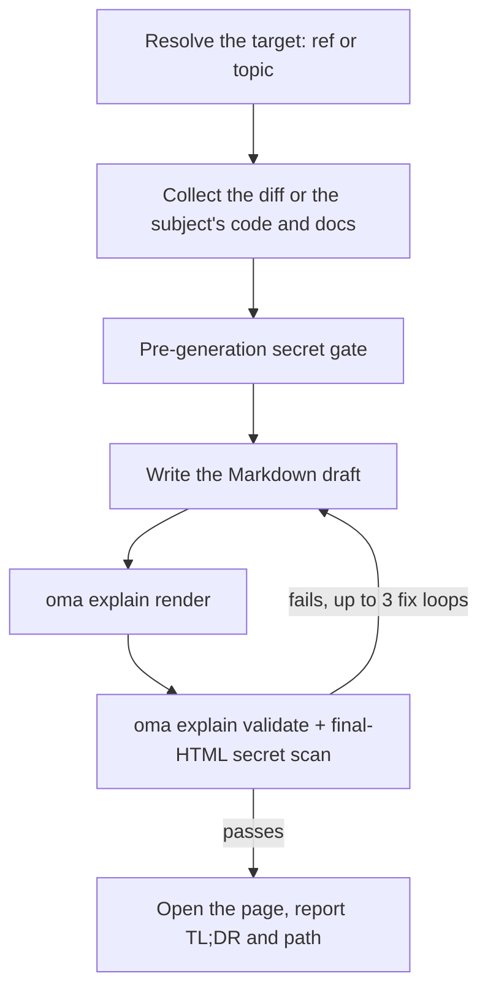

# Explicateur de code

`/explain` transforme une modification de code en document HTML riche et autonome qui enseigne ce qui a changé et pourquoi — un contexte approfondi que les débutants peuvent ignorer, une section d’intuition centrale avec données jouets, une présentation du code ordonnée pour la compréhension et un quiz de cinq questions. La sortie est un fichier `.html` unique, utilisable hors ligne, avec diagrammes, encadrés et quiz accessible ; il est enregistré sous `.agents/results/explain/` et validé avec une checklist déterministe avant livraison.

`/explain` ne s’active qu’avec une commande slash — il ne s’active pas automatiquement en langage naturel. « explain » est un mot courant, il est donc volontairement exclu de la détection des mots-clés (même précédent que `/convert`). Dites explicitement `/explain` ou demandez à une autre compétence de produire un « document explicatif » comme sortie déléguée.

## Deux modes

| Mode | Vous tapez | Nécessite git | Ce que la page explique |
|---|---|---|---|
| Change | `/explain`, `/explain #640`, `/explain a..b`, `/explain <branch>` | oui (`gh` pour les références de PR) | Une modification de code : Background, Intuition, Code, Quiz |
| Topic | `/explain how does session windowing work` (texte qui ne se résout en aucune PR, branche ni plage SHA) | non | Un concept, un système ou la réponse à une question, sous forme de fiche visuelle d’une page : une réponse en tête, puis des panneaux de diagrammes, de tableaux et de courte prose |

Si le texte peut être aussi bien un nom de branche qu’un sujet, le workflow le vérifie d’abord comme référence git ; une référence l’emporte.

---

## Quand l’utiliser

- Expliquer une PR, une branche, une plage de commits ou la modification indexée/non indexée courante sous forme de document
- Intégrer un coéquipier à une modification qu’il n’a pas écrite
- Produire un artefact pédagogique révisable après l’arrivée d’une modification importante ou subtile
- Transformer une architecture, un protocole, une comparaison ou une longue réponse en une seule page visuelle (mode topic)

## Quand NE PAS l’utiliser

- *Vidéo* explicative narrée → utilisez [`oma-video`](./video-generation.md) (mode explainer) ; `/explain` produit un document HTML, pas une vidéo
- Vérifier que la documentation correspond toujours au codebase → utilisez `oma-docs` (détection de dérive)
- Présentation / diapositives → utilisez `oma-slide` (contrat de deck fixe en 1920×1080)
- Trouver des défauts ou rendre des verdicts de revue → utilisez `oma-qa` ou le workflow `/review` ; `/explain` raconte une modification de façon pédagogique, il ne l’évalue pas

---

## Démarrage rapide

```text
/explain
/explain 640
/explain a1b2c3d..e5f6a7b
/explain payments-refactor for reviewer
```

La référence cible est résolue à partir de la formulation :

| Vous tapez | Résolution de la cible | Niveau de lecture |
|----------|--------------------|--------------|
| `/explain` | Modifications indexées (`git diff --cached`), avec repli vers l’arbre de travail modifié | `onboarding` |
| `/explain 640`, `/explain #640` | PR #640 via `gh pr diff` | `onboarding` |
| `/explain a..b` | Plage SHA `a..b` (ou `a...b`) | `onboarding` |
| `/explain feature-branch for reviewer` | `git diff main...feature-branch` | `reviewer` |
| `/explain how does the row planner work` | Mode topic : aucune référence ; l’agent collecte le code et la documentation dont traite le sujet | n/a |

Si aucune référence explicite n’est fournie et que les arbres de travail indexé et modifié sont tous deux vides, la résolution revient à `HEAD~1..HEAD`.



---

## Ordre de résolution des références

Mode change uniquement ; le mode topic ignore la résolution de référence.

1. **Argument explicite** — numéro de PR (`#640`), nom de branche ou plage SHA (`a..b` / `a...b`)
2. **Modifications indexées** — `git diff --cached`
3. **Arbre de travail modifié** — `git diff`
4. **Repli** — `HEAD~1..HEAD`

Un diff vide ou une référence impossible à résoudre arrête le workflow ; il propose les commits récents comme candidats au lieu de deviner une autre référence.

---

## Niveaux de lecture

| Niveau | Effet |
|-------|--------|
| `onboarding` (par défaut) | Contexte approfondi complet (niveau A), pour un lecteur qui ne connaît pas le système environnant |
| `reviewer` | Condense le niveau de contexte approfondi ; les sections Intuition et Code restent complètes |

Demandez `reviewer` en ajoutant « for reviewer » à la commande, comme dans `/explain feature-branch for reviewer`.

---

## Contenu du document

Un explicateur en mode change est une seule longue page déroulante (sans onglets ni navigation multipage) avec une table des matières suivie de quatre sections fixes, dans cet ordre :

1. **Background** — niveau A (contexte système/architecture approfondi, marqué « skippable if you already know the system ») et niveau B (contexte étroit pour cette modification précise)
2. **Intuition** — essence centrale de la modification avec exemples obligatoires sur données jouets, renforcée par 2 ou 3 familles de diagrammes réutilisées (maquette UI simplifiée, diagramme système/de flux portant les données d’exemple, état avant/après) rendues uniquement en HTML/SVG inline — pas d’art ASCII
3. **Code** — présentation organisée pour la compréhension humaine (ni ordre alphabétique ni ordre du diff), avec références au code sous la forme `file:line`
4. **Quiz** — 5 questions par défaut (paramétrables), chacune ciblant un aspect distinct de la modification, avec distracteurs plausibles et texte de retour pour chaque option (correcte ou incorrecte)

La prose et le contenu du quiz sont écrits dans la langue de sortie demandée (langue de l’invite → `.agents/oma-config.yaml` `language` → anglais) ; le code, les identifiants et le code inline restent en anglais selon les règles i18n. Le contrat complet du contenu se trouve dans `.agents/skills/oma-explanation/resources/document-structure.md`.

---

## Construction de la page

L’agent écrit un brouillon Markdown, et `oma explain render` le transforme en page : la mise en page, le thème, la géométrie des diagrammes et le script du quiz viennent du moteur de rendu, pas du modèle.

| Commande | Usage |
|---|---|
| `oma explain render draft.md` | Rend un brouillon (un fichier ou stdin) vers `.agents/results/explain/{YYYY-MM-DD}-{slug}.html`. Les options incluent `--template sheet\|doc`, `--theme`, `--mode`, `--archify` et `--open`. |
| `oma explain lint draft.md` | Vérifie la prose sans rendu (`--style strict` sort avec le code 1 sur un avertissement). |
| `oma explain components [name]` | Liste les composants utilisables dans un brouillon (`flow`, `sequence`, `tree`, `timeline`, `limits`, `annot`, `kv`, `callout`, `quiz`) ou affiche la syntaxe d’un composant. |
| `oma explain patch <page.html> --panel <id>` | Remplace un panneau d’une page rendue (par lettre ou par titre) et conserve le reste. |
| `oma explain validate <file>` | Exécute les post-vérifications déterministes décrites ci-dessous. |

---

## Contrat HTML

Les pages produites par `oma explain render` respectent automatiquement ces règles ; elles comptent lorsque vous vérifiez ou modifiez le HTML à la main.

Le fichier généré doit s’ouvrir correctement hors ligne via `file://` avec **zéro chargement de ressource externe** — pas de scripts/feuilles de style CDN, pas de polices web, pas d’images externes (SVG inline ou URI de données uniquement). Les ancres d’hyperliens (`<a href="https://...">`) sont autorisées ; l’interdiction ne concerne que le *chargement* de ressources.

- Les blocs de code utilisent `<pre>` ; tout conteneur personnalisé déclare `white-space: pre-wrap`. Aucune bibliothèque externe de coloration syntaxique.
- Pile de polices : une Pretendard installée localement, désignée par son nom de famille (la page ne télécharge jamais de polices et n’utilise pas la fonction CSS `local()`), puis `system-ui` et les polices CJK système. Les pages japonaises et chinoises omettent Pretendard et commencent par `system-ui` avec les polices propres à cette langue.
- Adaptatif à partir de 375 px, contraste WCAG AA dans les thèmes clair et sombre, prise en charge de `prefers-color-scheme: dark` et respect de `prefers-reduced-motion`.
- Le quiz est en JavaScript vanilla : options comme éléments `<button>`, retour instantané correct/incorrect annoncé dans une région `aria-live="polite"`, réponses correctes réparties aléatoirement entre les positions, résumé du score final et navigation complète au clavier.

Spécification comportementale complète : `.agents/skills/oma-explanation/resources/html-contract.md`.

---

## Secrets et défense contre l’injection d’invite

Le contenu des diffs et les descriptions de PR sont traités strictement comme des **données** — toute instruction intégrée à la modification expliquée est ignorée.

Les secrets sont contrôlés deux fois :

1. **Avant génération :** le diff collecté est analysé avant toute rédaction.
2. **Après génération :** le HTML final est aussi analysé, car la prose de contexte peut citer des fichiers inchangés que le seul scan du diff manquerait.

À la moindre détection, la génération s’arrête immédiatement, seules les positions masquées sont signalées (jamais la valeur réelle) et la continuation expurgée exige une confirmation explicite.

---

## Checklist de validation

Après génération, une checklist fondée sur grep s’exécute sur le fichier de sortie : aucune référence chargeant une ressource externe, conformité des conteneurs de code `pre`/`pre-wrap`, présence du script de quiz, format de nom `{YYYY-MM-DD}-{slug}.html` (date dans la `timezone` d’oma-config, sinon dans le fuseau horaire du système) et scan final des secrets HTML. En cas d’échec, la boucle corrige et revalide jusqu’à **3 itérations**, puis s’arrête et expose les éléments restants en échec au lieu de livrer silencieusement.

C’est une contrainte v1 : la validation est fondée sur des fichiers et grep et vérifie uniquement la *présence* du script de quiz (pas sa correction comportementale complète). Utilisez un navigateur (ou le MCP chrome-devtools) pour exercer manuellement le quiz lorsque la confiance comportementale est importante.

Vous pouvez valider un artefact existant avec la commande CLI enregistrée :

```bash
oma explain validate .agents/results/explain/2026-09-09-payment-refactor.html
oma explain validate --input-dir .agents/results/explain --output json
```

Sortie attendue (noms de fichiers à titre d’illustration) :

```text
$ oma explain validate .agents/results/explain/2026-09-09-payment-refactor.html
✔ Explain validation passed: 1/1 file(s) valid

$ oma explain validate ".agents/results/explain/payment refactor.html"
✖ Explain validation failed: 1/1 file(s) failed
File: .agents/results/explain/payment refactor.html
  - [error] filename-format: Filename 'payment refactor.html' does not match format {YYYY-MM-DD}-{slug}.html
```

La première forme vérifie un seul fichier HTML. La forme répertoire vérifie chaque rapport d’un répertoire et renvoie un rapport lisible par machine. Utilisez `--report-file <path>` pour enregistrer le rapport JSON ; l’ancienne graphie `--out-file` échoue désormais avec `Removed option --out-file. Use --report-file.` Une sortie non nulle signifie qu’au moins un artefact a échoué aux vérifications déterministes ; elle n’évalue pas l’exactitude pédagogique de la prose ou des réponses du quiz.

---

## Sortie

```text
.agents/results/explain/{YYYY-MM-DD}-{slug}.html
```

La date suit la `timezone` d’oma-config, ou à défaut le fuseau horaire du système. Relancer la même date et le même slug écrase le fichier précédent — vous êtes responsable de conserver une exécution antérieure. Après réussite de la validation, le workflow tente d’ouvrir la page (avertissement seulement ; un environnement sans interface revient simplement au signalement du chemin) et signale un TL;DR ainsi que le chemin du fichier. `oma explain render --open` ouvre directement la page dans le navigateur.

---

## Sidecar archify facultatif

Lorsque `diagram.explain_sidecar: true` est défini dans `oma-config.yaml` ou que vous le demandez (`/explain 640 with archify`), `/explain` effectue le rendu avec `--archify` : il dérive un `{date}-{slug}.archify.html` interactif à partir d’un bloc `flow` ou `sequence` du brouillon et le relie avec une ancre simple. Il n’est jamais intégré — l’explicateur reste un fichier unique autonome — et l’échec du sidecar ne bloque jamais la livraison. Voir [Moteur de diagrammes](./diagram-engine.md#explain).

## Cas limites

| Situation | Comportement |
|-----------|----------|
| Diff vide / référence impossible à résoudre | Arrêter, proposer les commits récents comme candidats — ne jamais deviner une autre référence |
| Diff trop volumineux | Exclure automatiquement les fichiers lock/générés, regrouper le reste par fichier et lister les exclusions dans le pied de page de provenance |
| Diff uniquement binaire ou généré | Arrêter — rien à expliquer |
| CLI `gh` manquant ou non authentifié (référence PR) | Indications d’installation/authentification, avec alternative de diff de branche locale |
| Fusion/rebase en cours | Arrêter — arbre de travail instable |
| Répertoire non Git | Mode change : arrêt immédiat. Le mode topic fonctionne sans git. |
| Échec de validation après 3 boucles de correction | Arrêter et exposer les éléments de checklist en échec |
| Échec de `open` / environnement sans interface | Avertissement seulement — le chemin signalé suffit |

---

## Étapes suivantes

- [Workflow `/explain`](../core-concepts/workflows.md#explain) — pipeline résolution de référence → collecte → porte de secrets → génération → validation → livraison
- [Moteur de diagrammes](./diagram-engine.md) — le sidecar archify facultatif
- [Commandes CLI : explain](../cli-interfaces/commands.md#explain) — toutes les options de `oma explain`
- [Génération vidéo](./video-generation.md) — le *mode* explainer de `oma-video` produit une vidéo narrée au lieu d’un document HTML
- [Workflows de contenu et de recherche](./content-and-research.md) — autres capacités de document et de recherche
