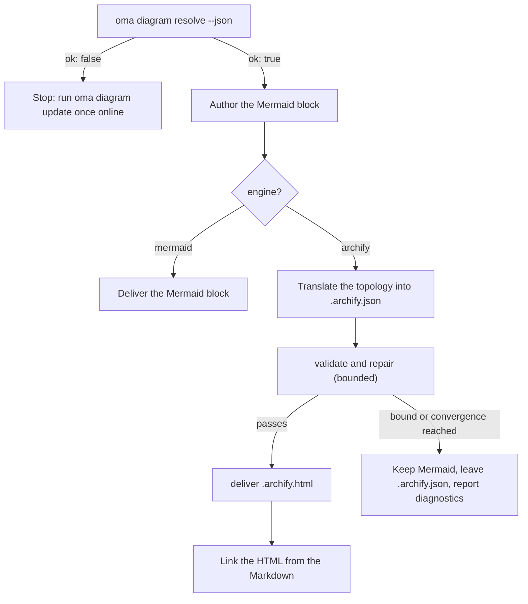

# Moteur de diagrammes

`/architecture` (ADR, recommandations, revues) et `/explain` (explicateurs de modifications de code) produisent tous deux des diagrammes structurels. Pour `/architecture`, il s’agit toujours de blocs **Mermaid** dans l’artefact Markdown (`/explain` dessine ses propres diagrammes SVG inline) et — chaque fois qu’[archify](https://github.com/tt-a1i/archify) peut être résolu, ce qui est le cas normal — également d’un **diagramme HTML interactif et validé** à côté de l’artefact : thème sombre/clair, déplacement-zoom, recherche, traçage des relations, export PNG/SVG/WebM, rendu depuis une spécification JSON typée.

Mermaid ne disparaît jamais : c’est le SSOT textuel présent dans le Markdown et les diffs git. archify est un artefact dérivé.

---

## Archify toujours à jour — rien à installer {#always-the-latest-archify--nothing-to-install}

archify est une compétence d’agent sous licence MIT (Node ≥ 18, aucune dépendance d’exécution). oh-my-agent ne dépend pas d’une copie installée une fois pour toutes ; il conserve **sa propre copie gérée** et suit la dernière version :

- Cache : `~/.cache/oma-diagram/archify/<tag>/` avec un pointeur `state.json`.
- Avant chaque utilisation, `oma diagram resolve` demande à GitHub la dernière balise de version (vérification limitée à une fois par `check_interval_min`, 60 minutes par défaut), télécharge l’archive source lorsqu’une balise plus récente existe (répertoire par balise atomique ; les anciennes balises sont supprimées), et réutilise sinon la copie en cache.
- Les échecs réseau ne sont jamais fatals : la copie en cache est utilisée et signalée comme `stale` avec la raison. Seule une première exécution sans réseau et sans cache revient à une copie de compétence installée par l’utilisateur, puis à Mermaid.

```bash
# Illustrative output; the release tag, cache path, and quality can vary.
oma diagram update          # force a check / download now
oma diagram resolve
# engine:   archify  (requested: auto)
# reason:   archify 2.15.0 via managed:v2.15.0 (current)
# root:     /Users/you/.cache/oma-diagram/archify/v2.15.0
# bin:      /Users/you/.cache/oma-diagram/archify/v2.15.0/bin/archify.mjs
# version:  2.15.0
# quality:  showcase
# sidecar:  off (explain)
oma diagram resolve --offline   # never touch the network
```

Ordre de résolution (le premier résultat l’emporte, identique dans tous les environnements fournisseur) :

1. `diagram.archify.path` dans `oma-config.yaml` — épinglage explicite, désactive le suivi automatique de la dernière version
2. Variable d’environnement `ARCHIFY_HOME` — épinglage explicite
3. **Dernière version gérée** (`~/.cache/oma-diagram/archify`)
4. Répertoires de compétences installées par l’utilisateur : projet `.agents` / `.claude` / `.codex` / `.cursor` / `.qwen` / `.kiro` `/skills/archify`, puis les mêmes sous `~`, puis `~/.raven/workspace/skills/archify`

<!-- oma-docs:ignore-start -->
Une installation archify gérée ou épinglée n’est retenue que si elle contient `bin/archify.mjs`.
<!-- oma-docs:ignore-end -->

---

## Configuration

Section sparse dans `.agents/oma-config.yaml` (les clés absentes utilisent les valeurs par défaut montrées) :

```yaml
diagram:
  engine: auto                # auto | archify | mermaid
  explain_sidecar: false      # /explain also writes an archify sidecar
  archify:
    managed: true             # false = never download; use pins / skill dirs only
    channel: stable           # stable (latest GitHub Release) | main (HEAD of main)
    check_interval_min: 60    # minutes between remote checks; 0 = every call
    path: null                # explicit install dir (pin)
    quality: showcase         # showcase | standard  → --quality
    open: false               # pass --open to deliver
```

### Quel moteur s’exécute {#which-engine-runs}

Une seule décision couvre la valeur de configuration, la résolution ou non d’archify et ce que livre le workflow. « Se résout » signifie qu’une étape de l’[ordre de résolution](#always-the-latest-archify--nothing-to-install) trouve une installation : un épinglage, la dernière copie gérée ou un répertoire de compétence installé par l’utilisateur.

| `diagram.engine` | archify se résout ? | `oma diagram resolve --json` | Résultat de `/architecture` |
|---|---|---|---|
| `auto` (par défaut) | oui | `engine: archify`, `ok: true` | Bloc Mermaid + `.archify.html` lié |
| `auto` | non (par exemple première exécution hors ligne, ou `managed: false` sans répertoire de compétence) | `engine: mermaid`, `ok: true` | Mermaid uniquement ; le rapport indique de lancer `oma diagram update` une fois en ligne |
| `archify` | oui | `engine: archify`, `ok: true` | Bloc Mermaid + `.archify.html` lié |
| `archify` | non | `engine: mermaid`, `ok: false`, sortie 1 | Le workflow s’arrête avec l’indication `oma diagram update` au lieu de rétrograder silencieusement |
| `mermaid` | non vérifié | `engine: mermaid`, `ok: true` | Mermaid uniquement ; archify n’est jamais appelé |

`oma diagram resolve --engine <auto|archify|mermaid>` remplace la configuration pour un appel, et une invite peut faire de même pour une exécution (`/explain 640 with archify`).

---

## CLI

```bash
oma diagram resolve [--engine auto|archify|mermaid] [--refresh] [--offline] [--json]
oma diagram update  [--json]
oma diagram archify <archify args…>
```

`oma diagram update` force une actualisation et se termine avec 1 lorsqu’aucune installation archify ne peut être résolue.

`oma diagram archify` exécute l’exécutable archify résolu avec `ARCHIFY_UPDATE_CHECK_DISABLED=1` (aucun réseau) et transmet le code de sortie, afin que `validate` / `deliver` / `visual-check` se comportent exactement comme le documente archify :

```bash
oma diagram archify guide "show the auth request lifecycle" --json
oma diagram archify validate architecture adr-auth.archify.json --quality showcase --json
oma diagram archify deliver  architecture adr-auth.archify.json adr-auth.archify.html --quality showcase --json
oma diagram archify visual-check adr-auth.archify.html --json   # exit 2 = no Chrome (skipped), or archify itself could not be resolved
```

`--json` sur `resolve` renvoie `{ ok, requested, engine, quality, open, explainSidecar, archify?: { root, bin, version, source, status?, note? }, reason, probed }` — `source` vaut `managed:<tag>`, `config:…`, `env:…` ou un libellé de répertoire de compétence ; `status` (`fresh` / `current` / `stale`) et `note` sont définis pour les copies gérées.

---

## Utilisation par les workflows

Le protocole partagé se trouve dans `.agents/skills/_shared/conditional/diagram-engine.md`. `/architecture` suit cette séquence :

1. `oma diagram resolve --json`
2. Rédiger d’abord le bloc Mermaid (toujours).
3. Si `engine: archify` : traduire la topologie Mermaid en IR JSON d’archify (`architecture` / `sequence` / `dataflow` / `lifecycle` / `workflow`), en ne lisant que le schéma correspondant et un exemple de l’installation.
4. `validate` → réparer → `deliver`, de façon bornée : arrêt lorsque la spécification passe, lorsque la règle de convergence d’archify se déclenche, après 3 tentatives de réparation, après 10 minutes au total, ou lorsque le même diagnostic se répète. Les libellés sémantiques ne sont jamais supprimés uniquement pour réussir.
5. Lier le HTML — ne jamais l’intégrer.



### `/architecture` {#architecture}

Uniquement pour les décisions structurelles (frontières, dépendances, flux de données). Sortie à côté de l’artefact Markdown sous `.agents/results/architecture/` :

```text
adr-notification-service.md            # Mermaid block + "Interactive:" link
adr-notification-service.archify.json  # frozen spec (kept even on failure)
adr-notification-service.archify.html  # delivered viewer
```

### `/explain` {#explain}

Facultatif, car le contrat propre à l’explicateur (fichier unique autonome, thème par variables CSS) n’autorise pas l’intégration d’un second document HTML complet. Activez-le avec `diagram.explain_sidecar: true`, passez `oma explain render --archify`, ou demandez-le dans l’invite (« with archify »). Il n’y a ni bloc Mermaid ni JSON écrit à la main : le moteur de rendu dérive la spécification archify d’un bloc `flow` ou `sequence` du brouillon (le panneau marqué `{archify}`), exécute `deliver` (avec un repli unique de la qualité `showcase` vers `standard`) et relie `{date}-{slug}.archify.html` avec un `<a href>` simple. La commande rapporte `linked`, `skipped` (avec la raison) ou `failed` (premier diagnostic). Le workflow ne boucle pas sur un sidecar en échec, et un échec du sidecar ne bloque jamais l’explicateur.

---

## Modes d’échec

Un archify impossible à résoudre est couvert par la [table de décision du moteur](#which-engine-runs). Les cas restants :

| Situation | Résultat |
|---|---|
| La vérification de mise à jour échoue (hors ligne, limitée par le débit) | La copie en cache est utilisée et signalée comme `stale` avec la raison |
| `validate` ne converge jamais | Mermaid reste le diagramme livré ; le dernier `.archify.json` est laissé à une personne ; les diagnostics sont rapportés textuellement |
| Chrome absent pour `visual-check` | Signalé comme `skipped`, jamais comme une réussite |
| `oma diagram archify …` se termine avec 2 | Soit Chrome est absent (`visual-check`), soit archify n’a pas pu être résolu ; vérifiez d’abord `oma diagram resolve --json` |

---

## Étapes suivantes

- [Explicateur de code](./code-explainer.md) — le workflow `/explain` et son sidecar archify facultatif
- [Workflow `/architecture`](../core-concepts/workflows.md#architecture) — ADR et revues qui portent le bloc Mermaid
- [Sémantique de oma-config.yaml](./oma-config-semantics.md) — comment la section `diagram:` est fusionnée
- [Commandes CLI : diagram](../cli-interfaces/commands.md#diagram) — liste complète des options
- [Recherche de marché](./market-research.md) — le même modèle de dernière version gérée pour le moteur last30days
- Source archify : [tt-a1i/archify](https://github.com/tt-a1i/archify)
