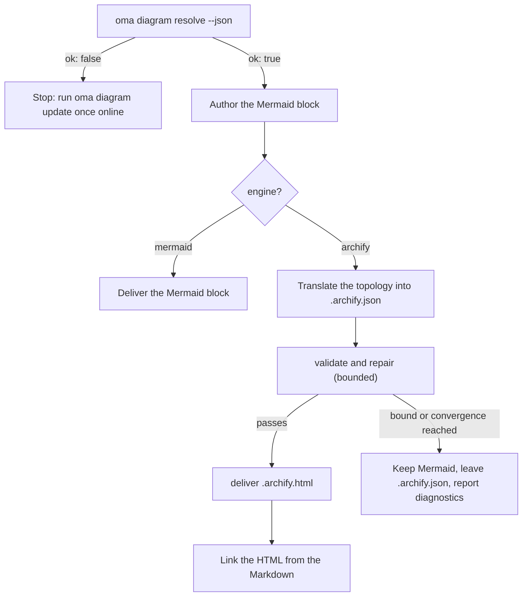

# Moteur de diagrammes

`/architecture` (ADR, recommandations, revues) et `/explain` (explicateurs de modifications de code) produisent des diagrammes structurels. `/architecture` insère toujours des blocs **Mermaid** dans l’artefact Markdown ; `/explain` dessine ses propres diagrammes SVG inline. Lorsqu’[archify](https://github.com/tt-a1i/archify) peut être résolu, OMA génère aussi un **diagramme HTML interactif et validé** à côté de l’artefact. Il propose un thème sombre ou clair, le déplacement et le zoom, la recherche, le traçage des relations, l’export PNG/SVG/WebM et le rendu depuis une spécification JSON typée.

Mermaid reste le SSOT textuel dans le Markdown et les diffs git. archify produit un artefact dérivé.

---

<a id="always-the-latest-archify--nothing-to-install"></a>
## Installer archify {#install-archify}

archify est une compétence d’agent sous licence MIT (Node ≥ 18, aucune dépendance d’exécution). oh-my-agent utilise la copie installée via la [skills CLI](https://github.com/vercel-labs/skills) et ne conserve aucune copie qui lui soit propre :

- `oma diagram update` installe archify lorsqu’il est absent (`bunx skills add tt-a1i/archify --skill archify -g -y`) et le met à jour sinon (`bunx skills update archify -g -y`).
- `oma diagram resolve` ne lit que les répertoires de compétences installées et n’accède jamais au réseau. Sans installation, `auto` revient à Mermaid et indique la commande d’installation.
- `oma update` n’installe pas archify.

```bash
# Illustrative output; the version, install path, and quality can vary.
oma diagram update
oma diagram resolve
# engine:   archify  (requested: auto)
# reason:   archify 2.15.0 via home:~/.agents/skills
# root:     /Users/you/.agents/skills/archify
# bin:      /Users/you/.agents/skills/archify/bin/archify.mjs
# version:  2.15.0
# quality:  showcase
# sidecar:  off (explain)
```

Ordre de résolution (le premier résultat l’emporte, identique dans tous les environnements fournisseur) :

1. `diagram.archify.path` dans `oma-config.yaml` — épinglage explicite
2. Variable d’environnement `ARCHIFY_HOME` — épinglage explicite
3. Répertoires de compétences installées : projet `.agents` / `.claude` / `.codex` / `.cursor` / `.qwen` / `.kiro` / `.gemini` / `.copilot` `/skills/archify`, puis les mêmes sous `~`, puis `~/.config/agents/skills/archify` et `~/.raven/workspace/skills/archify`

<!-- oma-docs:ignore-start -->
Un répertoire archify installé ou épinglé n’est retenu que s’il contient `bin/archify.mjs`.
<!-- oma-docs:ignore-end -->

Les versions antérieures conservaient leur propre copie sous `~/.cache/oma-diagram/`. Elle n’est plus lue ; vous pouvez la supprimer.

---

## Configuration {#configuration}

Section sparse dans `.agents/oma-config.yaml` (les clés absentes utilisent les valeurs par défaut montrées) :

```yaml
diagram:
  engine: auto                # auto | archify | mermaid
  explain_sidecar: false      # /explain also writes an archify sidecar
  archify:
    path: null                # explicit install dir (pin)
    quality: showcase         # showcase | standard  → --quality
    open: false               # pass --open to deliver
```

`archify.managed`, `archify.channel` et `archify.check_interval_min` sont obsolètes : ils sont toujours validés mais ignorés, et `resolve` affiche un avertissement tant qu’ils sont définis.

### Quel moteur s’exécute {#which-engine-runs}

Une seule décision couvre la valeur de configuration, la résolution ou non d’archify et ce que livre le workflow. « Se résout » signifie qu’une étape de l’[ordre de résolution](#always-the-latest-archify--nothing-to-install) trouve une installation : un épinglage ou un répertoire de compétence installé.

| `diagram.engine` | archify se résout ? | `oma diagram resolve --json` | Résultat de `/architecture` |
|---|---|---|---|
| `auto` (par défaut) | oui | `engine: archify`, `ok: true` | Bloc Mermaid + `.archify.html` lié |
| `auto` | non (archify non installé) | `engine: mermaid`, `ok: true` | Mermaid uniquement ; le rapport mentionne `oma diagram update` |
| `archify` | oui | `engine: archify`, `ok: true` | Bloc Mermaid + `.archify.html` lié |
| `archify` | non | `engine: mermaid`, `ok: false`, sortie 1 | Le workflow s’arrête avec l’indication `oma diagram update` au lieu de rétrograder silencieusement |
| `mermaid` | non vérifié | `engine: mermaid`, `ok: true` | Mermaid uniquement ; archify n’est jamais appelé |

`oma diagram resolve --engine <auto|archify|mermaid>` remplace la configuration pour un appel, et une invite peut faire de même pour une exécution (`/explain 640 with archify`).

---

## CLI {#cli}

```bash
oma diagram resolve [--engine auto|archify|mermaid] [--json]
oma diagram update  [--json]
oma diagram archify <archify args…>
```

`oma diagram update` force une actualisation et se termine avec 1 lorsqu’aucune installation archify ne peut être résolue.

`oma diagram archify` exécute l’exécutable archify résolu avec `ARCHIFY_UPDATE_CHECK_DISABLED=1` (aucun réseau) et transmet le code de sortie, afin que `validate` / `deliver` / `visual-check` se comportent exactement comme le documente archify :

```bash
oma diagram archify guide "show the auth request lifecycle" --json
oma diagram archify validate architecture adr-auth.archify.json --quality showcase --json
oma diagram archify deliver  architecture adr-auth.archify.json adr-auth.archify.html --quality showcase --json
oma diagram archify visual-check adr-auth.archify.html --json   # exit 2 = no Chrome (skipped), or archify itself could not be resolved
```

`--json` sur `resolve` renvoie `{ ok, requested, engine, quality, open, explainSidecar, archify?: { root, bin, version, source }, reason, probed, warnings }` — `source` vaut `config:…`, `env:…` ou un libellé de répertoire de compétence tel que `home:~/.agents/skills` ; `warnings` liste les clés obsolètes ignorées. `--refresh` et `--offline` sont acceptés comme no-ops obsolètes.

---

## Utilisation par les workflows {#how-the-workflows-use-it}

Le protocole partagé se trouve dans `.agents/skills/_shared/conditional/diagram-engine.md`. `/architecture` suit cette séquence :

1. `oma diagram resolve --json`
2. Rédiger d’abord le bloc Mermaid (toujours).
3. Si `engine: archify` : traduire la topologie Mermaid en IR JSON d’archify (`architecture` / `sequence` / `dataflow` / `lifecycle` / `workflow`), en ne lisant que le schéma correspondant et un exemple de l’installation.
4. `validate` → réparer → `deliver`, de façon bornée : arrêt lorsque la spécification passe, lorsque la règle de convergence d’archify se déclenche, après 3 tentatives de réparation, après 10 minutes au total, ou lorsque le même diagnostic se répète. Les libellés sémantiques ne sont jamais supprimés uniquement pour réussir.
5. Lier le HTML — ne jamais l’intégrer.



### `/architecture` {#architecture}

Uniquement pour les décisions structurelles (frontières, dépendances, flux de données). Sortie à côté de l’artefact Markdown sous `.agents/results/architecture/` :

```text
adr-notification-service.md            # Mermaid block + "Interactive:" link
adr-notification-service.archify.json  # frozen spec (kept even on failure)
adr-notification-service.archify.html  # delivered viewer
```

### `/explain` {#explain}

Facultatif, car le contrat propre à l’explicateur (fichier unique autonome, thème par variables CSS) n’autorise pas l’intégration d’un second document HTML complet. Activez-le avec `diagram.explain_sidecar: true`, passez `oma explain render --archify`, ou demandez-le dans l’invite (« with archify »). Il n’y a ni bloc Mermaid ni JSON écrit à la main : le moteur de rendu dérive la spécification archify d’un bloc `flow` ou `sequence` du brouillon (le panneau marqué `{archify}`), exécute `deliver` (avec un repli unique de la qualité `showcase` vers `standard`) et relie `{date}-{slug}.archify.html` avec un `<a href>` simple. La commande rapporte `linked`, `skipped` (avec la raison) ou `failed` (premier diagnostic). Le workflow ne boucle pas sur un sidecar en échec, et un échec du sidecar ne bloque jamais l’explicateur.

---

## Posters de stack (stack-diagram) {#stack-posters-stack-diagram}

Lorsque le diagramme est une topologie de stack technique ou d’infrastructure dont les nœuds sont des produits de fournisseurs (AWS, Vercel, Postgres, …) et que vous demandez des logos, `/architecture` emprunte la **route stack** au lieu d’archify. Il exécute la compétence d’agent amont [Caru-ini/stack-diagram](https://github.com/Caru-ini/stack-diagram) (MIT ; Python 3.9+, accès réseau pour les logos) de la même manière que `oma-slide` exécute ppt-master : il n’y a ni commande oma ni clé de configuration. La table de routage se trouve dans `.agents/skills/_shared/conditional/diagram-engine.md`.

- Résolution : d’abord le catalogue de compétences du runtime, sinon `bunx skills use caru-ini/stack-diagram@stack-diagram`. Si la résolution échoue, le workflow revient à la décision archify ↔ Mermaid ci-dessus et le signale.
- Sortie : `<artifact-stem>.stack.html` à côté de l’artefact Markdown, lié sous la section Diagramme sous la forme `Stack: …`. Le bloc Mermaid reste le SSOT.
- HTML uniquement. L’export PNG et la vérification par capture d’écran de la source amont nécessitent Playwright + Chromium ; oma ne les installe ni ne les exécute jamais.
- Le téléversement vers la galerie amont (`share.py`) est ignoré sauf si vous demandez explicitement une publication.
- Bornes : 2 tentatives de build, 5 minutes au total ; une exécution propre de `build.py` constitue le critère d’acceptation.
- `/explain` n’emprunte jamais cette route ; son sidecar est dérivé du brouillon dans le code.

Écrivez « archify » dans l’invite pour forcer la route structurelle, ou « stack-diagram » / « with logos » pour forcer la route stack.

---

## Modes d’échec {#failure-modes}

Un archify impossible à résoudre est couvert par la [table de décision du moteur](#which-engine-runs). Les cas restants :

| Situation | Résultat |
|---|---|
| `oma diagram update` échoue (hors ligne, `bunx` absent) | L’erreur de la skills CLI est affichée ; une installation existante continue de fonctionner |
| `validate` ne converge jamais | Mermaid reste le diagramme livré ; le dernier `.archify.json` est laissé à une personne ; les diagnostics sont rapportés textuellement |
| Chrome absent pour `visual-check` | Signalé comme `skipped`, jamais comme une réussite |
| `oma diagram archify …` se termine avec 2 | Soit Chrome est absent (`visual-check`), soit archify n’a pas pu être résolu ; vérifiez d’abord `oma diagram resolve --json` |

---

## Étapes suivantes {#next-steps}

- [Explicateur de code](./code-explainer.md) — le workflow `/explain` et son sidecar archify facultatif
- [Workflow `/architecture`](../core-concepts/workflows.md#architecture) — ADR et revues qui portent le bloc Mermaid
- [Sémantique de oma-config.yaml](./oma-config-semantics.md) — comment la section `diagram:` est fusionnée
- [Commandes CLI : diagram](../cli-interfaces/commands.md#diagram) — liste complète des options
- [Recherche de marché](./market-research.md) — le même modèle d’installation via la skills CLI pour le moteur last30days
- Source archify : [tt-a1i/archify](https://github.com/tt-a1i/archify)
- Source stack-diagram : [Caru-ini/stack-diagram](https://github.com/Caru-ini/stack-diagram)
