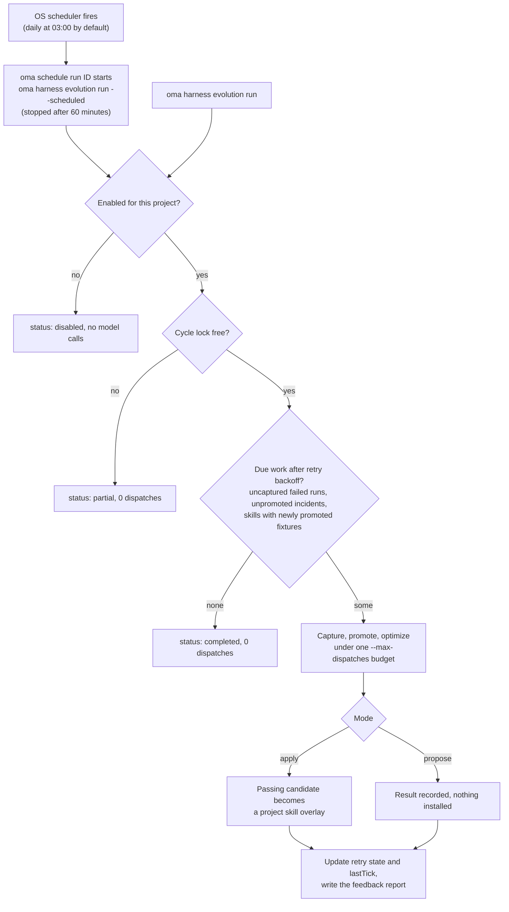

# Évolution du harnais du projet

OMA peut collecter des preuves à partir des exécutions d’agents suivies et traiter les échecs dans un cycle de retour planifié. Les modifications automatiques de compétences sont **désactivées tant que vous ne les activez pas pour un projet**. Chaque cycle dispose d’un budget fini d’appels de modèle, et une modification appliquée doit franchir les portes d’évaluation de compétence existantes.

Le chemin automatisé améliore les documents de compétence. Les modifications de la procédure de l’optimiseur ou du Maintainer restent une [méta-optimisation](./skill-opt.md#meta-optimization-the-procedure-as-the-candidate) distincte, invoquée manuellement.

## Activer un projet

Exécutez depuis la racine du projet :

```bash
# Example allowance: at most 300 model dispatches per scheduled cycle
oma harness evolution enable --max-dispatches 300

# Evaluate proposals without applying them
oma harness evolution enable --max-dispatches 300 --mode propose

# Choose a schedule in the operating system's local time
oma harness evolution enable --max-dispatches 300 --cron "0 3 * * *"

oma harness evolution status --json
```

`enable` affiche les paramètres enregistrés et l’ID de la tâche du planificateur :

```json
{
  "enabled": true,
  "scheduleId": "sch_abcdefgh2345",
  "mode": "apply",
  "maxDispatches": 300
}
```

`status --json` renvoie `config`, `schedule` (l’entrée du planificateur, ou `exists: false`), `pending` (le nombre de nouvelles tentatives non terminées), `conflicts` (les conflits de superposition par compétence) et `state` (les nouvelles tentatives et `lastTick`).

Le planning par défaut est quotidien à 3 h, heure locale, et le mode par défaut est `apply`. `--max-dispatches` est obligatoire à l’activation et doit être un entier positif. La valeur de l’exemple est un quota d’appels, pas une estimation de prix ni la promesse qu’un cycle ira à son terme. Des suites de fixtures plus grandes et une notation répétée consomment davantage d’appels.

<!-- oma-docs:ignore-start -->
Les paramètres sont enregistrés dans `.agents/evolution/harness-evolution.json`. Les preuves générées, l’état des nouvelles tentatives et le verrou du cycle se trouvent sous `.agents/state/harness-evolution/`.
<!-- oma-docs:ignore-end -->

L’activation enregistre une tâche intégrée auprès du [planificateur système](./scheduled-agents.md) d’OMA déjà en place ; elle apparaît dans `oma schedule list` avec l’agent `__builtin__`. Au moment du déclenchement, `oma schedule run <id>` lance `oma harness evolution run --scheduled` dans ce projet et l’arrête au bout de 60 minutes : dimensionnez donc `--max-dispatches` pour un cycle qui tient en une heure. Une nouvelle activation met à jour la tâche du projet au lieu d’en créer une autre. Arrêtez le planning avec `oma harness evolution disable` plutôt qu’avec `oma schedule delete`, afin que les paramètres enregistrés restent cohérents.

```bash
# Run one cycle now under the saved mode and budget
oma harness evolution run --json

# Stop future cycles; retain evidence and applied improvements
oma harness evolution disable
```

`run --json` renvoie `status` (`completed`, `partial` ou `disabled`), `dispatchesUsed` et `maxDispatches`. Lorsqu’un autre cycle détient le verrou, `run` renvoie `partial` avec 0 répartition. Un cycle qui s’arrête sur une erreur, par exemple un quota épuisé, se termine avec cette erreur et enregistre `partial` ou `failed` dans `state.lastTick`.

Un projet désactivé n’exécute aucun travail de modèle via la commande d’évolution, y compris lors d’une invocation planifiée tardive. La désactivation n’effectue aucun rollback des modifications déjà appliquées.

## Ce qui se passe automatiquement

Le diagramme montre un cycle, qu’il soit déclenché par le planificateur ou lancé à la main.



1. **Enregistrer les preuves d’achèvement.** Les exécutions suivies par OMA laissent des références locales à leur résultat et à leurs preuves de vérification. Cette étape d’achèvement n’effectue aucun appel de modèle supplémentaire. L’achèvement répété d’une même exécution ne crée pas de preuves en double.
2. **Collecter les échecs selon le planning.** Le cycle analyse les exécutions échouées éligibles, déduit les attentes de leurs contrats de tâche enregistrés et vérifie qu’une fixture de régression proposée rejette bien la sortie en échec préservée.
3. **Optimiser les compétences touchées.** Les incidents sont regroupés par compétence. Chaque compétence est optimisée sous les vérifications existantes d’entraînement, de validation, de test final, d’isolation et de transfert négatif.
4. **Appliquer ou rapporter.** En mode `apply`, un candidat qui réussit devient une superposition de compétence du projet. En mode `propose`, le cycle enregistre le résultat sans l’installer.
5. **Signaler les changements.** Utilisez status et l’historique de promotion existant pour examiner les résultats. Les changements appliqués alimentent aussi la notification d’évolution de la session suivante.

OMA n’observe pas automatiquement chaque conversation native ni chaque correction de l’utilisateur. L’entrée est constituée des preuves d’exécution qu’OMA suit réellement. Une exécution sans sortie préservée ni contrat d’acceptation peut nécessiter une [spécification d’incident](./harness-incidents.md#capture-an-incident) rédigée manuellement.

## Budget et nouvelles tentatives

Le cycle partage un seul quota d’appels entre la capture, la rédaction de grilles, l’acheminement, la notation, l’optimisation des compétences, les tâches voisines et l’évaluation finale. Un appel de modèle est débité du quota avant la répartition. Les appels relancés par la couche d’exécution comptent également. La limite de constitution plus stricte d’une compétence continue de s’appliquer.

Lorsque le quota est épuisé, l’évaluation reste incomplète et le candidat concerné ne peut pas être appliqué. Le rapport consigne la consommation et le travail en attente. Un seul cycle de projet s’exécute à la fois.

La création d’une fixture ne marque pas l’optimisation de l’incident comme terminée. Une optimisation interrompue ou échouée reste en attente et peut reprendre après un délai de backoff, sans dupliquer la fixture. Le délai double à chaque tentative échouée : 2, 4, 8, … minutes, jusqu’à 1024 minutes (environ 17 heures). Un résultat entièrement évalué sans modification acceptable est enregistré comme traité, de sorte que les mêmes preuves ne déclenchent pas indéfiniment des optimisations répétées. De nouvelles preuves peuvent déclencher une autre tentative.

Passer du mode proposition au mode application rend les propositions non appliquées éligibles au traitement. L’application exige toujours une évaluation à jour et un contenu source inchangé ; une ancienne proposition n’est pas une instruction d’écriture inconditionnelle.

## Superpositions de compétence persistantes

Les modifications automatiques sont stockées séparément des définitions de compétence gérées, dans la zone d’évolution du projet appartenant à l’utilisateur, `.agents/evolution/skills/<skill>/` (avec un enregistrement `overlay.json`). L’évaluation et les liens de compétence fournisseur locaux au projet utilisent le corps effectif sélectionné parmi la base gérée et sa superposition éligible. Les installations de fournisseur à portée HOME ne sont pas redirigées vers une superposition de projet. Une copie non gérée dans un répertoire fournisseur du projet doit être résolue avant l’application automatique. Les ressources de la compétence restent disponibles à leurs chemins relatifs.

Une superposition enregistre la base sur laquelle elle a été évaluée. Après `oma update` :

- Une base inchangée continue d’utiliser sa superposition.
- Une base modifiée laisse la superposition préservée, mais la marque comme un conflit et utilise la base mise à jour. L’ancienne évaluation ne peut pas établir que la superposition est sûre sur la nouvelle base.

Une modification effectuée pendant l’exécution de l’optimisation empêche le candidat d’écraser ce contenu modifié. Status signale les conflits pour examen.

## Examiner et annuler

```bash
oma harness evolution status --json
oma skill promotions --all
oma skill rollback --skill oma-docs
```

Les enregistrements de promotion conservent les hachages du candidat et du parent, les preuves d’évaluation et un patch pouvant être examiné. Le rollback de la première superposition rétablit l’usage de la base gérée ; le rollback d’une superposition ultérieure rétablit la superposition précédente. Les modifications inconnues sont préservées : le rollback refuse d’écarter un contenu qui ne correspond plus au candidat enregistré.

L’application manuelle via `oma skill optimize --apply` écrit toujours le `SKILL.md` géré, mais elle refuse de s’exécuter tant qu’une superposition de projet est active pour cette compétence (`[oma skill opt] an active project overlay owns this skill; ...`). Effectuez d’abord le rollback de la superposition avec `oma skill rollback --skill <id>`, ou laissez le cycle d’évolution appliquer la modification. L’évolution planifiée choisit explicitement le chemin d’application par superposition.

## Portée des preuves

Un test logiciel réussi confirme le câblage et les règles d’évaluation. Il n’établit pas que des modifications automatiques répétées améliorent, avec le temps, le travail réel d’un projet. Examinez les promotions réelles, les coûts, les régressions et l’historique de rollback avant d’augmenter le quota ou d’étendre l’automatisation. La promotion de procédure L5 n’est pas invoquée par cette boucle de retour planifiée.

## Voir aussi

- [Cas de régression d’incidents](./harness-incidents.md) — capturer, promouvoir et reproduire les incidents que ce cycle traite.
- [Optimisation des compétences](./skill-opt.md) — les portes que franchit chaque modification appliquée.
- [Agents planifiés](./scheduled-agents.md) — le planificateur système qui déclenche le cycle.
