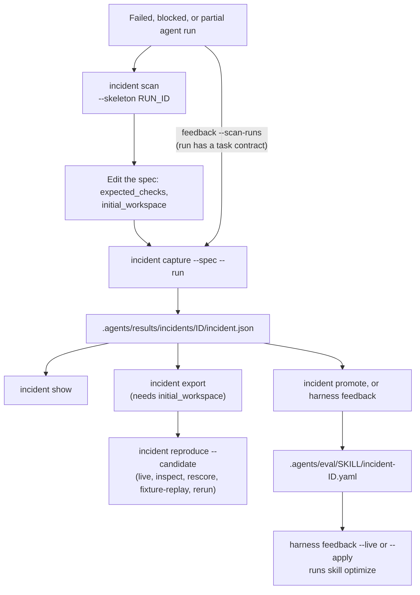

# Cas de régression d’incident

`oma harness incident` relie un échec observé à un cas de régression et à l’évaluation du candidat qui suit. La commande enregistre les observations séparément des hypothèses causales. Un simple processus échoué n’établit pas que le modèle ait causé l’incident.

Le diagramme montre le cycle de vie d’un incident. La promotion alimente l’optimisation des compétences ; l’exportation alimente l’évaluation du harnais.



## Rechercher des candidats {#find-candidates}

```bash
oma harness incident scan            # failed/blocked/partial runs with no captured incident
oma harness incident scan --json
oma harness incident scan --skeleton <run-id> > incidents/run-failure.json
```

1. `oma harness incident scan` liste les exécutions suivies dont l’état est `failed`, `blocked` ou `partial`, et écarte toute exécution déjà référencée par un incident capturé via `source.runId`. `--limit <n>` plafonne la liste. Les exécutions proviennent des enregistrements d’exécution du projet dans le répertoire d’état du profil OMA (par défaut `~/.oma/u/0/projects/<project-id>/agent-runs/`, où `<project-id>` est le SHA-256 du chemin canonique du projet ; `OMA_STATE_HOME` et `OMA_PROFILE` changent la racine et le profil). `oma agent spawn` et `oma agent parallel` conservent les 64 derniers KiB du journal de chaque exécution à côté de son enregistrement, sous `<run-id>.output.txt`.
2. `--skeleton <run-id>` affiche une spécification avec l’id, l’agent, l’exécution source, l’échec observé, le code de sortie et, lorsque le runner l’a conservée, la fin de la sortie de l’agent. `expected_checks` reste un `TODO` parce que le comportement correct est une décision que l’analyse ne peut pas prendre.
3. Remplacez la vérification provisoire. Pour rendre l’incident exécutable, ajoutez aussi `"initial_workspace": "<dir>"` pointant vers une copie des fichiers de la tâche tels qu’ils étaient avant l’exécution. Sans cela, l’incident peut être capturé et promu, mais `incident export` et `reproduce` s’arrêtent avec `Cannot export a runnable regression: initial workspace evidence is missing`.
4. Capturez avec `--run <run-id>` pour que le prompt, l’identité de l’exécution et l’empreinte de l’espace de travail soient préservés. `capture --run` importe la sortie conservée comme observation quand la spécification n’en contient pas, et `incident promote` peut valider la fixture dérivée contre elle.

## Capturer automatiquement une exécution échouée

```bash
oma harness feedback --scan-runs            # capture, promote, report
oma harness feedback --scan-runs --live     # and optimize the affected skills
```

Une exécution échouée, bloquée ou partielle dont la tâche avait un contrat ne demande aucune spécification écrite à la main. Le comportement attendu est les critères d’acceptation du contrat, décidés avant l’exécution ; l’ensemble non satisfait est formé des critères couverts par un reçu de vérification en échec, ou de tous les critères lorsque l’exécution n’a jamais été vérifiée. L’opt-agent réécrit les critères non satisfaits en une grille d’évaluation du juge (`PASS only if …`), le juge note par rapport à cette grille la sortie conservée de l’exécution elle-même, et l’incident n’est capturé que lorsque cette sortie échoue : une grille que l’échec réussit n’a pas capturé l’échec. La spécification est écrite sous `.agents/results/incidents/_specs/<id>.json` et capturée avec l’identité de l’exécution, la grille étant portée comme vérification d’acceptation `output_judge`. Les exécutions sans sortie conservée, sans prompt ou sans contrat sont listées comme non capturables avec la raison.

`output_judge` est un contrat noté. L’évaluateur mécanique du harnais l’indique comme non évalué ; son utilité est la fixture de régression de compétence que `incident promote` en dérive avec la même grille.

## Capturer un incident {#capture-an-incident}

Enregistrez une spécification JSON dans le projet :

```json
{
  "schema_version": 1,
  "id": "incomplete-result",
  "summary": "The agent reported success while the result remained incomplete",
  "prompt": "Complete the task and update result.json",
  "agent": "backend",
  "observed": {
    "failure": "result.json still contained complete=false",
    "output": "success",
    "exit_code": 0
  },
  "initial_workspace": "initial",
  "expected_checks": [
    {
      "type": "file_json_equals",
      "path": "result.json",
      "pointer": "/complete",
      "value": true
    }
  ],
  "evidence_files": ["original-output.txt"],
  "dependencies": []
}
```

`initial_workspace`, `evidence_files` et les chemins des fixtures de dépendances sont relatifs au fichier de spécification. Le chemin `checker` d’une vérification de commande est relatif au projet. La syntaxe des vérifications correspond à [Évaluation du harnais](./harness-eval.md). Le répertoire initial doit être une fixture de tâche fournie pour l’avant-exécution, sans fichiers d’instructions OMA ou du fournisseur ; le harnais évalué est injecté séparément.

```bash
oma harness incident capture --spec incidents/incomplete-result.json --json
oma harness incident show incomplete-result --json

# Import prompt and observable metadata from an existing local run
oma harness incident capture --spec incidents/run-failure.json --run <run-id> --json
```

`--run` prend un ID d’exécution listé par `oma harness incident scan` ; les enregistrements d’exécution se trouvent dans le répertoire d’état du profil décrit dans [Rechercher des candidats](#find-candidates), pas dans `.agents/state/`. Il préserve l’identité exécution/session, le fournisseur, l’état et l’empreinte de l’espace de travail d’origine. Un prompt fourni prime sur le prompt enregistré de l’exécution. `source.trace_id` peut relier un incident signalé à une trace externe sans la récupérer ni la téléverser.

Le manifeste capturé se trouve sous `.agents/results/incidents/<id>/incident.json`. Il inclut l’instantané initial lorsqu’il est fourni, les hachages des preuves sources et des fichiers du vérificateur, les vérifications d’acceptation, les limites et un hachage du manifeste. Les ID existants ne peuvent pas être écrasés. Le texte d’observation sensible est occulté ; l’occultation est signalée comme une limite du rejeu exact. La collecte d’instantanés rejette les fichiers non pris en charge et impose des bornes de fichiers, de nombre et de taille totale. Les références de preuves préservent les hachages et les chemins, pas des copies de chaque fichier source référencé.

L’objet facultatif `cause` contient `category`, `hypothesis`, `confidence` et `evidence`. Les catégories sont `model`, `tool`, `config`, `context`, `application`, `evaluator` et `unknown`. Son absence laisse la cause à `unknown`.

## Promouvoir en fixture de compétence

```bash
oma harness incident promote <id> [--skill <id>] [--draft] [--force] --json
```

Un incident capturé devient une fixture de régression pour la compétence que l’agent en échec a exercée, afin que `oma skill optimize` puisse réparer la compétence contre elle. La compétence est choisie en acheminant le prompt de l’incident dans le catalogue de compétences installées avec la même sonde au niveau de la description qu’utilise `oma skill eval --routing` (un appel de modèle) ; lorsque l’acheminement ne choisit rien, on utilise la première entrée `skills:` de la définition d’agent sous `.agents/agents/<agent>.md`, sinon la compétence installée nommée `oma-<agent>`. `--skill` outrepasse ce choix, et la promotion enregistre lequel des trois a décidé (`attribution`). La fixture est écrite dans `.agents/eval/<skill>/incident-<id>.yaml` avec `group: incident-<id>` pour qu’elle ne chevauche jamais la partition train/validation/test, et la promotion est enregistrée à côté de l’incident sous `promotion.json`. Un incident n’est promu qu’une fois.

Le vérificateur vient des vérifications d’acceptation. Quand chaque vérification est `output_contains`, la fixture est un `assert` déterministe. Sinon les vérifications ne peuvent pas s’exécuter dans une évaluation de compétence (il n’y a ni fichiers ni commandes), donc `--draft` demande à l’opt-agent une grille d’évaluation du juge qui commence par `PASS only if` et nomme l’échec observé. Dans les deux cas la fixture n’est admise que si la sortie en échec enregistrée ne la satisfait pas : un assert que la sortie observée satisfait déjà, ou une grille rédigée que le juge réussit sur cette sortie, est refusé parce qu’il ne constitue pas un cas de régression. Un incident sans sortie observée ne peut pas être validé et demande `--force`, ce qui est enregistré comme une limite.

## Fermer la boucle

```bash
oma harness feedback                 # promote every unpromoted incident, report what changed (routing, drafting, and judge model calls)
oma harness feedback --live          # also run one optimization epoch per affected skill (dry-run)
oma harness feedback --apply --json  # also write edits that pass every gate (implies --live)
```

`--incident <ids...>` limite l’exécution aux incidents listés. `--max-epochs <n>` (1 par défaut) définit le nombre d’époques d’optimisation par compétence pour `--live` et `--apply`.

:::caution Coût des modèles et cible d’écriture
`feedback` n’affiche aucun aperçu des coûts. Même sans `--live`, la promotion achemine chaque incident vers une compétence au moyen d’un appel de modèle et peut rédiger et juger des grilles. `--live` et `--apply` exécutent `oma skill optimize --live --yes` pour chaque compétence touchée, et `--apply` écrit directement le `SKILL.md` géré, y compris pour les compétences `oma-*` que `oma update` écrase. Pour une exécution confirmée avec aperçu, utilisez `oma skill optimize --skill <id> --live` ; pour un cycle budgété avec des superpositions de projet, utilisez l’[évolution du harnais du projet](./harness-evolution.md).
:::

`feedback` est la boucle de retour de déploiement en une seule commande : avec `--scan-runs`, chaque exécution en échec non capturée et dotée d’un contrat est d’abord capturée (voir plus haut), puis chaque incident capturé sans fixture est promu, en rédigeant des grilles si nécessaire, les compétences touchées sont regroupées, et avec `--live` chacune est optimisée une fois contre sa suite agrandie sous les portes habituelles (acceptation sur données retenues et réservées, transfert négatif confirmé, test final détenu par le runner). Le rapport sous `.agents/results/feedback/feedback-<ts>.json` énumère les promotions, les incidents ignorés avec la raison, et le résultat de chaque compétence avec le diff, de sorte que la chaîne allant d’un échec observé à une modification candidate tient dans un seul enregistrement auditable. Pour une exploitation planifiée avec un quota d’appels de modèle partagé, de nouvelles tentatives persistantes et des superpositions de compétence du projet, activez l’[évolution du harnais du projet](./harness-evolution.md). L’instantané d’état de la session suivante annonce les changements appliqués.

Ce qui reste une décision humaine : une exécution sans contrat de tâche n’a aucun comportement attendu enregistré, donc `incident scan` la liste et elle ne se capture que par une spécification ; `--skeleton` en rédige une.

## Exporter et évaluer

```bash
oma harness incident export incomplete-result --json
oma harness incident reproduce incomplete-result --candidate candidates/fix \
  --record-file incidents/comparison.json --yes --json
```

L’exportation matérialise l’instantané initial enregistré et une suite exploratoire à un seul cas. Le hachage du manifeste et l’identité de l’exécution et de la trace sources voyagent avec la tâche jusqu’à l’évaluation et à l’enregistrement. Toute modification des fichiers exportés, du prompt, de l’agent, des vérifications ou des sources épinglées du vérificateur invalide la réutilisation. Créez un nouvel ID d’incident pour changer le contrat d’acceptation.

Par défaut, `reproduce` démarre une nouvelle comparaison live entre référence et candidat et l’enregistre. La confirmation habituelle du coût live s’applique sauf si `--yes` est fourni. Cette commande utilise le fournisseur d’agent configuré par la tâche du harnais, Codex compris ; elle n’impose pas le profil de compilateur protégé de l’optimiseur de compétences à l’exécution de la tâche.

Une suite d’incident exportée contient exactement une tâche : `reproduce` affiche donc toujours `coverage: insufficient` (cinq tâches notées sont nécessaires pour un verdict), et la décision est `INSUFFICIENT` sauf si l’un des bras n’a pas pu être lancé (`FAIL`). Lisez plutôt les lignes de tâches : l’ID de l’incident sous `corrected:` signifie que la référence a échoué et que le candidat a réussi ; sous `regressed:`, il signifie que le candidat a cassé un cas qui réussissait ; `none` dans les deux signifie que les bras se sont comportés de la même manière. En JSON, ces champs sont `score.correctedTaskIds` et `score.regressedTaskIds`.

Si aucun état initial n’a été capturé, `capture` et `show` fonctionnent toujours, mais l’exportation exécutable et la reproduction de l’exécution s’arrêtent sur une erreur de preuve manquante. L’arbre de travail actuel d’une exécution historique ne peut pas établir son état d’origine. Même un instantané initial fourni séparément ne prouve pas l’équivalence avec cette exécution historique ; le rapport énonce cette limite.

## Choisir l’opération de preuve

```bash
oma harness incident reproduce incomplete-result --candidate candidates/fix \
  --action inspect --record-file incidents/comparison.json --json

oma harness incident reproduce incomplete-result --candidate candidates/fix \
  --action rescore --record-file incidents/comparison.json --json

oma harness incident reproduce incomplete-result --candidate candidates/fix \
  --action fixture-replay --record-file incidents/comparison.json \
  --transcript incidents/tool-responses.json --json

oma harness incident reproduce incomplete-result --candidate candidates/fix \
  --action rerun --record-file incidents/comparison.json --record --yes --json
```

| Opération | Ce qui se passe |
|---|---|
| `inspect` | Lit et agrège les verdicts enregistrés. Aucune vérification ni aucun agent n’est exécuté. |
| `rescore` | Applique les vérifications courantes de sortie et de fichiers aux preuves brutes enregistrées. Les anciens champs de réussite et d’échec sont ignorés. |
| `fixture-replay` | Rejoue les données de réponses d’outils et les modifications de fichiers fournies contre l’état initial enregistré. Aucun modèle ni processus d’outils n’est exécuté. |
| `rerun` | Démarre de vrais appels d’agents de référence et de candidat depuis l’état initial enregistré. Cela engage l’usage normal du modèle. |

Pour un contrat d’acceptation révisé, créez une suite de harnais distincte et utilisez `oma harness eval --action rescore` avec la même identité de suite, de tâche et d’incident et le même prompt. La suite d’incidents exportée est elle-même immuable. Voir [les détails d’enregistrement et de rejeu](./harness-eval.md#reuse-a-recording) pour les exigences des preuves brutes et le schéma de transcription des outils.

Déclarez les dépendances externes comme `{ "name": "service", "repeatability": "fixture|live|unavailable", "reason": "...", "fixture": "response.json" }`. Une dépendance de fixture pointe vers un fichier qui utilise le schéma complet de transcription du harnais, avec l’ID de l’incident comme `taskId`. Le rejeu d’incident hors ligne rejette les dépendances live ou indisponibles, les fichiers de fixture manquants, les hachages de fixture modifiés, les réponses nommées manquantes et les modifications de requêtes, de réponses ou de fichiers qui diffèrent de la transcription épinglée. Il ne peut toujours pas attester que l’auteur ait déclaré toutes les dépendances externes. Une nouvelle exécution live ne peut pas non plus garantir qu’un service externe se comportera comme par le passé.

La capture, l’exportation et l’évaluation émettent des événements locaux `harness.incident.*` qui relient l’incident, les hachages de candidat et de référence, le mode d’exécution et les ID de tâches corrigées ou en régression. Un incident à un seul cas est une preuve de régression, pas un remplacement des suites de validation et de test final. Les profils de harnais actuels indiquent `promotionReady: false` ; ces opérations n’établissent pas l’isolation protégée du test final et ne promeuvent pas automatiquement un candidat.
