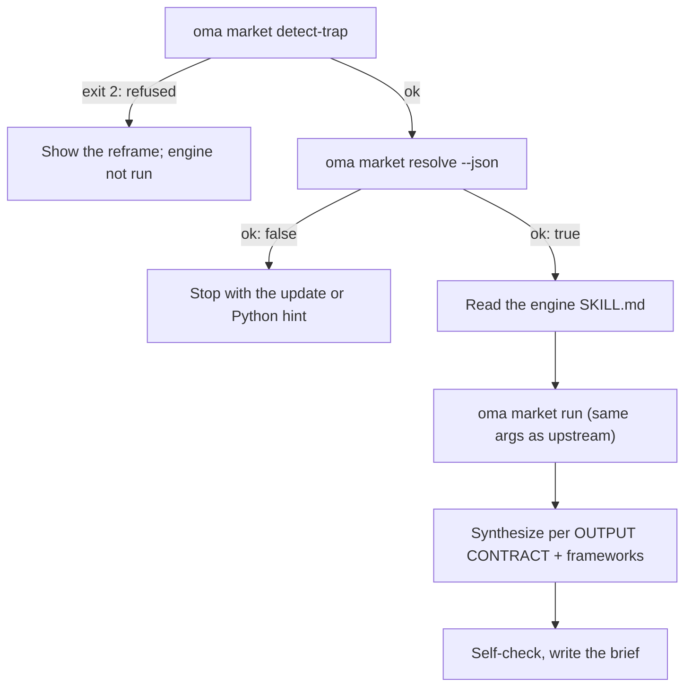

# Étude de marché

`oma-market` recherche les points de douleur, les tendances, le sentiment envers les concurrents et les sujets émergents signalés sur la période de N jours choisie. Il s’appuie sur des sources communautaires avec des mesures d’engagement, notamment Reddit (upvotes et commentaires principaux), X, les transcriptions YouTube, TikTok, Instagram, Hacker News, Polymarket, GitHub, arXiv, Techmeme, Digg, LinkedIn, StockTwits et Bluesky, ainsi que sur le web.

La recherche s’exécute sur le moteur amont [**last30days**](https://github.com/mvanhorn/last30days-skill) (MIT, Python 3.12+). oh-my-agent ne le fork pas : il conserve une copie gérée du moteur. La compétence applique à chaque exécution son contrôle de sujet et ajoute une couche de cadres stratégiques. La cadence des versions, le nombre d’étoiles et la couverture des fournisseurs dépendent du projet amont et peuvent changer.

---

## Démarrage rapide

Formulez votre demande à l’agent en langage courant. Des expressions comme « étude de marché », « points de douleur », « analyse concurrentielle », « voix du client » ou « détection de tendances » activent la compétence `oma-market` :

```text
Trouve les principaux points de douleur signalés par les développeurs à propos des conteneurs distants de VS Code au cours des 30 derniers jours.
Compare le sentiment de la communauté entre Cursor et Windsurf sur les 90 derniers jours, frameworks swot,5f.
```

| Orienter avec | Effet |
|---|---|
| « A vs B », ou `--vs B` | Intention concurrent : flux de comparaison amont + SWOT + 5F de Porter |
| `--days 7`, `30`, `90` ou `180` | Fenêtre de recherche |
| `--intent pain`, `trend`, `competitor` ou `discovery` | Remplace la classification automatique de l’intention |
| `--frameworks none`, ou une liste comme `swot,5f,pestel` | Désactive les sections de cadres, ou les sélectionne |

Le résultat est un seul brief dans `.agents/results/market/{topic-slug}-{YYYYMMDD}.md`. Sa première ligne est le badge du moteur (`🌐 last30days v<version> · synced <date>`), suivi des groupes de preuves classés avec leurs liens, des sections de cadres et du pied de page du moteur qui liste les sources ignorées.

| Fonctionne sans clés | Nécessite l’assistant de configuration amont (clés ou cookies) |
|---|---|
| Reddit, Hacker News, GitHub, Polymarket, arXiv, Techmeme, Digg, web | X, transcriptions YouTube, TikTok, Instagram et autres sources à clé ; les sources ignorées sont listées dans le pied de page |

---

## Moteur toujours à jour (Python 3.12+ requis) {#always-the-latest-engine--nothing-to-install}

```bash
# Illustrative output; the release tag, cache path, and Python version vary.
oma market resolve
# engine:   last30days
# reason:   last30days 3.21.1 via managed:v3.21.1 (current)
# root:     ~/.cache/oma-market/last30days/v3.21.1
# skill:    ~/.cache/oma-market/last30days/v3.21.1/SKILL.md
# version:  3.21.1
# python:   python3.14 (3.14.7, PATH)
# save_dir: <workspace>/.agents/results/market/raw
```

- Cache : `~/.cache/oma-market/last30days/<tag>/` + `state.json`.
- Avant chaque utilisation, `resolve` demande à GitHub la dernière version (vérification limitée à une fois par `check_interval_min`, 60 minutes par défaut), télécharge une balise plus récente dans son propre répertoire (les anciennes balises sont supprimées) et réutilise sinon le cache. Les échecs réseau réutilisent la copie en cache et signalent `stale`.
- Python : `LAST30DAYS_PYTHON` → `market.python` → `python3.14`, `python3.13`, `python3.12`, `python3`, `python` dans le PATH (doit être ≥ 3.12) → `uv python find '>=3.12'`. Si rien n’est trouvé, `resolve` n’est pas ok et affiche l’indication d’installation ; la compétence s’arrête au lieu de dégrader vers une recherche limitée au web.
- La configuration du moteur et les clés API résident dans `~/.config/last30days/` (écrites par l’assistant de configuration amont avec votre accord) ; elles survivent aux mises à niveau du moteur.

Ordre de résolution (le premier résultat l’emporte) : `market.path` → `LAST30DAYS_HOME` → **dernière version gérée** → copies installées par l’utilisateur (`.agents|.claude|.codex|.cursor|.qwen|.kiro/skills/last30days` dans le projet et sous `~`, puis le cache du plugin Claude Code).

```bash
oma market update            # force a check / download now
oma market resolve --offline # never touch the network
oma market run -- --help     # the engine's own flags (without `--`, oma prints its own help)
```

---

## Configuration

```yaml
market:
  managed: true                   # false = never download; pins / skill dirs only
  channel: stable                 # stable (latest Release) | main (HEAD)
  check_interval_min: 60          # 0 = check on every call
  path: null                      # explicit engine dir (pin)
  python: null                    # interpreter override
  save_dir: .agents/results/market/raw
```

---

## Fonctionnement d’une exécution



1. `oma market detect-trap "<topic>"` — refuse les sujets pièges par mots-clés et de shopping démographique (sortie 2) avec une suggestion de reformulation. Un sujet vide ou de plus de 200 caractères termine avec le code de sortie 4.
2. `oma market resolve --json` — moteur + Python ; s’arrête avec `ok: false`.
3. L’agent lit de haut en bas le `SKILL.md` du moteur résolu et le suit : assistant de configuration de première exécution, résolution préalable des handles / subreddits / hashtags de recherche (lorsque WebSearch est disponible), planification des requêtes et porte de précondition.
4. `oma market run "<topic>" <flags> --emit=compact` — arguments identiques à l’appel amont `python3 scripts/last30days.py` ; `--save-dir` est ajouté depuis `market.save_dir`.
5. La synthèse suit le OUTPUT CONTRACT amont (badge en première ligne, groupes de preuves classés, LAWs 1–8), puis oma ajoute des sections de cadres qui ne citent que les groupes du moteur :

| Intention | Mise en forme moteur | Cadres |
|---|---|---|
| douleur | sujet formulé comme plainte, `--days 30`, `--deep` lorsque les résultats sont maigres | SWOT |
| tendance | `--days 7/30/90/180`, `--discover "<domain>"` pour « qu’est-ce qui est tendance ? » | SWOT |
| concurrent | `"A vs B"` → flux de comparaison amont | SWOT + 5F de Porter |
| découverte | `--discover`, puis suivis `--drill` | SWOT + PESTEL |

6. Auto-vérifier, puis écrire `.agents/results/market/{topic-slug}-{YYYYMMDD}.md`.

---

## Modes d’échec

| Situation | Résultat |
|---|---|
| Sujet refusé par detect-trap | Reformulation affichée ; le moteur ne s’exécute pas. `--force` uniquement après reconfirmation explicite de l’utilisateur |
| Aucun moteur en cache et mode hors ligne | `ok: false` → lancer `oma market update` une fois en ligne |
| Aucun Python 3.12+ | `ok: false` avec indication d’installation (brew / apt / `uv python install 3.12`), ou définissez `LAST30DAYS_PYTHON` / `market.python` ; aucun remplacement limité à la recherche web |
| La vérification de version échoue | Moteur en cache utilisé, signalé comme `stale` |
| Sources sans clés | Ignorées dans le moteur et listées dans le pied de page ; activez-les via l’assistant de configuration amont |

---

## Étapes suivantes

- [Workflows de contenu et de recherche](./content-and-research.md) — choisir la bonne capacité pour les autres tâches de recherche et de documents
- [Moteur de diagrammes](./diagram-engine.md) — le même modèle de dernière version gérée pour archify
- [Sémantique de oma-config.yaml](./oma-config-semantics.md) — comment la section `market:` est fusionnée
- [Commandes CLI : market](../cli-interfaces/commands.md#market) — liste complète des options
- Amont : [mvanhorn/last30days-skill](https://github.com/mvanhorn/last30days-skill)
