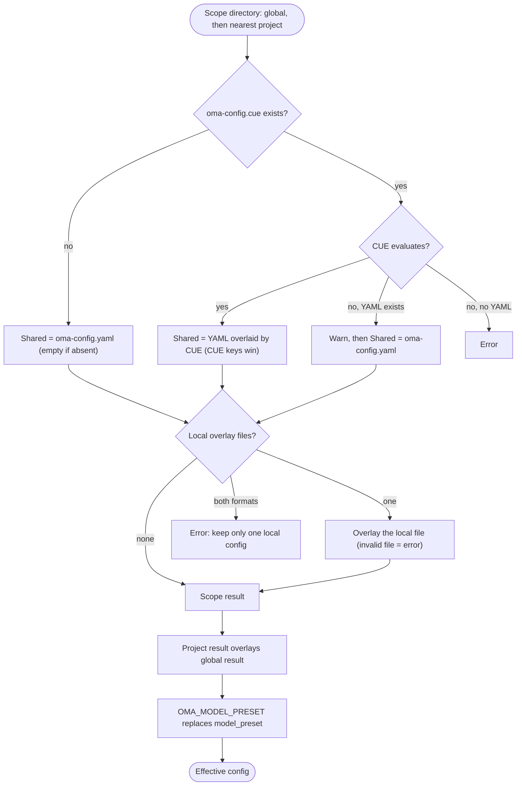

## Vue d'ensemble

OMA lit les valeurs par défaut globales depuis `$OMA_HOME/.agents/` (par défaut `~/.oma/.agents/`),
puis superpose le répertoire `.agents/` de projet le plus proche trouvé au-dessus du répertoire de travail.
Chaque portée peut comporter ces couches :

- **Partagée** : `.agents/oma-config.yaml` et `.agents/oma-config.cue`. Lorsque les deux existent et que le fichier CUE s'évalue, chaque clé définie par le fichier CUE remplace la même clé du fichier YAML ; les clés présentes uniquement dans le fichier YAML restent des valeurs par défaut. Lorsque le fichier CUE ne peut pas être évalué, OMA émet un avertissement et utilise uniquement le fichier YAML.
- **Locale** : `.agents/oma-config.local.cue` ou `.agents/oma-config.local.yaml` (un seul fichier, superposé au résultat partagé ; gardez ce fichier privé).

Les paramètres partagés et locaux du projet remplacent les paramètres globaux. Des racines
de projet ancêtres différentes ne sont jamais fusionnées ; un `.agents/` le plus proche vide reste une frontière
de projet. Les valeurs par défaut globales ne changent pas l'identité du projet. Consultez la
[référence de configuration](/docs/guide/configuration-reference) pour connaître les clés et valeurs par défaut prises en charge.

## Flux de résolution

OMA exécute les mêmes étapes pour la portée globale et pour la portée de projet la plus proche, puis fusionne les deux résultats :



Lorsqu'aucun `.agents/` de projet n'est trouvé, ou que la remontée atteint le répertoire `.agents/` global lui-même, seul le résultat global est utilisé.

## Table de précédence {#precedence-table}

Les lignes suivantes l'emportent. Les maps simples sont fusionnées récursivement ; les tableaux, scalaires et `null` remplacent la valeur précédente.

| Ordre | Couche | Règle |
|:-----:|-------|------|
| 1 | `oma-config.yaml` global | Valeurs par défaut sous le fichier CUE global lorsque les deux existent. |
| 2 | `oma-config.cue` global | Remplace le YAML global clé par clé. Si l'évaluation échoue (par exemple, la CLI `cue` est absente) et que le YAML existe, OMA affiche `[config] CUE evaluation failed at ... Falling back to oma-config.yaml` et utilise uniquement le YAML. |
| 3 | `oma-config.local.cue` ou `oma-config.local.yaml` global | Un seul fichier. Un fichier local mal formé est une erreur. |
| 4 | `oma-config.yaml` du projet | `.agents/` de projet le plus proche, au niveau du répertoire de travail ou au-dessus. |
| 5 | `oma-config.cue` du projet | Remplace la ligne 4 clé par clé, avec le même repli que la ligne 2. |
| 6 | `oma-config.local.cue` ou `oma-config.local.yaml` du projet | Un seul fichier. Un fichier local mal formé est une erreur. |
| 7 | `OMA_MODEL_PRESET` | Une valeur non vide remplace `model_preset` pour ce processus. Une valeur vide est une erreur. |

:::tip[Quel fichier modifier ?]
Si `.agents/oma-config.cue` existe, une clé qui y est définie remplace la même clé de `oma-config.yaml`. Modifiez cette clé dans le fichier CUE, ou placez une valeur propre à la machine dans une surcharge locale. `oma doctor --profile` liste les fichiers chargés sous **Configuration sources**.
:::

Pour une surcharge propre au projet, placez uniquement les feuilles modifiées dans le fichier local. Par exemple, un choix de modèle local peut rester en dehors du fichier partagé :

```yaml
# .agents/oma-config.local.yaml
model_preset: claude
agents:
  backend:
    model: anthropic/claude-sonnet-4-6
```

Exécutez la commande depuis le projet afin que le répertoire `.agents/` le plus proche soit sélectionné. Un fichier local mal formé provoque une erreur explicite ; corrigez-le ou supprimez-le avant de réessayer.

## Vérifier votre configuration

```bash
oma doctor --profile                           # loaded files, resolved preset, per-role model and CLI
cue export --out json .agents/oma-config.cue   # what the CUE layer evaluates to (requires the cue CLI)
```

| Symptôme ou message | Cause | Correction |
|--------------------|-------|-----|
| Une modification du YAML n'a aucun effet | `oma-config.cue` définit la même clé | Modifiez la clé dans le fichier CUE, ou surchargez-la dans un fichier local |
| `[config] CUE evaluation failed at ... Falling back to oma-config.yaml` | La CLI `cue` est absente, ou le fichier CUE ne s'évalue pas | Installez `cue`, ou corrigez l'erreur signalée par `cue export` |
| `Both local CUE and YAML configs exist in ...; keep only one local config.` | Deux fichiers de surcharge locale | Supprimez l'un des deux |
| `OMA_MODEL_PRESET must be non-empty` | La variable est exportée mais vide | `unset OMA_MODEL_PRESET` |
| `Unknown model_preset "..."` | Faute de frappe, ou entrée `custom_presets` manquante | Utilisez un preset cité dans le message d'erreur |
| `Legacy preset name "..." is no longer valid` | Une clé antérieure au renommage, comme `claude-only` | Renommez-la comme l'indique le message, ou exécutez `oma update` |
| `[model-registry] User inline model "..." failed validation` | Une entrée `models:` incomplète ou invalide | Consultez [Intégrer des slugs de modèle](/docs/guide/per-agent-models#inlining-model-slugs) |

## Valeurs par défaut

| Clé | Valeur par défaut | Quand elle s'applique |
|-----|-------------------|-----------------------|
| `auto_update_cli` | `true` | Les deux fichiers sont absents ou la clé manque |
| `serena.mode` | `bridge` | Les deux fichiers sont absents ou la clé manque |
| `serena.auto_update` | `true` | Les deux fichiers sont absents ou la clé manque |
| `telemetry` | `false` | Les deux fichiers sont absents ou la clé manque |
| `language` | `en` | Les deux fichiers sont absents ou la clé manque |
| `model_preset` | Requis | Le modèle de projet fourni utilise `auto` ; le schéma exige une valeur non vide. |
| `translation_voice` | `balanced` | Les deux fichiers sont absents ou la clé manque |
| `timezone` | Fuseau système | Les deux fichiers sont absents ou la clé manque |

## Justification de l'ordre de lecture

Modifiez `~/.oma/.agents/oma-config.yaml` (avec `OMA_HOME` défini : `<OMA_HOME>/.agents/oma-config.yaml`)
pour les valeurs par défaut à l'échelle de l'utilisateur. Les fichiers partagés et locaux du projet remplacent ces valeurs par défaut
sans hériter de projets ancêtres sans rapport. Une sélection `none` dans un projet
pour la mémoire sémantique remplace la sélection globale d'AgentMemory.

## Notes

- `language` dans `oma-config.yaml` contrôle la langue des réponses des agents. Cette clé ne sert **pas** à déterminer la langue des messages d'avertissement d'installation ou de mise à jour : ceux-ci utilisent la locale système (`$LANG`), car `oma-config.yaml` n'est pas encore chargé au moment de l'installation.
- `auto_update_cli` consulte les surcharges du projet avant les valeurs par défaut globales et vaut « activé » par défaut lorsqu'aucune des deux portées ne le définit.
- `telemetry` (valeur par défaut `false`) correspond au mécanisme de désactivation propre à chaque fournisseur, écrit par `oma install` / `oma update` / `oma link` : Claude `DISABLE_TELEMETRY` + `CLAUDE_CODE_DISABLE_FEEDBACK_SURVEY`, Gemini/Qwen `privacy.usageStatisticsEnabled`, Codex `analytics.enabled` + `feedback.enabled`, Grok `[features] telemetry` et Antigravity (agy) `enableTelemetry` dans `~/.gemini/antigravity-cli/settings.json`. Définir `telemetry: true` réactive la télémétrie en supprimant la désactivation d'oma pour le fournisseur concerné.
- `diagram` (moteur `auto` / `archify` / `mermaid`, `explain_sidecar`, `archify.managed|channel|check_interval_min|path|quality|open`) est une section sparse de surcharge de compétence, comme `video` / `image` ; consultez [Moteur de diagrammes](/docs/guide/diagram-engine).
- `video.hyperframes.check_interval_min` limite la fréquence des contrôles de dernière version pour la toolchain HyperFrames par exécution et heygen-com/hyperframes (`oma video compose`, `oma update`). Le schéma CUE fourni ne définit pas encore `video.hyperframes` ; `cue export` le rejette donc à l'intérieur du bloc de schéma (`field not allowed`) ; définissez-le dans `oma-config.yaml` ou dans une surcharge YAML locale.
- `market` (`managed|channel|check_interval_min|path|python|save_dir`) configure le moteur toujours à jour `last30days` utilisé par `oma market` ; consultez [Recherche de marché](/docs/guide/market-research).
- Le schéma de runtime typé couvre `providers`, `free`, `agents`, `models`, `custom_presets`, `vendors`, `session`, `docs` et les sections sparse de compétences. Les modèles fournis contiennent aussi des blocs appartenant à leurs consommateurs, comme `scm`, `memory`, `serena_reaper` et `mcp` ; leurs consommateurs sont propriétaires de leurs clés imbriquées. Ne déduisez pas une clé à partir de cette liste : utilisez la [référence de configuration](/docs/guide/configuration-reference) et le guide de la fonctionnalité pour ce bloc.
- Modifier directement `oma-config.yaml` est sûr. `oma install` et `oma update` remplacent les champs au niveau des expressions régulières et préservent les clés modifiées par l'utilisateur qu'ils ne gèrent pas (par exemple les surcharges `agents:` personnalisées et `session.quota_cap`).
- `oma update` ajoute en plus les clés de premier niveau définies par le modèle fourni mais absentes de votre fichier (avec les valeurs par défaut du modèle), sous un marqueur `# Added by oma update`. Les clés déjà présentes ne sont jamais modifiées : le contenu existant reste identique octet par octet. Les clés supprimées volontairement réapparaîtront avec la valeur par défaut du modèle ; définissez explicitement la valeur au lieu de supprimer la clé pour refuser cette réapparition.
