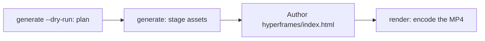

# Génération vidéo

`oma-video` est le routeur vidéo d’oh-my-agent. À partir d’un brief d’une ligne, il compose un script, une narration, des visuels et des sous-titres, puis enregistre le plan dans un répertoire d’exécution. Les étapes de fournisseur peuvent fonctionner sans clé et utiliser des replis locaux ou déterministes ; un vrai MP4 nécessite toujours un compositeur opérationnel et une composition valide.

La compétence s’active avec « shorts », « reels », « screencast », ou des expressions comme « make a video », « explainer video », « demo video », « walkthrough video » ou « video from README », ou lorsqu’une autre compétence a besoin d’une vidéo comme effet secondaire.

> **En bref** `oma video generate` planifie une exécution et prépare les éléments. Avec le compositeur HyperFrames par défaut, il n’encode pas de MP4 : écrivez `<runDir>/hyperframes/index.html` (le workflow `/video` le fait pour vous), puis lancez `oma video render <runDir>`. Lors de la première exécution, commencez par `oma video doctor --install`.

---

## Quand l’utiliser

- Transformer un brief, un README, du code ou des données en courte vidéo.
- Produire un explainer narré ou un enregistrement de démonstration/parcours.
- Tout pipeline reproductible « brief → `.mp4` » que vous voulez relancer de manière déterministe.

## Quand NE PAS l’utiliser

- Images fixes uniques → utilisez [`oma-image`](/docs/guide/image-generation).
- Diffusion ou streaming d’écran en direct → hors périmètre (oma n’enregistre jamais l’écran ; c’est vous qui fournissez l’enregistrement).
- Audio de narration autonome → utilisez `oma-voice`.

---

## Modes en un coup d’œil

| Mode | Format | Ce qu’il compose |
|------|--------|------------------|
| `shorts` | 9:16 | Clip vertical court (script → narration → visuels → sous-titres). |
| `explainer` | 16:9 | Explainer horizontal à partir d’un README, de code ou d’un brief de données. |
| `demo` | dérivé | Parcours construit à partir de votre propre enregistrement d’écran, fourni avec `--capture <file>`. `--source web --url <url>` ne fait que stocker l’URL masquée comme contexte ; oma n’ouvre jamais de navigateur, n’enregistre jamais l’écran et n’automatise jamais la connexion. |

Le mode choisit des valeurs raisonnables ; transmettez les flags pertinents lorsque vous avez besoin d’autres valeurs.

---

## Démarrage rapide

Dans un agent, `/video three quick tips for better focus` exécute pour vous toutes les étapes ci-dessous. À la main, le pipeline comporte quatre étapes :



```bash
oma video doctor --install   # first run only: HyperFrames toolchain, Chrome Headless Shell, Pretendard

# 1. Plan from an agent-authored script (schema: .agents/skills/oma-video/resources/script-schema.md)
oma video generate "three quick tips for better focus" --mode shorts --script ./script.json --dry-run --output json

# 2. Stage assets (narration needs --voice <profile>; the default is a silent video)
oma video generate "three quick tips for better focus" --mode shorts --script ./script.json --output json

# 3. Author <runDir>/hyperframes/index.html per its AUTHORING.md, then encode
oma video compose <runDir>
oma video render <runDir> --output json

# Demo from your own recording; without --polish the recording itself becomes the output
oma video generate "product walkthrough" --mode demo --capture ./capture.mp4
```

<!-- oma-docs:ignore-start -->

| Étape | Commande | Résultat |
|---|---|---|
| Planifier | `generate --dry-run` | `script.json`, `render-spec.json`, `manifest.json` ; aucun rendu |
| Préparer les éléments | `generate` | visuels, sous-titres, audio et musique facultatifs, un échafaudage `hyperframes/` et l’avertissement `composition pending` |
| Écrire | modifier `hyperframes/index.html` | la composition |
| Rendre | `render <runDir>` | `{mode}-{slug}.mp4` et un manifeste mis à jour |

<!-- oma-docs:ignore-end -->

Sans `--script`, la CLI construit un squelette déterministe de trois scènes à partir du texte du brief. `--locale` définit la balise de langue de la narration et des sous-titres, mais ne les traduit pas ; écrivez le brief ou `script.json` dans la langue cible.

Chaque exécution affiche son répertoire. Un `--seed` fixe stabilise les entrées de planification déterministes ; les sorties live des fournisseurs et les images capturées peuvent tout de même varier. Refaites le rendu d’un répertoire existant lorsque vous voulez réutiliser sa spécification de rendu et ses éléments enregistrés.

D’autres outils qui exécutent `oma video generate --output json` analysent une enveloppe JSON sur stdout : `{exitCode, runDir, manifestPath, scriptPath, renderSpecPath, warnings, error}`. Il n’existe pas de clé `outputs` : lisez les chemins de sortie ou d’élément depuis le manifeste à `manifestPath`.

---

## HyperFrames toujours à jour — vous écrivez la composition

oh-my-agent ne fournit **aucun code de composition HyperFrames**. Chaque exécution obtient son propre projet à `<runDir>/hyperframes/`, échafaudé par `oma video compose` sur le dernier HyperFrames npm (cache de chaîne `~/.cache/oma-video/hyperframes/<version>/`, partagé via un lien symbolique `node_modules`) avec [heygen-com/hyperframes](https://github.com/heygen-com/hyperframes) à HEAD (`~/.cache/oma-video/hyperframes-skills/`). L’agent écrit la source de composition générée en suivant `AUTHORING.md` de l’échafaudage, les compétences et la spécification du mode dans `.agents/skills/oma-video/resources/hyperframes-authoring/`.

```bash
oma video generate "…"                     # → render-spec.json + <runDir>/hyperframes/ (composition pending)
oma video compose <runDir> --output json   # refresh scaffold / print the contract (idempotent)
#   author hyperframes/index.html as instructed by AUTHORING.md
oma video render <runDir> --output json    # lint → render with the cached HyperFrames CLI → ffprobe; exit 1 on any failure
```

- Les vérifications de dernière version (npm + GitHub) sont limitées par `video.hyperframes.check_interval_min` (60 par défaut ; `0` = chaque compose). `oma update` respecte l’intervalle ; `oma video doctor --upgrade` force une vérification ; les exécutions hors ligne utilisent la chaîne mise en cache et signalent `stale`.
- La reproductibilité vit dans le répertoire d’exécution : `render-spec.json`, la source de composition écrite et la version de la chaîne inscrite dans les métadonnées du paquet HyperFrames généré. Le rendu à nouveau de la même exécution réutilise ce contrat de rendu ; une nouvelle exécution vérifie le dernier HyperFrames.
- Un échec de lint ou de rendu n’est **pas** masqué derrière un placeholder (qui n’existe que pour `OMA_VIDEO_MOCK=1`) : `oma video render` se termine avec le code 1 et les diagnostics, et l’agent corrige la composition avec les dernières compétences. Une rupture sur une nouvelle version de HyperFrames est un bug de composition, jamais une raison d’épingler.

```yaml
video:
  hyperframes:
    check_interval_min: 60    # 0 = check on every compose
```

---

## Référence CLI

```bash
oma video generate <brief...> [options]
oma video doctor [--install|--upgrade|--install-mpt|--install-strudel]  # toolchain readiness / provisioning
oma video compose <runDir>       # prepare HTML project and authoring contract
oma video render <runDir>        # re-render from render-spec.json (deterministic)
oma video provider list         # provider availability + key/fallback status
```

### Flags principaux

| Flag | Rôle |
|------|---------|
| `--mode <m>` | `shorts` \| `explainer` \| `demo`. |
| `--aspect <a>` | `9:16` \| `16:9` \| `1:1` \| `auto`. |
| `--locale <lang>` | Balise de langue de la narration et des sous-titres. |
| `--captions <s>` | `tiktok` \| `lower-third` \| `none` (alignement sans clé). |
| `--visual <m>` | `auto` \| `generate` \| `stock` \| `aigc` \| `slide`. |
| `--voice <profile>` | Voix de narration, ou `none` (valeur par défaut ; omettez-la et la vidéo sera rendue silencieuse avec un minutage estimé des sous-titres). |
| `--music <mode>` | `upbeat`, `calm`, `cinematic`, `lofi`, `piano` ou `none`. |
| `--compositor <c>` | `hyperframes` (par défaut) \| `mpt`. |
| `--capture <path>` | Votre enregistrement pour le mode demo : `.mp4`, `.mov`, `.webm` ou `.mkv`, stocké dans le projet. |
| `--source <k>` | Source de capture demo : `file` ou `web` (par défaut : `file`). |
| `--url <url>` | URL de contexte pour `--source web`, stockée masquée dans `manifest.json`. Obligatoire avec `--source web` ; elle ne démarre jamais de capture et ne remplace pas `--capture`. |
| `--polish` | Superposer la composition HyperFrames aux images capturées. |
| `--device`, `--ready-selector`, `--show-cursor`, `--capture-timeout`, `--capture-stop` | Acceptés mais inutilisés : oma ne pilote pas de navigateur et n’enregistre pas l’écran. |
| `--output-dir <path>` | Répertoire de sortie de base. Les chemins hors de `$PWD` exigent `--allow-external-output`. |
| `--allow-external-output` | Autoriser les chemins de sortie hors de `$PWD`. |
| `--max-usd <n>` | Plafond de coût (`0.2` par défaut). Lorsque l’estimation courante l’atteint, l’exécution s’arrête avec le code 1 ; relancez avec `-y` ou une valeur plus élevée. |
| `--duration <sec>` | Durée cible en secondes (1–180), ou `auto`. |
| `--seed <n>` | Graine déterministe. |
| `--dry-run` | Émettre script / render-spec / manifeste et ignorer le rendu. |
| `--script <path>` | `script.json` écrit par l’agent à injecter (remplace le squelette ; contrôle narration, texte à l’écran et prompts visuels par scène). |
| `-y, --yes` | Autoriser les fournisseurs dont l’estimation atteint `--max-usd` (équivalent à `OMA_VIDEO_YES=1`). |
| `--timeout <sec>` | Délai maximal, en secondes entières, de chaque appel à un fournisseur visuel ou musical (`600` par défaut). Les suffixes d’unité ne sont pas analysés : `2m` signifie 2 secondes. |
| `--output <f>` | Sortie CLI : `text` (par défaut) ou `json`. |
| `--no-brief-in-manifest` | Stocker un SHA-256 du brief au lieu du brief brut. |

---

## Fournisseurs utilisables sans clé

Les étapes de fournisseur se résolvent vers une **branche réelle** et, lorsque l’étape le permet, un **repli déterministe**. Des clés manquantes peuvent donc laisser une exécution planifiée avec un minutage estimé ou des éléments locaux. Le compositeur est une étape finale obligatoire et n’a pas de repli normal par placeholder :

| Capacité | Branche réelle (ce qui l’active) | Repli |
|------------|-------------|----------|
| script | `script.json` écrit par l’agent et transmis avec `--script <path>` (le workflow `/video` l’écrit) | squelette déterministe de trois scènes à partir du texte du brief |
| voix | `oma-voice` (Voicebox ou VoiceStudio, local ; choisi par `voice.backend`) avec `--voice <profile>` | vidéo silencieuse avec minutage estimé (`--voice none`, la valeur par défaut) |
| visuel | `oma-image`, `oma-slide`, clips stock Pexels lorsque `PEXELS_API_KEY` est défini | élément placeholder |
| visuel : `aigc` | pas encore branché ; `RUNNINGHUB_API_KEY` active le fournisseur, qui écrit tout de même des placeholders | élément placeholder |
| sous-titre | `.srt` et `.vtt` alignés sur `timing.json`, dans la langue du script | identique ; la traduction vers `--locale` n’est pas encore branchée |
| musique | fond Strudel après `oma video doctor --install-strudel` | aucune piste musicale |
| capture | un enregistrement que vous fournissez avec `--capture <file>` | aucun : sans `--capture`, le mode demo affiche des instructions d’enregistrement et se termine avec le code 3 |
| compositeur | HyperFrames (géré) ou MoneyPrinterTurbo | aucun repli de compositeur ; l’exécution échoue avec des diagnostics |

Aucune automatisation des identifiants : vous effectuez vous-même toute connexion à l’écran pendant l’enregistrement ; les URL et tokens de requête sont masqués dans les journaux et le manifeste.

Les sous-titres sont rendus comme des **repères statiques par fenêtre** — l’unique ligne de sous-titre active à l’image courante, entourée par CSS, sans animation par mot.

---

## Chaîne d’outils et `doctor`

La chaîne lourde (le `node_modules` du projet HyperFrames géré, la police Pretendard intégrée, le checkout MoneyPrinterTurbo, le projet musical Strudel et Chrome Headless Shell) est **provisionnée à la demande**, jamais livrée dans le paquet. `doctor` sans option ne fait qu’établir un rapport — il n’installe jamais rien :

```bash
oma video doctor
```

Il indique `node`, `chromium`, `ffmpeg`, `ffprobe`, `hyperframes-toolchain`, `hyperframes-skills`, `pretendard-font`, `mpt-project`, `strudel`, `voicebox`, `voicestudio`, `oma-image`, `pixelle` et `cap`, puis affiche l’indication d’installation de tout élément manquant. Lancez `oma video doctor --output json` pour obtenir la liste de référence. La base requise comprend Node.js 22+, la chaîne d’outils HyperFrames et son navigateur Chrome, FFmpeg/FFprobe et `oma-image`. Un vrai MP4 exige aussi du HTML écrit.

Utilisez les flags d’installation pour provisionner la chaîne d’outils :

```bash
oma video doctor --install             # warm the latest HyperFrames toolchain + Chrome Headless Shell + Pretendard + heygen-com/hyperframes
oma video doctor --upgrade             # force a latest-version check now
oma video doctor --install-mpt         # MoneyPrinterTurbo checkout (clone + venv + deps) for --compositor mpt
oma video doctor --install-strudel     # Strudel music renderer for --music (installs AGPL-3.0-or-later packages locally)
```

`--install` récupère aussi la police Pretendard intégrée (version épinglée) dans le cache partagé de la chaîne d’outils — elle fait partie de la limite de déterminisme. En cas d’échec réseau, un avertissement est affiché et le rendu revient aux polices système ; les différences de navigateur et de système d’exploitation peuvent tout de même affecter la sortie encodée.

---

## Structure de sortie

```text
.agents/results/videos/{timestamp}-{shortid}-{mode}/
├── script.json          # scenes + narration
├── render-spec.json     # the deterministic render contract
├── timing.json          # per-segment timing (voicebox-stt, voicestudio-stt, or estimated)
├── captions.srt / .vtt
├── audio/narration-01.wav     # one track; absent when the video is silent
├── music/                     # pattern.strudel, bgm.wav, bgm.mp3 (with --music and Strudel installed)
├── visuals/scene-*.{png,svg,…}
├── hyperframes/         # index.html, AUTHORING.md, local assets and toolchain link
├── {mode}-{slug}.mp4    # the rendered output (slug derived from the script title)
└── manifest.json        # providers, assets, cost, warnings
```

Le `render-spec.json` et les éléments constituent la limite de déterminisme.

---

## Dépannage

<!-- oma-docs:ignore-start -->

| Symptôme | Cause / correctif |
|---------|-------------|
| Aucun MP4 n’est produit | Un contrôle du compositeur, de la composition ou de la chaîne d’outils a échoué. Lancez `oma video doctor`, puis `oma video compose <runDir>` et corrigez la composition signalée avant de relancer `oma video render <runDir>`. |
| La narration est silencieuse (`source: estimated`) | `--voice` vaut `none` par défaut, ou aucun backend vocal n’est accessible. Passez `--voice <profile>` avec un profil du backend choisi (application Voicebox, ou identifiant de profil VoiceStudio avec `voice.backend: voicestudio` ou `auto`) et démarrez cette application, ou acceptez le minutage estimé. |
| L’exécution demo se termine avec le code 3 et des instructions d’enregistrement | Aucun fichier `--capture` n’a été fourni (y compris avec `--source web`) ; oma n’enregistre pas l’écran. Enregistrez le parcours avec Cap, QuickTime ou OBS, sauvegardez-le dans le projet et relancez avec `--capture ./walkthrough.mp4`. |
| `--capture` refusé (code 4) | Le fichier n’existe pas, se trouve hors du répertoire du projet ou n’est pas un `.mp4` / `.mov` / `.webm` / `.mkv`. Copiez l’enregistrement dans le projet, par exemple `./captures/demo.mp4`. |
| L’exécution s’arrête au plafond de coût (code 1) | L’estimation courante a atteint `--max-usd`. Relancez avec `-y` ou un `--max-usd` plus élevé. |
| `--out path "…" is outside $PWD. Use --allow-external-out to override.` (code 1) | `--output-dir` pointe hors du projet. Relancez avec `--allow-external-output` (le message affiche toujours l’ancien nom de l’option), ou choisissez un répertoire dans le projet. |
| `oma video doctor` indique `oma-image` comme manquant | Si le détail indique `Removed option --format. Use --output.`, c’est la sonde de disponibilité elle-même qui a échoué, et elle ne dit rien de vos fournisseurs ; vérifiez-les directement avec `oma image doctor`. Sinon, aucun fournisseur d’images n’est prêt et les visuels se replient sur des placeholders : lancez `oma image doctor` et configurez un fournisseur. |
| Le rendu est lent au premier lancement | Le navigateur HyperFrames / checkout MPT est provisionné une fois ; les exécutions suivantes réutilisent le cache. |

<!-- oma-docs:ignore-end -->

---

## Étapes suivantes

- [Workflow `/video`](../core-concepts/workflows.md#video) — le pipeline brief → script → éléments → render-spec → HyperFrames.
- [Génération d’images](./image-generation.md) — le routeur d’images fixes réutilisé comme fournisseur visuel vidéo.
- [Workflows de contenu et de recherche](./content-and-research.md) — voix, diapositives et autres capacités de contenu.
- [Commandes CLI : video](../cli-interfaces/commands.md#video) — liste complète des options de `oma video`.
