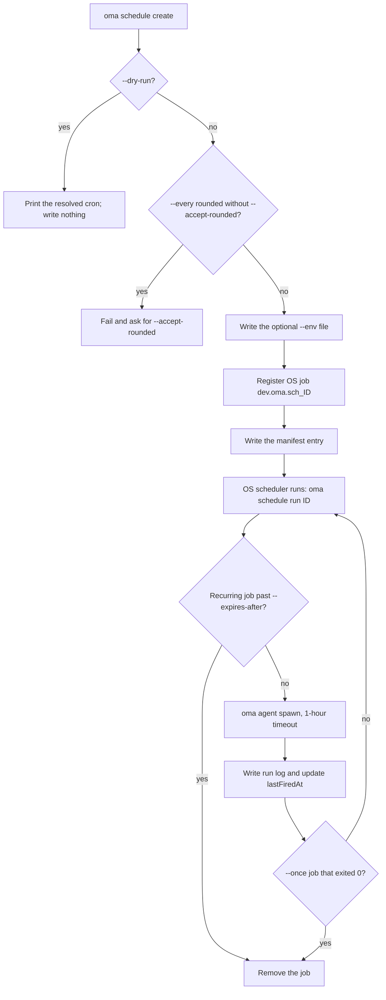
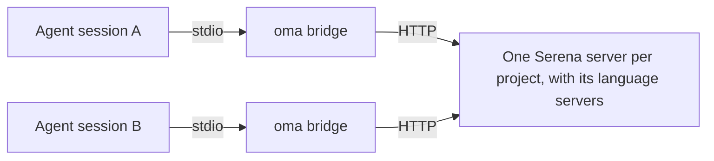
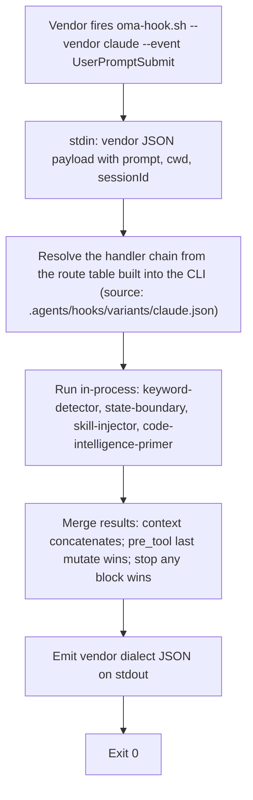

# CLIコマンド {#cli-commands}

グローバルインストール（`bun install --global oh-my-agent`）後は `oma` または `oh-my-agent` を使います。インストールせずに一度だけ実行する場合は `npx oh-my-agent` を使います。

環境変数 `OH_MY_AG_OUTPUT_FORMAT` に `json` を設定すると、共通の `--json` / `--output` オプションを使うコマンドで JSON がデフォルトの出力になります。明示的に `--output text` を指定した場合はそちらが優先されます。

コマンドが `Unknown command`、`Unexpected argument`、`Removed option` で失敗した場合は、このページの [削除された表記](#aliases) を参照してください。インストール、フック、実行時の問題については [トラブルシューティング](../guide/troubleshooting.md) を参照してください。

## タスクから始める {#start-with-a-task}

目的に合う最小のコマンドを選びます。以下のコマンドはパスまたはレポートを出力するため、次の操作に進む前に内容を確認できます。

| 目的 | 最初に実行するコマンド | 結果 |
|:-----|:----------------------|:------|
| プロジェクトをインストールまたは修復する | `oma install` の後に `oma doctor` | インストール済みリソースとヘルスレポート。モデル解決を確認する場合は `oma doctor --profile` を使います。 |
| エージェントからコマンドやオプションを探す | `oma describe` または `oma describe "image generate"` | 引数、オプション、入れ子のコマンドを含む JSON。 |
| 画像を生成する | `oma image generate "<prompt>" --output json` | `.agents/results/images/` 配下の画像パスとマニフェスト。 |
| 動画を計画またはレンダリングする | `oma video generate "<brief>" --dry-run` | 計画成果物を含む実行ディレクトリ。composition を作成してから compose と render を実行します。 |
| インタラクティブなコード解説を作る | `/explain` | `.agents/results/explain/` 配下の検証済み自己完結 HTML 成果物。 |
| ダイアグラムエンジンを解決する | `oma diagram resolve --output json` | 選択された Mermaid または archify エンジンと、その理由。 |
| コミュニティの兆候を調べる | `oma market detect-trap "<topic>"` | preflight の結果。通過した場合だけ `oma market resolve --output json` と上流実行に進みます。 |
| 論文を変換または確認する | `oma scholar search "<query>"` | Knows、OpenAlex、Semantic Scholar の検索結果。`oma scholar get` で sidecar を取得します。 |
| スライドデッキを作る | `oma slide create --output-dir <dir>` | 作成、検証、バンドル、エクスポートができる作業ディレクトリ。 |
| ドキュメントのずれを確認する | `oma docs verify --json` | 壊れた参照の構造化レポートと再生成された参照インデックス。 |
| 定期実行するエージェントをスケジュールする | `oma schedule create backend "<task>" --every 2h --dry-run` | 解決された cron 式。`--dry-run` を外して再実行するまで何も登録されません。 |
| スキルやハーネスの品質を確認する | `oma skill lint` または `oma skill audit` | オフラインのレポート。モデルを呼び出すコマンドを使う前に [スキル・ハーネスコマンドの選び方](#choosing-a-skill-or-harness-command) を参照してください。 |

以下の正規名は `oma describe` が返すパスです。受け付けるのは空白区切りのこれらのパスだけです。`slide new`、`slide viewer`、`image list-vendors`、`video list-providers` などの古い表記、`agent:parallel` のようなコロン形式、短縮名 `viz`、`s`、`img` は `Unknown command` または `Unexpected argument` で失敗します。[エイリアスと削除された表記](#aliases) を参照してください。

## 現在のコマンド一覧 {#current-command-surface}

この一覧は長いリファレンスを確認しやすくし、使用頻度の低いファミリーも見つけやすくします。引数の正確な構文は各ファミリーの `--help` または `oma describe <path>` で確認してください。[CLIオプション](./options.md) にレジストリの全フラグ一覧があります。

| ファミリー | 登録済みパス |
|:---------|:-----------------|
| `install` | `install` |
| `describe` | `describe` |
| `uninstall` | `uninstall` |
| `update` | `update`, `update mcp` |
| `link` | `link` |
| `intel` | `intel`, `intel suggest` |
| `market` | `market`, `market detect-trap`, `market resolve`, `market update`, `market run` |
| `doctor` | `doctor` |
| `profile` | `profile`, `profile list`, `profile show`, `profile create`, `profile use`, `profile run` |
| `home` | `home`, `home migrate` |
| `retro` | `retro` |
| `recap` | `recap` |
| `docs` | `docs`, `docs verify`, `docs sync`, `docs i18n`, `docs lint` |
| `emit` | `emit` |
| `cleanup` | `cleanup` |
| `bridge` | `bridge` |
| `verify` | `verify`, `verify agent`, `verify triggers` |
| `vault` | `vault`, `vault store`, `vault get`, `vault list`, `vault delete` |
| `star` | `star` |
| `visualize` | `visualize` |
| `search` | `search`, `search providers`, `search web`, `search fetch`, `search meta`, `search media`, `search archive`, `search trust`, `search code`, `search doctor`, `search api`, `search api fetch`, `search api search`, `search rss`, `search rss fetch`, `search rss google` |
| `harness` | `harness`, `harness eval`, `harness incident`, `harness incident scan`, `harness incident capture`, `harness incident show`, `harness incident export`, `harness incident promote`, `harness incident reproduce`, `harness feedback`, `harness evolution`, `harness evolution enable`, `harness evolution status`, `harness evolution disable`, `harness evolution run` |
| `slide` | `slide`, `slide validate`, `slide bundle`, `slide edit`, `slide doctor`, `slide create`, `slide preview`, `slide export`, `slide export pdf`, `slide export png`, `slide export pptx`, `slide import`, `slide import pptx`, `slide asset`, `slide asset fetch-video`, `slide style`, `slide style list`, `slide style preview`, `slide style get` |
| `scholar` | `scholar`, `scholar search`, `scholar resolve`, `scholar get`, `scholar lint` |
| `image` | `image`, `image generate`, `image doctor`, `image vendor`, `image vendor list` |
| `video` | `video`, `video generate`, `video doctor`, `video compose`, `video render`, `video provider`, `video provider list` |
| `serena` | `serena`, `serena check`, `serena setup`, `serena reap`, `serena daemon`, `serena daemon gc`, `serena reaper`, `serena reaper enable`, `serena reaper disable` |
| `explain` | `explain`, `explain render`, `explain lint`, `explain patch`, `explain components`, `explain validate` |
| `diagram` | `diagram`, `diagram resolve`, `diagram update`, `diagram archify` |
| `help` | `help` |
| `version` | `version` |
| `dashboard` | `dashboard`, `dashboard terminal`, `dashboard web` |
| `auth` | `auth`, `auth status` |
| `hook` | `hook`, `hook run`, `hook probe` |
| `state` | `state`, `state emit`, `state migrate`, `state get`, `state list`, `state repair`, `state verify`, `state decisions`, `state decisions list`, `state inject-log`, `state inject-log list`, `state inject-log get`, `state summary`, `state trajectory`, `state heal-check`, `state activate`, `state archive`, `state purge` |
| `ralph` | `ralph`, `ralph verify` |
| `goal` | `goal`, `goal set` |
| `stats` | `stats`, `stats get`, `stats reset` |
| `agent` | `agent`, `agent context`, `agent resume`, `agent begin`, `agent verify`, `agent finish`, `agent spawn`, `agent status`, `agent parallel`, `agent review` |
| `model` | `model`, `model check`, `model probe`, `model propose` |
| `memory` | `memory`, `memory keys`, `memory init`, `memory setup`, `memory daemon`, `memory daemon status`, `memory daemon start`, `memory daemon stop`, `memory daemon restart`, `memory service`, `memory service install`, `memory service uninstall`, `memory status`, `memory retry`, `memory retry drain`, `memory import`, `memory maintain`, `memory maintain backup`, `memory maintain prune`, `memory maintain vacuum`, `memory gc`, `memory upgrade` |
| `skill` | `skill`, `skill audit`, `skill lint`, `skill eval`, `skill optimize`, `skill meta-optimize`, `skill procedure`, `skill evolution-stats`, `skill promotions`, `skill rollback`, `skill matrix` |
| `schedule` | `schedule`, `schedule create`, `schedule list`, `schedule delete`, `schedule run`, `schedule sync` |

OMA の他のプロセスは、いくつかの内部エントリーポイント（`agent parallel-supervisor`、`hook script`、`schedule inspect`、`schedule builtin-evolution-add`）を呼び出します。これらは引き続き動作しますが、ヘルプと `oma describe` には表示されません。手動で実行する必要はありません。

コマンドが残りの引数を別のツールに渡す場合、レジストリでは意図的にオプションを限定していません。`market run` と `diagram archify` が該当します。状態を変更する操作やネットワーク操作の前に、解決された上流ツールのヘルプを確認してください。

---

## セットアップとインストール {#setup-installation}

### install {#install}

引数なしの `oma` はインタラクティブインストーラーを起動します。明示的な形式は `oma install` で、プロバイダー選択オプションを指定できます。

```bash
oma
oma install
oma install --web-search native --code-intelligence gortex --semantic-memory agentmemory
```

| オプション | 指定できる値 |
|:-------|:----------------|
| `--web-search <provider>` | `native`, `brave` |
| `--code-intelligence <provider>` | `serena`, `gortex` |
| `--semantic-memory <provider>` | `agentmemory`, `honcho`, `none` |
| `--honcho-url <url>` | Honcho API のオリジン（新規接続のデフォルト値: `http://127.0.0.1:8000`） |
| `--honcho-workspace <id>` | Honcho のワークスペース ID（新規接続のデフォルト値: `oma`） |

`--web-search`、`--code-intelligence`、`--semantic-memory` を省略すると保存済みのプロバイダー選択を使います。そのプロバイダーを選んだ場合、`--honcho-url` と `--honcho-workspace` で新しい Honcho 接続を設定します。ルートの `-y, --yes` はプロンプトを省略してデフォルトを使い、`--global` は `$OMA_HOME/.agents/`（デフォルトは `~/.oma/.agents/`）を対象にします。`OMA_HOME` を設定していても、プロジェクトへのインストール先は `<cwd>/.agents/` のままです。

**動作:**
1. 古い `.agent/` ディレクトリを確認し、見つかった場合は `.agents/` へ移行します。
2. 競合するツールを検出し、削除を提案します。
3. プロジェクト種別（All、Fullstack、Frontend、Backend、Mobile、DevOps、Custom）を尋ねます。
4. Backend を選ぶと、言語のバリアント（Python、Node.js、Rust、その他）を尋ねます。
5. GitHub Copilot のシンボリックリンクを確認します。
6. レジストリから最新の tarball をダウンロードします。
7. 共通リソース、ワークフロー、設定、選択したスキルをインストールします。
8. 選択したベンダー向けの適応ファイルをインストールします（プロジェクト固有の設定であり、HOME 側へ黙って書き込みません）。
9. CLI のシンボリックリンクを作成します。
10. 推奨する **global** Git 設定をオプトインで提案します。
    - `rerere.enabled=true` 。 マルチエージェントのマージ競合を再利用します。
    - `init.defaultBranch=main` 。 新しいリポジトリのデフォルトブランチを統一します。
    - `--yes` / CI では完全に省略し、手動修正のヒントだけを表示します。
11. 該当する場合は MCP の設定を提案します。
12. `gh` が認証済みなら GitHub スターを尋ねます。

**例:**
```bash
cd /path/to/my-project
oma
# Follow the interactive prompts
```

### doctor {#doctor}

CLI のインストール、MCP 設定、スキルの状態を確認します。

```text
oma doctor [--json] [--output <format>] [--profile] [--heal-check <agent-type>]
```

**オプション:**

| フラグ | 説明 |
|:-----|:-----------|
| `--json` | JSON として出力します。レポートの `issues` 件数が 0 より大きい場合、コマンドは `1` で終了します。 |
| `--output <format>` | 出力形式（`text` または `json`）です。 |
| `--profile` | プロファイルのヘルスマトリクスを表示します。アクティブな `model_preset` と `agents:` の上書きから解決したモデルスラッグ、CLI、エージェントごとの認証状態を表示します。[エージェント別モデル](../guide/per-agent-models.md) を参照してください。 |
| `--heal-check <agent-type>` | そのエージェントの自己修復ゲートチェックをレポートに含めます。 |

**確認対象:**
- CLI のインストール: `claude`、`codex`、`qwen`、`agy`、`grok`、`kiro-cli`、`kimi`、`pi`（バージョンとパス）。
- 各 CLI の認証状態。
- Claude Code（`~/.claude.json`）と Codex（`~/.codex/config.toml`）の MCP 設定。
- インストール済みスキルとその状態。
- メモリストアディレクトリ: `.agents/state/memories/` の存在とファイル数（古いプロジェクトでは従来の `.serena/memories/` にフォールバックします）。
- プロジェクトとグローバルの二重インストールマーカーと関連する警告。
- 推奨 **global** Git 設定（JSON の `gitRecommended`）。
  - `rerere.enabled=true`。
  - `init.defaultBranch=main`。
  - 各不一致が問題の合計（JSON の `issues`）に加算されます。
- プロジェクトのベンダーコンテキストファイル（Codex、Qwen、または Claude Code ≥ 2.1.277 がインストール済みなら `AGENTS.md` の OMA ブロック）。
- AgentMemory、state/hooks の健全性、Serena reaper の診断、関連する問題カウンター。

**自動修復:** 不足しているスキルが見つかると、`doctor` は対話的なインストールを提案します。推奨 Git 設定がない、または値が違う場合は、install/update と同じオプトイン方式のグローバル修正を提案します。

**例:**
```bash
# Interactive text output
oma doctor

# JSON output for CI pipelines
oma doctor --json

# Pipe to jq for specific checks
oma doctor --json | jq '.clis[] | select(.installed == false)'

# Inspect the profile resolution matrix
oma doctor --profile
```

### update {#update}

レジストリからスキルを最新バージョンへ更新します。

```text
oma update [-f, --force] [--with-new-skills] [--ci] [-y, --yes] [--all] [--vendor <vendors>]
```

**オプション:**

| フラグ | 説明 |
|:-----|:-----------|
| `-f, --force` | ユーザーが変更した設定ファイルを上書きします（`oma-config.yaml`、`mcp.json`、`stack/` ディレクトリ）。 |
| `--with-new-skills` | このリリースで追加されたスキルをインストールします。指定しない場合は、既にインストール済みのスキルだけを更新します。 |
| `--ci` | 非対話式 CI モードで実行します（プロンプトを省略し、通常のテキストを出力）。 |
| `-y, --yes` | プロンプトを省略します。ベンダーの範囲は変わらず、`--all` または `--vendor` を指定しない限り、既存のベンダーディレクトリだけを更新します。 |
| `--all` | 対応するプロジェクト対象ベンダーをすべて作成または更新します。 |
| `--vendor <vendors>` | 指定したベンダーを作成または更新します。`claude,qwen` のようなカンマ区切りの一覧を受け付けます。 |

**動作:**
1. レジストリから `prompt-manifest.json` を取得し、最新バージョンを確認します。
2. `.agents/skills/_version.json` のローカルバージョンと比較します。
3. すでに最新なら終了します。
4. 最新の tarball をダウンロードして展開します。
5. ユーザーが変更したファイルを保持します（`--force` を除く）。
6. 新しいファイルを `.agents/` へコピーします。
7. 保持したファイルを復元します。
8. ベンダー適応ファイルを更新し、シンボリックリンクを再生成します。デフォルトでは、プロジェクトに既に存在するベンダーディレクトリだけを対象にします。
9. 推奨する **global** Git 設定（install と同じオプトインで、`rerere.enabled` と `init.defaultBranch`）を提案します。`--yes` / `--ci` では省略します。

**例:**
```bash
# Standard update (preserves config)
oma update

# Force update (resets all config to defaults)
oma update --force

# CI mode (no prompts, no spinners)
oma update --ci

# CI mode with force
oma update --ci --force

# Update existing vendors without prompts
oma update --yes

# Create/update every supported project-scoped vendor
oma update --all

# Create/update only Claude and Qwen integrations
oma update --vendor claude,qwen

# Also refresh browser MCP selections
oma update mcp --ci
```

`oma update mcp` には独自の `--yes`、`--ci`、`--all`、`--vendor <vendors>` オプションがあります。選択したプロジェクト対象ベンダー向けに、対応ブラウザー MCP サーバー（Aside、Chrome DevTools、Firefox DevTools）を選択します。

### uninstall {#uninstall}

選択したインストールルートにある OMA 所有ファイルを確認または削除します。

```bash
oma uninstall --dry-run
oma uninstall --yes
```

`--dry-run` はファイルを変更せず削除対象を一覧表示します。`--yes` は確認プロンプトを省略します。登録されたコマンド説明に従い、`oma-config.yaml`、`mcp.json`、ユーザー作成スキルは保持されます。プレビューに必要なファイルが含まれていたら、実行を止めて dry-run の出力を確認してください。

### link {#link}

再インストールせず、`.agents/` を SSOT としてベンダー固有ファイルを再生成します。

```text
oma link [vendors...] [--dry-run] [--global]
```

`--dry-run` はファイルを変更せず、書き込まれる内容をプレビューします。

**例:**

```bash
# Preview the files link would write
oma link --dry-run

# Regenerate all configured vendors
oma link

# Regenerate only Claude and Codex files
oma link claude codex

# Regenerate the global install (~/.oma/.agents/) from any directory
oma link opencode --global
```

`--global` なしでは `<cwd>/.agents/` を対象にし、指定時は `~/.oma/.agents/`（または `$OMA_HOME/.agents/`）を対象にします。`OMA_HOME` はプロジェクトの対象を変更しません。[グローバルインストール](../guide/global-install.md) を参照してください。

**動作:**
1. `.agents/agents/` からベンダー固有のエージェントファイルを再構築します。
2. 選択したベンダーのフックとローカル設定を更新します。
3. 設定済みのすべてのベンダー（Claude Code を含む）の `AGENTS.md` 連携ブロックを再生成します。`CLAUDE.md` と `GEMINI.md` は作成せず、OMA ブロックも追加しません。Claude Code ≥ 2.1.277 は `AGENTS.md` をネイティブに読みますが、`CLAUDE.md` があるときは `AGENTS.md` を無視します。そのため、ユーザーが所有する `CLAUDE.md` がある場合、link は `@AGENTS.md` のインポート行を 1 行だけ追記します。`oma update` も、そのバージョンを検出すると従来の `CLAUDE.md` の OMA ブロックを取り除きます。
4. 必要に応じて Cursor MCP のリンクと CLI スキルのシンボリックリンクを更新します。

`.agents/agents/`、`.agents/workflows/`、`.agents/rules/`、フック定義を編集した後に使います。

**モデルの動作:**
- 同じベンダーへのネイティブディスパッチでは、生成されたベンダーエージェントファイルに定義されたモデルを使います。
- 外部フォールバックディスパッチでは、`.agents/skills/oma-orchestration/config/cli-config.yaml` の各ベンダー `default_model` を使います。

**ディスパッチの動作:**
- 対象ベンダーが現在のランタイムと一致し、そのランタイムがロール用ネイティブエージェントに対応していれば、OMA はネイティブディスパッチを使います。
- それ以外では OMA は `oma agent spawn` にフォールバックします。

### 既存のインストールを再設定する {#setup-workflow}

`/setup` ワークフローはありません。インストール済みのプロジェクトを変更するには、`oma install` を再実行するか、ブラウザー MCP サーバーだけを変更する場合は `oma update mcp` を使うか、エージェントセッション内で `/tools` を実行して MCP ツールを有効化または無効化します。エージェントごとのモデル解決は `oma doctor --profile` で確認します。エージェントごとのモデル固定は `.agents/oma-config.yaml` の `agents:` 配下に記述します（[エージェント別モデル](../guide/per-agent-models.md)）。

---

## モニタリングとメトリクス {#monitoring-metrics}

### dashboard terminal {#dashboard}

エージェントをリアルタイムに監視するターミナルダッシュボードを起動します。

```text
oma dashboard terminal [--project-root <path>]
```

`<project>/.agents/state/memories/` を監視します。プロジェクトは `--project-root`（デフォルトはカレントディレクトリ）です。従来の `.serena/memories/` への自動フォールバックはありません。セッション状態、エージェント一覧、アクティビティフィードを罫線 UI で表示し、ファイル変更のたびに更新します。終了するには `Ctrl+C` を押します。

メモリディレクトリは `MEMORIES_DIR` 環境変数で上書きできます。

**例:**
```bash
# Standard usage
oma dashboard terminal

# Custom memories directory
MEMORIES_DIR=/path/to/.agents/state/memories oma dashboard terminal
```

### dashboard web {#dashboard-web}

Web ダッシュボードを起動します。

```text
oma dashboard web [--project-root <path>]
```

`http://127.0.0.1:9847` でライブ更新用の WebSocket 接続を持つ HTTP サーバーを起動します。表示された URL をブラウザーで開くとダッシュボードを確認できます。

**環境変数:**

| 変数 | デフォルト | 説明 |
|:-----|:--------|:-----------|
| `DASHBOARD_PORT` | `9847` | HTTP/WebSocket サーバーのポート |
| `MEMORIES_DIR` | `<project-root>/.agents/state/memories` | メモリディレクトリのパス。`--project-root` より優先されます。 |

**例:**
```bash
# Standard usage
oma dashboard web

# Custom port
DASHBOARD_PORT=8080 oma dashboard web
```

### stats {#stats}

生産性メトリクスを表示します。

```text
oma stats get [--json] [--output <format>]
oma stats reset [--json] [--output <format>]
```

**オプション:**

| フラグ | 説明 |
|:-----|:-----------|
| `--json` | JSON として出力します。 |
| `--output <format>` | 出力形式（`text` または `json`）です。 |

**計測項目:**
- セッション数
- 使用したスキル（頻度付き）
- 完了したタスク数
- セッションの合計時間
- 変更ファイル数、追加行数、削除行数
- 最終更新時刻

**コストテレメトリー**（`.agents/state/memories/` 配下のすべての `session-cost-*.md` ファイルを集計）:
- 入力トークン合計（プロンプト文字数からの近似値。現時点では出力トークンを含みません）
- 起動回数
- 控えめなベンダー別入力トークン単価表で見積もった USD（Claude $3/M、Codex $5/M、Gemini $0.3/M、Qwen $0/M、Cursor $5/M、Antigravity $0.3/M）
- ベンダー別内訳（トークン数・起動回数・USD）

この見積もりは下限であり、請求額を正確に表すものではありません。起動時に厳密な予算を適用するには `.agents/oma-config.yaml` の `session.quota_cap` を設定してください。上限を含む品質優先の仕組みについては、Getting Started の Why oh-my-agent ページを参照してください。

メトリクスは `.agents/state/metrics.json` に保存されます。従来の `.serena/metrics.json` があれば読み込みます。データは Git の統計とメモリファイルから収集します。

**例:**
```bash
# View current metrics
oma stats get

# JSON output
oma stats get --json

# Reset all metrics
oma stats reset
```

### recap {#recap}

Claude、Codex、Gemini、Antigravity、Qwen、Cursor、Grok のセッションにまたがる AI ツールの会話履歴を振り返ります。

```text
oma recap [--window <period>] [--date <date>] [--tool <tools>] [--top <n>] [--sort <metric>] [--mermaid] [--graph] [--json] [--output <format>]
```

**オプション:**

| フラグ | 説明 | デフォルト |
|:-----|:-----------|:--------|
| `--window <period>` | 期間: `1d`、`3d`、`7d`、`2w`、`30d` | `1d` |
| `--date <date>` | 指定日（`YYYY-MM-DD`）。`--window` より優先されます。 | |
| `--tool <tools>` | カンマ区切りのフィルター: `grok,claude,codex,gemini,qwen,cursor,antigravity` | すべて |
| `--top <n>` | 上位 N 件のプロジェクトまたはトピックを表示します。 | |
| `--sort <metric>` | `count` または `duration` で並べ替えます。 | `count` |
| `--mermaid` | Mermaid ガントチャートとして出力します。 | |
| `--graph` | ブラウザーでインタラクティブグラフを開きます。 | |
| `--json` / `--output <format>` | 機械可読形式で出力します。 | `text` |

**例:**

```bash
oma recap                                     # Today (1d)
oma recap --window 7d                         # Last week
oma recap --date 2026-04-20 --tool grok,claude
oma recap --window 7d --mermaid > week.mmd
oma recap --window 30d --graph                # Interactive browser graph
```

### retro {#retro}

メトリクスと傾向を含むエンジニアリング振り返りを表示します。

```text
oma retro [window] [--json] [--output <format>] [--interactive] [--compare]
```

**引数:**

| 引数 | 説明 | デフォルト |
|:---------|:-----------|:--------|
| `window` | 期間は `<n>h`、`<n>d`、`<n>w` で指定します（例: `24h`、`7d`、`2w`）。月単位は使えないため、`30d` を使います。 | 過去 7 日間 |

**オプション:**

| フラグ | 説明 |
|:-----|:-----------|
| `--json` | JSON として出力します。 |
| `--output <format>` | 出力形式（`text` または `json`）です。 |
| `--interactive` | 手動入力を行う対話モードです。 |
| `--compare` | 現在の期間と同じ長さの直前期間を比較します。 |

**表示内容:**
- 1 行のメトリクス要約（そのまま共有できる形式）
- 要約表（コミット、変更ファイル、追加/削除行、貢献者）
- 前回の振り返りとの差分傾向（前回のスナップショットがある場合）
- 貢献者ランキング
- コミット時刻の分布（時間別ヒストグラム）
- 作業セッション
- コミット種別の内訳（feat、fix、chore など）
- ホットスポット（変更が多いファイル）

**例:**
```bash
# Last 7 days (default)
oma retro

# Last 30 days
oma retro 30d

# Last 2 weeks
oma retro 2w

# Compare with previous period
oma retro 7d --compare

# Interactive mode
oma retro --interactive

# JSON for automation
oma retro 7d --json
```

---

## グローバルホーム、セッション、ローカルプロファイル {#global-home-sessions-and-local-profiles}

### home migrate {#home-migrate}

OMA が所有するグローバル定義と実行時メタデータを統合ホームへコピーします。

```bash
oma home migrate --dry-run --json
oma home migrate --json
oma schedule sync
```

`OMA_HOME` はグローバルストレージのルートを選択し、デフォルトは `~/.oma` です。定義はその `.agents/`、
スケジュールは `schedule/`、Serena と vault のキー名インデックスは `state/` を使います。
プロファイルのストレージは `u/` を使います。ただし `OMA_STATE_HOME` で別のプロファイルルートを
明示的に選択した場合はそちらを使います。

移行では元の内容を保持し、同一のコピーはスキップし、vault のキー名をマージし、
移行先の競合や使用中のデータを報告します。検証済みの OMA 所有スキルディレクトリは、
古い検出パスが移行先コピーへの管理リンクになる前に、`$OMA_HOME/backup/legacy-global-skills/` 配下へアーカイブできます。
ユーザーのスキルと外部リンクはそのまま残ります。ベンダーの認証情報、OS キーチェーンの秘密情報、
外部メモリのデータは移動しません。グローバルの install/update はこの移行を自動で実行します。
OS ジョブの登録は別の処理です。スケジュールがある場合は、移行後に `oma schedule sync` を実行してください。

### state list {#state-list}

現在のプロジェクトの OMA ワークフローセッションを一覧表示します。明示的なグローバル検索では、
選択したローカルプロファイル内の複数プロジェクトにまたがるセッションを表示します。

```bash
oma state list
oma state list --all-projects --json
oma state list --all-projects --project /path/to/project
oma state list --all-projects --search migration
```

`--all-projects` は読み取り専用です。セッションの有効化や保守とは併用できません。
通常のセッション読み書きはプロジェクト範囲を維持します。
他のリポジトリの従来セッションは、集約一覧に表示される前に
ホームストレージへ移行する必要があります。

### profile {#profile}

`~/.oma/u/<slot>/` 配下のローカルストレージプロファイルを管理します。スロットは
0 以上の十進整数で、モデルプリセットやプロバイダーのログインアカウントとは別です。

```bash
oma profile list --json
oma profile create 1
oma profile show
eval "$(oma profile use 1 --shell zsh)"
oma profile show
oma profile run 1 -- oma state list --all-projects --json
```

`profile use` はシェル有効化コードを出力し、評価すると現在のシェルに `OMA_PROFILE` を設定します。
単独で実行しても親シェルは変更されず、既に実行中のアプリケーションも変わらず、CLI 専用のデフォルト値も別には保存しません。
有効化したシェルから起動した CLI コマンドとベンダーフックは、同じプロファイルを継承します。
デフォルトプロファイルは `0` で、ストレージは `OMA_HOME`（デフォルトは `~/.oma`）に従います。明示的な `OMA_STATE_HOME` はプロファイルのストレージだけを上書きします。
`profile run <slot> -- <command> [args...]` はそのコマンドと子プロセスだけにプロファイルを適用します。
区切り記号により、`--help` や `--json` などの子コマンド用オプションを子コマンドへ渡します。

---

## エージェント管理 {#agent-management}

### agent spawn {#agent-spawn}

サブエージェントプロセスを起動します。

```text
oma agent spawn <agent-id> <prompt> <session-id> [--vendor <vendor>] [-w <workspace>] [--isolation <mode>]
```

**引数:**

| 引数 | 必須 | 説明 |
|:-----|:-----|:-----------|
| `agent-id` | 必須 | エージェント種別: `orchestrator`、`architecture`、`qa`、`pm`、`backend`、`frontend`、`mobile`、`db`、`debug`、`refactor`、`docs`、`tf-infra`、`explore` |
| `prompt` | 必須 | タスク説明。インラインテキストまたはファイルパスです。 |
| `session-id` | 必須 | セッション識別子（形式: `session-YYYYMMDD-HHMMSS`） |

**オプション:**

| フラグ | 説明 |
|:-----|:-----------|
| `--vendor <vendor>` | CLI ベンダーの上書き: `antigravity`、`claude`、`codex`、`cursor`、`opencode`、`qwen`、`grok`、`pi` |
| `-w, --workspace <path>` | エージェントの作業ディレクトリ。省略時はモノレポ設定から自動検出します。 |
| `--resumed-from <run-id>` | 再試行を直前の実行の run ID に関連付けます。 |
| `--task-id <id>` | セッション計画のタスク ID。省略時はエージェント ID です。 |
| `--isolation <mode>` | 起動ごとの分離モード。現在は `worktree` に対応し、`${tmpdir}/oma-worktrees/{sessionId}/{agentId}` に `oma/{sessionId}/{agentId}` ブランチの新しい Git worktree を作ってそこでエージェントを実行します。終了後も worktree は保持され、マージまたは破棄のコマンドを確認用に表示します（自動マージはしません）。 |
| `--read-only` | 起動したエージェントを非破壊ツールに制限します（自動承認フラグを抑止します）。`oma skill eval --live` が 2 つの評価アームで内部的に使います。 |
| `--fallback-vendors <vendors>` | 最大 3 つの設定済み CLI ベンダーを順序付きカンマ区切りで指定するフォールバックチェーンを有効にします。継続には、認識済みのクォータ・レート制限・一時的障害と、新しい安全な引き継ぎチェックポイントが必要です。 |

**ベンダー解決順序:** `--vendor` フラグ > `oma-config.yaml` の `agents:` 上書き > 有効な `model_preset` のエージェントデフォルト値。

**プロンプトの解決:** prompt 引数が既存ファイルのパスなら、その内容をプロンプトに使います。それ以外は引数をインラインテキストとして使います。ベンダー固有の実行プロトコルは自動で追加されます。

**終了コード:**

| コード | 意味 |
|:-----|:--------|
| `0` | 実行記録が `completed` として終了しました。 |
| `3` | ベンダープロセスは 0 で終了したものの、実行は検証済みの `completed` として終了せず（例: `partial`、`blocked`、`failed`）、コード `spawn.incomplete-result` の `blocker.raised` イベントが記録されます。`--fallback-vendors` の後続試行を開始できない場合にも返されます。起動完了とは扱わないでください。 |
| `130` | 中断されました（Ctrl+C または SIGTERM）。 |
| その他 | ベンダープロセス自体が失敗し、その終了コードをそのまま返します。 |

`completed` を判定する実行記録と申告については [エージェントの結果と再開](../guide/agent-results-and-resume.md) を参照してください。

**例:**
```bash
# Inline prompt, auto-detect workspace
oma agent spawn backend "Implement /api/users CRUD endpoint" session-20260324-143000

# Prompt from file, explicit workspace
oma agent spawn frontend ./prompts/dashboard.md session-20260324-143000 -w ./apps/web

# Override vendor to Claude
oma agent spawn backend "Implement auth" session-20260324-143000 --vendor claude -w ./api

# Allow a prepared task handoff to another configured vendor
oma agent spawn backend "Implement auth" session-20260324-143000 --vendor claude --fallback-vendors codex,qwen -w ./api

# Mobile agent with auto-detected workspace
oma agent spawn mobile "Add biometric login" session-20260324-143000

# Run inside an isolated git worktree (useful for hypothesis spawns or
# when parallel agents would touch shared files)
oma agent spawn backend "Try a Drizzle-based rewrite" session-20260324-143000 --isolation worktree
```

**ベンダーフォールバック:** フォールバック候補にはインストール済み CLI 設定のベンダーエントリが必要です。
各試行は対象ベンダーのモデル設定を使い、既存のセッション割当量チェックを通過します。
初期のベンダーフォールバック機能では、複数プロバイダー対応プロキシの `pi` は対象外です。
追加のプロバイダー認証情報や有料 API 経路は作成しません。

フォールバックを有効にすると、タスクは `.agents/results/` に実行ごとの安全な引き継ぎ記録を準備する指示を受け取ります。
後続試行はその記録を読み、残りの作業を続ける前にワークスペースを確認します。
利用可能なチェックポイントなしで割当量を使い切ると、要レビュー記録を残して停止します。
キャンセル、通常のタスク失敗、完了済みの実行では別の試行を開始しません。
`--read-only` でもチェックポイント要件は免除されません。

セッションイベントには遷移理由と移行元/移行先ベンダーを記録します。
各試行には固有の実行 ID があり、後続試行は前の試行にリンクします。
これは `oma agent spawn` が起動したサブプロセスに適用されます。
ベンダーアプリで既に開いている対話セッションを自動的に切り替えるものではありません。
`--fallback-vendors` を省略すると、通常の単一ベンダー実行を維持します。

### agent status {#agent-status}

1 つ以上のサブエージェントの状態を確認します。

```text
oma agent status <session-id> [agent-ids...] [--project-root <path>]
```

**引数:**

| 引数 | 必須 | 説明 |
|:-----|:-----|:-----------|
| `session-id` | 必須 | 確認するセッション ID |
| `agent-ids` | 任意 | エージェント ID の空白区切り一覧。省略時は出力しません。 |

**オプション:**

| フラグ | 説明 | デフォルト |
|:-----|:-----------|:--------|
| `--project-root <path>` | 実行記録、メモリ、PID ファイルを確認するプロジェクト | カレントディレクトリ |

**ステータス値:**
- `running`、`completed`、`partial`、`blocked`、`failed`: セッション内でそのエージェントの最新の実行記録の状態です。runner プロセスが終了している `running` 記録は `failed` として報告されます。
- `stale`: 実行は `completed` として記録されていますが、その証拠がもう検証を通りません。
- `legacy-<status>`、`unverified`、`legacy-completed`: 実行記録がない場合に、古い `result-<agent>.md` ファイルまたは一時ステータスファイルから読み取った状態です。
- PID ファイルからの `running` / `crashed`: プロセスが稼働中か、終了しているかを示します。
- `crashed`: 実行記録、結果ファイル、ステータスファイル、PID ファイルのいずれも見つかりませんでした。

**出力形式:** エージェントごとに 1 行で `{agent-id}:{status}` を出力します。

**例:**
```bash
# Check specific agents
oma agent status session-20260324-143000 backend frontend

# Output:
# backend:running
# frontend:completed

# Check another project
oma agent status session-20260324-143000 qa --project-root /path/to/project
```

### agent parallel {#agent-parallel}

複数のサブエージェントを並列実行します。

```text
oma agent parallel [tasks...] [--session-id <id>] [--vendor <vendor>] [-i, --inline] [--no-wait]
```

**引数:**

| 引数 | 必須 | 説明 |
|:-----|:-----|:-----------|
| `tasks` | 必須 | YAML タスクファイルのパス、または `--inline` 時のインライン仕様 |

**オプション:**

| フラグ | 説明 |
|:-----|:-----------|
| `--session-id <id>` | 結果を既存のセッションに関連付けます。YAML の `id` 値がタスク ID になります。 |
| `--vendor <vendor>` | すべてのエージェントに適用する CLI ベンダーの上書き |
| `-i, --inline` | `agent:task[:workspace]` 引数としてタスクを指定するインラインモード |
| `--no-wait` | バックグラウンドモード（起動してすぐ戻る） |

**YAML タスクファイルの形式:**
```yaml
tasks:
  - id: user-api        # optional task ID
    agent: backend
    task: "Implement user API"
    workspace: ./api    # optional, auto-detected if omitted
  - agent: frontend
    task: "Build user dashboard"
    workspace: ./web
```

`id`、`agent`、`task`、`workspace` は同じリスト項目に属するため、`-` の下にインデントします。

**インラインタスク形式:** `agent:task` または `agent:task:workspace`（ワークスペースは `.` にするか、`./` または `/` で始める必要があります）。

**結果ディレクトリ:** `<project-root>/.agents/results/parallel-<timestamp>-<id>/` に各エージェントのログファイルが入ります。

**例:**
```bash
# From YAML file
oma agent parallel tasks.yaml

# Inline mode
oma agent parallel --inline "backend:Implement auth API:./api" "frontend:Build login:./web"

# Background mode (no wait)
oma agent parallel tasks.yaml --no-wait

# Override vendor for all agents
oma agent parallel tasks.yaml --vendor claude
```

### agent review {#agent-review}

外部 AI CLI（codex、claude、qwen、grok）を使ってコードレビューを実行します。

```text
oma agent review [--vendor <vendor>] [-p <prompt>] [-w <path>] [--no-uncommitted]
```

**オプション:**

| フラグ | 説明 |
|:-----|:-----------|
| `--vendor <vendor>` | 使用する CLI ベンダー: `codex`、`claude`、`qwen`、`grok`。解決した設定のベンダーに対応していない場合は `codex` をデフォルトにします。 |
| `-p, --prompt <prompt>` | カスタムレビュー用プロンプト。省略時はデフォルトのコードレビュープロンプトを使います。 |
| `-w, --workspace <path>` | レビュー対象のパス。デフォルトはカレントディレクトリです。 |
| `--no-uncommitted` | 未コミット変更のレビューを省略します。指定すると、セッション内でコミット済みの変更だけをレビューします。 |

**動作:**
- 環境または最近の Git アクティビティから現在のセッション ID を自動検出します。
- `codex` ではネイティブの `codex review` サブコマンドを使います。
- `claude` と `qwen` ではプロンプトベースのレビュー要求を組み立て、レビュー用プロンプトを付けて CLI を呼び出します。
- デフォルトでは、作業ディレクトリの未コミット変更をレビューします。
- `--no-uncommitted` を指定すると、現在のセッションでコミットされた変更だけをレビューします。

**例:**
```bash
# Review uncommitted changes with default vendor
oma agent review

# Review with codex (uses native codex review command)
oma agent review --vendor codex

# Review with claude using a custom prompt
oma agent review --vendor claude -p "Focus on security vulnerabilities and input validation"

# Review a specific path
oma agent review -w ./apps/api

# Review only committed changes (skip working tree)
oma agent review --no-uncommitted

# Review committed changes in a specific workspace with qwen
oma agent review --vendor qwen -w ./apps/web --no-uncommitted
```

### goal set {#goal-set}

アクティブな永続ワークフロー（orchestrate、ultrawork、work、ralph）にゴール契約を付加します。契約は persistent-mode の Stop フックが機械的に適用するため、完了判定をモデルの判断に委ねません。

```text
oma goal set [--workflow <name>] [--session-id <id>] [--gate <keyword>] [--budget-minutes <n>] [--description <text>]
```

`--gate`、`--budget-minutes`、`--description` の少なくとも 1 つを指定してください。指定しない場合、コマンドは `Nothing to set` で失敗します。用語集の [永続ワークフロー](../getting-started/glossary.md#persistent-workflow) と [停止ゲート](../getting-started/glossary.md#stop-gate) を参照してください。

**オプション:**

| フラグ | 説明 |
|:-----|:-----------|
| `--gate <keyword>` | 決定的な停止ゲート: `typecheck`、`test`、`lint` のいずれかです。同名の package.json スクリプトに対応し、シェルを使わず argv 配列で実行します。設定中は、このスクリプトが **成功した場合だけ** Stop フックがワークフロー終了を許可します。失敗時は出力末尾を示して修正点を伝えます。自由形式のコマンドは拒否します。ゲート値はエージェントが書き込める状態ファイルに保存されるため、任意文字列の実行による権限回避を防ぎます。 |
| `--budget-minutes <n>` | ワークフロー有効化からの実時間予算です。超過すると Stop フックがワークフローを無効化し、未完了でも停止を許可します（セッションイベント履歴には `gate.failed` と `gate: "budget"` を記録します）。 |
| `--description <text>` | 目的の人間向け説明。情報表示のみです。 |
| `--workflow <name>` | 複数の永続ワークフローがある場合の対象ワークフロー。 |
| `--session-id <id>` | 状態ファイルのベンダーセッション ID サフィックス。複数の永続ワークフローがアクティブな場合にだけ必要です。 |

**動作メモ:**
- ゲート通過 → ワークフローを無効化し、`gate.passed` を発行して停止を許可します。
- 各ゲート実行の予算は 25 秒です（`OMA_GATE_TIMEOUT_MS` で短くすることだけができます）。ゲート失敗とタイムアウトはどちらも再強化上限（5）に数えます。そのため、失敗し続けるゲートが停止を永遠に妨げることはありません。最後の保護策として 2 時間で期限切れになります。`--gate test` は、`test` スクリプトがこの予算内に余裕を持って終わる場合にだけ使ってください。
- 目標契約がなければ、永続モードは従来どおり動作します（再強化プロンプトだけです）。契約は完全なオプトインです。

**例:**
```bash
# After starting /ultrawork: require typecheck to pass before the session may end
oma goal set --gate typecheck

# Bound an autonomous run: stop honestly after 2 hours even if incomplete
oma goal set --workflow ultrawork --gate typecheck --budget-minutes 120
```

---

## スケジュール実行エージェント {#scheduled-agents}

### スケジュールのライフサイクル {#schedule-lifecycle}

スケジュールジョブは以下のコマンドを経て進みます。各実行を発火させるのは、実行中の `oma` プロセスではなく OS スケジューラーです。



| 段階 | トリガー | 処理内容 | 記録先 |
|:------|:-------------|:-------------|:------------|
| プレビュー | `schedule create ... --dry-run` | cron 式を解決し、`--every` の丸めに関する注記があれば表示します | stdout のみ |
| 登録 | `schedule create` | 指定時は `--env` ファイルを書き込み、OS ジョブを登録してから、マニフェストエントリを書き込みます | OS スケジューラー、`~/.oma/schedule/schedules.json`、`~/.oma/schedule/env/<id>` |
| 発火 | OS スケジューラー | `oma schedule run <id>` を実行します。`--expires-after` の期間を過ぎた繰り返しジョブは実行せずに削除します | — |
| 実行 | `schedule run` | ジョブに対して 1 時間のタイムアウト付きで `oma agent spawn` を実行します | `~/.oma/schedule/runs/<id>/` |
| 記録 | `schedule run` | `lastFiredAt` を更新します。`--once` ジョブは終了コード 0 の実行後にだけ削除します | マニフェスト |
| 確認と修復 | `schedule list`、`schedule sync` | マニフェストと OS スケジューラーを比較し、ドリフトを修復します | — |
| 削除 | `schedule delete <id>` | マニフェストと OS スケジューラーからジョブを削除します | — |

`~/.oma` はデフォルトの `OMA_HOME` です。ジョブが一度も発火しないなどの症状については [トラブルシューティング](../guide/troubleshooting.md) を参照してください。

### schedule create {#schedule-create}

スケジュール実行するエージェントジョブを登録します。`--cron` と `--every` のどちらか一方が必須です。

```text
oma schedule create <agent-id> <prompt> (--cron <expr> | --every <phrase>) [--vendor <vendor>] [-w <path>] [--once] [--expires-after <duration>] [--env <KEY1,KEY2>] [--dry-run] [--accept-rounded]
```

**引数:**

| 引数 | 必須 | 説明 |
|:-----|:-----|:-----------|
| `agent-id` | 必須 | 発火時に `oma agent spawn` へ渡すエージェント ID。例: `backend`、`frontend`、`qa`、または `qa-reviewer` のようなエージェントファイルのエイリアス。ジョブが発火するまで検証されません。 |
| `prompt` | 必須 | 発火時にエージェントへ渡すタスク説明 |

**オプション:**

| フラグ | 説明 |
|:-----|:-----------|
| `--cron "<expr>"` | 5 フィールドの cron 式（例: `"0 9 * * *"`）。`--every` とは併用できません。 |
| `--every "<phrase>"` | 自然言語の間隔: `5m`、`2h`、`1d`、`every 20m`、`every 5 minutes`。cron のきれいな間隔にならない値（例: `7m`）は丸められ、`--accept-rounded` を付けない限りジョブは登録 **されません**。`--cron` とは併用できません。 |
| `--vendor <vendor>` | `oma agent spawn` に渡す CLI ベンダーの上書き: `antigravity`、`claude`、`codex`、`cursor`、`opencode`、`qwen`、`grok`、`pi`。デフォルトは自動検出です。 |
| `-w, --workspace <path>` | エージェントの作業ディレクトリ。登録時のカレントディレクトリがデフォルトです。 |
| `--once` | 一度だけ実行し、成功した実行の後に自身を削除します。 |
| `--expires-after <duration>` | この期間を過ぎた後の最初の発火時に繰り返しジョブを削除します。`d` 単位の日数で指定し（例: `30d`）、`0` は無期限です。`30` のような単位なしの数値や、`12h`、`2w` のような値は拒否されます。 |
| `--env <KEY1,KEY2>` | 指定した環境変数を `~/.oma/schedule/env/<id>`（0600）へ保存し、実行時に注入します。指定したキーだけを保存し、環境全体は取得しません。 |
| `--dry-run` | OS ジョブ、マニフェストエントリ、env ファイルを作成せず、解決された cron と丸めの注記を表示します。 |
| `--accept-rounded` | プレビューを確認したうえで、`--every` が丸めた間隔を登録します。 |

**動作:**
1. cron 式を解析して検証します（または `--every` の文を cron に変換します）。`--dry-run` ではここで停止します。
2. `--env` を指定した場合は、列挙した変数を `~/.oma/schedule/env/<id>` に書き込みます。
3. OS スケジューラーにジョブを登録します。macOS では launchd、Linux では systemd の `--user` タイマー（systemd が使えない場合はユーザーの crontab）、Windows では Task Scheduler（`schtasks`）、その他の POSIX システムでは crontab を使います。OS ジョブは設定間隔で `oma schedule run <id>` を呼びます。
4. ジョブを `~/.oma/schedule/schedules.json` に書き込みます（グローバルマニフェスト、権限 0600）。

**例:**
```bash
# Exact cron: weekdays at 9 AM
oma schedule create qa-reviewer "Run QA review on latest changes" --cron "0 9 * * 1-5"

# Natural language: every 2 hours
oma schedule create backend "Check for slow queries" --every "2h"

# One-shot, pinned vendor and workspace
oma schedule create pm "Generate sprint plan" --cron "0 9 * * 1" --once --vendor claude -w /path/to/project

# Capture specific env vars for the job
oma schedule create backend "Sync external data" --cron "0 * * * *" --env SYNC_API_KEY,SYNC_TARGET_URL

# Expire a recurring job after 30 days
oma schedule create backend "Check for slow queries" --every "2h" --expires-after 30d

# Preview a rounded interval, then register it
oma schedule create backend "Check logs" --every 7m --dry-run
oma schedule create backend "Check logs" --every 7m --accept-rounded
```

`--every 7m` のプレビューは次のように表示されます。

```text
Preview: requested interval resolves to */6 * * * *
Note: Requested every 7m -- 7 is not a divisor of 60; rounded to every 6m (*/6 * * * *).
Preview only: no OS job, manifest entry, or env file was written.
```

詳しい手順は [スケジュール実行エージェント](../guide/scheduled-agents.md) を参照してください。

### schedule list {#schedule-list}

全プロジェクトのスケジュールジョブをプロジェクトごとにまとめ、OS とのドリフト状態付きで一覧表示します。

```text
oma schedule list [--json] [--output <format>]
```

**オプション:**

| フラグ | 説明 |
|:-----|:-----------|
| `--json` | JSON として出力します。 |
| `--output <format>` | 出力形式（`text` または `json`）です。 |

**ドリフト状態:**

| 状態 | 意味 | 修復 |
|:------|:--------|:-------|
| `synced` | マニフェストエントリと OS ジョブが一致しています | — |
| `stale` | OS 登録が、現在の CLI が受け付けなくなったコマンドを呼び出します | `oma schedule sync`（`oma update` も同じ処理を行います） |
| `missing-in-os` | マニフェストエントリに対応する OS ジョブがありません | `oma schedule sync` |
| `orphan-in-os` | マニフェストにないジョブが OS にあります | `oma schedule sync --prune` |

**例:**
```bash
oma schedule list
oma schedule list --json | jq '.jobs[] | select(.drift != "synced")'
```

### schedule delete {#schedule-delete}

マニフェストと OS スケジューラーの両方からスケジュールジョブを削除します。

```text
oma schedule delete <id>
```

**引数:**

| 引数 | 必須 | 説明 |
|:-----|:-----|:-----------|
| `id` | 必須 | `schedule list` のジョブ ID（形式: `sch_` の後に `a-z` と `2-7` からなる 12 文字） |

**例:**
```bash
oma schedule delete sch_k7d2mq4xa3pz
```

### schedule run {#schedule-run}

ID でスケジュールジョブを実行します。OS スケジューラーが発火時に呼ぶ入口です。通常は手動で呼びませんが、ジョブのデバッグに使えます。

```text
oma schedule run <id>
```

**動作:**
1. マニフェストで `<id>` を検索します（見つからなければゼロ以外で終了）。
2. `--expires-after` の期間を過ぎた繰り返しジョブは、実行せずに削除します。
3. `~/.oma/schedule/env/<id>` の保存済み環境変数を読み込み、注入します。
4. 1 時間のタイムアウト付きで `oma agent spawn <agentId> <prompt> schedule-<id>-<epoch-ms> [--vendor <vendor>] --workspace <workspace>` を呼び出します。`--vendor` はジョブにベンダーが設定されている場合にだけ渡します。
5. 結果を `~/.oma/schedule/runs/<id>/<timestamp>.md` に書き込みます。
6. マニフェストの `lastFiredAt` を更新します。`--once` ジョブは終了コード 0 の実行後にだけ削除され、失敗した単発ジョブは次の一致時刻に再び発火します。
7. 認証期限切れでは明示的に失敗し、stderr に `re-auth required: <vendor>` を出力してゼロ以外で終了します。その他の失敗でもゼロ以外で終了します。黙って成功扱いにはしません。

**例:**
```bash
# Invoke manually to debug a job
oma schedule run sch_k7d2mq4xa3pz
```

### schedule sync {#schedule-sync}

マニフェストを OS スケジューラーへ再同期します。システム移行や OS スケジューラーのリセット後のドリフトを修復します。

```text
oma schedule sync [--prune]
```

**オプション:**

| フラグ | 説明 |
|:-----|:-----------|
| `--prune` | マニフェストにない OS ジョブ（orphan-in-os）も削除します。`--prune` なしでは孤立ジョブを報告するだけで削除しません。 |

**例:**
```bash
# Repair missing-in-os jobs
oma schedule sync

# Repair missing-in-os AND remove orphans
oma schedule sync --prune
```

---

## メモリ管理 {#memory-management}

### memory init {#memory-init}

連携用メモリストアのスキーマを初期化します。

```text
oma memory init [--json] [--output <format>] [--force]
```

**オプション:**

| フラグ | 説明 |
|:-----|:-----------|
| `--json` | JSON として出力します。 |
| `--output <format>` | 出力形式（`text` または `json`）です。 |
| `--force` | 空または既存のスキーマファイルを上書きします。 |

**動作:** エージェントとワークフローが連携状態を読み書きできるよう、初期スキーマファイルを含む `.agents/state/memories/` のディレクトリ構造を作成します。

**例:**
```bash
# Initialize memory
oma memory init

# Force overwrite existing schema
oma memory init --force
```

---

## 統合とユーティリティ {#integration-utilities}

### auth status {#auth-status}

対応しているすべての CLI の認証状態を確認します。

```text
oma auth status [--json] [--output <format>]
```

**オプション:**

| フラグ | 説明 |
|:-----|:-----------|
| `--json` | JSON として出力します。 |
| `--output <format>` | 出力形式（`text` または `json`）です。 |

**確認対象:** GitHub CLI（`gh`）、Claude CLI、Codex CLI、Command Code、Cursor CLI、Qwen CLI、Antigravity CLI（`agy`）、Grok、Kimi Code CLI、Kiro CLI、pi、OpenCode CLI。`--json` はキーごとに真偽値を 1 つ出力します。例: `{ "github": true, "claude": true, "codex": false, ... }`。

**例:**
```bash
oma auth status
oma auth status --json
```

### bridge {#bridge}

MCP stdio をプロジェクトごとの共有 Serena サーバーへプロキシします。

```text
oma bridge [url] [--context <name>]
```

**引数:**

| 引数 | 必須 | 説明 |
|:-----|:-----|:-----------|
| `url` | 任意 | 呼び出し元が管理するエンドポイントに接続し、共有デーモンの解決は行いません。`OMA_BRIDGE_URL` でも同じ効果があります。 |

**オプション:**

| フラグ | 説明 |
|:-----|:-----------|
| `--context <name>` | デーモン用 Serena コンテキスト（デフォルト `ide`）です。デーモンはこの値をキーにします。 |

**動作:** 各ベンダーの Serena MCP エントリがデフォルトで実行するコマンドで、
手動で呼び出すものではありません。Serena の stdio トランスポートではエージェントセッションごとに
独自の Python プロセスと完全な言語サーバースタックを持つため、コストは開いているセッション数に比例します。
ブリッジはこれをプロジェクトごとに 1 台のサーバーへ集約します。作業ディレクトリからプロジェクトルートを解決し、
未起動なら `--project` 固定の Serena HTTP サーバーを起動し、
セッションをそこへプロキシします。

`--project` を固定することが重要です。指定せずに起動したサーバーは
`activate_project` ツールを公開するため、あるセッションが他のすべてのセッションの
プロジェクトを勝手に切り替えられます。

**構成:**



**ライフサイクル:** 最初のセッションがサーバーを起動し、後続のセッションは再利用します。
各プロキシはクライアントとして登録されます。最後のセッションが切断しても、
サーバーは 10 分間稼働し続け（その間の再起動では再接続します）、それ以外の場合は
次に起動するブリッジがサーバーを終了します。stdio への自動フォールバックはありません。
共有サーバーを起動できない場合、MCP 接続は
`Shared Serena is unavailable for <root>` で失敗します。`oma doctor` を実行してから、
MCP 接続を再試行してください。

`.agents/oma-config.yaml` で `serena.mode: stdio` を設定するとオプトアウトできます。

**例:**
```bash
# Connect to a server you manage yourself
oma bridge http://localhost:12341/mcp
```

### verify {#verify}

サブエージェントの出力を期待する基準に照らして検証します。

```text
oma verify agent <agent-type> [-w <workspace>] [--session-id <id>] [--task-id <id>] [--run-id <id>] [--json] [--output <format>]
oma verify triggers [--corpus <path>] [--max-false-fire <pct>] [--max-missed-fire <pct>] [--json] [--output <format>]
```

**`verify agent` の引数:**

| 引数 | 必須 | 説明 |
|:-----|:-----|:-----------|
| `agent-type` | 必須 | `backend`、`frontend`、`mobile`、`qa`、`debug`、`pm` のいずれか |

**オプション:**

| フラグ | 説明 | デフォルト |
|:-----|:-----------|:--------|
| `-w, --workspace <path>` | 検証対象の workspace パス | カレントディレクトリ |
| `--session-id <id>` | セッション計画とレポートを選択します。 | |
| `--task-id <id>` | 1 つのタスクの範囲とレポートを選択します。セッション ID または実行 ID が必要です。 | |
| `--run-id <id>` | 実行レポートを正確に選択し、ローカルの受領記録からセッションとタスクを推定します。 | |
| `--json` | JSON として出力します。 | |
| `--output <format>` | 出力形式（`text` または `json`）です。 | |

**動作:** 指定したエージェント種別に設定されたチェック（テスト、静的検査、担当範囲への適合を含む）を実行します。タスクまたは実行を選択した場合でも、workspace のコードチェックは workspace を検査します。

複数のセッション計画または実行の受領記録が一致した場合、ファイル名で選ばずに検証を失敗させ、明示的な識別子を求めます。レポートのない新しい実行は、以前の実行のレポートを再利用できません。`--run-id` は、受領記録のセッション/タスクを使う前に、そのエージェントと workspace を確認します。ローカルの受領記録がない場合は、3 つの ID をすべて指定してください。範囲指定のない従来の TDD レポートは、従来の `.agents/plan.json` 計画でのみ受け付けます。

`verify triggers` はラベル付きプロンプトコーパスに対するキーワード検出の精度を測定します。割合のしきい値がゲートになります。登録パスは `verify agent` で、旧トップレベル表記 `oma verify <agent-type>` は `Unexpected argument` で拒否されます。

**共通チェック（全エージェント種別）:**
- **Scope Check:** `.agents/results/plan-{sessionId}.json` のタスク範囲を読みます。`git diff` の変更ファイルを定義済みの範囲パターンと比較し、担当範囲外のファイルが変更されていれば失敗します。
- **Charter Preflight:** 選択した結果レポートに、未記入のプレースホルダーがない、正しく記入された `CHARTER_CHECK:` ブロックがあることを確認します。
- **TDD Evidence:** 該当する各タスクの選択レポートに、そのタスクの正確なタスク ID と、空でない独自の `red:` と `green:` のエントリがあることを求めます。別のセッションや再試行のレポートで、選択したレポートを置き換えることはできません。
- **Hardcoded Secrets:** `.py`、`.ts`、`.tsx`、`.js`、`.dart` ファイルを調べ、`password = "..."` や `api_key = "..."` のようなパターンを検出します（テスト/例ファイルは除外）。
- **TODO/FIXME コメント:** `TODO`、`FIXME`、`HACK`、`XXX` コメントを数え、見つかった場合は警告します。

**エージェント種別ごとの追加チェック:**

| エージェント種別 | 追加チェック |
|:-----------|:-----------------|
| `backend` | `.agents/skills/oma-backend/stack/stack.yaml`（`/stack-set` が生成）の `verify` コマンドによる構文検証、SQL インジェクション検出（raw SQL パターン）、テスト実行。このファイルがない場合はスキップ |
| `frontend` | `.agents/skills/oma-frontend/stack/stack.yaml`（`angular-developer` スキルがインストールされていれば `.agents/skills/angular-developer/stack/stack.yaml`）の `verify` コマンドによる構文検証とテスト実行。このファイルがない場合は TypeScript コンパイル（`tsc --noEmit`）とフロントエンドテスト（`vitest`）。常に実行: インラインスタイル検出（`style={{`、警告のみ）、`any` 型使用（3 件超で失敗） |
| `mobile` | `.agents/skills/oma-mobile/stack/stack.yaml` の `verify` コマンドによる構文検証とテスト実行。このファイルがない場合は Flutter/Dart 解析（`flutter analyze` または `dart analyze`）と Flutter テスト（`flutter test`） |
| `qa` | 機械的なチェックはありません。`QA Report` チェックを 1 件 `PASS` として記録します |
| `debug` | プロジェクト種別に応じて Python またはフロントエンドのテストを実行します。 |
| `pm` | `.agents/results/plan-{sessionId}.json` の存在と有効な JSON を確認します。 |

**出力形式:**
各チェックは詳細メッセージ付きで `PASS`、`FAIL`、`WARN`、`SKIP` のいずれかを返します。失敗が 0 件の場合だけ全体結果は `ok: true` です。

**例:**
```bash
# Verify backend output in default workspace
oma verify agent backend

# Verify frontend in specific workspace
oma verify agent frontend -w ./apps/web

# JSON output for CI
oma verify agent backend --json

# Verify one run's scope and evidence
oma verify agent backend --run-id run-123 --json
```

### hook run {#hook}

ベンダーフックイベントを oma の単一のフック入口経由でディスパッチします。各ベンダーが生成した `oma-hook.sh` ラッパーから呼び出される標準 ABI です。ハンドラーチェーンの単体デバッグやテストにも直接使えます。

```text
oma hook run --vendor <v> --event <nativeEvent> [--matcher <tool>]
```

**オプション:**

| フラグ | 必須 | 説明 |
|:-----|:---------|:-----------|
| `--vendor <v>` | 必須 | ベンダー識別子。`antigravity`、`claude`、`codex`、`commandcode`、`cursor`、`grok`、`kimi`、`kiro`、`qwen` のいずれかです。（`pi` ベンダーはここでは **無効** で、`oma hook run` ではなくインプロセスの `installPiExtension` ブリッジを使います。） |
| `--event <e>` | 必須 | ベンダー設定に登録されたネイティブフックイベント名（例: `UserPromptSubmit`、`PreToolUse`、`Stop`）。 |
| `--matcher <m>` | 任意 | フック登録から転送される任意のツール名/マッチャー（例: `Bash`）。 |

**標準入力・標準出力の契約:**
- **stdin:** ベンダー固有の JSON ペイロード（ベンダーがフックプロセスへ渡すものと同じオブジェクト）。
- **stdout:** ハンドラー発火時はベンダー形式の JSON（kiro プロンプトはプレーンテキスト）、出力がなければ空です。
- **終了コード:** 常に `0` です（fail-open。エラーは stderr に書き込み、エージェントをブロックしません）。

**実行時のデータフロー:**



**ハンドラーチェーンの単体デバッグ:**

```bash
# Test what keyword-detector injects for a given prompt (Claude)
echo '{"prompt":"orchestrate the auth feature","cwd":"/path/to/project"}' \
  | oma hook run --vendor claude --event UserPromptSubmit

# Test a Bash pre_tool block (Claude): scm-guard denies staging a likely-secret file
echo '{"tool_name":"Bash","tool_input":{"command":"git add .env"},"cwd":"/path/to/project"}' \
  | oma hook run --vendor claude --event PreToolUse --matcher Bash

# Test persistent-mode Stop enforcement (Codex)
echo '{"cwd":"/path/to/project"}' \
  | oma hook run --vendor codex --event Stop

# Test Antigravity prompt-time injection (agy fires PreInvocation)
echo '{"prompt":"brainstorm","cwd":"/path/to/project"}' \
  | oma hook run --vendor antigravity --event PreInvocation
```

標準出力が空なら、そのイベントでチェーンは何も行いません。ベンダーのルートテーブルに登録されていないイベント名（例: `antigravity` の `BeforeTool`）は空のチェーンを実行し、何も出力しません。標準出力の JSON オブジェクトはエージェントセッションが受け取るベンダー形式です。

**スコープに関する注意:**
- `statusLine`/hud エントリは `oma hook run` を経由しません（ホットパス表示は直接の `bun` 経路に残ります）。
- pi ベンダーは `oma hook run` ではなく、インプロセスの `installPiExtension` ブリッジを使います。
- プロジェクトとグローバルの二重インストールによる重複配信は、`oma hook run` の内部で破棄されます（別の `oma-hook.sh` ラッパーから起動された同一のペイロード）。異なるイベントは、並列のツール呼び出しも含めて、常に実行されます。

ルーター実装は `cli/commands/hook/command.ts`、ベンダー別互換マトリクスは `cli/commands/hook/probe/` を参照してください。

**例:**
```bash
# Inspect Claude keyword-detection output for a real prompt
echo '{"prompt":"plan the new checkout feature","cwd":"'$(pwd)'"}' \
  | oma hook run --vendor claude --event UserPromptSubmit

# Verify a Qwen Stop event fires the persistent-mode block
echo '{"cwd":"'$(pwd)'"}' | oma hook run --vendor qwen --event Stop

# Check Antigravity hook output format
echo '{"prompt":"brainstorm","cwd":"'$(pwd)'"}' \
  | oma hook run --vendor antigravity --event PreInvocation
```

`oma hook script --vendor <v> --script <name>` は、インストール済みのフックハンドラーを 1 つ、CLI のメモリアダプター経由で実行します。

---

### hook probe {#hook-probe}

ベンダーごとのフック互換性を調べ、カバレッジマトリクスを表示します。

```text
oma hook probe [--vendor <list>] [--output <fmt>] [--hooks-dir <dir>]
```

**オプション:**

| フラグ | 説明 | デフォルト |
|:-----|:-----------|:--------|
| `--vendor <list>` | 調査するベンダーのカンマ区切り一覧 | `claude,codex,cursor,grok,kimi,kiro,qwen,antigravity` |
| `--output <fmt>` | 出力形式: `text`、`md`、`json` | `text` |
| `--hooks-dir <dir>` | `.agents/hooks/core` ディレクトリの上書き | 自動検出 |

**確認対象:** ベンダーごとにコアフックスクリプト（`keyword-detector`、`persistent-mode` など）の有無と、バリアント JSON がイベントをハンドラーチェーンへ正しく割り当てるかを調べます。いずれかのベンダーが `failed` 状態を報告すると終了コードは `1` です。

**例:**
```bash
# Text matrix for all vendors
oma hook probe

# Markdown matrix (useful in CI PR comments)
oma hook probe --output md

# JSON for programmatic consumption
oma hook probe --output json | jq '.results[] | select(.status == "failed")'

# Probe a subset of vendors
oma hook probe --vendor claude,codex,antigravity
```

---

### vault {#vault}

`@napi-rs/keyring` を使い、OS キーチェーン（macOS Keychain、Linux Secret Service、Windows Credential Manager）で API キーや秘密情報を管理します。値はシェル履歴や環境ファイルに現れず、キー名だけを `~/.oma/state/vault-index.json` に記録するため、`oma vault list` で値を公開せず一覧表示できます。

```text
oma vault store <name> [--value <value>]
oma vault get <name>
oma vault list [--json]
oma vault delete <name>
```

**サブコマンド:**

| サブコマンド | 説明 |
|:------------|:-----------|
| `store <name>` | 秘密情報の値を非表示入力で尋ね、`name` として OS キーチェーンへ保存します。`--value <value>` は非対話式にインライン指定できますが、シェル履歴に残るためプロンプトを推奨します。 |
| `get <name>` | 保存値を装飾なしで標準出力へ出し、シェル内で利用できます。例: `export ANTHROPIC_API_KEY=$(oma vault get anthropic)`。存在しないキーでは終了コード `2` です。 |
| `list` | 保存キー名と `createdAt` タイムスタンプを一覧表示します。値は表示しません。 |
| `delete <name>` | キーチェーンとインデックスから秘密情報を削除します。古い `vault rm` 表記は拒否されます。 |

**キー名の規則:** `[A-Za-z0-9._-]` からなる 1〜64 文字です。例: `anthropic`、`openai-prod`、`github_pat`、`sentry.dsn`。

**ネイティブ依存関係:** ネイティブモジュール `@napi-rs/keyring` は遅延ロードされます。ロードに失敗した場合（たとえば `libsecret` や `gnome-keyring` のないヘッドレス Linux）には、黙ってフォールバックせず、インストール方法を含む明示的なエラーを表示します。

**例:**
```bash
# Store with a hidden interactive prompt
oma vault store anthropic

# Non-interactive (note: value is visible in shell history)
oma vault store openai --value sk-test-...

# Use in a shell pipeline
export ANTHROPIC_API_KEY=$(oma vault get anthropic)
oma agent spawn backend "Refactor /api/auth" session-20260517-150000

# List entries (names only)
oma vault list

# Remove
oma vault delete anthropic
```

### cleanup {#cleanup}

孤立したサブエージェントプロセスと一時ファイルをクリーンアップします。

```text
oma cleanup [--dry-run] [-y, --yes] [--json] [--output <format>]
```

**オプション:**

| フラグ | 説明 |
|:-----|:-----------|
| `--dry-run` | 変更せず、削除対象を表示します。 |
| `-y, --yes` | 確認プロンプトを省略して全件を削除します。 |
| `--json` | JSON として出力します。 |
| `--output <format>` | 出力形式（`text` または `json`）です。 |

**クリーンアップ対象:**
- OS の一時ディレクトリ（`os.tmpdir()`。通常は Linux で `/tmp`、macOS で `$TMPDIR`、Windows で `%TEMP%`）にある孤立した `subagent-*.pid` ファイル。
- 同じディレクトリにある孤立した `subagent-*.log` ファイル。
- **孤立した Serena 言語サーバー:** MCP クライアント（例: Claude）が終了すると、`serena start-mcp-server` は init の子プロセスになり、LSP 子プロセス（`tsserver`、`pyright`、…、数百 MB）がクライアントなしで残ります。ここで回収します。*アイドルだが接続中* のケースは [`serena reap`](#serena) で別に処理します。
- `.gemini/antigravity/` 配下の Gemini Antigravity ディレクトリ（brain、implicit、knowledge）。

**例:**
```bash
# Preview what would be cleaned
oma cleanup --dry-run

# Clean with confirmation prompts
oma cleanup

# Clean everything without prompts
oma cleanup --yes

# JSON output for automation
oma cleanup --json
```

### serena {#serena}

Serena のプロジェクトごとの言語サーバーからメモリを回収します。Serena は開いているプロジェクトごとに LSP
スタック（`tsserver`、`pyright`、…、約 300 MB）を起動し、セッション全体で維持するため、
複数のプロジェクトを開くと使用量が積み上がります。reaper はアイドル状態の LSP 子プロセスを終了し、
Serena は次のツール呼び出しで自己修復して再起動します（再起動の操作は不要です）。

```text
oma serena reap [--dry-run] [--quiet]
oma serena reaper enable [--dry-run]
oma serena reaper disable [--dry-run]
oma serena daemon gc [--quiet]
oma serena check [--project <path>] [--dart-sdk <path>] [--timeout <duration>] [--staged]
oma serena setup
```

**サブコマンド:**

| コマンド | 説明 |
|:--------|:-----------|
| `serena reap` | アイドル LSP をその場で回収します。対話実行では常に実行し、`--quiet`（スケジュール経路）は `enabled` のオプトインを尊重します。 |
| `serena reap --dry-run` | 回収対象と解放見込みメモリを表示します。プロセスは終了しません。 |
| `serena reaper enable` | 5 分ごとに `serena reap --quiet` を実行するバックグラウンドタスクをインストールします（launchd / systemd timer / Windows Task Scheduler）。 |
| `serena reaper disable` | バックグラウンドタスクを削除します。 |
| `serena daemon gc` | アイドル猶予期間中にクライアントがなかった共有 Serena デーモンを停止します。`--quiet` は定期クリーンアップタスク用に出力を抑制します。 |
| `serena check` | 管理対象の共有 Serena LSP を通じて Dart パッケージを解析します。`--project` のデフォルトは `apps/mobile` です。`--timeout`（デフォルト `60s`）は起動と解析に適用されます。`--staged` は Git インデックスと異なる入力を拒否します。 |
| `serena setup` | 管理対象のアダプターを修復し、`oma-dart-check` 互換ランチャーをインストールします。 |

**ポリシー:** デフォルトの `lru` は `keepWarm` 個の最終利用プロジェクトを維持し、残りを回収します。`idle` は `idleMinutes` を超えてアイドルのプロジェクトを回収します。
作業中のツール呼び出しは `graceSeconds` の猶予時間で保護されます。

**設定**（`.agents/oma-config.yaml`、オプトイン。デフォルトでは無効）:

```yaml
serena_reaper:
  enabled: false     # gates the scheduled (--quiet) path; interactive reap always runs
  policy: lru        # lru | idle
  keepWarm: 2        # LRU: keep this many most-recently-active projects warm
  idleMinutes: 10    # idle threshold / LRU secondary floor
  graceSeconds: 90   # in-flight protection; SIGTERM→SIGKILL window
```

プロジェクトごとの KEEP/REAP 状態とアクティビティ信号の発信元は [`oma doctor`](#doctor) で表示します。
孤立（クライアント停止後）の Serena LSP は、この設定にかかわらず
[`oma cleanup`](#cleanup) で回収されます。

**例:**
```bash
# See what would be reclaimed across all open projects
oma serena reap --dry-run

# Reap idle LSPs once, right now
oma serena reap

# Turn on automatic 5-minute background reaping
#   (set serena_reaper.enabled: true in oma-config.yaml first)
oma serena reaper enable

# Turn it back off
oma serena reaper disable
```

### visualize {#visualize}

プロジェクト構造を依存グラフとして可視化します。

```text
oma visualize [--focus <node-or-path>] [--affected <paths...>] [--json] [--output <format>]
```

**オプション:**

| フラグ | 説明 |
|:-----|:-----------|
| `--focus <node-or-path>` | そのノードまたはパスが（推移的に）必要とする参照だけを選択します。 |
| `--affected <paths...>` | これらのパスの変更によって影響を受ける定義、ワークフロー、チェックを見つけます。 |
| `--json` | JSON として出力します。 |
| `--output <format>` | 出力形式（`text` または `json`）です。 |

**動作:** プロジェクト構造を分析し、スキル、エージェント、ワークフロー、共有リソース間の関係を示す依存グラフを生成します。

**例:**
```bash
oma visualize
oma visualize --json
```

### search {#search}

fetch、メタデータ、RSS、メディア、コード、信頼スコアを扱う検索プリミティブです。ほとんどのサブコマンドは JSON を標準出力へ出力します（`--pretty` で整形）。`rss google` は URL を出力します。

```text
oma search <subcommand> ...
```

**サブコマンド:**

| サブコマンド | 用途 |
|:-----------|:--------|
| `fetch <url>` | 段階的に昇格する戦略パイプライン（api → probe → impersonate → browser → archive）で URL を取得します。 |
| `api fetch <url>` | 一致したプラットフォーム API ハンドラーで取得します（`fetch` が最初に試す戦略）。 |
| `api search <query>` | 対応プラットフォームへキーワード検索を分散します（`--platforms <list>`）。 |
| `meta <url>` | OGP / JSON-LD / Schema.org メタデータを抽出します。 |
| `rss fetch <url>` | RSS / Atom フィードを検出して解析します。 |
| `rss google <query>` | クエリ用の Google News RSS URL を組み立てます（`--locale`、デフォルト `en-US`）。 |
| `web <query>` | 選択した Web プロバイダーで検索します（`--provider`、`--limit`、`--timeout`）。 |
| `providers` | ネットワーク要求を行わずに、登録済みプロバイダーを一覧表示します。 |
| `media <url>` | `yt-dlp`（1858 サイト）でメディアメタデータを抽出します。 |
| `archive <url>` | AMP / archive.today / Wayback のフォールバック経由で取得します。 |
| `trust <domain>` | ドメインの信頼レベルまたはスコアを解決します。 |
| `code <query>` | `gh`（GitHub）または `glab`（GitLab）経由でコードを検索します。 |
| `doctor` | 依存関係（Chrome、`python3` + `curl_cffi`、`yt-dlp`、`gh`）を確認します。 |

**URL/クエリ系サブコマンドの共通オプション:**

| フラグ | 説明 | デフォルト |
|:-----|:-----------|:--------|
| `--timeout <duration>` | 戦略ごとのタイムアウト。例: `15s`（`trust` と `code` では使えません） | `15s`（`media` は `30s`） |
| `--locale <value>` | `Accept-Language` ヘッダー | `en-US,en;q=0.9` |
| `--pretty` | JSON 出力を整形表示 | `false` |

**`fetch` の追加オプション:**

| フラグ | 説明 |
|:-----|:-----------|
| `--only <strategies>` | 実行する戦略のカンマ区切り一覧（`api,probe,impersonate,browser,archive`） |
| `--skip <strategies>` | スキップする戦略のカンマ区切り一覧 |
| `--include-archive` | 最後のフォールバックとして archive 戦略を追加 |

**`media` の追加オプション:**

| フラグ | 説明 |
|:-----|:-----------|
| `--subs` | 字幕を書き出します。 |
| `--sub-lang <list>` | 字幕言語のカンマ区切り一覧（デフォルト: `en`） |
| `--format <spec>` | yt-dlp の形式指定 |

**`code` の追加オプション:**

| フラグ | 説明 | デフォルト |
|:-----|:-----------|:--------|
| `--host <github\|gitlab>` | ホスト | `github` |
| `--language <lang>` | 言語フィルター | |
| `--repo <owner/repo>` | リポジトリに限定 | |
| `--limit <n>` | 最大結果数 | `20` |

**終了コード:** `0` は ok、`1` は error、`2` は blocked、`3` は not-found、`4` は invalid-input、`5` は auth-required、`6` は timeout です。

**例:**

```bash
# Auto-escalating fetch
oma search fetch https://example.com/article --pretty

# Force a single strategy
oma search fetch https://example.com --only browser

# Cross-platform keyword search via API handlers
oma search api search "RAG patterns" --platforms hackernews,reddit

# Find a repo's trust score
oma search trust github.com

# Code search (defaults to GitHub)
oma search code "useEffect cleanup" --language ts --limit 10

# Verify your local dependencies
oma search doctor
```

レジストリには明示的な検出ヘルパーもあります。

```bash
# Inspect which providers are registered without making a network request
oma search providers --json

# Use the selected web provider with bounded output
oma search web "latest browser automation" --limit 10 --timeout 30s --pretty

# Fetch metadata and feeds directly
oma search meta https://example.com/article --pretty
oma search media https://example.com/video --subs --sub-lang en --pretty
oma search archive https://example.com/article --pretty

# Platform API and RSS routes
oma search api fetch https://example.com/article --pretty
oma search api search "RAG patterns" --platforms hackernews,reddit --pretty
oma search rss fetch https://example.com/feed.xml --pretty
oma search rss google "browser automation"
```

`search` は `--json` なしでも JSON を出力します（URL を出力する `rss google` を除く）。`--pretty` は表示形式だけを変え、結果スキーマは変えません。`search web` は `--provider`、`--limit`、`--timeout`、`--json`、`--pretty` を受け付けます。戦略がブロックされた場合や依存関係がない場合は、上の終了コード表を使い、戦略を変える前に `oma search doctor` を再実行してください。

### image {#image}

認証状態を考慮して並列ディスパッチする、複数ベンダー対応の AI 画像生成です。

```text
oma image <subcommand> ...
```

**サブコマンド:**

| サブコマンド | 用途 |
|:-----------|:--------|
| `generate <prompt...>` | `pollinations`（flux/zimage、無料）、`codex`（ChatGPT OAuth 経由の gpt-image-2）、`antigravity`（Gemini Code Assist サブスクリプションの nano-banana、キー不要）で画像を生成します。 |
| `doctor` | ベンダーごとの認証とインストール状態を確認します。 |
| `vendor list` | 登録済みベンダーと対応モデルを一覧表示します。 |

**`image generate` のオプション:**

| フラグ | 説明 | デフォルト |
|:-----|:-----------|:--------|
| `--vendor <name>` | `auto` \| `pollinations` \| `codex` \| `antigravity` \| `all` | `auto` |
| `--size <size>` | 両辺が 16 の倍数で 16〜3840、アスペクト比 1:3〜3:1 の `WxH`。`auto` も指定できます。 | `1024x1024` |
| `--quality <level>` | `low` \| `medium` \| `high` \| `auto` | `auto` |
| `-n, --count <n>` | 画像数（1〜5） | `1` |
| `--output-dir <path>` | 出力ディレクトリ | `.agents/results/images/{timestamp}-{shortid}/`（複数ベンダーを実行する場合は `-compare` サフィックス付き） |
| `--allow-external-output` | `$PWD` 外の出力パスを許可します。 | `false` |
| `--model <name>` | ベンダー固有のモデル上書き。モデルが非公開の `antigravity` では無視されます。 | ベンダーのデフォルト |
| `--timeout <duration>` | 画像ごとのタイムアウト | `180s` |
| `-r, --reference <path>` | 参照画像。繰り返しまたはカンマ区切りで指定できます。`codex` と `antigravity` が対応し、`pollinations` では拒否されます。各画像は 5MB 以下の PNG/JPEG/GIF/WebP（マジックバイト検証）で、最大 10 枚です。 | |
| `-y, --yes` | コスト確認を省略 | `false` |
| `--no-prompt-in-manifest` | プロンプト本文の代わりに SHA256 を保存 | `false` |
| `--dry-run` | 計画とコスト見積もりを表示し、実行しません。 | `false` |
| `--output <format>` | CLI 出力形式: `text` \| `json` | `text` |

各実行は生成画像の隣に `manifest.json` を書き、ベンダー、モデル、プロンプト（またはハッシュ）、サイズ、品質、コストを記録します。

**例:**

```bash
# Needs at least one authenticated vendor: POLLINATIONS_API_KEY (free key),
# a Codex login, or a signed-in agy. Check first with: oma image doctor
oma image generate "minimalist sunrise over mountains"

# Specific vendor + size + count, skip cost prompt
oma image generate "logo concept" --vendor codex --size 1024x1024 -n 3 -y

# All vendors in parallel for comparison
oma image generate "cat astronaut" --vendor all

# Cost estimate without spending
oma image generate "test prompt" --dry-run

# Use a reference image to guide style / subject (codex or antigravity)
oma image generate "same otter in dramatic lighting" --vendor codex -r ~/Downloads/otter.jpeg

# Multiple references (repeatable or comma-separated)
oma image generate "blend these styles" --vendor antigravity -r a.png -r b.png
oma image generate "blend these styles" --vendor antigravity -r a.png,b.png

# Per-vendor doctor check
oma image doctor --output json
```

### video {#video}

短編、解説、デモ動画を計画、作成、レンダーします。`generate` は brief、スクリプト、レンダー仕様、実行マニフェストを作成します。実際の MP4 をレンダーする前に composition と動作する compositor が必要です。

```text
oma video generate "three ways to reduce build times" --mode shorts --dry-run --output json
oma video generate "product walkthrough" --mode demo --capture ./capture.mp4 --output json
oma video doctor --output json
oma video provider list --output json
oma video compose <runDir> --output json
oma video render <runDir> --output json
```

`generate` は `--mode shorts|explainer|demo`、`--aspect`、`--locale`、`--captions`、`--visual`、`--voice`、`--music`、`--duration`、`--compositor hyperframes|mpt`、`--capture`、`--source file|web`、`--url`、`--device`、`--ready-selector`、`--show-cursor`、`--polish`、`--capture-timeout`、`--capture-stop duration:<seconds>|selector:<css>` を受け付けます。ブラウザーキャプチャには `--source web --url <url>` を使い、デフォルトのソースは `--source file` です。`--output-dir` は実行ルート、`--allow-external-output` は `$PWD` 外のパス、`--max-usd` はコスト上限、`-y, --yes` はコスト確認の省略、`--seed` は計画入力の安定化、`--timeout` はビジュアル・音楽プロバイダー呼び出しごとの制限時間、`--script` はエージェントが書いた `script.json` の注入、`--no-brief-in-manifest` は本文の代わりに brief ハッシュの保存を指定します。`--dry-run` は計画後に停止し、`--output text|json` は CLI エンベロープを制御します。

`doctor` はキャッシュ済み HyperFrames/MPT ツールチェーンを確認し、`--install`、`--upgrade`、`--install-mpt`、`--install-strudel` を受け付けます。`provider list` はプロバイダーの利用可能性とキー状態を報告します。`compose` は実行用 composition を作成または更新して作成規約を示し、`render` は lint、レンダー、出力検査を行います。compositor、composition、ツールチェーンの不足はエラーです。テスト専用の `OMA_VIDEO_MOCK=1` だけがプレースホルダーモードで、通常の実行はテキストや小さなファイルを MP4 の代わりにしません。

JSON が成功すると `runDir`、`manifestPath`、`scriptPath`、`renderSpecPath` が含まれます。マニフェストには選択したプロバイダー、入力、生成アセットを記録します。`compose` の後は生成された composition を `AUTHORING.md` に従って作成し、`render` を再実行します。プロバイダーキーがない場合は `oma video doctor`、キャプチャに失敗した場合は URL、セレクター、デバイス、タイムアウト、レンダーに失敗した場合は composition の診断を確認します。

### star {#star}

GitHub で oh-my-agent にスターを付けます。

```text
oma star
```

オプションはありません。`gh` CLI のインストールと認証が必要です。`first-fluke/oh-my-agent` リポジトリにスターを付けます。

**例:**
```bash
oma star
```

### describe {#describe}

CLI コマンドを実行時の内省用 JSON として説明します。

```text
oma describe [command-path]
```

**引数:**

| 引数 | 必須 | 説明 |
|:-----|:-----|:-----------|
| `command-path` | 任意 | 説明するコマンド。省略時はルートプログラムを説明します。 |

**動作:** コマンド名、説明、引数、オプション、サブコマンドを含む JSON オブジェクトを出力します。AI エージェントが利用可能な CLI 機能を理解するために使います。パスは `skill eval` のように空白で区切ります。コロン形式やその他の削除された表記は `Unknown command` を返します。

**例:**
```bash
# Describe all commands
oma describe

# Describe a specific command
oma describe "agent spawn"

# Describe a subcommand
oma describe "agent parallel"
```

---

## リサーチと成果物のコマンド {#research-and-artifact-commands}

これらのファミリーは、出力が調査成果物、プレゼンテーション、レポートの場合に役立ちます。ここでは意図的に短くし、リンク先のガイドでワークフローと復旧方法を説明しています。

### intel suggest {#intel-suggest}

市場とリポジトリのシグナルからプロダクト作業を提案します。

```bash
oma intel suggest --topic "developer onboarding" --target ./my-product --dry-run
oma intel suggest --config .agents/intel.yaml --json
```

`--config` は完全な設定を指定します。単発実行では `--topic`、`--target`、`--repos`、`--since`、`--last-commits` で入力を選びます。`--output-dir` はローカルレポート、`--fixture` は決定的レビュー用のローカル JSON フィクスチャを指定します。`--create-issue` は受理した候補を GitHub に登録し、対象設定と確認が必要です。`--base-repo <owner/name>` でリポジトリを選び、`--yes` は承認済み自動化でだけ使います。`--dry-run` と `--json` は安全な検査経路です。

### market {#market}

market ファミリーは解決済みの上流 `last30days` エンジンへ委譲します。ゲートとリゾルバーから始めます。

```bash
TOPIC="browser automation pain points"
oma market detect-trap "$TOPIC"
oma market resolve --output json
oma market run "$TOPIC" --days 30 --emit=compact
```

`market detect-trap` はキーワードトラップまたは広すぎるトピックに対して終了コード 2 と言い換え案を返します。続行を明示的に望む場合だけ `--force` でゲートを迂回できます。`market resolve` は `--refresh` と `--offline` を受け付け、`market update` は管理エンジンキャッシュを更新します。`market run` は残りの引数を解決済み Python エンジンへ渡し、トピック指定時は `market.save_dir` から `--save-dir` を追加します。上流フラグを選ぶ前に [市場調査](../guide/market-research.md) を読みます。`--help` の内容は管理エンジンのリリースで変わります。

### docs {#docs}

docs ファミリーでドキュメントのずれを確認します。各コマンドはレポート指向で、`sync` はホストエージェント向けの候補を表示するだけでファイルを編集しません。

```bash
oma docs verify --json
oma docs verify --no-urls --report-file .agents/results/docs-drift.md
oma docs sync HEAD~3..HEAD --json
oma docs i18n --json --min-severity HIGH
oma docs lint --json --locales ko,ja
```

`verify` はローカル参照を確認し `docs/generated/doc-refs.json` を再生成します。`--urls-sync` は任意の `lychee` URL パスを待ちます。`sync` のデフォルトはステージ済み変更、次に `HEAD~1..HEAD` で、`{doc, changedFiles, matchedRefs}` 候補を出力します。`i18n` は英語/翻訳の構造的なずれ、`lint` は翻訳文書のスタイル問題を報告します。これらのサブコマンドは docs を自動編集しません。

### slide {#slide}

`oma slide` は 1920×1080 の HTML スライド断片を作業ディレクトリで扱います。最小の作業手順は次のとおりです。

```bash
oma slide create --output-dir .agents/results/slides/demo
# author slide-01.html and meta.json in that directory
oma slide validate --workspace .agents/results/slides/demo --output json
oma slide preview --workspace .agents/results/slides/demo
oma slide bundle --workspace .agents/results/slides/demo
```

品質ゲートは、はみ出し、重なり、フォントサイズの問題を報告します。単一スライドには `--slide <file>` を使い、JSON 出力では `--report-file <path>` を指定します。検証後にだけエクスポートします。

```text
oma slide export pdf --workspace <dir> --output-file <file> --mode capture
oma slide export png --workspace <dir> --output-dir <dir> --resolution 1080p
oma slide export pptx --workspace <dir> --output-file <file>
```

PPTX エクスポートは実験的でラスター方式です。`slide import pptx <file>`、`slide asset fetch-video <url>`、`slide style list|preview|get <slug>` は入力アセットとスタイル検出を扱います。作成方針と固定ステージ制約は [oma-slide](../guide/content-and-research.md#slides-and-presentations) を参照してください。

### scholar {#scholar}

論文と研究メタデータを検索し、共有前に sidecar を検証します。

```bash
oma scholar search "vision language action" --limit 10
oma scholar resolve "Attention Is All You Need"
oma scholar get --section statements "knows:generated/reconvla/1.0.0"
oma scholar get "10.48550/arXiv.1706.03762"
oma scholar lint paper.knows.yaml
```

`search` は `--year-min` で OpenAlex の結果を絞り、`--always-fallback` でフォールバックプロバイダーを強制できます。`get --section` は `statements`、`evidence`、`relations`、`artifacts`、`citation` を受け付けます。`lint --lenient` はレコード間参照切れを警告に下げ、`--fail-on-warning` は CI で警告を失敗にします。CLI はまず Knows を検索し、OpenAlex と Semantic Scholar へフォールバックします。sidecar は上流へ送信しません。

### explain {#explain}

`/explain` が作成ワークフローです。CLI はワークフローが書いた下書きをレンダリングし、結果を検証します。

```bash
oma explain render draft.md --archify
oma explain render draft.md --template doc --theme card
oma explain lint draft.md
oma explain components flow
oma explain patch .agents/results/explain/2026-09-09-change.html --panel C panel.md
oma explain validate .agents/results/explain/2026-09-09-change.html
oma explain validate --input-dir .agents/results/explain --output json --report-file .agents/results/explain/report.json
```

`render` は Markdown の下書き（ファイル、または `-` で受け取る stdin）を自己完結 HTML 1 ページに変換し、`.agents/results/explain/{YYYY-MM-DD}-{slug}.html` に保存します。別のパスは `--output-file` で指定します。下書きには内容だけを書きます。`## ` 見出し 1 つがパネル 1 つになり、その中にコンポーネントブロック（`flow`, `sequence`, `tree`, `timeline`, `limits`, `annot`, `kv`, `callout`, `quiz`）を置きます。図のレイアウト、パネルの行組み、テーマ（`--theme blueprint|card`、`--mode auto|light|dark`）はレンダラーが決めます。`--style off|warn|strict` は文章チェックの厳しさで、`strict` では警告が 1 件でもあるとレンダリングが失敗します。`--archify` は `flow` または `sequence` ブロックからインタラクティブな archify 図を生成してリンクします。この手順が失敗してもページ本体は保存されます。`components [name]` はコンポーネントの構文を表示します。`patch` はページに埋め込まれた下書きを使い、パネル 1 つだけを差し替えます。`render --template sheet|doc` はパネルのグリッドと目次付きの 1 カラムのどちらかを選びます。`lint` はレンダリングせずに下書きの文章だけを検査します。

ファイルまたは `--input-dir` のどちらか一方を渡します。検証は自己完結 HTML の契約と機械可読の失敗を確認しますが、説明の正確さは判定しません。[コード解説](../guide/code-explainer.md) を参照してください。

### diagram {#diagram}

構造ダイアグラムを出力する前にエンジンを解決します。

```text
oma diagram resolve --output json
oma diagram resolve --engine mermaid --offline
oma diagram update
oma diagram archify validate architecture <stem>.archify.json --quality showcase --json
oma diagram archify deliver architecture <stem>.archify.json <stem>.archify.html --quality showcase --json
```

`diagram resolve` は `--engine auto|archify|mermaid`、`--refresh`、`--offline` を受け付けます。`diagram update` は管理対象 archify コピーを更新します。`diagram archify` は残りの引数を解決済み上流実行ファイルへ渡し、終了コードを伝播します。Mermaid が Markdown の正規ソースで、HTML は派生成果物です。[ダイアグラムエンジン](../guide/diagram-engine.md) を参照してください。

## 状態、モデル、メモリの確認 {#state-model-and-memory-inspection}

次のファミリーは永続ワークフロー状態とモデル/プロバイダー診断を公開します。クリーンアップ系の操作では `--dry-run`、別のプログラムが結果を読む場合は `--json` を優先します。

### state {#state}

```text
oma state list --json
oma state list --all-projects --project /path/to/project --search migration
oma state get <session-id> --json
oma state trajectory <session-id>
oma state trajectory <session-id> --open
oma state decisions list work --json
oma state verify --workflow work --checkpoint remediation-choice --instance <finding-id> --json
oma state archive --older-than 90d --dry-run --json
oma state purge --older-than 90d --dry-run --json
```

`state verify` には `--workflow`、`--checkpoint`、`--instance` が必要です。ワークフローのチェックポイントは `state decisions list <workflow>` で一覧表示します。`state summary [session-id]` はセッション要約を連携ストアへエクスポートし、`state heal-check --agent <type>` はエージェントに自己修復が許可されているかを報告します。

`state emit` はカテゴリとセッションメタデータを明示した [L1](../getting-started/glossary.md#l1-and-l2-memory) イベントを記録します。`state migrate` は従来セッションを選択プロファイルへ移します。`state repair` は壊れた状態ファイルを修復します。`state decisions list` と `state inject-log list|get` は必須判断と注入監査エントリを確認します。`state trajectory` は、セッションの L1 イベントと、そのセッションが実行されたベンダーセッションのトランスクリプトを結合し、ターンごとの記録として表示します。記録にはプロンプト、モデル応答、ツール呼び出し、所要時間、トークン使用量が含まれます。`--open` を付けると Web ダッシュボードの `/trajectory` で開きます。トランスクリプトは各ベンダーのセッションストアから読み込み、Claude Code、Codex、Antigravity、Grok、Qwen Code、Kiro、pi、Command Code、Kimi、DeepSeek Harness、Cursor に対応しています。`CLAUDE_CONFIG_DIR`、`CODEX_HOME`、`KIMI_SHARE_DIR`、`DSH_HOME` の設定に従います。Kiro はプロンプトにしか時刻を記録せず、Cursor は時刻もツールの結果も記録しません。そのため Cursor のトランスクリプトはセッションの範囲で切り出さず、全体を表示します。トランスクリプトを読み込めないベンダーは L1 イベントのみを表示します。`state activate`、`state archive`、`state purge` は明示的な操作で、古い真偽値フラグは拒否されます。状態を変更するため、dry-run を確認してから archive または purge を実行します。

### model {#model}

```bash
oma model check --json
oma model check --owner openai --fail-on-drift
oma model probe openai/gpt-5 --timeout 30s --json
oma model propose --owner anthropic --json
```

`model check` はレジストリを稼働中のベンダー一覧と比較し、新しい候補をプローブできます。`model probe` は 1 つのスラッグをベンダー CLI でテストします。`model propose` は `oma-config` の `models:` パッチを出力します。設定を変更する場合だけ `--write` を使います。ベンダーの可用性やクォータにより、レジストリ項目が有効でもプローブが失敗することがあります。

### agent evidence commands {#agent-evidence-commands}

ネイティブエージェント実行は、証拠に基づく次の手順を使います。

```bash
SESSION_ID="session-$(date +%Y%m%d-%H%M%S)"
oma agent context docs --difficulty Medium
oma agent begin docs docs "$SESSION_ID" --workspace .
# Use the runId and claimPath printed by begin.
oma agent verify "<run-id>" --required
# Or record one check and its real exit code
oma agent verify "<run-id>" -- bun run test
oma agent finish "<run-id>" "<claim-path>"
# Inspect, then resume a session
oma agent resume "$SESSION_ID" --dry-run
```

`agent context` はグラフで選択したコンテキストを読み込み、`begin` は実行 ID と申告パスを出力して開始します。`verify` はその実行 ID を受け取り、固定チェック（`--required`）を実行するか、`--affected` で絞るか、`--` の後のコマンドを実行してその終了コードを記録します。`finish` は実行 ID と申告ファイルのパスを受け取ります。`agent resume <session-id> --dry-run` は準備済みで再利用可能なタスクを報告し、`agent resume <session-id> --max-attempts <n>`（デフォルト `3`）は計画が許可するタスクだけを再試行します。`agent verify` と `agent resume` は、別のプロジェクトを対象にする `--project-root <path>` を受け付けます。計画と申告形式は [エージェントの結果と再開](../guide/agent-results-and-resume.md) を参照してください。これらは OMA 実行契約用で、通常の作業には `agent spawn`、`agent parallel`、`agent review` を使えます。

### memory {#memory}

```bash
oma memory status --json
oma memory keys --kind connection --dry-run --json
oma memory init --json
oma memory setup --port 3111 --dry-run --json
oma memory import --source claude --since 7d --dry-run --json
oma memory gc --scope sessions --keep 20 --dry-run --json
```

`memory gc --scope` は `all`（デフォルト）、`sessions`、`serena` を受け付けます。`--max-age <duration>` には `50d` のような単位が必要で、`0` は期間による削除を無効にします。

`memory keys` は Honcho 接続または埋め込み認証情報を設定し、`--dry-run` はキーを読み書きせず宛先を表示します。`memory setup` は AgentMemory エンドポイントを準備し、`--install` または `--start` を任意で指定できます。`memory daemon` と `memory service` はローカルプロセスまたは OS サービス連携を管理します。`memory maintain backup|prune|vacuum`、`memory retry drain`、`memory upgrade`、`memory gc` は保守操作です。適用前に JSON または dry-run の出力を確認してください。

## スキル管理 {#skill-management}

### スキル・ハーネスコマンドの選び方 {#choosing-a-skill-or-harness-command}

まずオフラインのコマンドから始めます。**live** と記したコマンドは、設定済みのベンダー CLI を通じてモデルを呼び出すため、クォータや費用を消費します。その多くはコスト見積もりを表示し、`--yes` を渡さない限り確認を求めます。

| 目的 | コマンド | モデル呼び出し | 書き込み | 前提条件 |
|:-----|:--------|:------------|:-------|:-------------|
| スキル間の説明の重複を確認する | `oma skill audit` | なし | なし | インストール済みスキル |
| SKILL.md の作成内容を lint する | `oma skill lint [--skill <id>]` | なし | なし | インストール済みスキル |
| 記録済みの有用性判定を再生する | `oma skill eval --skill <id>`（mock、デフォルト） | なし | なし | 記録済み `_rollouts/` を含む `.agents/eval/<id>/` のタスクフィクスチャ。判定には採点可能なタスクが 5 件以上必要 |
| スキルの有用性を測定する | `oma skill eval --skill <id> --live [--record]` | **Live**: タスクごとに baseline と treatment のアーム（`--trials` で反復）と judge 呼び出し | `--record` 時だけ `_rollouts/` | タスクフィクスチャ |
| SKILL.md の編集を提案する | `oma skill optimize --skill <id> --live` | **Live**、エポックごと | 進化の証拠。SKILL.md は変更されません | 5 件以上のタスクフィクスチャ |
| 改善する編集を適用する | `oma skill optimize --skill <id> --live --apply` | **Live**、エポックごと | SKILL.md（先に元ファイルをバックアップ）。`oma-*` スキルには `--yes` も必要 | 検証と最終テストの lift がともに厳密に改善すること |
| 最後に適用した編集を元に戻す | `oma skill rollback --skill <id>` | なし | SKILL.md | 記録済みの昇格 |
| 進化の履歴を確認する | `oma skill promotions --skill <id>`、`oma skill evolution-stats --skill <id>` | なし | なし | 記録済みの最適化実行 |
| 最適化手法そのものを調整する | `oma skill meta-optimize --skill <ids...> --live` | **Live**、多数の内部実行（`--live` が必須） | `--apply` 時だけ手順ファイル | フィクスチャを持つ保留スキル |
| ネイティブのスキル検出を確認する | `oma skill matrix [--live]` | `--live` 時だけ **Live**（`claude` と `codex` の CLI を実行）。それ以外は計画を表示 | `--report <path>` 時だけ JSON レポート | ベンダー CLI のインストール |
| ハーネス比較を再生する | `oma harness eval --suite <yaml> --candidate <dir>`（mock、デフォルト） | なし | なし | suite、baseline、candidate に一致する記録済み実行 |
| ハーネスのオーバーレイを比較する | `oma harness eval --suite <yaml> --candidate <dir> --live [--record]` | **Live**: タスクごとに baseline と candidate のアーム | `--record` 時だけ記録 | プロジェクト内の suite とフィクスチャ |
| 失敗した実行をフィクスチャにする | `oma harness incident scan`、次に `capture --spec <file>`、次に `promote <id>` | `promote` のみ: `--skill` 省略時のルーティング呼び出し。`--draft` 時は opt-agent のルーブリック下書きと judge チェック | インシデント記録、回帰フィクスチャ | 失敗、ブロック、または部分完了のエージェント実行 |
| インシデントの原因となったスキルを最適化する | `oma harness feedback [--live \| --apply]` | `--live` または `--apply` 時だけ **Live** | フィクスチャ。`--apply` 時だけ受理した SKILL.md の編集 | キャプチャ済みインシデント、または `--scan-runs` |
| フィードバックをスケジュール実行する | `oma harness evolution enable --max-dispatches <n>` | **Live**、スケジュール実行ごとに予算まで | スケジュールジョブ（[スケジュール実行エージェント](#scheduled-agents) を参照）。デフォルトは `--mode apply`、または `--mode propose` | OS スケジューラー |

`--live` なしの `skill optimize` は `1` で終了します。mock 最適化に使える記録済みの提案ソースが CLI にないためです。評価をオフラインで再生するには `oma skill eval` を使います。「no coverage」や「insufficient」の結果については [トラブルシューティング](../guide/troubleshooting.md) を参照してください。

### skill audit {#skills-audit}

インストール済みスキルの説明重複、ブラックホール的な汎用性、ライブラリサイズによるルーティング低下を確認します。

```text
oma skill audit [--json] [--output <format>]
```

**オプション:**

| フラグ | 説明 |
|:-----|:-----------|
| `--json` | CI/CD 用 JSON として出力します。 |
| `--output <format>` | 出力形式（`text` または `json`）です。 |

**確認対象:**
- **説明の組み合わせ類似度:** インストール済みスキルの各ペアの TF-IDF コサイン類似度です。60%以上で警告、75%以上で失敗します。
- **ブラックホール検出:** 全スキルとの平均類似度が外れ値のスキルを検出します。平均 + 1.5 × 標準偏差以上なら、ルーティングを乗っ取るほど汎用的な説明を示します。
- **ライブラリサイズ減衰:** 60 スキルを超えると警告します。ライブラリが大きくなるほどルーティング精度が対数的に低下します。
- **フォーカスチェック:** スキルが束に膨らんでいる場合に警告します。`SKILL.md` 以外の参照ドキュメント（`.md`）が 20 個を超える場合（vendor ツリーは除外）、または `SKILL.md` 本文が 25,000 文字を超える場合が対象です。焦点を絞ったスキルは束より高い性能を示すため、削除ではなく分割して修正します（SkillsBench、arXiv:2602.12670）。

**終了コード:** `0` は警告帯の指摘のみ、または指摘なし、`1` は失敗帯の組み合わせが 1 件以上です。

**例:**
```bash
oma skill audit
oma skill audit --json | jq '.findings'
```

### skill lint {#skills-lint}

スキル単位の作成上の問題を検出します。`skill audit` がスキル *間* の関係を確認するのに対し、こちらは単一の `SKILL.md` の品質欠陥を扱います。arXiv:2607.01456 のスキル臭分類に基づきます（実環境の SKILL.md の 99% 以上に少なくとも 1 つの臭いがあるとされます）。

```text
oma skill lint [--skill <id>] [--json] [--output <format>]
```

**オプション:**

| フラグ | 説明 |
|:-----|:-----------|
| `--skill <id>` | 1 つのスキルを lint します。 |
| `--json` | CI/CD 用 JSON として出力します。 |
| `--output <format>` | 出力形式（`text` または `json`）です。 |

**一般的な臭い（全スキル共通）:**

| 臭い | 重大度 | 意味 |
|:------|:---------|:--------|
| `missing-name` | fail | frontmatter の `name` がないか空です。 |
| `missing-description` | fail | frontmatter の `description` がないか空です。ルーティングに必要です。 |
| `weak-description` | warn | 説明が 40 文字未満で、ルーティングには薄すぎます。 |
| `body-too-long` | warn | SKILL.md 本文が 500 行を超えています。詳細を段階開示用に `resources/` へ移します。 |
| `template-placeholder` | warn | コード範囲外に `{Placeholder}` の残りがあります。 |
| `broken-reference` | fail | 存在しない `resources/`、`config/`、`scripts/`、`assets/` ファイルを参照しています。 |
| `verbose-description` | warn | 説明が 350 文字を超えています。ルーティングのトリガーと除外条件は説明に残し、操作の詳細は参照資料へ移します。 |
| `malformed-frontmatter` | fail | SKILL.md が有効な YAML frontmatter のマッピングで始まっていません。 |
| `invalid-directory`、`missing-skill-file`、`unreadable-skill-file` | fail | `--skill` で選択したスキルがディレクトリでない、SKILL.md がない、または読み取れません。 |

**SSL-lite の臭い**（スキルの宣言名、または公開されるディレクトリ名・エイリアスが `oma-` で始まる場合、`## Scheduling` がなくても SSL-lite 検証が必須です。プレフィックスのないエイリアスで、宣言名の `oma-` を回避することはできません。通常のプレフィックスなしスキルは、`## Scheduling` を含めることでこの形式をオプトインします）:

| 臭い | 重大度 | 意味 |
|:------|:---------|:--------|
| `ssl-structure` | fail | トップレベルセクションが `Scheduling / Structural Flow / Logical Operations / References` から逸脱しています。 |
| `canonical-path` | fail | `### Canonical command path` または `### Canonical workflow path` が正確に 1 つではありません。 |
| `missing-boundaries` | warn | `### When NOT to use` がなく、境界のないスキルがルーティングを乗っ取ります。 |
| `empty-failure-recovery` | warn | `### Failure and recovery` がないか空です（箇条書きまたは表行を受け付けます）。SkillLens に沿う失敗機構を記述します。 |

**終了コード:** `0` は失敗重大度の臭いがない場合、`1` は失敗の臭いが 1 件以上ある場合です。

**例:**
```bash
oma skill lint
oma skill lint --skill oma-scholar
oma skill lint --json | jq '.smells'
```

### skill eval {#skills-eval}

スキルを読み込むことで保留タスクの成果が改善するかを測定します。これは説明境界の重複を測る `skill audit` の *有用性* 版です。`audit` が「2 つのスキルは冗長か」を問うのに対し、`eval` は「このスキルは役立つか」を問います。

```text
oma skill eval [--skill <id>] [--mock | --live] [--record] [--yes]
               [--task-dir <path>] [--max-tasks <n>] [--trials <n>]
               [--neg-transfer] [--routing] [--require-coverage]
               [--json] [--output <format>]
```

**オプション:**

| フラグ | 説明 |
|:-----|:-----------|
| `--skill <id>` | 評価するスキル ID（単純名、パス区切りなし）。デフォルトは `_all`。 |
| `--mock` | `_rollouts/` の記録済みロールアウトを再生します（デフォルト、決定的、LLM ディスパッチなし）。CI で安全です。 |
| `--live` | ライブエージェントディスパッチ。タスクごとに baseline と treatment の 2 アームを内部ディスパッチで実行します。コスト見積もりを表示し、`--yes` なしでは確認を求めます。 |
| `--record` | ライブロールアウト（judge の判定を含む）を `_rollouts/` に記録し、後で `--mock` 再生できるようにします。`--live` 時だけ意味があります。 |
| `--yes` | コスト見積もり確認を省略します。`--live` 時だけ意味があります。 |
| `--task-dir <path>` | タスクフィクスチャディレクトリを上書きします（workspace ルート内が必須）。デフォルトは `.agents/eval/<skill>/`。 |
| `--max-tasks <n>` | 評価するタスク数を上限にします（決定的なソート順）。 |
| `--trials <n>` | 各アームを交互の順序で n 回繰り返します（1〜10、`--live` 時のみ）。 |
| `--neg-transfer` | 負の転移を検出するため、同じドメインの近傍タスクもサンプリングします（デフォルトはオフ）。 |
| `--routing` | 活性化を測定します。各タスクでモデルがどのインストール済みスキルを読み込むかを調べます（`--live` で測定し、mock は記録を再生します）。 |
| `--require-coverage` | 5 未満のタスクしかない場合はゼロ以外で終了し、CI の見かけ上の成功を防ぎます。 |
| `--json` | CI/CD 用 JSON として出力します。 |
| `--output <format>` | 出力形式（`text` または `json`）です。 |

**仕組み:**

`.agents/eval/<skill>/` の各タスクフィクスチャについて、
1. **Baseline arm:** スキルを読み込まずにタスクプロンプトをディスパッチします。
2. **Treatment arm:** `SKILL.md` をプロンプトの先頭に付けてからディスパッチします。
3. 各アームをチェッカーで採点します（デフォルトは judge、決定的なオプトインでは assert または regex）。
4. `utilityLift = weighted_mean(treatment scores) − weighted_mean(baseline scores)` を計算します。

**判定:**

| 判定 | 条件 |
|:---------|:---------|
| `pass` | `utilityLift ≥ 5%` |
| `warn` | `0% < utilityLift < 5%` |
| `fail` | `utilityLift ≤ 0%`（終了コード 1） |
| `insufficient` | 採点可能なタスクが 5 未満（`--require-coverage` 時だけ終了コード 1） |

**推奨モード:** 実際のスキル有用性を測る場合は judge チェッカーと `--live` を使います。記録済みの judge 判定をオフラインで再生する場合や、決定的な `assert` / `regex` 契約チェックを実行する場合は `--mock` を使います。

**モードの選択:** モードはフラグだけで決まります。`--live` を渡した場合だけライブ実行になり、デフォルトは mock 再生です。これを上書きする環境変数はないため、CI のコマンドには `--live` を含めないでください。

**終了コード:** `0` は pass または warn、`1` は fail、または `--require-coverage` 指定時の insufficient です。

**例:**
```bash
# Replay recorded rollouts (CI-safe)
oma skill eval --skill oma-scholar

# Live run with cost preview
oma skill eval --skill oma-scholar --live

# Live run, record results for future mock replay, skip prompt
oma skill eval --skill oma-scholar --live --record --yes

# JSON output for CI
oma skill eval --skill oma-scholar --json

# Fail CI when no tasks exist
oma skill eval --skill oma-scholar --require-coverage

# Limit to 10 tasks
oma skill eval --skill oma-scholar --max-tasks 10
```

フィクスチャ形式（`.agents/eval/` 配下）とチェッカー種別の詳細は [スキル有用性評価ガイド](../guide/skill-eval.md) を参照してください。

---

### skill optimize {#skills-opt}

スキルの `SKILL.md` を WikiSkill 型の継続進化で最適化します。Maintainer は観測したロールアウト証拠を範囲付き知識へ統合し、Proposer は追加/削除/置換の編集を制限付きで出力します。却下結果は実行間で保持されます。候補は保留検証分割を厳密に改善する必要があり、`--apply` には runner 所有の最終テスト分割での厳密な改善も必要です。根拠は WikiSkill（arXiv:2608.27454）です。

```text
oma skill optimize [--skill <id>] --live [--dry-run | --apply]
                   [--max-epochs <n>] [--edits-per-epoch <k>] [--lr <chars>]
                   [--memory <mode>] [--yes] [--json] [--output <format>]
```

**オプション:**

| フラグ | デフォルト値 | 説明 |
|:-----|:--------|:------------|
| `--skill <id>` | `_all` | 最適化するスキル ID（単純名、パス区切りなし）。 |
| `--dry-run` | **yes（デフォルト）** | `SKILL.md` を変更せず編集案と差分を表示します。進化の証拠は記録します。 |
| `--apply` | — | 受理した編集を適用します。アトミック書き込みの前に元ファイルをバックアップし、検証済みの改善だけを書き込みます。 |
| `--mock` | — | CLI からは実行できません。最適化には記録済みの提案ソースがなく、`1` で終了します。評価を再生するには `oma skill eval --mock` を使います。 |
| `--live` | 必須 | LLM 最適化をライブでディスパッチします。エポックごとに実際のモデル呼び出しが発生します。コスト見積もりを表示し、`--yes` がなければ確認を求めます。 |
| `--max-epochs <n>` | `8` | 最適化エポックの最大数。 |
| `--edits-per-epoch <k>` | `4` | エポックごとに提案する編集候補数。 |
| `--lr <chars>` | `600` | 文章の学習率予算。編集ごとの最大純文字変更数です。 |
| `--memory <mode>` | `recall` | `recall` は永続的な進化の知識を再利用します。`none` は同じ予算で比較するため、空のメモリから開始します。 |
| `--yes` | — | コスト見積もりの確認を省略します（`--live` の場合だけ有効）。 |
| `--json` | — | CI/CD 用に JSON で出力します。 |
| `--output <format>` | `text` | 出力形式（`text` または `json`）。 |

**必須条件:** `.agents/eval/<skill>/` に少なくとも 5 件のタスクフィクスチャが必要です。5 件未満の場合は明確なメッセージを出してエラーになります。作成方法は [スキル有用性評価ガイド](../guide/skill-eval.md) を参照してください。

**学習・検証・テストの分割:** フィクスチャは決定的に 60/20/20 へ分割されます。Maintainer と Proposer が見るのは TRAIN の証拠だけで、候補選択には保持した VALIDATION タスクを使い、runner が所有する TEST 分割は進化が終わるまで隠します。`--apply` が書き込むのは、検証と最終テストの lift がともに厳密に改善した場合だけです。

**SSOT に関する注意:** ID が `oma-` で始まるスキルは `oma update` によって上書きされます。そのようなスキルでは `--apply` を避け、デフォルトの `--dry-run` を使って提案差分を上流へ反映してください。`oma-*` スキルでは、`--yes` も渡した場合にだけ `--apply` が書き込みます。それ以外の場合は警告を表示し、何も書き込みません。ユーザー作成のスキルには自由に適用できます。

**終了コード:** `0` は最適化完了、`1` はフィクスチャ不足、`--live` なしの実行、または無効な引数です。

**例:**
```bash
# Propose edits with a cost preview (SKILL.md unchanged)
oma skill optimize --skill oma-scholar --live

# Skip confirmation and apply only if validation and final-test lift improve
# (--yes is also required to apply to an oma-* skill)
oma skill optimize --skill oma-scholar --live --apply --yes

# JSON output
oma skill optimize --skill oma-scholar --live --json

# Tune epochs and edits budget
oma skill optimize --skill oma-scholar --live --max-epochs 4 --edits-per-epoch 2 --lr 300

# Offline alternative: replay recorded evaluations
oma skill eval --skill oma-scholar --json
```

詳しい手順は [スキル最適化ガイド](../guide/skill-opt.md) を参照してください。SSOT と過学習ガードも説明しています。

---

### harness eval {#harness-eval}

候補の `.agents/` オーバーレイを現在の OMA ハーネスと、分離したリポジトリタスクで比較します。対象エージェントとベンダールートは固定し、決定的なチェックで各アームが生成したファイルと出力を採点します。

```text
oma harness eval --suite <path> --candidate <path> [--partition <name>]
                 [--mock | --live | --action <mode>] [--transcript <path>]
                 [--record] [--record-file <path>] [--yes]
                 [--timeout <duration>] [--require-coverage]
                 [--json] [--output <format>]
```

| フラグ | 説明 |
|:-----|:------------|
| `--suite <path>` | 必須の suite YAML。suite と fixture workspace はプロジェクトルート内に必要です。 |
| `--candidate <path>` | `.agents/` オーバーレイを含む候補ルートが必須です。 |
| `--partition <name>` | `validation`（デフォルト）または `final-test`。 |
| `--mock` | suite、baseline、candidate に一致する記録済みの判定を確認します（デフォルト、エージェントの再生なし）。 |
| `--action <mode>` | `inspect`、`rescore`、`fixture-replay`、`rerun` のいずれか。 |
| `--transcript <path>` | `fixture-replay` 用のツールフィクスチャのトランスクリプト。 |
| `--live` | suite の対象エージェントで baseline と candidate のアームを実行します。 |
| `--record` | 後で mock 再生できるようライブ実行を保存します。`--live` が必要です。 |
| `--record-file <path>` | 記録先を上書きします。プロジェクトルート内に置く必要があります。 |
| `--yes` | ライブ実行のコスト確認を省略します。 |
| `--timeout <duration>` | baseline と candidate に共通する、単位付きのアームごとのタイムアウト。デフォルトは `15m`。古い `--timeout-minutes` 表記は拒否されます。 |
| `--require-coverage` | 対になったタスクが 5 件未満で採点可能な場合はゼロ以外で終了します。 |
| `--json` | 評価全体を JSON で出力します。 |
| `--output <format>` | 出力形式（`text` または `json`）。 |

**判定ゲート:** pass には採点済みの対タスクが少なくとも 5 件、5 パーセントポイント以上の lift、回帰ゼロが必要です。対が 5 件以上ある場合、回帰または負の lift が 1 つでもあれば失敗し、回帰がなく lift が 5 ポイント未満なら `warn` です。ディスパッチエラーは常に失敗です。最小値未満のカバレッジは `insufficient` で、`--require-coverage` を指定した場合だけゼロ以外で終了します。

**分離:** 候補ファイルが置き換えられるのは、一時的な候補アーム内の `.agents/agents`、`.agents/rules`、`.agents/skills`、`.agents/workflows` の内容だけです。フック、設定、状態、評価フィクスチャ、シンボリックリンク、ベンダーバリアント、保護されたエージェント実行 frontmatter の変更、フィクスチャ所有のベンダーハーネスファイルは拒否されます。実行中に保護された定義を変更すると、そのアームは失敗します。ライブ評価では HOME を基準にしたベンダー探索を拒否します。プライマリエージェントの経路は固定され、ネストしたサブエージェントのモデル固定はまだ強制されません。

```bash
# Generate a live measurement and recording
oma harness eval --suite harness-eval/suite.yaml --candidate candidate --live --record

# Replay the same measurement in CI
oma harness eval --suite harness-eval/suite.yaml --candidate candidate --mock --require-coverage --json
```

詳しい形式、対応チェック、分離モデル、現在の制限は [ハーネス評価ガイド](../guide/harness-eval.md) を参照してください。

### harness incident promote {#harness-incident-promote}

キャプチャしたインシデントを、失敗したエージェントが使ったスキルの回帰フィクスチャに変換します。

```text
oma harness incident promote <id> [--skill <id>] [--draft] [--force] [--json]
```

`--skill` を省略すると、ライブのルーティング呼び出しがスキルを選び、エージェント定義のスキルがフォールバックになります。`--draft` は、チェックが出力アサーションでない場合に opt-agent へ judge ルーブリックの下書きを依頼します。`--force` は、観測された出力に対して検証できないフィクスチャも受け入れます。

その他のインシデントコマンド:

| コマンド | 用途 | 主なオプション |
|:--------|:--------|:------------|
| `oma harness incident scan` | キャプチャ済みインシデントがまだ参照していない、失敗・ブロック・部分完了のエージェント実行を一覧表示します | `--limit <n>`、`--skeleton <run-id>`（仕様のスケルトンを出力） |
| `oma harness incident capture --spec <path>` | 仕様 JSON からインシデントをキャプチャします | `--run <id>` はエージェント実行から観測可能なメタデータを取り込みます |
| `oma harness incident show <id>` | インシデントの来歴を表示します | `--json` |
| `oma harness incident export <id>` | インシデントのフィクスチャをエクスポートします | `--json` |
| `oma harness incident reproduce <id> --candidate <path>` | インシデントに対して候補の `.agents/` オーバーレイを評価します。`--action` なしでは新しいライブ実行を開始します | `--action inspect\|rescore\|fixture-replay\|rerun`、`--record`、`--record-file`、`--transcript`、`--yes`、`--timeout <duration>`（`15m`） |

### harness feedback {#harness-feedback}

昇格していないインシデントをすべて昇格し、`--live` または `--apply` を指定した場合は、影響を受けた各スキルを拡大したスイートに対して最適化します。

```text
oma harness feedback [--scan-runs] [--live] [--apply] [--max-epochs <n>] [--incident <ids...>] [--json]
```

`--apply` は `--live` を含意し、すべてのゲートを通過した受理済みの編集だけを書き込みます。`--max-epochs` のデフォルトは `1` です。`--scan-runs` は、まだキャプチャされていない失敗した実行を、タスク契約からインシデントとして先にキャプチャします。

[インシデント回帰ケースガイド](../guide/harness-incidents.md) を参照してください。

### harness evolution {#harness-evolution}

現在のプロジェクトに対して、予算付きのフィードバックサイクルをスケジュールします。

```text
oma harness evolution enable --max-dispatches <n> [--cron <expr>] [--mode apply|propose]
oma harness evolution status
oma harness evolution run
oma harness evolution disable
```

`enable` は、実行ごとに有限のモデルディスパッチ予算を持つスケジュールジョブ（デフォルトの cron は `0 3 * * *`、デフォルトのモードは `apply`）を登録し、`disable` はそれを削除します。`run` は今すぐ 1 サイクルを開始し、`status` は設定とそのスケジュールジョブを表示します。[ハーネス進化ガイド](../guide/harness-evolution.md) を参照してください。

---

### help {#help}

ヘルプ情報を表示します。

```text
oma help
```

利用可能な全コマンドを含む完全なヘルプを表示します。

### version {#version}

バージョン番号を表示します。

```text
oma version
```

現在の CLI バージョンを出力して終了します。

---

## トラブルシューティング {#troubleshooting}

| 症状 | 原因 | 対処 |
|:--------|:------|:----|
| `Unknown command: ... Use oma --help.` | 短縮エイリアス（`viz`、`s`、`img`）、コロン表記（`agent:parallel`、`memory:init`）、または複数形の `skills audit` / `lint` / `eval` / `opt` | [エイリアスと削除された表記](#aliases) の正規パスを使います |
| `Unexpected argument for oma <path>. Use oma <replacement>.` | `vault rm`、`search api <url>`、`verify backend` など、名前が変わったサブコマンド | `vault delete`、`search api fetch <url>`、`verify agent backend` |
| `Removed option -r. Use --project-root.`（`--root`、`--session`、`--timeout-minutes`、`--max-age-days` も同様） | オプション名が変更されました | メッセージが示す表記を使います: `--project-root`、`--session-id`、`--timeout`、`--expires-after` または `--max-age` |
| `Invalid duration: 30. Include a unit, e.g. 30s or 2m.` | `--expires-after` や `--max-age` などの期間オプションに単位なしの数値が渡されました | `30d` のように単位を付けます |
| `Interval was rounded. Review with --dry-run, then re-run with --accept-rounded to register it.` | `--every` の値が cron のきれいな間隔になりません | `--dry-run` でプレビューしてから `--accept-rounded` を付けるか、`--cron` を使います |
| `Nothing to set: pass at least one of --gate, --budget-minutes, --description` | 契約を指定せずに `oma goal set` を実行しました | `--gate`、`--budget-minutes`、`--description` のいずれかを付けます |

インストール、ベンダー、フック、ダッシュボード、スケジュールの問題については [トラブルシューティングガイド](../guide/troubleshooting.md) を参照してください。

---

## 環境変数 {#environment-variables}

| 変数 | 説明 | 使用先 |
|:---------|:-----------|:--------|
| `OH_MY_AG_OUTPUT_FORMAT` | `json` に設定すると JSON がデフォルトの出力になります。明示的な `--output text` が優先されます。 | 共通の `--json` / `--output` オプションを使うコマンド |
| `DASHBOARD_PORT` | Web ダッシュボードのポート | `dashboard web` |
| `MEMORIES_DIR` | メモリディレクトリのパスを上書きします。 | `dashboard terminal`、`dashboard web` |
| `OMA_BRIDGE_URL` | `url` 引数と同様に、`oma bridge` を呼び出し元が管理する Serena エンドポイントへ接続します。 | `bridge` |
| `OMA_GATE_TIMEOUT_MS` | `oma goal set --gate` が設定する 25 秒の停止ゲート予算を短くします。 | persistent-mode の Stop フック |
| `OMA_HOOK_DEDUP` | `0` に設定すると、`oma hook run` の重複配信の抑制を無効にします。 | `hook run` |
| `OMA_HOOK_DEDUP_DIR` | 重複したフック配信の抑制に使うプライベートな claim ディレクトリを上書きします（デフォルト: `$XDG_RUNTIME_DIR/oma-hook-dedup`、なければ `<tmpdir>/oma-hook-dedup-<uid>`）。 | `hook run` |

`oma skill eval` にはモードを上書きする環境変数がありません。ライブ実行になるのは `--live` を指定した場合だけです。

---

## エイリアスと削除された表記 {#aliases}

エイリアスは `oma` だけです。これは `oh-my-agent` の短いバイナリ名で、どちらもパッケージと一緒にインストールされます。

古い表記は `Unknown command`、`Unexpected argument`、`Removed option` で拒否されます。正規の形式を使ってください。

| 古い表記 | 使用する形式 |
|:-------------|:----|
| `viz`, `s`, `img`, `vid`, `sl` | `visualize`, `search`, `image`, `video`, `slide` |
| `agent:parallel`、`memory:init`、`schedule:add` などのコロン形式 | `agent parallel`, `memory init`, `schedule create` |
| `skills audit`, `skills lint`, `skills eval`, `skills opt`, `skills matrix` | `skill audit`, `skill lint`, `skill eval`, `skill optimize`, `skill matrix` |
| `verify <agent-type>` | `verify agent <agent-type>` |
| `vault rm` | `vault delete` |
| `search api <url>`, `search api:search`, `search rss <url>`, `search rss:google` | `search api fetch <url>`, `search api search`, `search rss fetch <url>`, `search rss google` |
| `slide new`, `slide viewer`, `image list-vendors`, `video list-providers` | `slide create`, `slide preview`, `image vendor list`, `video provider list` |
| `-r`, `--root` | `--project-root` |
| `--session` | `--session-id` |
| `--timeout-minutes <n>` | `--timeout <duration>` |
| `--max-age-days <n>` | `--expires-after <duration>`（`schedule create`）または `--max-age <duration>`（`memory gc`） |

古いバージョンが登録した OS スケジューラーのエントリが動き続けるよう、`schedule:run` と `serena daemon:gc` だけは引き続き解決されます。
