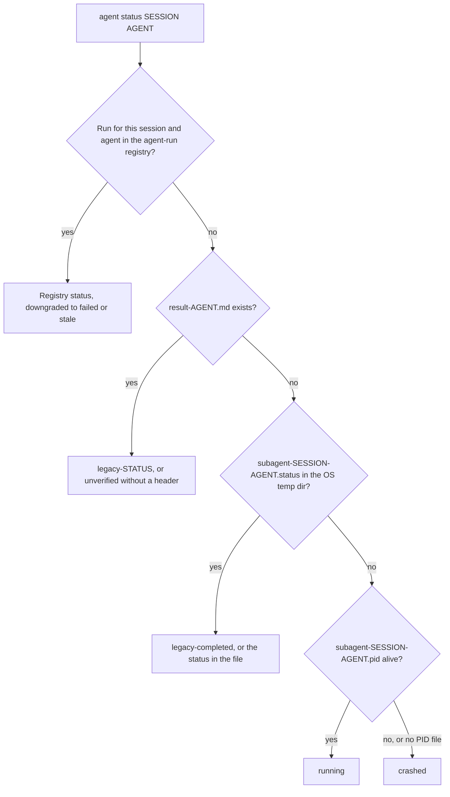

# CLIオプション {#cli-options}

## クイックリファレンス {#quick-reference}

| やりたいこと | 使うもの |
|:-------------|:----|
| プロンプトなしで実行する | `-y` / `--yes`（`OMA_YES=1`、`CI=true` も有効）。プレーンな非対話出力には `oma update --ci` |
| JSON を取得する | `--json`、`--output json`、または `OH_MY_AG_OUTPUT_FORMAT=json`。例外は [出力オプション](#output-options) を参照 |
| グローバルインストールを対象にする | `-g` / `--global`、または `OMA_INSTALL_GLOBAL=1`。`OMA_HOME` でグローバル保存ルートを移動 |
| 変更前にプレビューする | コマンドが対応している場合は `--dry-run`。[JSON出力に対応するコマンド](#commands-supporting-json-output) を参照 |
| コマンドのフラグを確認する | `oma <command> --help`、`oma describe "<command>"`、またはページ末尾の [レジストリ](#complete-public-option-registry) |
| アップグレード後に動かなくなったスクリプトを直す | [名称変更されたコマンドとオプション](#renamed-commands-and-options) |
| スクリプトで失敗時に分岐する | [終了コード](#exit-codes) |

---

## グローバルオプション {#global-options}

ルートの `oma` / `oh-my-agent` コマンドで使用できるオプションです。

| フラグ | 説明 |
|:-----|:-----------|
| `-g, --global` | `<cwd>/.agents/` ではなく OMA のグローバルインストール（`~/.oma/.agents/`、または `$OMA_HOME/.agents/`）を操作します。 |
| `-y, --yes` | 選択したコマンドが確認をサポートする場合にプロンプトを省略します。コマンド固有の安全確認は適用されます。`OMA_YES=1` と `CI=true` も同様に扱います。 |
| `-V, --version` | バージョン番号を出力して終了します。 |
| `-h, --help` | コマンドのヘルプを表示します。 |

すべてのサブコマンドも `-h, --help` に対応し、それぞれのヘルプを表示します。

`--global` はプロセス全体のインストールルートを設定するため、`install`、`update`、`link`、`uninstall` は実行場所にかかわらずグローバルインストールを解決します。

| モード | 選択方法 | `.agents/` の場所 |
|:-----|:-----------------|:--------------------|
| プロジェクト（デフォルト） | 指定なし | `<cwd>/.agents/` |
| グローバル | `--global` または `OMA_INSTALL_GLOBAL=1` | `$OMA_HOME/.agents/`（デフォルトは `~/.oma/.agents/`） |

`OMA_HOME=<abs-path>` はグローバル保存ルートを変更します。絶対パスで指定する必要があります。プロジェクトインストールは引き続き cwd を使います。解決された場所は `oma home --json` で表示でき、旧データの移行は `oma home migrate --dry-run` でプレビューできます。詳しくは [グローバルインストール](../guide/global-install.md) を参照してください。

---

## 名称変更されたコマンドとオプション {#renamed-commands-and-options}

コマンドパスはコロンではなくスペースで区切ります。また、いくつかのコマンドとオプションの名称が変更されました。旧表記はエイリアスとして扱われず、拒否されます。

- 旧コマンドは `Unknown command: ... Use oma --help.` または `Unexpected argument for oma <group>. Use oma <replacement>.` で失敗します。
- グループ名だけの `dashboard`、`state`、`stats` は、実行されずにそのグループのヘルプを表示するようになりました。
- 旧オプションは `Removed option <old>. Use <new>.` で失敗します。削除された `state` と `stats` のアクションフラグは `Removed option <old>. Use an explicit action; see oma --help.` で失敗します。

旧バージョンが書き込んだ OS スケジューラーのエントリーが動き続けるよう、`schedule:run` と `serena daemon:gc` だけは引き続き解決されます。

| 旧コマンド | 現在の表記 |
|:------------|:--------|
| コロン区切りの `a:b` パス全般（`agent:spawn`、`state:emit` など） | スペース区切りのパス（`agent spawn`、`state emit`） |
| `dashboard`、`dashboard:web` | `dashboard terminal`、`dashboard web` |
| `hook --vendor ...` | `hook run --vendor ...` |
| `intel run` | `intel suggest` |
| `state`、`state:get <id>` | `state list`、`state get <id>` |
| `state --activate` / `--archive` / `--purge` | `state activate` / `state archive` / `state purge` |
| `state:required-decisions` | `state decisions list` |
| `state:inject-log ... --entry <file>` | `state inject-log list`、`state inject-log get <session-id> <file>` |
| `stats`、`stats --reset` | `stats get`、`stats reset` |
| `memory:retry-drain` | `memory retry drain` |
| `vault rm` | `vault delete` |
| `search api <url>`、`search rss <url>` | `search api fetch <url>`、`search rss fetch <url>` |
| `search api:search`、`search rss:google` | `search api search`、`search rss google` |
| `skills audit` / `lint` / `eval` / `promotions` / `rollback` / `procedure` / `meta-optimize` / `evolution-stats` / `matrix` | `skill ...`（単数形） |
| `skills opt` | `skill optimize` |
| `slide new`、`slide viewer` | `slide create`、`slide preview` |
| `slide pdf` / `png` / `pptx` | `slide export pdf` / `png` / `pptx` |
| `slide import-pptx`、`slide fetch-video`、`slide styles ...` | `slide import pptx`、`slide asset fetch-video`、`slide style ...` |
| `image list-vendors`、`video list-providers` | `image vendor list`、`video provider list` |
| `schedule:add`、`schedule:remove` | `schedule create`、`schedule delete` |
| `verify <agent-type>` | `verify agent <agent-type>` |

| 旧オプション | 現在の表記 |
|:-----------|:--------|
| `-m, --model <vendor>` | `--vendor <vendor>` |
| `-r, --root <path>` | `--project-root <path>` |
| `--sid`、`--session` | `--session-id <id>` |
| `--format <fmt>` | `--output <format>`（`search media --format` は変更なし） |
| `--out <dir>`、`--out-dir` | `--output-dir <path>` |
| `--out <file>`、`--out-file` | `--output-file <path>`。`slide validate` と `explain validate` では `--report-file <path>` |
| `--dir` | `slide` コマンドでは `--workspace <path>`、`slide create` では `--output-dir <path>`、`explain validate` では `--input-dir <path>` |
| `--max` | `scholar search` では `--limit <n>` |
| `--allow-external-out` | `--allow-external-output` |
| `--timeout <seconds>`、`--timeout <ms>`、`--timeout-minutes` | `--timeout <duration>`（`30s`、`2m`）。旧値がミリ秒または分だった箇所では単位の指定が必須です |
| `--max-age-days` | `--max-age <duration>`。`schedule create` では `--expires-after <duration>` |

---

## 出力オプション {#output-options}

多くのコマンドは CI/CD パイプラインや自動化向けの機械可読出力に対応しています。JSON 出力を求める方法は 3 つあります。

### 1. --json フラグ {#1---json-flag}

```bash
oma stats get --json
oma doctor --json
oma cleanup --json
```

`--json` は、それを記載しているパスでだけ利用できます。コマンドファミリー全体が対応すると推測しないでください。たとえば `image`、`video`、`slide` のリーフはレジストリに記載された場合に `--output` を公開し、`search` は常に JSON を出力します。

### 2. --output フラグ {#2---output-flag}

```bash
oma stats get --output json
oma doctor --output text
```

ほとんどのコマンドで `--output` は `text` または `json` を受け付けます。`--json` と同じ機能を持ちますが、テキスト出力も明示的に指定できるため、環境変数が `json` に設定されているときに便利です。

**検証:** 無効な形式を指定すると、CLI は `Invalid output format: {value}. Expected one of text, json` を返します。

### 3. OH_MY_AG_OUTPUT_FORMAT 環境変数 {#3-oh_my_ag_output_format-environment-variable}

```bash
export OH_MY_AG_OUTPUT_FORMAT=json
oma stats get # outputs JSON
oma doctor # outputs JSON
oma retro # outputs JSON
```

この環境変数を `json` に設定すると、対応するコマンドで JSON がデフォルトの出力になります。認識される値は `json` だけで、それ以外の値は無視され、出力はテキストのままです。

### 形式の決まり方 {#how-the-format-is-chosen}

コマンドラインのフラグは環境変数より優先されます。`--json` と JSON 以外の `--output` を同時に渡すと、優先順位で解決されるのではなくエラーになります。

| 渡すもの | 変数が未設定 | `OH_MY_AG_OUTPUT_FORMAT=json` |
|:---------|:---------------|:------------------------------|
| なし | テキスト | JSON |
| `--json` または `--output json` | JSON | JSON |
| `--output text` | テキスト | テキスト |
| `--json --output text` | エラー: `--json conflicts with --output. Choose one output format.` | 同じエラー |

独自の形式値を使うコマンドもあります。

| コマンド | 形式の制御 |
|:---------|:---------------|
| `search ...` | 常に JSON。`--pretty` はインデントだけを変えます。`search providers` と `search web` は `--json` も受け付けます |
| `describe` | 常に JSON |
| `image ...`、`video ...` | `--output text\|json`（デフォルト `text`） |
| `slide validate` | `--output json\|concise`（デフォルト `concise`） |
| `explain validate` | `--output concise\|json`（デフォルト `concise`）または `--json` |
| `hook probe` | `--output text\|md\|json` |

### JSON出力に対応するコマンド {#commands-supporting-json-output}

`--json` または `--output` を受け付けるすべてのコマンドは、`oma describe` で `supportsJsonOutput: true` を報告します。ページ末尾の [レジストリ](#complete-public-option-registry) には、パスごとのフラグが記載されています。フラグなしで常に JSON を出力するコマンド（`describe` とほとんどの `search` サブコマンド）には印が付きません。CLI からパスを一覧表示するには次を実行します。

```bash
oma describe | jq -r '.. | objects | select(.supportsJsonOutput? == true) | .path'
```

`--dry-run` を持つコマンドを探すには、同じように `select(.supportsDryRun? == true)` を使います。

---

## コマンドごとのオプション {#per-command-options}

### install {#install}

```text
oma install [--web-search <provider>] [--code-intelligence <provider>] [--semantic-memory <provider>] [--honcho-url <url>] [--honcho-workspace <id>]
```

対話式インストーラーは選択したプロバイダー設定を `.agents/oma-config.yaml` に書き込みます。`.agents/oma-config.cue` がある場合はそちらが優先されるため、CUE 設定にまだ含まれていない選択は gitignore 対象のローカルオーバーレイ `.agents/oma-config.local.yaml` に書き込まれます。ブラウザー DevTools の選択と `oma memory keys` の vault 参照も同じ規則に従い、CLI ベンダーの選択と `oma model propose --write` は `oma-config.yaml` がない場合に同じ規則に従います。プロバイダーフラグで web-search、code-intelligence、semantic-memory の連携先を選び、そのプロバイダーを選択した場合は `--honcho-url` と `--honcho-workspace` で Honcho メモリサービスを設定します。インストール中に確認を求められた場合はルートの `-y, --yes` フラグが適用されます。

### doctor {#doctor}

```text
oma doctor [--json] [--output <format>] [--profile] [--heal-check <agentType>]
```

| フラグ | 説明 | デフォルト |
|:-----|:-----------|:--------|
| `--json` | 整形テキストではなく JSON を出力します。 | `false` |
| `--output <format>` | 出力形式を明示します（`text` または `json`）。[出力オプション](#output-options) を参照してください。 | `text` |
| `--profile` | 有効な `model_preset` と `agents:` の上書きから解決したモデルスラッグ、CLI、エージェントごとの認証状態をプロファイルのヘルスマトリクスで表示します。[エージェント別モデル](../guide/per-agent-models.md) を参照してください。 | `false` |
| `--heal-check <agentType>` | エージェントの自己修復ゲートのチェックを含めます。 | |

`--json` を付けると、レポートの最上位に `ok` と `issues` フィールドが含まれ、`issues` が 0 より大きい場合 `doctor` は `1` で終了します。

### update {#update}

```text
oma update [-f | --force] [--with-new-skills] [--ci] [-y | --yes] [--all] [--vendor <vendors>]
oma update mcp [-y | --yes] [--ci] [--all] [--vendor <vendors>]
```

| フラグ | 短縮形 | 説明 | デフォルト |
|:-----|:------|:-----------|:--------|
| `--force` | `-f` | 更新中にユーザーが変更した設定ファイルを上書きします。対象は `oma-config.yaml`、`mcp.json`、`stack/` ディレクトリです。このフラグを付けない場合、更新前にバックアップし、完了後に復元します。 | `false` |
| `--with-new-skills` | | 現在のインストール以降にレジストリへ追加されたスキルをインストールします。 | `false` |
| `--ci` | | 非対話式 CI モードで実行します。確認プロンプトをすべて省略し、スピナーやアニメーションの代わりに通常のコンソール出力を使います。stdin を利用できない CI/CD パイプラインで必要です。 | `false` |
| `--yes` | `-y` | プロンプトを省略します。`--all` または `--vendor` と組み合わせない限り、不足しているベンダーディレクトリは作成しません。 | `false` |
| `--all` | | 対応するプロジェクト対象ベンダーをすべて作成または更新します。 | `false` |
| `--vendor <vendors>` | | `claude,qwen` のようなカンマ区切りのベンダー一覧を作成または更新します。 | 既存のベンダーディレクトリのみ |

`oma update mcp` はブラウザー MCP サーバーを選択するときも同じ `--yes`、`--ci`、`--all`、`--vendor` 制御を使います。`--force` と `--with-new-skills` は使いません。

**--force の動作:**
- `oma-config.yaml` はレジストリのデフォルト値に置き換わります。
- `mcp.json` はレジストリのデフォルト値に置き換わります。
- Backend の `stack/` ディレクトリ（言語固有のリソース）は置き換わります。
- このフラグにかかわらず、その他のファイルは常に更新されます。

**--ci の動作:**
- 開始時に `console.clear()` を呼びません。
- `@clack/prompts` は通常の `console.log` に置き換わります。
- 競合ツールの検出プロンプトを省略します。
- `process.exit(1)` を呼ばず、エラーを送出します。

**ベンダーの対象範囲:**
- `oma update` はすでに存在するベンダーディレクトリだけを更新します。
- `oma update --yes` はプロンプトを出さず、同じベンダー範囲を使います。
- `oma update --all` は対応するプロジェクト対象ベンダーをすべて作成または更新します。
- `oma update --vendor claude,qwen` は指定したベンダーだけを作成または更新します。

### stats {#stats}

```text
oma stats get [--json | --output <format>]
oma stats reset [--json | --output <format>]
```

| フラグ | 説明 | デフォルト |
|:-----|:-----------|:--------|
| `--json` | JSON で出力します。`stats get` はメトリクスオブジェクトを、`stats reset` は `{"reset":true}` を出力します。 | `false` |
| `--output <format>` | `text` または `json` で出力します。 | `text` |

`oma stats reset` がリセット用コマンドです。`oma stats get --reset` は `Removed option --reset` で失敗します。

:::note
`stats get` は読み取り専用ではありません。呼び出すたびに 1 セッションとして数えられ、直近 10 コミットの差分が `.agents/state/metrics.json` の累積ファイル数・行数カウンターに加算されるため、ポーリングしないでください。
:::

### retro {#retro}

```text
oma retro [window] [--json] [--output <format>] [--interactive] [--compare]
```

| フラグ | 説明 | デフォルト |
|:-----|:-----------|:--------|
| `--interactive` | 旧来のガイド付き入力です。達成したこと、主な学び、次のステップを尋ねます。window、`--compare`、`--json` は無視されます。 | `false` |
| `--compare` | 現在の期間を同じ長さの直前の期間と比較し、差分メトリクス（コミット +12、追加行 -340 など）を表示します。 | `false` |

**window 引数の形式:** 数値の後に `h`、`d`、`w` のいずれかを付けます。
- `24h`: 24 時間
- `7d`: 7 日間
- `2w`: 2 週間
- 省略時はデフォルトの 7 日間です。

月単位には対応していません。`oma retro 1m` は `Invalid window: 1m. Use: 24h, 7d, 14d, 30d, 2w` で失敗します。

### cleanup {#cleanup}

```text
oma cleanup [--dry-run] [-y | --yes] [--json] [--output <format>]
```

| フラグ | 短縮形 | 説明 | デフォルト |
|:-----|:------|:-----------|:--------|
| `--dry-run` | | プレビューモードです。クリーンアップ対象をすべて一覧表示しますが、変更は行いません。検出結果にかかわらず終了コードは 0 です。 | `false` |
| `--yes` | `-y` | すべての確認プロンプトを省略し、確認なしで全件をクリーンアップします。スクリプトや CI に便利です。 | `false` |

**クリーンアップ対象:**
1. 孤立した PID ファイル: 参照先のプロセスが動いていない `/tmp/subagent-*.pid`。
2. 孤立したログファイル: 終了した PID に対応する `/tmp/subagent-*.log`。
3. Gemini Antigravity のディレクトリ: `.gemini/antigravity/brain/`、`.gemini/antigravity/implicit/`、`.gemini/antigravity/knowledge/`。時間とともに状態が蓄積し、大きくなる可能性があります。

### agent spawn {#agent-spawn}

```text
oma agent spawn <agent-id> <prompt> <session-id> [options]
```

| フラグ | 短縮形 | 説明 | デフォルト |
|:-----|:------|:-----------|:--------|
| `--resumed-from` | — | 直前の実行 ID に再試行をリンクします。 | |
| `--fallback-vendors` | — | 順序付きでカンマ区切りの、明示的なフォールバックベンダーチェーンです。 | |
| `--task-id` | — | セッション計画にあるタスク ID です。 | エージェント ID |
| `--vendor` | — | CLI ベンダーの上書きです。`--help` には `antigravity`、`claude`、`codex`、`cursor`、`opencode`、`qwen`、`grok`、`pi` が表示されます。 | 設定から解決 |
| `--workspace` | `-w` | エージェントの作業ディレクトリです。省略または `.` の場合、CLI はモノレポ設定ファイル（pnpm-workspace.yaml、package.json、lerna.json、nx.json、turbo.json、mise.toml）からワークスペースを自動検出します。 | 自動検出または `.` |
| `--isolation` | — | 分離モードです。`worktree` は起動ごとに Git worktree を作成し、デフォルト値は `none` です。 | `none` |
| `--read-only` | — | 起動したエージェントを非破壊ツールに制限し、自動承認フラグを抑止します。 | `false` |

**検証:**
- `agent-id` と `session-id` に `..`、`?`、`#`、`%`、制御文字を含めることはできません。`agent spawn` にはエージェント ID の固定リストはありません。モデルとベンダーのルーティングは `orchestrator`、`architecture`、`qa`、`pm`、`backend`、`frontend`、`mobile`、`db`、`debug`、`refactor`、`docs`、`tf-infra`、`explore` に加え、`backend-engineer`、`qa-reviewer`、`research-explorer` などのエイリアスを認識します。
- `--vendor` は oma のベンダー ID（`antigravity`、`claude`、`codex`、`commandcode`、`copilot`、`cursor`、`grok`、`hermes`、`kimi`、`kiro`、`opencode`、`pi`、`qwen`、`zcode`）のいずれかである必要があります。下の表は `--help` に表示される 8 つのベンダーを扱います。

**ベンダー固有の動作:**

| ベンダー | コマンド | 自動承認フラグ | プロンプトフラグ |
|:-------|:--------|:-----------------|:-----------|
| antigravity | `agy` | `--dangerously-skip-permissions` | `-p` |
| claude | `claude` | なし | `-p` |
| codex | `codex` | `--sandbox workspace-write` | なし（プロンプトは位置引数） |
| cursor | `cursor-agent` | ベンダー固有 | `-p` |
| opencode | `opencode` | ベンダー固有 | `-p` |
| qwen | `qwen` | `--yolo` | `-p` |
| grok | `grok` | ベンダー固有 | `-p` |
| pi | `pi` | `--read-only` モードでは抑止 | プロンプトは位置引数 |

これらのデフォルト値は `.agents/skills/oma-orchestration/config/cli-config.yaml` で上書きできます。

Codex は workspace-write サンドボックスを維持します。oma はネットワークアクセスを有効にし、プロジェクトルート、OMA の状態保存ディレクトリ（`~/.oma`）、既存のパッケージマネージャーのキャッシュを書き込み可能なディレクトリとして追加します。`oma update` は `cli-config.yaml` を置き換えるため、継続して使うモードは `OMA_CODEX_SANDBOX` で設定します。値は `read-only`、`workspace-write`（デフォルト）、`danger-full-access`（サンドボックスも承認もなし）です。

### agent status {#agent-status}

```text
oma agent status <session-id> [agent-ids...] [--project-root <path>]
```

| フラグ | 説明 | デフォルト |
|:-----|:-----------|:--------|
| `--project-root <path>` | エージェント実行レジストリと `.agents/state/memories/result-{agent}.md` ファイルを読み込むプロジェクトです。`-r` と `--root` は削除され、`Removed option -r. Use --project-root.` で失敗します。 | カレントディレクトリ |

このコマンドは、指定したエージェントごとに `{agent-id}:{status}` 行を 1 行ずつ出力します。各エージェントについて、最初に存在するソースを使います。



| ステータス | 意味 |
|:-------|:--------|
| `running`、`completed`、`partial`、`blocked`、`failed` | エージェント実行レジストリに記録されたステータス |
| `failed` | 登録済みの実行が `running` なのに、そのランナープロセスが存在しない場合にも報告されます |
| `stale` | 登録済みの実行は `completed` だが、その結果の証拠がもう検証を通らない |
| `legacy-<status>` | 登録済みの実行がなく、`result-{agent}.md` に `## Status: <status>` ヘッダーがある |
| `unverified` | 登録済みの実行がなく、`result-{agent}.md` にステータスヘッダーがない |
| `legacy-completed` | 実行も結果ファイルもなく、セッションの `.status` ファイルが `completed` を示している（それ以外の値はそのまま出力されます） |
| `crashed` | 何も見つからない、または旧来の PID ファイルが終了済みのプロセスを指している |

実行の記録方法は [エージェントの結果と再開](../guide/agent-results-and-resume.md) を参照してください。

### agent parallel {#agent-parallel}

```text
oma agent parallel [tasks...] [--session-id <id>] [--vendor <vendor>] [-i | --inline] [--no-wait]
```

| フラグ | 短縮形 | 説明 | デフォルト |
|:-----|:------|:-----------|:--------|
| `--session-id <id>` | — | 起動するすべての実行に使うセッション ID です。同じ ID を `oma agent status` に渡します。 | 実行ディレクトリ名（`parallel-<timestamp>-<suffix>`） |
| `--vendor` | — | すべての起動エージェントに適用する CLI ベンダーの上書きです。 | エージェント設定から解決 |
| `--inline` | `-i` | ファイルパスではなく、`agent:task[:workspace]` 形式のタスク引数として解釈します。 | `false` |
| `--no-wait` | | バックグラウンドモードです。全エージェントを起動して完了を待たずに戻ります。PID 一覧とログを `.agents/results/parallel-<timestamp>-<suffix>/` に保存します。 | `false`（完了まで待機） |

**インラインタスク形式:** `agent:task` または `agent:task:workspace`
- 最後のコロン区切り要素が `./`、`/` で始まるか `.` と等しいかを確認してワークスペースを検出します。
- 例: `backend:Implement auth API:./api` は agent=backend、task="Implement auth API"、workspace=./api です。
- 例: `frontend:Build login page` は agent=frontend、task="Build login page"、workspace=自動検出です。

**YAML タスクファイルの形式:**

```yaml
tasks:
  - id: api            # optional; default <agent>-<index>
    agent: backend
    task: "Implement user API"
    workspace: ./api   # optional; auto-detected when omitted
  - agent: frontend
    task: "Build user dashboard"
```

### recap {#recap}

```text
oma recap [--window <period>] [--date <date>] [--tool <tools>] [--top <n>] [--sort <metric>] [--mermaid] [--graph] [--json] [--output <format>]
```

| フラグ | 説明 | デフォルト |
|:-----|:-----------|:--------|
| `--window <period>` | `<n>h`、`<n>d`、`<n>w` 形式の期間（例: `1d`、`3d`、`7d`、`2w`、`30d`）。30 日を超える値は警告付きで 30 日に制限されます。`--date` を指定した場合は無視されます。 | `1d` |
| `--date <date>` | 指定日（`YYYY-MM-DD`）。`--window` より優先されます。 | |
| `--tool <tools>` | ツールでセッションを絞り込みます。カンマ区切り: `antigravity`、`claude`、`codex`、`cursor`、`gemini`、`grok`、`qwen`。 | すべてのツール |
| `--top <n>` | 概要に表示するプロジェクトまたはトピックを上位 N 件に限定します。 | 上限なし |
| `--sort <metric>` | セッションを `count` または `duration` で並べ替えます。 | `count` |
| `--mermaid` | デフォルトの概要ではなく Mermaid のガントチャートを出力します。`--json` が優先されます。 | `false` |
| `--graph` | Web ダッシュボード（`/recap`）でインタラクティブなグラフを開きます。`--mermaid` と `--json` より優先されます。 | `false` |

### search {#search}

```text
oma search <subcommand> [...]
```

`search` のすべてのサブコマンドは、フラグなしで JSON を stdout に書き出します。`providers` と `web` は `--json` も受け付けます。`--output` を受け付けるサブコマンドはありません。`--pretty` はインデントだけを変えます。

| サブコマンド | 主なオプション |
|:-----------|:---------------|
| `providers` | `--json`、`--pretty` |
| `web <query>` | `--provider <id>`、`--limit <n>`（デフォルト `10`）、`--timeout <duration>`（デフォルト `15s`）、`--json`、`--pretty` |
| `fetch <url>` | `--only`、`--skip`、`--include-archive`、`--timeout <duration>`（デフォルト `15s`）、`--locale`、`--pretty` |
| `meta <url>` / `archive <url>` / `api fetch <url>` / `rss fetch <url>` | `--timeout <duration>`（デフォルト `15s`）、`--locale`（デフォルト `en-US,en;q=0.9`）、`--pretty` |
| `api search <query>` | `--platforms <list>`、`--timeout <duration>`、`--locale`、`--pretty` |
| `rss google <query>` | `--locale`（デフォルト `en-US`） |
| `media <url>` | `--subs`、`--sub-lang <list>`（デフォルト `en`）、`--format <spec>`、`--timeout <duration>`（デフォルト `30s`）、`--pretty` |
| `code <query>` | `--host <github\|gitlab>`（デフォルト `github`）、`--language`、`--repo`、`--limit`（デフォルト `20`）、`--pretty` |
| `trust <domain>` | `--pretty` |
| `doctor` | なし（Chrome / `python3 curl_cffi` / `yt-dlp` / `gh` のバイナリを確認） |

`search` は共通の終了コード体系を使います。[終了コード](#exit-codes) を参照してください。

### image {#image}

```text
oma image <subcommand> [...]
```

出力形式はサブコマンドごとに `--output <text|json>` で制御します。

`image generate` のオプション:

| フラグ | 短縮形 | 説明 | デフォルト |
|:-----|:------|:-----------|:--------|
| `--vendor <name>` | | `auto` \| `pollinations` \| `codex` \| `antigravity` \| `all`。`auto` は有効な `image:` 設定と利用可能な認証から解決します。 | `auto` |
| `--size <size>` | | 両辺が 16 の倍数で 16〜3840、アスペクト比が 1:3〜3:1 の `WxH`、または `auto`。 | ベンダーのデフォルト |
| `--quality <level>` | | `low` \| `medium` \| `high` \| `auto`。 | ベンダーのデフォルト |
| `--count <n>` | `-n` | 画像数（1〜5）。 | `1` |
| `--output-dir <dir>` | | 出力ディレクトリ。`--allow-external-output` を付けない限り `$PWD` 内である必要があります。 | `.agents/results/images/{timestamp}/` |
| `--allow-external-output` | | `$PWD` 外の `--output-dir` を許可します。 | `false` |
| `--model <name>` | | ベンダー固有のモデル上書き。antigravity のモデルは `agy` が選びます。 | ベンダーのデフォルト |
| `--timeout <duration>` | | 画像ごとのタイムアウト（期間値）。 | ベンダーのデフォルト |
| `--reference <path>` | `-r` | スタイルまたは被写体を移す参照画像。繰り返し（`-r a.png -r b.png`）またはカンマ区切りで指定できます。サイズ（≤5MB）、形式（マジックバイトで PNG/JPEG/GIF/WebP を検証）、数（≤10）を確認します。`codex` と `antigravity` が対応し、`pollinations` では終了コード 4 で拒否されます。 | |
| `--yes` | `-y` | コスト確認プロンプトを省略します。 | `false` |
| `--no-prompt-in-manifest` | | `manifest.json` にプロンプト本文を保存せず、SHA256 を保存します。 | `false` |
| `--dry-run` | | 計画とコスト見積もりを表示し、実行しません。 | `false` |
| `--output <format>` | | `text` \| `json`。 | `text` |

`image doctor` と `image vendor list` は `--output <text|json>` を受け付けます。ベンダーの確認には `image vendor list` を使います。旧来の `image list-vendors` 表記は失敗します。

### video {#video}

```text
oma video generate <brief...> [options]
oma video doctor [--output <format>] [--install|--upgrade|--install-mpt|--install-strudel]
oma video compose <run-dir> [--output <format>] [--refresh] [--offline]
oma video render <run-dir> [--output <format>]
oma video provider list [--output <format>]
```

`video generate` は計画およびキャプチャ制御の `--mode`、`--aspect`、`--locale`、`--captions`、`--visual`、`--voice`、`--music`、`--duration`、`--compositor`、`--capture`、`--source`、`--url`、`--device`、`--ready-selector`、`--show-cursor`、`--polish`、`--capture-timeout`、`--capture-stop` を受け付けます。さらに `--output-dir`、`--allow-external-output`、`--max-usd`、`--seed`、`--timeout`、`--script`、`--dry-run`、`--yes`、`--output`、`--no-brief-in-manifest` も使えます。ブラウザーキャプチャには `--source web --url <url>` を使い、デフォルトのソースは `file` です。通常のレンダーには作成済みの composition と動作する compositor が必要です。プレースホルダーは `OMA_VIDEO_MOCK=1` のテスト経路に限られます。

`video doctor` は HyperFrames/MPT/Strudel ツールチェーンを確認または準備します。`compose` は実行用 composition の契約を準備し、`render` は lint、レンダー、出力検査を行います。`provider list` はプロバイダーとキーの状態を報告します。実行マニフェストと復旧手順は [動画生成](../guide/video-generation.md) を参照してください。

### memory init {#memory-init}

```text
oma memory init [--json] [--output <format>] [--force]
```

| フラグ | 説明 | デフォルト |
|:-----|:-----------|:--------|
| `--force` | `.agents/state/memories/` 内の空または既存のスキーマファイルを上書きします。このフラグがなければ既存ファイルには触れません。 | `false` |

### verify {#verify}

```text
oma verify agent <agent-type> [-w <workspace>] [--session-id <id>] [--task-id <id>] [--run-id <id>] [--json] [--output <format>]
oma verify triggers [--corpus <path>] [--max-false-fire <pct>] [--max-missed-fire <pct>] [--json] [--output <format>]
```

| フラグ | 短縮形 | 説明 | デフォルト |
|:-----|:------|:-----------|:--------|
| `--workspace` | `-w` | 検証対象のワークスペースディレクトリです。 | カレントディレクトリ |
| `--session-id <id>` | | セッション計画とレポートを選択します。複数の計画がある場合は、実行レシートでセッションが特定できない限り必須です。 | |
| `--task-id <id>` | | 1 つのタスクのスコープとレポートを選択します。`--session-id` または `--run-id` が必要です。 | |
| `--run-id <id>` | | 特定の実行レポートを選択します。セッションとタスクはローカルのレシートから推定します。レシートがない場合は両方の ID を明示してください。 | |

**エージェント種別:** `backend`、`frontend`、`mobile`、`qa`、`debug`、`pm`。

`verify triggers` はラベル付きコーパスに対するキーワード検出精度を測定します。割合のしきい値がゲートになります。CI ジョブで個々の検出結果を確認する場合は JSON 出力を使います。旧来の `oma verify <agent-type>` 表記は失敗します。`verify agent <agent-type>` を使ってください。

---

## 終了コード {#exit-codes}

**共通体系（`image`、`video`、`search`）:**

| コード | 意味 |
|:-----|:--------|
| `0` | 成功 |
| `1` | 一般的なエラー |
| `2` | ブロック、またはプロバイダーの安全上の拒否 |
| `3` | 見つからない |
| `4` | 入力が不正 |
| `5` | 認証が必要、またはプロバイダーのバイナリが未インストール |
| `6` | タイムアウト |

**コマンド固有:**

| コマンド | コード |
|:--------|:------|
| `doctor --json` | `0` 問題なし、`1` 1 件以上の問題あり |
| `verify agent` | `0` すべてのチェックに合格、`1` チェックの失敗またはエージェント種別が無効、`2` ワークスペースが見つからない |
| `verify triggers` | `0` しきい値内、`1` しきい値を超過 |
| `docs verify` | `1` 壊れた参照を検出 |
| `vault get` | `1` キー名が無効、`2` 該当するエントリーがない |

---

## 実践例 {#practical-examples}

### CIパイプライン: 更新と検証 {#ci-pipeline-update-and-verify}

```bash
# Update in CI mode, then fail the job when doctor reports any issue
oma update --ci
oma doctor --json | jq -e '.ok' > /dev/null
```

### エージェントのバッチ実行とステータス監視 {#batch-agent-execution-with-status-monitoring}

```bash
# Choose the session ID first and pass it to both commands
SESSION_ID="session-$(date +%Y%m%d-%H%M%S)"
oma agent parallel tasks.yaml --session-id "$SESSION_ID" --no-wait

# Check status every 5 seconds
watch -n 5 "oma agent status $SESSION_ID backend frontend mobile"
# Without `watch` (stock macOS), loop instead:
# while sleep 5; do oma agent status "$SESSION_ID" backend frontend mobile; done
```

### テスト後のCIクリーンアップ {#cleanup-in-ci-after-tests}

```bash
# Clean up all orphaned processes without prompts
oma cleanup --yes --json
```

### ワークスペースを指定した検証 {#workspace-aware-verification}

```bash
# Verify each domain in its workspace
oma verify agent backend -w ./apps/api
oma verify agent frontend -w ./apps/web
oma verify agent mobile -w ./apps/mobile
```

### スプリントレビュー向け振り返り比較 {#retro-with-comparison-for-sprint-reviews}

```bash
# Two-week sprint retro with comparison to previous sprint
oma retro 2w --compare
```

### 完全なヘルスチェック用スクリプト {#full-health-check-script}

```bash
#!/usr/bin/env bash
set -euo pipefail

echo "=== oh-my-agent Health Check ==="

report="$(mktemp)"
# doctor exits 1 when it finds issues; keep the report and continue
oma doctor --json > "$report" || true

# Check CLI installations
jq -r '.clis[] | "\(.name): \(if .installed then "OK (\(.version // "unknown"))" else "MISSING" end)"' "$report"
jq -r '"Issues: \(.issues)"' "$report"

# Check auth status (an object of booleans keyed by github and each vendor ID)
oma auth status --json | jq -r 'to_entries[] | "\(.key): \(if .value then "authenticated" else "not authenticated" end)"'

echo "=== Done ==="
```

### エージェントのイントロスペクション用describe {#describe-for-agent-introspection}

```bash
# An AI agent can discover available commands
oma describe | jq '.command.subcommands[] | {name, description}'

# Get details about a specific command
oma describe "agent spawn" | jq '.command.options[] | {flags, description}'
```

---

## 公開オプションレジストリ全体 {#complete-public-option-registry}

各行は単独で実行できるコマンドパスです。ヘルプを表示するだけのグループは省略し、共通のルートフラグは [グローバルオプション](#global-options) で説明しています。デフォルト値は各オプションの横に記載しています。1 つのパスの完全な JSON は `oma describe "<path>"` で確認してください。

:::note
この表は `oma describe` から生成されています。手作業で編集しないでください。再生成するには `node cli/scripts/generate-cli-reference.mjs` を実行し、古くなっている場合に失敗させるには `--check` を付けます。
:::

<!-- oma:generated cli-registry:start -->

| Command | Arguments | Options | Description |
|:--|:--|:--|:--|
| `agent begin` | `<agent-id> <task-id> <session-id>` | `--timeout-seconds <seconds>`, `--deadline <timestamp>`, `--project-root <path>`, `-w, --workspace <path>` | Start an evidence-backed native agent run |
| `agent context` | `<agent-id>` | `--project-root <path>`, `--difficulty <level>` (default: `Medium`) | Load graph-selected context for a native dispatch prompt |
| `agent finish` | `<run-id> <result-file>` | `--project-root <path>` | Validate a native agent result against its verification receipts |
| `agent parallel` | `[tasks...]` | `--timeout-seconds <seconds>`, `--deadline <timestamp>`, `--session-id <id>`, `--vendor <vendor>`, `-i, --inline`, `--no-wait` | Run multiple sub-agents in parallel |
| `agent resume` | `<session-id>` | `--timeout-seconds <seconds>`, `--deadline <timestamp>`, `--project-root <path>`, `--dry-run`, `--max-attempts <count>` (default: `3`) | Resume safe incomplete tasks, reusing current acceptance evidence |
| `agent review` | — | `--session-id <id>`, `--timeout-seconds <seconds>`, `--deadline <timestamp>`, `--vendor <vendor>`, `-p, --prompt <prompt>`, `-w, --workspace <path>`, `--no-uncommitted` | Run code review using external CLI (codex/claude/qwen/grok) |
| `agent spawn` | `<agent-id> <prompt> <session-id>` | `--resumed-from <run-id>`, `--timeout-seconds <seconds>`, `--deadline <timestamp>`, `--fallback-vendors <vendors>`, `--task-id <id>`, `--vendor <vendor>`, `-w, --workspace <path>`, `--isolation <mode>`, `--read-only` | Spawn a subagent (prompt can be inline text or a file path) |
| `agent status` | `<session-id> [agent-ids...]` | `--project-root <path>` (default: current directory) | Check status of subagents |
| `agent verify` | `<run-id> [command...]` | `--timeout-seconds <seconds>`, `--deadline <timestamp>`, `--project-root <path>`, `--required`, `--affected <paths...>` | Execute verification argv after -- and record its real exit code |
| `auth status` | — | `--json`, `--output <format>` | Check authentication status of all supported CLIs |
| `bridge` | `[url]` | `--context <name>` (default: `ide`), `--oma-home <path>`, `--oma-state-home <path>` | Proxy MCP stdio to a shared per-project Serena server (started on demand) |
| `cleanup` | — | `--dry-run`, `-y, --yes`, `--json`, `--output <format>` | Clean up orphaned subagent processes and temp files |
| `dashboard terminal` | — | `--project-root <path>` | Start terminal dashboard (real-time agent monitoring) |
| `dashboard web` | — | `--project-root <path>` | Start web dashboard on http://127.0.0.1:9847 |
| `describe` | `[command-path]` | — | Describe CLI commands as JSON for runtime introspection |
| `diagram archify` | `[args...]` | — | Run the installed archify CLI (doctor \| guide \| validate \| deliver \| visual-check …) with update checks disabled |
| `diagram resolve` | — | `--engine <engine>`, `--refresh`, `--offline`, `--json`, `--output <format>` | Report which diagram engine workflows should use, and where archify lives |
| `diagram update` | — | `--json`, `--output <format>` | Download the latest archify release into oma's managed cache (~/.cache/oma-diagram/archify) |
| `docs i18n` | — | `--json`, `--min-severity <level>` (default: `MEDIUM`) | Detect drift between English source docs (web/docs) and i18n translations (web/i18n/{lang}/...). Emits structural signals (line count, heading count, last-commit timestamp) per pair so the host LLM can decide which translations need a diff-sync patch. The CLI never edits translations. |
| `docs lint` | — | `--json`, `--locales <list>` | Lint translated docs for content-level anti-patterns (em-dashes in CJK targets, etc.). Complements `oma docs i18n` (structural drift) with style/anti-pattern checks per oma-translation SKILL.md § Stage 4. The CLI never auto-fixes — it only reports issues for the host LLM to restructure. |
| `docs migrate` | — | `--dry-run`, `--json` | Consolidate engineering decisions and result reports into their canonical directories |
| `docs sync` | `[diff-range]` | `--json` | Given a git diff, list docs that reference changed files. The host LLM (skill runtime) is expected to read this list plus the diff and propose patches per the SKILL.md contract — the CLI never auto-edits docs. Default diff-range: --cached (staged changes), fallback to HEAD~1..HEAD. |
| `docs verify` | `[path]` | `--json`, `--report-file <path>`, `--no-urls`, `--urls-sync` | Extract file, link, and script references from docs and report broken targets. Regenerates docs/generated/doc-refs.json as a side effect. Exit code: 0 = clean, 1 = broken refs found. URL link checking is delegated to `lychee` (install: brew install lychee). |
| `doctor` | — | `--profile`, `--heal-check <agentType>`, `--json`, `--output <format>` | Check CLI installations, MCP configs, and skill status |
| `emit` | — | `--target <target>` (default: `all`), `--output-dir <path>` (default: `.`), `--json`, `--output <format>` | Emit standards-conformant artifacts from the .agents/ SSOT (Agent Skills spec, Agent Plugins package, Claude Code plugin marketplace, AGENTS.md, cli/AGENTS.md) |
| `explain components` | `[name]` | `--json`, `--output <format>` | List the components a draft can use, or print one component's syntax |
| `explain lint` | `[file]` | `--style <level>`, `--lang <code>`, `--json`, `--output <format>` | Check the prose of a draft (file or stdin) without rendering |
| `explain patch` | `<html> [file]` | `--panel <id>`, `--open`, `--json`, `--output <format>` | Replace one panel of a rendered page from its embedded draft (new panel from file or stdin) |
| `explain render` | `[file]` | `--output-file <path>`, `--template <name>`, `--theme <name>`, `--mode <mode>`, `--style <level>`, `--lang <code>`, `--archify`, `--no-archify`, `--open`, `--json`, `--output <format>` | Render a Markdown draft (file or stdin) into one self-contained HTML explanation |
| `explain validate` | `[file]` | `--input-dir <path>`, `--output <format>` (default: `concise`), `--report-file <path>`, `--json` | Validate self-contained explain HTML report artifacts |
| `goal set` | — | `--workflow <name>`, `--session-id <id>`, `--gate <keyword>`, `--budget-minutes <n>`, `--description <text>`, `--json`, `--output <format>` | Attach a goal contract (deterministic stop gate / wall-clock budget) to an active persistent workflow |
| `goal status` | — | `--workflow <name>`, `--session-id <id>`, `--check-fresh`, `--json`, `--output <format>` | Show the latest gate pass for an OMA session |
| `harness eval` | — | `--suite <path>`, `--candidate <path>`, `--partition <name>` (default: `validation`), `--mock`, `--action <mode>`, `--transcript <path>`, `--live`, `--record`, `--record-file <path>`, `--yes`, `--timeout <duration>` (default: `15m`), `--require-coverage`, `--json`, `--output <format>` | Compare a candidate .agents overlay with the current baseline |
| `harness evolution disable` | — | `--json`, `--output <format>` | Disable harness evolution and remove its scheduled job |
| `harness evolution enable` | — | `--max-dispatches <n>`, `--cron <expr>` (default: `0 3 * * *`), `--mode <mode>` (default: `apply`), `--json`, `--output <format>` | Enable scheduled harness evolution with a dispatch budget |
| `harness evolution run` | — | `--scheduled`, `--json`, `--output <format>` | Run one harness evolution tick now |
| `harness evolution status` | — | `--json`, `--output <format>` | Show the evolution config, schedule, pending retries, and overlay conflicts |
| `harness feedback` | — | `--live`, `--apply`, `--max-epochs <n>` (default: `1`), `--incident <ids...>`, `--scan-runs`, `--json`, `--output <format>` | Promote captured incidents to skill fixtures and optimize the affected skills |
| `harness incident capture` | — | `--spec <path>`, `--run <id>`, `--json`, `--output <format>` | Record a failure from an incident spec as a captured incident |
| `harness incident export` | `<id>` | `--json`, `--output <format>` | Export a captured incident as a one-task eval suite |
| `harness incident promote` | `<id>` | `--skill <id>`, `--draft`, `--force`, `--json`, `--output <format>` | Turn a captured incident into a regression fixture for a skill |
| `harness incident reproduce` | `<id>` | `--candidate <path>`, `--action <mode>`, `--record-file <path>`, `--transcript <path>`, `--record`, `--yes`, `--timeout <duration>` (default: `15m`), `--json`, `--output <format>` | Inspect, rescore, replay, or rerun a captured incident against a candidate |
| `harness incident scan` | — | `--limit <n>`, `--skeleton <run-id>`, `--json`, `--output <format>` | List failed, blocked, or partial agent runs that no captured incident references yet |
| `harness incident show` | `<id>` | `--json`, `--output <format>` | Show a captured incident and its provenance |
| `help` | — | — | Show help information |
| `home` | — | `--json`, `--output <format>` | Inspect and migrate OMA global storage |
| `home migrate` | — | `--dry-run`, `--json`, `--output <format>` | Copy legacy OMA global files; preserve originals |
| `hook probe` | — | `--vendor <list>`, `--output <format>` (default: `text`), `--hooks-dir <dir>` | Probe per-vendor L1 hook compatibility and print a matrix |
| `hook run` | — | `--vendor <v>`, `--event <e>`, `--matcher <m>` | Dispatch a vendor hook event through the centralised oma hook router |
| `image doctor` | — | `--output <format>` (default: `text`) | Check authentication and install status per vendor |
| `image generate` | `<prompt...>` | `--vendor <name>` (default: `auto`), `--size <size>`, `--quality <level>`, `-n, --count <n>`, `--output-dir <path>`, `--allow-external-output`, `--model <name>`, `--timeout <duration>`, `-r, --reference <path>`, `-y, --yes`, `--no-prompt-in-manifest`, `--dry-run`, `--output <format>` (default: `text`) | Generate images via pollinations (flux/zimage, free), codex (gpt-image-2, ChatGPT OAuth), or antigravity (gemini nano-banana via `agy` CLI, free with Gemini Code Assist sign-in) |
| `image vendor list` | — | `--output <format>` (default: `text`) | List registered vendors and supported models |
| `install` | — | `--web-search <provider>`, `--code-intelligence <provider>`, `--semantic-memory <provider>`, `--honcho-url <url>`, `--honcho-workspace <id>` | Install oh-my-agent skills and configurations |
| `intel suggest` | — | `--config <path>`, `--topic <topic>`, `--target <target>`, `--repos <repos>`, `--since <window>`, `--last-commits <n>`, `--output-dir <path>`, `--dry-run`, `--fixture <path>`, `--create-issue`, `--base-repo <owner/name>`, `--yes`, `--json`, `--output <format>` | Suggest high-value product work from market/code intelligence |
| `link` | `[vendors...]` | `--dry-run` | Regenerate vendor files (.claude/, .cursor/, etc.) from .agents/ SSOT |
| `market detect-trap` | `<topic>` | `--force` | Preflight check that refuses keyword-trap queries |
| `market resolve` | — | `--refresh`, `--offline`, `--json`, `--output <format>` | Report the last30days engine oma will run (managed latest, pin, or local copy) and the Python it uses |
| `market run` | `[args...]` | — | Run the last30days engine (scripts/last30days.py) with the given arguments; --save-dir defaults to market.save_dir |
| `market update` | — | `--json`, `--output <format>` | Download the latest last30days release into oma's managed cache (~/.cache/oma-market/last30days) |
| `memory daemon restart` | — | `--port <port>` (default: `3111`), `--dry-run`, `--json`, `--output <format>` | Restart the OMA-owned AgentMemory daemon |
| `memory daemon start` | — | `--port <port>` (default: `3111`), `--dry-run`, `--json`, `--output <format>` | Start AgentMemory in the background |
| `memory daemon status` | — | `--json`, `--output <format>` | Show daemon status |
| `memory daemon stop` | — | `--dry-run`, `--json`, `--output <format>` | Stop the OMA-owned AgentMemory daemon |
| `memory gc` | — | `--scope <scope>` (default: `all`), `--keep <count>`, `--max-age <duration>`, `--dry-run`, `--json`, `--output <format>` | Garbage-collect project-local memory: prune old L1 sessions and ephemeral Serena files |
| `memory import` | — | `--source <source>` (default: `all`), `--since <since>` (default: `30d`), `--dry-run`, `--force-partial`, `--json`, `--output <format>` | Import vendor conversation history into AgentMemory |
| `memory init` | — | `--force`, `--json`, `--output <format>` | Initialize the coordination store in .agents/state/memories |
| `memory keys` | — | `--kind <kind>` (default: `connection`), `--profile <name>` (default: `oma`), `--key-env <name>` (default: `LLM_OPENAI_API_KEY`), `--from-env <name>`, `--dry-run`, `--json`, `--output <format>` | Configure Honcho connection or local embedding credentials |
| `memory maintain` | `<action>` | `--keep <count>` (default: `5`), `--dry-run`, `--json`, `--output <format>` | Maintain AgentMemory local storage: backup, prune, vacuum |
| `memory maintain backup` | — | `--keep <count>` (default: `5`), `--dry-run`, `--json`, `--output <format>` | Back up AgentMemory local storage |
| `memory maintain prune` | — | `--keep <count>` (default: `5`), `--dry-run`, `--json`, `--output <format>` | Delete AgentMemory backups beyond --keep |
| `memory maintain vacuum` | — | `--keep <count>` (default: `5`), `--dry-run`, `--json`, `--output <format>` | Run SQLite VACUUM on AgentMemory storage |
| `memory retry drain` | — | `--dry-run`, `--json`, `--output <format>` | Drain queued semantic-memory deliveries |
| `memory service install` | — | `--port <port>` (default: `3111`), `--dry-run`, `--json`, `--output <format>` | Install AgentMemory launchd/systemd service integration |
| `memory service uninstall` | — | `--dry-run`, `--json`, `--output <format>` | Uninstall AgentMemory launchd/systemd service integration |
| `memory setup` | — | `--endpoint <url>`, `--port <port>`, `--install`, `--start`, `--dry-run`, `--json`, `--output <format>` | Prepare AgentMemory endpoint configuration |
| `memory status` | — | `--json`, `--output <format>` | Show selected semantic-memory provider health |
| `memory upgrade` | — | `--port <port>`, `--dry-run`, `--json`, `--output <format>` | Stop, backup, upgrade, restart, and health-check AgentMemory |
| `model check` | — | `--json`, `--fail-on-drift`, `--owner <name>`, `--probe` | Check model registry against live vendor model lists |
| `model probe` | `<slug>` | `--json`, `--timeout <duration>` | Probe a model slug against its vendor CLI to verify it is accepted |
| `model propose` | — | `--json`, `--owner <name>`, `--write`, `--timeout <duration>` | Run model:check --probe internally and generate an oma-config `models:` patch for accepted candidates |
| `profile create` | `<slot>` | `--json`, `--output <format>` | Create a local profile |
| `profile list` | — | `--json`, `--output <format>` | List local profiles |
| `profile run` | `<slot> <command> [args...]` | — | Run one command with OMA_PROFILE set for the child process |
| `profile show` | `[slot]` | `--json`, `--output <format>` | Show a local profile |
| `profile use` | `<slot>` | `--shell <shell>`, `--json`, `--output <format>` | Print shell code to activate an existing profile |
| `ralph verify` | — | `--session-id <id>`, `--newer-than <iso>`, `--no-emit`, `--json`, `--output <format>` | Verify ralph EXEC artifacts (anti-circumvention gate, ralph.md Step 1.3) |
| `recap` | — | `--window <period>` (default: `1d`), `--date <date>`, `--tool <tools>`, `--top <n>`, `--sort <metric>` (default: `count`), `--mermaid`, `--graph`, `--json`, `--output <format>` | Recap AI tool conversation history |
| `retro` | `[window]` | `--interactive`, `--compare`, `--json`, `--output <format>` | Engineering retrospective with metrics & trends |
| `schedule create` | `<agent-id> <prompt>` | `--cron <expr>`, `--every <phrase>`, `--vendor <vendor>`, `-w, --workspace <path>`, `--once`, `--expires-after <duration>`, `--env <keys>`, `--dry-run`, `--accept-rounded` | Register a scheduled agent job |
| `schedule delete` | `<id>` | — | Remove a scheduled job from manifest and OS scheduler |
| `schedule list` | — | `--json`, `--output <format>` | List scheduled jobs with OS drift state (synced/stale/missing-in-os/orphan-in-os), grouped by project |
| `schedule run` | `<id>` | `--oma-home <path>`, `--oma-state-home <path>`, `--registration <identity>` | Execute a scheduled job by id (invoked by OS scheduler; not normally called directly) |
| `schedule sync` | — | `--prune` | Re-sync manifest → OS scheduler (registers missing jobs, rewrites stale commands). Use --prune to remove orphan OS jobs. |
| `scholar get` | `<id>` | `--section <name>` | Fetch a sidecar (knows record_id) or work metadata (W-id, DOI, arXiv:&lt;id&gt;, CorpusId:&lt;n&gt;, S2 paperId) |
| `scholar lint` | `<file>` | `--lenient`, `--fail-on-warning` | Validate a .knows.yaml or .knows.json sidecar (v0.9.0) |
| `scholar resolve` | `<query...>` | — | Find best paper match across knows.academy, OpenAlex, Semantic Scholar |
| `scholar search` | `<query...>` | `--limit <n>` (default: `10`), `--year-min <year>`, `--always-fallback` | Search papers (knows.academy → OpenAlex → Semantic Scholar) |
| `search api fetch` | `<url>` | `--timeout <duration>` (default: `15s`), `--locale <value>` (default: `en-US,en;q=0.9`), `--pretty` | Fetch a URL through its matched platform API |
| `search api search` | `<query>` | `--platforms <list>`, `--timeout <duration>` (default: `15s`), `--locale <value>` (default: `en-US,en;q=0.9`), `--pretty` | Fan-out keyword search across platforms that support it |
| `search archive` | `<url>` | `--timeout <duration>` (default: `15s`), `--locale <value>` (default: `en-US,en;q=0.9`), `--pretty` | Fetch via AMP / archive.today / Wayback |
| `search code` | `<query>` | `--host <github\|gitlab>` (default: `github`), `--language <lang>`, `--repo <owner/repo>`, `--limit <n>` (default: `20`), `--pretty` | Search code via gh / glab |
| `search doctor` | — | — | Check dependencies (Chrome, python3 curl_cffi, yt-dlp, gh) |
| `search fetch` | `<url>` | `--only <strategies>`, `--skip <strategies>`, `--include-archive`, `--timeout <duration>` (default: `15s`), `--locale <value>` (default: `en-US,en;q=0.9`), `--pretty` | Fetch URL via auto-escalating strategy pipeline |
| `search media` | `<url>` | `--subs`, `--sub-lang <list>` (default: `en`), `--format <spec>`, `--timeout <duration>` (default: `30s`), `--pretty` | Extract media metadata via yt-dlp (1858 sites) |
| `search meta` | `<url>` | `--timeout <duration>` (default: `15s`), `--locale <value>` (default: `en-US,en;q=0.9`), `--pretty` | Extract OGP / JSON-LD / Schema.org from URL |
| `search providers` | — | `--json`, `--pretty` | List registered search providers and inspect selection without network calls |
| `search rss fetch` | `<url>` | `--timeout <duration>` (default: `15s`), `--locale <value>` (default: `en-US,en;q=0.9`), `--pretty` | Discover and parse RSS/Atom feed for a URL |
| `search rss google` | `<query>` | `--locale <value>` (default: `en-US`) | Build Google News RSS URL for a query |
| `search trust` | `<domain>` | `--pretty` | Resolve trust level / score for a domain |
| `search web` | `<query>` | `--provider <id>`, `--limit <n>` (default: `10`), `--timeout <duration>` (default: `15s`), `--json`, `--pretty` | Search with the selected web provider (Brave and Exa have CLI adapters) |
| `serena check` | — | `--project <path>` (default: `apps/mobile`), `--dart-sdk <path>`, `--timeout <duration>` (default: `60s`), `--staged` | Analyze a Dart package using the managed shared Serena LSP |
| `serena daemon gc` | — | `--quiet` | Stop shared Serena daemons with no clients after the idle grace period |
| `serena reap` | — | `--dry-run`, `--quiet` | Kill idle Serena LSP children to reclaim memory (Serena self-heals on next tool call) |
| `serena reaper disable` | — | `--dry-run` | Uninstall the periodic Serena Reaper scheduled task |
| `serena reaper enable` | — | `--dry-run` | Install the periodic Serena Reaper scheduled task (runs every 5 minutes) |
| `serena setup` | — | — | Repair the managed adapter and install the oma-dart-check compatibility launcher |
| `skill audit` | — | `--json`, `--output <format>` | Check frontmatter description similarity between installed skills |
| `skill eval` | — | `--skill <id>`, `--mock`, `--live`, `--record`, `--yes`, `--task-dir <path>`, `--max-tasks <n>`, `--trials <n>`, `--require-coverage`, `--neg-transfer`, `--routing`, `--json`, `--output <format>` | Measure per-skill utility lift (treatment vs baseline on held-out tasks) |
| `skill evolution-stats` | — | `--skill <id>`, `--json`, `--output <format>` | Aggregate recorded optimization runs: proposals, acceptance, verified improvements, rollbacks, by memory mode and procedure |
| `skill lint` | — | `--skill <id>`, `--json`, `--output <format>` | Detect per-skill authoring smells (frontmatter, structure, broken refs) |
| `skill matrix` | — | `--suite <path>`, `--project-root <path>`, `--skills <names>`, `--delivery <mode>` (default: `native`), `--vendors <ids>` (default: `claude,codex`), `--cases <ids>`, `--live`, `--yes`, `--timeout-seconds <n>` (default: `120`), `--claude-model <model>`, `--codex-model <model>`, `--report <path>`, `--json`, `--output <format>` | Test native skill discovery, references and output contracts across CLI vendors |
| `skill meta-optimize` | — | `--target <part>` (default: `optimizer`), `--skill <ids...>`, `--anchor <ids...>`, `--repeats <n>` (default: `3`), `--candidates <n>` (default: `2`), `--max-epochs <n>` (default: `1`), `--edits-per-epoch <k>` (default: `4`), `--live`, `--apply`, `--memory <mode>` (default: `none`), `--yes`, `--json`, `--output <format>` | Propose and score changes to the evolution procedure itself on held-out skills; promote only with a paired bootstrap interval above zero |
| `skill optimize` | — | `--skill <id>`, `--dry-run`, `--apply`, `--mock`, `--live`, `--max-epochs <n>` (default: `8`), `--edits-per-epoch <k>` (default: `4`), `--lr <chars>` (default: `600`), `--yes`, `--memory <mode>` (default: `recall`), `--json`, `--output <format>` | Optimize a skill's SKILL.md to maximize measured held-out utility lift |
| `skill procedure` | — | `--export`, `--json`, `--output <format>` | Show the evolution procedure (optimizer/maintainer prompts, constitution) and its hashes; --export writes editable defaults |
| `skill promotions` | — | `--skill <id>`, `--all`, `--json`, `--output <format>` | List recorded SKILL.md promotions and rollbacks for a skill, or every skill and the procedure with --all |
| `skill rollback` | — | `--skill <id>`, `--json`, `--output <format>` | Restore the SKILL.md body replaced by the most recent recorded promotion |
| `slide asset fetch-video` | `<url>` | `--workspace <path>`, `--output-name <name>` | Download video via yt-dlp into ./assets/ and print local ref |
| `slide bundle` | — | `--workspace <path>`, `--output-file <path>`, `--inline-fonts` | Merge per-slide files into a single self-contained .html deliverable |
| `slide create` | — | `--output-dir <path>` (default: `my-deck`), `--force` | Scaffold a new slide working directory with starter HTML, assets/, and meta.json |
| `slide doctor` | — | — | Probe required deps (chrome, puppeteer-core) and optional deps (yt-dlp, pptxgenjs) |
| `slide edit` | — | `--workspace <path>`, `--port <n>` (default: `0`) | Open browser bbox editor (node:http server at 127.0.0.1, dispatches to oma agent runner) |
| `slide export pdf` | — | `--workspace <path>`, `--output-file <path>`, `--mode <mode>` (default: `capture`) | Export slides to PDF via puppeteer-core |
| `slide export png` | — | `--workspace <path>`, `--output-dir <path>`, `--resolution <res>` (default: `1080p`) | Export each slide as a PNG image via puppeteer-core |
| `slide export pptx` | — | `--workspace <path>`, `--output-file <path>` | [EXPERIMENTAL] Export to PPTX via pptxgenjs (raster-backed, gradients rasterized) |
| `slide import pptx` | `<file>` | `--workspace <path>` | Import a .pptx file into slide fragments via officeparser (bunx, best-effort) |
| `slide preview` | — | `--workspace <path>` | Build viewer.html (deck-stage web component + speaker-notes panel, toggle with `n`) |
| `slide style get` | `<slug>` | `--refresh` | Fetch a bold template design.md (always-latest main; cached for offline fallback) |
| `slide style list` | — | — | List available style presets (vendored + bold-template index) |
| `slide style preview` | `<slug>` | — | Preview a style preset in the terminal |
| `slide validate` | — | `--workspace <path>`, `--output <format>` (default: `concise`), `--slide <file>`, `--report-file <path>` | Geometric quality gate — renders slides via puppeteer-core and checks overflow/overlap/font-size |
| `star` | — | — | Star oh-my-agent on GitHub |
| `state activate` | `<session-id>` | `--category <category>` (default: `main`), `--archived`, `--all-projects`, `--project <project>`, `--search <text>`, `--older-than <duration>` (default: `90d`), `--dry-run`, `--json`, `--output <format>` | Set the active session for a category |
| `state archive` | — | `--category <category>` (default: `main`), `--archived`, `--all-projects`, `--project <project>`, `--search <text>`, `--older-than <duration>` (default: `90d`), `--dry-run`, `--json`, `--output <format>` | Move inactive terminal sessions to the state archive |
| `state decisions list` | `[workflow]` | `--agent <id>`, `--json`, `--output <format>` | List workflow checkpoints or available agent decision subjects |
| `state emit` | `<kind> [payload]` | `--session-id <id>`, `--category <category>` (default: `main`), `--vendor <vendor>`, `--vendor-sid <vendorSid>`, `--parent-event-id <eventId>`, `--causality-key <key>`, `--ts <iso>`, `--no-mirror`, `--json`, `--output <format>` | Append an OMA L1 workflow event |
| `state get` | `<sid>` | `--json`, `--output <format>` | Inspect one OMA L1 session by ID |
| `state heal-check` | — | `--agent <agentType>`, `--json`, `--output <format>` | Check whether self-healing is allowed for an agent |
| `state inject-log get` | `<session-id> <file>` | `--json`, `--output <format>` | Print one inject audit log entry for a session |
| `state inject-log list` | `<sid>` | `--entry <file>`, `--json`, `--output <format>` | List or view per-boundary inject audit logs |
| `state list` | — | `--category <category>` (default: `main`), `--archived`, `--all-projects`, `--project <project>`, `--search <text>`, `--older-than <duration>` (default: `90d`), `--dry-run`, `--json`, `--output <format>` | Inspect OMA L1 workflow state |
| `state migrate` | — | `--runtime`, `--include-active`, `--dry-run`, `--json`, `--output <format>` | Migrate project state to the home profile |
| `state purge` | — | `--category <category>` (default: `main`), `--archived`, `--all-projects`, `--project <project>`, `--search <text>`, `--older-than <duration>` (default: `90d`), `--dry-run`, `--json`, `--output <format>` | Delete inactive sessions older than --older-than |
| `state repair` | — | `--dry-run`, `--json`, `--output <format>` | Repair OMA L1 workflow state files |
| `state summary` | `[sid]` | `--category <category>` (default: `main`), `--json`, `--output <format>` | Export a session summary to the coordination store |
| `state trajectory` | `[sid]` | `--category <category>` (default: `main`), `--open`, `--width <columns>`, `--sequence`, `--ascii`, `--json`, `--output <format>` | Show a session trajectory: L1 events joined with vendor transcripts |
| `state verify` | — | `--workflow <workflow>`, `--checkpoint <checkpoint>`, `--instance <id>`, `--session-id <id>`, `--category <category>` (default: `main`), `--no-emit-missing`, `--json`, `--output <format>` | Verify required L1 events for a workflow checkpoint |
| `stats get` | — | `--json`, `--output <format>` | View productivity metrics |
| `stats reset` | — | `--json`, `--output <format>` | Reset productivity metrics data |
| `uninstall` | — | `--dry-run`, `-y, --yes` | Remove oh-my-agent's owned files (preserves oma-config.yaml, mcp.json, and user-authored skills) |
| `update` | — | `-f, --force`, `--with-new-skills`, `--ci`, `-y, --yes`, `--all`, `--vendor <vendors>` | Update skills to latest version from registry |
| `update mcp` | — | `-y, --yes`, `--ci`, `--all`, `--vendor <vendors>` | Choose browser MCP servers (Aside, Chrome DevTools, Firefox DevTools) |
| `vault delete` | `<name>` | — | Remove a secret from the keychain and the index |
| `vault get` | `<name>` | — | Print stored value to stdout (for: export KEY=$(oma vault get &lt;name&gt;)) |
| `vault list` | — | `--json` | List stored secret names (values never displayed) |
| `vault store` | `<name>` | `--value <value>` | Store a secret under &lt;name&gt; (interactive password prompt) |
| `verify agent` | `<agent-type>` | `-w, --workspace <path>` (default: current directory), `--session-id <id>`, `--task-id <id>`, `--run-id <id>`, `--json`, `--output <format>` | Run the check battery on one agent's output (backend, frontend, mobile, qa, debug, pm) |
| `verify triggers` | — | `--corpus <path>`, `--max-false-fire <pct>`, `--max-missed-fire <pct>`, `--json`, `--output <format>` | Measure keyword-detector trigger accuracy against a labeled prompt corpus |
| `version` | — | — | Show version number |
| `video compose` | `<runDir>` | `--output <format>` (default: `text`), `--refresh`, `--offline` | Scaffold the run's Hyperframes project on the latest toolchain + heygen-com/hyperframes; prints the authoring contract |
| `video doctor` | — | `--output <format>` (default: `text`), `--install`, `--upgrade`, `--install-mpt`, `--install-strudel` | Check video provider and compositor readiness |
| `video generate` | `<brief...>` | `--mode <mode>`, `--aspect <aspect>`, `--locale <lang>`, `--captions <style>`, `--visual <mode>`, `--voice <profile>`, `--music <mode>`, `--duration <sec>`, `--compositor <name>`, `--capture <path>`, `--source <kind>` (default: `file`), `--url <url>`, `--device <name>`, `--ready-selector <css>`, `--show-cursor`, `--polish`, `--capture-timeout <sec>`, `--capture-stop <mode>`, `--output-dir <path>`, `--allow-external-output`, `--max-usd <n>`, `--seed <n>`, `--timeout <duration>`, `-y, --yes`, `--dry-run`, `--script <path>`, `--output <format>` (default: `text`), `--no-brief-in-manifest` | Generate a video run directory from a brief |
| `video provider list` | — | `--output <format>` (default: `text`) | List video providers and availability |
| `video render` | `<runDir>` | `--output <format>` (default: `text`) | Re-render a run directory from render-spec.json |
| `visualize` | — | `--focus <node-or-path>`, `--affected <paths...>`, `--json`, `--output <format>` | Visualize project structure as a dependency graph |

<!-- oma:generated cli-registry:end -->

---

## 関連項目 {#see-also}

- [CLIコマンド](./commands.md): コマンドごとの動作と使用例。
- ベンダールールファイル（`.cursor/rules` など）は、独立した `export` コマンドではなく [`oma link <vendor>`](./commands.md#link) で再生成されます。
- [設定リファレンス](../guide/configuration-reference.md): これらのフラグが上書きする設定キー。
- [自動更新](../guide/automated-updates.md): GitHub Action から `oma update` を実行する方法。
- [ダッシュボード監視](../guide/dashboard-monitoring.md): `agent status` とダッシュボード。
- [グローバルインストール](../guide/global-install.md): プロジェクトとグローバルのインストールルート。
- [トラブルシューティング](../guide/troubleshooting.md)
