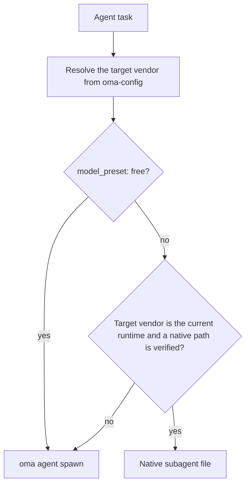
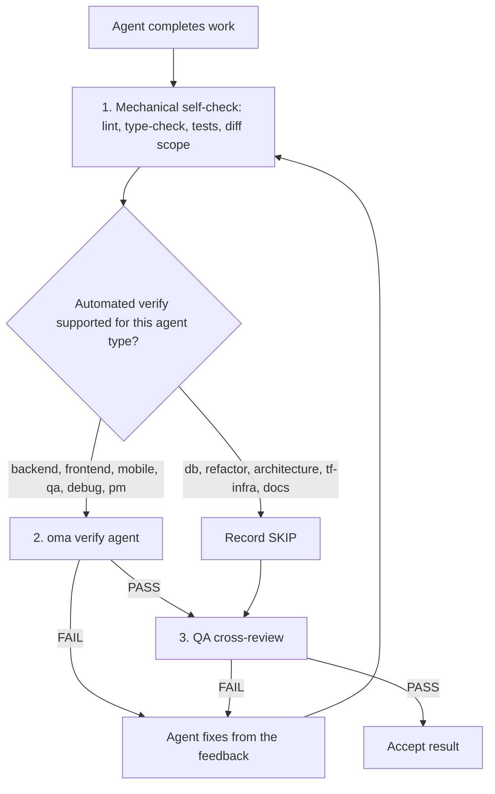

# エージェント

OMA は、[スキル](../getting-started/glossary.md#skill)、ディスパッチロール、[エージェント定義](../getting-started/glossary.md#agent-definition)を分離します。スキルはドメインの指針をルーティングしてロードし、正規ロールはディスパッチで使うランタイム ID になり、リポジトリ内の定義はサブエージェントにベンダー固有のペルソナを与えます。これらの層は意図的に重なるため、タスクの境界と受入基準に応じて、1 つのスキルで足りるかを判断します。

---

## スキルカタログ {#skill-catalog}

この表は、インストール済みスキルの正式な一覧です。`cli/scripts/generate-skill-catalog.mjs` が各 `.agents/skills/<name>/SKILL.md` のフロントマターから生成します。ドリフトを検出するには、このスクリプトを `--check` 付きで実行してください。各スキルのリソースファイルと、それぞれを読むタイミングは、SKILL.md の `## References` セクションに記載されています。

<!-- oma:generated skill-catalog:start -->
<!-- Generated from SKILL.md frontmatter under .agents/skills by cli/scripts/generate-skill-catalog.mjs. Do not edit this block by hand. -->

| Skill | Use it for |
|---|---|
| [`oma-academic-writing`](https://github.com/first-fluke/oh-my-agent/blob/main/.agents/skills/oma-academic-writing/SKILL.md) | Draft and revise academic prose against a rubric, evidence, and citation requirements. Use for essays, reports, literature reviews, or academic style audits. |
| [`oma-architecture`](https://github.com/first-fluke/oh-my-agent/blob/main/.agents/skills/oma-architecture/SKILL.md) | Evaluate system boundaries and architectural tradeoffs. Use for architecture decisions, design reviews, and ADRs. |
| [`oma-backend`](https://github.com/first-fluke/oh-my-agent/blob/main/.agents/skills/oma-backend/SKILL.md) | Implement server APIs, authentication, and application data access. Schema modeling and query tuning use oma-db. |
| [`oma-brainstorm`](https://github.com/first-fluke/oh-my-agent/blob/main/.agents/skills/oma-brainstorm/SKILL.md) | Explore goals, constraints, and alternative approaches before choosing a design. Use when the user requests ideation or design exploration. |
| [`oma-coordination`](https://github.com/first-fluke/oh-my-agent/blob/main/.agents/skills/oma-coordination/SKILL.md) | Coordinate assigned specialist tasks and handoffs manually. Use when supervising a multi-agent project step by step. |
| [`oma-db`](https://github.com/first-fluke/oh-my-agent/blob/main/.agents/skills/oma-db/SKILL.md) | Design schemas and migrations, tune queries, or plan vector retrieval and database operations. Application API implementation uses oma-backend. |
| [`oma-debug`](https://github.com/first-fluke/oh-my-agent/blob/main/.agents/skills/oma-debug/SKILL.md) | Diagnose a reproducible failure, fix its cause, and verify the regression. Use for crashes, incorrect behavior, and failing tests. |
| [`oma-design`](https://github.com/first-fluke/oh-my-agent/blob/main/.agents/skills/oma-design/SKILL.md) | Define or review a visual system, DESIGN.md, or redesign direction. Use for typography, layout, color, motion, and interaction design decisions. |
| [`oma-dev-workflow`](https://github.com/first-fluke/oh-my-agent/blob/main/.agents/skills/oma-dev-workflow/SKILL.md) | Configure development tasks, git hooks, CI/CD, or release automation. Use when creating or fixing a repository development workflow. |
| [`oma-docs`](https://github.com/first-fluke/oh-my-agent/blob/main/.agents/skills/oma-docs/SKILL.md) | Check documentation references, sync docs to code changes, and detect translation drift. Use for documentation maintenance in a repository. |
| [`oma-explanation`](https://github.com/first-fluke/oh-my-agent/blob/main/.agents/skills/oma-explanation/SKILL.md) | Create an offline HTML explanation of a code change (diff, PR, branch) or of a topic, system, or question. Use when a visual walkthrough document is requested. |
| [`oma-frontend`](https://github.com/first-fluke/oh-my-agent/blob/main/.agents/skills/oma-frontend/SKILL.md) | Implement or modify web UI in React, Next.js, or Angular. Use for components, pages, styles, forms, and frontend state or data flows. |
| [`oma-hwp`](https://github.com/first-fluke/oh-my-agent/blob/main/.agents/skills/oma-hwp/SKILL.md) | Convert Hangul HWP, HWPX, or HWPML documents to Markdown with kordoc. Use for text, table, and image extraction from these formats. |
| [`oma-image`](https://github.com/first-fluke/oh-my-agent/blob/main/.agents/skills/oma-image/SKILL.md) | Generate raster images or reference-guided variations through the OMA image CLI. Use for image assets or explicit vendor comparisons; pixel editing uses an editor. |
| [`oma-market`](https://github.com/first-fluke/oh-my-agent/blob/main/.agents/skills/oma-market/SKILL.md) | Research customer pain points, trends, and competitors through the OMA market engine. Use for market discovery or voice-of-customer analysis. |
| [`oma-mobile`](https://github.com/first-fluke/oh-my-agent/blob/main/.agents/skills/oma-mobile/SKILL.md) | Implement Flutter, React Native, native Swift, or native Kotlin Android apps. Use for mobile screens, widgets, platform integrations, and application data flows. |
| [`oma-observability`](https://github.com/first-fluke/oh-my-agent/blob/main/.agents/skills/oma-observability/SKILL.md) | Design or troubleshoot telemetry, SLOs, and incident diagnostics. Route to the relevant signal, system boundary, or vendor guide. |
| [`oma-orchestration`](https://github.com/first-fluke/oh-my-agent/blob/main/.agents/skills/oma-orchestration/SKILL.md) | Dispatch and supervise parallel specialist agents with durable task state. Use when automated multi-agent execution is requested. |
| [`oma-pdf`](https://github.com/first-fluke/oh-my-agent/blob/main/.agents/skills/oma-pdf/SKILL.md) | Extract PDF text, headings, tables, and images into Markdown using opendataloader-pdf. Use for PDF parsing, not PDF layout creation. |
| [`oma-pm`](https://github.com/first-fluke/oh-my-agent/blob/main/.agents/skills/oma-pm/SKILL.md) | Turn product requirements into scoped tasks with dependencies and acceptance criteria. Use for implementation planning and prioritization. |
| [`oma-qa`](https://github.com/first-fluke/oh-my-agent/blob/main/.agents/skills/oma-qa/SKILL.md) | Review changes for correctness, security, accessibility, and performance. Use for scoped quality reviews or verification plans; bug fixes use oma-debug. |
| [`oma-recap`](https://github.com/first-fluke/oh-my-agent/blob/main/.agents/skills/oma-recap/SKILL.md) | Summarize AI conversation histories for a specified date or period. Use for daily work recaps and cross-tool activity summaries. |
| [`oma-refactor`](https://github.com/first-fluke/oh-my-agent/blob/main/.agents/skills/oma-refactor/SKILL.md) | Restructure existing code while preserving observable behavior. Use for targeted technical debt or hotspot work with characterization tests. |
| [`oma-scholar`](https://github.com/first-fluke/oh-my-agent/blob/main/.agents/skills/oma-scholar/SKILL.md) | Search academic literature and generate, validate, or compare Knows paper sidecars. Use for claim/evidence analysis and literature synthesis. |
| [`oma-scm`](https://github.com/first-fluke/oh-my-agent/blob/main/.agents/skills/oma-scm/SKILL.md) | Manage Git branches, merges, conflicts, commits, and release baselines. Use for repository history and change-management operations. |
| [`oma-search`](https://github.com/first-fluke/oh-my-agent/blob/main/.agents/skills/oma-search/SKILL.md) | Find external documentation, web sources, or remote code with citations. Local code navigation uses the configured code tools. |
| [`oma-security`](https://github.com/first-fluke/oh-my-agent/blob/main/.agents/skills/oma-security/SKILL.md) | Scan application source, agent skills, and MCP components; run penetration tests against scoped web test deployments, validate findings, and configure scan gates. Use oma-qa for broad quality reviews and domain skills for remediation. |
| [`oma-skill-creation`](https://github.com/first-fluke/oh-my-agent/blob/main/.agents/skills/oma-skill-creation/SKILL.md) | Create or revise OMA skills and their references. Use for skill routing, execution contracts, conditional loading, and authoring validation. |
| [`oma-slide`](https://github.com/first-fluke/oh-my-agent/blob/main/.agents/skills/oma-slide/SKILL.md) | Create, import, revise, or export presentation decks through the OMA slide CLI. Use for HTML slides and PDF, PNG, or PPTX deck delivery. |
| [`oma-tf-infra`](https://github.com/first-fluke/oh-my-agent/blob/main/.agents/skills/oma-tf-infra/SKILL.md) | Create or review Terraform infrastructure and plans. Use for cloud resources, IAM, networking, state management, and infrastructure changes. |
| [`oma-translation`](https://github.com/first-fluke/oh-my-agent/blob/main/.agents/skills/oma-translation/SKILL.md) | Translate or revise localized UI strings and prose while preserving meaning, terminology, placeholders, and structure. |
| [`oma-video`](https://github.com/first-fluke/oh-my-agent/blob/main/.agents/skills/oma-video/SKILL.md) | Create videos through the OMA video CLI, or analyze and edit existing clips with media tools. Use for frame extraction, visual analysis, silence cuts, dubbing assembly, scripts, and composition; audio-only work uses oma-voice. |
| [`oma-voice`](https://github.com/first-fluke/oh-my-agent/blob/main/.agents/skills/oma-voice/SKILL.md) | Generate or transcribe speech with Voicebox, or process existing audio locally. Use for narration, transcripts, timed speech, and loudness conversion; video editing uses oma-video. |
<!-- oma:generated skill-catalog:end -->

---

## ディスパッチロール {#dispatch-roles}

ランタイムは正規ロールでディスパッチします。`orchestrator` 以外の各ロールは `.agents/agents/` 配下にチェックイン済みの定義を 1 つ持ち、その `skills:` フロントマターがロードするスキルを指定します。最初に挙げたスキルがタスクを担当します。

| ロール | 定義ファイル | 別名 | スキル |
|------|-----------------|---------------|--------|
| `orchestrator` | なし（ランタイムの調整ロール） | | |
| `pm` | `pm-planner.md` | `pm-planner` | oma-pm |
| `architecture` | `architecture-reviewer.md` | `architecture-reviewer` | oma-architecture |
| `qa` | `qa-reviewer.md` | `qa-reviewer` | oma-qa |
| `backend` | `backend-engineer.md` | `backend-engineer` | oma-backend |
| `frontend` | `frontend-engineer.md` | `frontend-engineer` | oma-frontend, oma-design |
| `mobile` | `mobile-engineer.md` | `mobile-engineer` | oma-mobile |
| `db` | `db-engineer.md` | `db-engineer` | oma-db |
| `debug` | `debug-investigator.md` | `debug-investigator` | oma-debug |
| `refactor` | `refactor-engineer.md` | `refactor-engineer` | oma-refactor |
| `docs` | `docs-curator.md` | `docs-curator` | oma-docs |
| `tf-infra` | `tf-infra-engineer.md` | `tf-infra-engineer` | oma-tf-infra |
| `explore` | `research-explorer.md` | `research-explorer`, `explorer` | oma-search, oma-market, oma-scholar |

末尾の `-agent` サフィックスも受け付けます（`qa-agent` は `qa` に解決されます）。

### ネイティブエージェントファイル {#native-agent-files}

`.agents/agents/` 配下のエージェント定義が正本です。OMA はカスタムサブエージェントに対応するランタイム向けに、これをベンダー固有のファイルへ投影します。

| ランタイム | ネイティブエージェントファイル |
|---------|--------------------|
| Claude Code | `.claude/agents/<name>.md` |
| Codex CLI | `.codex/agents/<name>.toml` |
| Cursor | `.cursor/agents/` |
| OpenCode | `.opencode/agents/` |
| Kiro | `.kiro/agents/` |
| Grok | `.grok/agents/` |
| CommandCode | `.commandcode/agents/` |
| Qwen Code | `.qwen/agents/` |

pi にはエージェントファイルの仕組みがないため、`oma agent spawn` が定義のペルソナをプロンプトにインラインで埋め込みます。生成ファイルは `oma link`、`oma install`、`oma update` で更新されます。

### ロールのディスパッチ方法

ワークフローが現在のランタイムと同じベンダーにエージェントを割り当てる場合は、そのランタイムのネイティブエージェントファイルを先に使います。ベンダーが異なるタスクは `oma agent spawn` にフォールバックします。



> **エージェントごとのモデルディスパッチ：** 各ロールのベンダー、モデル、推論強度は `.agents/oma-config.yaml`（または `.agents/oma-config.cue`。任意で `.local` オーバーレイを適用）から決まります。新規インストールのデフォルトである `model_preset: auto` では、`agents:` オーバーライドのないロールは現在のランタイムのネイティブエージェントとモデル設定に従います。`model_preset: free` では常に `oma agent spawn` 経由でディスパッチします。設定の詳細は[エージェント別モデル](../guide/per-agent-models.md)、実行中のマトリクスは [`oma doctor --profile`](../cli-interfaces/commands.md#doctor) で確認できます。

---

## スキルカテゴリ {#agent-categories}

| カテゴリ | スキル | 責務 |
|----------|--------|---------------|
| **アイデア出し** | oma-brainstorm | アイデアの探索、アプローチの提案、設計ドキュメントの作成 |
| **アーキテクチャ** | oma-architecture | システム／モジュール／サービス境界、ADR/ATAM/CBAM方式の分析、トレードオフ記録 |
| **計画** | oma-pm | 要件分解、タスク分割、APIコントラクト、優先度割り当て |
| **実装** | oma-frontend, oma-backend, oma-mobile, oma-db | 各ドメインのコード作成 |
| **デザイン** | oma-design | デザインシステム、DESIGN.md、トークン、タイポグラフィ、カラー、モーション、アクセシビリティ |
| **インフラ** | oma-tf-infra | マルチクラウド Terraform プロビジョニング、IAM、コスト最適化、ポリシーアズコード |
| **DevOps** | oma-dev-workflow | mise タスクランナー、CI/CD、マイグレーション、リリース調整、モノレポ自動化 |
| **オブザーバビリティ** | oma-observability | オブザーバビリティパイプライン、トレーサビリティルーティング、MELT+P シグナル（metrics/logs/traces/profiles/cost/audit/privacy）、SLO 管理、インシデントフォレンジック、トランスポートチューニング |
| **品質** | oma-qa | セキュリティ監査（OWASP）、パフォーマンス、アクセシビリティ（WCAG）、コード品質レビュー |
| **デバッグ** | oma-debug | バグ再現、根本原因分析、最小限の修正、回帰テスト |
| **ローカライゼーション** | oma-translation | トーン、レジスター、ドメイン用語を保持するコンテキスト対応翻訳 |
| **協調** | oma-orchestration, oma-coordination | 自動および手動のマルチエージェントオーケストレーション |
| **Git** | oma-scm | Conventional Commits の生成、機能単位のコミット分割 |
| **検索・取得** | oma-search | 信頼度スコアリング付きのインテントベース検索ルーター（Context7 ドキュメント、ウェブ、`gh`/`glab` コード、ローカルコードインテリジェンス） |
| **レトロスペクティブ** | oma-recap | ツール横断の会話履歴分析とテーマ別作業サマリー |
| **ドキュメント処理** | oma-hwp, oma-pdf | LLM/RAG 取り込みのための HWP/HWPX/HWPML および PDF から Markdown への変換 |
| **ドキュメント** | oma-docs | ドキュメントの保守：壊れた参照、差分の影響を受けるドキュメント、翻訳のドリフト、翻訳ドキュメントの lint |
| **解説** | oma-explanation | コード変更（差分、PR、ブランチ、コミット範囲）や、トピック、システム、質問についてのオフライン HTML 解説 |
| **アカデミックライティング** | oma-academic-writing, oma-scholar | 出版品質の学術文の作成・監査、Knows サイドカーによる学術研究・検索・査読 |
| **セキュリティ** | oma-security | アプリケーションのソース、エージェントのスキルパッケージ、MCP コンポーネント、承認済みのウェブテスト環境のスキャン（Deepsec、Cisco のスキャナー、ARTEX）と、独立した指摘の検証、CI ゲート |
| **リファクタリング** | oma-refactor | ホットスポット、特性テストの安全網、リファクタリング専用コミットを使う、動作を保つ段階的な構造変更 |
| **市場調査** | oma-market | コミュニティシグナルからの課題・トレンド・競合・発見の調査と、意図に応じた SWOT/Porter の 5F/PESTEL の枠組み |
| **スキル作成** | oma-skill-creation | SSL-lite 形式での OMA スキルの作成と検証 |
| **メディア生成** | oma-image, oma-slide, oma-video, oma-voice | AI 画像生成、HTML プレゼンテーション、短編・解説・デモ動画、ローカル TTS/STT |

---

## 詳細エージェントリファレンス

ここでは、各スキルのドメインと主要なルールをまとめます。正本は各スキルの SKILL.md です。その `## References` セクションにリソースファイルとそれぞれを読む条件が記載されているため、このページではその一覧を複製しません。

### oma-brainstorm

**ドメイン：** 計画や実装前のデザインファーストアイデア出し。

**使用すべき場合：** 新機能のアイデア探索、ユーザー意図の理解、アプローチの比較。複雑または曖昧なリクエストの`/plan`前に使用。

**使用すべきでない場合：** 要件が明確な場合（oma-pmへ）、実装（ドメインエージェントへ）、コードレビュー（oma-qaへ）。

**コアルール：**
- デザイン承認前に実装や計画を行わない
- 質問は一度に一つ（バッチではなく）
- 代替案が判断に役立つ場合は、実行可能な 2〜3 のアプローチを比較する。制約により選択肢が少ない場合は、選択肢をでっち上げずに理由を説明する
- 設計はセクションごとに提示し、未決の重要な選択だけを解決する
- YAGNI: 必要なものだけ設計

**ワークフロー：** 7 フェーズ：コンテキスト、質問、アプローチ（任意で TRIZ-lite を起点にできる）、設計、ブラインドレビュー、ドキュメント（`docs/plans/designs/` に保存）、`/plan` への遷移。

---

### oma-architecture

**ドメイン：** ソフトウェア／システムアーキテクチャ（モジュール・サービス境界、トレードオフ分析、ステークホルダー統合、意思決定記録）。

**使用すべき場合：** システムアーキテクチャの選定またはレビュー、モジュール／サービス／オーナーシップ境界の定義、明示的なトレードオフを伴うアーキテクチャ選択肢の比較、アーキテクチャ上の痛み（変更増幅、隠れた依存関係、不自然なAPI）の調査、アーキテクチャ投資またはリファクタリングの優先順位付け、アーキテクチャ推奨事項またはADRの作成。

**使用すべきでない場合：** ビジュアル／デザインシステム（oma-designを使用）、機能計画とタスク分解（oma-pmを使用）、Terraform実装（oma-tf-infraを使用）、バグ診断（oma-debugを使用）、セキュリティ／パフォーマンス／アクセシビリティレビュー（oma-qaを使用）。

**方法論：** 診断ルーティング、design-twice比較、ATAM方式のリスク分析、CBAM方式の優先順位付け、ADR方式の意思決定記録。

**コアルール：**
- メソッドを選択する前にアーキテクチャ問題を診断
- 現在の意思決定に最も軽量で十分な方法論を使用
- アーキテクチャ設計をUI／ビジュアルデザインおよびTerraform実装と区別
- 意思決定が横断的でコストを正当化できる場合のみステークホルダーエージェントに相談
- 推奨事項の質が合意の演出より重要：広く相談し、明示的に決定
- すべての推奨事項は前提、トレードオフ、リスク、検証ステップを明記
- デフォルトでコストを意識：実装コスト、運用コスト、チーム複雑度、将来の変更コスト

---

### oma-pm

**ドメイン：** プロダクトマネジメント（要件分析、タスク分解、APIコントラクト）。

**使用すべき場合：** 複雑な機能の分解、実現可能性の判断、作業の優先順位付け、APIコントラクトの定義。

**コアルール：**
- APIファースト設計：実装タスク前にコントラクトを定義
- 各タスクに必要：エージェント、タイトル、受入基準、優先度、依存関係
- 最大並列実行のため依存関係を最小化
- セキュリティとテストは各タスクの一部（別フェーズではない）
- タスクは単一エージェントで完了可能であること
- オーケストレーターとの互換性のため、JSON plan とセッション単位のタスクボードを出力

**出力：** 数値の優先度ティア（`1` = 依存関係なし、小さいティアから先に実行）を持つ `.agents/results/plan-{sessionId}.json` と、設定済みメモリストア内の実行単位のレポート `result-{agentId}-{taskId}-{runId}-{sessionId}.md`。

---

### oma-frontend

**ドメイン：** TypeScript による React/Next.js または Angular の Web UI。React プロジェクトは FSD-lite を使い、Angular プロジェクトは `resources/angular-rules.md` に従います。

**使用すべき場合：** ユーザーインターフェース、コンポーネント、クライアントサイドロジック、スタイリング、フォームバリデーション、API統合の構築。

**技術スタック：**
- React + Next.js（Server Componentsがデフォルト、インタラクティビティにClient Components）
- TypeScript（strict）
- TailwindCSS v4 + shadcn/ui（読み取り専用プリミティブ、cva/ラッパーで拡張）
- FSD-lite：ルート`src/` + フィーチャー`src/features/*/`（クロスフィーチャーインポート禁止）

**ライブラリ（React/Next.js プロジェクト）：**
| 用途 | ライブラリ |
|---------|---------|
| 日付 | luxon |
| スタイリング | TailwindCSS v4 + shadcn/ui |
| フック | ahooks または @mantine/hooks |
| ユーティリティ | es-toolkit |
| 型 | type-fest |
| URL状態 | nuqs |
| サーバー状態 | TanStack Query（OpenAPI 仕様がある場合は orval 生成フック） |
| クライアント状態 | Jotai または Zustand。デフォルトはなく、意図に応じて選ぶ（使用は最小限に） |
| フォーム | @tanstack/react-form + Zod |
| 認証 | better-auth |
| アニメーション | 新規プロジェクトでは motion（`motion/react`） |

**コアルール：**
- shadcn/uiファースト、cvaで拡張、`components/ui/*`を直接変更しない
- デザイントークンの1:1マッピング（色のハードコード禁止）
- リクエストプロキシ：既存の Next.js 16+ の `proxy.ts` の規約を維持する。`middleware.ts` への名前変更を提案する前に、インストール済みのバージョンとルーティングを確認する
- 3 レベルを超える props ドリリングは禁止。プロジェクトのクライアント状態ライブラリ（Jotai の atom または Zustand のストア）を使う
- `@/`による絶対インポート必須
- FCPターゲット < 1秒
- レスポンシブブレークポイント：320px、768px、1024px、1440px

**品質ゲートチェックリスト：**
- アクセシビリティ：ARIAラベル、セマンティック見出し、キーボードナビゲーション
- モバイル：モバイルビューポートで検証
- パフォーマンス：CLSなし、高速ロード
- レジリエンス：Error BoundariesとLoading Skeletons
- テスト：ロジックをVitestでカバー
- 品質：型チェックとリントがパス

---

### oma-backend

**ドメイン：** API、サーバーサイドロジック、認証、データベース操作。

**使用すべき場合：** REST/GraphQL API、データベースマイグレーション、認証、サーバービジネスロジック、バックグラウンドジョブ。

**アーキテクチャ：** Router（HTTP）-> Service（ビジネスロジック）-> Repository（データアクセス）-> Models。

**スタック検出：** プロジェクトマニフェスト（pyproject.toml、package.json、Cargo.toml、go.mod など）を読み取って言語とフレームワークを決定します。プロジェクト固有の規約がない場合は `/stack-set` の実行をユーザーに依頼します。このコマンドは、同梱のスキーマとテンプレートから、解決済みの `stack/` リファレンスを具体化します。

**コアルール：**
- クリーンアーキテクチャ：ルートハンドラにビジネスロジックを置かない
- すべての入力をプロジェクトのバリデーションライブラリで検証
- パラメーター化クエリのみ（SQLでの文字列補間禁止）
- 認証に JWT + Argon2id を使う（レガシー互換性では bcrypt も許容）。認証エンドポイントにはレート制限をかける
- サポートされている場合は非同期、すべてのシグネチャに型注釈
- 集約エラーモジュールによるカスタム例外
- 明示的なORMローディング戦略、トランザクション境界、安全なライフサイクル

<!-- oma-docs:ignore-start -->
プロジェクト固有の `stack/stack.yaml`、`stack/tech-stack.md`、snippets、API テンプレートは必要に応じて `/stack-set` が生成します。スタックを具体化するまでは存在しません。
<!-- oma-docs:ignore-end -->

---

### oma-mobile

**ドメイン：** クロスプラットフォームおよびネイティブのモバイルアプリ（Flutter、React Native、Swift ネイティブ iOS）。

**使用すべき場合：** ネイティブモバイルアプリ（iOS + Android）、モバイル固有の UI パターン、プラットフォーム機能（カメラ、GPS、プッシュ通知）、オフラインファーストアーキテクチャ、SwiftUI と `swift-openapi-generator` を使う Swift ネイティブ iOS アプリ。

**アーキテクチャ：** クリーンアーキテクチャ（domain -> data -> presentation）。Swift iOS では `App/Core/Features/Shared` の配置を使います。

**技術スタック：**
- Flutter/Dart：Riverpod/Bloc（状態管理）、Dio with interceptors（API）、GoRouter（ナビゲーション）、Material Design 3（Android）+ iOS HIG
- Swift ネイティブ iOS（iOS 17+）：SwiftUI + `@Observable`（Observation framework）、Apple の `swift-openapi-generator` による API クライアント、`App/Core/Features/Shared` の配置

**コアルール：**
- Riverpod/Bloc を状態管理に使い、複雑なロジックで raw setState を使わない
- すべてのコントローラーを `dispose()` メソッドで破棄する
- API 呼び出しには Dio with interceptors を使い、オフラインを適切に処理する
- 60fps を目標にし、両プラットフォームでテストする
- Swift では iOS 17+ の `@Observable` を `ObservableObject` より優先し、OpenAPI 仕様から `swift-openapi-generator` で API クライアントを生成する

**プラットフォームシード：** `variants/` には `flutter/`、`react-native/`、`swift-ios/` が同梱され、それぞれに `stack.yaml`、`tech-stack.md`、`snippets.md`、API テンプレートがあります。共有の `stack.schema.json` も含まれます。これらは `/stack-set` 用のスターター素材であり、既存コードを編集するときに読む必要はありません。

---

### oma-db

**ドメイン：** データベースアーキテクチャ（SQL、NoSQL、ベクトルデータベース）。

**使用すべき場合：** スキーマ設計、ERD、正規化、インデックス、トランザクション、キャパシティプランニング、バックアップ戦略、マイグレーション設計、ベクトルDB/RAGアーキテクチャ、アンチパターンレビュー、コンプライアンス対応設計（ISO 27001/27002/22301）。

**デフォルトワークフロー：** 探索（エンティティ、アクセスパターン、ボリュームの特定）-> 設計（スキーマ、制約、トランザクション）-> 最適化（インデックス、パーティショニング、アーカイブ、アンチパターン）。

**コアルール：**
- まずモデルを選択、次にエンジンを選択
- リレーショナルはデフォルト3NF、分散型はBASEトレードオフを文書化
- 3つのスキーマ層すべてを文書化：外部、概念、内部
- 整合性はファーストクラス：エンティティ、ドメイン、参照、ビジネスルール
- 並行性は暗黙にしない：トランザクション境界と分離レベルを定義
- ベクトルDBは検索インフラであり、信頼できるソースではない
- ベクトル検索を字句検索の直接代替として扱わない

**必須成果物：** 外部スキーマサマリー、概念スキーマ、内部スキーマ、データ標準テーブル、用語集、キャパシティ見積もり、バックアップ/リカバリ戦略。ベクトル/RAGの場合：エンベディングバージョンポリシー、チャンキングポリシー、ハイブリッド検索戦略。

---

### oma-design

**ドメイン：** デザインシステム、UI/UX、DESIGN.md管理。

**使用すべき場合：** デザインシステムと DESIGN.md の作成・改訂、既存サイトやアプリのリデザイン（維持または全面刷新）、ランディングページ、デザイントークン、カラーパレット、タイポグラフィ、レスポンシブレイアウト、アクセシビリティレビュー。

**ワークフロー：** 7フェーズ：Setup（コンテキスト収集）-> Extract（オプション、参照URLから）-> Enhance（曖昧なプロンプトの補強）-> Propose（2〜3のデザイン方向性）-> Generate（DESIGN.md + トークン）-> Audit（レスポンシブ、WCAG、Nielsen、AIスロップチェック）-> Handoff。

**アンチパターン強制（「AIスロップ排除」）：**
- タイポグラフィ：システムフォントスタックがデフォルト、正当な理由なしにデフォルトのGoogle Fontsを使わない
- カラー：紫から青のグラデーション禁止、グラデーションオーブ/ブロブ禁止、純黒の上に純白禁止
- レイアウト：ネストされたカード禁止、デスクトップ専用レイアウト禁止、テンプレ的な3メトリック統計レイアウト禁止
- モーション：バウンスイージングの乱用禁止、800ms超のアニメーション禁止、prefers-reduced-motionを尊重
- コンポーネント：グラスモーフィズムの乱用禁止、すべてのインタラクティブ要素にキーボード/タッチ代替手段

**コアルール：**
- `.design-context.md` と `DESIGN.md` があれば再利用する。`.design-context.md` は、実質的な調査が判断の材料になる場合にだけ作成する
- 既存のサイトやアプリでは `resources/redesign-protocol.md` に従い、提案の前に Preserve（維持）か Overhaul（全面刷新）かを分類する
- システムフォントスタックがデフォルト（ko/ja/zh用CJK対応フォント）
- すべてのデザインでWCAG AA最低基準
- レスポンシブファースト（モバイルがデフォルト）
- 2〜3の方向性を提示し、確認を得る

---

### oma-tf-infra

**ドメイン：** TerraformによるInfrastructure-as-Code、マルチクラウド。

**使用すべき場合：** AWS/GCP/Azure/Oracle Cloudでのプロビジョニング、Terraform設定、CI/CD認証（OIDC）、CDN/ロードバランサー/ストレージ/ネットワーキング、状態管理、ISOコンプライアンスインフラ。

**クラウド検出：** Terraform のプロバイダーとリソースプレフィックスを読み取ります（`google_*` = GCP、`aws_*` = AWS、`azurerm_*` = Azure、`oci_*` = Oracle Cloud）。マルチクラウドのリソース対応表も完全な形で含みます。

**コアルール：**
- プロバイダー非依存：プロジェクトコンテキストからクラウドを検出
- バージョニングとロック付きのリモートステート
- CI/CD認証にOIDCファースト
- 常にapply前にplan
- 最小権限IAM
- すべてにタグ付け（Environment、Project、Owner、CostCenter）
- コード内にシークレット禁止
- すべてのプロバイダーとモジュールをバージョンピン
- 本番でのauto-approve禁止

---

### oma-dev-workflow

**ドメイン：** モノレポタスク自動化とCI/CD。

**使用すべき場合：** 開発サーバーの実行、アプリ横断のlint/format/typecheck、データベースマイグレーション、API生成、i18nビルド、本番ビルド、CI/CD最適化、pre-commitバリデーション。

**コアルール：**
- パッケージマネージャー直接コマンドではなく常に`mise run`タスクを使用
- 変更されたアプリのみでlint/testを実行
- commitlintでコミットメッセージを検証
- CIは変更されていないアプリをスキップ
- miseタスクが存在する場合、パッケージマネージャーの直接コマンドを使わない

---

### oma-observability

**ドメイン：** レイヤー、境界、シグナルにまたがるインテントベースのオブザーバビリティおよびトレーサビリティルーター。

**使用すべき場合：**
- パイプラインのセットアップ：OTel SDK + Collector + ベンダーバックエンド
- サービスおよびドメイン境界にまたがるトレーサビリティ：W3C propagator、baggage、マルチテナント、マルチクラウド
- トランスポートチューニング：UDP/MTU閾値、OTLP gRPC vs HTTP、Collector DaemonSet vs サイドカートポロジー、サンプリングレシピ
- インシデントフォレンジック：6次元ローカライゼーション（code / service / layer / host / region / infra）
- ベンダーカテゴリ選定：OSSフルスタック vs 商用SaaS vs 高カーディナリティ特化 vs プロファイリング特化
- observability-as-code：Grafana Jsonnetダッシュボード、PrometheusRule CRD、OpenSLO YAML、SLO burn-rateアラート
- メタオブザーバビリティ：パイプラインの自己ヘルス、クロックスキュー、カーディナリティガードレール、保持マトリクス
- MELT+Pシグナルカバレッジ：metrics、logs、traces、profiles、cost、audit、privacy
- 現在の upstream のサポート状況とプロジェクトの要件に照らして評価する、ログパイプラインの移行

**使用すべきでない場合：** LLM ops / gen_aiオブザーバビリティ（Langfuse、Arize Phoenix、LangSmith、Braintrustを使用）、データパイプラインlineage（OpenLineage + Marquez、dbt test、Airflow lineage）、IoT / データセンターの物理層テレメトリ（Nlyte、Sunbird、Device42）、カオスエンジニアリングオーケストレーション（Chaos Mesh、Litmus、Gremlin、ChaosToolkit）、GPU / TPUインフラ（NVIDIA DCGM Exporter）、ソフトウェアサプライチェーン（sigstore、in-toto、SLSA）、インシデントレスポンスワークフロー / ページング（PagerDuty、OpsGenie、Grafana OnCall）、該当ベンダーの固有スキルで既にカバーされている単一ベンダーセットアップ。

**コアルール：**
- ルーティング前にインテントを分類：setup | migrate | investigate | alert | trace | tune | route
- ベンダーレジストリではなくカテゴリファースト：`resources/vendor-categories.md`を介してベンダー所有スキルに委譲し、ベンダードキュメントを複製しない
- トランスポートチューニングが堀（moat）：UDP/MTU閾値、OTLPプロトコル選択、Collectorトポロジー、サンプリングレシピは他のスキルがカバーしない深さ
- メタオブザーバビリティは妥協不可：セットアップ完了を宣言する前にパイプラインの自己ヘルス、クロック同期（< 100 msドリフト）、カーディナリティ、保持を検証
- CNCFファースト優先：Prometheus、Jaeger、Thanos、Fluent Bit、OpenTelemetry、Cortex、OpenCost、OpenFeature、Flagger、Falco
- Fluentd は引き続き CNCF Graduated です。CNCF 2025-10 の Fluentd から Fluent Bit へのガイドは移行ガイドであり、非推奨化ではありません。Fluentd、Fluent Bit、OTel Collector は、ワークロード、プラグイン、運用の要件から選ぶ
- W3C Trace Contextをデフォルトpropagatorに；クラウドごとに変換（AWS X-Ray `X-Amzn-Trace-Id`、GCP Cloud Trace、Datadog、Cloudflare、Linkerd）
- 機能よりプライバシー優先：PIIのredaction、サンプリング対応baggageルール、SOC2/ISO不変監査 + GDPR/PIPA消去はストレージではなく収集時点で適用

---

### oma-qa

**ドメイン：** 品質保証（セキュリティ、パフォーマンス、アクセシビリティ、コード品質）。

**使用すべき場合：** デプロイ前の最終レビュー、セキュリティ監査、パフォーマンス分析、アクセシビリティコンプライアンス、テストカバレッジ分析。

**レビュー優先順位：** セキュリティ > パフォーマンス > アクセシビリティ > コード品質。

**重要度レベル：**
- **CRITICAL**：セキュリティ侵害、データ損失リスク
- **HIGH**：ローンチブロッカー
- **MEDIUM**：今スプリントで修正
- **LOW**：バックログ

**コアルール：**
- すべての指摘にfile:line、説明、修正を含める
- まず自動化ツールを実行（npm audit、bandit、lighthouse）
- 偽陽性なし。すべての指摘は再現可能であること
- 説明だけでなく修正コードを提供

---

### oma-debug

**ドメイン：** バグ診断と修正。

**使用すべき場合：** ユーザー報告のバグ、クラッシュ、パフォーマンス問題、間欠的な障害、レースコンディション、回帰バグ。

**手法：** まず再現、次に診断。修正を推測しない。

**コアルール：**
- 症状ではなく根本原因を特定する
- 最小限の修正：必要な箇所だけを変更する
- すべての修正に回帰テストを付ける
- 他の場所で類似パターンを検索する
- `.agents/results/` に記録する

**使用するコードインテリジェンスツール（Gortex または Serena）：**
- `find_symbol("functionName")` または Gortex のシンボルナビゲーション：関数を特定する
- `find_referencing_symbols("Component")` または Gortex の影響分析：すべての使用箇所を調べる
- `search_for_pattern("error pattern")` または Gortex の検索：類似の問題を探す

---

### oma-translation

**ドメイン：** コンテキスト対応の多言語翻訳。

**使用すべき場合：** UI文字列、ドキュメント、マーケティングコピーの翻訳、既存翻訳のレビュー、用語集の作成。

**6 つの場面の流れ：** Prepare、Acquire、Reason、Act、Verify、Finalize。翻訳は、保護された構文と意味を読む、レジスターを選ぶ、ターゲット言語で再構成する、適切な箇所では著者の文体を保つ、という 4 段階で進めます。

**コアルール：**
- まず既存のロケールファイルをスキャンして規約に合わせる
- 単語ではなく意味を翻訳
- 感情的な含意を保持
- 逐語訳を絶対に行わない
- 一つの文章内でレジスターを混在させない
- ドメイン固有の用語はそのまま保持

---

### oma-orchestration

**ドメイン：** CLIスポーンによる自動マルチエージェント協調。

**使用すべき場合：** 並列で複数エージェントを必要とする複雑な機能、自動実行、フルスタック実装。

**設定デフォルト：**

| 設定 | デフォルト | 説明 |
|---------|---------|-------------|
| MAX_PARALLEL | 3 | 同時サブエージェント最大数 |
| MAX_RECOVERY_ATTEMPTS | 3 | タスクごとのリトライと探索仮説の合計（最初の試行を含む） |
| POLL_INTERVAL | 30秒 | `oma agent spawn` 実行のステータスチェック間隔（Claude Code のネイティブサブエージェントは同期的に結果を返す） |

**ワークフローフェーズ：** Plan → References（タスクごとのリファレンスを選択）→ Setup（セッションとタスクボードの成果物）→ Execute（MAX_PARALLEL の範囲で準備できたタスクをディスパッチ）→ Monitor → Verify（レビューループ）→ Collect（申告と実行単位のレポート）。

**エージェント間レビューループ：** 図とループの上限は[オーケストレーションフロー](#orchestration-flow)を参照してください。

**セッションの証拠：** 有用な場合に、重要な訂正と判定済みのレビュー指摘を、原因、影響、検証結果とあわせて記録します。ペナルティスコアは適用されず、スコアによる一時停止もありません。

---

### oma-scm

**ドメイン：** ブランチ、マージ、ワークツリー、ベースライン、監査対応、Conventional Commits を扱うソフトウェア構成管理（SCM）と Git。

**使用すべき場合：** コード変更後（`/scm`）、マージ競合、ブランチ戦略、リリース/タグ、またはリポジトリの構成管理に関する質問。

**コミットタイプ：** feat、fix、docs、style、refactor、perf、test、chore、build、ci、revert。

**ワークフロー（コミット）：** 変更を分析 → 必要なら機能ごとに分割 → タイプ → スコープ → 説明（命令形、72 文字未満、小文字、末尾のピリオドなし）→ 明示したパスでコミット。

**ルール：**
- 明示的な承認なしに `git add -A` や `git add .` を使わない
- シークレットファイルをコミットしない
- ステージング時は常にファイルを指定する
- メッセージはファイルに書き、`git commit -F <message-file>` でコミットする
- 明示的な承認なしに共有履歴を書き換えない。`--force-with-lease` を使い、単なる `--force` は使わない
- Co-author trailer は、有効な `scm.co_author` の設定がそれを有効にし、名前とメールアドレスを指定している場合だけ含める

---

### oma-coordination

**ドメイン：** 手動ステップバイステップのマルチエージェント協調ガイド。

**使用すべき場合：** 完全自動のオーケストレーションではなく、スポーン、監視、コントラクトの整合、QA を段階ごとに監督したいマルチドメインの作業。

**使用すべきでない場合：** 完全自動の並列実行（oma-orchestrationを使用）、単一ドメインのタスク（ドメインエージェントを直接使用）。

**コアルール：**
- 有効な計画は再利用する。oma-pm を呼ぶのは、分解やコントラクトを変える必要がある場合だけ
- 同じ優先度ティアの独立したタスクは並列でスポーンし、それぞれ専用のワークスペースか `--isolation worktree` を使う
- API 境界が変わった場合は、依存する frontend や mobile の作業の前にコントラクトを更新する
- QA レビューは常に最後のステップ
- QA でブロッキングになった不具合と、必要な検証の欠落は担当エージェントに戻し、影響するチェックを再実行する

**ワークフロー：** 計画（再利用または PM）→ 優先度ティアごとにスポーン → モニタリング → QA レビュー → 問題修正 → 出荷。

**oma-orchestrationとの違い：** coordinationは手動ガイド型（ユーザーがペースを制御）、orchestratorは自動化（最小限のユーザー介入でエージェントがスポーン・実行）。

---

### oma-search

**ドメイン：** ドメイン信頼度スコアリングを使用するインテントベース検索ルーター。クエリを Context7（ドキュメント）、ネイティブウェブ検索、`gh`/`glab`（コード）、ローカルコードインテリジェンス（Gortex または Serena）にルーティングします。

**使用すべき場合：** 公式ライブラリ／フレームワークのドキュメント検索、チュートリアル／例／比較／解決策のためのウェブ調査、実装パターンのためのGitHub/GitLabコード検索、検索チャネルが不明なクエリ（自動ルーティング）、検索インフラが必要な他のスキル（共有呼び出し）。

**使用すべきでない場合：** ローカル専用のコードベース探索（コードインテリジェンス MCP を直接使用）、Git 履歴または blame 分析（oma-scm）、完全なアーキテクチャ調査（内部でこのスキルを呼ぶ可能性がある oma-architecture）。

**コアルール：**
- 明示的な `--docs`、`--code`、`--web` がルートを選ぶ。それ以外は `resources/intent-rules.md` でインテントを分類します
- 1つのクエリ、1つの最適ルート。インテントが曖昧でない限り冗長なマルチルートを避けます
- すべての結果に信頼度スコア。すべての非ローカル結果はレジストリからドメイン信頼度ラベルを取得します
- その他のフラグ：`--strict` はスコアリング後に信頼度で結果を絞り込み、`--wide` はラベル付きの低信頼度の結果も残し、`--gitlab` はコードホストに GitLab を選びます
- Fail forward：主要ルートが失敗した場合、優雅にフォールバック（docs→web、web→`oma search fetch`戦略）
- 追加 MCP は不要：ドキュメントは Context7、ウェブはランタイムネイティブ、コードは CLI、ローカルは設定済みプロバイダー（Gortex または Serena）
- ベンダー中立のウェブ検索：現在のランタイムが提供するものを使用（WebSearch、Google、Bing）
- ドメインレベルの信頼度のみ。サブパスまたはページレベルのスコアリングはありません

---

### oma-recap

**ドメイン：** 複数の AI ツール（Claude、Codex、Gemini、Antigravity、Qwen、Cursor、Grok）の会話履歴分析とテーマ別の日次/期間作業サマリー。

**使用すべき場合：** 1日または期間の作業活動の要約、複数のAIツールにまたがる作業の流れの把握、セッション間のツール切り替えパターンの分析、デイリースタンドアップ／週次レトロ／作業ログの準備。

**使用すべきでない場合：** Gitコミットベースのコード変更レトロスペクティブ（`oma retro`を使用）、リアルタイムエージェントモニタリング（`oma dashboard terminal`を使用）、生産性メトリクス（`oma stats get`を使用）。

**プロセス：**
1. 自然言語入力（today、yesterday、last Monday、明示的な日付）から日付または時間範囲を解決
2. 暦日なら `oma recap --date YYYY-MM-DD --json`、ローリングウィンドウ（`1d`、`3d`、`7d`、`2w`、`30d`）なら `oma recap --window 7d --json` で会話データを取得し、`--tool` で絞り込む
3. ツールではなく内容（プロジェクトとテーマ）でグループ化する。3 日以上のウィンドウでは、日ではなくプロジェクトでグループ化する
4. テーマの抽出（取り組んだ機能、修正したバグ、探索したツール）
5. テーマ別の日次／期間サマリーをレンダリング

---

### oma-hwp

**ドメイン：** `kordoc`を使用したHWP / HWPX / HWPML（韓国語ワードプロセッサ）→ Markdown変換。

**使用すべき場合：** 韓国語HWP文書（`.hwp`、`.hwpx`、`.hwpml`）のMarkdown変換、LLMコンテキストまたはRAGのための韓国の政府／企業文書の準備、HWPからの構造化コンテンツ（表、見出し、リスト、画像、脚注、ハイパーリンク）の抽出。

**使用すべきでない場合：** PDFファイル（oma-pdfを使用）、XLSX/DOCX（スコープ外）、HWP生成／編集（スコープ外）、既にテキストファイル（Readツールを直接使用）。

**コアルール：**
- 実行に`bunx kordoc@latest`を使用。インストール不要で、常に`@latest`または固定バージョンを渡します
- デフォルト出力形式はMarkdown
- 出力ディレクトリが指定されない場合、入力と同じディレクトリに出力
- kordocが構造保持を処理（見出し、表、ネストされた表、脚注、ハイパーリンク、画像）
- セキュリティ防御（ZIP bomb、XXE、SSRF、XSS）はkordocが提供。カスタム防御の追加は禁止です
- 暗号化またはDRMロックされたHWPの場合、制限をユーザーに明確に報告
- HTMLの`<table>`ブロックをGFMパイプテーブルに変換し、Hancomフォントの私用領域文字を削除するために、`resources/flatten-tables.ts`で後処理

---

### oma-pdf

**ドメイン：** `opendataloader-pdf`を使用したPDF → Markdown変換。

**使用すべき場合：** LLMコンテキストまたはRAGのためのPDF文書のMarkdown変換、PDFからの構造化コンテンツ（表、見出し、リスト）の抽出、AI消費のためのPDFデータの準備。

**使用すべきでない場合：** PDF生成／作成（適切な文書ツールを使用）、既存PDF編集（スコープ外）、既にテキストのファイルの単純な読み取り（Readツールを直接使用）。

**コアルール：**
- 実行に`uvx opendataloader-pdf`を使用。インストール不要です
- デフォルト出力形式はMarkdown
- 出力ディレクトリが指定されない場合、入力PDFと同じディレクトリに出力
- 文書構造を保持（見出し、表、リスト、画像）
- スキャンされたPDFの場合、OCR付きハイブリッドモードを使用
- Markdownフォーマット正規化のために、常に出力に`uvx mdformat`を実行
- 出力Markdownが読みやすく構造化されているか検証
- 変換の問題（欠落した表、文字化けしたテキスト）をユーザーに報告

---

### oma-academic-writing

**ドメイン：** 出版品質の英語学術文。エッセイ、レポート、分析、エグゼクティブサマリー、結論、文献レビューの作成・改稿・監査。

**使用すべき場合：** 学術レポートやエッセイ、分析、エグゼクティブサマリー、結論、文献レビューの作成または改稿、AI らしい英語の書き換え、文の多様性・動詞・ヘッジ・アンチ AI の監査、HD/A/上位帯のルーブリックに合わせた推敲。

**使用すべきでない場合：** 翻訳（oma-translation）、出典の探索や引用収集、文献検索（oma-scholar）、ルーブリック解析とタスク分解（oma-pm）、コードドキュメントや README、API リファレンス（該当するドメインスキル）、くだけた文章やマーケティングコピー、非英語の学術文（英語で作成してから oma-translation に渡す）。

**モード：** `draft`（見出し、本文、Writing Notes、Claim-Evidence Map）、`revise`（原文、改稿、変更一覧）、`review`（文構造、動詞、アンチ AI、具体性、ヘッジ、段落の明瞭さ、リズム、主張と証拠の対応を PASS/FAIL で監査）。

**コアルール：**
- 判断の前に引用：適用するルールの文字どおりのルーブリックや制約を引用する
- すべての文を検証可能にし、データ、統計、引用を捏造しない
- 禁止された一般動詞（`show`、`have`、`make`、`do`、`get`、`use` など）を主動詞にしない
- 文型、長さ、書き出しを変え、同じ型の文を 3 文以上続けない
- 根拠の強さに合わせてヘッジの強さを調整し、一人称の `I think` や `I believe` を使わない
- すべての主張を Claim-Evidence Map の証拠に対応付け、裏付けられない主張は弱めるか削除する

**ワークフロー：** 6 段階：制約を引用してルーブリックと原稿を読む、段落を Topic-Support-Conclude で計画する、4 つのプロトコルに従って下書きする、アンチ AI チェックリストで監査する、逆アウトラインと Claim-Evidence Map を作る、音読・結束性・具体性・語数・リズムを磨く。

---

### oma-security

**ドメイン：** アプリケーションのソース、エージェントのスキルパッケージ、MCP コンポーネント、承認済みのウェブテスト環境を対象とするセキュリティスキャンと検証。

**使用すべき場合：** リポジトリやソースの差分のスキャン、スキルパッケージや MCP サーバー・設定の検査、承認済みの具体的なテスト環境に対する範囲を限定したペネトレーションテスト、スキャナーの候補の検証、エンジン固有の CI ゲートの設定、スキャナーの資格情報、カバレッジ、マッチャー、クォータ、再開可能な状態のトラブルシューティング。

**使用すべきでない場合：** 正確性、パフォーマンス、アクセシビリティ、品質の広範なレビュー（oma-qa）、実行を伴わないツール比較や調査（oma-search）、セキュリティアーキテクチャの判断（oma-architecture）、プロダクトコードの修正（oma-debug、または担当の backend/frontend/mobile/infrastructure スキル）。

**対象ごとのデフォルトエンジン：**

| 対象 | デフォルトエンジン |
|--------|----------------|
| アプリケーションのソースまたはソースの差分 | Deepsec（明示的に選択した場合は Cisco AI Deep SAST） |
| エージェントのスキルディレクトリまたはパッケージ | Cisco Skill Scanner |
| MCP のソース、設定、サーバー | Cisco MCP Scanner |
| ウェブのテスト環境 | ARTEX |
| 範囲を限定したローカルでの再現 | Cloudflare の検証手法（外部ネットワークなし） |

**コアルール：**
- 一般的なリポジトリスキャンではソースだけを選ぶ。スキル、MCP、ランタイムのスキャンを暗黙に追加しない
- 失敗や空の結果を理由に、別のエンジン、モデル、有料のアナライザーを自動で選ばない
- 既存の `.deepsec/` の状態を保持して再開する。失敗した実行やノイズの多い実行を消すために再初期化しない
- キーやツールがインストールされていても、有料の呼び出しやスコープの拡大を承認したことにはならない。共有の実行ポリシーに従い、既存の承認を再利用する
- 一意の候補はそれぞれ、それを発見していない新しい検証者に渡す。`confirmed` には独立して観測された証拠が必要
- どの結果も対象が安全であることを証明しない。必須のチェックが未完了の間はゲートを通過できない

**出力：** 呼び出しごとに 1 つの `.agents/results/security/<run-id>/`。`run.json`、`findings.json`、`report.md` を含みます（ウェブランタイムでは `runtime.json`、CI では `gate.json` も含みます）。

---

### oma-docs

**ドメイン：** 4 つのモードによるドキュメントの保守：`verify`（壊れた参照。`docs/generated/doc-refs.json` を再生成）、`sync`（差分で変更されたファイルを参照するドキュメント）、`i18n`（翻訳のドリフト）、`lint`（翻訳ドキュメントのスタイルの問題）。

**使用すべき場合：** リファクタリング、名前変更、ファイル削除の後にドキュメント内の古い参照を探す場合、リリース前に CLI コマンド、ファイルパス、設定キーがまだ存在するかを確認する場合、大きな git の差分の後に変更されたファイルを参照するドキュメントを探す場合、定期的な翻訳ドリフトのチェック。

**使用すべきでない場合：** 一般的なソースの調査（oma-search）、アプリケーションの実装（担当のスペシャリスト）、既知のテキストの翻訳（oma-translation）。

**コアルール：**
- レビューだけの依頼では提案を出す。範囲を指定した既存の編集依頼があれば、ファイルごとに改めて承認を得ずに修正を適用できる
- CLI は構造化データを出力し、ホスト LLM が合成とパッチ作成を行う。CLI の検出結果をでっち上げず、docs CLI からベンダーの LLM API を呼ばない
- シークレットを含むファイル（`.env*`、秘密鍵、資格情報）は差分レポートやパッチに含めない
- ignore ブロック、`oma-docs: skip`、設定済みの除外を尊重する
- URL のチェックは `lychee`（任意）に委譲する。ワークフローフックは `docs.auto_verify` が有効な場合だけ動作し、警告のみ

**ワークフロー：** `oma docs verify --json`、`oma docs sync <range> --json`、`oma docs i18n --json`、または `oma docs lint --json` → 構造化された結果を確認 → 各修正を現在のコードと照合 → 承認済みの修正を適用 → 影響するチェックを再実行。`verify` は問題がなければ 0、壊れた参照を見つけると 1 で終了します。

---

### oma-explanation

**ドメイン：** 2 つのモードによる、オフラインで自己完結した HTML 解説：変更モード（差分、PR、ブランチ、コミット範囲について、背景、直感、コードの読み解き、5 問のクイズを含む）とトピックモード（概念、システム、質問を 1 ページのビジュアルシートにまとめる）。

**使用すべき場合：** 差分、プルリクエスト、ブランチ、コミット範囲、またはトピック、システム、質問を、オフライン対応の 1 つの HTML ページで説明する場合。

**ワークフロー：** モデルが Markdown の下書きを書き、`oma explain render` がそれを `.agents/results/explain/{YYYY-MM-DD}-{slug}.html` の 1 つの HTML ファイルに変換し、`oma explain validate` が検査します。有効になるのは `/explain`、スキル名の指定、委任の場合だけで、このスキルはキーワードヒントの対象外です。

**使用すべきでない場合：** 通常のドキュメントページ、実機能の実装、スライドデッキ（プレゼンテーションには `oma-slide`）。

---

### oma-image

**ドメイン：** 認証状態を考慮したマルチベンダー AI 画像生成。Codex の `gpt-image-2`、`agy` 経由の Antigravity Gemini 系「nano-banana」モデル（モデルは内部で選択）、Pollinations の flux/zimage を扱います。

**使用すべき場合：** 画像、ビジュアルアセット、イラスト、商品写真、コンセプトアート、モックアップの生成、同じプロンプトを複数の画像モデルで比較、エディターワークフロー内でのプロンプト画像生成。

**使用すべきでない場合：** 既存画像の編集や写真加工、動画や音声の生成（oma-video / oma-voice）、構造化データからのインライン SVG 作成、単純なリサイズや形式変換。

**コアルール：**
- 呼び出す前に、主題・スタイル・構図・用途が曖昧なら確認するかプロンプトを補強して、展開した内容を示す
- 認証状態に応じてディスパッチし、`--vendor all` では指定したすべてのベンダーが利用可能であることを確認する
- 推定費用が $0.20 以上の実行では確認する（`--yes`/`OMA_IMAGE_YES=1` で回避可能）。デフォルトの `pollinations` と `antigravity` は無料
- `$PWD` 外への出力には `--allow-external-output` を使い、`n` の上限は 5
- 各実行は画像の横に `manifest.json` を書く。プロンプト、ベンダー/モデル、入力、成果物メタデータを記録し、ピクセル単位の同一性は保証しない
- 添付された参照画像は `--reference <path>` で自動転送する（codex/antigravity）

**ワークフロー：** PREPARE（プロンプトの確認/補強、ベンダー選択）→ ACQUIRE（認証、参照、出力先の検証）→ ACT（`oma image generate`）→ VERIFY（manifest、ファイル、終了コード）→ FINALIZE（出力先と警告）。

---

### oma-market

**ドメイン：** コミュニティシグナルから課題、トレンド、競合ポジション、発見を調査すること。調査は upstream の [`last30days`](https://github.com/mvanhorn/last30days-skill) エンジン（Reddit、X、YouTube、TikTok、Instagram、HN、Polymarket、GitHub、arXiv、Techmeme、Digg、LinkedIn、StockTwits、Bluesky、ウェブなど）を使い、oma は常に最新リリースを保持します。

**使用すべき場合：** コミュニティ投稿から実際の課題を抽出、7/30/90/180 日の期間でカテゴリのトレンド検出、競合センチメント分析と SWOT / Porter's 5F ポジショニング、`--discover` による探索、人・企業・ティッカーの調査、採用シグナル、フォローアップ調査。

**使用すべきでない場合：** 市場の枠組みを持たない一般ウェブ調査（oma-search）、学術文献（oma-scholar）、ライブダッシュボードやスケジュール監視（`oma schedule <action>` でこのスキルを包む）。

**コアルール：**
- detect-trap を最初に実行し、明示的な再確認がない限り（`--force`）エンジンを起動しない
- 常に最新の 1 エンジンを使う。`oma market resolve` は実行前に管理コピー（`~/.cache/oma-market/last30days/<tag>/`）を更新し、キャッシュがオフラインにない場合だけ古いユーザーインストールをフォールバックにする
- 解決したエンジンの `SKILL.md` に従い、raw `python3 scripts/last30days.py` の代わりに `oma market run <args>` を使うことだけを置き換える
- WebSearch だけで済ませない。エンジン、Python 3.12 以降、または正常終了がない場合は停止して報告する
- キー付きソースは upstream のセットアップウィザードでユーザーが同意した場合だけ有効にし、スキップしたソースはフッターに残す
- フレームワークはエンジンのクラスタだけを引用し、ファイル書き込み前にバッジの先頭行と upstream の LAWs を確認する
- 実行ごとに `.agents/results/market/{topic-slug}-{YYYYMMDD}.md` に 1 つのブリーフを書き、意図に応じてフレームワークを自動切替する（pain/trend → SWOT、competitor → SWOT + Porter's 5F、discovery → SWOT + PESTEL）

**ワークフロー：** detect-trap → `oma market resolve` → upstream の `SKILL.md` を読む → upstream の事前調査（セットアップウィザード、ハンドル/サブレディット解決、クエリ計画）→ `oma market run … --emit=compact` → upstream の OUTPUT CONTRACT に従って合成 → フレームワーク追加 → セルフチェック → 書き込み。

---

### oma-refactor

**ドメイン：** 動作を保つリファクタリング。コードスメル、SATD、ホットスポットを対象に、特性テストの安全網とリファクタリング専用コミットで段階的に構造を変更します。

**使用すべき場合：** 特定ファイル/モジュールのリファクタリング（抽出、移動、名前変更、分割、イディオム整合）、機能前の準備、レガシー救済（継ぎ目の発見と特性テスト）、ホットスポット（変更頻度 × 複雑度）による対象選定、現時点で安全に変更できるかの監査。

**使用すべきでない場合：** 報告されたバグや失敗動作の修正（oma-debug）、セキュリティ/パフォーマンス/アクセシビリティ監査（oma-qa）、システム設計や ADR（oma-architecture）、DB スキーマや移行の仕組み（oma-db）、コミット分割やステージング（oma-scm）、目的がパフォーマンス最適化である場合。

**コアルール：**
- 動作を保つ。利用者との契約（Hyrum を考慮）を破らず、改善は副作用であって目標にしない
- 検証可能にする。安全網がなければ、まず特性（ゴールデンマスター）テストを別コミットで書く
- 段階的にする。コミットごとに名前付き変換を 1 つだけ行い、失敗を繰り返す場合は前提を記録して完全に戻す Mikado を使う
- 分離する。動作変更をリファクタリングコミットに混ぜず、`refactor:` 型だけを使う
- 経済性を考える。可読性を優先し、削除予定または変更の少ないコードは触らない
- 規約からの逸脱は oma-architecture の ADR ルートに送り、ローカル修正で済ませない。メトリクスはすべて代理指標（Goodhart）である

**ワークフロー：** PREPARE（green/brownfield の分類、サイズゲート、ホットスポット順位）→ ACQUIRE（シンボルツールでコードを読み、メトリクスと Git シグナルを収集）→ REASON（原子的変換の順序/expand-contract を計画）→ ACT（エンジンファーストで 1 変換）→ VERIFY（テストを変えずに再実行してコミット、または Mikado で戻す）→ FINALIZE（メトリクス差分と可読性の判定）。

---

### oma-scholar

**ドメイン：** Knows の `.knows.yaml` サイドカー仕様を使う学術研究コンパニオン。構造化された論文サイドカーの生成、検証、レビュー、クエリ、比較と、knows.academy からの取得を扱います。

**使用すべき場合：** サイドカーによるトークン効率の高い論文読解（主張だけなら約 700 トークン、PDF 全体は約 10K）、草稿/LaTeX/ノートからの `.knows.yaml` 生成、共有前の構造検証、サイドカー形式の査読、既存サイドカーの検索・要約、2 論文の構造比較、knows.academy からの検索/取得。

**使用すべきでない場合：** 一般ウェブ検索や非学術コンテンツ（oma-search）、論文翻訳（oma-translation）、サイドカーなしの PDF 解析だけ（oma-pdf）、編集システムを含む完全な査読ワークフロー。

**モード：** Generate、Validate、Review、Analyze、Compare、Remote（search/fetch）。

**コアルール：**
- 対象仕様は v0.9.0 / `paper@1` プロファイル。ホスト LLM がサイドカーを生成し、外部 LLM SDK をシェルから呼び出さない
- 捏造を防ぐ。DOI/会場/年がソースに見えなければキーごと省略し、`doi: TODO` を書いたり推測したりしない
- 正確なフィールド名、単一の `provenance.actor` オブジェクト、閉じた enum、引用しない数値
- 証拠のある主張には `supported_by` を使う。定義や未解決の問いはソースに紐づけたままでよい。`oma scholar lint` はステートメントあたりの関係が 1.5 未満だと警告するが、この比率は診断の目安であってノルマではない
- 共有前に `oma scholar lint` で検証し、第三者サイドカーには `--lenient` を使う
- 古い/2026 年以前の論文は knows.academy から OpenAlex にフォールバックし、公開プロキシ API は認証不要

**ワークフロー：** PREPARE（モードとソース）→ ACQUIRE（メタデータ、節、またはローカルテキスト）→ REASON（主張、証拠、関係を抽出）→ ACT（生成/lint/レビュー/分析/比較/取得）→ VERIFY（スキーマ、enum、ID、関係）→ FINALIZE（留保付きのサイドカー/レポート/要約）。

---

### oma-skill-creation

**ドメイン：** SSL-lite Markdown 形式（Scheduling / Structural Flow / Logical Operations / References）で OMA スキルを作成・検証します。

**使用すべき場合：** `.agents/skills/{name}/SKILL.md` の新規作成、既存スキルの SSL-lite 化、実行量の多いスキルへの正規コマンド/ワークフローパスの追加、ルーティング/実行/検証/復旧の詳細の監査、例を本文と `resources/` のどちらに置くかの判断。

**使用すべきでない場合：** `$CODEX_HOME/skills` への外部スキルのインストール、Codex プラグインバンドルの作成、スキル作成と関係のない一般的なプロジェクト計画（oma-pm）、製品/インフラ/フロントエンド/バックエンド/モバイルコードの直接編集（対応するスペシャリストスキル）。

**コアルール：**
- 上位セクションを Scheduling、Structural Flow、Logical Operations、References の 4 つに固定する
- 明確な `name` と `description` を含む YAML frontmatter を保ち、説明変更後に `oma skill audit` を実行する（TF-IDF cosine collision が 60% 以上で警告、75% 以上で失敗）
- 隣接スキルへのルートを含む具体的な `When NOT to use` 境界を置く
- インラインの正規パスは 1 つだけ（壊れやすい/反復的なコマンドなら `Canonical command path`、判断/調査フローなら `Canonical workflow path`）
- 長いバリエーション固有の詳細は本文ではなく `resources/` に置き、スキル内に README/変更履歴/インストール文書を作らない

**ワークフロー：** PREPARE（目的、トリガー、境界、入出力、依存関係）→ ACQUIRE（類似スキル 1-3 個と規約を読む）→ REASON（本文か `resources/` かを決定）→ ACT（SSL-lite テンプレートから下書き）→ VERIFY（構造、ルーティング、実行、形式を検査）→ FINALIZE（変更ファイルと検証レポート）。

---

### oma-slide

**ドメイン：** 固定 1920×1080 ステージのアニメーション豊富な HTML プレゼンテーションを生成し、`oma slide` CLI で PDF/PNG/PPTX に決定的に検証・バンドル・出力します。

**使用すべき場合：** トピックやアウトラインからの新規プレゼンテーション、既存デッキの強化や再フォーマット、アニメーションとデザインドクトリンを備えたスライド別 HTML、PDF/PNG/PPTX 出力、名前付きスタイルプリセット、Canva への出力/取り込み。

**使用すべきでない場合：** スライドを使わない通常の文書、画像だけの生成（oma-image）、ブランド/デザインシステムの定義（oma-design）、生成なしの決定的な CLI 操作（`oma slide` CLI を直接呼ぶ）。

**コアルール：**
- HTML はスキルが作成し、CLI はその他（足場、検証、バンドル、出力）を行う
- ローカルアセットだけを使い、``/`<video src>` にリモート URL を置かず、`./assets/<file>` だけを使う
- CJK のスライドでは Pretendard フォントを必須とする
- `prefers-reduced-motion` ラッパー、見えるフォーカス状態、`data-om-validate` をすべてのスライドに必須とする
- 検証の自動修正は最大 3 回。その後は差分をユーザーに示す
- 画像生成は oma-image に委譲し、Canva MCP は明示的な同意がある場合だけ任意で自動提供する

**ワークフロー：** 7 段階：DETECT（モード）→ DISCOVER（確認とアセット評価）→ STYLE（3 つのライブプレビューから選択）→ GENERATE（1920×1080 の `slide-NN.html`）→ VALIDATE（`oma slide validate`、自動修正ループは 3 回以内）→ REVIEW（ビューアーと任意の bbox エディター）→ DELIVER（`bundle` と、任意で PDF/PNG/PPTX 出力）。

---

### oma-video

**ドメイン：** `oma video` CLI で短編、解説、人間操作のデモ動画を生成し、スクリプト → ナレーション → ビジュアル → キャプション → HyperFrames レンダリングを構成します。

**使用すべき場合：** トピックからの短編動画（shorts/reels、9:16）、README/コード/データからの解説（16:9/9:16）、画面キャプチャ（`--source file`）または監督下のブラウザによる任意 URL のウェブアプリキャプチャ（`--source web`）、既存 run の決定的な再レンダリング。

**使用すべきでない場合：** 静止画 1 枚の生成（oma-image）、スライドデッキの生成（oma-slide。解説フレームの内部で呼び出す）、音声だけの生成（oma-voice）、完成した mp4 のノンリニア編集、ライブ配信（監督下のウェブキャプチャは対象）。

**コアルール：**
- 呼び出す前にモードを確認または推定し、曖昧な brief から黙ってレンダリングせず、推定した計画を示す
- 対応するアセットフォールバックのプロバイダー設定はキー任意。Pexels と Pixelle は環境キーがある場合だけ有効になり、コンポジターの失敗をフォールバック動画で置き換えない
- `$0.20` 以上でコスト確認（`--yes`/`OMA_VIDEO_YES=1` で回避）、上限は 180 秒 / 40 シーン
- レンダリング入力は `render-spec.json`、アセット、seed、埋め込み Pretendard に記録し、`OMA_VIDEO_MOCK=1` はユーザー成果物ではなくゴールデンフィクスチャ用のテストハーネス
- デモは人間参加型：ウェブキャプチャは headed browser を開き、人間がフローを操作している間だけ記録する。資格情報の自動化はしない。ログ/manifest では `--url` とトークンをマスクする
- `$PWD` 外への出力には `--allow-external-output` を使う

**ワークフロー：** PREPARE（モード/アスペクト/ロケール、brief の確認/補強）→ ACQUIRE（プロバイダー可用性、キャプチャパス、費用）→ ACT（スクリプト → 音声 ∥ ビジュアル ∥ キャプション → render-spec → render）→ VERIFY（スキーマ、manifest ハッシュ、終了コード、mp4）→ FINALIZE（run-dir、mp4 パス、カバレッジ警告）。

---

### oma-voice

**ドメイン：** Voicebox MCP サーバーによるローカル優先の音声合成と音声認識。完全にデバイス上で動作し、クラウド、API キー、呼び出しごとの費用はありません。

**使用すべき場合：** エージェントの完了/ブロッカー通知、mp3/wav のナレーションや音声アセット、ローカル音声（mp3、wav、m4a、webm、flac）の Markdown 転写、同じテキストを異なる profile id で再実行する音声比較。

**使用すべきでない場合：** クラウド TTS や高忠実度の多言語クラウド音声、リアルタイム端末マイク入力（Voicebox のホットキー口述）、音声クローンのサンプルアップロード/プロファイル作成（Voicebox デスクトップアプリ UI）、動画/音楽/サウンドデザイン。

**コアルール：**
- Voicebox が必須。ハンドシェイク/`GET /health` 失敗時は一度だけインストール/起動ヒントを出して終了し、再試行や自動再起動をしない
- profile が必須。`voicebox_list_profiles` が空ならアプリ UI を案内して終了する
- 長さの上限：1 回の TTS は 5000 文字（2000 文字で警告）、STT は 30 分。v1 は自動分割しない
- 自動呼び出しの透明性：通知は `auto_notify_after_sec`（デフォルト 60 秒）を超えるタスクだけで発火し、意図を常に 1 行で告知する
- パスの安全：`$PWD` 外への出力は警告して確認し、SIGINT では部分出力を書かない
- 生成ごとに manifest が必須。Voicebox は無料なのでコストゲートはない

**ワークフロー：** PREPARE（テキスト/音声/言語/パス/profile の検証）→ ACQUIRE（シグナルが欠けている場合だけ 1 回確認）→ ACT（MCP の `voicebox_speak` または `voicebox_transcribe`）→ VERIFY（音声/転写と manifest フィールド）→ FINALIZE（`manifest.json` を書き、パスを報告）。

---

## 承認と明確化 {#charter-preflight-charter_check}

エージェントは固定のプリフライトブロックを出力しません。`.agents/agents/` のすべての定義は `.agents/skills/_shared/core/execution-policy.md` に従います。`oma agent spawn` はこのファイルを、`.agents/skills/_shared/runtime/result-contract.md` とともに各サブエージェントのプロンプトに注入します。

| 状況 | エージェントの対応 |
|-----------|---------------------|
| ゴールと承認は明確で、通常の詳細だけが残っている | リポジトリの規約を使い、影響の大きい前提を明記して進める |
| 好みを聞けば結果がよくなる可能性がある | 任意の簡潔な質問を 1 つだけ行い、独立した作業は続ける |
| 不足している情報が正確性やスコープを大きく左右する | 具体的な質問を行い、それに依存する作業だけを止める |
| まだ承認されていないアクションが必要 | レビューできる結果を用意し、アクションを説明してから確認する |

スポーンされたサブエージェントは、ユーザーに直接質問できません。不足している事実と完了した独立作業を、構造化された `blocked` または `partial` の結果として報告します。コーディネーターは既存のコンテキストから答えるか、ユーザーに確認します。`.agents/skills/_shared/core/clarification-protocol.md` を参照してください。

---

## スキルのロード {#two-layer-skill-loading}

エージェントは担当の SKILL.md を全文読み、`resources/` のファイルは、タスクが各ファイルに記載されたトリガーを満たした場合にだけ 1 つずつ読みます。チェックリストのセクションは未解決の検証のため、エラープレイブックは失敗を実際に確認した後だけ、`common-checklist.md` はドメインをまたぐ広範なレビューの場合だけです。難易度が決めるのはソフトなサイズの予算であり、スキルや完全なチェックリストを追加することはありません。ロードの仕組みは[スキル](./skills.md)と[タスクごとのリソースロード](./skills.md#resource-loading-by-task)を参照してください。

---

## スコープ付き実行

エージェントは厳格なドメイン境界の下で動作します：

- フロントエンドエージェントはバックエンドコードを変更しない
- バックエンドエージェントはUIコンポーネントに触れない
- DBエージェントはAPIエンドポイントを実装しない
- エージェントはスコープ外の依存関係を他のエージェント向けにドキュメント化

実行中に別のドメインに属するタスクが発見された場合、エージェントはそれを処理しようとせず、結果ファイルにエスカレーション項目として記録します。

---

## ワークスペース戦略

マルチエージェントプロジェクトでは、ファイル競合を防ぐためにワークスペースを分けます。

```text
./apps/api → backend agent workspace
./apps/web → frontend agent workspace
./apps/mobile → mobile agent workspace
```

エージェントをスポーンするときは `-w` フラグでワークスペースを指定します。

```bash
oma agent spawn backend "Implement auth API" session-01 -w ./apps/api
oma agent spawn frontend "Build login form" session-01 -w ./apps/web
```

`-w` は任意で、省略するとワークスペースは自動検出されます。各実行を計画のタスクに対応付けるには `--task-id` を、スポーンごとに専用の git worktree を与えるには `--isolation worktree` を、レビューのパスを非破壊的なツールに限定するには `--read-only` を使います。

```bash
oma agent spawn backend prompts/auth-api.md session-01 --task-id task-2 --isolation worktree
oma agent spawn qa prompts/review.md session-01 --task-id task-5 --read-only
```

---

## オーケストレーションフロー {#orchestration-flow}

マルチエージェントワークフロー（`/orchestrate` または `/work`）を実行する場合：

1. **PM エージェント**がリクエストを、数値の優先度ティア（`1` = 依存関係なし。小さいティアから先に実行）、依存関係、受入基準を持つタスクに分解する。有効な既存の計画があれば再利用する
2. **セッションを初期化：** セッション ID を生成し、設定済みメモリストアに `orchestrator-session-{sessionId}.md` と `task-board-{sessionId}.md` を作成する
3. **ティア 1 のタスク**を並列で開始する（同時実行は MAX_PARALLEL まで）
4. **進捗を監視：** `oma agent spawn` の実行では、オーケストレーターが実行単位の `progress-{agentId}-{taskId}-{runId}-{sessionId}.md` を POLL_INTERVAL ごとにポーリングする。Claude Code のネイティブサブエージェントは同期的に結果を返す
5. **後続のティア**は、依存するタスクが完了したら開始する
6. **レビューループ**を完了した各エージェントで実行する（下記参照）
7. **結果を収集：** 実行単位の結果ファイルと構造化された申告から集める
8. **最終レポート：** セッションの要約、変更ファイル、残りの課題をまとめる

### エージェント間レビューループ

出典：`.agents/skills/oma-orchestration/SKILL.md`（PHASE 4.5）。



セルフチェックは機械的なチェックだけです。エージェントは自分の出力を過大評価しがちなため、設計の質と受入基準は QA のクロスレビューで判断します。

| カウンター | 上限 | 超過時 |
|---------|-----|-------------|
| セルフチェックと修正のサイクル | 3 | 結果にかかわらずクロスレビューへ進む |
| クロスレビューでの差し戻し | 2 | レビュー履歴とともにユーザーに報告する |
| ループの合計反復回数 | 5 | 復旧を止め、失敗したチェックを残して `partial` または `failed` を返す |

---

## エージェント定義 {#agent-definitions}

`.agents/agents/` には、正本となるチェックイン済みのサブエージェント定義が 12 個あり、[ディスパッチロール](#dispatch-roles)の表のロールに 1 つずつ対応します。各ファイルは、エージェントのアイデンティティと `skills:`、共有の実行ポリシーと結果コントラクトを指す実行プロトコルのセクション、ドメインのルールを定めます。アーキテクチャやプロセスの概要を加えるファイルもあります。これらは Task/Agent ツール（Claude Code）や CLI でサブエージェントをスポーンするときに使われ、OMA は各ランタイム向けの[ネイティブエージェントファイル](#native-agent-files)へ投影します。

---

## ランタイム状態（プロジェクトメモリストア）

オーケストレーションセッション中、エージェントは `.agents/state/memories/` の共有メモリファイルで連携します（古いプロジェクトは従来の `.serena/memories/` パスにフォールバックします）。パスやツール名を変えるには `.agents/mcp.json` の `memoryConfig` を使います。リポジトリルートの `.mcp.json` は Claude Code の MCP サーバー一覧なので、こちらではありません。

| ファイル | オーナー | 目的 | その他 |
|------|-------|---------|--------|
| `orchestrator-session-{sessionId}.md` | オーケストレーター | セッション ID、状態、開始時刻、フェーズ追跡 | 読み取り専用 |
| `task-board-{sessionId}.md` | オーケストレーター | タスク割り当て、優先度、状態更新 | 読み取り専用 |
| `progress-{agentId}-{taskId}-{runId}-{sessionId}.md` | その実行 | ターンごとの進捗：実行内容、読み取り/変更ファイル、現在の状態 | オーケストレーターが読む |
| `result-{agentId}-{taskId}-{runId}-{sessionId}.md` | その実行 | 最終出力：状態（completed/failed）、要約、変更ファイル、受入基準チェックリスト | オーケストレーターが読む |
| `session-metrics-{sessionId}.md` | オーケストレーター | 任意のセッションの証拠：重要な訂正、やり直し、裁定済みのレビュー指摘 | QA が読む |
| `lessons-{sessionId}.md` | オーケストレーター | セッションで得た、証拠に裏付けられた学び | 全員が読む |
| `experiment-ledger-{sessionId}.md` | オーケストレーター/QA | 実際の実験の証拠 | 全員が読む |

メモリツールは設定できます。デフォルトではエージェントがネイティブのファイルツール（`Read`、`Write`、`Edit`）でこれらの調整ファイルを直接読み書きします。`.agents/mcp.json` でカスタムツールとカスタムベースパスも設定できます。

```json
{
  "memoryConfig": {
    "provider": "file",
    "basePath": ".agents/state/memories",
    "tools": {
      "read": "Read",
      "write": "Write",
      "edit": "Edit"
    }
  }
}
```

ダッシュボード（`oma dashboard terminal` と `oma dashboard web`）はこれらのメモリファイルを監視し、リアルタイムの状態を表示します。

---

## 関連ページ

- [スキル](./skills.md)：スキルが選択される仕組みと、そのリソースのロード方法
- [ワークフロー](./workflows.md)：スキルを読むスラッシュワークフロー
- [並列実行](./parallel-execution.md)
- [エージェントの結果と再開](../guide/agent-results-and-resume.md)：`oma agent begin` → `oma agent verify` → `oma agent finish` のライフサイクル
- [エージェント別モデル](../guide/per-agent-models.md)
- [ダッシュボード監視](../guide/dashboard-monitoring.md)
