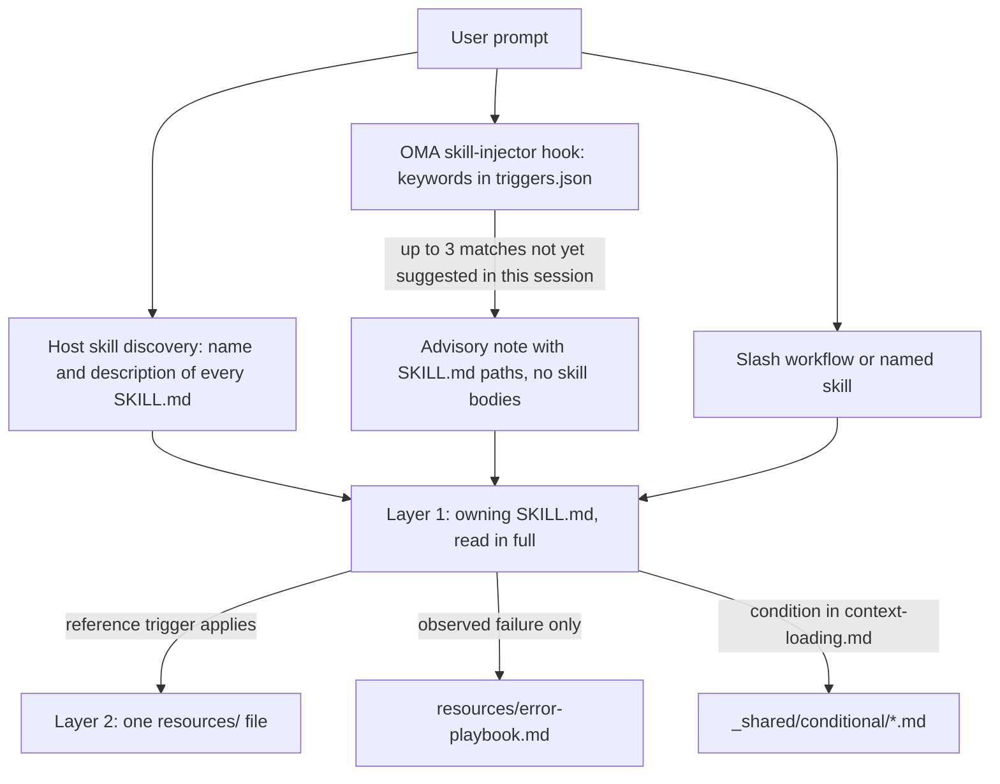
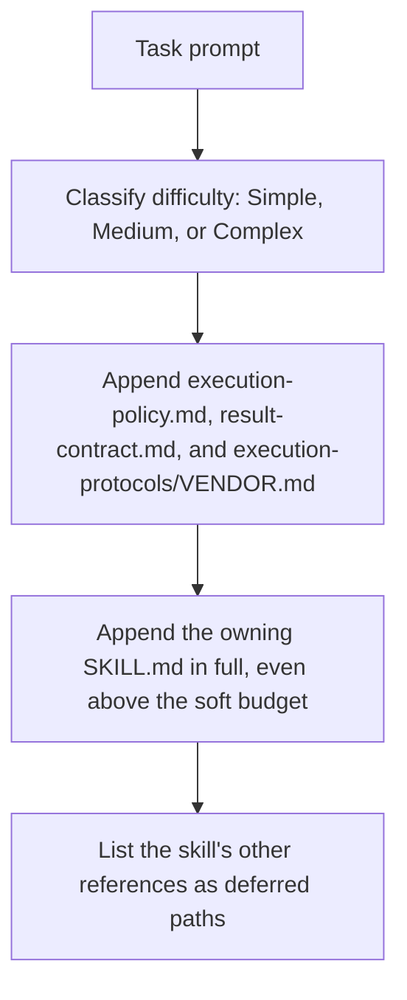

# スキル

[スキル](../getting-started/glossary.md#skill)は、ディスパッチロールにドメインの指針を与える構造化された知識パッケージです。実行プロトコル、技術スタックのリファレンス、コードテンプレート、エラープレイブック、品質チェックリスト、スキルが提供する例を、トークン効率を考えた 2 層アーキテクチャで整理しています。インストール済みのスキル一覧は[スキルカタログ](./agents.md#skill-catalog)を参照してください。

---

## 2 層設計

スキルは段階的にコンテキストへ入ります。選択の段階でモデルに示されるのは、パスか description だけです。スキルが選ばれると、担当の SKILL.md を全文読みます。補助ファイルは、それぞれのトリガーが当てはまったときに 1 つずつ読みます。



出典：`.agents/hooks/core/skill-injector.ts`、`.agents/skills/_shared/core/skill-routing.md`、`.agents/skills/_shared/core/context-loading.md`。

### Layer 1: SKILL.md（スキルが選択されたときに読む）

すべてのスキルはルートに `SKILL.md` ファイルを持ちます。インジェクターフックが渡すのは本文ではなく **パス参照** なので、選択されていないスキルは `description` 以外のコストを消費しません。すべての `SKILL.md` は YAML フロントマターと、共通する 4 つのトップレベルセクションを持ちます。いずれかのセクションが欠けている場合や、本文が 500 行を超える場合は、`oma skill lint` が報告します。

| 部分 | 内容 |
|------|----------|
| フロントマター | `name` と、ルーティング用の `description`（スキルが何をするか、いつ使うか） |
| `## Scheduling` | ゴール、意図のシグネチャ、使用すべき場合、使用すべきでない場合、想定する入力と出力、依存関係 |
| `## Structural Flow` | 遷移、失敗と復旧、終了状態 |
| `## Logical Operations` | 正規のコマンドまたはワークフローのパス、リソースのスコープ、ガードレール |
| `## References` | Layer 2 のファイルと、それぞれを読む根拠となる条件 |

現在の `oma-frontend` のフロントマター：

```yaml
---
name: oma-frontend
description: "Implement or modify web UI in React, Next.js, or Angular. Use for components, pages, styles, forms, and frontend state or data flows."
---
```

ホストランタイムは各スキルの `description` をモデルに示すため、description はルーティング用の文として書きます。OMA のキーワードフックはこれを読みません。フックのキーワードは `.agents/hooks/core/triggers.json` にあります。

### Layer 2: resources/（オンデマンド）

`resources/` ディレクトリには、実行に必要な詳しい知識を収めます。次の場合にだけロードされます。
1. ホストまたはワークフローがスキルを選択した場合（ネイティブスキルの一致や明示的なコマンドなど）
2. 現在のタスクが、そのリファレンスのロード条件を満たす場合

このオンデマンドロードはコンテキストローディングガイド（`.agents/skills/_shared/core/context-loading.md`）が制御します。ガイドは、エントリの指示と、タスクごとに選択するリファレンスを区別します。

### `oma agent spawn` が注入する内容

CLI ディスパッチはサブエージェントのプロンプトを自分で組み立てます。そのため、サブエージェントはコントラクトと担当スキルがすでにコンテキストにある状態で始まります。



出典：`cli/commands/agent/spawn-status.ts`、`cli/platform/agent-config/loaders.ts`、`cli/platform/context-loader.ts`。ネイティブサブエージェントは同じタスクコンテキストを `oma agent context <agent-id>` から受け取ります。ランタイムが提供していない場合は、ポリシーと結果コントラクトを自分で読みます。

---

## ファイル構造の例

```text
.agents/skills/oma-frontend/
├── SKILL.md                          ← Layer 1: read when selected
└── resources/
    ├── execution-protocol.md         ← Layer 2: step-by-step workflow
    ├── tech-stack.md                 ← Layer 2: detailed technology specs
    ├── tailwind-rules.md             ← Layer 2: Tailwind conventions
    ├── angular-rules.md              ← Layer 2: Angular-specific conventions
    ├── snippets.md                   ← Layer 2: copy-paste code patterns
    ├── error-playbook.md             ← Layer 2: error recovery procedures
    └── checklist.md                  ← Layer 2: quality verification checklist

.agents/skills/oma-backend/
├── SKILL.md
├── resources/
│   ├── execution-protocol.md
│   ├── orm-reference.md              ← Domain-specific (ORM queries, N+1, transactions)
│   ├── checklist.md
│   └── error-playbook.md
└── variants/                          ← Starter seeds for /stack-set
    ├── stack.schema.json
    ├── node/
    ├── python/
    └── rust/

.agents/skills/oma-mobile/
├── SKILL.md
├── resources/
│   ├── execution-protocol.md
│   ├── tech-stack.md
│   ├── screen-template.dart
│   ├── screen-template.swift         ← Swift native iOS screen template
│   ├── screen-template.tsx            ← React Native screen template
│   ├── checklist.md
│   └── error-playbook.md
└── variants/                          ← Platform seeds for /stack-set
    ├── README.md
    ├── stack.schema.json
    ├── flutter/                       ← stack.yaml, tech-stack.md, snippets.md, api-template.dart
    ├── react-native/                  ← stack.yaml, tech-stack.md, snippets.md, api-template.ts
    └── swift-ios/                     ← stack.yaml, tech-stack.md, snippets.md, api-template.swift

.agents/skills/oma-design/
├── SKILL.md
├── resources/
│   ├── execution-protocol.md
│   ├── anti-patterns.md
│   ├── asset-strategy.md
│   ├── checklist.md
│   ├── design-md-spec.md
│   ├── design-tokens.md
│   ├── getdesign-fetcher.md
│   ├── prompt-enhancement.md
│   ├── redesign-protocol.md
│   ├── stitch-integration.md
│   └── error-playbook.md
└── reference/                         ← Deep reference material
    ├── typography.md
    ├── color-and-contrast.md
    ├── spatial-design.md
    ├── motion-design.md
    ├── responsive-design.md
    ├── component-patterns.md
    ├── accessibility.md
    ├── visual-hierarchy.md
    └── shader-and-3d.md
```

---

## スキルごとのリソースタイプ

| リソースタイプ | ファイル名パターン | 目的 | ロードされるタイミング |
|--------------|-----------------|---------|-------------|
| **実行プロトコル** | `execution-protocol.md` | 手順型ワークフロー：Analyze -> Plan -> Implement -> Verify | 選択した操作で、コマンドやコントラクトの詳細が必要なとき |
| **技術スタック** | `tech-stack.md` | 技術仕様、バージョン、設定の詳細 | 選択したフレームワークまたはスタックの判断に関わる場合 |
| **エラープレイブック** | `error-playbook.md` | 症状から復旧までの手順。情報や権限が足りない場合は、それに依存するアクションだけを止めます | 失敗を実際に確認した後のみ |
| **チェックリスト** | `checklist.md` | ドメイン固有の品質検証 | 未解決の検証に関係するセクション |
| **スニペット** | `snippets.md` | コピーして使えるコードパターン | 実装や出力の形式になじみがない場合 |
| **例** | `examples.md` | 具体的な入出力例（oma-pm、oma-db、oma-tf-infra、oma-observability、oma-search） | 実装や出力の形式になじみがない場合 |
| **バリアント** | `variants/` ディレクトリ | 言語・フレームワークごとのスターターシード。Backend には `node`、`python`、`rust` があり、Mobile には `flutter`、`react-native`、`swift-ios` があります。`/stack-set` はこれらを使ってプロジェクトの `stack/` を生成します。 | 対応するスタックをセットアップするとき |
| **テンプレート** | `screen-template.{dart,swift,tsx}`（oma-mobile）、`variants/*/api-template.*` | 新しい画面や API モジュールのボイラープレート | そのファイルを作成するとき |
| **ドメインリファレンス** | `orm-reference.md`、`anti-patterns.md` など | 特定のサブタスク向けの詳しいドメイン知識 | タスクの種類に応じて |

---

## 共有リソース（_shared/）

すべてのエージェントは `.agents/skills/_shared/` の共通基盤を共有します。リソースは 3 つのカテゴリに分かれています。

### コアリソース（`.agents/skills/_shared/core/`）

| リソース | 目的 | ロードされるタイミング |
|----------|---------|-------------|
| **`execution-policy.md`** | すべてのスキルとワークフローに適用される、承認、明確化、検証、完了のルール。 | すべての `oma agent spawn` プロンプトに注入されます。提供されていない場合はネイティブエージェントが読みます |
| **`skill-routing.md`** | タスクの成果、担当、実際の依存関係でルーティングします。必須のエージェント連鎖やターン数のクォータはありません。 | オーケストレーターとコーディネーションスキルが参照 |
| **`context-loading.md`** | 担当スキルのエントリ、条件付きリファレンス、ランタイムのロード境界。 | コンテキストを組み立てるとき |
| **`prompt-structure.md`** | なじみのないタスクの引き継ぎで、ゴール、コンテキスト、実際の制約、受入基準を満たす証拠を示す指針です。直接依頼されたタスクに必須のテンプレートはありません。 | なじみのない引き継ぎを組み立てるとき。必須の事前ロードではありません |
| **`clarification-protocol.md`** | 通常の詳細はコンテキストから解決し、重要な不足情報と承認だけを求めます。 | 要件が曖昧な場合 |
| **`code-intelligence.md`** | コード検索、ナビゲーション、影響分析には、設定済みのコードインテリジェンス機能を使います。 | コード検索またはナビゲーション |
| **`test-approach.md`** | PM の計画にあるタスクごとの `test_approach` と、`tdd` タスク向けの `TDD_EVIDENCE` ブロック。 | 計画で `test_approach` が設定されたタスク |
| **`context-budget.md`** | ファイルサイズの推定値、実際のプロンプトの計測、範囲を絞った読み取り、チェックポイント。 | 長いタスク、またはコンテキストのオーバーヘッドを診断するとき |
| **`difficulty-guide.md`** | 依存関係と検証の必要性から、計画の深さと成果物を決めます。 | タスク分解で難易度の見積もりが必要なとき |
| **`quality-principles.md`** | スコープ、保守性、証拠、タスクに見合った検証に関する指針です。 | 品質重視ワークフロー（ultrawork）の開始時 |
| **`vendor-detection.md`** | 設定から各エージェントの対象ベンダーを解決し、ネイティブディスパッチか `oma agent spawn` かを選びます。 | ディスパッチの詳細が未解決のとき |
| **`session-metrics.md`** | 会話や評価者に関するペナルティスコアを伴わない、任意のセッションの証拠。 | 振り返りが依頼されたとき、または重要な訂正があったとき |
| **`common-checklist.md`** | 該当するドメイン横断のチェック。全体に適用する行数の上限や、catch を一律に求める要件はありません。 | ドメイン横断のレビューが関連する場合 |
| **`lessons-learned.md`** | バージョンやトリガーの条件を付けて、証拠に裏付けられた学びを記録し、適用します。RCA を自動で実施するしきい値はありません。 | エラー後とセッション終了時に参照 |
| **`anti-ai-prose.md`** | 共有の文章診断。 | 学術的な文章の監査と、翻訳スタイルのレビュー |
| **`stack-verify.schema.json`** | backend と mobile のスタックスキーマが再利用する、共有の `verify:` 定義。 | スタックスキーマの検証 |
| **`api-contracts/`** | 任意のコントラクトテンプレート。プロジェクトのスキーマを再利用します。生成されたコントラクトは、スキルのソースの外にあります。 | 境界をまたぐ作業を計画するとき |

### ランタイムリソース（`.agents/skills/_shared/runtime/`）

| リソース | 目的 |
|----------|---------|
| **`result-contract.md`** | エージェント結果の実行 ID、申告パス、完了コントラクト。すべての `oma agent spawn` プロンプトに注入されます。ネイティブエージェントは `oma agent begin`、`oma agent verify`、`oma agent finish` でこれに従います。 |
| **`memory-protocol.md`** | CLI サブエージェント向けのメモリファイル形式と操作。設定可能なメモリツール（read / write / edit）を使う On Start、During Execution、On Completion のプロトコルを定義します。実験追跡の拡張も含みます。 |
| **`event-spec.md`** | 永続的なワークフローイベントのコントラクト。イベントは OMA ホームプロファイル配下の `events.jsonl` に追記され、`oma state get` または `oma state list` で確認できます。 |
| **`execution-protocols/claude.md`** | Claude Code 固有の実行パターン。ベンダーが claude のとき、`oma agent spawn` が注入します。 |
| **`execution-protocols/antigravity.md`** | Antigravity CLI（`agy`）の実行パターン。 |
| **`execution-protocols/codex.md`** | Codex CLI 固有の実行パターン。 |
| **`execution-protocols/commandcode.md`** | CommandCode の実行パターン。 |
| **`execution-protocols/grok.md`** | Grok の実行パターン。 |
| **`execution-protocols/kimi.md`** | Kimi Code の実行パターン。 |
| **`execution-protocols/kiro.md`** | Kiro の実行パターン。 |
| **`execution-protocols/opencode.md`** | OpenCode 拡張の実行パターン。 |
| **`execution-protocols/pi.md`** | pi 拡張の実行パターン。 |
| **`execution-protocols/qwen.md`** | Qwen CLI 固有の実行パターン。 |

ベンダー固有の実行プロトコルは、CLI 起動のエージェントなら `oma agent spawn` が自動で注入します。ネイティブサブエージェントは、選択したベンダーの統合規則を使います。

### 条件付きリソース（`.agents/skills/_shared/conditional/`）

これらは、実行中に特定の条件が満たされたときにだけロードされます。

| リソース | トリガー条件 | ロード元 |
|----------|-------------------|-----------|
| **`quality-score.md`** | 定義済みのベースラインまたは実験の比較が必要になる | Orchestrator（QA エージェントのプロンプトへ渡す） |
| **`experiment-ledger.md`** | 実際の仮説を、ベースラインまたは別のアプローチと比較する | Coordinator（共有の台帳を管理します。並列エージェントはタスク単位・実行単位の結果を書き、Coordinator がそれを統合します） |
| **`exploration-loop.md`** | 復旧を繰り返しても失敗し、予算の範囲で代替案を試す価値がある | Orchestrator（仮説エージェントをスポーンする前にインラインで渡す） |
| **`diagram-engine.md`** | ワークフローが構造図（アーキテクチャ、シーケンス、データフロー、ライフサイクル）を出力しようとしている | 図を出力するワークフロー |

これらのリソースは、それぞれのトリガー条件を満たすまでロードを後回しにします。難易度だけでは注入しません。

---

## スキルが選択される仕組み {#how-skills-route-via-skill-routingmd}

スキルがコンテキストに入る経路は 3 つあります。どの経路も、それ単独ではワークフローを開始せず、委任を承認することもありません。

1. **ホストのネイティブ検出。** スキルをサポートするランタイムは、すべてのスキルの `name` と `description` を一覧にします。モデルは、依頼された成果に description が一致する SKILL.md を読みます。
2. **OMA のキーワードヒント。** OMA がプロンプトフックをインストールしている環境では、`skill-injector` がプロンプトを `.agents/hooks/core/triggers.json` の多言語キーワードと照合します。そして、最大 3 つの SKILL.md パスを挙げた助言の `[OMA SKILLS DETECTED: ...]` ノートを追加します。「Tailwind CSS でログインフォームを作成」の場合、一致するのは `tailwind` キーワードだけなので、ノートは `oma-frontend` を提案します。
3. **明示的な呼び出し。** `/plan`、`/review`、`/debug` などのスラッシュワークフロー、またはプロンプトでスキル名を指定する方法です。

### 成果による担当

範囲の決まったタスクは、1 つの担当スキルが扱います。別のスキルが固有の能力を提供する場合に限り、引き継ぎを追加します。この表は `.agents/skills/_shared/core/skill-routing.md` を反映しています。その他のドメインは、[スキルカタログ](./agents.md#skill-catalog)にあるインストール済みスキルの description から選んでください。

| 依頼された成果 | 担当スキル |
|-------------------|--------------|
| アプリケーション API、サーバー認証、サービス / データアクセスのロジック | oma-backend |
| スキーマ、マイグレーション設計、インデックス、クエリチューニング、データベース運用 | oma-db |
| Web のコンポーネント、ページ、フォーム、クライアントの状態 | oma-frontend |
| モバイルの画面、ウィジェット、プラットフォーム統合 | oma-mobile |
| システム境界、アーキテクチャのトレードオフ、ADR | oma-architecture |
| 誤った動作の診断と修正 | oma-debug |
| 正確性、セキュリティ、アクセシビリティ、パフォーマンスのレビュー | oma-qa |
| ビジュアルシステム、DESIGN.md、リデザインの方向性 | oma-design |
| 依頼されたアイデア出しや代替案の検討 | oma-brainstorm |
| 要件、依存関係、受入基準 | oma-pm |
| 依頼されたスペシャリストの並列実行 | oma-orchestration |
| 依頼された手動のマルチエージェント調整 | oma-coordination |
| Git のブランチ、コミット、マージ、リポジトリ履歴 | oma-scm |

### スキル間の依存関係

固定の実行チェーンはありません。実際の依存関係に従って作業の順序を決めます。

- 未確定のアーキテクチャやプロダクトの判断は、それに依存する作業より先に解決します。すでに決まっている判断を、アーキテクチャ、ブレインストーミング、PM にもう一度通す必要はありません。
- 共有の API コントラクトが使える状態なら、Backend とクライアントの作業は独立して進められます。コントラクトがない場合は、関係する担当者と先にその境界を決めます。
- 独立した実装を続けながら、完成してレビューできる部分のレビューを始められます。不安定な成果物を最終的な証拠としてレビューしないでください。
- 実装中に見つかったバグは、その担当者が修正できます。診断が必要な場合にデバッグの支援を追加します。実装からデバッグへ進む必須のチェーンはありません。
- ドメインをまたぐ不具合では、証拠から失敗しているコントラクトと責任を持つ担当者を特定します。API の不一致があっても、Backend を変更すべきだとは限りません。

### スキルのヒントが表示されない場合

以下の動作はすべて `.agents/hooks/core/skill-injector.ts` に由来します。

| 症状 | 原因 | 対処 |
|---------|-------|------------|
| `[OMA SKILLS DETECTED]` ノートがまったく出ない | プロンプトが `/` で始まっている、セッションで[永続ワークフロー](../getting-started/glossary.md#persistent-workflow)が有効になっている、またはメッセージが中継されたエージェントメッセージである | 想定どおりの動作です。コンテキストはワークフローが管理します。必要ならスキル名を指定してください |
| 期待したスキルがノートにない | 一覧に出るのは上位 3 件の一致だけです（一致したキーワード 1 つにつき 10 点） | より具体的な用語を使うか、スキル名を指定してください |
| 以前に提案されたスキルが再び提案されない | SKILL.md のパスはセッションごとに 1 回だけ提案されます。`.agents/state/skill-sessions.json` の記録は、新しい提案がないまま 1 時間たつと期限切れになります | 以前の提案は引き続き有効です |
| キーワードが無視される | コードフェンス、バッククォート、ダブルクォートの中のテキストは、照合の前に取り除かれます | その用語をプレーンテキストで書いてください |
| oma-academic-writing、oma-docs、oma-explanation、oma-scholar、oma-skill-creation が提案されない | これらのスキルは `triggers.json` にキーワードがありません | `/docs` や `/explain` を使うか、スキル名を指定してください。ホストの検出は引き続き description を参照します |
| ヒントが無関係なスキルを挙げる | 照合はキーワードベースで、助言にすぎません | 求める成果を明記してください。ノートはモデルに判断を委ねるよう指示しています |

---

## トークン節約の計算 {#token-savings-math}

節約を主張する前に、コンテキストのコストを計測してください。simple、medium、complex という言葉は、2 つの異なるものに使われています。

- **スクリプトのシナリオ**（`routed`、`simple`、`medium`、`complex`、`all`）は、`scripts/measure-skill-context.ts` が出力する、累積のファイルサイズ比較です。ロードのポリシーではありません。`all` は上限にすぎません。
- **ローダーの難易度**（Simple、Medium、Complex）は、CLI ディスパッチが注入するコンテキストのソフトな予算を選びます。[タスクごとのリソースロード](#resource-loading-by-task)を参照してください。

```bash
bun scripts/measure-skill-context.ts
bun scripts/measure-skill-context.ts --skills oma-pm,oma-backend,oma-frontend --json
oma agent context backend --difficulty Medium
```

スクリプトは UTF-8 バイト数 / 4 の推定値を報告します。`routed` はエントリのみです。`simple`、`medium`、`complex` は比較用に、想定上のプロトコル、例、スタックの各ファイルを追加します。これらの名前はスクリプトとの互換性のために残してあり、事前ロードの指示ではありません。新しいチェックアウトでは、サイズの目安としてプラットフォームのシードを 1 つ使う場合があります。すべてのプラットフォームをロードするわけではありません。

context コマンドは、実際に注入されるタスクコンテキストを表示します。内容は、`## Task context (graph-selected, approximately N tokens)` ヘッダー、担当の SKILL.md、後回しにしたリファレンスの一覧です。会話のそれ以外の部分は含まず、ホストやランタイムの指示もすべては含みません。また、`oma agent spawn` は実行ポリシー、結果コントラクト、ベンダープロトコルも追加するため、スポーンされるプロンプトはこれより大きくなります。特定のモデルでの入力トークンの総数、レイテンシ、コストを計測するには、組み立てたプロンプトか使用状況のテレメトリを使ってください。これらをリポジトリのサイズや、生成されたミラーの数から推測しないでください。

## タスクごとのリソースロード {#resource-loading-by-task}

どの難易度でも、担当スキルから始めます。グラフはリファレンスのインデックスです。隣接関係は、別のスペシャリスト、エラープレイブック、条件付きの実験ワークフローをロードする許可にはなりません。

ローダーは、Simple / Medium / Complex にそれぞれ推定 1,500 / 4,000 / 8,000 トークンのソフトな予算を使います。予算を超えるエントリも保持し、超過を報告します。補助リファレンスは、タスクのトリガーが確定したあとで明示的に選択しない限り、ロードを後回しにしたままです。必須のエントリを、より小さな無関係のドキュメントで置き換えることはありません。

検証は、タスクのリスクとプロジェクトの要件に従います。難易度のラベルによって、完全なテストスイート、固定のプリフライト応答、承認済みの作業への再度の承認が必要になることはありません。

## コンテキストロードのタスクマップ（エージェント別）

これらは、タスクで必要になったときに参照するリファレンスの例です。担当スキルの最新のインデックスを使い、該当するセクションだけを選択してください。

### Backend エージェント

<!-- oma-docs:ignore-start -->

| タスクの種類 | 必須リソース |
|-----------|-------------------|
| CRUD API の作成 | 存在する場合はプロジェクトの `stack/snippets.md` と `stack/api-template.*`（`/stack-set` が生成）。ない場合は既存のプロジェクトコード |
| 認証 | 存在する場合は `stack/snippets.md` + `stack/tech-stack.md` |
| DB マイグレーション | 存在する場合は `stack/snippets.md`。スキーマ設計は oma-db が担当 |
| パフォーマンス最適化 | `orm-reference.md` と、スキルが提供する対応する例 |
| 既存コードの変更 | プロジェクトのコードインテリジェンスプロバイダーと関連する実行リソース |

<!-- oma-docs:ignore-end -->

`variants/node`、`variants/python`、`variants/rust` は `/stack-set` 用のスターターシードです。既存コードを編集するとき、エージェントはこれらを読みません。

### Frontend エージェント

| タスクの種類 | 必須リソース |
|-----------|-------------------|
| コンポーネント作成 | snippets.md とプロジェクト既存のコンポーネントパターン |
| フォーム実装 | snippets.md（フォーム + Zod） |
| API 統合 | snippets.md（TanStack Query） |
| スタイリング | tailwind-rules.md |
| ページレイアウト | snippets.md（grid） |

### Design エージェント

| タスクの種類 | 必須リソース |
|-----------|-------------------|
| デザインシステム作成 | reference/typography.md + reference/color-and-contrast.md + reference/spatial-design.md + design-md-spec.md |
| ランディングページのデザイン | reference/component-patterns.md + reference/motion-design.md + prompt-enhancement.md |
| デザイン監査 | checklist.md + anti-patterns.md |
| デザイントークンのエクスポート | design-tokens.md |
| 3D / シェーダー効果 | reference/shader-and-3d.md + reference/motion-design.md |
| アクセシビリティレビュー | reference/accessibility.md + checklist.md |

### QA エージェント

| タスクの種類 | 必須リソース |
|-----------|-------------------|
| セキュリティレビュー | checklist.md（Security セクション） |
| パフォーマンスレビュー | checklist.md（Performance セクション） |
| アクセシビリティレビュー | checklist.md（Accessibility セクション） |
| 完全監査 | checklist.md（全セクション）。規格に基づくレビューが依頼された場合は iso-quality.md も |
| 定義済みメトリクスの比較 | quality-score.md（条件付き） |

---

## オーケストレーターのプロンプト構成

オーケストレーターがサブエージェントのプロンプト（`oma-orchestration/resources/subagent-prompt-template.md`）を書くときは、タスクのデータだけを渡します。エージェントのロール、タスク ID、ワークスペース、許可されたパス、タスクの説明、受入基準、ロード条件付きのタスクリファレンス、重要な制約です。

- CLI ディスパッチでは、`oma agent spawn` が `execution-policy.md`、`result-contract.md`、ベンダーの実行プロトコル、担当の SKILL.md をすでに注入しているため、プロンプトでは繰り返しません。
- ネイティブディスパッチでは、ランタイムが提供していない場合に、それらのファイルと担当スキルのパスを渡します。
- error-playbook のセクションは失敗を実際に確認した後にだけ追加し、`runtime/memory-protocol.md` はエージェントが永続的なタスク状態を調整または再開する場合にだけ追加します。

このプロンプトでは不要なリソースを省き、タスクに使えるコンテキストを残します。

---

## セッションの証拠と振り返りレビュー

セッション記録には、重要な訂正、スコープの変更、やり直し、裁定済みのレビュー指摘を、証拠とともに残します。必要な明確化にペナルティはありません。以前の CD と EA の加重スコア、およびしきい値で発動する RCA ルールは削除されました。これらはプロンプトの指示であり、CLI が計算するメトリクスではありませんでした。

可能な場合は、既存のタスク結果を使ってください。設定済みのコーディネーションストアの配下に、別ファイルの `session-metrics-{sessionId}.md` を作るかどうかは任意です。失敗の繰り返しや依頼された振り返りは、学びを記録する根拠になり得ます。通常のチェックの失敗や、異議が出ている指摘が、自動的に学びになるわけではありません。過去のログは残し、新しい形式に書き換えないでください。

`oma stats` は、生産性と、記録された使用量・コストのサマリーを報告します。`oma retro` は、実際のゲート、ブロッカー、決定欠落の各イベントを提案にまとめます。どちらも、これらの Markdown アーティファクトから CD / EA スコアを計算しません。

## タスク分解とコンテキストの復旧

依存関係と、独立して検証できる動作を軸に計画してください。固定のスプリント数、ファイル数、ターン数の見積もりは、レビューの深さや完了を決めるものではありません。テストとエラーハンドリングは、検証対象の動作と一緒に扱ってください。

停滞や有用なコンテキストの喪失を実際に確認した場合は、再開または再ディスパッチの前に、完了した作業、残りの基準、関連するパス、検証の証拠を保存してください。既存の作業を保持し、実行中の試行と重複しないようにしてください。ターン数と進捗の比率だけでは、リセットは必要ありません。

## 条件付きの計測と探索

定義済みのベースラインや実験の比較があると、計測のガイダンスが有効になります。テストや lint があるだけでは有効になりません。比較可能なメトリクスを、単位、方法、リビジョン、証拠とともに記録してください。必須の正確性チェックとセキュリティチェックは、引き続き独立しています。OMA には、デフォルトの複合的な計算式も、レターグレードのゲートも、スコアで発動するロールバックもありません。

実際の実験では、仮説、ベースラインと候補の証拠、必須のチェック、決定、担当ファイルを記録します。失敗の繰り返しは、既存の復旧予算の範囲内で別の仕組みを試す根拠になり得ます。実験の変更は分離し、無関係な編集は保持してください。統合した候補を検証してから、ゲートを再開してください。

---

## 関連ページ

- [エージェント](./agents.md)：スキルカタログ、ディスパッチロール、定義、ネイティブエージェントファイル
- [ワークフロー](./workflows.md)：スキルを読むスラッシュワークフロー
- [プロジェクト構造](./project-structure.md)：インストール後に `.agents/skills/` が置かれる場所
- [エージェントの結果と再開](../guide/agent-results-and-resume.md)：ネイティブの `oma agent begin` → `oma agent finish` のライフサイクル
- [スキル評価](../guide/skill-eval.md)と[スキル最適化](../guide/skill-opt.md)
- 作成：`oma-skill-creation` スキルを使い、その後 `oma skill lint` と `oma skill audit` を実行します
