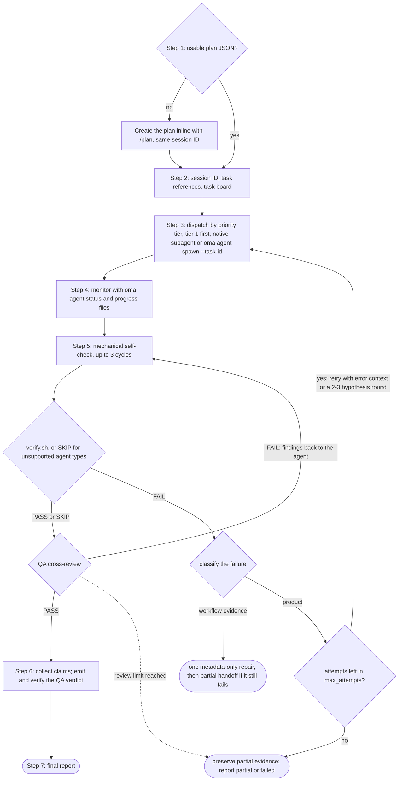
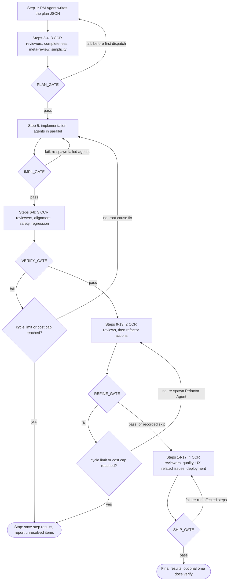
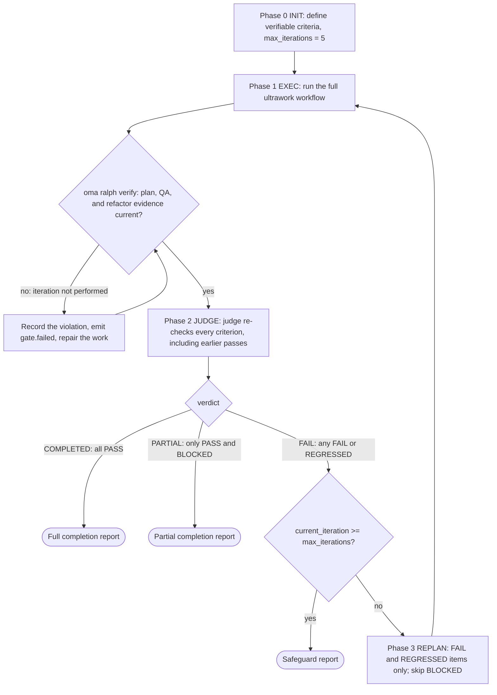

# ワークフロー

ワークフローは、スラッシュコマンドで開始する、構造化された複数ステップのプロセスです。4 つの永続モードは、通常の依頼で名前を挙げたときにも始まります。単一フェーズのユーティリティから、5 フェーズの複雑な品質ゲートまで、エージェントがタスクでどう協力するかを定義します。

20 個のワークフローがあり、そのうち 4 個は[永続的](../getting-started/glossary.md#persistent-workflow)です。永続ワークフローは状態を維持し、誤って中断されません。

## ワークフロー一覧

| ワークフロー | 用途 | 永続 |
|---|---|---|
| [`/orchestrate`](#orchestrate) | プランに基づく自動並列エージェント実行と検証ループ | はい |
| [`/work`](#work) | 複数ドメインの段階的な調整：計画、実装、QA、修正 | はい |
| [`/ultrawork`](#ultrawork) | 12 個の分離レビューステップを持つ 5 フェーズの品質ワークフロー | はい |
| [`/ralph`](#ralph) | 機械的に検証できる基準が通るまで ultrawork を繰り返す | はい |
| [`/plan`](#plan) | 依存関係と API コントラクトを含む PM のタスク分解 | いいえ |
| [`/brainstorm`](#brainstorm) | 計画前のデザインファーストのアイデア出し | いいえ |
| [`/architecture`](#architecture) | アーキテクチャの意思決定、レビュー、ADR | いいえ |
| [`/deepinit`](#deepinit) | 既存のコードベース向けに AGENTS.md、ARCHITECTURE.md、`docs/` を生成 | いいえ |
| [`/review`](#review) | QA レビュー：セキュリティ、パフォーマンス、アクセシビリティ、コード品質 | いいえ |
| [`/security`](#security) | ソース、エージェントスキル、MCP コンポーネントのセキュリティスキャン、指摘の検証、CI ゲート | いいえ |
| [`/debug`](#debug) | 回帰テストを伴うバグの診断と修正 | いいえ |
| [`/design`](#design) | デザインの指摘、DESIGN.md、リデザインの方向性、またはデザイントークン | いいえ |
| [`/scm`](#scm) | Git 操作と Conventional Commits | いいえ |
| [`/convert`](#convert) | ドキュメントとメディアの形式変換 | いいえ |
| [`/docs`](#docs) | ドキュメントのドリフト検出と同期 | いいえ |
| [`/recap`](#recap) | AI ツールをまたいだ日次または期間ごとの作業の振り返り | いいえ |
| [`/stack-set`](#stack-set) | ドメインスキル向けのスタック固有リファレンス | いいえ |
| [`/video`](#video) | `oma-video` スキルによる MP4 生成 | いいえ |
| [`/schedule`](#schedule) | 定期的・時間ベースのエージェントジョブ | いいえ |
| [`/explain`](#explain) | コード変更またはトピックのインタラクティブな HTML 解説 | いいえ |

---

## スキルとワークフローの選び方 {#choosing-a-skill-or-workflow}

タスクに必要な調整と検証で選びます。すでにワークフローを選択している場合はそれに従い、明示的にキャンセルまたは変更するまで実行中のワークフローを続けます。新しいタスクでワークフローを選んでいない場合は、次のガイドを使います。

| タスクに必要なこと | 選択 | 例 |
|---|---|---|
| エージェントの調整を伴わない 1 つのドメイン | [単一スキル](/docs/guide/single-skill) | API エンドポイントを追加し、バリデーションをテストする |
| 計画、実装、QA を段階的に行う複数ドメイン | `/work` | API 変更と Web / モバイルクライアントを調整する |
| 独立したタスクの自動委任と並列実行 | `/orchestrate` | 依存関係を解決してからバックエンドとフロントエンドを並列実装する |
| 明示的に依頼された包括的な品質プロセス | `/ultrawork` | 計画、実装、検証、改善、リリース準備のレビューを一通り実行する |
| 機械的に検証できる基準を満たすまで繰り返すという明示的な依頼 | `/ralph` | ループのセーフガード内で、指定した回帰チェックが通るまで実装と judge による検証を繰り返す |

`/orchestrate` は、エージェントをスポーンする前に使えるプランをロードするか、`/plan` で作成します。先に `/plan` を実行する必要はありません。既存のプランがあるかどうかで `/work` と `/orchestrate` を区別せず、作業をどう調整したいかで選びます。どちらも独立したタスクを並列実行できます。

受入基準とテストは単一スキルのタスクにも含めます。それだけでは `/ralph` は必要になりません。Ralph は各イテレーションで ultrawork の全プロセスと judge による判定を実行するため、検証ループを繰り返したい場合に選びます。セーフガードが適用されると、未完了またはブロックされた作業を残して停止することがあります。

この表は選択の助言であり、自動ワークフロールーターではありません。ホストエージェントは適切な方法を推奨できますが、ワークフローを推奨・説明するだけでは実行を開始しません。スラッシュコマンドが明示的な選択です。キーワード検出フックが有効なら、情報を尋ねる入力のフィルターに該当しない限り、設定済みキーワードまたはパターンへの一致でも起動します。検出器はドメイン数を分類せず、プランの準備状況も確認せず、この表を優先順位アルゴリズムとしても使いません。

プランレビューは、タスクについてすでに与えられた承認を引き継ぎます。エージェントが尋ねるのは、重要な未決定事項またはその範囲外の操作だけです。リリース準備レビュー自体は、公開やデプロイを承認するものではありません。

---

## 永続ワークフロー {#persistent-workflows}

永続ワークフローはすべてのタスクが完了するまで続きます。`.agents/state/` に状態を保持し、明示的に無効化するまで各ユーザーメッセージに `[OMA PERSISTENT MODE: ...]` コンテキストを再注入します。

永続モードが始まるのは、**明示的な呼び出し**があったときだけです。明示的な呼び出しとは、ワークフローのスラッシュコマンド（`/ultrawork`、または `/oma:ultrawork` のような名前空間付きの形式）か、平文で書いたワークフロー自身の名前を指します（`triggers.json` の `explicit` リスト："orchestrate" とその一覧にある翻訳、"ultrawork"/"ulw"、"work mode"/"work workflow"、"ralph"/"랄프"）。キーワードフックが、それ以外の文からワークフローを開くことはありません。

### /orchestrate

**説明：** CLI による自動並列エージェント実行です。サブエージェントを CLI でスポーンし、永続的な実行状態と実行記録で調整し、進捗を監視して検証ループを実行します。

**永続：** はい。状態ファイルは `.agents/state/orchestrate-state-{sessionId}.json` です。

**トリガーキーワード：**

| 言語 | キーワード |
|----------|----------|
| 明示的な呼び出し（永続） | "orchestrate", "オーケストレート", "orquestar", "orchestrer", "orchestrieren", "orquestrar", "оркестровать", "orkestreren", "orkiestrować" |

"do everything"、"전부 해줘"、"build me an app" のような文では、このワークフローは始まりません。

**ステップ：**

1. **Step 0、準備：** coordination スキル、context-loading ガイド、memory protocol を読み、ベンダーを検出します。
2. **Step 1、プランのロード/作成：** `.agents/results/plan-{sessionId}.json`、次に最新の `plan-*.json` を確認します。プランがない場合、またはエージェント、優先度ティア、依存関係、受入基準のいずれかが欠けていて実行可能でない場合は、同じセッション ID を保ったまま `/plan` にインラインで作成を委任します。プランを提示し、既存の承認を引き継ぎます。委任前に確認するのは、重要な未決定事項または新しい承認が必要な場合だけです。
3. **Step 2、セッションの初期化：** `oma-config.yaml` をロードし、CLI マッピング表を表示します。プラン作成時のセッション ID を再利用するか、`session-YYYYMMDD-HHMMSS` を生成します。タスクごとに、インストール済みスキルのインテントシグネチャと照合して、必要なスキルリファレンスを選びます。確信を持って一致したスキルが 1 つあれば十分です。設定済みのメモリストアに `orchestrator-session-{sessionId}.md` と `task-board-{sessionId}.md` を作成し、各タスクで選んだリファレンスと選択の理由をそこに記録します。これらはコーディネーターのメモであり、ランチャーが強制することはありません。
4. **Step 3、エージェントのスポーン：** 優先度ティアごとに（低い番号から順に、ティア 1、次にティア 2 と進みます）、ベンダーに適した方法でエージェントをスポーンします。同じランタイムとベンダーならネイティブサブエージェントを使い、外部または異なるベンダーなら `oma agent spawn` を使います。各エージェントは、タスク、API コントラクト、選択されたリファレンスとそのロード条件を受け取ります。MAX_PARALLEL（デフォルト 3）を超えません。
5. **Step 4、モニタリング：** `oma agent status` でプロセスの状態を確認します。ホストの完了通知を優先し、通知がない場合は、変更のあった実行単位の `progress-{agentId}-{taskId}-{runId}-{sessionId}.md` を上限付きバックオフでポーリングします。構造化された実行記録を読み、タスクボードを更新します。完了、失敗、クラッシュを監視します。
6. **Step 5、検証：** 完了したエージェントごとに、機械的なセルフチェック（lint、型チェック、テスト、diff の範囲。最大 3 サイクル）を実行し、次に `verify.sh {agent-type} {workspace}` を実行します（対象は backend、frontend、mobile、qa、debug、pm で、それ以外のエージェントタイプは `SKIP` を記録します）。最後に QA クロスレビューを行います。verify に失敗したら、エラーのコンテキストを付けて再スポーンします。失敗が続く場合は別の仮説を検討する理由になり得ますが、元の試行、各再試行、各仮説は、同じ合計の復旧予算（`max_attempts`、元の試行を含めてデフォルト 3）を消費します。予算で比較ラウンドを賄えない場合は、未解決の証拠を保全します。
7. **Step 6、収集：** 実行単位の結果ファイルと構造化された申告を読み、サマリーを作成します。
8. **Step 7、最終レポート：** セッションサマリーを提示します。実験を実施した場合は証拠と判断をまとめ、教訓を記録するのは再利用できる原因が特定できた場合に限ります。



**読み込むファイル：** `.agents/results/plan-{sessionId}.json`、`.agents/oma-config.yaml`、実行単位の進捗/結果ファイル、構造化された実行記録。
**書き込むファイル：** 設定済みメモリストアの実行単位のセッション/タスクボード状態、構造化された実行記録と申告、最終レポート。

**使用すべき場合：** 自動調整で最大限の並列処理が必要な大規模プロジェクト。

---

### /work

**説明：** 複数ドメインの作業を段階的に調整します。PM が最初に計画し、エージェントが承認済みの範囲で実行し、QA レビューと問題修正を続けます。

**永続：** はい。状態ファイルは `.agents/state/work-state-{sessionId}.json` です。

**トリガーキーワード：**

| 言語 | キーワード |
|----------|----------|
| 明示的な呼び出し（永続） | "work mode", "work workflow" |

単独の "work" はトリガーではありません。日常的な語彙だからです（"Does this work on Windows?"）。"step by step" とその翻訳でも、このワークフローは始まりません。

**ステップ：**

1. **Step 0、準備：** スキル、context-loading、memory protocol を読み、セッション開始を記録します。
2. **Step 1、要件分析：** 関係するドメインを特定します。単一ドメインなら直接エージェントを使うよう提案します。
3. **Step 2、PM エージェントによる計画：** PM が要件を分解し、API コントラクトと優先度付きタスク分解を作成して `.agents/results/plan-{sessionId}.json` に保存します。
4. **Step 3、プランのレビュー：** プランを提示し、既存の承認範囲で続行します。重要な未決定事項や新しい承認が必要な場合だけ質問します。
5. **Step 4、エージェントのスポーン：** 優先度ティアごとにスポーンし、同じティアでは並列実行します。ワークスペースは分けます。
6. **Step 5、モニタリング：** 進捗ファイルをポーリングし、エージェント間の API コントラクト整合性を検証します。
7. **Step 6、QA レビュー：** セキュリティ（OWASP）、パフォーマンス、アクセシビリティ、コード品質をレビューする QA エージェントをスポーンします。
8. **Step 6.1、計測（条件付き）：** 定義された比較が必要な場合に、ベースラインを記録します。
9. **Step 7、反復：** CRITICAL / HIGH の問題があれば担当エージェントを再スポーンします。同じ問題が 2 回続いたら Exploration Loop を起動します。

**使用すべき場合：** 複数ドメインにまたがり、計画・実装・QA を段階的に調整したい機能。

---

### /ultrawork

**説明：** 品質に焦点を当てたワークフローです。5 フェーズ、全 17 ステップ、12 個の分離レビューを持ちます。各フェーズには、次に進む前に通過しなければならないゲートがあります。

**永続：** はい。状態ファイルは `.agents/state/ultrawork-state-{sessionId}.json` です。

**トリガーキーワード：**

| 言語 | キーワード |
|----------|----------|
| 明示的な呼び出し（永続） | "ultrawork", "ulw" |

**フェーズとステップ：**

| フェーズ | ステップ | エージェント | レビュー観点 |
|-------|-------|-------|-------------------|
| **PLAN** | 1-4 | PM Agent（作成者、Step 1）+ CCR レビュアー（Steps 2-4） | 完全性、メタレビュー、過剰エンジニアリング/シンプルさ |
| **IMPL** | 5 | Dev Agents（スポーン） | 実装 |
| **VERIFY** | 6-8 | CCR レビュアー | 整合性、安全性（OWASP）、回帰防止 |
| **REFINE** | 9-13 | Refactor Agent（Steps 9、11、13）+ CCR レビュアー（Steps 10、12） | ファイル分割、再利用性、カスケード影響、一貫性、デッドコード |
| **SHIP** | 14-17 | CCR レビュアー | コード品質（lint / coverage）、UX フロー、関連課題、デプロイ準備 |

各レビューステップは、それぞれ新しいコンテキストを持つ専用のレビュアーサブエージェントとして実行されます（[クロスコンテキストレビュー](../getting-started/glossary.md#cross-context-review-ccr)）。PM Agent が自分のプランをインラインでレビューすることはありません。

**ゲートの定義：**

- **PLAN_GATE：** プランが文書化され、前提が列挙され、代替案が検討され、過剰エンジニアリングのレビューが完了し、スコープが承認されています。
- **IMPL_GATE：** 適用対象の、出力ファイルを生成しないチェックとテストが通り、計画したファイルだけを変更し、実際の実験ではベースラインの証拠を記録します。ビルドチェックは明示的に依頼された場合のみ実行します。
- **VERIFY_GATE：** 実装が要件に一致し、CRITICAL ゼロ、HIGH ゼロ、回帰なし、適用対象のプロジェクト計測目標を満たしています。
- **REFINE_GATE：** プロジェクトの保守性ルールに従い、統合機会を記録し、副作用を確認してコードを整理し、未解決の回帰がありません。
- **SHIP_GATE：** 品質チェック、UX 検証、関連課題、デプロイ準備チェックリストが完了し、適用対象のプロジェクト計測目標を最新の証拠で満たしています。既存の承認を引き継ぎますが、公開またはデプロイにはその操作の承認が必要です。

**ゲートに失敗した場合：**
- 1 回目の失敗：該当ステップへ戻って修正し、再試行します。
- 同じ問題で 2 回目の失敗：原因を再評価します。残りの予算内で試す価値のある代替案があれば、分離した実験を、必要な動作と定義済みの指標に照らして比較します。
- 上限：PLAN の失敗で Step 1 に戻れるのは、最初のタスクをディスパッチする前だけです（以降、プランは変更できません）。VERIFY と REFINE の再試行は、ゲート失敗回数が設定済みの上限（デフォルトは VERIFY + REFINE で 5 サイクル）に達するか、セッションのコスト上限を超えると停止します。



**条件付きの拡張：** 定義済みの指標による比較、実験の判断と証拠、予算内での仮説探索、再利用できる原因に裏づけられた教訓。

**REFINE のスキップ条件：** 50 行未満の単純なタスク。

**使用すべき場合：** リリース準備状況を判断する前に完全なレビュー工程を実行したい場合。ワークフローはチェックと指摘を記録しますが、プロダクション準備完了の判断は行いません。

---

### /ralph

**説明：** 自己参照型の永続実行ループです。ultrawork を [judge](../getting-started/glossary.md#judge) で包み、各イテレーション後に完了基準を確認します。すべての基準が PASS なら完全完了、PASS と BLOCKED だけが残るなら部分完了を報告し、セーフガードが発動したら停止します。

**永続：** はい。状態ファイルは `.agents/state/ralph-state-{sessionId}.json` です。

**トリガーキーワード：**

| 言語 | キーワード |
|------|-----------|
| 明示的な呼び出し（永続） | "ralph", "랄프" |

単独の再開フレーズ（"keep going"、"carry on"、"계속해"、"続けて"、"продолжай" など）や、完了を求める言い回し（"don't stop"、"끝까지 해"）では、このワークフローは始まりません。

**フェーズ：**

1. **Phase 0、INIT：** 前提（context-loading、memory protocol、judge protocol）をロードします。テストのアサーション、出力ファイルを生成しない型チェック、終了コード、ファイルの存在など、機械的に検証できる完了基準を定義して記録します。ビルドチェックは明示的に依頼された場合だけ含めます。基準を提示して承認済みの範囲で続行し、`max_iterations: 5` でセッションを初期化します。
2. **Phase 1、EXEC：** ultrawork（PLAN → IMPL → VERIFY → REFINE → SHIP）を、Ralph のセッション ID のもとで 1 回のイテレーションとして実行します。続いてアーティファクトゲート `oma ralph verify --json --session-id <sessionId> --newer-than <iteration start>` を実行します。ゲートに失敗した場合、そのイテレーションは実行されなかったものとして扱います。Ralph は違反を記録し、作業を修復してからゲートを再実行します。
3. **Phase 2、JUDGE：** judge が、承認済みのチェックを実行してファイルの存在を確認し、各完了基準を実際のプロジェクト状態に照らして確認します。ワークフローのプロンプトは、オーケストレーターに対して、基準だけを伝えた新しいコンテキストの別エージェントとして judge をスポーンするよう指示します。スポーンを機械的に確認する仕組みはありません。サブエージェントをスポーンできないランタイムには、インラインで判定して `ralph.judge-inline-fallback` を記録するよう指示します。根拠と、PASS、FAIL、REGRESSED、BLOCKED の基準状態を記録します。
4. **判定ゲート：** すべての基準が PASS なら完全完了を報告します。PASS と BLOCKED だけなら部分完了を報告します。FAIL または REGRESSED があれば、セーフガードの範囲内で失敗のコンテキストを次のイテレーションへ渡します。
5. **Phase 3、REPLAN：** 次のイテレーションの対象を FAIL と REGRESSED の項目に絞り（diff を踏まえて診断します）、BLOCKED の項目はスキップし、PASS の基準は judge の確認範囲に残します。その後 Phase 1 に戻ります。
6. **セーフガード：** `current_iteration >= max_iterations`（デフォルト 5）に達するとループを停止します。同じ根本原因で 3 回連続して失敗した基準は BLOCKED となり、再試行されません（スタック検出）。



judge ノードは Phase 2 で説明した、プロンプトで指示される judge です。ワークフローはオーケストレーターに新しいコンテキストで judge をスポーンするよう指示し、サブエージェントをスポーンできないランタイムはインラインで判定してフォールバックを記録します。

**/ultrawork との主な違い：** Ultrawork は 5 フェーズのプロセスを実行し、フェーズのゲートに失敗すると再試行します。Ralph は ultrawork をリトライループに包み、プロンプトで指示された judge がプロジェクトの証拠に照らしてすべての基準を再検証します。ループは完全完了、ブロックされた作業を残す部分完了、またはセーフガードレポートで終了します。

**読み込むファイル：** `.agents/workflows/ralph/resources/judge-protocol.md`、ultrawork の全ファイル。
**書き込むファイル：** `session-ralph-{sessionId}.md`（メモリ）、イテレーションログ、最終レポート。

**使用すべき場合：** 機械的に検証できる完了基準に対して、実行と judge による再検証を繰り返すことを明示的に希望する場合。テストがあるだけでは Ralph は必要ありません。各イテレーションで ultrawork 全体を実行し、セーフガードを考慮します。

---

## 非永続ワークフロー

### /plan

**説明：** PM 主導でタスクを分解します。要件を分析し、技術スタックを選び、依存関係付きの優先タスクと API コントラクトを定義します。

**トリガーキーワード：** なし。`/plan` で開始します。キーワードフックが文からこのワークフローを開くことはありません。

**ステップ：** 要件収集 -> 技術的実現可能性の分析（MCP コード解析） -> 複雑度の評価（Simple / Medium / Complex） -> 必要なら API コントラクトを定義 -> タスクを分解 -> ユーザーレビュー -> 成果物を保存（機械可読 JSON と、Medium / Complex の場合は人間向け Markdown トラッカー）。

**出力：** `.agents/results/plan-{sessionId}.json`、メモリ書き込み、Medium / Complex では `docs/plans/work/{NNN}-{name}.md`（タスク表、決定ログ、進捗ノート付き）。ライフサイクルは Markdown ヘッダーの `Status` フィールド（`Active` -> `Completed`）で管理します。プランをフォルダー間で移動しません。`/brainstorm` で選んだアプローチは `docs/decisions/{NNN}-{name}.md` に保存します。

**実行：** インラインで行い、サブエージェントはスポーンしません。`/orchestrate` または `/work` が実行中にタスクとステータスを更新します。

---

### /brainstorm

**説明：** デザインファーストのアイデア出しです。意図を探索し、制約を明確化し、アプローチを提案して、計画前に承認済みの設計ドキュメントを作成します。

**トリガーキーワード：** なし。`/brainstorm` で開始します。キーワードフックが文からこのワークフローを開くことはありません。

**ステップ：** プロジェクトコンテキストを探索（MCP 解析） -> 一度に 1 つずつ確認質問 -> トレードオフ付きで 2〜3 のアプローチを提案 -> ユーザーの承認を得ながらセクション単位で設計を提示 -> ブラインドレビューのラウンド -> 選んだアプローチを `docs/decisions/{NNN}-{name}.md` に保存し、`docs/decisions/index.md` を更新 -> `/plan` を提案。

**ルール：** 設計の承認前に実装や計画を行いません。コードを出力しません。YAGNI を守ります。

---

### /architecture

**説明：** アーキテクチャの問題を診断し、診断ルーティング / design-twice / ATAM / CBAM / ADR の適切な分析手法を選び、選択肢を比較し、ステークホルダーの意見を統合して、推奨案、レビュー、または ADR を作成します。

**トリガーキーワード：** なし。`/architecture` で開始します。キーワードフックが文からこのワークフローを開くことはありません。

**ステップ：** 判断を枠付け（新しいアーキテクチャ / レビュー / トレードオフ分析 / 投資優先順位付け / ADR 作成） -> 診断ルーティングで方法を選択 -> MCP コード解析（`get_symbols_overview`、`find_symbol`、`find_referencing_symbols`）で現在のアーキテクチャを分析 -> 必要な場合だけステークホルダーの意見を統合 -> 前提、トレードオフ、リスク、検証手順が明確な推奨案を作成 -> 実装が必要なら `/plan` に引き渡します。

**ルール：** このワークフローで実装コードやタスク計画を書きません。アーキテクチャの判断後は `/plan` に引き渡します。MCP ツールを使い、生のファイル読み取りや grep で代替しません。

**使用すべき場合：** システムアーキテクチャ、モジュール/サービス/所有権の境界、リファクタリングの優先順位、ADR の作成、変更の増幅・隠れた依存関係・扱いにくい API などのアーキテクチャ上の問題。

---

### /deepinit

**説明：** 既存のコードベースを分析し、AGENTS.md、ARCHITECTURE.md、構造化された `docs/` ナレッジベースを生成してプロジェクトを初期化します。

**トリガーキーワード：** なし。`/deepinit` で開始します。キーワードフックが文からこのワークフローを開くことはありません。

**ステップ：** 準備 -> コードベースの分析（プロジェクト種別、アーキテクチャ、暗黙のルール、ドメイン、境界） -> ARCHITECTURE.md を生成（ドメインマップ、200 行未満） -> `docs/` ナレッジベースを生成（decisions/、plans/、generated/、product-specs/、references/、ドメイン文書） -> ルート AGENTS.md を生成（目次付き、約 100 行） -> 境界 AGENTS.md を生成（モノレポのパッケージごと、各 50 行未満） -> 既存ハーネスを更新（再実行の場合） -> 検証（デッドリンクと行数制限がないこと）。

**出力：** AGENTS.md、ARCHITECTURE.md、docs/decisions/、docs/plans/、docs/PLANS.md、docs/QUALITY-SCORE.md、docs/CODE-REVIEW.md、検出したドメイン固有のドキュメント。

---

### /review

**説明：** OWASP Top 10 のセキュリティ監査、パフォーマンス分析、WCAG 2.2 AA のアクセシビリティ確認、コード品質レビューを行う QA パイプラインです。

**トリガーキーワード：** なし。`/review` で開始します。キーワードフックが文からこのワークフローを開くことはありません。

**ステップ：** レビュー範囲の特定 -> 自動セキュリティチェック（`npm audit`、`bandit`、またはスタックの同等ツール） -> OWASP Top 10 の手動セキュリティレビュー -> パフォーマンス分析 -> WCAG 2.2 AA のアクセシビリティレビュー -> コード品質レビュー -> QA レポートの生成。

**スコープ：** スコープは依頼から決まります。特定のファイル、機能ブランチ、PR、またはプロジェクト全体です。PR やブランチは、そのベースブランチとの差分を取ります。スコープの指定がない場合、ワークフローは現在の未コミットの変更とブランチの変更をレビューし、その前提を明示します。スコープを決める手がかりが何もない場合にだけ質問します。

**任意の修正・検証ループ**（`--fix`）：QA レポート後にドメインエージェントをスポーンして CRITICAL / HIGH を修正し、QA を再実行します。最大 3 回繰り返します。

**委任：** 範囲が大きい場合は、Step 2〜7 をスポーンした QA サブエージェントに委任します。

---

### /security

**説明：** ソースコード、エージェントスキル、MCP コンポーネントを対象に `oma-security` スキルを実行します。ワークフローは適切なエンジンを選び、カバレッジと証拠を記録し、指摘を検証して、設定された CI ゲートを適用します。スコープを定めた Web テスト環境のペネトレーションテストは、ARTEX を明示的に依頼された場合に限り、ユーザーが用意したレビュー済みの ARTEX プラットフォームに対して実行します。

**入口：** `/security`。キーワードフックが文からこのワークフローを開くことはありません。ワークフロー内では、対象と意図に応じて Deepsec と Cisco スキャナーを選びます。リポジトリスキャンではソースだけを選び、スキル、MCP、ランタイムのスキャンを暗黙に追加しません。

**対象とエンジン：**

| 対象 | エンジン |
|------|----------|
| ソースコード | デフォルトは Vercel Deepsec。指定があれば Cisco AI Deep SAST を使用 |
| エージェントスキルのパッケージ | Cisco Skill Scanner |
| MCP コンポーネントまたはサーバー | Cisco MCP Scanner |
| Web テスト環境（ランタイムペネトレーションテスト） | デフォルトではなし。ARTEX は、明示的に依頼された場合に限り、ユーザーが用意したレビュー済みの ARTEX プラットフォーム上で、許可された対象と実行範囲に限定して使用 |

ランタイムテストには同梱のエンジンがありません。このスキルは ARTEX プラットフォームをインストール、ビルド、デプロイしません。明示的な ARTEX のリクエスト、具体的な Web テスト環境、レビュー済みのプラットフォームがそろわない場合、ワークフローは不足している前提条件を示し、ランタイムのステージを `skipped` として記録して、選択された他の操作を続けます。

Cloudflare の監査手法を、独立した検証とローカルサンドボックスでの再現に適用します。追加のスキャナーではなく、検出精度の優位性を示すものでもありません。

**ステップ：**

1. `.agents/skills/oma-security/SKILL.md` を読み、対象と意図に必要なリソースだけを読み込みます。
2. 対象（`source`、`skill`、`mcp`、`web_runtime`）と意図（`setup`、`scan`、`diff`、`pentest`、`triage`、`validate`、`ci`、`troubleshoot`）を解決します。選択したエンジンのバージョン、利用可能なインターフェース、認証情報、実行予算を確認します。
3. 合意した範囲で選択したエンジンを実行します。該当する場合は既存の Deepsec の状態を再利用します。明示的に依頼された ARTEX の実行は、用意されたプラットフォームのレビュー済みで固定したバージョンと、隔離されたデプロイ先、アカウント、対象の許可リスト、予算に紐付けます。ARTEX は、レビュー済みスナップショットで検証した UI/API、または手動・外部タスクで実行します。CI での自動化には、検証済みアダプターとタスクの実行記録が必要です。
4. 未加工の結果とエンジンの終了コードを保存し、出所や判定の不一致を失わない形で指摘を正規化します。候補を独立してレビューし、静的な検証と実際に観測した再現結果を分けて記録します。
5. カバレッジ、指摘、証拠、未完了の作業、該当する CI の結果を報告します。修正は影響を受けるコンポーネントの担当専門家に引き渡します。

**リソース：** `deepsec-setup.md`、`deepsec-scanning.md`、`deepsec-config.md`、`deepsec-matchers.md` は Deepsec を扱います。`cisco-source.md`、`skill-scanning.md`、`mcp-scanning.md`、`artex.md` はその他のエンジンを扱います。`findings-contract.md`、`validation.md`、`ci.md` は、共通の証拠、検証、ゲートのルールを定義します。リソースはすべて `.agents/skills/oma-security/resources/` にあります。

**ルール：** 認証情報をレポートやバージョン管理に含めません。ソースとスキャナーの出力は信頼できない入力として扱います。ローカルでの再現は OS サンドボックスで実行し、ARTEX の通信は許可されたランタイムの範囲に限定します。失敗、一部のみ完了、スキップしたスキャンや、成功しなかったエクスプロイトの試行は、対象が安全である根拠にはなりません。`confirmed` と判定するには、記録したリビジョンまたはデプロイで、独立した検証と観測による実証が必要です。静的な裏付けだけの場合は `needs_validation` のままにします。

**使用すべき場合：** ソース、エージェントスキル、MCP コンポーネントのセキュリティスキャン、指摘のトリアージと検証、CI セキュリティゲート、またはすでに運用している ARTEX プラットフォーム上での、テスト環境に対する範囲を限定したペネトレーションテストに使います。コード品質、アクセシビリティ、パフォーマンスも含むレビューには `/review` を使います。

---

### /debug

**説明：** 再現、診断、修正、回帰テスト、類似パターンのスキャンを含む構造化されたバグ診断と修正です。

**トリガーキーワード：** なし。`/debug` で開始します。キーワードフックが文からこのワークフローを開くことはありません。

**ステップ：** エラー情報を収集 -> MCP（`search_for_pattern`、`find_symbol`）で再現 -> MCP の `find_referencing_symbols` で実行経路を追跡して根本原因を診断 -> 最小修正を提案（ユーザー確認が必要） -> 修正と回帰テストを実装 -> 類似パターンをスキャン（10 ファイル超なら debug-investigator サブエージェントをスポーンできる） -> メモリにバグを記録します。

**サブエージェントのスポーン条件：** エラーが複数ドメインにまたがる、スキャン対象が 10 ファイルを超える、または深い依存関係の追跡が必要な場合。

---

### /design

**説明：** デザインタスクのスコープを定め、適用するデザインガイダンスを選び、`oma-design` を通じて指摘、`DESIGN.md`、リデザインの方向性、またはデザイントークンを提供します。このワークフローは実装コードを書きません。実装は `oma-frontend` または `oma-mobile` に引き渡します。インラインで実行し、サブエージェントはスポーンしません。

**トリガーキーワード：** なし。`/design` で開始します。キーワードフックが文からこのワークフローを開くことはありません。

**ステップ：**

1. **スキルをロード：** `.agents/skills/oma-design/SKILL.md` と `resources/execution-protocol.md` を読みます。サプライヤーの選択、プロジェクトのデザインコントラクト、納品の証拠はスキルが担当します。ワークフローはその操作の順序を決めるだけで、独自のビジュアルルールは追加しません。
2. **スコープとコンテキストを確定：** 依頼された結果を、指摘（監査）、デザインシステムのドキュメント、リデザインの方向性、トークンのいずれかに分類します。依頼内容、既存の `DESIGN.md`、`.design-context.md`（ある場合）、ブランド資料、対応言語、影響する UI を読みます。既存のサイトやアプリケーションでは `redesign-protocol.md` をロードし、変更を提案する前に Preserve か Overhaul かを決めます。ワークフローが質問するのは、結果を大きく変える選択で、依頼、成果物、コードベースから答えが得られない場合だけです。`.design-context.md` は、実質的な調査が判断の材料になった場合にだけ作成または更新します。
3. **ガイダンスを選び、リファレンスを集める：** `external-design-skills.md` を通じて、操作に対してサプライヤーを 1 つ選びます（Interface Design、Taste、Impeccable）。ドキュメントのみ、またはトークンコントラクトのタスクはローカルで処理します。任意の入力は、タスクが必要とする場合にだけロードします。対象は、依頼されたベンダーシード（`getdesign-fetcher.md`）、依頼された Stitch の操作（`stitch-integration.md`）、画像とプレースホルダー（`asset-strategy.md`）、データテーブルやグリッドを中心に構成した画面（`data-grid.md`）です。利用できない連携は、黙って置き換えず、証拠の制限として報告します。
4. **方向性を決める：** 選んだガイダンスをプロジェクトの証拠に適用します。別の方向性を提示するのは、未解決の選択が結果に大きく影響する場合だけです。既存の方向性と承認で答えが出る場合は、それで十分です。
5. **成果物を作成：** デザインシステムでは、`design-md-spec.md` に従って `DESIGN.md` を作成または更新し、Section 9（Agent Prompt Guide）を含む 9 つのセクションをすべて維持します。トークンは `design-tokens.md` に従い、セマンティックロールをプロジェクト既存のトークンシステムとテーマ形式に対応付けます。監査では、確認した場所、証拠、影響、推奨を添えた指摘を返し、何も編集しません。
6. **検証して引き渡す：** `checklist.md` の該当するチェックを実行し、何を確認したかを明記します。納品した成果物、選択したルートとその出所、検証結果、残っている制限を報告し、実装を `oma-frontend`（Web）または `oma-mobile`（ネイティブ）に引き渡します。

**制約：** どの方向性も、プロジェクトのブランド、対応言語に CJK が含まれる場合のフォントのカバー範囲、既存の実装スタック、サポートする最小のビューポートからのレスポンシブな挙動、WCAG AA（プロジェクトがより厳しい目標を設定している場合はそちら）の範囲に収めます。レンダリングされた実装が必要なチェックは、ドキュメントのみの作業では指定するだけで実行しません。

---

### /scm

**説明：** 機能ごとの自動分割を伴う Conventional Commits を生成します。

**トリガーキーワード：** なし（自動検出から除外）。

**ステップ：** 変更を分析（git status、git diff） -> 5 ファイルを超え、異なるスコープ/種類にまたがる場合は機能を分割 -> 種類を決定（feat / fix / refactor / docs / test / chore / style / perf） -> 変更モジュールからスコープを決定 -> 命令形で説明を作成（72 文字未満） -> 直ちにコミットを実行（確認プロンプトなし）。

**ルール：** `git add -A` を使いません。シークレットをコミットしません。複数行メッセージには HEREDOC を使います。Co-Author トレーラーは、有効な `scm.co_author` 設定に名前とメールアドレスがある場合だけ追加します。

---

### /convert

**説明：** メディアのカテゴリに応じてルーティングし、ファイルを別の形式に変換します。**ドキュメント**（PDF は `opendataloader-pdf` / `oma-pdf`、HWP / HWPX / HWPML は `kordoc` / `oma-hwp`）は Markdown に抽出します。**画像**、**動画**、**音声**は `oma-video` 用に導入済みの `ffmpeg` でトランスコードします。

**トリガーキーワード：** なし（入力ファイルパスを明示して起動）。

**ステップ：** 入力を検証してカテゴリでルーティング（ドキュメント `.pdf` / `.hwp*`、画像 `.jpg` / `.png` / `.webp` / …、動画 `.mp4` / `.mov` / …、音声 `.mp3` / `.wav` / …） -> ターゲット形式を決定（ドキュメントのデフォルトは Markdown、メディアは明示的な `--to`） -> 変換（PDF：`uvx opendataloader-pdf`、スキャン PDF はハイブリッド OCR、HWP：`bunx kordoc@latest`、メディア：`ffmpeg`） -> ドキュメントを正規化（PDF：`uvx mdformat`、HWP：`flatten-tables.ts`） -> 検証（Markdown を読み取り、メディアは `ffprobe`） -> 変換元から変換先の形式と画質・コーデックの選択を報告します。

**ルール：** カテゴリでルーティングし、ドキュメント変換器をメディアに、またはその逆に使いません。出力先のデフォルトは入力と同じディレクトリです。メディアでは画質・コーデックの選択を報告します（トランスコードは可逆ではありません）。ステップを省略しません。応答言語は `.agents/oma-config.yaml` に従います。

**使用すべき場合：** LLM / RAG の取り込み用に PDF や韓国語 HWP 系の文書を Markdown へ変換する場合、または画像（jpg→webp/png）、動画（mov→mp4、mp4→gif）、音声（wav→mp3）をトランスコードする場合。

---

### /docs

**説明：** `oma-docs` によるドキュメントドリフトの検出と同期です。Verify はすべてのリポジトリ Markdown（デフォルトの glob は `**/*.md`）で壊れた参照を探し、Sync は Git 差分で影響を受けるドキュメントごとのパッチを提案します。インラインで実行し、ベンダーに関わらず `oma docs` を直接呼び出します。

**トリガーキーワード：** なし。`/docs` で開始します。キーワードフックが文からこのワークフローを開くことはありません。

**ステップ：** モードを検出（デフォルトは `verify`、プロンプトが sync または Git 差分範囲を含む場合は `sync`） -> 事前確認（`command -v oma`。Sync では使用可能な差分を確認し、`HEAD~1..HEAD` にフォールバック） -> Verify：`oma docs verify --json`（終了コード `0` はクリーン、`1` は壊れた参照）または Sync：範囲に対する `oma docs sync --json` -> ホスト LLM 契約に従って結果を合成（Verify は CRITICAL / HIGH / MEDIUM / LOW 別に具体的な修正、Sync は最小の unified-diff パッチ） -> Sync パッチを文書ごとに対話的に提示（`[y] apply [n] skip [d] show diff [s] show full proposal`。自動適用しない） -> 適用したら `oma docs verify --json` でインデックスを再生成 -> モード、種類別件数、`docs/generated/doc-refs.json` / `url-drift.json` の場所を報告。

**ルール：** Sync パッチを自動適用しません（文書ごとに `[y]` の確認が必要）。`.agents/`（SSOT）を変更しません。`oma docs` がない場合はインストール案内を表示して終了し、手動 grep にフォールバックしません。

**読み込むファイル：** 対象 Markdown（`**/*.md` または指定 glob）、Sync の `git diff` にある `changedFiles`。
**書き込むファイル：** Verify で常に再生成する `docs/generated/doc-refs.json`、URL チェック時の `docs/generated/url-drift.json`、Sync の `[y]` で承認されたドキュメントパッチ。

**使用すべき場合：** 壊れたファイルパス、CLI コマンド、設定キー、環境変数など、ドキュメントがコードベースと一致するか確認するとき、またはコード変更後にパッチを提案するとき。

---

### /recap

**説明：** `oma-recap` による日次または期間の作業リキャップです。自然言語から日付または期間を解決し、複数の AI ツール履歴（Grok、Claude、Codex、Qwen、Cursor、Antigravity）に対して `oma recap --json` を実行し、テーマ分析と Markdown 形式への整形をスキルに委任して、保存先と TL;DR を報告します。インラインで実行し、サブエージェントはスポーンしません。ベンダーに関わらず `oma recap` を直接呼び出します。

**トリガーキーワード：** なし。`/recap` で開始します。キーワードフックが文からこのワークフローを開くことはありません。

**ステップ：** モードと期間を検出（デフォルトは `daily`、今日の日次。`this week` や `지난 7일` なら `period` として `--window Nd` を使う） -> ユーザーが明示した場合だけ `--tool` フィルターを抽出（`grok, claude, codex, qwen, cursor, antigravity`） -> `command -v oma` を事前確認 -> `oma recap --json` を実行（日次は `--date YYYY-MM-DD` または省略、期間は `--window 7d` / `30d`） -> 15 分テーマ閾値とテンプレートで保存 -> 3 項目の TL;DR と保存先を報告。

**ルール：** `.agents/`（SSOT）を変更しません。保存するリキャップの技術用語（プロジェクト名、ツール名、CLI フラグ）を自動翻訳しません。ソースがない場合はリキャップを作りません。

**読み込むファイル：** `oma recap` 経由の AI ツールの会話履歴。
**書き込むファイル：** `.agents/results/recap/{date}.md` または `.agents/results/recap/{start}~{end}.md`。

**使用すべき場合：** AI ツールをまたいだ日または期間（週/月）の作業を要約するとき。特定のツールだけに絞ることもできます。

---

### /stack-set

**説明：** プロジェクトの技術スタックを自動検出し、解決したドメインスキルの言語固有リファレンスを生成します。バックエンドのマニフェストは `oma-backend` へルーティングします。モバイルのスタック（`Package.swift` / `.xcodeproj` の Swift/iOS、`settings.gradle.kts` の Kotlin/Android、`pubspec.yaml` の Flutter、`package.json` と react-native の React Native）は `oma-mobile` へルーティングします。フロントエンドのマニフェスト（Angular、Next.js、React、Vue、Svelte）は `oma-frontend` へルーティングします。複数のドメインが検出され、依頼がどれかを指定していない場合、ワークフローはどれを設定するか尋ねます。

**トリガーキーワード：** なし（自動検出から除外）。

<!-- oma-docs:ignore-start -->
**ステップ：** マニフェストを検出（pyproject.toml、package.json、Cargo.toml、pom.xml、go.mod、mix.exs、Gemfile、*.csproj、Package.swift、*.xcodeproj、pubspec.yaml） -> 確認（検出したスタックを表示してユーザーの確認を得る） -> 生成（`stack/stack.yaml`、`stack/tech-stack.md`、8 つの必須パターンを含む `stack/snippets.md`、backend では `stack/api-template.*`。モバイルのスタックは API サービスまたはリポジトリのスニペットを `stack/snippets.md` に置く） -> 検証。
<!-- oma-docs:ignore-end -->

**出力：** 解決したドメインスキルの `stack/` ディレクトリ（例：`.agents/skills/oma-backend/stack/` または `.agents/skills/oma-mobile/stack/`）。`SKILL.md` や `resources/` は変更しません。

---

### /video

**説明：** `oma-video` スキルをエンドツーエンドで実行します。brief → script → narration → visuals → captions → render-spec → 管理対象の HyperFrames（または MoneyPrinterTurbo）という流れです。再現可能な実行ディレクトリを作り、コンポジターと ffprobe の確認が通った場合だけ実際の `.mp4` を出力します。対応するアセットのフォールバックはキーなしでも使えますが、コンポジターやツールチェーンの失敗は失敗のままです。インラインで実行し、サブエージェントはスポーンしません。

**トリガーキーワード：** なし。`/video` で開始します。キーワードフックが文からこのワークフローを開くことはありません。

**ステップ：**

1. **brief と mode を解決：** `shorts`（9:16）、`explainer`（16:9）、`demo`（`--capture` で渡す、人間による画面録画）を選び、フラグで上書きできるデフォルトを適用します。
2. **script を構成：** シーンとナレーションを生成します（キーがあれば LLM、なければ brief から決定的なアウトライン）。
3. **アセットを合成：** `oma-voice` でナレーション、デフォルトでは `oma-image` で映像、キー不要のキャプション同期を使い、`demo` では取り込んだ人間の録画を使います。`oma-slide` のフレームは、`visual.ref` が既存のデッキディレクトリを指すシーンにだけ使います。ストック（Pexels）と AIGC（Pixelle）の映像は、キーが設定されていれば `--visual stock` または `--visual aigc` で使えます。`--source web --url` は URL のコンテキストを追加するだけで、CLI がブラウザを開いたり録画したりすることはありません。各プロバイダーは決定的フォールバックへ切り替わります。
4. **render-spec を作成：** 決定性の境界となる `render-spec.json` とアセットを実行ディレクトリに書き込みます。
5. **レンダー：** 管理対象の HyperFrames プロジェクト（または MoneyPrinterTurbo）をサブプロセスとして起動します。通常のコンポジターまたはツールチェーンの失敗は失敗として扱い、決定的なプレースホルダーは明示的なモック/テスト経路（`OMA_VIDEO_MOCK=1`）でだけ使用できます。`demo` の実行では、キャプチャを `Demo` composition に通して個人情報をマスクするために `--polish` が必要です。指定しない場合、出力される MP4 はマスクされていない生のキャプチャです。

**出力：** `.agents/results/videos/{timestamp}-{shortid}-{mode}/` にある実行ディレクトリ。`script.json`、`render-spec.json`、`timing.json`、`captions.{srt,vtt}`、`audio/`、`visuals/`、`{composition}.mp4`、`manifest.json` を含みます。[動画生成ガイド](../guide/video-generation.md)を参照してください。

---

### /schedule

**説明：** `oma schedule <action>` コマンドで時間ベースのエージェントジョブを登録・管理します。ジョブはグローバルレジストリ（`~/.oma/schedule/`）に保存され、OS ネイティブのスケジューラ（macOS の launchd、Linux の systemd user timers、Windows の schtasks、POSIX フォールバックの crontab）で起動します。各実行は `oma agent spawn` でハーネスに戻ります。

**トリガーキーワード：** なし（`oma schedule <action>` の時間ベースジョブをスラッシュで起動）。

**ステップ：** 意図を解決（add / list / remove / sync） -> スケジュールを解析（明示的な `--cron` または `--every` による自然言語） -> `oma schedule create` で登録（名前付き環境変数だけを取得、ファイルは 0600） -> `oma schedule list` で検証（マニフェストと OS の差分、プロジェクト別のグループ） -> ジョブ ID と次回実行時刻を報告。

**使用すべき場合：** インタラクティブセッションが開いていないときにも実行する必要がある、夜間のリキャップ、スケジュールスキャン、定期メンテナンスなどの繰り返しタスク。

---

### /explain

**説明：** `oma-explanation` スキルをエンドツーエンドで実行し、差分、PR、ブランチ、コミット範囲、またはトピックを、自己完結したインタラクティブ HTML 解説（変更の場合は Background / Intuition / Code / Quiz）に変換します。インラインで実行し、サブエージェントはスポーンしません。

**トリガーキーワード：** なし。「explain」は日常語であり、キーワード検出では通常の「この関数を説明して」のような質問を誤検出するため、スラッシュ専用です。

**ステップ：** 引数を解決（対象 ref：明示的な PR# / ブランチ / SHA 範囲 -> staged -> dirty tree -> `HEAD~1..HEAD`、読者レベル `onboarding` | `reviewer`、出力言語、問題数） -> コントラクトをロード（`oma-explanation` SKILL.md + resources） -> 収集とゲート（差分と周辺コード、生成前のシークレットスキャン、差分/PR テキストを厳密にデータとして扱う） -> 生成（下書きを書き、`oma explain render <draft.md>` でレンダリング） -> 検証（`oma explain validate <file>` と最終 HTML のシークレットスキャン、最大 3 回の修正ループ） -> 配布（`oma explain render --open` でページを開く。開くのに失敗しても警告のみ。TL;DR + パス）。

**出力：** `.agents/results/explain/{YYYY-MM-DD}-{slug}.html`（日付は oma-config の `timezone`、未設定ならシステムのタイムゾーン。同じ日付と slug で再実行すると上書き）。[コード解説ガイド](../guide/code-explainer.md)を参照してください。

---

## スキルとワークフローの違い

| 観点 | スキル | ワークフロー |
|--------|--------|-----------|
| **対象** | エージェントの専門知識（何を知っているか） | 調整されたプロセス（どう協力するか） |
| **場所** | `.agents/skills/oma-{name}/` | `.agents/workflows/{name}.md` |
| **起動** | ホストがスキルの名前と説明に照合する。スキルインジェクターがヒントを追加することもある | スラッシュコマンド。`orchestrate`、`ultrawork`、`work`、`ralph` は、プロンプトがモード名を挙げたときにも始まる |
| **範囲** | 単一ドメインの実行 | 複数ステップ、多くの場合は複数エージェント |
| **例** | 「React コンポーネントを作る」 | 「計画 -> 実装 -> レビュー -> コミット」 |

---

## 自動検出の仕組み

### フックシステム

oh-my-agent は各ユーザーメッセージの処理前に `UserPromptSubmit` フックを使います。ベンダーの設定は単一の `<hookDir>/oma-hook.sh --vendor <v> --event <e>` エントリを登録し、処理チェーンをインプロセスで実行する `oma hook run` へルーティングします。チェーンは次の 3 つで構成されます。

1. **`triggers.json`**（`.agents/hooks/core/triggers.json`、`oma` バイナリに埋め込み）：`workflows` テーブルがキーワードでルーティングするのは `orchestrate`、`ultrawork`、`work`、`ralph` だけで、それも各モードの明示的な名前による場合に限ります。スキルのキーワードヒントは同じファイルにあり、変更はありません。
2. **`keyword-detector.ts`**（`.agents/hooks/core/keyword-detector.ts`）：ユーザー入力をこれらの明示的な名前と照合し、ワークフローの起動コンテキストを注入する TypeScript ロジックです。
3. **`persistent-mode.ts`**（`.agents/hooks/core/persistent-mode.ts`）：状態ファイルを確認して永続ワークフローの実行を強制し、ワークフローコンテキストを再注入します。

### 検出フロー

1. ユーザーがプロンプトを入力します。
2. フックは、プロンプトが `/command` で始まるかを確認します（始まる場合はキーワードの注入をスキップし、コマンドがワークフローをロードします）。永続ワークフローのスラッシュコマンドは、この場合もそのモードの状態ファイルを書き込みます。
3. フックが入力をサニタイズし（コードブロック、引用符付き文字列、貼り付けたシステムエコーブロックを除去）、`.agents/hooks/core/triggers.json` の `workflows` のキーワードリストをスキャンします。これらのリストに含まれるのは、`orchestrate`、`ultrawork`、`work`、`ralph` の明示的な名前だけです。強化ガードは、同じワークフローが直近 60 秒で 2 回以上起動していれば再トリガーを抑制します。
4. 一致があれば、入力が情報パターンにも一致するか確認します。
5. 情報を求める入力（例：「what is orchestrate?」）ならフィルターし、ワークフローを起動しません。
6. 明示的な名前が一致した場合は `[OMA WORKFLOW: {workflow-name}]` を注入し、そのワークフローをすぐに開始するようエージェントに指示します。複数の明示的な名前が一致した場合は、最も長いキーワードが優先され、次に宣言順で決まります。
7. 同じ明示的な一致が、永続モードの状態ファイルを書き込みます。短い質問の中でモード名を挙げた場合も開始します（`ultrawork로 해줄래?`）。モードについての質問（`What is ultrawork?`）では開始しません。
8. エージェントが注入されたタグを読み、`.agents/workflows/` から対応するワークフローファイルをロードします。

### 言語セクションの規約

`.agents/hooks/core/triggers.json` は `keywords`、`patterns`、`informationalPatterns` について、言語ごとのセクション構造を使います。

| セクション | 動作 |
|---------|----------|
| `*` | ユニバーサル。英語コンテンツ（共通語）と、本当に言語をまたぐトークン（ワークフロー名の `"orchestrate"` など）に使います。 |
| `en` | 英語。機能的には `*` と同じです。 |
| `ko`、`ja`、`zh`、`es`、`fr`、`de`、`pt`、`ru`、`nl`、`pl` | 言語固有の言い回しです。 |

すべてのセクションは常にロードされます。ユーザーは自分が考える言語でプロンプトを入力するため、`.agents/oma-config.yaml` の `language` 設定が制御するのは応答言語だけです。ある言語で書かれたキーワードは、その言語の文字を含むプロンプトにしか一致しません。そのため、すべてのセクションを統合しても、無関係なプロンプトで起動することはありません。

単語境界はキーワード自体だけで決まり、`language` には左右されません。ASCII のキーワードは単語全体にだけ一致します（そのため "work" は "network" に一致せず、"ulw" はより長い識別子に一致しません）。一方、非 ASCII のテキストを含むキーワードは、CJK の助詞が単語に直接つながるため、部分文字列として一致します（"랄프로"）。

### パターンフィールド（生の正規表現） {#pattern-field-raw-regex}

検出器は、ワークフローの `patterns` フィールドを引き続きコンパイルできます。`patterns` は `iu` フラグ付きの生の正規表現文字列で、キーワードリストでは表現できない複数トークンの意図に使います。同梱の `workflows` テーブルは `patterns` を宣言していません。明示的な名前はすべて `keywords` にも含まれます。一致が明示的とみなされるのは、一致したキーワードのテキストがそのワークフローの `explicit` リストにある場合だけだからです。

```jsonc
{
  "workflows": {
    "orchestrate": {
      "persistent": true,
      "explicit": ["orchestrate", "オーケストレート", "orquestar"],
      "keywords": {
        "*": ["orchestrate"],
        "ja": ["オーケストレート"],
        "es": ["orquestar"]
      }
    }
  }
}
```

**作成ルール：**

- 文字列は直接コンパイルします。バックスラッシュは JSON 用と正規表現用に一度ずつエスケープします（`\\b`、`\\s+`）。
- 自動的な単語境界ラップはありません。パターンの作成者が `\b` を自分で扱います。
- 無効な正規表現は実行時に黙ってスキップされます（設定編集時にはテスト失敗で確認できます）。

### 情報パターンのフィルターリング

`.agents/hooks/core/triggers.json` の `informationalPatterns` セクションには、コマンドではなく質問を示すフレーズを定義します。各ワークフロー候補の一致の前後 60 文字のウィンドウを確認します。

| セクション | パターン例 |
|---------|----------------------|
| `*`（ユニバーサル英語） | "what is", "what are", "how to", "how does", "how do", "should we", "should i", "could we", "would you", "what if", "what about", "why build", "false positive", "trigger when", "auto-trigger" |
| `ko` | "뭐야", "무엇", "어떻게", "설명해", "알려줘", "트리거", "발동", "메타", "왜 만들", "어떻게 만들", "어떨까", "한다면", "할까요" |
| `ja` | "とは", "って何", "どうやって", "説明して" |
| `zh` | "是什么", "什么是", "怎么", "解释" |

入力が明示的なモード名と情報パターンの両方に一致した場合、情報パターンを優先し、ワークフローを起動しません。次のようなプロンプトをブロックする仕組みです。

- `"what is orchestrate?"`：`*` の `what is` が `orchestrate` キーワードをブロックします。
- `"orchestrate 트리거 해주면 되나요?"`：`ko` の `트리거` が `orchestrate` キーワードをブロックします。

### キーワードフックが開かないワークフロー

`orchestrate`、`ultrawork`、`work`、`ralph` 以外のワークフローは、すべてスラッシュコマンドから開始します。手順ファイルは `.agents/workflows/` に残ります。`excludedWorkflows` には `stack-set`、`schedule`、`convert` が含まれるため、後からキーワードバンクが追加されても、この 3 つにはルーティングできません。`/explain` は、"explain" が日常語であるためスラッシュ専用のままです。同じファイルにあるスキルのキーワードヒントは別の仕組みで、引き続きスキルのコンテキストを注入します。

---

## 永続モードの仕組み {#persistent-mode-mechanics}

### 状態ファイル

永続ワークフロー（orchestrate、ultrawork、work、ralph）は、明示的に呼び出されたとき、`.agents/state/` に状態ファイルを作成します（[永続ワークフロー](#persistent-workflows)を参照）。

```text
.agents/state/
├── orchestrate-state-{sessionId}.json
├── ultrawork-state-{sessionId}.json
├── work-state-{sessionId}.json
└── ralph-state-{sessionId}.json
```

`{sessionId}` はホストのセッション ID なので、同時に実行しているセッションがファイルを共有することはありません。ファイルにはワークフロー名、セッション ID、アクティベーション時刻、再強化の回数を記録し、`oma goal set` の後は goal contract も記録します。フェーズの進捗はここではなく、`session-ultrawork.md` などのメモリファイルに保存します。

### 再注入

永続ワークフローが有効な間、`persistent-mode.ts` フックは各ユーザーメッセージに `[OMA PERSISTENT MODE: {workflow-name}]` を注入します。これにより会話ターンをまたいでも実行が続きます。

### Goal contract（任意の停止ゲートと予算）

`oma goal set` は、アクティブな永続ワークフローに機械的な完了契約を追加します。

- `--gate typecheck|test|lint`：Stop フックは、その `package.json` スクリプトが成功した場合だけセッションの終了を許可します（シェルを使わず argv 配列として実行し、自由形式コマンドは意図的に拒否します）。失敗時は末尾の出力でブロックし、失敗とタイムアウトは再強化制限に数えるため、赤いゲートが永遠に停止を妨げることはありません。
- `--budget-minutes <n>`：アクティベーションからの実時間予算です。超過するとワークフローを無効化し、正直な部分停止を許可します。セッションイベント履歴に記録します。

契約がない場合、永続モードは上記のとおりに動作し、契約はオプトインです。詳細は [CLI コマンドリファレンス](../cli-interfaces/commands.md#goal-set)の `goal set` を参照してください。

### 非アクティブ化

永続ワークフローを無効化するには、ユーザーが「workflow done」（設定言語での同等表現）と言います。次の処理を行います。

1. `.agents/state/` から状態ファイルを削除します。
2. 永続モードコンテキストの注入を停止します。
3. 通常の動作に戻ります。

すべてのステップが完了して最終ゲートを通過すると、ワークフローは自然に終了することもあります。`goal set` のゲートが設定されている場合は、ゲートの合格で自動的に無効化されます。

---

## 典型的なワークフローシーケンス

| 目的 | シーケンス |
|------|----------|
| 単一ドメインの機能 | タスクを説明 → 関連スキル → 実装 → 対象を絞った検証 |
| 複雑なマルチドメインプロジェクト | `/work` → PM が計画 → 承認済みの範囲でレビュー → エージェントをスポーン → QA レビュー → 問題を修正 → レポート |
| 自動並列実装 | `/orchestrate` → プランをロードまたは作成 → 依存関係を解決 → 独立したタスクをスポーン → 検証 → レポート |
| 最高品質のデリバリー | `/ultrawork` → PLAN（プラン + 3 レビュー） → IMPL → VERIFY（3 レビュー） → REFINE（2 レビュー + 3 リファクタリング） → SHIP（4 レビュー） |
| バグ調査 | `/debug` → 再現 → 根本原因 → 最小限の修正 → 回帰テスト → 類似パターンの調査 |
| デザインから実装へ | `/brainstorm` → 設計ドキュメント → `/plan` → タスク分解 → `/orchestrate` → 並列実装 → `/review` → `/scm` |
| 新しいコードベースのセットアップ | `/deepinit` → AGENTS.md + ARCHITECTURE.md + `docs/` |
| judge による検証を伴う反復実行 | `/ralph` → 基準を定義 → ultrawork → アーティファクトゲート → judge → 必要に応じて繰り返し → 完了、部分完了、またはセーフガードレポート |

---

## 関連項目

- [並列実行](./parallel-execution.md)：`oma agent spawn`、`oma agent parallel`、モニタリング
- [プロジェクト構造](./project-structure.md)：ワークフローの状態ファイルとメモリファイルの場所
- [`oma goal set`](../cli-interfaces/commands.md#goal-set)：永続ワークフローの停止ゲートと予算
- [マルチエージェントプロジェクトガイド](../guide/multi-agent-project.md)
- [トラブルシューティング](../guide/troubleshooting.md)
- [用語集](../getting-started/glossary.md)
