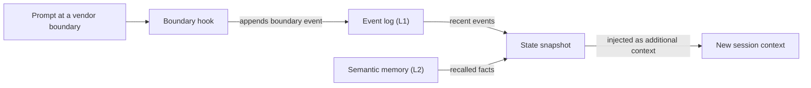

# 用語集

各項目では短い定義を示し、その用語を詳しく扱うページにリンクします。OMA の中で場所によって意味が変わる語は、その旨を記載します。

## 構成要素

### スキル {#skill}

スキルは `.agents/skills/oma-<name>/` にあるドメイン知識のパッケージです。スキルがルーティングされると `SKILL.md` がコンテキストに入り、`resources/` 内のファイルはタスクが必要とするときだけ読み込まれます。スキルは 1 つのドメインでエージェントがどう作業するかを導くもので、複数ステップのプロセスは定義しません。詳しくは[スキル](../core-concepts/skills.md)を参照してください。

### ワークフロー {#workflow}

ワークフローは `.agents/workflows/<name>.md` で定義される複数ステップのプロセスです。`/plan` や `/orchestrate` などのスラッシュコマンドで開始します。キーワード検出フックが有効な場合は、一致するトリガーフレーズでも注入されます。ワークフローは 1 つ以上のスキルとエージェントを調整します。詳しくは[ワークフロー](../core-concepts/workflows.md)と[スキルとワークフローの選び方](../core-concepts/workflows.md#choosing-a-skill-or-workflow)を参照してください。

### エージェント定義 {#agent-definition}

エージェント定義は、`.agents/agents/` にあるリポジトリ管理のサブエージェントファイルです（`backend-engineer.md`、`qa-reviewer.md` など）。エージェントの役割、読み込むスキル（`skills:` フロントマター）、実行プロトコルのセクション、ドメインルールを定めます。OMA はこれらのファイルを `.claude/agents/*.md` や `.codex/agents/*.toml` などのベンダーネイティブ形式に変換します。ドキュメントでは「エージェント」という語を、ディスパッチのロール（`backend`、`qa`、`explore`）や `oma-backend` のようなスキルにも使います。詳しくは[エージェント定義](../core-concepts/agents.md#agent-definitions)を参照してください。

## プリセット

### スキルプリセット {#skill-preset}

スキルプリセットは、インストーラーがプロジェクトに追加するスキルのまとまりです（`all`、`fullstack`、`backend`、`research` など）。共有の `_shared/` リソースはどのプリセットでもインストールされます。スキルプリセットは、エージェントを実行するモデルには影響しません。詳しくは[プリセット](./installation.md#presets)を参照してください。

### モデルプリセット {#model-preset}

モデルプリセットは、`.agents/oma-config.yaml`（または `.cue`）の `model_preset` の値です。各エージェントが使うベンダーとモデルを決めます。新規インストールのデフォルトである `auto` は、現在のランタイム自身のエージェント設定とモデル設定に従います。`claude`、`codex`、`mixed` などの固定プリセットはそれらを固定します。`agents.<id>` のオーバーライドはプリセットより優先されます。ただし `free` では、`free.model` がエージェントごとのモデル指定を置き換えます。詳しくは[組み込みプリセット](../guide/per-agent-models.md#built-in-presets)を参照してください。

## ワークフローの実行

### 永続ワークフロー {#persistent-workflow}

永続ワークフローは、作業が終わるか無効化されるまで、ターンをまたいで実行を続けます。永続ワークフローは `/orchestrate`、`/work`、`/ultrawork`、`/ralph` で、永続モードを有効にするのは明示的な呼び出しだけです。有効な間は、フックがプロンプトのたびに `[OMA PERSISTENT MODE: ...]` を再注入し、Stop フックは再強化の上限または古さのタイムアウトに達するまでセッションの終了をブロックします。無効化するには `workflow done` と伝えます。詳しくは[永続モードの仕組み](../core-concepts/workflows.md#persistent-mode-mechanics)を参照してください。

### 停止ゲート {#stop-gate}

停止ゲートは、`oma goal set --gate typecheck|test|lint` で実行中の永続ワークフローに付ける任意の完了チェックです。Stop フックは、同じ名前の `package.json` スクリプトが成功した場合にだけワークフローの終了を許可します。ゲートの失敗は再強化の上限に数えられるため、失敗し続けるゲートが停止を永久にブロックすることはありません。詳しくは [`goal set`](../cli-interfaces/commands.md#goal-set) を参照してください。

## セッションと状態

OMA では「セッション」に 2 つの意味があります。OMA 自身が追跡するセッションと、使用している AI CLI や IDE の会話セッションです。状態ファイルやコマンドオプションを読むときは、この 2 つを区別してください。

### OMA セッション {#oma-session}

OMA セッションは、ベンダーの会話とは独立に、OMA が独自のセッション ID で追跡する作業です。オーケストレーションはこの ID を使って、プラン、タスクボード、進捗ファイルと結果ファイル、エージェントの実行記録に名前を付けます。オーケストレーターはこの ID を `session-YYYYMMDD-HHMMSS` の形式で生成します。ワークフローの状態は、OMA セッション ID（`sid`）をキーとして[イベントログ](#event-log)に記録され、`oma state list` と `oma state get <sid>` で確認できます。詳しくは[セッション ID 戦略](../guide/multi-agent-project.md#session-id-strategy)を参照してください。

### ベンダーセッション ID {#vendor-session-id}

ベンダーセッション ID は、AI CLI や IDE が割り当てる会話 ID です（Claude Code や Codex のセッション ID など）。OMA はこれをイベントに `vendorSid` として記録し、永続モードの状態ファイルもこの ID をキーにします（`.agents/state/<workflow>-state-<vendor-session-id>.json`）。OMA セッションが有効な間に、別のベンダーセッション、別のベンダー、または圧縮された直後のセッションからプロンプトが届くと、フックが `boundary` イベントを記録し、状態のスナップショットを注入します。これにより、新しいコンテキストでも作業が続きます。詳しくは [`state`](../cli-interfaces/commands.md#state) を参照してください。

セマンティックメモリを利用できない場合、スナップショットはローカルのイベントだけを使います。

### イベントログ {#event-log}

イベントログは OMA セッションの追記専用の記録で、`${OMA_STATE_HOME:-~/.oma}/u/<profile>/sessions/<sid>/` の下に `events.jsonl` として保存されます。1 行が 1 つのイベントで、`session.created`、`workflow.phase`、`gate.passed`、`decision.made`、`session.ended` などがあります。ワークフローは必須の決定を `oma state emit` で追記し、`oma state verify` で確認します。ログはファイルを直接開かず、`oma state get` または `oma state trajectory` で読みます。詳しくは [`state`](../cli-interfaces/commands.md#state) を参照してください。

## レビューと証拠

### judge {#judge}

「judge」には 2 つの意味があります。`/ralph` での judge は、ultrawork の各イテレーションの後に、すべての完了基準を実際のプロジェクト状態に照らして確認し、PASS、FAIL、REGRESSED、BLOCKED を記録するフェーズです。新しいコンテキストで別途スポーンされたエージェントがこれを実行するため、オーケストレーターが自分の作業を自分で採点することはありません。スキルの評価と最適化では、`judge` はデフォルトのチェッカータイプです。モデルがルーブリックに照らしてアームの出力を採点し、PASS または FAIL を返します。詳しくは [/ralph](../core-concepts/workflows.md#ralph) と [judge チェッカー](../guide/skill-eval.md#judge-default)を参照してください。

### クロスコンテキストレビュー（CCR） {#cross-context-review-ccr}

クロスコンテキストレビュー（CCR）は、`/ultrawork` の各レビューステップを、コンテキストが分離された新しいレビュアーサブエージェントで実行するというルールです。レビュアーが受け取るのは、パスで参照されるレビュー対象の成果物（diff、変更ファイル、プラン、以前の結果、テスト出力）と、そのレビュー 1 つ分のガイドだけです。メインセッションの履歴や実装者の推論は見ません。各レビュアーは構造化された判定を書き出し、フェーズのコーディネーターがそれを収集します。詳しくは [/ultrawork](../core-concepts/workflows.md#ultrawork) を参照してください。

### チャーター {#charter}

チャーター（charter）は、以前の実装エージェントがコードを書く前に出力していた `CHARTER_CHECK` プリフライトブロックです。現在のエージェント定義では、決まった形式のプリフライト出力は求められません。代わりに、エージェントは共有の実行ポリシーに従います。重要な前提を明示し、情報の欠落が正しさやスコープを左右する場合にだけ質問し、その回答に依存する作業だけを一時停止します。スポーンされたサブエージェントはユーザーに直接質問できないため、欠けている事実を `blocked` または `partial` の結果で報告します。詳しくは[承認と確認](../core-concepts/agents.md#charter-preflight-charter_check)を参照してください。

### 実行記録と申告 {#run-record-and-claim}

実行記録は、1 回のエージェント試行についての機械可読な受領記録です。プロファイルのプロジェクト別状態ディレクトリ `~/.oma/u/<profile>/projects/<project-hash>/agent-runs/` に保存されます（以前のバージョンでは `.agents/state/agent-runs/`）。`oma agent begin` がこれを作成し、タスクのコントラクトのスナップショットを取ります。申告（claim）は、対応する `.claim.json` パスにあるエージェント自身の報告で、`completed`、`partial`、`blocked`、`failed` のいずれかのステータスと、変更ファイル、未解決の作業、成果物を含みます。`oma agent finish` は申告を現在のコントラクト、検証の受領記録、成果物のハッシュと照合するため、古い証拠に基づく申告が completed のまま残ることはありません。詳しくは[エージェントの結果と再開](../guide/agent-results-and-resume.md)を参照してください。

## メモリとプロバイダー

### L1・L2 メモリ {#l1-and-l2-memory}

L1 は[イベントログ](#event-log)です。ローカルの追記専用のワークフロー状態で、`oma state verify` と境界のスナップショットが読み取ります。L2 はセマンティックメモリで、選択した `providers.semantic_memory` プロバイダー（デフォルトの `agentmemory`、`honcho`、または `none`）が想起した事実を提供します。必須の決定は L1 にあるため、L2 がなくてもセッションの境界をまたいで保持されます。「L1」と「L2」には別の意味もあります。スキルの Layer 1 と Layer 2 は、それぞれ `SKILL.md` とオンデマンドの `resources/` ディレクトリを指します。また `oma docs verify` が報告する「L2 references」は、ドキュメントから抽出したファイル、URL、CLI、スクリプト、環境、設定への参照です。詳しくは [`memory`](../cli-interfaces/commands.md#memory) と [Honcho セマンティックメモリ](../guide/configuration-reference.md#honcho-semantic-memory)を参照してください。

### 機能プロバイダー {#capability-provider}

機能プロバイダーは、OMA が 1 つの機能に使う外部ツールまたはサービスで、`.agents/oma-config.yaml` の `providers` で選択します。対象の機能は、ドキュメント（`docs`、デフォルトは `context7`）、Web 検索（`web`、デフォルトは `native`）、コードインテリジェンス（`code_intelligence`、デフォルトは `serena`）、セマンティックメモリ（`semantic_memory`、デフォルトは `agentmemory`）です。プロバイダーを変更したら `oma link` を実行します。詳しくは[トップレベルキー](../guide/configuration-reference.md#top-level-keys)と[重要なデフォルト](./important-defaults.md)を参照してください。

## プランとソースファイル

### プラン {#plan}

プランは `.agents/results/plan-<sessionId>.json` にある機械可読のタスク分解です。`/plan` が書き出し、`/orchestrate` と `/work` が読み込みます。使えるプランがない場合は `/orchestrate` が作成します。各タスクには担当エージェント、ワークスペース、依存関係、受入基準、必須チェックが記載され、実行記録はこのコントラクトのスナップショットを取ります。`oma doctor --profile` が示すエージェントごとのモデル解決とは無関係です（一部のページではそちらを inherited plan と呼んでいます）。詳しくは [/plan](../core-concepts/workflows.md#plan) と[ネイティブ実行を開始する](../guide/agent-results-and-resume.md#start-a-native-run)を参照してください。

### SSOT {#ssot}

単一の信頼できるソース（SSOT）は `.agents/` ディレクトリです。プロジェクトインストールでは `<project>/.agents/`、グローバルインストールでは `~/.oma/.agents/` です。スキル、ワークフロー、エージェント定義、ルール、設定はここにあり、`oma install`、`oma update`、`oma link` がここからベンダーネイティブのファイル（`.claude/`、`.codex/` など）を生成します。生成されたファイルを編集せず、`.agents/` を編集して `oma link` を実行してください。一部のページでは、スケジュール実行エージェントのマニフェストのような、より狭い範囲のソースにも SSOT という語を使います。詳しくは [.agents/: 信頼できるソース](../core-concepts/project-structure.md#agents-the-source-of-truth)を参照してください。
