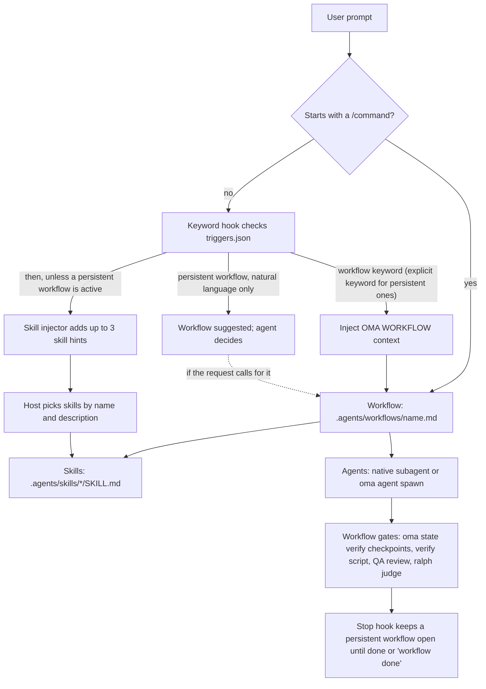

# はじめに

oh-my-agent は、AI 搭載 IDE と CLI ツール向けのマルチエージェント・オーケストレーションフレームワークです。1つの AI アシスタントにすべてを任せるのではなく、33個のスキルパッケージと13個の標準ディスパッチロールに作業を振り分けます。12個のリポジトリ内サブエージェント定義ファイルが、実装、レビュー、計画、デバッグ、ドキュメント、リサーチ、インフラの役割を再利用できる形で提供します。`research-explorer.md` は標準の `explore` ロールに対応し、`orchestrator` は個別の定義ファイルを持たないランタイム調整ロールです。

OMA は、明示的に呼び出したとき、またはそのチェックを含むワークフローを選んだときに機械的なチェックを実行します。`oma verify agent <agent-type>` は選択したエージェント種別のチェックを実行し、`/ralph` は成果物を使った検証と [judge](./glossary.md#judge) ループを追加します。有効なベンダーの Stop フック（[停止ゲート](./glossary.md#stop-gate)）は、設定されたチェックが実行される間、ワークフローを継続できます。スキルを読み込んだだけでは受入は成立せず、通常のプロンプトだけで全ワークフローのゲートが自動実行されるわけでもありません。ワークフローの受入基準と生成されたファイルを使って、完了を判断してください。

システム全体は、プロジェクト内の可搬な `.agents/` ディレクトリに保存されます。Claude Code、Codex CLI、Antigravity CLI または IDE、Cursor、OpenCode など、サポート対象のツールを切り替えても、エージェント設定はコードと一緒に移動します。

OMA を初めて使う場合は、まず [クイックスタート](./quick-start.md)、続いて[重要なデフォルト](./important-defaults.md)を読んでください。インストールで [SSOT](./glossary.md#ssot) とベンダー統合が作られます。最初に役立つ確認は `oma doctor` で、最初のタスクには小さな単一ドメインの変更を選ぶとよいでしょう。調整が必要になったら `/work` や `/orchestrate` に進みます。

---

## マルチエージェントパラダイム

従来の AI コーディングアシスタントは、フロントエンド、バックエンド、データベース、セキュリティ、インフラを1つのプロンプトコンテキストで扱うことが多くあります。その結果、次の問題が起こります。

- **コンテキストの希薄化:** すべてのドメインの知識を読み込むと、コンテキストウィンドウを消費します。
- **担当範囲が不明確:** 複数ドメインにまたがるタスクで、各部分の境界が決まりません。
- **手動調整:** 複雑な機能では、ホストやユーザーが引き継ぎの順序を決める必要があります。

oh-my-agent は専門化でこの問題に対応します。

1. **各スキルには主なドメインがあります。** フロントエンドスキルは React/Next.js、shadcn/ui、TailwindCSS v4、FSD-lite アーキテクチャを扱います。バックエンドスキルは Repository-Service-Router パターン、パラメーター化クエリ、JWT 認証を扱います。ドメインの境界では重なりもあるため、2つ目のスキルや調整ワークフローが必要かどうかは、タスクの受入基準で判断してください。
2. **エージェントは並列で実行できます。** バックエンドエージェントが API を構築している間、フロントエンドエージェントは自分のワークスペースで作業できます。オーケストレーターはファイルとして保存される実行単位の状態と実行記録を介して調整します。
3. **品質に関するガイダンスが組み込まれています。** スキルにはドメイン別のチェックリスト、エラー対応手順、[チャーター](./glossary.md#charter)規則があります。チャータープリフライトでコードを書く前に範囲を絞り、選択したワークフローに含まれる場合、または依頼した場合に QA レビューを実行します。

---

## 現在のカタログ: 33スキル、12定義、21ワークフロー

カタログでは、混同しやすい3つを分けています。

- **[スキル](./glossary.md#skill)**は `.agents/skills/*/SKILL.md` にある33個のドメイン知識パッケージです。自然言語の意図からルーティングし、リソースを段階的に読み込みます。
- **[エージェント定義](./glossary.md#agent-definition)**は `.agents/agents/` にある12個のファイルです。ベンダーのネイティブなサブエージェント人格を提供し、1つ以上のスキルを参照します。
- **[ワークフロー](./glossary.md#workflow)**は `.agents/workflows/` にある21個のプロセス定義です。4つ（`orchestrate`、`work`、`ultrawork`、`ralph`）が[永続的](./glossary.md#persistent-workflow)で、残りはレポートまで実行して永続モードを維持しません。

以下では詳細なスキルカタログを保持します。名前や説明が変わった場合は、各 `SKILL.md` のフロントマターが最新の基準です。

12個のリポジトリ内定義ファイルは、エイリアスを通じて13個のランタイムロールをカバーします。`research-explorer.md` は `explore` に対応し、`orchestrator` はランタイム専用です。その他の定義ファイルは [エージェント](../core-concepts/agents.md)に掲載したロールに対応します。

### アイデア出し、アーキテクチャ、計画

| エージェント | 役割 | 主な機能 |
|-------|------|-----------------|
| **oma-brainstorm** | デザインファーストのアイデア出し | ユーザーの意図を探り、トレードオフ付きで2〜3の案を出し、コードを書く前にデザインドキュメントを作成します。6段階のワークフローは Context、Questions、Approaches、Design、Documentation、`/plan` への移行です。 |
| **oma-architecture** | システムアーキテクチャスペシャリスト | モジュール、サービス、所有権の境界、トレードオフ分析、ステークホルダーの統合を扱います。診断ルーティング、design-twice 比較、ATAM 型のリスク分析、CBAM 型の優先順位付け、ADR 型の意思決定記録を使い、デフォルトでコストも考慮します。 |
| **oma-pm** | プロダクトマネージャー | 要件を依存関係付きの優先タスクに分解し、API コントラクトを定義します。`.agents/results/plan-{sessionId}.json` とセッション単位のタスクボードを出力します。ISO 21500 の概念、ISO 31000 のリスク整理、ISO 38500 のガバナンスに対応します。 |

### 実装

| エージェント | 役割 | 技術スタックとリソース |
|-------|------|----------------------|
| **oma-frontend** | UI/UX スペシャリスト | React、Next.js、TypeScript、TailwindCSS v4、shadcn/ui、FSD-lite アーキテクチャ。ライブラリは luxon（日時）、ahooks または @mantine/hooks（フック）、es-toolkit（ユーティリティ）、Jotai/Zustand（クライアント状態）、orval が生成するフック経由の TanStack Query（サーバー状態）、@tanstack/react-form + Zod（フォーム）、better-auth（認証）、nuqs（URL 状態）です。リソースは `execution-protocol.md`、`tech-stack.md`、`tailwind-rules.md`、`snippets.md`、`angular-rules.md`、`error-playbook.md`、`checklist.md` です。 |
| **oma-backend** | API とサーバーのスペシャリスト | クリーンアーキテクチャ（Router-Service-Repository-Models）。スタックに依存せず、プロジェクトのマニフェストから Python/Node.js/Rust/Go/Java/Elixir/Ruby/.NET を検出します。認証には JWT + Argon2id を使います。リソースは `execution-protocol.md`、`orm-reference.md`、`checklist.md`、`error-playbook.md` です。`/stack-set` で言語別の `stack/` リファレンスを生成できます。 |
| **oma-mobile** | クロスプラットフォームモバイル | 状態管理に Flutter、Dart、Riverpod/Bloc、API 呼び出しに interceptors 付き Dio、ナビゲーションに GoRouter を使います。クリーンアーキテクチャは domain-data-presentation です。Material Design 3（Android）と iOS HIG、60fps を目標にします。Swift ネイティブ iOS にも対応し、SwiftUI + `@Observable`（iOS 17以降）、Apple の `swift-openapi-generator`、`App/Core/Features/Shared` 構成を使えます。リソースは `execution-protocol.md`、`tech-stack.md`、`screen-template.dart`、`screen-template.swift`、`screen-template.tsx`、`checklist.md`、`error-playbook.md` で、プラットフォーム別の variant は `/stack-set` が展開します。 |
| **oma-db** | データベースアーキテクチャ | SQL、NoSQL、ベクトルデータベースのモデリングを扱います。スキーマ設計（デフォルトは3NF）、正規化、インデックス、トランザクション、キャパシティプランニング、バックアップ戦略を扱い、ISO 27001/27002/22301 を考慮した設計に対応します。リソースは `execution-protocol.md`、`document-templates.md`、`anti-patterns.md`、`vector-db.md`、`iso-controls.md`、`checklist.md`、`error-playbook.md` です。 |

### デザイン

| エージェント | 役割 | 主な機能 |
|-------|------|-----------------|
| **oma-design** | デザインシステムスペシャリスト | トークン、タイポグラフィ、カラーシステム、モーションデザイン（motion/react、GSAP、Three.js）、レスポンシブファーストのレイアウト、WCAG 2.2 準拠の DESIGN.md を作成します。7段階は Setup、Extract、Enhance、Propose、Generate、Audit、Handoff です。アンチパターン（「AI スロップ」）を禁止し、Stitch MCP 統合は任意です。リソースは `design-md-spec.md`、`design-tokens.md`、`anti-patterns.md`、`prompt-enhancement.md`、`stitch-integration.md` と、タイポグラフィ、色、空間、モーション、レスポンシブ、コンポーネント、アクセシビリティ、シェーダーのガイドを収めた `reference/` です。 |

### インフラストラクチャ、DevOps、オブザーバビリティ

| エージェント | 役割 | 主な機能 |
|-------|------|-----------------|
| **oma-tf-infra** | Infrastructure as Code | AWS、GCP、Azure、Oracle Cloud を対象とするマルチクラウド Terraform。OIDC を優先する認証、最小権限 IAM、Policy as Code（OPA/Sentinel）、コスト最適化を扱います。ISO/IEC 42001 の AI 制御、ISO 22301 の継続性、ISO/IEC/IEEE 42010 のアーキテクチャドキュメントに対応します。リソースは `multi-cloud-examples.md`、`cost-optimization.md`、`policy-testing-examples.md`、`iso-42001-infra.md`、`checklist.md` です。 |
| **oma-dev-workflow** | モノレポのタスク自動化 | mise タスクランナー、CI/CD パイプライン、データベースマイグレーション、リリース調整、Git フック、pre-commit 検証を扱います。リソースは `validation-pipeline.md`、`database-patterns.md`、`api-workflows.md`、`i18n-patterns.md`、`release-coordination.md`、`troubleshooting.md` です。 |
| **oma-observability** | インテントベースのオブザーバビリティルーター | MELT+P シグナル（metrics/logs/traces/profiles/cost/audit/privacy）のカバレッジ、UDP/MTU、OTLP gRPC と HTTP、Collector トポロジー、サンプリング、W3C Trace Context の伝播、SLO と burn-rate アラート、6次元のインシデント局在化、自己健全性や保持期間などのメタオブザーバビリティを扱います。CNCF を優先し、非推奨の Fluentd ではなく Fluent Bit または OTel Collector を使います。 |

### 品質とデバッグ

| エージェント | 役割 | 主な機能 |
|-------|------|-----------------|
| **oma-qa** | 品質保証 | OWASP Top 10 のセキュリティ監査、パフォーマンス分析、WCAG 2.2 AA のアクセシビリティ、コード品質レビューを行います。CRITICAL/HIGH/MEDIUM/LOW の重要度に `file:line` と修正コードを添付します。ISO/IEC 25010 の品質特性と ISO/IEC 29119 のテスト整合性に対応します。リソースは `execution-protocol.md`、`iso-quality.md`、`checklist.md`、`verify-ship-protocol.md`、`error-playbook.md` です。 |
| **oma-debug** | バグの診断と修正 | 再現を先に行います。根本原因分析、最小限の修正、必須の回帰テスト、類似パターンの検索を含みます。シンボル追跡にはコードインテリジェンス MCP ツール（Gortex または Serena）を使います。リソースは `execution-protocol.md`、`common-patterns.md`、`debugging-checklist.md`、`bug-report-template.md`、`error-playbook.md` です。 |
| **oma-refactor** | 挙動を保ったリファクタリング | 特性テストの安全網で段階的な再構成を確認します。ホットスポット（複雑度 × 変更頻度）の特定、コードスメル/SATD の選択、失敗時の Mikado 法による復元、状態を持つ変更の expand-contract、挙動を混ぜないリファクタリング専用コミットを扱います。IDE のリネームや jscodeshift/ast-grep を使うエンジン優先の変換と、`uvx lizard` / `uvx radon` による指標を使います。成功基準は読みやすさであり、指標は代理値です。 |

### ローカライゼーション、調整、Git

| エージェント | 役割 | 主な機能 |
|-------|------|-----------------|
| **oma-translation** | コンテキストに応じた翻訳 | Prepare、Acquire、Reason、Act、Verify、Finalize の6場面を使います。翻訳方法は、意味と保護対象の構文を読む、レジスターを選ぶ、ターゲット言語で再構成する、必要な場合は著者の文体を保つ、の4段階です。ターゲット言語別プロファイル（`resources/lang/{code}.md`）にレジスターとタイポグラフィの規則があります。リソースは `translation-rubric.md`、`anti-ai-patterns.md`、`lang/{ko,ja,zh,en}.md` です。 |
| **oma-orchestration** | 自動マルチエージェントコーディネーター | CLI サブエージェントを並列起動し、セッション、タスクボード、進捗、結果の永続ファイルで調整し、検証ループを監視します。MAX_PARALLEL（デフォルト3）、MAX_RETRIES（デフォルト2）、POLL_INTERVAL（デフォルト30秒）を設定できます。エージェント間レビューと任意のセッションの証拠も含みます。リソースは `subagent-prompt-template.md`、`memory-schema.md` です。 |
| **oma-scm** | ソフトウェア構成管理（SCM）と Git | ブランチ、merge/rebase/conflict、ワークツリー、ベースライン、リリース状態を扱います。安全なステージング付きの Conventional Commit メッセージも案内し、co-author の末尾情報は有効な `scm.co_author` 設定から取得します。 |
| **oma-coordination** | 手動マルチエージェントワークフローガイド | CLI `oma agent spawn` で PM、Frontend、Backend、Mobile、QA エージェントを調整する手順を示します。PM による分解、同じ優先度のタスクを別ワークスペースで起動、実行単位の進捗と結果の監視、Frontend/Mobile 作業前の API とデータ契約の調整、QA レビューまでを扱います。`oma-orchestration` の手動版です。 |

### 検索、レトロスペクティブ、ドキュメント処理

| エージェント | 役割 | 主な機能 |
|-------|------|-----------------|
| **oma-search** | インテントベースの検索ルーター | クエリを Context7（ドキュメント）、ネイティブ Web 検索、`gh`/`glab`（コード）、ローカルコードインテリジェンス（Gortex または Serena）にルーティングします。ローカル以外の結果にドメイン信頼度を付けます。docs→web→fetch の fail-forward ルーティングに対応し、`--docs`、`--code`、`--web`、`--strict`、`--wide`、`--gitlab` フラグを使えます。 |
| **oma-recap** | ツール横断の作業レトロスペクティブ | Grok、Claude、Codex、Gemini、Qwen、Cursor、Antigravity の会話履歴を分析します。自然言語の日付や期間を解決し、ツールとセッションでグループ化し、テーマを抽出し、日次や期間のサマリーをレンダリングします。CLI が要求された期間を30日で上限設定した場合も記録します。 |
| **oma-hwp** | HWP/HWPX/HWPML → Markdown | `bunx kordoc@latest` で韓国語ワープロ文書を変換します。見出し、ネストした表、脚注、ハイパーリンク、画像を保持し、`flatten-tables.ts` の後処理で Hancom の私用領域文字を除去します。 |
| **oma-pdf** | PDF → Markdown | `uvx opendataloader-pdf` で PDF を変換します。見出し、表、リスト、画像を保持し、スキャン PDF には OCR ハイブリッドモードを使い、`uvx mdformat` で出力を正規化します。 |

### 学術・リサーチ執筆

| エージェント | 役割 | 主な機能 |
|-------|------|-----------------|
| **oma-academic-writing** | 出版品質の英語文章 | エッセイ、レポート、エグゼクティブサマリー、結論、文献レビューを執筆、改稿、監査します。Sentence Structure（4種類の文と長さ・書き出しの変化）、Verb（段階化した学術コーパスから一般的な動詞を置き換える規則）、Hedging（証拠に合わせた強さ）、Anti-AI 準拠の4プロトコルを同時に適用します。Quote-before-judgment のルーブリックゲート、Claim-Evidence Map、逆向きアウトラインを使い、`draft` / `revise` / `review` モードに対応します。 |
| **oma-scholar** | 研究論文のサイドカー | Knows の `.knows.yaml` サイドカー仕様（v0.9.0 / `paper@1`）で学術論文を検索、生成、検証、レビュー、比較します。主張だけなら約700トークン、PDF 全体なら約10Kトークンで取得でき、`oma scholar search/resolve/get/lint` は knows.academy 上で動作します。2026年より前の論文には OpenAlex を自動フォールバックとして使い、未知のフィールドは推測せず省略します。 |

### セキュリティ

| エージェント | 役割 | 主な機能 |
|-------|------|-----------------|
| **oma-security** | セキュリティスキャンと検証 | アプリケーションのソース、エージェントスキル、MCP コンポーネントをスキャンし、スコープを限定した Web テスト環境に対してペネトレーションテストを実行し、指摘を検証してスキャンゲートを設定します。対象ごとのデフォルトエンジンは、アプリケーションのソースや差分には Deepsec、エージェントスキルのパッケージには Cisco Skill Scanner、MCP コンポーネントには Cisco MCP Scanner、Web テスト環境には ARTEX です。幅広い品質レビューには `oma-qa` を、修正にはドメインスキルを使います。 |

### ドキュメントとメタツール

| エージェント | 役割 | 主な機能 |
|-------|------|-----------------|
| **oma-docs** | ドキュメントの整合性検出 | `verify` モードは `docs/**/*.md` の壊れた参照（ファイルパス、CLI コマンド、設定キー、環境変数、スクリプト）を決定論的に確認し、0/1 を終了コードとして返します。`sync` モードは Git の差分を候補ドキュメントに対応付け、ホスト LLM によるパッチ案をドキュメントごとに確認してから適用します（自動適用はしません）。URL 確認は `lychee` に委ねます。CLI は構造化 JSON を出力し、ホスト LLM が自然言語の整理を担います。`.agents/` は変更しません。 |
| **oma-skill-creation** | SSL-lite スキル作成スペシャリスト | SSL-lite 形式で OMA スキルを作成、更新、監査します。必須4セクション（Scheduling / Structural Flow / Logical Operations / References）を検査し、標準パスを1つだけインラインに入れ、`When NOT to use` の相互ルートを設定し、`oma skill audit` で説明の衝突を検出します。TF-IDF コサイン類似度は警告が60%以上、失敗が75%以上です。長い variant の詳細は `resources/` に移します。 |
| **oma-explanation** | コード変更の解説 | 差分、PR、ブランチ、コミット範囲を Background、Intuition、Code、Quiz を含むオフライン HTML の解説にします。`/explain` ワークフローは最終成果物を検証し、`.agents/results/explain/` に書き出します。 |

### 市場調査

| エージェント | 役割 | 主な機能 |
|-------|------|-----------------|
| **oma-market** | コミュニティシグナル分析 | Reddit、X、YouTube、TikTok、HN、Polymarket、GitHub、arXiv、Techmeme、Bluesky、Web などを含む上流の `last30days` エンジンを `oma market run` から実行します。`oma` はエンジンを常に最新リリース（`~/.cache/oma-market/`）に保ち、各実行を `detect-trap` で確認し、意図（pain / trend / competitor / discovery）を分類し、SWOT / Porter's 5F / PESTEL を追加します。LAW に準拠したブリーフを `.agents/results/market/{slug}-{YYYYMMDD}.md` に出力します。 |

### メディアとコンテンツ生成

| エージェント | 役割 | 主な機能 |
|-------|------|-----------------|
| **oma-image** | マルチベンダー画像ルーター | Codex（ChatGPT OAuth 経由の `gpt-image-2`、CLI 優先）、Antigravity の Gemini 系「nano-banana」モデル（`agy` CLI + Gemini Code Assist、モデルは内部で選択）、Pollinations（無料の `flux`/`zimage`）へ、認証状態を見て並列ディスパッチします。生成前の明確化とプロンプト補強、最大10個の参照画像、0.20ドル以上でのコスト確認、再現用の `manifest.json` を備えます。CLI は `oma image generate`、`oma image doctor`、`oma image vendor list` です。 |
| **oma-slide** | アニメーション付き HTML デッキ生成 | 固定 1920×1080 ステージで、アンチ「AI スロップ」のプレゼンデッキを作成します。ジオメトリを決定論的に検証し、単一 HTML にまとめ、`oma slide` で PDF/PNG/PPTX に出力します。スタイルプリセットとテンプレート、CJK→Pretendard 規則、`prefers-reduced-motion`、可視フォーカス、最大3回の自動修正検証ループを使います。画像は `oma-image` に委ね、Canva MCP の入出力は任意です。 |
| **oma-video** | ショート、解説、デモのルーター | `oma video` CLI でショート/リール（9:16）、解説（16:9）、人が録画するデモ（16:9）を作成します。決定論的なアセットバス（`script.json` → `timing.json` → `render-spec.json`）が、管理対象の HyperFrames コンポジターに入力されます。アセットプロバイダーはローカルのフォールバックを使う場合がありますが、コンポジションやツールチェーンの不足、レンダーエラーがあれば実行は失敗します。人によるキャプチャで認証情報を自動入力することはありません。 |
| **oma-voice** | ローカル優先の TTS と STT | Voicebox MCP サーバーを使い、クラウド呼び出しや1回ごとの料金なしで、端末上の通知、アセット用 TTS、文字起こしを実行します。TTS は WAV がデフォルトで、ローカルで MP3 に変換できます。文字起こしは音声パスまたは base64 を受け付けます。TTS は5000文字、STT は30分までで、保存するアセットや文字起こしはマニフェストを書き出します。 |

---

## 段階的開示モデル

oh-my-agent は、コンテキストウィンドウの枯渇を防ぐために2層のスキルアーキテクチャを使います。

**レイヤー1: SKILL.md（スキルがルーティングされたときに読み込み）**
エージェントの役割、ルーティング条件、コアルール、「使う場合／使わない場合」のガイダンスを含みます。エージェントが作業していないときに読み込まれるのは、この層です。

**レイヤー2: resources/（オンデマンド）**
実行プロトコル、技術スタックのリファレンス、コードスニペット、エラー対応手順、チェックリスト、例を含みます。エージェントがタスクに呼び出されたときに、タスクの種類に関係するリソースだけが読み込まれます（`context-loading.md` の難易度評価とタスク・リソース対応表に基づきます）。

どれだけコンテキストを節約できるかはスキルとタスクによって変わるため、数値を前提にせず測定してください。スクリプトと、その推定値が何を含むかは[トークン節約の計算](../core-concepts/skills.md#token-savings-math)を参照してください。

---

## `.agents/`: 単一の信頼できるソース（SSOT）

oh-my-agent に必要なものはすべて `.agents/` ディレクトリにあります。

```text
.agents/
├── oma-config.yaml   # Shared preferences and provider/model settings
├── oma-config.cue    # Optional schema-backed configuration
├── mcp.json          # MCP server configuration
├── skills/           # 33 skill directories + _shared resources
│   ├── _shared/      # Core resources used by all agents
│   └── oma-{skill}/  # Per-skill SKILL.md + resources/variants
├── workflows/        # 21 workflow definitions
├── agents/           # 12 subagent definitions
├── hooks/            # Hook sources, including core/triggers.json
├── rules/            # Project rules projected into vendor files
├── config/           # Shipped defaults (defaults.yaml)
├── results/          # Plans (plan-{sessionId}.json) and agent results
└── state/            # Active workflow state files
```

`.claude/` ディレクトリは IDE 統合層としてだけ存在します。`.agents/` を指すシンボリックリンク、キーワード検出と HUD ステータスラインのフックを含みます。`.agents/state/memories/` はオーケストレーション中のランタイム調整状態を保存し、古いプロジェクトでは従来の `.serena/memories/` にフォールバックします。

この構成により、エージェント設定は次の性質を持ちます。
- **可搬:** IDE を切り替えても再設定は不要です。
- **バージョン管理可能:** `.agents/` をコードと一緒にコミットできます。
- **共有可能:** チームメンバーが同じエージェント設定を取得できます。

---

## サポートされる IDE と CLI ツール

oh-my-agent は、ネイティブのスキル／プロンプト読み込みまたは生成された統合ファイルを通じて、選択した AI 搭載 IDE と CLI で動作します。

| ツール | 統合方法 | 並列エージェント |
|---|---|---|
| **Claude Code** | ネイティブスキル + Agent tool | 真の並列処理には Task tool |
| **Antigravity CLI/IDE** | `agy` 用にスキルと MCP 設定を展開 | `oma agent spawn` |
| **Codex CLI** | スキルを自動読み込み | モデルを介した並列リクエスト |
| **Cursor** | `.cursor/` 統合経由のスキル | 手動スポーン |
| **OpenCode** | スキル + インプロセスプラグインブリッジ + 生成されたサブエージェント（`.opencode/agents/`） | `oma agent spawn --vendor opencode` |
| **Kimi Code CLI** | `~/.kimi-code/` のフックとスキル（HOME への書き込みは同意が必要。SSOT の `.agents/skills/` もネイティブに読む）とプロジェクト単位の Serena MCP | `oma agent spawn --vendor kimi` |

エージェントのスポーン方法は、ベンダー検出と有効な設定に応じて変わります。同じベンダーのランタイムではネイティブサブエージェントを使うことがあり、異なるベンダーでは `oma agent spawn` にフォールバックします。ディスパッチ規則は[並列実行](../core-concepts/parallel-execution.md)を参照してください。

---

## リクエストの流れ

この図は、プロンプトから結果が完成するまでに何が起こるかを示します。キーワードフック、スキルインジェクター、Stop フックは、フック統合が有効なホストでだけ動作します。キーワードフックとスキルインジェクターは同じプロンプトに対して順番に実行され、それぞれが注入したコンテキストは結合されます。



出典：`.agents/hooks/core/keyword-detector.ts`（スラッシュコマンドのスキップ、トリガーの照合、永続ワークフローの提案）、`.agents/hooks/core/skill-injector.ts`、`.agents/hooks/core/persistent-mode.ts`、および `.agents/workflows/` 配下のワークフローファイル。すべてのワークフローがすべてのゲートを持つわけではありません。`/orchestrate` は検証スクリプトを、`/review` は QA レビューを実行し、`/ralph` は [judge](./glossary.md#judge) を追加します。

---

## スキルルーティングシステム

ホストは、インストール済みスキルの名前と説明からスキルを選びます。OMA のルーティングマップ（`.agents/skills/_shared/core/skill-routing.md`）は、どのスキルがどの成果を担当するかを定義します。キーワードだけで判断せず、求められている成果とその依存関係でルーティングしてください。スキルを選んでも、ワークフローが開始されたり委任が承認されたりするわけではありません。

| 求められている成果 | 担当スキル |
|---|---|
| アプリケーション API、サーバー認証、サービス/データアクセスのロジック | oma-backend |
| スキーマ、マイグレーション設計、インデックス、クエリ調整、データベース運用 | oma-db |
| Web コンポーネント、ページ、フォーム、クライアント状態 | oma-frontend |
| モバイル画面、ウィジェット、プラットフォーム統合 | oma-mobile |
| システム境界、アーキテクチャのトレードオフ、ADR | oma-architecture |
| 誤った挙動の診断と修正 | oma-debug |
| 正確性、セキュリティ、アクセシビリティ、パフォーマンスのレビュー | oma-qa |
| ビジュアルシステム、DESIGN.md、再設計の方向性 | oma-design |
| 依頼されたアイデア出しや代替案の検討 | oma-brainstorm |
| 要件、依存関係、受入基準 | oma-pm |
| 依頼された専門エージェントの並列実行 | oma-orchestration |
| 依頼された手動のマルチエージェント調整 | oma-coordination |
| Git ブランチ、コミット、マージ、リポジトリ履歴 | oma-scm |

その他のドメインでは、ホストがインストール済みスキルの説明から選びます。複数ドメインの作業に固定の順序はありません。未確定のアーキテクチャや製品の判断を先に解決し、共有する API コントラクトが使える状態になれば、バックエンドとクライアントの作業は並列に進められます。

---

## HUD ステータスライン

Claude Code で実行すると、oh-my-agent はステータスバーに `[OMA]` のステータスインジケーターを表示します。次を表示します。

- モデル名（例: Opus、Sonnet）
- 色分けされたコンテキスト使用率（緑 < 70%、黄 70〜85%、赤 > 85%）
- 永続ワークフローが実行中の場合は、その状態

HUD は Claude Code の `statusLine` フック機能を使う `.claude/hooks/hud.ts` で動作します。

---

## 自動ワークフロー検出

`/command` を入力しなくてもワークフローを起動できます。oh-my-agent のフックシステムは、`.agents/hooks/core/triggers.json` に定義されたキーワードトリガー（oma バイナリにインライン化され、すべてのベンダーで共有されます）に対して自然言語の入力をスキャンします。対応言語は11言語（英語、韓国語、日本語、中国語、スペイン語、フランス語、ドイツ語、ポルトガル語、ロシア語、オランダ語、ポーランド語）です。

- **実行可能な入力**（例: 「認証機能を plan する」）→ ワークフローを自動的に読み込みます。
- **情報を尋ねる入力**（例: 「orchestrate とは？」）→ フィルターリングされ、ワークフローは起動しません。
- **明示的な `/command`** → 重複を避けるため、フックは検出をスキップします。
- **永続ワークフロー**（`orchestrate`、`work`、`ultrawork`、`ralph`）は、自然言語だけで一致した場合は提案されるだけで、開始されません。プロンプトにワークフローの明示的なキーワード（例：`ultrawork` や `ralph`）が含まれると、永続モードが有効になります。
- **実行中の永続ワークフロー** → 「workflow done」と言うまで、メッセージごとにコンテキストを再注入します。

すべてのフックイベントは `oma hook run` の標準 ABI を通ります。ベンダーは `oma-hook.sh --vendor <v> --event <nativeEvent>` を起動し、インプロセスのハンドラーチェーンへ渡してベンダー固有の形式を標準出力に出します（常に終了コード0で、失敗時もエージェントを止めません）。

---

## クロスベンダーサポート

oh-my-agent は Claude Code に限定されません。フック対応ベンダーは同じ `oma hook run` ABI を共有し、拡張ベンダーはインプロセスブリッジを使います。

| ベンダー | フックの配送 | StatusLine |
|--------|--------------|------------|
| **Claude Code** | `oma-hook.sh --vendor claude --event UserPromptSubmit` / `PreToolUse` / `Stop` | `bun .claude/hooks/hud.ts`（直接実行、変更なし） |
| **Codex CLI** | `oma-hook.sh --vendor codex --event UserPromptSubmit` / `PreToolUse` / `Stop` | なし |
| **Qwen Code** | `oma-hook.sh --vendor qwen --event UserPromptSubmit` / `PreToolUse` / `Stop` | `ui.statusLine` 経由の `bun` パス |
| **Cursor** | `oma-hook.sh --vendor cursor --event beforeSubmitPrompt` / `preToolUse` | なし |
| **Grok** | `oma-hook.sh --vendor grok --event UserPromptSubmit` / `Stop` | なし |
| **Kiro** | `oma-hook.sh --vendor kiro --event userPromptSubmit` / `preToolUse` / `stop` | なし |
| **Kimi Code** | `oma-hook.sh --vendor kimi --event UserPromptSubmit` / `PreToolUse` / `Stop`（`~/.kimi-code/config.toml` のグローバル専用 `[[hooks]]`） | なし |
| **Antigravity** | `oma-hook.sh --vendor antigravity --event PreInvocation` / `PreToolUse` / `Stop` | なし |
| **pi** | インプロセスブリッジ（`installPiExtension`）。`oma hook run` は経由しません。 | なし |

`.agents/` ディレクトリが引き続き SSOT です。インストールは、選択したベンダーにスキル、ワークフロー、フック、エージェント定義をリンクまたは投影します。利用できる機能はベンダーによって異なります。同じベンダーのネイティブサブエージェントも、CLI で起動した異なるベンダーのエージェントも、同じソースを読みます。

---

## 次のステップ

- **[インストール](./installation.md):** 3つのインストール方法、プリセット、CLI 設定、検証
- **[エージェント](/docs/core-concepts/agents):** 33個のスキル、13個のディスパッチロール、チャータープリフライトの詳細
- **[スキル](/docs/core-concepts/skills):** 2層アーキテクチャの説明
- **[ワークフロー](/docs/core-concepts/workflows):** トリガーとフェーズを含む21個のワークフロー
- **[使い方ガイド](/docs/guide/usage):** 単一タスクから完全なオーケストレーションまでの実例
