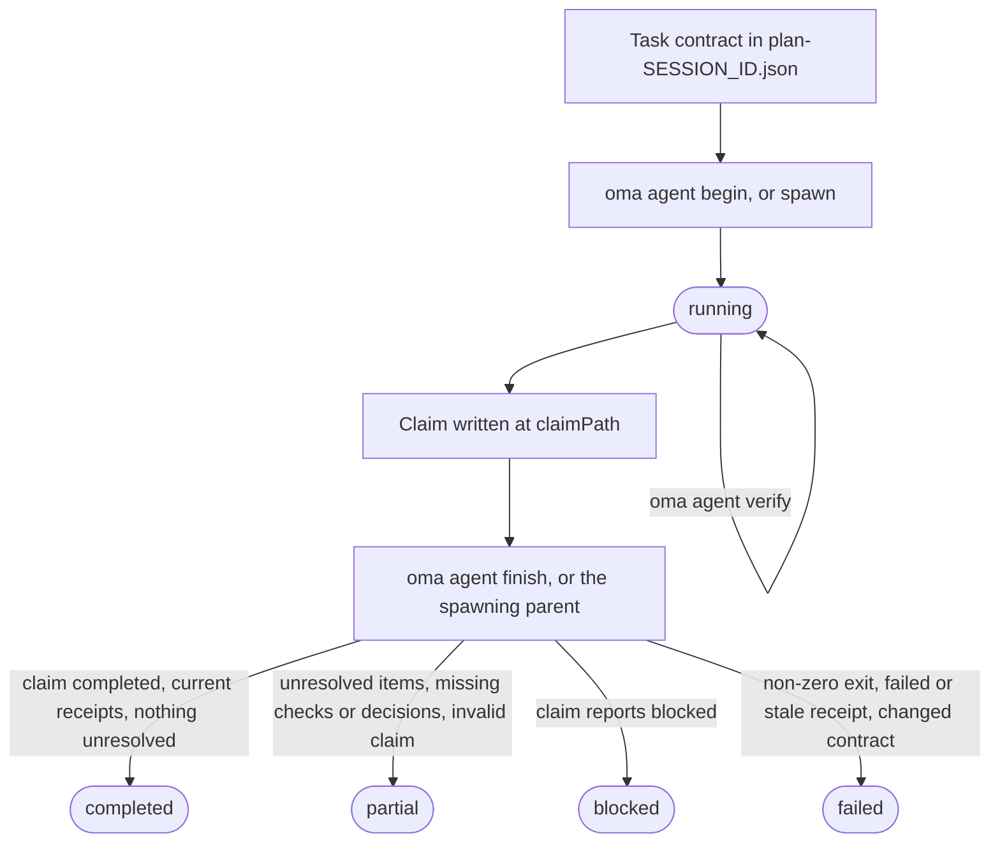
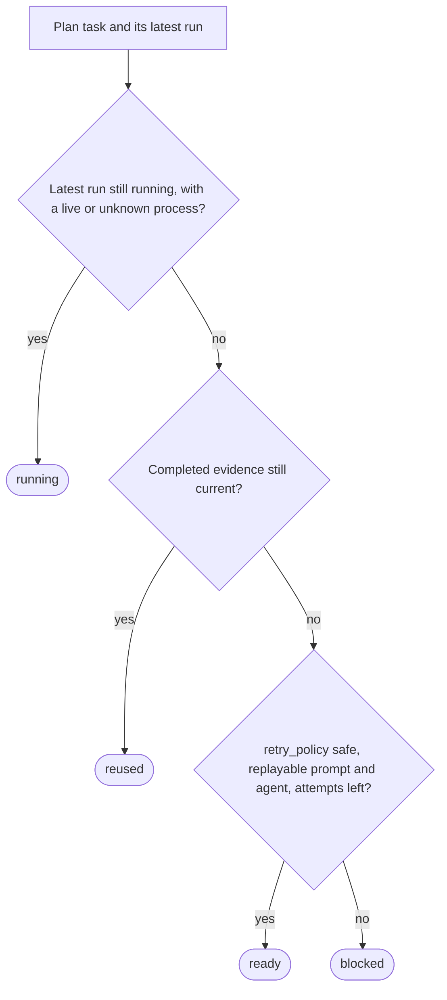

# エージェント結果と再開

OMA はエージェントの結果を、プロセスの終了コードだけでなく、小さな証拠記録として扱います。実行記録にはタスク ID とセッション ID、ワークスペースのフィンガープリント、検証の受領記録、変更ファイル、未解決の作業、アーティファクトのハッシュが含まれます。これにより、受け入れコントラクトと入力が一致している間だけ、コーディネーターは完了したタスクを再利用できます。

ネイティブエージェントを実行する場合は、このライフサイクルを直接使います。ワークフローと `oma agent spawn` は同じ記録を作成し、管理対象の実行の確定は親コーディネーターに任せます。ここで使う用語については、用語集の [実行記録と申告](../getting-started/glossary.md#run-record-and-claim) と [プラン](../getting-started/glossary.md#plan) を参照してください。

## ライフサイクルの概要

| ステップ | コマンド | 記録されるもの | 控えておくもの |
| --- | --- | --- | --- |
| 1. コントラクト | `.agents/results/plan-SESSION_ID.json` を編集する | タスクの `acceptance_criteria` と `required_checks` | セッション ID、タスク ID |
| 2. 開始 | `oma agent begin AGENT TASK SESSION_ID --workspace .` | ステータスが `running` の実行記録 | `runId`、`claimPath` |
| 3. コンテキスト（任意） | `oma agent context AGENT --difficulty Medium` | なし | プロンプトのコンテキスト |
| 4. 検証 | `oma agent verify RUN_ID --required` | チェックごとに 1 つの受領記録 | 終了コード |
| 5. 申告 | `claimPath` に JSON を書き込む | 申告ファイル | なし |
| 6. 完了 | `oma agent finish RUN_ID CLAIM_PATH` | 最終ステータス | `status` |
| 7. 復旧 | `oma agent resume SESSION_ID --dry-run`、次に `--dry-run` なしで実行 | 復旧チェックポイントとセッションリース | タスクごとのステータス |

`oma agent spawn` と `oma agent parallel` はステップ 2 と 6 を代わりに行います。親プロセスが実行を開始し、子プロセスの終了時に確定します。



申告が `partial` や `failed` を直接報告することもできます。finish が申告を格上げすることはありません。証拠が成り立たない `completed` の申告は格下げされ、終了コードが 0 以外ならどの実行も `failed` になります。

## ネイティブ実行を開始する {#start-a-native-run}

まず、`.agents/results/plan-SESSION_ID.json` のプランにタスクと、その `acceptance_criteria` と `required_checks` を定義します。小さな一般的プロジェクトチェックなら、次のように 1 つのタスクを含められます。

```json
{
  "tasks": [
    {
      "id": "docs",
      "agent": "docs",
      "task": "Review README.md and report any documentation issues",
      "workspace": ".",
      "acceptance_criteria": [
        { "id": "diff-clean", "description": "The current Git diff has no whitespace errors" }
      ],
      "required_checks": [
        { "id": "whitespace", "criteria": ["diff-clean"], "command": ["git", "diff", "--check"], "cwd": "." }
      ],
      "retry_policy": "manual"
    }
  ]
}
```

このチェックが証明するのは Git diff に空白エラーがないことだけです。タスク、基準、チェックをプロジェクトの実際の受け入れコントラクトに置き換えてください。プロジェクトルートから実行を開始します。

```bash
oma agent begin docs docs SESSION_ID --workspace .
```

`SESSION_ID` はプランで使ったセッション ID に置き換えます。コマンドは生成された UUID の `runId` と `claimPath` を含む JSON を、たとえば次のように表示します。

```json
{
  "runId": "<generated-run-id>",
  "taskId": "docs",
  "sessionId": "<your-session-id>",
  "status": "running",
  "claimPath": ".agents/state/agent-runs/<generated-run-id>.claim.json"
}
```

山括弧の値はプレースホルダーです。実行時に表示された実際の値を使ってください。begin が成功すると、`.agents/state/agent-runs/` に実行記録が作成され、タスクコントラクトのスナップショットが保存されます。申告パスは常に実行記録のパスで、`.json` を `.claim.json` に置き換えたものです。

## コンテキストを読み込み、タスクを実行する

編集前にグラフが選んだ参照を読み込みます。

```bash
oma agent context docs --difficulty Medium
```

難易度は `Simple`、`Medium`、`Complex` のいずれかでなければなりません。コマンドは選択したエージェント用に組み立てたコンテキストを表示します。グラフに基づくコンテキストがない場合はタスク定義を修正するか、プロジェクトに記載されたネイティブ検索パスを使います。コンテキストの受領記録を捏造しないでください。

`begin` に記録されたワークスペースでタスクを実行します。実行中はセッションプランを固定してください。受入基準や必要なチェックを変更する場合は、プランを更新してから新しい実行を開始します。

## 検証を記録する

受け入れコントラクトに固定されたすべてのチェックを実行します。

```bash
oma agent verify RUN_ID --required
```

`RUN_ID` は `begin` が返した UUID に置き換えます。コマンドは宣言された argv を実行し、実際の終了コードと検証前後のワークスペースフィンガープリントを記録します。タスクコントラクトに含まれているチェックなら、正確なコマンドを 1 つだけ記録できます。

```bash
oma agent verify RUN_ID -- git diff --check
```

正確なコマンド形式は、タスクのコントラクトに属するチェックだけに使います。それ以外ではプランの `required_checks` を使い、`--required` で受領記録が宣言された受入基準を証明するようにしてください。

`--affected PATH...` は、グラフにそのパスの完全なテスト選択がある場合だけ使います。チェックは実行ごとに直列で行われます。終了コードが 0 以外の場合やチェック中にワークスペースが変わった場合、その受領記録は無効です。

## 申告を書き込み、実行を完了する

API コントラクト、認証ポリシー、データモデル、マイグレーション戦略、状態の所有者、インフラのアクセス範囲など、後続の作業が依存する判断を選ぶタスクでは、ディスパッチ前にタスクへ `required_decisions` を宣言します。

```json
"required_decisions": [
  {
    "subject": "db.migration-strategy",
    "description": "Choose the compatibility window and rollback strategy for the account migration."
  }
]
```

既存の判断に従うタスクでは、このフィールドを省略します。要件はタスクコントラクトとともに固定され、ディスパッチ後に削除や変更はできません。
エージェントに推奨される subject は `oma state decisions list --agent db-engineer --json` で一覧表示できます。これらの subject は関係する場合に使う選択肢であり、カタログがすべての選択を必須にするわけではありません。

`begin` が表示した正確なパスに申告ファイルを書き込みます。

```json
{
  "status": "completed",
  "changedFiles": [],
  "unresolved": [],
  "artifacts": []
}
```

`status` は `completed`、`partial`、`blocked`、`failed` のいずれかです。パスはプロジェクトルートからの相対パスで、すべてのアーティファクトはワークスペース内の通常ファイルでなければなりません。`verificationSkipped` は、実行可能なチェックがない特定のレビューだけに使います。失敗したチェックを成功に変えるものではありません。

実質的な判断は、申告の任意の `decisions` 配列に含めます。

```json
"decisions": [
  {
    "subject": "db.migration-strategy",
    "decision": "Use an expand-and-contract migration; retain the old column for one release.",
    "rationale": "Both deployed app versions must work during the rollout; rollback switches reads to the retained column.",
    "alternatives": ["Replace the column during a maintenance window"],
    "evidence": ["docs/account-migration.md"]
  }
]
```

親は各判断を、実行のセッションに `decision.made` イベントとして保存し、実際のエージェント ID、タスク ID、実行 ID を付けます。必須の判断が欠けていると、実行可能なチェックが通っていても結果は partial のままです。別のタスクや別の試行の判断では要件を満たせません。受領記録は判断イベントの ID とコンテンツハッシュを固定し、再利用時にはそれらのイベントがまだ存在し、有効で、内容が変わっていないことを確認します。
任意の判断も記録されます。読み取り専用のエージェントは、親が保存できるように、同じ配列を `OMA_RESULT_JSON` の申告で返します。

申告を書いたら、ネイティブ実行を確定します。

```bash
oma agent finish RUN_ID CLAIM_PATH
```

両方の値を `begin` の JSON から置き換えます。`CLAIM_PATH` は生成された `.claim.json` パスです。新しいファイル名を作らないでください。

finish コマンドは申告、現在のコントラクト、現在の受領記録、アーティファクトのハッシュを確認します。古い証拠を含む完了申告は failed または partial になります。親プロセスがライフサイクルを管理している実行は確定できません。

## 起動された実行とネイティブ実行

`oma agent spawn` と `oma agent parallel` は実行を作成し、実行 ID と結果の指示を子プロセスへ注入し、子プロセスの終了コードを親が取得できるようにします。子は申告を書き、アーティファクトを報告します。親は管理対象の受領記録を確定します。読み取り専用の子は `OMA_RESULT_JSON: {...}` を 1 行返します。親はこれを保存し、`verificationSkipped` の説明は実行可能な検証とは別に扱います。

`.agents/results/` の人間向け結果ファイルと `.agents/state/memories/` のメモは、作業を追うために役立ちます。再利用と再開の根拠になるのは、`.agents/state/agent-runs/` の機械可読な受領記録です。

## 再試行前に復旧状態を確認する

まず、OMA が何をするかを確認します。

```bash
oma agent resume SESSION_ID --dry-run
```

レポートは各タスクを `reused`、`ready`、`running`、`blocked` に分類し、理由を含めます。



依存先が `reused` でない場合、それに依存する `reused` のタスクは `ready`（再生できない場合は `blocked`）に戻ります。また、依存先が `blocked` または `running` の `ready` タスクは `blocked` になります。有効な完了受領記録を再利用できるのは、コントラクト、入力、アーティファクトのハッシュ、依存関係の証拠が現在も有効な場合だけです。管理対象のプロセスが実行中の場合や、ネイティブ実行に生存確認の証拠がない場合は、二重実行しません。

安全に実行できることを確認したら、依存関係の順序で準備済みのタスクを再開します。

```bash
oma agent resume SESSION_ID
```

自動再生には、`retry_policy: "safe"` に加えて、プランまたは保存済みディスパッチに再生可能なプロンプトとエージェントが必要です。デフォルトは `manual` です。元の試行を含む `--max-attempts` のデフォルトは `3` です。

```bash
oma agent resume SESSION_ID --max-attempts 2
```

OMA は復旧チェックポイントを `.agents/state/agent-resume/` に書き込み、セッションリースを使って 2 つのコーディネーターが同じセッションを再試行できないようにします。復旧中はプランを固定します。プランや依存関係が変わった場合、または後の再試行が以前の入力を変えた場合、影響を受けるタスクは blocked になり、新しい検証実行が必要です。

再開は新しい試行を開始します。中断されたモデルの会話を復元するものではありません。中断されたネイティブ実行を再開する前に、実際の結果と未解決の作業を記録して、古い実行を `partial` または `failed` にします。その後、dry-run レポートを確認し、安全に再試行できる経路があるタスクだけを再試行します。

## 復旧例

| 状況 | 操作 | 期待される結果 |
| --- | --- | --- |
| 必須チェックが失敗した | タスクを修正し、もう一度 `oma agent verify RUN_ID --required` を実行して、新しい申告で完了する | ワークスペースのフィンガープリントが現在のものであれば、最新の受領記録が失敗した結果を置き換える |
| 申告の前にプロセスが終了した | 実行を partial または failed にしてから、`oma agent resume SESSION_ID --dry-run` を実行する | 古い試行は保持され、安全なタスクは `ready`、手動タスクは `blocked` になる |
| 依存関係が変わった | 依存タスクを再実行して、レポートをもう一度確認する | 自分のファイルが変わっていなくても、依存タスクの再利用は無効になる |
| プランまたは入力が変わった | プランを安定させてから新しい実行を開始する | 新しい実行は新しいコントラクトを記録し、古い証拠は再利用されない |
| タスクに判断が必要 | 説明を付けて `blocked` として記録する | 判断とプロンプトが用意されるまで、再開しても blocked のままになる |

## 次のステップ

- `begin`、`verify`、`finish`、`resume` のエラーメッセージ：[トラブルシューティング](./troubleshooting.md#find-your-error)
- パースエラー、ベンダーツールの不足、ダッシュボードの状態、スケジュール、古い評価データ：[トラブルシューティング](./troubleshooting.md)
- 管理対象の実行を作業中に見守る：[ダッシュボード監視](./dashboard-monitoring.md)
- タスクコントラクトを持つプランを定義する：[マルチエージェントプロジェクト](./multi-agent-project.md)
