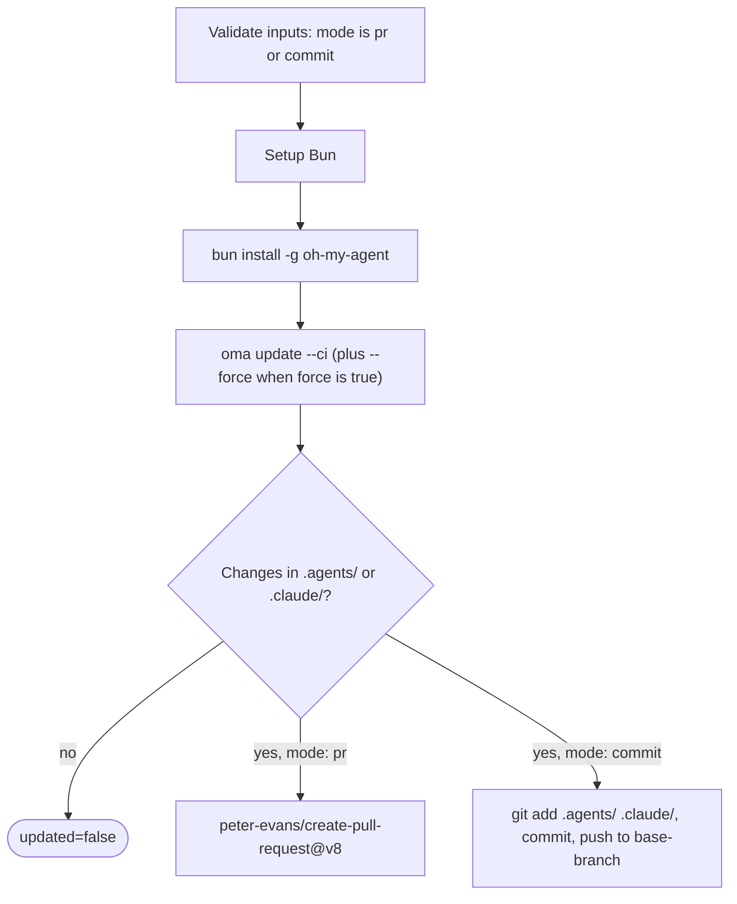

# ガイド：自動更新

## 概要

oh-my-agent GitHub Action（`first-fluke/oma-update-action@v1`）は、CI で `oma update` を実行してプロジェクトのエージェントスキルを自動更新します。更新をレビュー用のプルリクエストにするモードと、ブランチへ直接コミットするモードがあります。

---

## クイックセットアップ

<!-- oma-docs:ignore-start -->
プロジェクトに `.github/workflows/update-oh-my-agent.yml` としてこのファイルを追加します。
<!-- oma-docs:ignore-end -->

```yaml
name: Update oh-my-agent

on:
  schedule:
    - cron: '0 9 * * 1'  # Every Monday at 9am UTC
  workflow_dispatch:        # Allow manual trigger

permissions:
  contents: write
  pull-requests: write

jobs:
  update:
    runs-on: ubuntu-latest
    steps:
      - uses: actions/checkout@v4

      - uses: first-fluke/oma-update-action@v1
```

これが最小構成です。インストール済みのコンポーネントに変更があると、Action は `updated=true` とバージョンを出力し、プルリクエストを作成して終了します。ファイルに変更がなければ、`updated=false` となり、プルリクエストは作成されません。

---

## Action の全入力

| 入力 | 型 | 必須 | デフォルト | 説明 |
|:------|:-----|:---------|:--------|:-----------|
| `mode` | string | いいえ | `"pr"` | 変更の適用方法です。`"pr"` はプルリクエストを作成し、`"commit"` はベースブランチへ直接プッシュします。 |
| `base-branch` | string | いいえ | `"main"` | `pr` モードでは PR のベースブランチ、`commit` モードでは直接コミットする対象ブランチです。チェックアウトする内容は変わりません。`actions/checkout` の `ref:` を同じブランチに設定してください。 |
| `force` | string | いいえ | `"false"` | `oma update` に `--force` を渡します。`"true"` にすると、ユーザーがカスタマイズした設定ファイル（`oma-config.yaml`、`mcp.json`）と `stack/` ディレクトリを上書きします。通常は保持されます。 |
| `pr-title` | string | いいえ | `"chore(deps): update oh-my-agent skills"` | プルリクエストのタイトルです。`pr` モードでのみ使います。 |
| `pr-labels` | string | いいえ | `"dependencies,automated"` | PR に付けるラベルをカンマ区切りで指定します。`pr` モードでのみ使います。 |
| `commit-message` | string | いいえ | `"chore(deps): update oh-my-agent skills"` | カスタムコミットメッセージです。両モードで、PR のコミットメッセージまたは直接コミットのメッセージとして使います。 |
| `token` | string | いいえ | `${{ github.token }}` | PR を作成するための GitHub トークンです。作成した PR から他のワークフローを起動する必要がある場合は Personal Access Token（PAT）を使います。デフォルトの `GITHUB_TOKEN` では、作成した PR でワークフローが実行されません。 |

---

## Action の全出力

| 出力 | 型 | 説明 | 利用できる条件 |
|:-------|:-----|:-----------|:----------|
| `updated` | string | `oma update` の実行後に変更を検出した場合は `"true"`、すでに最新の場合は `"false"` です。 | 常に利用可能 |
| `version` | string | 更新後の oh-my-agent のバージョンです。`.agents/skills/_version.json` から読み取ります。 | `updated` が `"true"` の場合 |
| `pr-number` | string | 作成したプルリクエストの番号です。 | PR が作成された `pr` モードの場合のみ |
| `pr-url` | string | 作成したプルリクエストの完全な URL です。 | PR が作成された `pr` モードの場合のみ |

---

## 詳細な例

### 例 1：デフォルトの PR モード

最も一般的な設定です。更新があれば、毎週月曜日に PR を作成します。

```yaml
name: Update oh-my-agent

on:
  schedule:
    - cron: '0 9 * * 1'
  workflow_dispatch:

permissions:
  contents: write
  pull-requests: write

jobs:
  update:
    runs-on: ubuntu-latest
    steps:
      - uses: actions/checkout@v4

      - uses: first-fluke/oma-update-action@v1
        id: update

      - name: Summary
        if: steps.update.outputs.updated == 'true'
        run: |
          echo "Updated to version ${{ steps.update.outputs.version }}"
          echo "PR: ${{ steps.update.outputs.pr-url }}"
```

**実行される処理：**
- リポジトリをチェックアウトします。
- Bun をインストールし、その後 oh-my-agent をグローバルにインストールします。
- `oma update --ci` を実行します。
- `.agents/` または `.claude/` に変更があるか確認します。
- 変更がある場合は `peter-evans/create-pull-request@v8` を使い、`chore/update-oh-my-agent` ブランチに PR を作成します。
- PR に `dependencies,automated` ラベルを付け、本文に新しいバージョン番号を含めます。

### 例 2：PAT を使う直接コミットモード

PR のレビュー手順を挟まず、すぐに更新を適用したいチーム向けです。コミットから後続のワークフローを起動できるように PAT を使います。

```yaml
name: Update oh-my-agent (Direct)

on:
  schedule:
    - cron: '0 6 * * *'  # Daily at 6am UTC
  workflow_dispatch:

permissions:
  contents: write

jobs:
  update:
    runs-on: ubuntu-latest
    steps:
      - uses: actions/checkout@v4
        with:
          ref: develop
          token: ${{ secrets.OH_MY_AGENT_PAT }}

      - uses: first-fluke/oma-update-action@v1
        with:
          mode: commit
          token: ${{ secrets.OH_MY_AGENT_PAT }}
          commit-message: "chore: auto-update oh-my-agent skills"
          base-branch: develop
```

**実行される処理：**
- PAT を使って `develop` をチェックアウトします。`ref: develop` は必須です。`base-branch` はプッシュ先を設定するだけで、Action はチェックアウトで得られた `HEAD` をそのままプッシュします。
- `oma update --ci` を実行します。
- 変更がある場合は Git を `github-actions[bot]` として設定し、`develop` に直接コミットします。
- PAT により、`develop` へのプッシュを監視するワークフローがそのコミットで起動します。

**重要：** `github.token` の代わりに `secrets.OH_MY_AGENT_PAT`（Contents: Write 権限を持つ Fine-Grained PAT）を使ってください。デフォルトの `GITHUB_TOKEN` で作成したコミットは他のワークフローを起動しないため、プッシュイベントを前提とする CI パイプラインが動かなくなることがあります。

### 例 3：条件付き通知

新しいバージョンが利用可能なときに Slack 通知を送ります。

```yaml
name: Update oh-my-agent

on:
  schedule:
    - cron: '0 9 * * 1'
  workflow_dispatch:

permissions:
  contents: write
  pull-requests: write

jobs:
  update:
    runs-on: ubuntu-latest
    steps:
      - uses: actions/checkout@v4

      - uses: first-fluke/oma-update-action@v1
        id: update

      - name: Notify Slack
        if: steps.update.outputs.updated == 'true'
        uses: slackapi/slack-github-action@v2
        with:
          webhook: ${{ secrets.SLACK_WEBHOOK }}
          webhook-type: incoming-webhook
          payload: |
            {
              "text": "oh-my-agent updated to v${{ steps.update.outputs.version }}. PR: ${{ steps.update.outputs.pr-url }}"
            }

      - name: Skip notification
        if: steps.update.outputs.updated == 'false'
        run: echo "Already up to date, no notification needed."
```

**要点：** `steps.update.outputs.updated == 'true'` を使い、実際に更新があった場合だけ後続のステップを条件付きで実行します。これにより、変更がない実行による通知のノイズを防げます。

### 例 4：カスタムラベル付きの強制モード

更新時にすべての設定ファイルをデフォルトへ戻したいプロジェクト向けです。

```yaml
name: Update oh-my-agent (Force)

on:
  workflow_dispatch:  # Manual trigger only for force updates

permissions:
  contents: write
  pull-requests: write

jobs:
  update:
    runs-on: ubuntu-latest
    steps:
      - uses: actions/checkout@v4

      - uses: first-fluke/oma-update-action@v1
        with:
          force: 'true'
          pr-title: "chore(deps): force-update oh-my-agent skills (reset configs)"
          pr-labels: "dependencies,automated,force-update"
          commit-message: "chore(deps): force-update oh-my-agent skills"
```

**警告：** 強制モードは `oma-config.yaml`、`mcp.json`、`stack/` ディレクトリを上書きします。すべてのカスタマイズをデフォルトへ戻したい場合だけ使ってください。通常の更新では `force` 入力を省略します。

---

## 内部での動作

この Action は `action/action.yml` で定義された[複合アクション](https://docs.github.com/en/actions/creating-actions/creating-a-composite-action)です。まず `mode` が `pr` または `commit` であることを検証し、次のステップを実行して、最後にプルリクエストまたは直接コミットで終了します。



### Step 1：Bun のセットアップ

```yaml
- uses: oven-sh/setup-bun@v2
```

oh-my-agent CLI の実行に必要な Bun ランタイムをインストールします。

### Step 2：oh-my-agent のインストール

```bash
bun install -g oh-my-agent
```

npm レジストリから CLI をグローバルにインストールします。これで `oma` コマンドを使えるようになります。

### Step 3：oma update の実行

```yaml
- name: Run oma update
  shell: bash
  env:
    FORCE: ${{ inputs.force }}
  run: |
    FLAGS="--ci"
    if [ "$FORCE" = "true" ]; then
      FLAGS="$FLAGS --force"
    fi
    oma update $FLAGS
```

入力は `run:` 内の `${{ }}` 補間ではなく `env:` を通じてスクリプトに渡されます。これにより、入力値がシェルコードとして実行されるのを防ぎます。

`--ci` フラグは更新を非対話型モードで実行し、すべてのプロンプトを省略してスピナーアニメーションの代わりにプレーンテキストを出力します。有効にした `--force` フラグは、ユーザーがカスタマイズした設定ファイルを上書きします。

`oma update --ci` は内部で次の処理を行います。

1. メインブランチから `prompt-manifest.json` を取得し、最新バージョン番号を確認します。
2. ローカルの `.agents/skills/_version.json` にあるバージョンと比較します。
3. バージョンが一致すると、`Already up to date.` を表示して終了します。
4. 新しいバージョンがあると、最新の tarball をダウンロードして展開します。
5. `--force` がない限り、ユーザーがカスタマイズした `oma-config.yaml`、`mcp.json`、stack ディレクトリを保持します。
6. 既存の `.agents/` ディレクトリに新しいファイルをコピーします。
7. 保持していたファイルを戻します。
8. 設定の `vendors:` リストにあるベンダーのベンダー適応（フック、設定、エージェント定義）を更新します（空のリストは対象なしを意味します）。`vendors:` リストがない場合は、プロジェクトディレクトリがすでに存在するベンダーだけを更新します。
9. CLI シンボリックリンクを更新します。

Action は `--with-new-skills` なしで `oma update --ci` を呼び出します。インストール済みのスキルセットを更新し、新しく利用できるスキルを報告する動作です。更新の一部として新しいスキルを追加する場合は、意図的に `oma update --with-new-skills` を実行してください。

### Step 4：変更の確認

```bash
if [ -n "$(git status --porcelain .agents/ .claude/ 2>/dev/null)" ]; then
  echo "updated=true" >> "$GITHUB_OUTPUT"
  if [ -f ".agents/skills/_version.json" ]; then
    VERSION=$(jq -r '.version' .agents/skills/_version.json)
    echo "version=$VERSION" >> "$GITHUB_OUTPUT"
  fi
else
  echo "updated=false" >> "$GITHUB_OUTPUT"
fi
```

`.agents/` または `.claude/` 内で `oma update` が実際にファイルを変更したか確認し、`updated` と `version` の出力をそれに応じて設定します。この 2 つのディレクトリ以外の変更（たとえば `.codex/` や `AGENTS.md`）では `updated=true` になりません。

その後、`mode` 入力に応じて次の処理を行います。

- **`pr` モード：** `peter-evans/create-pull-request@v8` を使い、`chore/update-oh-my-agent` ブランチに PR を作成します。PR には新しいバージョン番号、oh-my-agent リポジトリへのリンク、設定したラベルが含まれます。前回作成した PR が閉じられずに同じブランチが残っている場合は、既存の PR を更新します。

- **`commit` モード：** Git を `github-actions[bot]` として設定し、`.agents/` と `.claude/` をステージングして、設定したメッセージでコミットし、ベースブランチへプッシュします。

---

## 関連項目

- [グローバルインストール](./global-install.md)：`oma update --global` と、ユーザー全体のインストールにおける CI の注意点
- [設定リファレンス](./configuration-reference.md#update-and-ownership-rules)：`oma update` が保持する設定ファイル
- [既存プロジェクトとの統合](./integration.md)：プロジェクト内で `oma update` が更新するファイル
