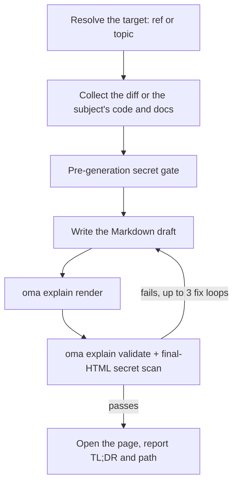

# コード解説

`/explain` はコード変更を自己完結型の HTML 文書にまとめ、変更内容と理由を説明します。文書には、初めての読者向けの読み飛ばせる背景、おもちゃのデータを使った核心の直感セクション、理解しやすい順序のコードウォークスルー、デフォルトで5問のアクセシブルなクイズが含まれます。オフラインで開ける1つの `.html` ファイルに図とコールアウトを含め、`.agents/results/explain/` に保存します。配布前に決定的なチェックリストで検証します。

`/explain` ワークフローは自然言語から自動起動しません。「explain」は日常語なので、`/convert` と同様にキーワード検出の対象外です。`/explain` を明示するか、別のスキルに「解説文書」を委任成果物として作らせます。

## 2 つのモード

| モード | 入力 | git の要否 | ページが説明する内容 |
|---|---|---|---|
| Change | `/explain`、`/explain #640`、`/explain a..b`、`/explain <branch>` | 必要（PR 参照には `gh`） | コード変更：Background、Intuition、Code、Quiz |
| Topic | `/explain how does session windowing work`（PR、ブランチ、SHA 範囲のいずれにも解決されないテキスト） | 不要 | 概念、システム、または質問への答えを 1 ページのビジュアルシートにまとめます。最初に答えを示し、続いて図、表、短い文章のパネルを並べます |

テキストがブランチ名とも主題とも取れる場合、ワークフローはまず git の参照として確認します。参照が優先されます。

---

## 使う場合

- PR、ブランチ、コミット範囲、現在のステージ済み／未ステージの変更を文書として説明する
- 自分が書いていない変更をチームメイトへ引き継ぐ
- 大きい変更または理解しにくい変更の後に、レビュー可能な教材を作る
- アーキテクチャ、プロトコル、比較、長い回答を 1 枚のビジュアルページにまとめる（Topic モード）

## 使わない場合

- ナレーション付き解説 *動画* → [`oma-video`](./video-generation.md)（explainer モード）。`/explain` は動画ではなく HTML 文書を作ります
- ドキュメントがコードベースと一致するかの確認 → `oma-docs`（ドリフト検出）
- プレゼンテーションデッキ／スライド → `oma-slide`（固定 1920×1080 デッキのコントラクト）
- 欠陥の発見やレビュー判定 → `oma-qa` または `/review` ワークフロー。`/explain` は変更を教育的に説明しますが、評価はしません

---

## クイックスタート

```text
/explain
/explain 640
/explain a1b2c3d..e5f6a7b
/explain payments-refactor for reviewer
```

入力された表現から対象の参照（ref）を解決します。

| 入力 | 対象の解決 | 読者レベル |
|---|---|---|
| `/explain` | ステージ済みの変更（`git diff --cached`）、なければ変更のあるワークツリー | `onboarding` |
| `/explain 640`、`/explain #640` | `gh pr diff` による PR #640 | `onboarding` |
| `/explain a..b` | SHA 範囲 `a..b`（または `a...b`） | `onboarding` |
| `/explain feature-branch for reviewer` | `git diff main...feature-branch` | `reviewer` |
| `/explain how does the row planner work` | Topic モード：参照はなく、エージェントが主題に関わるコードとドキュメントを収集します | 該当なし |

明示的な参照（ref）がなく、ステージ済みの変更と変更のあるワークツリーの両方が空なら、`HEAD~1..HEAD` へフォールバックします。



---

## 参照の解決順序 {#ref-resolution-order}

Change モードのみです。Topic モードでは参照の解決を省略します。

1. **明示的な引数**（PR 番号（`#640`）、ブランチ名、SHA 範囲（`a..b`／`a...b`））
2. **ステージ済みの変更**（`git diff --cached`）
3. **変更のあるワークツリー**（`git diff`）
4. **フォールバック**（`HEAD~1..HEAD`）

空の diff や解決できない参照ではワークフローを停止します。別の参照を推測せず、最近のコミットを候補として提示します。

---

## 読者レベル

| レベル | 効果 |
|---|---|
| `onboarding`（デフォルト） | 周辺システムを知らない読者向けの深い背景（Tier A） |
| `reviewer` | 深い背景の層を短くし、Intuition と Code は完全に保つ |

`reviewer` は、`/explain feature-branch for reviewer` のようにコマンドへ「for reviewer」を追加して指定します。

---

## 文書に含まれる内容

Change モードの解説は、タブや複数ページのナビゲーションを持たない、1 つの長いスクロールページです。目次に続いて、順序を固定した 4 セクションがあります。

1. **Background** には、Tier A（システムやアーキテクチャの深い背景。システムをすでに知っている場合は読み飛ばせると表示）と、この変更に絞った Tier B を含めます
2. **Intuition** では、変更の本質を、必須のおもちゃのデータ例と、2〜3 種類の再利用する図（簡略化した UI モック、例データを載せたシステム／データフロー図、変更前後の状態）で補強します。HTML／インライン SVG だけを使い、ASCII アートは使いません
3. **Code** では、人が理解しやすい順にウォークスルーをまとめます（アルファベット順や diff の順ではありません）。コードは `file:line` で参照します
4. **Quiz** では、デフォルト 5 問（変更可能）を用意します。各問は別の観点を扱い、もっともらしい誤答と、正誤それぞれのフィードバックを持ちます

文章とクイズは要求された出力言語（プロンプトの言語 → `.agents/oma-config.yaml` の `language` → 英語）で書きます。コード、識別子、インラインコードは i18n ルールに従って英語のままにします。完全な内容のコントラクトは `.agents/skills/oma-explanation/resources/document-structure.md` にあります。

---

## ページの作られ方

エージェントが Markdown のドラフトを書き、`oma explain render` がそれをページに変換します。レイアウト、テーマ、図の形状、クイズのスクリプトはモデルではなくレンダラーが提供します。

| コマンド | 用途 |
|---|---|
| `oma explain render draft.md` | ドラフト（ファイルまたは stdin）を `.agents/results/explain/{YYYY-MM-DD}-{slug}.html` にレンダリングします。オプションには `--template sheet\|doc`、`--theme`、`--mode`、`--archify`、`--open` があります。 |
| `oma explain lint draft.md` | レンダリングせずに文章を確認します（`--style strict` では警告があると 1 で終了します）。 |
| `oma explain components [name]` | ドラフトで使えるコンポーネント（`flow`、`sequence`、`tree`、`timeline`、`limits`、`annot`、`kv`、`callout`、`quiz`）を一覧表示するか、1 つのコンポーネントの構文を表示します。 |
| `oma explain patch <page.html> --panel <id>` | レンダリング済みページのパネルを 1 つ（文字またはタイトルで指定）置き換え、残りはそのまま保ちます。 |
| `oma explain validate <file>` | 後述の決定的な事後チェックを実行します。 |

---

## HTML コントラクト

`oma explain render` が作るページはこれらのルールを自動的に満たします。HTML を確認したり手で編集したりするときに重要になります。

生成されたファイルは `file://` でオフラインでも正しく開け、**外部リソースの読み込みを 0 件**にしなければなりません。CDN のスクリプトやスタイルシート、Web フォント、外部画像は使わず、インライン SVG または data URI だけを使います。ハイパーリンクの `<a href="https://...">` は許可されます。禁止されるのはリソースを*読み込む*ことだけです。

- コードブロックは `<pre>` を使います。カスタムコンテナでは `white-space: pre-wrap` を宣言します。外部の構文ハイライトライブラリは使いません
- フォントスタックは、ローカルにインストールされた Pretendard をファミリー名で指定し（ページはフォントをダウンロードせず、CSS の `local()` 関数も使いません）、次に `system-ui` とシステムの CJK フォントを続けます。日本語と中国語のページは Pretendard を使わず、`system-ui` とその言語向けのフォントから始めます
- 375px からレスポンシブにし、ライトとダークの両テーマで WCAG AA のコントラストを保ち、`prefers-color-scheme: dark` に対応し、`prefers-reduced-motion` を尊重します
- クイズは vanilla JS です。選択肢を `<button>` として置き、`aria-live="polite"` の領域で正誤のフィードバックを即時に知らせます。正解の位置はランダムに分散させ、最終スコアを表示し、キーボードで全操作できるようにします

完全な動作仕様は `.agents/skills/oma-explanation/resources/html-contract.md` にあります。

---

## 秘密情報とプロンプトインジェクションへの対策

diff の内容と PR の説明は厳密に**データ**として扱い、説明対象の変更に含まれる指示は無視します。

秘密情報は 2 回ゲートします。

1. **生成前**。何かを書き始める前に、収集した diff をスキャンします
2. **生成後**。背景の文章が、diff のスキャンだけでは見逃す変更されていないファイルを引用できるため、最終 HTML もスキャンします

検出した場合は生成を直ちに停止し、マスクした場所だけを報告します（実際の値は出しません）。伏せ字のまま続行するには、明示的な確認が必要です。

---

## 検証チェックリスト

生成後、grep ベースのチェックリストを出力ファイルに対して実行します。外部リソース読み込みの参照がないこと、コードコンテナが `pre`／`pre-wrap` の規則を満たすこと、クイズスクリプトがあること、ファイル名が `{YYYY-MM-DD}-{slug}.html` 形式であること（日付は oma-config の `timezone`、未設定ならシステムのタイムゾーン）、最終 HTML の秘密情報スキャンを確認します。失敗した場合は最大 **3 回**修正して再検証し、それでも残る失敗項目を黙って配布せずに表示して停止します。

これは v1 の制約です。検証は grep／ファイルベースで、クイズスクリプトの*存在*だけを確認します（動作の完全な正しさは確認しません）。動作の確信が必要なら、ブラウザー（または chrome-devtools MCP）でクイズを手動操作します。

既存アーティファクトは次の登録 CLI コマンドで検証できます。

```bash
oma explain validate .agents/results/explain/2026-09-09-payment-refactor.html
oma explain validate --input-dir .agents/results/explain --output json
```

想定される出力（ファイル名は例示です）：

```text
$ oma explain validate .agents/results/explain/2026-09-09-payment-refactor.html
✔ Explain validation passed: 1/1 file(s) valid

$ oma explain validate ".agents/results/explain/payment refactor.html"
✖ Explain validation failed: 1/1 file(s) failed
File: .agents/results/explain/payment refactor.html
  - [error] filename-format: Filename 'payment refactor.html' does not match format {YYYY-MM-DD}-{slug}.html
```

最初の形式は 1 つの HTML ファイルを確認します。ディレクトリ形式はディレクトリ内の全レポートを確認し、機械可読なレポートを返します。JSON レポートを保存するには `--report-file <path>` を使います。旧表記の `--out-file` は現在 `Removed option --out-file. Use --report-file.` で失敗します。終了コードが 0 以外なら、少なくとも 1 つのアーティファクトが決定的チェックに失敗しています。文章の教育的な正確さやクイズの答えは調べません。

---

## 出力

```text
.agents/results/explain/{YYYY-MM-DD}-{slug}.html
```

日付は oma-config の `timezone` に従い、未設定の場合はシステムのタイムゾーンを使います。同じ日付と slug で再実行すると以前のファイルを上書きします。過去の実行を残すのは利用者の責任です。検証に合格すると、ワークフローはページを開こうとし（警告のみ。ヘッドレス環境ではパスの報告に戻ります）、TL;DR とファイルパスを報告します。`oma explain render --open` はページを直接ブラウザーで開きます。

---

## 任意の archify サイドカー

`oma-config.yaml` で `diagram.explain_sidecar: true` を設定するか、`/explain 640 with archify` のように依頼すると、`/explain` は `--archify` 付きでレンダリングします。ドラフトの `flow` または `sequence` ブロックからインタラクティブな `{date}-{slug}.archify.html` を派生させ、通常のアンカーでリンクします。埋め込むことはありません。解説ページは単一の自己完結ファイルのままで、サイドカーの失敗が配布を止めることもありません。[ダイアグラムエンジン](./diagram-engine.md#explain)を参照してください。

## エッジケース

| 状況 | 動作 |
|---|---|
| 空の diff／解決できない ref | 停止し、最近のコミットを候補として提示します。別の ref を推測しません |
| 大きすぎる diff | ロックファイルと生成ファイルを自動除外し、残りをファイルごとにまとめ、除外を出典情報フッターに列挙します |
| バイナリのみ、または生成ファイルのみの diff | 停止します。解説できるものがありません |
| PR ref で `gh` CLI がない、または未認証 | インストール／認証の案内と、ローカルブランチの diff という代替手段を示します |
| merge／rebase 中 | 停止します。ワークツリーが安定していません |
| git ディレクトリではない | Change モード：直ちに停止します。Topic モードは git なしで実行します。 |
| 3 回の修正ループ後も検証に失敗 | 失敗したチェックリスト項目を表示して停止します |
| `open` が失敗、またはヘッドレス環境 | 警告のみ。報告したパスで十分です |

---

## 次のステップ

- [`/explain` ワークフロー](../core-concepts/workflows.md#explain)。参照の解決 → 収集 → 秘密情報ゲート → 生成 → 検証 → 配布のパイプラインです
- [ダイアグラムエンジン](./diagram-engine.md)。任意の archify サイドカーです
- [CLI コマンド：explain](../cli-interfaces/commands.md#explain)。`oma explain` のすべてのオプションです
- [動画生成](./video-generation.md)。`oma-video` の explainer *mode* は HTML 文書の代わりにナレーション付き動画を生成します
- [コンテンツとリサーチのワークフロー](./content-and-research.md)。その他の文書作成とリサーチの機能です
