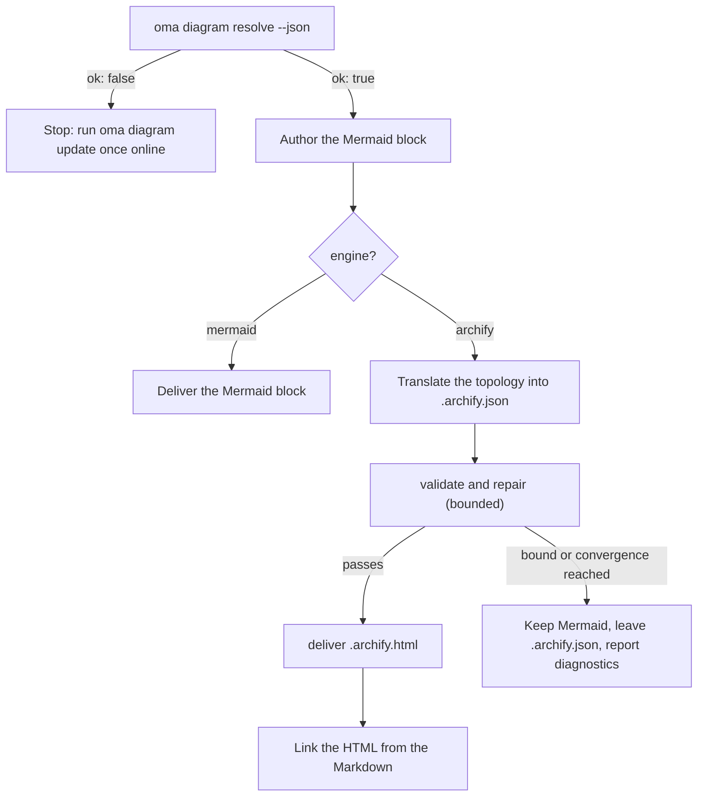

# ダイアグラムエンジン

`/architecture`（ADR、推奨、レビュー）と `/explain`（コード変更の解説）は構造図を出力します。`/architecture` アーティファクトには **Mermaid** ブロックが必ず含まれ、`/explain` ワークフローはインライン SVG 図を描きます。[archify](https://github.com/tt-a1i/archify) を解決できる場合、アーキテクチャワークフローはアーティファクトの隣に**インタラクティブで検証済みの HTML 図**も出力します。型付き JSON 仕様から描画され、ダーク／ライトテーマ、パンとズーム、検索、関係の追跡、PNG／SVG／WebM エクスポートに対応します。

Mermaid がなくなることはありません。Markdown と git diff に残るテキストの SSOT です。archify は派生アーティファクトです。

---

<a id="always-the-latest-archify--nothing-to-install"></a>
## archify のインストール {#install-archify}

archify は MIT ライセンスのエージェントスキルです（Node ≥ 18、ランタイム依存なし）。oh-my-agent は [skills CLI](https://github.com/vercel-labs/skills) でインストールしたコピーを使い、独自のコピーは保持しません。

- `oma diagram update` は、archify がない場合はインストールし（`bunx skills add tt-a1i/archify --skill archify -g -y`）、ある場合は更新します（`bunx skills update archify -g -y`）。
- `oma diagram resolve` はインストール済みのスキルディレクトリを読むだけで、ネットワークには一切アクセスしません。インストールがない場合、`auto` は Mermaid にフォールバックし、インストールコマンドを案内します。
- `oma update` は archify をインストールしません。

```bash
# Illustrative output; the version, install path, and quality can vary.
oma diagram update
oma diagram resolve
# engine:   archify  (requested: auto)
# reason:   archify 2.15.0 via home:~/.agents/skills
# root:     /Users/you/.agents/skills/archify
# bin:      /Users/you/.agents/skills/archify/bin/archify.mjs
# version:  2.15.0
# quality:  showcase
# sidecar:  off (explain)
```

解決順序はすべてのベンダーランタイムで同じです（最初に見つかったものを使います）。

1. `oma-config.yaml` の `diagram.archify.path`。明示的な固定値です
2. `ARCHIFY_HOME` 環境変数。明示的な固定値です
3. インストール済みのスキルディレクトリ。プロジェクトの `.agents` / `.claude` / `.codex` / `.cursor` / `.qwen` / `.kiro` / `.gemini` / `.copilot` の `/skills/archify`、次に `~` の同じ場所、最後に `~/.config/agents/skills/archify` と `~/.raven/workspace/skills/archify`

<!-- oma-docs:ignore-start -->
インストール済みまたは固定された archify のディレクトリに `bin/archify.mjs` が含まれている場合だけ解決できます。
<!-- oma-docs:ignore-end -->

以前のリリースは `~/.cache/oma-diagram/` に独自のコピーを保持していました。現在は読み込まれないので、削除してかまいません。

---

## 設定 {#configuration}

`.agents/oma-config.yaml` の最小限の設定項目です（キーを省略すると表示されたデフォルトを使います）。

```yaml
diagram:
  engine: auto                # auto | archify | mermaid
  explain_sidecar: false      # /explain also writes an archify sidecar
  archify:
    path: null                # explicit install dir (pin)
    quality: showcase         # showcase | standard  → --quality
    open: false               # pass --open to deliver
```

`archify.managed`、`archify.channel`、`archify.check_interval_min` は非推奨です。検証は引き続き通りますが無視され、設定されている間は `resolve` が警告を表示します。

### どのエンジンが動くか {#which-engine-runs}

設定値、archify を解決できるかどうか、ワークフローが何を配信するかを 1 つの判断でまとめます。「解決できる」とは、[解決順序](#always-the-latest-archify--nothing-to-install)のいずれかの段階でインストールが見つかることです。固定値か、インストール済みのスキルディレクトリのどちらかです。

| `diagram.engine` | archify を解決できるか | `oma diagram resolve --json` | `/architecture` の結果 |
|---|---|---|---|
| `auto`（デフォルト） | はい | `engine: archify`、`ok: true` | Mermaid ブロックとリンクされた `.archify.html` |
| `auto` | いいえ（archify が未インストール） | `engine: mermaid`、`ok: true` | Mermaid だけです。レポートは `oma diagram update` を案内します |
| `archify` | はい | `engine: archify`、`ok: true` | Mermaid ブロックとリンクされた `.archify.html` |
| `archify` | いいえ | `engine: mermaid`、`ok: false`、終了コード 1 | 黙って格下げせず、`oma diagram update` のヒントを示してワークフローを停止します |
| `mermaid` | 確認しない | `engine: mermaid`、`ok: true` | Mermaid だけです。archify は呼び出しません |

`oma diagram resolve --engine <auto|archify|mermaid>` は 1 回の呼び出しだけ設定を上書きします。プロンプトでも 1 回の実行だけ同じことができます（`/explain 640 with archify`）。

---

## CLI {#cli}

```bash
oma diagram resolve [--engine auto|archify|mermaid] [--json]
oma diagram update  [--json]
oma diagram archify <archify args…>
```

`oma diagram update` は更新を強制し、archify のインストールを解決できない場合は終了コード 1 で終了します。

`oma diagram archify` は、`ARCHIFY_UPDATE_CHECK_DISABLED=1`（ネットワークなし）で解決された archify 実行ファイルを動かし、終了コードをそのまま返します。そのため、`validate` / `deliver` / `visual-check` の動作は archify のドキュメントどおりです。

```bash
oma diagram archify guide "show the auth request lifecycle" --json
oma diagram archify validate architecture adr-auth.archify.json --quality showcase --json
oma diagram archify deliver  architecture adr-auth.archify.json adr-auth.archify.html --quality showcase --json
oma diagram archify visual-check adr-auth.archify.html --json   # exit 2 = no Chrome (skipped), or archify itself could not be resolved
```

`resolve` の `--json` は `{ ok, requested, engine, quality, open, explainSidecar, archify?: { root, bin, version, source }, reason, probed, warnings }` を返します。`source` は `config:…`、`env:…`、または `home:~/.agents/skills` のようなスキルディレクトリのラベルです。`warnings` には無視された非推奨キーが並びます。`--refresh` と `--offline` は非推奨の no-op として受け付けます。

---

## ワークフローからの利用 {#how-the-workflows-use-it}

共有プロトコルは `.agents/skills/_shared/conditional/diagram-engine.md` にあります。`/architecture` は次の順序に従います。

1. `oma diagram resolve --json`
2. Mermaid ブロックを最初に作成します（常に行います）。
3. `engine: archify` の場合は、Mermaid のトポロジーを archify の JSON IR（`architecture` / `sequence` / `dataflow` / `lifecycle` / `workflow`）に変換します。インストール先から対応するスキーマと 1 つの例だけを読みます。
4. `validate` → 修復 → `deliver` を上限付きで行います。仕様が検証を通ったとき、archify の収束ルールが発動したとき、修復を 3 回試したとき、合計 10 分が経過したとき、同じ診断が繰り返されたときに停止します。意味のあるラベルを、通過させるためだけに削除することはありません。
5. HTML をリンクします。埋め込むことはありません。



### `/architecture` {#architecture}

境界、依存関係、データフローなど、構造上の意思決定だけに使います。Markdown アーティファクトの隣の `.agents/results/architecture/` に出力します。

```text
adr-notification-service.md            # Mermaid block + "Interactive:" link
adr-notification-service.archify.json  # frozen spec (kept even on failure)
adr-notification-service.archify.html  # delivered viewer
```

### `/explain` {#explain}

解説ページ自身のコントラクト（CSS 変数でテーマを切り替える、自己完結した 1 つのファイル）では、別の完全な HTML ドキュメントを埋め込めないため、オプトインです。`diagram.explain_sidecar: true` を設定するか、`oma explain render --archify` を渡すか、プロンプトで依頼します（「with archify」）。Mermaid ブロックも手書きの JSON もありません。レンダラーはドラフトの `flow` または `sequence` ブロック（`{archify}` と印を付けたパネル）から archify の仕様を派生させ、`deliver` を実行し（`showcase` 品質から `standard` 品質へ一度だけフォールバックします）、`{date}-{slug}.archify.html` を通常の `<a href>` でリンクします。コマンドは `linked`、`skipped`（理由付き）、`failed`（最初の診断付き）のいずれかを報告します。ワークフローは失敗したサイドカーを繰り返し試さず、サイドカーの失敗が解説ページを止めることもありません。

---

## スタックポスター（stack-diagram） {#stack-posters-stack-diagram}

図がベンダー製品（AWS、Vercel、Postgres など）をノードとする技術スタックやインフラのトポロジーで、ロゴを依頼した場合、`/architecture` は archify ではなく**スタック経路**を取ります。`oma-slide` が ppt-master を実行するのと同じ方法で、上流の [Caru-ini/stack-diagram](https://github.com/Caru-ini/stack-diagram) エージェントスキル（MIT。Python 3.9 以降、ロゴ取得のためのネットワークアクセスが必要）を実行します。oma コマンドも設定キーもありません。経路表は `.agents/skills/_shared/conditional/diagram-engine.md` にあります。

- 解決: まずランタイムのスキルカタログ、なければ `bunx skills use caru-ini/stack-diagram@stack-diagram`。解決できない場合、ワークフローは上記の archify ↔ Mermaid の判断にフォールバックし、その旨を報告します。
- 出力: Markdown アーティファクトの隣の `<artifact-stem>.stack.html`。Diagram セクションの下に `Stack: …` としてリンクされます。Mermaid ブロックが SSOT のままです。
- HTML のみです。上流の PNG エクスポートとスクリーンショット確認には Playwright と Chromium が必要ですが、oma はそれらをインストールも実行もしません。
- 上流のギャラリーへのアップロード（`share.py`）は、明示的に公開を依頼しない限りスキップします。
- 上限: ビルド試行 2 回、合計 5 分。`build.py` が正常に完了することが受け入れ条件です。
- `/explain` はこの経路を取りません。そのサイドカーはドラフトからコードで派生されます。

プロンプトで「archify」と言えば構造図の経路を、「stack-diagram」または「with logos」と言えばスタック経路を強制できます。

---

## 失敗時の動作 {#failure-modes}

archify を解決できない場合は[エンジンの判断表](#which-engine-runs)で扱います。残りのケースは次のとおりです。

| 状況 | 結果 |
|---|---|
| `oma diagram update` が失敗（オフライン、`bunx` がない） | skills CLI のエラーを表示します。既存のインストールは引き続き動作します |
| `validate` が収束しない | Mermaid を配信する図として残します。最後の `.archify.json` は人間向けに残し、診断をそのまま報告します |
| `visual-check` に Chrome がない | `skipped` と報告します。pass にはしません |
| `oma diagram archify …` が終了コード 2 で終了 | Chrome がない（`visual-check`）か、archify を解決できなかったかのどちらかです。まず `oma diagram resolve --json` を確認してください |

---

## 次のステップ {#next-steps}

- [コード解説](./code-explainer.md)。`/explain` ワークフローと任意の archify サイドカーです
- [`/architecture` ワークフロー](../core-concepts/workflows.md#architecture)。Mermaid ブロックを含む ADR とレビューです
- [oma-config.yaml のセマンティクス](./oma-config-semantics.md)。`diagram:` セクションのマージ方法です
- [CLI コマンド：diagram](../cli-interfaces/commands.md#diagram)。全オプションの一覧です
- [市場調査](./market-research.md)。last30days エンジンにも同じ skills CLI のインストールパターンを使います
- archify 上流：[tt-a1i/archify](https://github.com/tt-a1i/archify)
- stack-diagram 上流：[Caru-ini/stack-diagram](https://github.com/Caru-ini/stack-diagram)
