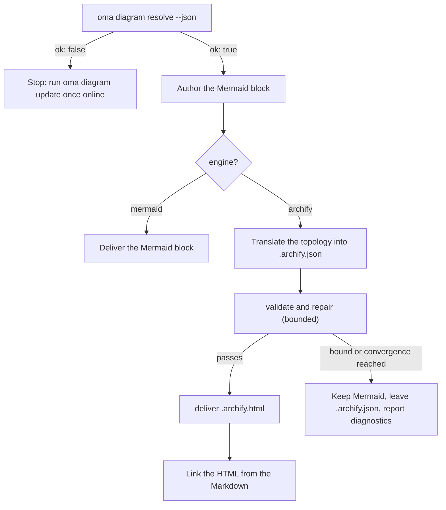

# ダイアグラムエンジン

`/architecture`（ADR、推奨事項、レビュー）と `/explain`（コード変更の解説）は、どちらも構造図を出力します。`/architecture` では、図は常に Markdown アーティファクト内の **Mermaid** ブロックです（`/explain` は独自のインライン SVG 図を描きます）。さらに [archify](https://github.com/tt-a1i/archify) を解決できる場合（通常はこちら）は、アーティファクトの隣に**インタラクティブで検証済みの HTML 図**も出力します。HTML 図にはダーク／ライトテーマ、パンとズーム、検索、関係の追跡、PNG／SVG／WebM エクスポートがあり、型付き JSON 仕様から描画されます。

Mermaid がなくなることはありません。Markdown と git diff に残るテキストの SSOT です。archify は派生アーティファクトです。

---

## 常に最新の archify を使う。インストールは不要 {#always-the-latest-archify--nothing-to-install}

archify は MIT ライセンスのエージェントスキルです（Node ≥ 18、ランタイム依存なし）。oh-my-agent は一度インストールしたコピーに依存せず、**独自の管理コピー**を保持して最新リリースを追跡します。

- キャッシュ: `~/.cache/oma-diagram/archify/<tag>/` と `state.json` ポインター。
- 各回の利用前に `oma diagram resolve` が GitHub に最新リリースタグを問い合わせます。確認は `check_interval_min`（デフォルト 60 分）に従って間引かれます。新しいタグがあればソースの tarball をダウンロードし（タグごとのディレクトリをアトミックに作成し、古いタグを削除）、なければキャッシュを再利用します。
- ネットワーク障害は致命的になりません。キャッシュがあれば、理由とともに `stale` と報告して使います。初回にネットワークもキャッシュもない場合だけ、ユーザーがインストールしたスキルのコピーへフォールバックし、その後 Mermaid にフォールバックします。

```bash
# Illustrative output; the release tag, cache path, and quality can vary.
oma diagram update          # force a check / download now
oma diagram resolve
# engine:   archify  (requested: auto)
# reason:   archify 2.15.0 via managed:v2.15.0 (current)
# root:     /Users/you/.cache/oma-diagram/archify/v2.15.0
# bin:      /Users/you/.cache/oma-diagram/archify/v2.15.0/bin/archify.mjs
# version:  2.15.0
# quality:  showcase
# sidecar:  off (explain)
oma diagram resolve --offline   # never touch the network
```

解決順序はすべてのベンダーランタイムで同じです（最初に見つかったものを使います）。

1. `oma-config.yaml` の `diagram.archify.path`。明示的な固定値で、自動最新版を使いません
2. `ARCHIFY_HOME` 環境変数。明示的な固定値です
3. **管理される最新版**（`~/.cache/oma-diagram/archify`）
4. ユーザーがインストールしたスキルディレクトリ。プロジェクトの `.agents` / `.claude` / `.codex` / `.cursor` / `.qwen` / `.kiro` の `/skills/archify`、次に `~` の同じ場所、最後に `~/.raven/workspace/skills/archify`

<!-- oma-docs:ignore-start -->
管理または固定された archify のインストールに `bin/archify.mjs` が含まれている場合だけ解決できます。
<!-- oma-docs:ignore-end -->

---

## 設定

`.agents/oma-config.yaml` の最小限の設定項目です（キーを省略すると表示されたデフォルトを使います）。

```yaml
diagram:
  engine: auto                # auto | archify | mermaid
  explain_sidecar: false      # /explain also writes an archify sidecar
  archify:
    managed: true             # false = never download; use pins / skill dirs only
    channel: stable           # stable (latest GitHub Release) | main (HEAD of main)
    check_interval_min: 60    # minutes between remote checks; 0 = every call
    path: null                # explicit install dir (pin)
    quality: showcase         # showcase | standard  → --quality
    open: false               # pass --open to deliver
```

### どのエンジンが動くか {#which-engine-runs}

設定値、archify を解決できるかどうか、ワークフローが何を配信するかを 1 つの判断でまとめます。「解決できる」とは、[解決順序](#always-the-latest-archify--nothing-to-install)のいずれかの段階でインストールが見つかることです。固定値、管理される最新コピー、ユーザーがインストールしたスキルディレクトリのいずれでもかまいません。

| `diagram.engine` | archify を解決できるか | `oma diagram resolve --json` | `/architecture` の結果 |
|---|---|---|---|
| `auto`（デフォルト） | はい | `engine: archify`、`ok: true` | Mermaid ブロックとリンクされた `.archify.html` |
| `auto` | いいえ（たとえば初回のオフライン実行や、スキルディレクトリがない状態での `managed: false`） | `engine: mermaid`、`ok: true` | Mermaid だけです。レポートは、オンライン時に一度 `oma diagram update` を実行するよう案内します |
| `archify` | はい | `engine: archify`、`ok: true` | Mermaid ブロックとリンクされた `.archify.html` |
| `archify` | いいえ | `engine: mermaid`、`ok: false`、終了コード 1 | 黙って格下げせず、`oma diagram update` のヒントを示してワークフローを停止します |
| `mermaid` | 確認しない | `engine: mermaid`、`ok: true` | Mermaid だけです。archify は呼び出しません |

`oma diagram resolve --engine <auto|archify|mermaid>` は 1 回の呼び出しだけ設定を上書きします。プロンプトでも 1 回の実行だけ同じことができます（`/explain 640 with archify`）。

---

## CLI

```bash
oma diagram resolve [--engine auto|archify|mermaid] [--refresh] [--offline] [--json]
oma diagram update  [--json]
oma diagram archify <archify args…>
```

`oma diagram update` は更新を強制し、archify のインストールを解決できない場合は終了コード 1 で終了します。

`oma diagram archify` は、`ARCHIFY_UPDATE_CHECK_DISABLED=1`（ネットワークなし）で解決された archify 実行ファイルを動かし、終了コードをそのまま返します。そのため、`validate` / `deliver` / `visual-check` の動作は archify のドキュメントどおりです。

```bash
oma diagram archify guide "show the auth request lifecycle" --json
oma diagram archify validate architecture adr-auth.archify.json --quality showcase --json
oma diagram archify deliver  architecture adr-auth.archify.json adr-auth.archify.html --quality showcase --json
oma diagram archify visual-check adr-auth.archify.html --json   # exit 2 = no Chrome (skipped), or archify itself could not be resolved
```

`resolve` の `--json` は `{ ok, requested, engine, quality, open, explainSidecar, archify?: { root, bin, version, source, status?, note? }, reason, probed }` を返します。`source` は `managed:<tag>`、`config:…`、`env:…`、またはスキルディレクトリのラベルです。管理コピーでは `status`（`fresh` / `current` / `stale`）と `note` も設定されます。

---

## ワークフローからの利用

共有プロトコルは `.agents/skills/_shared/conditional/diagram-engine.md` にあります。`/architecture` は次の順序に従います。

1. `oma diagram resolve --json`
2. Mermaid ブロックを最初に作成します（常に行います）。
3. `engine: archify` の場合は、Mermaid のトポロジーを archify の JSON IR（`architecture` / `sequence` / `dataflow` / `lifecycle` / `workflow`）に変換します。インストール先から対応するスキーマと 1 つの例だけを読みます。
4. `validate` → 修復 → `deliver` を上限付きで行います。仕様が検証を通ったとき、archify の収束ルールが発動したとき、修復を 3 回試したとき、合計 10 分が経過したとき、同じ診断が繰り返されたときに停止します。意味のあるラベルを、通過させるためだけに削除することはありません。
5. HTML をリンクします。埋め込むことはありません。



### `/architecture`

境界、依存関係、データフローなど、構造上の意思決定だけに使います。Markdown アーティファクトの隣の `.agents/results/architecture/` に出力します。

```text
adr-notification-service.md            # Mermaid block + "Interactive:" link
adr-notification-service.archify.json  # frozen spec (kept even on failure)
adr-notification-service.archify.html  # delivered viewer
```

### `/explain` {#explain}

解説ページ自身のコントラクト（CSS 変数でテーマを切り替える、自己完結した 1 つのファイル）では、別の完全な HTML ドキュメントを埋め込めないため、オプトインです。`diagram.explain_sidecar: true` を設定するか、`oma explain render --archify` を渡すか、プロンプトで依頼します（「with archify」）。Mermaid ブロックも手書きの JSON もありません。レンダラーはドラフトの `flow` または `sequence` ブロック（`{archify}` と印を付けたパネル）から archify の仕様を派生させ、`deliver` を実行し（`showcase` 品質から `standard` 品質へ一度だけフォールバックします）、`{date}-{slug}.archify.html` を通常の `<a href>` でリンクします。コマンドは `linked`、`skipped`（理由付き）、`failed`（最初の診断付き）のいずれかを報告します。ワークフローは失敗したサイドカーを繰り返し試さず、サイドカーの失敗が解説ページを止めることもありません。

---

## 失敗時の動作

archify を解決できない場合は[エンジンの判断表](#which-engine-runs)で扱います。残りのケースは次のとおりです。

| 状況 | 結果 |
|---|---|
| 更新確認に失敗（オフライン、レート制限） | キャッシュを使い、理由とともに `stale` と報告します |
| `validate` が収束しない | Mermaid を配信する図として残します。最後の `.archify.json` は人間向けに残し、診断をそのまま報告します |
| `visual-check` に Chrome がない | `skipped` と報告します。pass にはしません |
| `oma diagram archify …` が終了コード 2 で終了 | Chrome がない（`visual-check`）か、archify を解決できなかったかのどちらかです。まず `oma diagram resolve --json` を確認してください |

---

## 次のステップ

- [コード解説](./code-explainer.md)。`/explain` ワークフローと任意の archify サイドカーです
- [`/architecture` ワークフロー](../core-concepts/workflows.md#architecture)。Mermaid ブロックを含む ADR とレビューです
- [oma-config.yaml のセマンティクス](./oma-config-semantics.md)。`diagram:` セクションのマージ方法です
- [CLI コマンド：diagram](../cli-interfaces/commands.md#diagram)。全オプションの一覧です
- [市場調査](./market-research.md)。last30days エンジンにも同じ管理最新版のパターンを使います
- archify 上流：[tt-a1i/archify](https://github.com/tt-a1i/archify)
