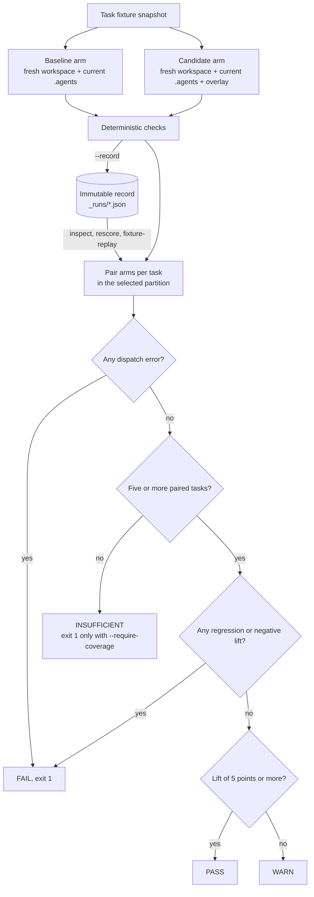

# ハーネス評価

:::tip 各機能の関係
[スキル評価](./skill-eval.md)は 1 つの `SKILL.md` が役立つかを測定し、[スキル最適化](./skill-opt.md)は保留ゲートの下でその本文を編集します。ハーネス評価（このページ）は、リポジトリタスクで `.agents/` オーバーレイ全体を比較します。[インシデント回帰ケース](./harness-incidents.md)は、観測された失敗を評価ケースとスキルフィクスチャに変えます。[プロジェクトハーネスの進化](./harness-evolution.md)は、インシデントのキャプチャとスキル最適化を予算付きのサイクルとして実行し、[スケジュールエージェント](./scheduled-agents.md)はそれを起動する OS スケジューラーです。
:::

`oma harness eval` は、エージェントのモデルを変えずに、候補の OMA ハーネスで固定した対象エージェントの性能が向上するかを測定します。[AI4AI at Test-Time: Strong-to-Weak Capability Transfer via Harnesses](https://arxiv.org/abs/2608.12307) のテスト時評価パターンを応用し、対象モデルを固定してハーネスだけを変え、同じタスクの結果を比較します。

このコマンドが評価する単位は `oma skill eval` より大きくなります。

| コマンド | 対象 | スコアの対象 |
|:--------|:----------|:-------------|
| `oma skill eval` | 1 つの `SKILL.md` 本文 | エージェントの出力 |
| `oma harness eval` | 範囲を絞った `.agents/` オーバーレイ | リポジトリのワークスペースで生成されたファイルと出力 |

「このスキルは役立つか」を知りたい場合は `oma skill eval` を使います。「スキル、ワークフロー、ルール、エージェント指示の組み合わせによって、固定したエージェントがリポジトリタスクをより安定して完了できるか」を知りたい場合は `oma harness eval` を使います。

**最初の実行の前に：**

- 最初の実行は `--live --record` で記録します。`inspect`（デフォルトの操作）、`rescore`、`fixture-replay`、`rerun` はすべてその記録を読みます。
- 判定には、選択した分割にスコア化されたタスクが少なくとも 5 つ必要です。`pass` には少なくとも 5 ポイントの改善幅と、回帰がないことが必要です。
- `inspect`、`rescore`、`fixture-replay` はモデルを呼び出しません。`--live` と `--action rerun` は、選択したタスクごとに 2 回呼び出します。
- `promotionReady` は常に `false` です。合格は人間が判断するための証拠であり、自動的な昇格ではありません。
- ライブ実行には、プロジェクトローカルでスキルを探索するベンダーが必要です（[実行と記録](#run-and-record)を参照）。

## 評価モデル

ライブ実行は、各タスクをペア実験として評価します。

1. OMA は初期のタスクフィクスチャをキャプチャします。完全なスナップショットを両方の実験群に配置するため、実行中に元のフィクスチャが変わっても、どちらも同じファイルから始まります。
2. 現在の `agents`、`config`、`rules`、`skills`、`workflows` 定義をそのワークスペースにコピーし、選択したベンダー形式へ投影します。
3. 2 つ目の新しいワークスペースでもセットアップを繰り返し、そこで候補オーバーレイを適用します。
4. 両方の実験群で同じ主エージェント、ベンダールート、プロンプト、書き込み権限、タイムアウトを使います。
5. 決定的なチェックで、生成されたワークスペースと任意のエージェント出力を検査します。信頼済みのコマンドチェックは、その後にタスクアーティファクトの新しいコピー上で実行されます。

実際のプロジェクトが実験群の作業ディレクトリになることはありません。OMA はチェックと一時ワークスペースの削除の前に、生の出力と最終的なタスクアーティファクトをキャプチャします。選択したベンダー自身のプロセスサンドボックスが、作業ディレクトリ外へのアクセス権限を決めます。

次の図は、ペアになった実験群が判定に至る流れを示します。オフラインの操作は、保存された記録からペアリングの段階に入ります。



## 候補の構成

候補パスは、部分的な `.agents/` ツリーを含むディレクトリです。

```text
candidate/
└── .agents/
    ├── agents/
    │   └── docs-curator.md
    ├── rules/
    │   └── documentation.md
    ├── skills/
    │   └── project-docs/
    │       └── SKILL.md
    └── workflows/
        └── docs-check.md
```

受け付けられるのは `.agents/agents`、`.agents/rules`、`.agents/skills`、`.agents/workflows` の下にあるファイルだけです。フック、評価フィクスチャ、状態、結果、設定ファイル、シンボリックリンク、ベンダーエージェントのバリアントは拒否されます。`model`、`tools`、`effort`、実行上限など、保護されたエージェントの frontmatter フィールドはベースラインと一致しなければなりません。スコアリング前に実行中のエージェントが保護された `.agents/` 定義を変更した場合も、その実験群は失敗します。

## スイート形式

スイートは 1 つの YAML ファイルと、タスクごとに 1 つのフィクスチャディレクトリで構成します。

```text
harness-eval/
├── suite.yaml
└── fixtures/
    ├── stale-api-doc/
    │   ├── docs/api.md
    │   └── src/session.ts
    └── missing-guide/
        ├── docs/
        └── src/feature.ts
```

```yaml
schema_version: 2
id: docs-harness
agent: docs-curator
tasks:
  - id: stale-api-doc
    partition: validation
    prompt: Update the API documentation to match the implementation.
    workspace: fixtures/stale-api-doc
    weight: 1
    checks:
      - type: file_contains
        path: docs/api.md
        value: openSession
      - type: file_not_contains
        path: docs/api.md
        value: createSession
  - id: missing-guide
    partition: final-test
    prompt: Write the missing guide for the feature in this fixture.
    workspace: fixtures/missing-guide
    checks:
      - type: file_exists
        path: docs/feature.md
```

バージョン 2 では、`validation` と `final-test` の両方のタスクが必要です。各タスクは所属する分割を宣言しなければなりません。デフォルトは validation です。候補の選択後に別立てで最終実行するときは `--partition final-test` を使います。各実行は選択した分割だけをスコア化するため、決定的な検証実行には少なくとも 5 つの `validation` タスクが、最終テスト実行には少なくとも 5 つの `final-test` タスクが必要です。上の例は読みやすさのために短くしてあり、常に `INSUFFICIENT` を報告します。2 つの分割でフィクスチャディレクトリを共有することも、入れ子にすることもできません。記録ファイルは、フィクスチャディレクトリ、候補オーバーレイ、評価器の入力の外に置いてください。これらの場所に置くと拒否されます。後の実行が最終チェックを見られないようにするためです。バージョン 1 のスイートは引き続き `exploratory` として実行されますが、final-test としては選択できません。

タスク ID は一意でなければなりません。フィクスチャパスとチェックパスは、プロジェクトとタスクのワークスペース内にとどめます。スイートとフィクスチャも、すべての実験群にコピーされるベースライン定義の外に置かなければなりません。フィクスチャにシンボリックリンク、`.agents`、`.codex`、`.claude`、ベンダーのスキルディレクトリ、ルートのエージェント指示ファイルなど、エージェントハーネスの制御面を含めてはいけません。これにより、タスクデータがどちらの実験群の制御ハーネスも隠せないようにします。

`node_modules` や `.venv` などの生成された依存ディレクトリは、ベースラインハーネスからコピーされません。決定的なヘルパーのソースと依存関係マニフェストをスキルにコミットし、チェックに必要なランタイム依存関係はタスクフィクスチャで準備します。

### チェックの種類

| 種類 | フィールド | 合格条件 |
|:-----|:-------|:---------------|
| `file_exists` | `path` | 実験群の完了後にパスが存在する。 |
| `file_not_exists` | `path` | パスが存在しない。 |
| `file_contains` | `path`、`value` | ファイルが存在し、値を含む。 |
| `file_not_contains` | `path`、`value` | ファイルが存在し、値を含まない。 |
| `output_contains` | `value` | 取得したエージェント出力が値を含む。 |
| `output_not_contains` | `value` | 取得したエージェント出力が値を含まない。 |
| `output_judge` | `rubric` | インシデントが持つ、採点で合否を決める契約。機械的な評価器は未評価として報告する（[インシデント回帰ケース](./harness-incidents.md) を参照）。 |
| `file_json_equals` | `path`、`value`、省略可能な `pointer` | パースしたファイルの JSON が `value` と等しい。任意で JSON Pointer の位置を指定できる。 |
| `output_json_equals` | `value`、省略可能な `pointer` | 取得した出力が有効な JSON で、`value` と等しい。任意で JSON Pointer の位置を指定できる。 |
| `command` | `argv`、`checker`、`timeout_ms`、`expected_exit_code` | 信頼済みのサブプロセスがタイムアウト内に完了し、指定した終了コードを返す。 |

JSON アサーションは、型を含めてパース後の値を比較します。成功を述べる文章では、JSON の状態アサーションを満たせません。`pointer` は `/result/count` のような JSON Pointer 構文を使い、デフォルトは値全体です。

コマンドチェックは、信頼済みのスイート所有者が作成します。

```yaml
- type: command
  argv: [/absolute/path/to/node, "{checker}", state.json]
  checker: checkers/verify-state.mjs
  timeout_ms: 5000
  expected_exit_code: 0
```

`checker` はスイートファイルからの相対パスで解決されます。単体で動作する通常のソースファイルで、すべてのフィクスチャ、候補オーバーレイ、ベースラインの `.agents` 定義の外に保存されている必要があります。`argv[0]` はプロジェクト外にある実行ファイルの絶対パスでなければならず、`{checker}` は引数全体でなければなりません。OMA は引数をシェル展開せず、そのまま渡します。タイムアウトは、300,000 ミリ秒以下の正の整数でなければなりません。終了コードは 0 から 255 までの整数です。

ディスパッチの前に、OMA は検査プログラムのソースのバイト列をスナップショットし、評価器の定義と実行ファイルのハッシュを計算します。ディスパッチの後は、タスクアーティファクトを別の一時ワークスペースへコピーし、スナップショットした検査プログラムをそのアーティファクトの外に書き出して、そこで呼び出します。コマンドごとに新しいコピーを使うため、ある検査プログラムが次のチェックの入力を変更することはできません。生成されたハーネス投影は除外し、アーティファクトのシンボリックリンクは拒否します。実験群の実行中に検査プログラムのソースが変わると、その実験群は失敗します。変更後のソースがスナップショットの代わりに使われることはありません。検査プログラムは、アーティファクトまたはアプリケーションの動作に対する固定のアサーションを使い、候補が編集できるテストやパッケージスクリプトに判定を委ねないようにしてください。

チェックと検査プログラムのパスは、エージェントのプロンプトにもフィクスチャにも追加されません。選択したタスクの入力は、その実行中は必然的に見えます。これは評価器の完全性を守り、分割どうしを分離しますが、同じユーザーのプロセスがホスト上の他のファイルを読むことまでは防ぎません。

## 実行と記録 {#run-and-record}

ライブモードは選択したタスクごとに 2 つのディスパッチを行い、ディスパッチのプレビューを表示して確認を求めます。

```bash
oma harness eval \
  --suite harness-eval/suite.yaml \
  --candidate candidate \
  --live --record \
  --record-file harness-eval/_runs/trial-1.json
```

非対話式の実行には `--yes` を使います。`--timeout <duration>` を指定すると、各実験群に同じ実時間上限を設定できます（デフォルトは `15m`。`--timeout 45m` のように単位が必要です）。`oma harness incident reproduce` も同じフラグを受け付けます。ライブ実行には、プロジェクトのワークスペースを基準にハーネスファイルを探索するベンダーが必要です。ベースラインからグローバルにインストールされた候補が見える可能性があるため、OMA は HOME を基準にした探索を拒否します。

ベンダーはスイートの `agent` から、プロジェクトのモデル設定を通じて解決されます。

| ベンダー | ライブの `harness eval`、`--action rerun`、`incident reproduce` |
|---|---|
| `claude`、`codex`、`commandcode`、`copilot`、`cursor`、`kiro`、`opencode`、`qwen` | 許可：プロジェクトローカルのスキルディレクトリ |
| `antigravity`、`hermes`、`kimi` | 拒否：HOME を基準にしたスキル探索 |
| 既知のプロジェクトスキルディレクトリを持たないベンダー | 拒否 |

オフラインの操作（`inspect`、`rescore`、`fixture-replay`）はディスパッチしないため、このチェックは適用されません。

`--record` は、不変のバージョン 2 JSON 記録を書き込みます。デフォルトの保存先はスイートの隣の `_runs/` で、ファイル名にはベースラインと候補のハッシュが含まれます。別のライブ実行には、新しい `--record-file` を使ってください。既存の保存先はディスパッチの前に拒否されます。記録は次を保持します。

- スイートの識別情報、分割、プロンプトとフィクスチャの出所情報、ベースラインと候補のハッシュ、評価器・検査プログラム・実行ファイルのハッシュ
- 元の出力とそのハッシュ（失敗したディスパッチから取得できた診断用の stdout を含む）
- 初期と最終のアーティファクトマニフェスト（ファイルのバイト列、ファイルごとのハッシュ、ファイルとディレクトリのモード、マニフェストのダイジェストを含む）
- 検査プログラムの参照、実験群の結果、指定された場合はインシデントの識別情報、再実行の場合は元の記録のハッシュ

タスクのスナップショットの上限は、1 ファイルあたり 5 MiB、合計 32 MiB、2,000 エントリです。シンボリックリンク、特殊ファイル、機密を含むパス、読み取れないファイル、サイズ超過のデータは、省略として記録されます。コピーされたハーネスの制御面は、最終的なタスクアーティファクトから除外されます。不完全なスナップショットは、証拠の制限事項として明示的に残ります。固定された再実行の入力にも、ファイルの再採点の根拠にもなりません。元のディスパッチが成功していれば、生の出力は出力だけを対象にしたチェックには引き続き使えます。

記録は独自の完全性ハッシュを持ちます。記録またはアーティファクトのハッシュが変わっていると拒否されます。これらのハッシュは証拠を識別するもので、プロセスの封じ込め（confinement）を証明するものでも、結果を昇格可能にするものでもありません。

### 実行条件

ライブ評価と再実行評価はどちらも、最初のディスパッチの前に実行マニフェストを解決し、記録に `manifest` として保存します。マニフェストは判定が対象とする条件を明記するため、保存されたスコアが別のモデル、CLI、OMA ビルドの証拠と取り違えられることはありません。

| フィールド | 意味 |
|---|---|
| `vendor`、`dispatchMode`、`runtimeVendor`、`command` | 解決されたディスパッチ経路と CLI の実行ファイル名。 |
| `model`、`modelSource` | OMA がエージェントのプランまたはベンダーのデフォルトから解決したモデル。`vendor-session` は、ベンダー自身のセッション設定がモデルを選び、OMA は固定していないことを示す。 |
| `effort`、`thinking` | エージェントのプランに指定があれば、そこから取得した推論設定。 |
| `cliVersion`、`cliVersionStatus` | `<command> --version` の最初の行（`probed`）。プローブに失敗した場合は `unavailable`。 |
| `omaVersion`、`platform`、`arch`、`node` | ホストと OMA ビルド。 |
| `environmentPolicy` | 実験群が受け取った環境変数の名前、強制した項目、破棄した数。値は記録されない。 |
| `memory`、`confinement` | すべての実験群で `memory: disabled`。`confinement` は、ディスパッチが何を制限し、何を制限しないかを示す（一時ワークスペース、制限のないネットワーク、継承された認証情報、ベンダーデフォルトのツール）。 |
| `manifestHash` | 上記の条件の識別情報。 |

マニフェストは説明であり、証明ではありません。OMA が解決した内容を記録するものです。`confinement` フィールドには、ネットワークと認証情報の隔離が強制されないことが明示されます。`promotionReady` は `false` のままです。

### 環境変数のポリシー

どちらの実験群も、許可リストで絞り込んだ同じ環境変数を受け取ります。基本の変数（`PATH`、`HOME`、ロケール、一時ディレクトリ、プロキシ、証明書の設定）、すべての `OMA_*` 変数、対象ベンダーの認証情報とランタイム検出用のプレフィックスに一致する変数は通過します。ディスパッチビルダーが呼び出しのために追加した項目も保持されます。それ以外はすべて破棄します。候補が誤ってデプロイトークンや別のプロバイダーのキーに到達しないようにするためです。`OMA_NO_AGENTMEMORY=1` は強制的に設定されます。ベンダーのメモリがベースラインと候補の実験群の間でコンテキストを持ち越さないようにするためです。

タスクが本当に必要とする変数を追加で渡すには、`OMA_HARNESS_ENV_PASSTHROUGH=NAME1,NAME2` を設定します。名前はマニフェストの `environmentPolicy.extra` に記録されます。既知のプレフィックスセットがないベンダーでは、マニフェストが `vendorKnown: false` を報告し、基本の変数、`OMA_*`、パススルーに指定した項目だけがプロセスに届きます。

## 記録の再利用 {#reuse-a-recording}

コマンドは次の 4 つの操作を区別します。

| 操作 | 実行される内容 | エージェント/モデルの呼び出し |
|:-------|:---------------|:------------------|
| `inspect` | 出所情報を検証したうえで、保存された実験群の判定を集計する。チェックは実行しない。 | なし |
| `rescore` | 現在の出力/ファイルチェックを、元の生の出力とアーティファクトのバイト列に適用する。 | なし |
| `fixture-replay` | 供給されたツールリクエストのトランスクリプトと照合し、そのフィクスチャの応答とファイル変更を再生してから、対応しているチェックを適用する。 | なし |
| `rerun` | 記録された初期スナップショットから作った新しいワークスペースで、設定されたエージェントを実行する。 | 選択したタスクごとに 2 回 |

`--action inspect` がデフォルトです。`--mock` は `inspect` のエイリアスで、他の操作と組み合わせることはできません。`inspect` も `fixture-replay` も、エージェントを再実行しません。

### 保存済み判定の確認

```bash
oma harness eval \
  --suite harness-eval/suite.yaml \
  --candidate candidate \
  --action inspect \
  --record-file harness-eval/_runs/trial-1.json
```

`inspect` では、元のスイート、分割、評価器、ベースライン、候補のハッシュがすべて一致している必要があります。記録されたスコアを表示するだけで、検査プログラムを呼び出さず、出力も再評価しません。バージョン 1 の記録は、必要な出所情報が一致していれば引き続き確認できます。分割と評価器の出所情報がない古い記録は、現在の CLI の検証を通過できません。レガシーの判定は、ラベルを付け替えて新しい生の証拠にすることはできません。再採点、フィクスチャ再生、固定した再実行のためには、新しいライブ記録を取得してください。

### 元の証拠の再採点

```bash
oma harness eval \
  --suite harness-eval/suite.yaml \
  --candidate candidate \
  --action rescore \
  --record-file harness-eval/_runs/trial-1.json
```

再採点は現在のチェックを使い、元の `passed` の値とチェックの判定は無視します。スイートの識別情報、タスク ID・プロンプト・インシデントの識別情報、ベースライン、候補、選択した分割は、引き続き一致している必要があります。検査プログラムの定義は変更できます。新しい結果は、元のバイト列がそれらのチェックでどのような成績になるかを示します。現在のフィクスチャファイルを変更しても、記録済みの最終アーティファクトは置き換わりません。

コマンドチェックは、記録が外部ランタイムと環境を固定していないため、オフラインの再採点には不十分です。除外された、または不完全なアーティファクトを対象にしたチェックも不十分です。元のディスパッチが失敗した場合に残るのは診断用の出力で、再採点しても有効な測定にはなりません。現在の受入基準でコマンドの実行が必要な場合は、ライブの再実行を使ってください。

### ツールフィクスチャの再生

トランスクリプトファイルには、オブジェクトを 1 つ、またはタスク ID が重複しないオブジェクトの配列を入れます。選択したタスクごとに 1 つのトランスクリプトを渡してください。

```json
{
  "schemaVersion": 1,
  "taskId": "stale-api-doc",
  "requests": [
    { "tool": "documentation", "request": { "path": "docs/api.md" } }
  ],
  "steps": [
    {
      "tool": "documentation",
      "request": { "path": "docs/api.md" },
      "response": { "body": "Use openSession." },
      "writes": [
        { "path": "docs/api.md", "content": "Use openSession.\n" }
      ],
      "removes": []
    }
  ],
  "output": "Fixture completed.",
  "dependencies": [
    { "name": "documentation", "repeatability": "fixture" }
  ]
}
```

```bash
oma harness eval \
  --suite harness-eval/suite.yaml \
  --candidate candidate \
  --action fixture-replay \
  --record-file harness-eval/_runs/trial-1.json \
  --transcript harness-eval/tool-fixtures.json
```

リクエストは、ツール名とリクエストの値の両方で、ステップの順序と完全に一致している必要があります。`writes` と `removes` は、タスクファイルに対する相対パスの変更で、省略できます。ワークスペースの外に出ることも、ハーネスの制御面を変更することもできません。ツール名はデータであり、トランスクリプトのコマンドは実行されません。`output` はフィクスチャデータで、出力チェックが必要とする場合は必須です。

宣言した各依存関係は、`name`、`repeatability`（`fixture`、`live`、`unavailable` のいずれか）、省略可能な `reason` と `fixture` の参照を持ちます。`fixture` の依存関係には、そのツール名に一致するステップが必要です。`live` または `unavailable` の依存関係があると、再生は不十分になります。省略可能な `fixture` フィールドは説明用で、再生はそのパスを読み込まず、供給されたステップを使います。トランスクリプトの再生は、宣言された依存関係を検証しますが、過去のすべての依存関係がキャプチャされたことまでは立証しません。

記録された両方の実験群が、同じ完全な初期スナップショットを持っている必要があります。OMA は同じトランスクリプトを各実験群に適用し、現在の出力/ファイルチェックを実行します。コマンドチェックにはライブの再実行が必要です。これらの結果は、供給されたフィクスチャの順序を再生できることを示しますが、候補の振る舞いの改善やモデルの再現性を立証するものではありません。

### 固定した初期ファイルからのエージェント再実行

```bash
oma harness eval \
  --suite harness-eval/suite.yaml \
  --candidate candidate \
  --action rerun \
  --record-file harness-eval/_runs/trial-1.json
```

再実行には、一致するスイートとタスクの識別情報、および元の両方の実験群で同一の完全な初期スナップショットが必要です。現在のベースライン、候補、設定済みのベンダー/モデル経路、現在のチェックを使って、実際のエージェント呼び出しを開始します。元の最終アーティファクトを開始状態には使いません。元のフィクスチャを後から編集しても、記録された初期状態が黙って変わることはありません。

再実行のディスパッチのプレビュー、確認、タイムアウトの動作は、ライブ実行と同じです。変更した候補も使えます。元の記録は `--record-file` で明示的に指定してください。`--record` を追加すると、元の記録と同じディレクトリに `-rerun-<timestamp>.json` で終わる新しいファイルを保存し、元の記録のハッシュに結び付けます。元の記録は保持されます。

固定したファイルは、外部サービスの状態、時刻の挙動、モデルのサンプリングまでは再現しません。再実行は、示された条件の下での新しい振る舞いの証拠であり、元のエージェントの軌跡を決定的に再現したという主張ではありません。

### 再生時の記録済み条件

`inspect`、`rescore`、`fixture-replay` は、記録に保存されたマニフェストを `conditions: "recorded"` として報告します。マニフェストより前に作られた記録では `conditions: "unavailable"` です。OMA は現在の条件も解決し、ベンダー、ディスパッチモード、モデル、`effort`、`thinking`、CLI バージョン、OMA バージョン、ホストの違いをすべて、再生の制限事項と昇格のブロッカーとして一覧にします。

```text
replay limitation: Recorded conditions differ from current: model: recorded "gpt-5.4", current "gpt-5.5"
```

CLI バージョンは、記録自身がプローブ済みのバージョンを持つ場合にだけ、再生時にプローブされます。プローブしていない組み合わせは、一致とは見なさず、比較できないものとして報告します。記録済みの判定は、元の条件の下では引き続き閲覧できます。ただし、ライブ評価または再実行評価がマニフェストの一致する記録を生成するまでは、現在の条件での候補の証拠にはなりません。

### 使用量 {#usage}

ベンダーが使用量を報告した場合、各実験群はそれを `usage` に保存します。内容は、入力トークンと出力トークン、USD 建てのコスト、実時間、出力の大半を生成したモデルです。評価はこれらを合計して `usage` にまとめ、`status` は `actual`、`partial`（一部の実験群が何も報告しなかった）、`unknown` のいずれかになります。ベンダーの結果エンベロープは、チェックを実行する前、および出力を記録する前に展開されます。そのため `output_contains` と `output_json_equals` が見るのは、エージェントの回答であり、その周囲の JSON の管理用データではありません。この `usage` フィールドに入るのは、エンベロープの内側にある使用量です。

### レポートのラベル

レポートには、`executionMode`、`evidenceStatus`（`complete`、`insufficient`、`legacy` のいずれか）、`replayLimitations`、利用できる場合は `sourceRecordHash` が含まれます。ライブ実行と再実行のレポートには、`manifest`、`conditions: "current"`、`traceSession` も含まれます。証拠の完全性は、現在の操作が確認または評価できる範囲を表します。インシデントから引き継いだ制限事項は、今回のファイルキャプチャが完全でも表示され続けます。`promotionReady` はどのモードでも `false` のままです。

## トレースイベント

ライブ評価と再実行評価はどちらも、ローカルセッション `oma-harness-<suite-id>` に、相互にリンクしたイベントを書き込みます。

| イベント | ペイロード |
|---|---|
| `harness.eval.started` | 操作、スイート/ベースライン/候補/評価器のハッシュ、分割、マニフェストのハッシュ、解決されたベンダー、モデル、CLI バージョン、タスク数。 |
| `harness.arm.completed` | 実験群ごとに 1 件。タスク、実験群、合否の状態、所要時間、出力のハッシュ、ディスパッチのエラー、終了コード、タイムアウトのフラグ、実験群のトレース。`parentEventId` は started イベントを指す。 |
| `harness.eval.completed` | 判定、改善幅（lift）、証拠の状態、`--record` を使った場合は記録のパスとハッシュ。 |

1 回の評価のイベントはすべて同じ `causalityKey` を共有します。イベントを書き込めなかった場合、レポートはそれを黙って省かず、`Trace event <kind> was not recorded` を再生の制限事項として一覧にします。

各実験群の実行は、`diagnostics` と `trace` も記録に保存します。

- `diagnostics`: 終了コード、シグナル、タイムアウトのフラグ、stderr の末尾 8 KiB と `stderrStatus`（`captured`、`truncated`、`unavailable` のいずれか）
- `trace`: ハーネスが観測できた内容。`output` は `complete`、`partial`（失敗したプロセスでも stdout が出力されていた）、`unavailable` のいずれかです。`artifacts` は最終スナップショットが完全かどうかを示します。`changedPaths` は、固定された初期ワークスペースと比べて実験群が追加、変更、削除したファイルの一覧です（上限は 200 件で、超えると `changedPathsTruncated` が立ちます）。`toolCalls` は常に `unsupported` です。ベンダー CLI がツールごとの観測結果をハーネスに公開しないためです。

失敗した実験群にも、部分的な出力、stderr の末尾、終了ステータス、ファイルの変更が残るため、最後のエラーを、その実験群が変更した内容までたどれます。観測できなかったことは状態として記録され、問題のない実行として読まれることはありません。

## メトリクスと判定ゲート

すべてのチェックに合格したタスクだけが合格します。スコアはペアタスクの加重平均です。

```text
lift = candidateScore - baselineScore
```

OMA は次も報告します。

- `corrected tasks`: ベースラインが失敗し、候補が合格したタスク
- `regressed tasks`: ベースラインが合格し、候補が失敗したタスク
- `coverage`: 選択した分割に、スコア化できるペアタスクが少なくとも 5 つ必要

改善幅（lift）が 5 パーセントポイント以上で、回帰がなければ、スコアの判定は `pass` になります。回帰が 1 つでもあるか、改善幅が負であれば候補は失敗します。0 以上 5 ポイント未満の改善幅は警告になり、ペアタスクが 5 未満なら `insufficient` 判定になります。CI でカバレッジ不足を終了コード 0 以外にするには `--require-coverage` を追加します。実験群が欠けている場合、記録のハッシュが古い場合、決定的なチェックが未完了の場合、スコアは根拠になりません。ライブのディスパッチエラーと評価器の完全性エラーは、判定を強制的に失敗にします。成功した改善幅として数えることはできません。再採点とフィクスチャ再生では、証拠が不十分な実験群をスコア化できるペアから除外し、証拠の欠如を候補の回帰として扱う代わりに `insufficient` 判定を報告します。

合格したスコアは、昇格の資格を立証するものではありません。レポートには、分割、評価器のハッシュ、`promotionReady: false`、明示的なブロッカーが含まれます。レガシーの実行と検証の実行には、最終テストの証拠がありません。現在のディスパッチ経路はファイルシステムへのアクセスの封じ込めを証明しないため、最終テストの実行でも、保護された最終評価を主張することも、昇格を承認することもできません。このフィールドは、実行プロバイダーがその境界を確立できるまで false のままです。

## トラブルシューティング

| メッセージまたは症状 | 原因 | 対処 |
|---|---|---|
| `No matching harness recording found: <path>. Run --live --record first.` | デフォルトの操作は `inspect` で、保存された記録を読みます。 | 一度 `--live --record` を実行するか、`--record-file` で既存の記録を渡します。 |
| `Harness recording is stale; suite, partition, evaluator, baseline, or candidate inputs changed` | `inspect` では、記録されたすべてのハッシュが一致している必要があります。 | 新しい `--record-file` で新しい実行を記録します。保存されたバイト列に現在のチェックを適用したい場合は `--action rescore` を使います。 |
| `Recorded evidence belongs to a different baseline, candidate, or partition` | `rescore` または `fixture-replay` が、別の入力から作られた記録を指しています。 | 一致する `--record-file` と `--partition` を選ぶか、記録し直します。 |
| `Harness recording is immutable; choose a new --record-file before dispatch` | `--record` が既存のファイルを上書きしようとしています。 | 新しい `--record-file` のパスを渡します。 |
| `--record requires --live or --action rerun` | `--record` がオフラインの操作と組み合わされています。 | `--record` を外すか、`--live` を使います。 |
| `--action fixture-replay requires --transcript` | トランスクリプトが渡されていません。 | `--transcript <path>` を追加します。 |
| `Removed option --timeout-minutes. Use --timeout.` | 古いフラグの表記です。 | `--timeout 30m` を使います（単位が必要です）。 |
| `Vendor <vendor> cannot provide project-local isolated harness discovery` | スイートのエージェントが、HOME を基準に探索するベンダー、またはプロジェクトのスキルディレクトリを持たないベンダーに解決されています。 | スイートのエージェントを、[実行と記録](#run-and-record)の表にあるベンダーへ振り向けます。 |
| `Candidate overlay must be stored separately from the baseline .agents tree` | `--candidate .`、または `.agents/` 内のパスを指定しています。 | オーバーレイは `candidates/fix/.agents/` など別の場所に置きます。 |
| `Candidate file is not allowed: <path>` | オーバーレイに `agents/`、`rules/`、`skills/`、`workflows/` 以外のファイルが含まれています。 | それらのファイルをオーバーレイから削除します。 |
| `Candidate agent field <field> cannot change model or execution controls: <path>` | 保護された frontmatter がベースラインと異なります。 | `model`、`tools`、`effort` などの保護フィールドを元に戻します。 |
| `Suite requires at least one final-test task` | `schema_version: 2` のスイートには両方の分割が必要です。 | `partition: final-test` のタスクを追加します。 |
| `decision: INSUFFICIENT` | 選択した分割のスコア化されたタスクが 5 つ未満か、実験群が欠けています。 | 分割のタスクが 5 つになるまで追加し、`replay limitation:` の行を確認します。 |
| `decision: FAIL` | ディスパッチエラー（続いて `<task>/<arm>: ...` の行が出ます）、回帰（`regressed:` の下にタスク ID が出ます）、または負の改善幅です。 | ディスパッチエラーの場合は、失敗した各実験群の下にある `exit=... timedOut=... stderr=...` の行を読みます。回帰の場合は、一覧にあるタスクの 2 つの実験群を比較します。 |

## 現在の境界

候補オーバーレイは外部で作成します。このコマンドは、ビルダーも `harness opt` の自動ループも実装していません。アーティファクトのキャプチャ、オフラインの再採点、ツールフィクスチャの再生、固定ファイルからの再実行、分割の選択、スナップショット化された評価器、実行マニフェスト、環境変数の許可リスト、リンクされたトレースイベントは利用できます。一方、保留データに対する OS レベルの秘匿、ネットワークや認証情報の封じ込め、繰り返しの確率的試行、ネストしたサブエージェント呼び出しへの強制モデル固定は確立されていません。トークンとコストの使用量は、ベンダーが報告した場合に実験群ごとに記録され、合計されます（[使用量](#usage)を参照）。環境変数の許可リストが制限するのは、ベンダーのプロセスが継承する変数です。ベンダー CLI が自前の認証情報ストアを読むことや、ネットワークに到達することは止められません。ネスト呼び出しの固定が実装されるまでは、1 つの固定モデルを測るスイートで、設定済みの別ロールを起動する候補ワークフローを避けてください。
