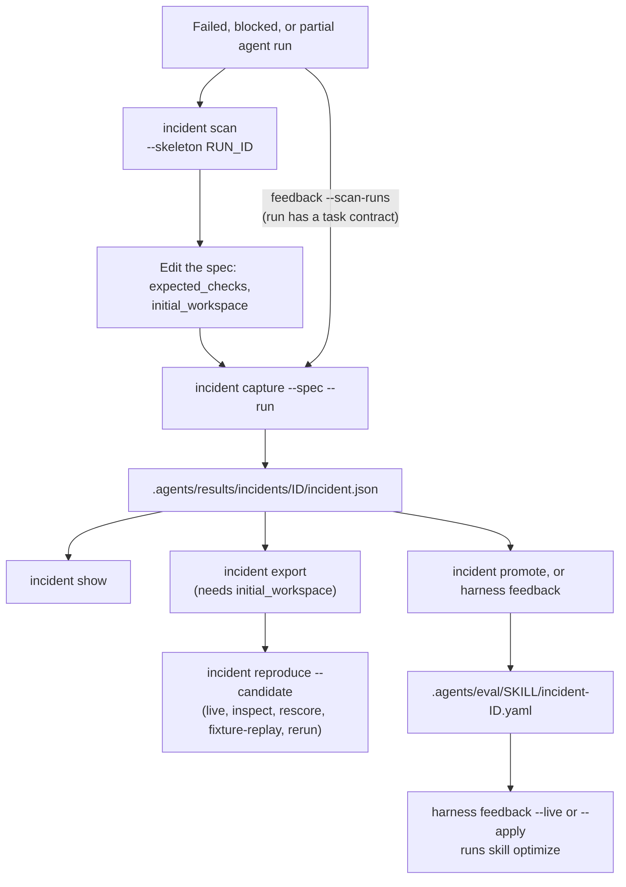

# インシデント回帰ケース

`oma harness incident` は、観測した失敗を回帰ケースと、その後続の候補評価に接続します。観察結果は因果の仮説と分けて記録します。プロセスが失敗したという事実だけでは、そのインシデントの原因がモデルだと確定できません。

昇格したインシデントはスキル最適化に、エクスポートしたインシデントはハーネス評価に進みます。



## 候補を見つける {#find-candidates}

```bash
oma harness incident scan            # failed/blocked/partial runs with no captured incident
oma harness incident scan --json
oma harness incident scan --skeleton <run-id> > incidents/run-failure.json
```

1. `oma harness incident scan` は、ステータスが `failed`、`blocked`、`partial` の追跡済み実行を一覧表示し、すでにキャプチャしたインシデントが `source.runId` で参照している実行は除外します。`--limit <n>` で一覧の件数を制限できます。実行は、OMA プロファイルの状態ディレクトリにあるプロジェクトの実行記録から取得されます（デフォルトは `~/.oma/u/0/projects/<project-id>/agent-runs/` で、`<project-id>` は正規化したプロジェクトパスの SHA-256 です。`OMA_STATE_HOME` と `OMA_PROFILE` でルートとプロファイルを変更できます）。`oma agent spawn` と `oma agent parallel` は、各実行ログの末尾 64 KiB を実行記録の隣に `<run-id>.output.txt` として保存します。
2. `--skeleton <run-id>` は仕様を出力します。id、エージェント、元の実行、観測した失敗、終了コード、そしてランナーが保存していた場合はエージェント出力の末尾が含まれます。`expected_checks` は `TODO` のまま残ります。正しい動作はスキャンが決められない判断だからです。
3. プレースホルダーのチェックを置き換えます。インシデントを実行可能にするには、実行前の状態のタスクファイルのコピーを指す `"initial_workspace": "<dir>"` も追加します。これがなくてもインシデントのキャプチャと昇格はできますが、`incident export` と `reproduce` は `Cannot export a runnable regression: initial workspace evidence is missing` で停止します。
4. `--run <run-id>` を付けてキャプチャすると、実行のプロンプト、識別情報、ワークスペースのフィンガープリントが保持されます。仕様に観察結果がない場合、`capture --run` は保存された出力を観察結果として取り込み、`incident promote` はそこから導出したフィクスチャをその出力で検証できます。

## 失敗した実行を自動でキャプチャする

```bash
oma harness feedback --scan-runs            # capture, promote, report
oma harness feedback --scan-runs --live     # and optimize the affected skills
```

タスクに契約があった実行が失敗、ブロック、部分完了で終わった場合、手で仕様を書く必要はありません。期待される動作は、実行前に決められている契約の受入基準です。失敗した検証受領記録がカバーしている基準が未達の基準集合で、実行が一度も検証されなかった場合はすべての基準が未達です。opt-agent は未達の基準を `PASS only if …` 形式の判定用ルーブリックに書き換え、判定プログラムはその実行自身が保存された出力をルーブリックで採点し、その出力に不合格となったときだけインシデントがキャプチャされます。失敗が合格してしまうルーブリックでは失敗を捉えられないからです。仕様は `.agents/results/incidents/_specs/<id>.json` に書き、実行の識別情報を添えてキャプチャし、ルーブリックは `output_judge` 受け入れチェックとして持ちます。保存された出力、プロンプト、契約がない実行は、理由を添えてキャプチャ不可として一覧化されます。

`output_judge` は採点で合否を決める契約です。機械的なハーネス評価器では未評価として報告されます。この項目の目的は、`incident promote` が同じルーブリックから導出するスキル回帰フィクスチャです。

## インシデントをキャプチャする {#capture-an-incident}

プロジェクト内に JSON 仕様を保存します。

```json
{
  "schema_version": 1,
  "id": "incomplete-result",
  "summary": "The agent reported success while the result remained incomplete",
  "prompt": "Complete the task and update result.json",
  "agent": "backend",
  "observed": {
    "failure": "result.json still contained complete=false",
    "output": "success",
    "exit_code": 0
  },
  "initial_workspace": "initial",
  "expected_checks": [
    {
      "type": "file_json_equals",
      "path": "result.json",
      "pointer": "/complete",
      "value": true
    }
  ],
  "evidence_files": ["original-output.txt"],
  "dependencies": []
}
```

`initial_workspace`、`evidence_files`、依存関係のフィクスチャパスは仕様ファイルを基準にします。コマンドチェックの `checker` パスはプロジェクト相対です。チェックの構文は [ハーネス評価](./harness-eval.md) を参照してください。初期ディレクトリは、事前に用意したタスクフィクスチャで、OMA やベンダーの指示ファイルを含んではいけません。評価対象のハーネスは別に注入されるからです。

```bash
oma harness incident capture --spec incidents/incomplete-result.json --json
oma harness incident show incomplete-result --json

# Import prompt and observable metadata from an existing local run
oma harness incident capture --spec incidents/run-failure.json --run <run-id> --json
```

`--run` には `oma harness incident scan` が一覧表示する実行 ID を指定します。実行記録は `.agents/state/` ではなく、[候補を見つける](#find-candidates)で説明したプロファイルの状態ディレクトリにあります。実行とセッションの識別情報、ベンダー、ステータス、元のワークスペースのフィンガープリントを保持します。仕様で指定したプロンプトは、実行に記録されたプロンプトより優先されます。`source.trace_id` を使えば、報告されたインシデントを外部トレースに接続できます。その取得やアップロードは行いません。

キャプチャしたマニフェストは `.agents/results/incidents/<id>/incident.json` に置かれます。指定した初期スナップショット、元になった証拠と検査プログラムのハッシュ、受け入れチェック、制限事項、マニフェストのハッシュが含まれます。既存の ID は上書きできません。機微な観察テキストはマスキングされ、マスキングは正確な再生に対する制限として報告されます。スナップショットの収集は未対応のファイルを拒否し、ファイル数と合計サイズに上限を設けます。証拠の参照は、参照する元ファイルの写しではなく、ハッシュとパスを保持します。

省略可能な `cause` オブジェクトは `category`、`hypothesis`、`confidence`、`evidence` を持ちます。カテゴリは `model`、`tool`、`config`、`context`、`application`、`evaluator`、`unknown` です。省略すると原因は `unknown` のままになります。

## スキルフィクスチャへ昇格する

```bash
oma harness incident promote <id> [--skill <id>] [--draft] [--force] --json
```

キャプチャしたインシデントは、失敗したエージェントが実際に使ったスキルの回帰フィクスチャになります。そのため `oma skill optimize` がそのスキルをフィクスチャに対して修復できます。スキルの選び方は、インストール済みスキルカタログに対してインシデントのプロンプトをルーティングします。このとき `oma skill eval --routing` と同じ説明レベルのプローブ（モデル呼び出し 1 回）を使います。ルーティングが何も選ばない場合は、`.agents/agents/<agent>.md` のエージェント定義にある `skills:` の最初の項目を使い、それもなければ `oma-<agent>` という名前のインストール済みスキルを使います。`--skill` はこれより優先され、3 つのうち何が決定したのかを昇格記録に `attribution` として残します。フィクスチャは train/validation/test 分割を絶対にまたがないよう `group: incident-<id>` を付けて `.agents/eval/<skill>/incident-<id>.yaml` に書き、昇格はインシデントの隣の `promotion.json` に記録されます。インシデントは 1 回だけ昇格します。

検査は受け入れチェックから取ります。すべてのチェックが `output_contains` の場合、フィクスチャは決定的な `assert` になります。そうでない場合、そのチェックはスキル評価では実行できません（ファイルもコマンドもないため）、`--draft` は opt-agent に対して `PASS only if` で始まり観測した失敗を名指しするルーブリックを依頼します。どちらの場合も、記録された失敗出力がそれに不合格になるときだけフィクスチャが受理されます。観測出力がすでに満たしてしまう assert、または判定プログラムがその出力で合格してしまう起案ルーブリックは、回帰ケースではないので拒否されます。観測出力がないインシデントは検証できないため `--force` が必要で、これは制限事項として記録されます。

## ループを閉じる

```bash
oma harness feedback                 # promote every unpromoted incident, report what changed (routing, drafting, and judge model calls)
oma harness feedback --live          # also run one optimization epoch per affected skill (dry-run)
oma harness feedback --apply --json  # also write edits that pass every gate (implies --live)
```

`--incident <ids...>` で、実行対象を指定したインシデントに限定します。`--max-epochs <n>`（デフォルト 1）は、`--live` と `--apply` でのスキルごとの最適化エポック数を設定します。

:::caution モデルのコストと書き込み先
`feedback` はコストのプレビューを表示しません。`--live` を付けなくても、昇格ではモデル呼び出しで各インシデントをスキルにルーティングし、ルーブリックの起案と判定を行うことがあります。`--live` と `--apply` は影響を受けた各スキルに対して `oma skill optimize --live --yes` を実行し、`--apply` は管理対象の `SKILL.md` に直接書き込みます。これには `oma update` が上書きする `oma-*` スキルも含まれます。確認とプレビューを伴う実行には `oma skill optimize --skill <id> --live` を、プロジェクトのオーバーレイを使う予算付きサイクルには[プロジェクトハーネス進化](./harness-evolution.md)を使ってください。
:::

`feedback` はデプロイのフィードバックループを 1 つのコマンドにまとめたものです。`--scan-runs` を付けると、契約がある未キャプチャの失敗実行を先にすべてキャプチャし（前述を参照）、次にキャプチャ済みでフィクスチャがないインシデントをすべて昇格し（必要ならルーブリックを起案）、影響したスキルをグループ化し、`--live` を付けると各スキルを、拡大したスイートに対して通常のゲート（held-in/held-out 受け入れ、確定した負の転移、ランナー所有の最終テスト）の下で 1 回ずつ最適化します。`.agents/results/feedback/feedback-<ts>.json` のレポートには昇格、理由付きでスキップしたインシデント、diff を含む各スキルの結果が並ぶので、観測した失敗から候補編集までの連鎖が 1 件の監査可能な記録になります。共有のモデル呼び出し上限、永続的なリトライ、プロジェクトのスキルオーバーレイを備えたスケジュール運用には、[プロジェクトハーネス進化](./harness-evolution.md)を有効化してください。適用した内容は次回セッションの状態スナップショットが通知します。

人の判断として残るのは次の点です。タスク契約がない実行には期待される動作が記録されていないため、`incident scan` に一覧されるに留まり、仕様を通してのみキャプチャされます。`--skeleton` はその起案を行います。

## エクスポートして評価する

```bash
oma harness incident export incomplete-result --json
oma harness incident reproduce incomplete-result --candidate candidates/fix \
  --record-file incidents/comparison.json --yes --json
```

エクスポートは、保存済みの初期スナップショットと 1 件のケースだけを含む探索用スイートを実体化します。マニフェストのハッシュと元の実行・トレースの識別情報が、タスクとともに評価と記録に引き継がれます。エクスポートしたファイル、プロンプト、エージェント、チェック、固定した検査プログラムのソースが変わると、再利用は無効になります。受け入れ契約を変えるには新しいインシデント ID を作成してください。

デフォルトでは `reproduce` は新しいライブなベースライン/候補比較を開始して記録します。`--yes` を指定しない限り、通常のライブ費用確認が適用されます。このコマンドは Codex を含む、ハーネスタスクに設定されたエージェントのベンダーを使います。スキルのオプティマイザの保護されたコンパイラプロファイルをタスク実行に強制はしません。

エクスポートしたインシデントスイートにはタスクが 1 つしかありません。そのため `reproduce` は常に `coverage: insufficient` を出力し（判定にはスコア付きのタスクが 5 つ必要です）、どちらかのアームのディスパッチに失敗した場合（`FAIL`）を除いて、判定は `INSUFFICIENT` になります。代わりにタスクの行を読んでください。インシデント ID が `corrected:` の下にあれば、ベースラインが失敗して候補が合格したことを意味します。`regressed:` の下にあれば、候補が合格していたケースを壊したことを意味します。両方が `none` なら、アーム間で振る舞いは同じです。JSON では、これらのフィールドは `score.correctedTaskIds` と `score.regressedTaskIds` です。

初期状態をキャプチャしていない場合、`capture` と `show` は動きますが、実行可能なエクスポートと実行再現は証拠不足のエラーで停止します。過去の実行に対して、現在の作業ツリーはその元の状態を証明できません。別に供給した初期スナップショットでも、その過去の実行と同等だとは証明できず、レポートはこれを制限として明記します。

## 証拠操作を選ぶ

```bash
oma harness incident reproduce incomplete-result --candidate candidates/fix \
  --action inspect --record-file incidents/comparison.json --json

oma harness incident reproduce incomplete-result --candidate candidates/fix \
  --action rescore --record-file incidents/comparison.json --json

oma harness incident reproduce incomplete-result --candidate candidates/fix \
  --action fixture-replay --record-file incidents/comparison.json \
  --transcript incidents/tool-responses.json --json

oma harness incident reproduce incomplete-result --candidate candidates/fix \
  --action rerun --record-file incidents/comparison.json --record --yes --json
```

| 操作 | 実行される内容 |
|---|---|
| `inspect` | 保存済みの判定を読んで集計します。チェックもエージェントも実行しません。 |
| `rescore` | 保存済みの生証拠に現在の出力/ファイルチェックを適用します。古い合否フィールドは無視されます。 |
| `fixture-replay` | 供給したツール応答データとファイル変更を、記録された初期状態に対して再生します。モデルもツールプロセスも実行しません。 |
| `rerun` | 記録された初期状態から実際のベースライン/候補エージェント呼び出しを開始します。通常のモデル使用が発生します。 |

受け入れ契約を改訂する場合は、別のハーネススイートを作成し、同じスイート/タスク/インシデントの識別情報とプロンプトで `oma harness eval --action rescore` を使ってください。エクスポートしたインシデントスイート自体は変更できません。生証拠の要件とツールのトランスクリプト仕様は [記録と再生の詳細](./harness-eval.md#reuse-a-recording) を参照してください。

外部依存は `{ "name": "service", "repeatability": "fixture|live|unavailable", "reason": "...", "fixture": "response.json" }` の形で宣言してください。フィクスチャの依存は、完全なハーネストランスクリプト仕様を使ったファイルを指し、`taskId` にはインシデント ID を使います。オフラインのインシデント再生では、live/unavailable 依存、存在しないフィクスチャファイル、変わったフィクスチャのハッシュ、名前で見つからない応答、固定したトランスクリプトと異なる要求/応答/ファイル変更を拒否します。それでも、作成者がすべての外部依存を宣言したかどうかまでは保証できません。ライブ再実行でも、外部サービスが過去と同じ振る舞いをすると保証できません。

キャプチャ、エクスポート、評価は、インシデントと候補/ベースラインのハッシュ、実行モード、修正または回帰したタスク ID を結ぶローカルな `harness.incident.*` イベントを発行します。1 件のインシデントは回帰の証拠であって、検証スイートと最終テストスイートの代わりにはなりません。現在のハーネスプロファイルは `promotionReady: false` を報告します。これらの操作は保護された最終テストの隔離を成立させず、候補を自動で昇格もしません。
