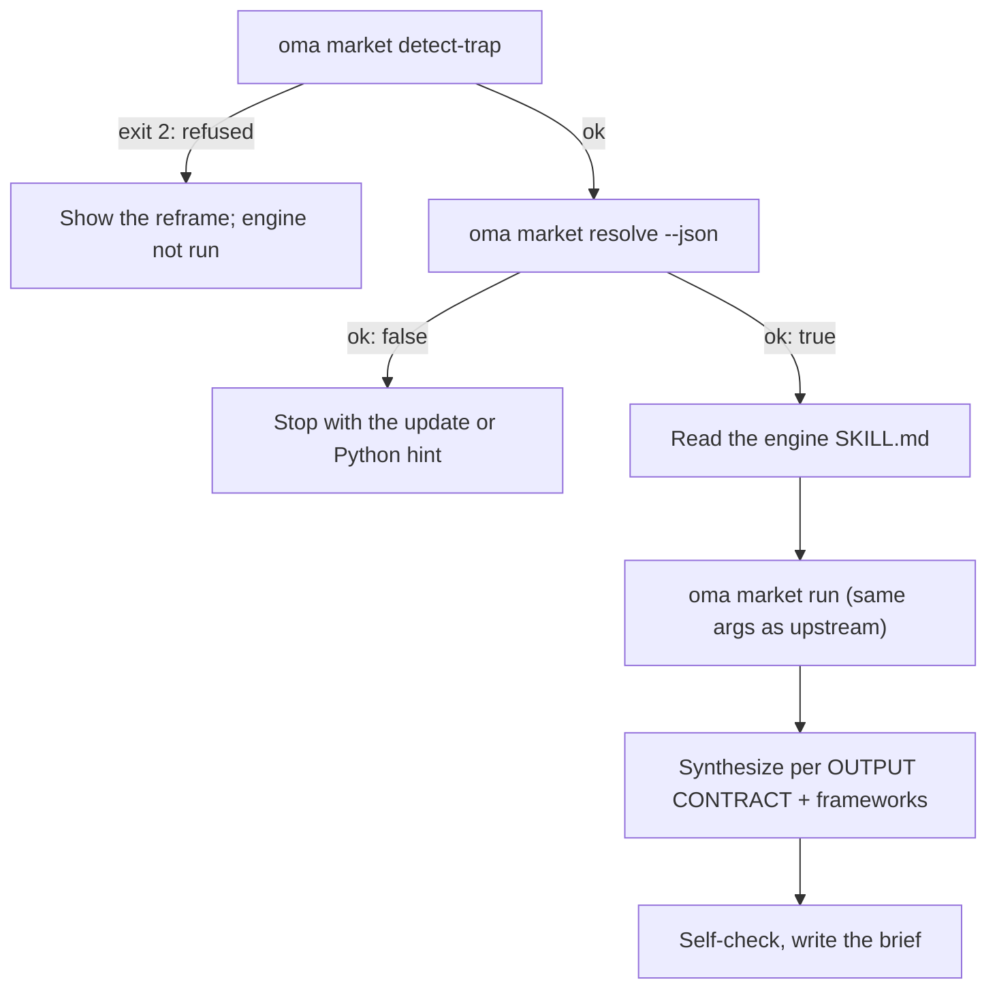

# 市場調査

`oma-market` は「直近 N 日間に、X について人々は実際に何を話しているか」という問いに答えます。Reddit（投票数と上位コメント）、X、YouTube の文字起こし、TikTok、Instagram、Hacker News、Polymarket、GitHub、arXiv、Techmeme、Digg、LinkedIn、StockTwits、Bluesky、Web など、実際の反応数を持つコミュニティソースから、困りごと、トレンド、競合への反応、発見を集めます。

調査は上流の [**last30days**](https://github.com/mvanhorn/last30days-skill) エンジン（MIT、Python 3.12 以降）で実行されます。oh-my-agent はこれをフォークしません。**常に最新の管理コピー**を保持し、すべての実行をゲートし、その上に戦略フレームワークの層を加えます。リリース頻度、スター数、プロバイダーの対応範囲は上流プロジェクトに属し、変わる可能性があります。

---

## クイックスタート

エージェントに普通の言葉で依頼します。「market research」「pain points」「competitor analysis」「voice of customer」「trend detection」などの表現で `oma-market` スキルが起動します。

```text
VS Code のリモートコンテナについて、直近 30 日間に開発者が報告している主な困りごとを調べて。
Cursor と Windsurf のコミュニティの反応を直近 90 日間で比較して。frameworks swot,5f。
```

| 指定方法 | 効果 |
|---|---|
| 「A vs B」または `--vs B` | 競合の意図：上流の比較フロー + SWOT + Porter の 5F |
| `--days 7`、`30`、`90`、`180` | 調査期間 |
| `--intent pain`、`trend`、`competitor`、`discovery` | 意図の自動分類を上書きします |
| `--frameworks none`、または `swot,5f,pestel` のようなリスト | フレームワークのセクションを無効にするか、選択します |

結果は `.agents/results/market/{topic-slug}-{YYYYMMDD}.md` に 1 つのブリーフとして保存されます。1 行目はエンジンのバッジ（`🌐 last30days v<version> · synced <date>`）で、続いてリンク付きの順位付き証拠クラスタ、フレームワークのセクション、スキップしたソースを列挙するエンジンのフッターが並びます。

| キーなしで動作 | 上流のセットアップウィザードが必要（キーまたは Cookie） |
|---|---|
| Reddit、Hacker News、GitHub、Polymarket、arXiv、Techmeme、Digg、Web | X、YouTube の文字起こし、TikTok、Instagram などキーが必要なソース。スキップしたソースはフッターに列挙されます |

---

## 常に最新のエンジンを使う（Python 3.12 以降が必要） {#always-the-latest-engine--nothing-to-install}

```bash
# Illustrative output; the release tag, cache path, and Python version vary.
oma market resolve
# engine:   last30days
# reason:   last30days 3.21.1 via managed:v3.21.1 (current)
# root:     ~/.cache/oma-market/last30days/v3.21.1
# skill:    ~/.cache/oma-market/last30days/v3.21.1/SKILL.md
# version:  3.21.1
# python:   python3.14 (3.14.7, PATH)
# save_dir: <workspace>/.agents/results/market/raw
```

- キャッシュ: `~/.cache/oma-market/last30days/<tag>/` と `state.json`。
- `resolve` は使用前に GitHub へ最新リリースを問い合わせます。確認は `check_interval_min`（デフォルト 60 分）ごとに 1 回までに制限されます。新しいタグがあれば専用ディレクトリにダウンロードし、古いタグを削除します。そうでなければキャッシュを再利用します。ネットワークに失敗した場合はキャッシュを使い、`stale` と報告します。
- Python の選択順は `LAST30DAYS_PYTHON` → `market.python` → PATH 上の `python3.14`、`python3.13`、`python3.12`、`python3`、`python`（3.12 以上が必要）→ `uv python find '>=3.12'` です。見つからない場合、`resolve` は ok にならず、インストール方法を表示します。スキルは Web 検索だけの調査に劣化させず、停止します。
- エンジンの設定と API キーは `~/.config/last30days/` にあります。上流のセットアップウィザードが同意を得て書き込むため、エンジン更新後も残ります。

解決の順序は次のとおりです（最初に見つかったものを使います）。`market.path` → `LAST30DAYS_HOME` → **管理される最新コピー** → ユーザーがインストールしたコピー（プロジェクトおよび `~` の `.agents|.claude|.codex|.cursor|.qwen|.kiro/skills/last30days`、次に Claude Code のプラグインキャッシュ）。

```bash
oma market update            # force a check / download now
oma market resolve --offline # never touch the network
oma market run -- --help     # the engine's own flags (without `--`, oma prints its own help)
```

---

## 設定

```yaml
market:
  managed: true                   # false = never download; pins / skill dirs only
  channel: stable                 # stable (latest Release) | main (HEAD)
  check_interval_min: 60          # 0 = check on every call
  path: null                      # explicit engine dir (pin)
  python: null                    # interpreter override
  save_dir: .agents/results/market/raw
```

---

## 実行の流れ



1. `oma market detect-trap "<topic>"` はキーワードトラップや属性による買い物調査のトピックを拒否し（終了コード 2）、言い換えを提案します。トピックが空、または 200 文字を超える場合は終了コード 4 で終了します。
2. `oma market resolve --json` でエンジンと Python を確認します。`ok: false` なら停止します。
3. エージェントは解決されたエンジンの `SKILL.md` を上から最後まで読み、それに従います。対象は初回セットアップウィザード、WebSearch が使える場合の調査前のハンドル／サブレディット／ハッシュタグ解決、クエリ計画、前提条件ゲートです。
4. `oma market run "<topic>" <flags> --emit=compact` は上流の `python3 scripts/last30days.py` 呼び出しと同じ引数を使います。`market.save_dir` の値から `--save-dir` が追加されます。
5. 合成は上流の OUTPUT CONTRACT（1 行目のバッジ、順位付きの証拠クラスタ、LAWs 1〜8）に従います。その後、エンジンのクラスタだけを引用するフレームワークのセクションを oma が追加します。

| 意図 | エンジンへの指示 | フレームワーク |
|---|---|---|
| pain | 苦情として整えたトピック、`--days 30`、薄い場合は `--deep` | SWOT |
| trend | `--days 7/30/90/180`、「何が注目されているか」には `--discover "<domain>"` | SWOT |
| competitor | `"A vs B"` → 上流の比較フロー | SWOT + Porter の 5F |
| discovery | `--discover`、続けて `--drill` のフォローアップ | SWOT + PESTEL |

6. 自己チェックを行い、`.agents/results/market/{topic-slug}-{YYYYMMDD}.md` に書き込みます。

---

## 失敗時の動作

| 状況 | 結果 |
|---|---|
| detect-trap がトピックを拒否 | 言い換えを表示し、エンジンを実行しません。`--force` はユーザーが明示的に再確認した後だけ使います |
| オフラインでエンジンのキャッシュがない | `ok: false`。オンラインになったら `oma market update` を一度実行します |
| Python 3.12 以降がない | インストール方法（brew / apt / `uv python install 3.12`）を含む `ok: false`。または `LAST30DAYS_PYTHON` / `market.python` を設定します。Web 検索だけの代替はありません |
| リリース確認に失敗 | キャッシュされたエンジンを使い、`stale` と報告します |
| キーのないソース | エンジン内でスキップし、フッターに列挙します。上流のセットアップウィザードで有効にできます |

---

## 次のステップ

- [コンテンツと調査のワークフロー](./content-and-research.md) — ほかの調査やドキュメント作業に合った機能を選ぶ
- [ダイアグラムエンジン](./diagram-engine.md) — archify で使われている同じ管理最新版パターン
- [oma-config.yaml のセマンティクス](./oma-config-semantics.md) — `market:` セクションのマージ方法
- [CLI コマンド：market](../cli-interfaces/commands.md#market) — オプションの一覧
- 上流： [mvanhorn/last30days-skill](https://github.com/mvanhorn/last30days-skill)
