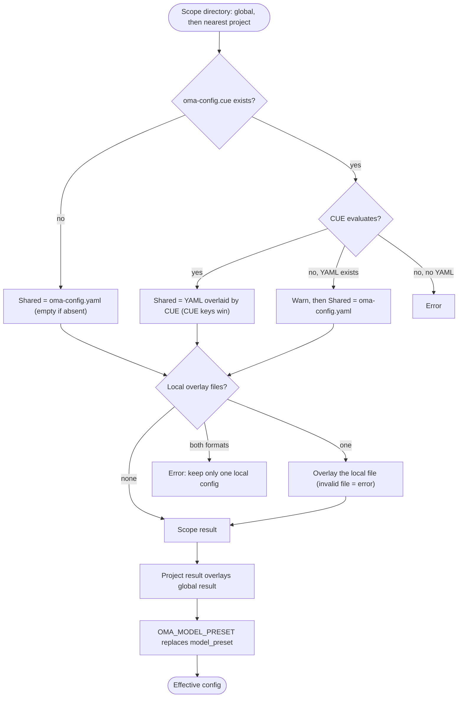

## 概要

OMA は `$OMA_HOME/.agents/`（デフォルトは `~/.oma/.agents/`）からグローバルのデフォルトを読み込み、
次に作業ディレクトリから親方向へたどって最も近いプロジェクトの `.agents/` を重ねます。
各スコープは次のレイヤーを持てます。

- **共有設定**：`.agents/oma-config.yaml` と `.agents/oma-config.cue`。両方が存在し、CUE ファイルを評価できる場合は、CUE ファイルが設定するすべてのキーが YAML ファイルの同じキーを上書きします。YAML ファイルにしかないキーはデフォルトとして残ります。CUE ファイルを評価できない場合、OMA は警告を出し、YAML ファイルだけを使います。
- **ローカル設定**：`.agents/oma-config.local.cue` または `.agents/oma-config.local.yaml`（1 ファイルだけを置き、共有設定の結果に重ねます。このファイルは非公開にしてください）。

プロジェクトの共有設定とローカル設定はグローバル設定を上書きします。異なる祖先の
プロジェクトルートがマージされることはありません。最も近い `.agents/` が空でも、それはプロジェクトの
境界になります。グローバルのデフォルトがプロジェクトの識別を変えることはありません。サポートされるキーとデフォルト値については
[設定リファレンス](/docs/guide/configuration-reference)を参照してください。

## 解決の流れ

OMA はグローバルスコープと最も近いプロジェクトスコープに同じ手順を実行し、2 つの結果をマージします。



プロジェクトの `.agents/` が見つからない場合、または探索がグローバルの `.agents/` ディレクトリ自体に到達した場合は、グローバルの結果だけを使います。

## 優先順位テーブル {#precedence-table}

後の行が優先されます。通常のマップは再帰的にマージします。配列、スカラー、`null` は前の値を置き換えます。

| 順序 | レイヤー | 規則 |
|:-----:|-------|------|
| 1 | グローバルの `oma-config.yaml` | 両方が存在する場合、グローバルの CUE ファイルの下に置かれるデフォルトです。 |
| 2 | グローバルの `oma-config.cue` | グローバルの YAML をキー単位で上書きします。評価に失敗し（たとえば `cue` CLI がない場合）、YAML が存在するときは、OMA が `[config] CUE evaluation failed at ... Falling back to oma-config.yaml` を出力して YAML だけを使います。 |
| 3 | グローバルの `oma-config.local.cue` または `oma-config.local.yaml` | 1 ファイルだけです。壊れたローカルファイルはエラーになります。 |
| 4 | プロジェクトの `oma-config.yaml` | 作業ディレクトリかその上にある、最も近いプロジェクトの `.agents/` です。 |
| 5 | プロジェクトの `oma-config.cue` | 4 行目をキー単位で上書きします。フォールバックは 2 行目と同じです。 |
| 6 | プロジェクトの `oma-config.local.cue` または `oma-config.local.yaml` | 1 ファイルだけです。壊れたローカルファイルはエラーになります。 |
| 7 | `OMA_MODEL_PRESET` | 空でない値が、そのプロセスの `model_preset` を置き換えます。空の値はエラーです。 |

:::tip[どのファイルを編集すればよいですか？]
`.agents/oma-config.cue` が存在する場合、そこで設定したキーは `oma-config.yaml` の同じキーを上書きします。そのキーは CUE ファイルで変更するか、マシン固有の値をローカルオーバーレイに置いてください。`oma doctor --profile` は、読み込んだファイルを **Configuration sources** の下に一覧表示します。
:::

プロジェクト固有の上書きでは、ローカルファイルに変更した末端の値だけを記述します。たとえば、ローカルのモデル選択を共有ファイルから分離できます。

```yaml
# .agents/oma-config.local.yaml
model_preset: claude
agents:
  backend:
    model: anthropic/claude-sonnet-4-6
```

最も近い `.agents/` ディレクトリを選べるように、コマンドはプロジェクトから実行してください。ローカルファイルが壊れている場合は明確に失敗するため、再試行する前に修正するか削除します。

## 設定を確認する

```bash
oma doctor --profile                           # loaded files, resolved preset, per-role model and CLI
cue export --out json .agents/oma-config.cue   # what the CUE layer evaluates to (requires the cue CLI)
```

| 症状またはメッセージ | 原因 | 対処 |
|--------------------|-------|-----|
| YAML の変更が反映されない | `oma-config.cue` が同じキーを設定している | CUE ファイルでそのキーを変更するか、ローカルファイルで上書きします |
| `[config] CUE evaluation failed at ... Falling back to oma-config.yaml` | `cue` CLI がない、または CUE ファイルを評価できない | `cue` をインストールするか、`cue export` が報告するエラーを修正します |
| `Both local CUE and YAML configs exist in ...; keep only one local config.` | ローカルオーバーレイファイルが 2 つある | どちらか一方を削除します |
| `OMA_MODEL_PRESET must be non-empty` | 変数がエクスポートされているが空 | `unset OMA_MODEL_PRESET` |
| `Unknown model_preset "..."` | タイプミス、または `custom_presets` のエントリーがない | エラーメッセージに挙げられたプリセットを使います |
| `Legacy preset name "..." is no longer valid` | `claude-only` など、名称変更前のキー | メッセージのとおりに名前を変えるか、`oma update` を実行します |
| `[model-registry] User inline model "..." failed validation` | `models:` のエントリーが不完全または無効 | [モデルスラッグのインライン指定](/docs/guide/per-agent-models#inlining-model-slugs)を参照してください |

## デフォルト値

| キー | デフォルト | 適用条件 |
|-----|---------|--------------|
| `auto_update_cli` | `true` | 両方のファイルがないか、キーがない場合 |
| `serena.mode` | `bridge` | 両方のファイルがないか、キーがない場合 |
| `serena.auto_update` | `true` | 両方のファイルがないか、キーがない場合 |
| `telemetry` | `false` | 両方のファイルがないか、キーがない場合 |
| `language` | `en` | 両方のファイルがないか、キーがない場合 |
| `model_preset` | 必須 | 配布されるプロジェクトテンプレートは `auto` を使いますが、スキーマでは空でない値が必要です。 |
| `translation_voice` | `balanced` | 両方のファイルがないか、キーがない場合 |
| `timezone` | システムのタイムゾーン | 両方のファイルがないか、キーがない場合 |

## 読み込み順序の理由

ユーザー全体のデフォルトには `~/.oma/.agents/oma-config.yaml`（`OMA_HOME` を設定している場合は `<OMA_HOME>/.agents/oma-config.yaml`）を編集します。
プロジェクトの共有ファイルとローカルファイルは、無関係な祖先プロジェクトを継承することなく
これらのデフォルトを上書きします。セマンティックメモリについてプロジェクトで `none` を選択すると、
グローバルの AgentMemory の選択より優先されます。

## 注意点

- `oma-config.yaml` の `language` はエージェントの応答言語を制御します。インストールや更新の警告メッセージの決定には**使いません**。インストール時点では `oma-config.yaml` がまだ読み込まれていないため、これらのメッセージはシステムロケール（`$LANG`）を使います。
- `auto_update_cli` はグローバルのデフォルトより先にプロジェクトの上書きを使い、どちらのスコープでも設定されていなければ有効になります。
- `telemetry`（デフォルトは `false`）は、各ベンダーのオプトアウト設定に対応します。`oma install`、`oma update`、`oma link` が設定を書き込みます。Claude では `DISABLE_TELEMETRY` と `CLAUDE_CODE_DISABLE_FEEDBACK_SURVEY`、Gemini と Qwen では `privacy.usageStatisticsEnabled`、Codex では `analytics.enabled` と `feedback.enabled`、Grok では `[features] telemetry`、Antigravity（agy）では `~/.gemini/antigravity-cli/settings.json` の `enableTelemetry` を使います。`telemetry: true` にすると、そのベンダーに対して oma が設定したオプトアウトを削除し、再びオプトインします。
- `diagram`（エンジンは `auto` / `archify` / `mermaid`、設定は `explain_sidecar`、`archify.managed|channel|check_interval_min|path|quality|open`）は、`video` や `image` と同じスパースなスキル上書きセクションです。[ダイアグラムエンジン](/docs/guide/diagram-engine)を参照してください。
- `video.hyperframes.check_interval_min` は、1 回の実行で使う HyperFrames ツールチェーンと heygen-com/hyperframes の最新バージョン確認を調整します（`oma video compose`、`oma update`）。配布される CUE スキーマはまだ `video.hyperframes` を定義していないため、`cue export` はスキーマブロック内のこのキーを拒否します（`field not allowed`）。`oma-config.yaml` またはローカルの YAML オーバーレイで設定してください。
- `market`（`managed|channel|check_interval_min|path|python|save_dir`）は、`oma market` が使う常に最新の `last30days` エンジンを設定します。[市場調査](/docs/guide/market-research)を参照してください。
- 型付きランタイムスキーマは `providers`、`free`、`agents`、`models`、`custom_presets`、`vendors`、`session`、`docs` とスパースなスキルセクションを対象とします。配布テンプレートには `scm`、`memory`、`serena_reaper`、`mcp` など、利用側が所有するブロックも含まれます。これらのネストしたキーは各利用側が管理します。この一覧からキーの存在を推測せず、[設定リファレンス](/docs/guide/configuration-reference)と該当機能のガイドを参照してください。
- `oma-config.yaml` を直接編集しても問題ありません。`oma install` と `oma update` は正規表現レベルでフィールドを置き換え、管理対象でないユーザー編集済みのキー（カスタムの `agents:` オーバーライドや `session.quota_cap` など）を保持します。
- `oma update` は、配布テンプレートに定義されていて手元のファイルにないトップレベルキーを、テンプレートのデフォルト値とともに `# Added by oma update` マーカーの下へ追加します。すでに存在するキーは変更せず、既存の内容をバイト単位で保持します。意図的に削除したキーはテンプレートのデフォルト値で再び現れるため、オプトアウトする場合はキーを削除せず値を明示してください。
