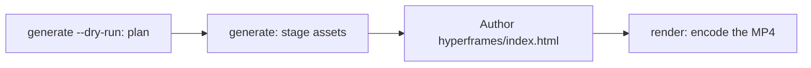

# 動画生成

`oma-video` は oh-my-agent の動画ルーターです。1 行の brief からスクリプト、ナレーション、映像、字幕をまとめ、計画を実行ディレクトリに記録します。プロバイダーの各段階はキーなしでも使え、ローカルまたは決定的なフォールバックを利用できます。ただし、実際の MP4 には動作するコンポジターと有効なコンポジションが必要です。

このスキルは "shorts"、"reels"、"screencast" や、"make a video"、"explainer video"、"demo video"、"walkthrough video"、"video from README" などの表現で起動します。別のスキルが副作用として動画を必要とした場合にも起動します。

> **TL;DR** `oma video generate` は実行を計画し、アセットを準備します。デフォルトの HyperFrames コンポジターでは MP4 をエンコードしません。`<runDir>/hyperframes/index.html` を作成し（`/video` ワークフローが代わりに行います）、次に `oma video render <runDir>` を実行します。初回は `oma video doctor --install` から始めてください。

---

## 使う場合

- brief、README、コード、データを短いクリップにする
- ナレーション付き解説やデモ／ウォークスルーの録画を作る
- 再実行するための再現可能な「brief → `.mp4`」パイプライン

## 使わない場合

- 静止画 1 枚 → [`oma-image`](/docs/guide/image-generation)
- 画面のライブ配信／ストリーミング → 対象外（oma は画面を録画しません。録画はユーザーが用意します）
- ナレーション音声だけ → `oma-voice`

---

## モード一覧

| モード | アスペクト比 | まとめる内容 |
|------|--------|------------------|
| `shorts` | 9:16 | 短い縦型クリップ（スクリプト → ナレーション → 映像 → 字幕）。 |
| `explainer` | 16:9 | README、コード、データの brief から作る横型解説。 |
| `demo` | derived | `--capture <file>` で渡した自分の画面録画から作るウォークスルー。`--source web --url <url>` はマスクした URL を文脈として保存するだけです。oma がブラウザーを開いたり、画面を録画したり、ログインを自動化したりすることはありません。 |

モードが適切なデフォルトを選びます。別の値が必要なときだけ関連フラグを渡します。

---

## クイックスタート

エージェント内では、`/video three quick tips for better focus` が以下のすべての手順を実行します。手動で行う場合、パイプラインは 4 つの手順からなります。



```bash
oma video doctor --install   # first run only: HyperFrames toolchain, Chrome Headless Shell, Pretendard

# 1. Plan from an agent-authored script (schema: .agents/skills/oma-video/resources/script-schema.md)
oma video generate "three quick tips for better focus" --mode shorts --script ./script.json --dry-run --output json

# 2. Stage assets (narration needs --voice <profile>; the default is a silent video)
oma video generate "three quick tips for better focus" --mode shorts --script ./script.json --output json

# 3. Author <runDir>/hyperframes/index.html per its AUTHORING.md, then encode
oma video compose <runDir>
oma video render <runDir> --output json

# Demo from your own recording; without --polish the recording itself becomes the output
oma video generate "product walkthrough" --mode demo --capture ./capture.mp4
```

<!-- oma-docs:ignore-start -->

| 手順 | コマンド | 結果 |
|---|---|---|
| 計画 | `generate --dry-run` | `script.json`、`render-spec.json`、`manifest.json`。レンダーはしない |
| アセットの準備 | `generate` | 映像、字幕、任意の音声と音楽、`hyperframes/` の雛形、警告 `composition pending` |
| 作成 | `hyperframes/index.html` を編集 | コンポジション |
| レンダー | `render <runDir>` | `{mode}-{slug}.mp4` と更新されたマニフェスト |

<!-- oma-docs:ignore-end -->

`--script` がない場合、CLI は brief のテキストから決定的な 3 シーンの骨格を作ります。`--locale` はナレーションと字幕の言語タグを設定しますが、翻訳はしません。brief または `script.json` は対象言語で書いてください。

各実行は実行ディレクトリを表示します。固定した `--seed` は決定的な計画入力を安定させますが、ライブのプロバイダー出力とキャプチャー映像は変わることがあります。保存済みのレンダー仕様とアセットを再利用したい場合は、既存の実行ディレクトリを再レンダーします。

`oma video generate --output json` をシェルから呼ぶ他のツールは、標準出力の JSON エンベロープ `{exitCode, runDir, manifestPath, scriptPath, renderSpecPath, warnings, error}` を解析します。`outputs` キーはありません。出力とアセットのパスは `manifestPath` のマニフェストから読みます。

---

## 常に最新の HyperFrames。コンポジションは自分で作成する

oh-my-agent に HyperFrames のコンポジションコードは**含まれていません**。各実行は `<runDir>/hyperframes/` に専用プロジェクトを持ち、最新 npm HyperFrames を使って `oma video compose` が雛形を生成します。ツールチェーンのキャッシュは `~/.cache/oma-video/hyperframes/<version>/` にあり、`node_modules` のシンボリックリンクで共有されます。[heygen-com/hyperframes](https://github.com/heygen-com/hyperframes) は HEAD（`~/.cache/oma-video/hyperframes-skills/`）にあります。エージェントは、生成された雛形の `AUTHORING.md`、スキル、`.agents/skills/oma-video/resources/hyperframes-authoring/` のモード仕様に従って生成コンポジションのソースを作成します。

```bash
oma video generate "…"                     # → render-spec.json + <runDir>/hyperframes/ (composition pending)
oma video compose <runDir> --output json   # refresh scaffold / print the contract (idempotent)
#   author hyperframes/index.html as instructed by AUTHORING.md
oma video render <runDir> --output json    # lint → render with the cached HyperFrames CLI → ffprobe; exit 1 on any failure
```

- 最新版の確認（npm + GitHub）は `video.hyperframes.check_interval_min`（デフォルト 60、`0` なら compose ごと）で間引かれます。`oma update` は間隔に従い、`oma video doctor --upgrade` は確認を強制します。オフライン実行ではキャッシュしたツールチェーンを使い、`stale` と報告します。
- 再現性は実行ディレクトリにあります。`render-spec.json`、作成したコンポジションのソース、生成された HyperFrames パッケージメタデータに記録されたツールチェーンのバージョンが境界です。同じ実行を再レンダーすると同じレンダー契約を再利用し、新しい実行では最新 HyperFrames を確認します。
- lint やレンダーの失敗はプレースホルダーで**隠されません**（それが存在するのは `OMA_VIDEO_MOCK=1` の場合だけです）。`oma video render` は診断付きで終了コード 1 を返し、エージェントは最新スキルを使ってコンポジションを修正します。新しい HyperFrames リリースでの破損はコンポジションのバグであり、固定する理由にはなりません。

```yaml
video:
  hyperframes:
    check_interval_min: 60    # 0 = check on every compose
```

---

## CLI リファレンス

```bash
oma video generate <brief...> [options]
oma video doctor [--install|--upgrade|--install-mpt|--install-strudel]  # toolchain readiness / provisioning
oma video compose <runDir>       # prepare HTML project and authoring contract
oma video render <runDir>        # re-render from render-spec.json (deterministic)
oma video provider list         # provider availability + key/fallback status
```

### 主なフラグ

| フラグ | 用途 |
|------|---------|
| `--mode <m>` | `shorts` \| `explainer` \| `demo`。 |
| `--aspect <a>` | `9:16` \| `16:9` \| `1:1` \| `auto`。 |
| `--locale <lang>` | ナレーション／字幕の言語タグ。 |
| `--captions <s>` | `tiktok` \| `lower-third` \| `none`（キーなしの整列）。 |
| `--visual <m>` | `auto` \| `generate` \| `stock` \| `aigc` \| `slide`。 |
| `--voice <profile>` | ナレーション音声。`none`（デフォルト）を指定するか、フラグを省略すると、推定した字幕タイミングで音声なしの動画をレンダーします。 |
| `--music <mode>` | `upbeat`、`calm`、`cinematic`、`lofi`、`piano`、または `none`。 |
| `--compositor <c>` | `hyperframes`（デフォルト） \| `mpt`。 |
| `--capture <path>` | demo モードで使う自分の録画。`.mp4`、`.mov`、`.webm`、`.mkv` のいずれかで、プロジェクト内に置きます。 |
| `--source <k>` | demo のキャプチャー元。`file` または `web`（デフォルトは `file`）。 |
| `--url <url>` | `--source web` の文脈 URL。マスクして `manifest.json` に保存します。`--source web` では必須ですが、キャプチャーを開始することはなく、`--capture` の代わりにもなりません。 |
| `--polish` | キャプチャーした映像に HyperFrames コンポジションを重ねます。 |
| `--device`, `--ready-selector`, `--show-cursor`, `--capture-timeout`, `--capture-stop` | 受け付けますが使われません。oma はブラウザーを操作せず、画面も録画しません。 |
| `--output-dir <path>` | 出力の基底ディレクトリ。`$PWD` 外のパスには `--allow-external-output` が必要です。 |
| `--allow-external-output` | `$PWD` 外の出力パスを許可します。 |
| `--max-usd <n>` | コストの上限（デフォルト `0.2`）。実行中の推定額が上限に達すると、実行は終了コード 1 で停止します。`-y` またはより大きい値で再実行してください。 |
| `--duration <sec>` | 目標の長さ（秒、1〜180）、または `auto`。 |
| `--seed <n>` | 決定的な seed。 |
| `--dry-run` | スクリプト、render-spec、マニフェストを出力し、レンダーを省略します。 |
| `--script <path>` | エージェントが作成した注入用の `script.json`（骨格を上書きし、ナレーション、画面上のテキスト、シーンごとの映像プロンプトを制御）。 |
| `-y, --yes` | 推定額が `--max-usd` に達するプロバイダーも許可します（`OMA_VIDEO_YES=1` と同じ）。 |
| `--timeout <sec>` | ビジュアル・音楽プロバイダー呼び出しごとの制限時間（整数の秒、デフォルト `600`）。単位の接尾辞は解析されないため、`2m` は 2 秒を意味します。 |
| `--output <f>` | CLI の出力は `text`（デフォルト）または `json`。 |
| `--no-brief-in-manifest` | brief の生値の代わりに SHA-256 をマニフェストへ保存します。 |

---

## キーなしで使えるプロバイダー

プロバイダーの段階は **実際の分岐**に解決され、段階が対応している場合は**決定的なフォールバック**も使います。そのため、キーがない場合も推定タイミングやローカルアセットを持つ計画済みの実行を残せます。コンポジターは必須の最終段階で、通常のプレースホルダーフォールバックはありません。

| 機能 | 実際の分岐（有効にする条件） | フォールバック |
|------------|-------------|----------|
| script | `--script <path>` で渡したエージェント作成の `script.json`（`/video` ワークフローが書き込む） | brief のテキストから作る決定的な 3 シーンの骨格 |
| voice | `--voice <profile>` を指定した `oma-voice`（Voicebox、ローカル） | 推定タイミングの無音動画（デフォルトの `--voice none`） |
| visual | `oma-image`、`oma-slide`、`PEXELS_API_KEY` を設定した場合は Pexels のストッククリップ | プレースホルダーアセット |
| visual: `aigc` | まだ接続されていない。`RUNNINGHUB_API_KEY` でプロバイダーは有効になるが、書き込むのはプレースホルダーのまま | プレースホルダーアセット |
| caption | `timing.json` に合わせた `.srt` と `.vtt`（スクリプトの言語） | 同じ。`--locale` への翻訳はまだ接続されていない |
| music | `oma video doctor --install-strudel` 実行後の Strudel の BGM | 音楽トラックなし |
| capture | `--capture <file>` で渡した録画 | なし。`--capture` がない場合、demo モードは録画の手順を表示して終了コード 3 で終了する |
| compositor | HyperFrames（管理対象）または MoneyPrinterTurbo | コンポジターのフォールバックなし。実行は診断付きで失敗します |

認証情報の自動化はありません。画面上のログインは録画中にユーザー自身が行います。URL とクエリトークンはログとマニフェストでマスクされます。

字幕は **静的なウィンドウ形式のキュー**としてレンダーされます。現在のフレームで有効な 1 行の字幕を CSS で折り返し、単語ごとのアニメーションは行いません。

---

## ツールチェーンと `doctor`

重いツールチェーン（管理対象の HyperFrames プロジェクトの `node_modules`、埋め込み Pretendard フォント、MoneyPrinterTurbo のチェックアウト、Strudel の音楽プロジェクト、Chrome Headless Shell）は**必要なときに準備され**、パッケージには含まれません。通常の `doctor` はレポートだけを行い、インストールはしません。

```bash
oma video doctor
```

`node`、`chromium`、`ffmpeg`、`ffprobe`、`hyperframes-toolchain`、`hyperframes-skills`、`pretendard-font`、`mpt-project`、`strudel`、`voicebox`、`oma-image`、`pixelle`、`cap` を報告し、不足しているもののインストール方法を表示します。正確な一覧は `oma video doctor --output json` で確認してください。基準として、Node.js 22 以上、HyperFrames ツールチェーンとその Chrome ブラウザー、FFmpeg/FFprobe、`oma-image` が必要です。実際の MP4 には、作成した HTML も必要です。

ツールチェーンを準備するにはインストールフラグを使います。

```bash
oma video doctor --install             # warm the latest HyperFrames toolchain + Chrome Headless Shell + Pretendard + heygen-com/hyperframes
oma video doctor --upgrade             # force a latest-version check now
oma video doctor --install-mpt         # MoneyPrinterTurbo checkout (clone + venv + deps) for --compositor mpt
oma video doctor --install-strudel     # Strudel music renderer for --music (installs AGPL-3.0-or-later packages locally)
```

`--install` は埋め込み Pretendard フォント（固定リリース）も共有のツールチェーンキャッシュへ取得します。これは再現性の境界に含まれます。ネットワークに失敗した場合は警告し、レンダーはシステムフォントへフォールバックします。ブラウザーや OS の違いは、エンコード後の出力に引き続き影響することがあります。

---

## 出力レイアウト

```text
.agents/results/videos/{timestamp}-{shortid}-{mode}/
├── script.json          # scenes + narration
├── render-spec.json     # the deterministic render contract
├── timing.json          # per-segment timing (voicebox-stt or estimated)
├── captions.srt / .vtt
├── audio/narration-01.wav     # one track; absent when the video is silent
├── music/                     # pattern.strudel, bgm.wav, bgm.mp3 (with --music and Strudel installed)
├── visuals/scene-*.{png,svg,…}
├── hyperframes/         # index.html, AUTHORING.md, local assets and toolchain link
├── {mode}-{slug}.mp4    # the rendered output (slug derived from the script title)
└── manifest.json        # providers, assets, cost, warnings
```

`render-spec.json` とアセットが再現性の境界です。

---

## トラブルシューティング

<!-- oma-docs:ignore-start -->

| 症状 | 原因／修正 |
|---------|-------------|
| MP4 が生成されない | コンポジター、コンポジション、ツールチェーンのチェックが失敗しました。`oma video doctor`、次に `oma video compose <runDir>` を実行し、報告されたコンポジションを直してから `oma video render <runDir>` を再実行します。 |
| ナレーションが無音（`source: estimated`） | `--voice` のデフォルトが `none` であるか、Voicebox に接続できません。Voicebox アプリのプロファイルを `--voice <profile>` で渡して `oma-voice` サーバーを起動するか、推定タイミングを受け入れます。 |
| demo の実行が録画の手順を表示して終了コード 3 で終了する | `--capture` ファイルが指定されていません（`--source web` の場合も同様）。oma は画面を録画しません。Cap、QuickTime、OBS で操作を録画してプロジェクト内に保存し、`--capture ./walkthrough.mp4` を付けて再実行します。 |
| `--capture` が拒否される（終了コード 4） | ファイルが存在しない、プロジェクトディレクトリの外にある、または `.mp4` / `.mov` / `.webm` / `.mkv` ではありません。録画をプロジェクト内（例: `./captures/demo.mp4`）にコピーします。 |
| コストの上限で実行が停止する（終了コード 1） | 実行中の推定額が `--max-usd` に達しました。`-y` を付けるか、より大きい `--max-usd` で再実行します。 |
| `--out path "…" is outside $PWD. Use --allow-external-out to override.`（終了コード 1） | `--output-dir` がプロジェクトの外を指しています。`--allow-external-output` を付けて再実行するか（メッセージには古いフラグ名が表示されます）、プロジェクト内のディレクトリを選びます。 |
| `oma video doctor` が `oma-image` を不足として表示する | 詳細が `Removed option --format. Use --output.` の場合は、準備状況の確認そのものが失敗しており、ベンダーの状態については何も示していません。`oma image doctor` で直接確認してください。それ以外の場合は準備済みの画像ベンダーがないため、映像はプレースホルダーにフォールバックします。`oma image doctor` を実行し、ベンダーを 1 つ設定してください。 |
| 初回レンダーが遅い | HyperFrames ブラウザー／MPT のチェックアウトを一度準備しています。以降の実行ではキャッシュを再利用します。 |

<!-- oma-docs:ignore-end -->

---

## 次のステップ

- [`/video` ワークフロー](../core-concepts/workflows.md#video)。brief → script → assets → render-spec → HyperFrames のパイプラインです。
- [画像生成](./image-generation.md)。動画の visual プロバイダーとして再利用される静止画ルーターです。
- [コンテンツとリサーチのワークフロー](./content-and-research.md)。音声、スライド、その他のコンテンツ機能です。
- [CLI コマンド: video](../cli-interfaces/commands.md#video)。`oma video` のオプション一覧です。
