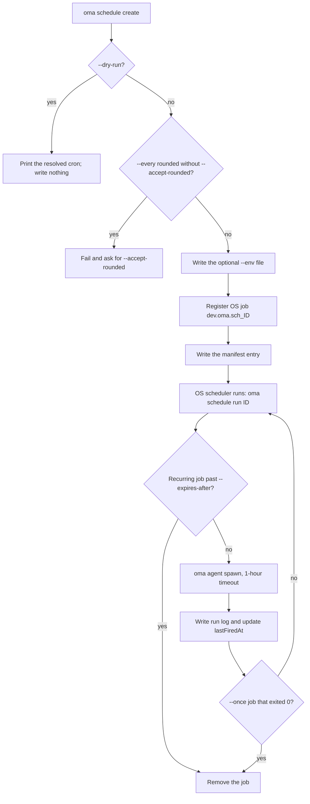
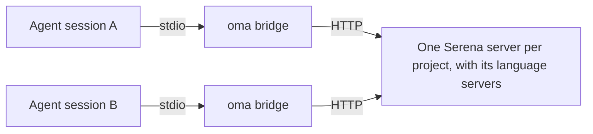
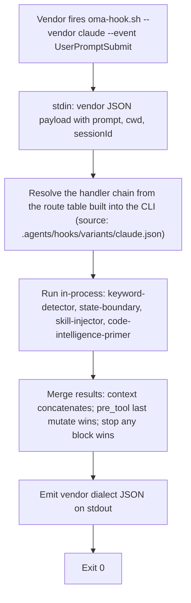

# CLI 명령어

전역 설치 후(`bun install --global oh-my-agent`) `oma` 또는 `oh-my-agent`를 사용합니다. 설치 없이 일회성으로 사용하려면 `npx oh-my-agent`를 실행합니다.

환경 변수 `OH_MY_AG_OUTPUT_FORMAT`을 `json`으로 설정하면 공통 `--json` / `--output` 옵션을 사용하는 명령에서 JSON이 기본 출력이 됩니다. 명시적으로 지정한 `--output text`가 여전히 우선합니다.

명령이 `Unknown command`, `Unexpected argument`, `Removed option`으로 실패하면 이 페이지의 [제거된 표기](#aliases)를 참고합니다. 설치, 훅, 런타임 문제는 [문제 해결](../guide/troubleshooting.md)을 참고합니다.

## 작업부터 시작하기 {#start-with-a-task}

질문에 답하는 가장 작은 명령을 선택합니다. 아래 명령은 다음 단계로 이동하기 전에 확인할 수 있는 경로 또는 보고서를 출력합니다.

| 작업 | 시작점 | 예상 결과 |
|:-----|:-----------|:----------------|
| 프로젝트 설치 또는 복구 | `oma install` 다음 `oma doctor` | 설치된 리소스와 상태 보고서입니다. 모델 해석이 문제라면 `oma doctor --profile`을 사용합니다. |
| 에이전트에서 명령 또는 옵션 찾기 | `oma describe` 또는 `oma describe "image generate"` | 인자, 옵션, 중첩 명령을 설명하는 JSON입니다. |
| 이미지 생성 | `oma image generate "<prompt>" --output json` | `.agents/results/images/` 아래 이미지 경로와 매니페스트입니다. |
| 비디오 계획 또는 렌더링 | `oma video generate "<brief>" --dry-run` | 계획 산출물이 있는 실행 디렉토리입니다. 컴포지션을 작성한 뒤에만 compose와 render를 실행합니다. |
| 대화형 코드 설명서 만들기 | `/explain` | `.agents/results/explain/` 아래 검증된 자체 완결 HTML 산출물입니다. |
| 다이어그램 엔진 해석 | `oma diagram resolve --output json` | 선택된 Mermaid 또는 archify 엔진과 그 이유입니다. |
| 커뮤니티 신호 조사 | `oma market detect-trap "<topic>"` | 사전 점검 결과입니다. 통과한 경우에만 `oma market resolve --output json`과 upstream 실행으로 이어갑니다. |
| 논문 변환 또는 검사 | `oma scholar search "<query>"` | Knows, OpenAlex, Semantic Scholar 검색 결과입니다. 사이드카는 `oma scholar get`으로 가져옵니다. |
| 슬라이드 덱 만들기 | `oma slide create --output-dir <dir>` | 작성, 검증, 번들링, 내보내기에 사용할 작업 디렉토리입니다. |
| 문서 드리프트 검토 | `oma docs verify --json` | 깨진 참조를 담은 구조화 보고서와 재생성된 참조 인덱스입니다. |
| 반복 실행 에이전트 예약 | `oma schedule create backend "<task>" --every 2h --dry-run` | 해석된 cron 표현식입니다. `--dry-run` 없이 다시 실행하기 전까지는 아무것도 등록하지 않습니다. |
| 스킬 또는 하네스 품질 점검 | `oma skill lint` 또는 `oma skill audit` | 오프라인 보고서입니다. 모델을 호출하는 명령을 실행하기 전에 [스킬 또는 하네스 명령 고르기](#choosing-a-skill-or-harness-command)를 참고합니다. |

아래 표준 이름은 `oma describe`가 반환하는 경로입니다. 공백으로 구분한 이 경로만 받습니다. `slide new`, `slide viewer`, `image list-vendors`, `video list-providers` 같은 예전 표기, `agent:parallel` 같은 콜론 형식, `viz`, `s`, `img` 같은 짧은 이름은 `Unknown command` 또는 `Unexpected argument`로 실패합니다. [별칭과 제거된 표기](#aliases)를 참고합니다.

## 현재 지원하는 명령 {#current-command-surface}

아래 표는 긴 레퍼런스를 빠르게 훑어보고 덜 자주 사용하는 계열도 찾을 수 있게 합니다. 정확한 인자 구문은 각 계열의 `--help` 또는 `oma describe <path>`로 확인하고, 전체 플래그 매트릭스는 [CLI 옵션](./options.md)에서 확인합니다.

| 계열 | 등록된 경로 |
|:-------|:-----------------|
| `install` | `install` |
| `describe` | `describe` |
| `uninstall` | `uninstall` |
| `update` | `update`, `update mcp` |
| `link` | `link` |
| `intel` | `intel`, `intel suggest` |
| `market` | `market`, `market detect-trap`, `market resolve`, `market update`, `market run` |
| `doctor` | `doctor` |
| `profile` | `profile`, `profile list`, `profile show`, `profile create`, `profile use`, `profile run` |
| `home` | `home`, `home migrate` |
| `retro` | `retro` |
| `recap` | `recap` |
| `docs` | `docs`, `docs verify`, `docs sync`, `docs i18n`, `docs lint` |
| `emit` | `emit` |
| `cleanup` | `cleanup` |
| `bridge` | `bridge` |
| `verify` | `verify`, `verify agent`, `verify triggers` |
| `vault` | `vault`, `vault store`, `vault get`, `vault list`, `vault delete` |
| `star` | `star` |
| `visualize` | `visualize` |
| `search` | `search`, `search providers`, `search web`, `search fetch`, `search meta`, `search media`, `search archive`, `search trust`, `search code`, `search doctor`, `search api`, `search api fetch`, `search api search`, `search rss`, `search rss fetch`, `search rss google` |
| `harness` | `harness`, `harness eval`, `harness incident`, `harness incident scan`, `harness incident capture`, `harness incident show`, `harness incident export`, `harness incident promote`, `harness incident reproduce`, `harness feedback`, `harness evolution`, `harness evolution enable`, `harness evolution status`, `harness evolution disable`, `harness evolution run` |
| `slide` | `slide`, `slide validate`, `slide bundle`, `slide edit`, `slide doctor`, `slide create`, `slide preview`, `slide export`, `slide export pdf`, `slide export png`, `slide export pptx`, `slide import`, `slide import pptx`, `slide asset`, `slide asset fetch-video`, `slide style`, `slide style list`, `slide style preview`, `slide style get` |
| `scholar` | `scholar`, `scholar search`, `scholar resolve`, `scholar get`, `scholar lint` |
| `image` | `image`, `image generate`, `image doctor`, `image vendor`, `image vendor list` |
| `video` | `video`, `video generate`, `video doctor`, `video compose`, `video render`, `video provider`, `video provider list` |
| `serena` | `serena`, `serena check`, `serena setup`, `serena reap`, `serena daemon`, `serena daemon gc`, `serena reaper`, `serena reaper enable`, `serena reaper disable` |
| `explain` | `explain`, `explain render`, `explain lint`, `explain patch`, `explain components`, `explain validate` |
| `diagram` | `diagram`, `diagram resolve`, `diagram update`, `diagram archify` |
| `help` | `help` |
| `version` | `version` |
| `dashboard` | `dashboard`, `dashboard terminal`, `dashboard web` |
| `auth` | `auth`, `auth status` |
| `hook` | `hook`, `hook run`, `hook probe`, `hook script` |
| `state` | `state`, `state emit`, `state migrate`, `state get`, `state list`, `state repair`, `state verify`, `state decisions`, `state decisions list`, `state inject-log`, `state inject-log list`, `state inject-log get`, `state summary`, `state trajectory`, `state heal-check`, `state activate`, `state archive`, `state purge` |
| `ralph` | `ralph`, `ralph verify` |
| `goal` | `goal`, `goal set` |
| `stats` | `stats`, `stats get`, `stats reset` |
| `agent` | `agent`, `agent context`, `agent resume`, `agent begin`, `agent verify`, `agent finish`, `agent spawn`, `agent status`, `agent parallel`, `agent review` |
| `model` | `model`, `model check`, `model probe`, `model propose` |
| `memory` | `memory`, `memory keys`, `memory init`, `memory setup`, `memory daemon`, `memory daemon status`, `memory daemon start`, `memory daemon stop`, `memory daemon restart`, `memory service`, `memory service install`, `memory service uninstall`, `memory status`, `memory retry`, `memory retry drain`, `memory import`, `memory maintain`, `memory maintain backup`, `memory maintain prune`, `memory maintain vacuum`, `memory gc`, `memory upgrade` |
| `skill` | `skill`, `skill audit`, `skill lint`, `skill eval`, `skill optimize`, `skill meta-optimize`, `skill procedure`, `skill evolution-stats`, `skill promotions`, `skill rollback`, `skill matrix` |
| `schedule` | `schedule`, `schedule create`, `schedule list`, `schedule delete`, `schedule run`, `schedule sync` |

`oma describe`에는 `agent parallel-supervisor`, `schedule inspect`, `schedule builtin-evolution-add`도 나옵니다. 다른 명령이 내부적으로 호출하는 명령이므로 직접 실행하지 않습니다.

명령이 남은 인자를 다른 도구에 위임하면 레지스트리는 해당 옵션을 의도적으로 열어 둡니다. 이는 `market run`과 `diagram archify`에 적용됩니다. 변경을 일으키거나 네트워크를 사용하는 작업 전에 해석된 upstream 도움말을 읽습니다.

---

## 설정 및 설치 {#setup--installation}

### install

인자 없이 `oma`를 실행하면 대화형 설치 프로그램이 시작됩니다. `oma install`은 명시적 형식이며 프로바이더 선택 옵션을 받습니다.

```bash
oma
oma install
oma install --web-search native --code-intelligence gortex --semantic-memory agentmemory
```

| 옵션 | 허용 값 |
|:-------|:----------------|
| `--web-search <provider>` | `native`, `brave` |
| `--code-intelligence <provider>` | `serena`, `gortex` |
| `--semantic-memory <provider>` | `agentmemory`, `honcho`, `none` |
| `--honcho-url <url>` | Honcho API origin (새 연결 기본값: `http://127.0.0.1:8000`) |
| `--honcho-workspace <id>` | Honcho 워크스페이스 ID (새 연결 기본값: `oma`) |

`--web-search`, `--code-intelligence`, `--semantic-memory`를 생략하면 저장된 프로바이더 선택을 유지합니다. 선택한 프로바이더가 Honcho일 때 `--honcho-url`과 `--honcho-workspace`로 새 Honcho 연결을 설정합니다. 루트 `-y, --yes` 플래그는 프롬프트를 건너뛰고 기본값을 사용합니다. `--global`은 `$OMA_HOME/.agents/`(기본값 `~/.oma/.agents/`)를 대상으로 합니다. `OMA_HOME`이 설정되어 있어도 프로젝트 설치는 `<cwd>/.agents/`에 그대로 둡니다.

**수행 내용:**
1. 레거시 `.agent/` 디렉토리를 확인하고 발견되면 `.agents/`로 마이그레이션합니다.
2. 경쟁 도구를 감지하고 제거를 제안합니다.
3. 프로젝트 타입 선택을 요청합니다 (All, Fullstack, Frontend, Backend, Mobile, DevOps, Custom).
4. 백엔드가 선택된 경우 언어 변형을 요청합니다 (Python, Node.js, Rust, Other).
5. GitHub Copilot 심볼릭 링크에 대해 질문합니다.
6. 레지스트리에서 최신 tarball을 다운로드합니다.
7. 공유 리소스, 워크플로우, 설정, 선택된 스킬을 설치합니다.
8. 선택된 벤더에 대한 벤더 적응을 설치합니다 (프로젝트 로컬 설정이며, HOME 레벨 벤더 파일을 몰래 쓰지 않습니다).
9. CLI 심볼릭 링크를 생성합니다.
10. 권장 **전역** git 설정을 제안합니다 (opt-in 확인):
    - `rerere.enabled=true`: 멀티 에이전트 머지 충돌 해결 재사용
    - `init.defaultBranch=main`: 새 저장소의 기본 브랜치 일관성
    - `--yes` / CI에서는 전부 건너뛰고 수동 수정 힌트만 출력
11. 해당되는 경우 MCP 설정을 제안합니다.
12. `gh`가 인증되어 있으면 GitHub star를 제안합니다.

**예시:**
```bash
cd /path/to/my-project
oma
# Follow the interactive prompts
```

### doctor

CLI 설치 상태, MCP 설정, 스킬 상태를 검사합니다.

```text
oma doctor [--json] [--output <format>] [--profile] [--heal-check <agent-type>]
```

**옵션:**

| 플래그 | 설명 |
|:-------|:-----|
| `--json` | JSON으로 출력합니다. 보고서의 `issues` 수가 0보다 크면 종료 코드 `1`로 끝납니다. |
| `--output <format>` | 출력 형식 (`text` 또는 `json`) |
| `--profile` | 프로필 상태 매트릭스를 표시합니다. 활성 `model_preset`과 `agents:` 오버라이드에서 해석한 에이전트별 모델 슬러그, CLI, 인증 상태를 보여줍니다. [에이전트별 모델](../guide/per-agent-models.md)을 참고합니다. |
| `--heal-check <agent-type>` | 해당 에이전트의 자가 치유 게이트 검사를 보고서에 포함합니다. |

**검사 항목:**
- CLI 설치: `claude`, `codex`, `qwen`, `agy`, `grok`, `kiro-cli`, `kimi`, `pi` (버전 및 경로).
- 각 CLI의 인증 상태.
- Claude Code(`~/.claude.json`)와 Codex(`~/.codex/config.toml`)의 MCP 설정.
- 설치된 스킬: 어떤 스킬이 있고 상태가 어떤지.
- 메모리 스토어 디렉토리: `.agents/state/memories/` 존재 여부 및 파일 수 (구버전 프로젝트는 레거시 `.serena/memories/` 경로로 폴백).
- 이중 설치 마커(프로젝트 vs 전역) 및 관련 경고.
- 권장 **전역** git 설정 (JSON의 `gitRecommended`):
  - `rerere.enabled=true`
  - `init.defaultBranch=main`
  - 불일치마다 이슈 합계(JSON의 `issues`)에 반영
- 프로젝트 벤더 컨텍스트 파일 (Codex, Qwen 또는 Claude Code ≥ 2.1.277이 설치된 경우 `AGENTS.md`의 OMA 블록).
- AgentMemory, state/hooks 상태, Serena reaper 진단 및 관련 이슈 카운터.

**자동 복구:** 누락된 스킬이 감지되면 `doctor`가 대화형으로 설치를 제안합니다. 권장 git 설정이 없거나 다르면 install/update와 동일한 opt-in 전역 수정을 제안합니다.

**예시:**
```bash
# Interactive text output
oma doctor

# JSON output for CI pipelines
oma doctor --json

# Pipe to jq for specific checks
oma doctor --json | jq '.clis[] | select(.installed == false)'

# Inspect the profile resolution matrix
oma doctor --profile
```

### update

레지스트리에서 최신 버전으로 스킬을 업데이트합니다.

```text
oma update [-f, --force] [--with-new-skills] [--ci] [-y, --yes] [--all] [--vendor <vendors>]
```

**옵션:**

| 플래그 | 설명 |
|:-------|:-----|
| `-f, --force` | 사용자가 커스터마이즈한 설정 파일(`oma-config.yaml`, `mcp.json`, `stack/` 디렉토리) 덮어쓰기 |
| `--with-new-skills` | 이번 릴리스에 새로 추가된 스킬을 설치합니다. 이 옵션이 없으면 이미 설치된 스킬만 갱신합니다. |
| `--ci` | 비대화형 CI 모드로 실행 (프롬프트 건너뛰기, 일반 텍스트 출력) |
| `-y, --yes` | 프롬프트를 건너뜁니다. 벤더 범위는 그대로입니다. `--all`이나 `--vendor`를 주지 않으면 이미 있는 벤더 디렉토리만 업데이트합니다. |
| `--all` | 지원하는 모든 프로젝트 범위 벤더를 만들거나 업데이트합니다. |
| `--vendor <vendors>` | 특정 벤더를 만들거나 업데이트합니다. `claude,qwen`처럼 쉼표로 구분한 목록을 받습니다. |

**수행 내용:**
1. 레지스트리에서 `prompt-manifest.json`을 가져와 최신 버전을 확인합니다.
2. `.agents/skills/_version.json`의 로컬 버전과 비교합니다.
3. 이미 최신이면 종료합니다.
4. 최신 tarball을 다운로드하고 추출합니다.
5. 사용자가 커스터마이즈한 파일을 보존합니다(`--force` 제외).
6. `.agents/` 위에 새 파일을 복사합니다.
7. 보존된 파일을 복원합니다.
8. 벤더 적응을 업데이트하고 심볼릭 링크를 갱신합니다. 기본적으로 프로젝트에 이미 있는 벤더 디렉토리만 건드립니다.
9. 권장 **전역** git 설정을 제안합니다 (install과 동일한 opt-in: `rerere.enabled`, `init.defaultBranch`). `--yes` / `--ci`에서는 건너뜁니다.

**예시:**
```bash
# Standard update (preserves config)
oma update

# Force update (resets all config to defaults)
oma update --force

# CI mode (no prompts, no spinners)
oma update --ci

# CI mode with force
oma update --ci --force

# Update existing vendors without prompts
oma update --yes

# Create/update every supported project-scoped vendor
oma update --all

# Create/update only Claude and Qwen integrations
oma update --vendor claude,qwen

# Also refresh browser MCP selections
oma update mcp --ci
```

`oma update mcp`는 자체 `--yes`, `--ci`, `--all`, `--vendor <vendors>` 옵션을 사용합니다. 선택한 프로젝트 범위 벤더에 대해 지원하는 브라우저 MCP 서버(Aside, Chrome DevTools, Firefox DevTools)를 선택합니다.

### uninstall

선택한 설치 루트에서 OMA가 소유한 파일을 미리 확인하거나 제거합니다.

```bash
oma uninstall --dry-run
oma uninstall --yes
```

`--dry-run`은 파일을 바꾸지 않고 제거 목록을 출력합니다. `--yes`는 확인 프롬프트를 건너뜁니다. 등록된 명령 설명에 따라 `oma-config.yaml`, `mcp.json`, 사용자 작성 스킬은 보존합니다. 미리보기에서 계속 필요한 파일을 발견하면 중지하고 dry-run 결과를 검토용으로 보관합니다.

### link

다시 설치하지 않고 `.agents/` 원본에서 벤더 네이티브 파일을 재생성합니다.

```text
oma link [vendors...] [--dry-run] [--global]
```

`--dry-run`은 파일을 바꾸지 않고 쓰게 될 내용을 미리 보여줍니다.

**예시:**

```bash
# Preview the files link would write
oma link --dry-run

# Regenerate all configured vendors
oma link

# Regenerate only Claude and Codex files
oma link claude codex

# Regenerate the global install (~/.oma/.agents/) from any directory
oma link opencode --global
```

`--global`이 없으면 link는 `<cwd>/.agents/`를, 있으면 `~/.oma/.agents/`(또는 `$OMA_HOME/.agents/`)를 대상으로 삼습니다. `OMA_HOME`은 프로젝트 대상을 바꾸지 않습니다. [글로벌 설치](../guide/global-install.md)를 참고하세요.

**수행 내용:**
1. `.agents/agents/`에서 벤더 네이티브 에이전트 파일을 다시 만듭니다
2. 선택한 벤더의 훅과 로컬 설정을 갱신합니다
3. Claude Code를 포함해 설정된 모든 벤더의 `AGENTS.md` 통합 블록을 재생성합니다. `CLAUDE.md`와 `GEMINI.md`는 생성하지 않고 OMA 블록도 넣지 않습니다. Claude Code ≥ 2.1.277은 `AGENTS.md`를 직접 읽지만 `CLAUDE.md`가 있으면 `AGENTS.md`를 무시하므로, 사용자가 소유한 `CLAUDE.md`가 있을 때 link는 `@AGENTS.md` import 줄을 하나만 추가합니다. 해당 버전이 감지되면 `oma update`가 `CLAUDE.md`에 남은 레거시 OMA 블록도 제거합니다
4. 필요하면 Cursor MCP 연결과 CLI 스킬 심볼릭 링크를 갱신합니다

`.agents/agents/`, `.agents/workflows/`, `.agents/rules/`, 훅 정의를 수정한 뒤에 실행하세요.

**모델 동작:**
- 같은 벤더 네이티브 디스패치는 생성된 벤더 에이전트 파일에 정의된 모델을 씁니다.
- 외부 폴백 디스패치는 `.agents/skills/oma-orchestration/config/cli-config.yaml`의 벤더별 `default_model`을 씁니다.

**디스패치 동작:**
- 대상 벤더가 현재 런타임과 같고 그 런타임이 네이티브 역할 에이전트를 지원하면 OMA는 네이티브 디스패치를 씁니다.
- 그렇지 않으면 `oma agent spawn`으로 폴백합니다.

### 기존 설치 다시 구성하기 {#setup-workflow}

`/setup` 워크플로우는 없습니다. 설치된 프로젝트를 바꾸려면 `oma install`을 다시 실행하거나, 브라우저 MCP 서버만 바꿀 때는 `oma update mcp`를 사용하거나, 에이전트 세션 안에서 `/tools`를 실행해 MCP 도구를 켜거나 끕니다. 에이전트별 모델 해석은 `oma doctor --profile`로 확인합니다. 에이전트별 모델 고정은 `.agents/oma-config.yaml`의 `agents:` 아래에 있습니다([에이전트별 모델](../guide/per-agent-models.md)).

---

## 모니터링 및 메트릭 {#monitoring--metrics}

### dashboard terminal {#dashboard}

실시간 에이전트 모니터링을 위한 터미널 대시보드를 시작합니다.

```text
oma dashboard terminal [--project-root <path>]
```

`<project>/.agents/state/memories/`를 감시합니다. 여기서 project는 `--project-root`(기본값: 현재 디렉토리)입니다. 레거시 `.serena/memories/` 경로로 자동 폴백하지 않습니다. 세션 상태, 에이전트 테이블, 활동 피드가 포함된 박스 드로잉 UI를 표시하며, 파일이 바뀔 때마다 업데이트됩니다. `Ctrl+C`를 눌러 종료합니다.

메모리 디렉토리는 `MEMORIES_DIR` 환경 변수로 오버라이드할 수 있습니다.

**예시:**
```bash
# Standard usage
oma dashboard terminal

# Custom memories directory
MEMORIES_DIR=/path/to/.agents/state/memories oma dashboard terminal
```

### dashboard web

웹 대시보드를 시작합니다.

```text
oma dashboard web [--project-root <path>]
```

`http://127.0.0.1:9847`에서 실시간 업데이트용 WebSocket 연결을 갖춘 HTTP 서버를 시작합니다. 출력된 URL을 브라우저에서 열어 대시보드를 확인합니다.

**환경 변수:**

| 변수 | 기본값 | 설명 |
|:-----|:-------|:-----|
| `DASHBOARD_PORT` | `9847` | HTTP/WebSocket 서버의 포트 |
| `MEMORIES_DIR` | `<project-root>/.agents/state/memories` | 메모리 디렉토리 경로입니다. `--project-root`보다 우선합니다. |

**예시:**
```bash
# Standard usage
oma dashboard web

# Custom port
DASHBOARD_PORT=8080 oma dashboard web
```

### stats

생산성 메트릭을 확인합니다.

```text
oma stats get [--json] [--output <format>]
oma stats reset [--json] [--output <format>]
```

**옵션:**

| 플래그 | 설명 |
|:-------|:-----|
| `--json` | JSON으로 출력 |
| `--output <format>` | 출력 형식 (`text` 또는 `json`) |

**추적되는 메트릭:**
- 세션 수
- 사용된 스킬 (빈도 포함)
- 완료된 태스크
- 총 세션 시간
- 변경된 파일, 추가된 줄, 제거된 줄
- 마지막 업데이트 타임스탬프

**비용 텔레메트리** (`.agents/state/memories/` 아래의 모든 `session-cost-*.md` 파일을 합산):
- 총 입력 토큰 (프롬프트 문자 수 기반 근사치이며, 출력 토큰은 아직 포함하지 않습니다)
- 총 스폰 수
- 벤더별 입력 토큰 단가를 보수적으로 적용한 추정 USD (Claude $3/M, Codex $5/M, Gemini $0.3/M, Qwen $0/M, Cursor $5/M, Antigravity $0.3/M)
- 벤더별 내역 (토큰 · 스폰 · USD)

추정치는 하한일 뿐 청구 금액과 정확히 일치하지 않습니다. 스폰 시점에 하드 예산을 적용하려면 `.agents/oma-config.yaml`의 `session.quota_cap`을 설정합니다. 이 상한이 속한 품질 우선 도구 모음은 Getting Started의 Why oh-my-agent 페이지를 참고합니다.

메트릭은 `.agents/state/metrics.json`에 저장되며, 레거시 `.serena/metrics.json`이 있으면 함께 읽습니다. 데이터는 git 통계와 메모리 파일에서 수집됩니다.

**예시:**
```bash
# View current metrics
oma stats get

# JSON output
oma stats get --json

# Reset all metrics
oma stats reset
```

### recap

Claude, Codex, Gemini, Antigravity, Qwen, Cursor, Grok 세션에 걸친 AI 도구 대화 이력을 요약합니다.

```text
oma recap [--window <period>] [--date <date>] [--tool <tools>] [--top <n>] [--sort <metric>] [--mermaid] [--graph] [--json] [--output <format>]
```

**옵션:**

| 플래그 | 설명 | 기본값 |
|:-----|:-----------|:--------|
| `--window <period>` | 시간 구간: `1d`, `3d`, `7d`, `2w`, `30d` | `1d` |
| `--date <date>` | 특정 날짜(`YYYY-MM-DD`). `--window`보다 우선합니다 | |
| `--tool <tools>` | 쉼표로 구분한 필터: `grok,claude,codex,gemini,qwen,cursor,antigravity` | 전체 |
| `--top <n>` | 상위 N개 프로젝트와 주제 표시 | |
| `--sort <metric>` | `count` 또는 `duration` 기준 정렬 | `count` |
| `--mermaid` | Mermaid 간트 차트로 출력 | |
| `--graph` | 브라우저에서 인터랙티브 그래프 열기 | |
| `--json` / `--output <format>` | 기계 판독 가능한 출력 | `text` |

**예시:**

```bash
oma recap                                     # Today (1d)
oma recap --window 7d                         # Last week
oma recap --date 2026-04-20 --tool grok,claude
oma recap --window 7d --mermaid > week.mmd
oma recap --window 30d --graph                # Interactive browser graph
```

### retro

메트릭과 트렌드가 포함된 엔지니어링 회고입니다.

```text
oma retro [window] [--json] [--output <format>] [--interactive] [--compare]
```

**인자:**

| 인자 | 설명 | 기본값 |
|:-----|:-----|:-------|
| `window` | `<n>h`, `<n>d`, `<n>w` 형식의 시간 구간(예: `24h`, `7d`, `2w`)입니다. 월 단위는 받지 않으므로 `30d`를 사용합니다. | 최근 7일 |

**옵션:**

| 플래그 | 설명 |
|:-------|:-----|
| `--json` | JSON으로 출력 |
| `--output <format>` | 출력 형식 (`text` 또는 `json`) |
| `--interactive` | 수동 입력이 있는 대화형 모드 |
| `--compare` | 현재 구간과 같은 길이의 직전 구간 비교 |

**표시 내용:**
- 공유하기 좋은 한 줄 요약 (메트릭)
- 요약 테이블 (커밋, 변경된 파일, 추가/제거된 줄, 기여자)
- 이전 회고 대비 트렌드 (이전 스냅샷이 존재하는 경우)
- 기여자 리더보드
- 커밋 시간 분포 (시간별 히스토그램)
- 작업 세션
- 커밋 타입 분류 (feat, fix, chore 등)
- 핫스팟 (가장 많이 변경된 파일)

**예시:**
```bash
# Last 7 days (default)
oma retro

# Last 30 days
oma retro 30d

# Last 2 weeks
oma retro 2w

# Compare with previous period
oma retro 7d --compare

# Interactive mode
oma retro --interactive

# JSON for automation
oma retro 7d --json
```

---

## 전역 홈, 세션, 로컬 프로필 {#global-home-sessions-and-local-profiles}

### home migrate

OMA가 소유한 전역 정의와 런타임 메타데이터를 통합 홈으로 복사합니다.

```bash
oma home migrate --dry-run --json
oma home migrate --json
oma schedule sync
```

`OMA_HOME`은 전역 저장 루트를 선택하며 기본값은 `~/.oma`입니다. 정의는 그 아래 `.agents/`를, 예약 작업은 `schedule/`을, Serena와 vault 키 이름 인덱스는 `state/`를 사용합니다. 프로필 저장소는 `OMA_STATE_HOME`이 다른 프로필 루트를 명시적으로 선택하지 않는 한 `u/`를 사용합니다.

마이그레이션은 원본 내용을 보존하고, 동일한 사본은 건너뛰고, vault 키 이름을 병합하며, 대상 충돌이나 사용 중인 데이터를 보고합니다. 검증된 OMA 소유 스킬 디렉토리는 이전 탐색 경로가 마이그레이션된 사본을 가리키는 관리 링크로 바뀌기 전에 `$OMA_HOME/backup/legacy-global-skills/` 아래에 보관될 수 있습니다. 사용자 스킬과 외부 링크는 그대로 둡니다. 벤더 인증, OS 키체인 시크릿, 외부 메모리 데이터는 옮기지 않습니다. 전역 install/update는 이 마이그레이션을 자동으로 실행합니다. OS 작업 등록은 별개이므로, 예약 작업이 있으면 마이그레이션 뒤에 `oma schedule sync`를 실행합니다.

### state list

현재 프로젝트의 OMA 워크플로우 세션을 나열합니다. 명시적인 전역 탐색은 선택한 로컬 프로필 안에서 여러 프로젝트의 세션을 나열합니다.

```bash
oma state list
oma state list --all-projects --json
oma state list --all-projects --project /path/to/project
oma state list --all-projects --search migration
```

`--all-projects`는 읽기 전용입니다. 세션 활성화나 유지보수와 함께 사용할 수 없습니다. 일반 세션 읽기와 쓰기는 프로젝트 범위를 유지합니다. 다른 저장소의 레거시 세션은 통합 목록에 나타나기 전에 먼저 홈 저장소로 마이그레이션해야 합니다.

### profile

`~/.oma/u/<slot>/` 아래의 로컬 저장 프로필을 관리합니다. 슬롯은 음이 아닌 10진 정수이며 모델 프리셋이나 프로바이더 로그인 계정과는 별개입니다.

```bash
oma profile list --json
oma profile create 1
oma profile show
eval "$(oma profile use 1 --shell zsh)"
oma profile show
oma profile run 1 -- oma state list --all-projects --json
```

`profile use`는 셸 활성화 코드를 출력하며, 이를 평가하면 현재 셸에 `OMA_PROFILE`이 설정됩니다. 명령만 단독으로 실행해서는 부모 셸을 바꾸지 않고, 이미 실행 중인 애플리케이션도 바꾸지 않으며, 별도의 CLI 전용 기본값도 저장하지 않습니다. 활성화한 셸에서 시작한 CLI 명령과 벤더 훅은 같은 프로필을 상속합니다. 기본 프로필은 `0`이며, 저장소는 `OMA_HOME`(기본값 `~/.oma`)을 따릅니다. 명시적인 `OMA_STATE_HOME`은 프로필 저장소만 덮어씁니다. `profile run <slot> -- <command> [args...]`는 해당 명령과 그 자식 프로세스에만 프로필을 선택합니다. 구분 기호 덕분에 `--help`, `--json` 같은 자식 옵션이 자식 명령에 그대로 연결됩니다.

---

## 에이전트 관리 {#agent-management}

### agent spawn

서브에이전트 프로세스를 생성합니다.

```text
oma agent spawn <agent-id> <prompt> <session-id> [--vendor <vendor>] [-w <workspace>] [--isolation <mode>]
```

**인자:**

| 인자 | 필수 | 설명 |
|:-----|:-----|:-----|
| `agent-id` | 예 | 에이전트 타입. `orchestrator`, `architecture`, `qa`, `pm`, `backend`, `frontend`, `mobile`, `db`, `debug`, `refactor`, `docs`, `tf-infra`, `explore` 중 하나 |
| `prompt` | 예 | 태스크 설명. 인라인 텍스트 또는 파일 경로 가능. |
| `session-id` | 예 | 세션 식별자 (형식: `session-YYYYMMDD-HHMMSS`) |

**옵션:**

| 플래그 | 설명 |
|:-------|:-----|
| `--vendor <vendor>` | CLI 벤더 오버라이드: `antigravity`, `claude`, `codex`, `cursor`, `opencode`, `qwen`, `grok`, `pi` |
| `-w, --workspace <path>` | 에이전트의 작업 디렉토리. 생략하면 모노레포 설정에서 자동 감지. |
| `--resumed-from <run-id>` | 재시도를 선행 run ID에 연결합니다. |
| `--task-id <id>` | 세션 계획의 태스크 ID입니다. 기본값은 에이전트 ID입니다. |
| `--isolation <mode>` | 스폰별 격리 모드입니다. 현재 `worktree`를 지원하며, `${tmpdir}/oma-worktrees/{sessionId}/{agentId}`에 `oma/{sessionId}/{agentId}` 브랜치로 새 git 워크트리를 만들고 거기서 에이전트를 실행합니다. 종료 후에도 워크트리는 남으며, 수동 검토용 머지·폐기 명령을 출력합니다(자동 머지는 하지 않습니다). |
| `--read-only` | 스폰된 에이전트를 비파괴 도구로 제한합니다(자동 승인 플래그를 억제합니다). `oma skill eval --live`가 두 평가 갈래 모두에 내부적으로 씁니다. |
| `--fallback-vendors <vendors>` | 설정된 CLI 벤더를 최대 3개까지 쉼표로 구분해 순서대로 나열한 체인을 명시적으로 선택합니다. 이어서 실행하려면 인식된 쿼터/속도 제한/일시적 실패가 발생했고, 안전하게 인계할 수 있는 최신 체크포인트가 있어야 합니다. |

**벤더 해석 순서:** `--vendor` 플래그 > `oma-config.yaml`의 `agents:` 오버라이드 > 활성 `model_preset`의 에이전트 기본값.

**프롬프트 해석:** 프롬프트 인자가 기존 파일의 경로이면 파일 내용이 프롬프트로 사용됩니다. 그렇지 않으면 인자가 인라인 텍스트로 사용됩니다. 벤더별 실행 프로토콜이 자동으로 추가됩니다.

**종료 코드:**

| 코드 | 의미 |
|:-----|:--------|
| `0` | 실행 기록이 `completed`로 끝났습니다. |
| `3` | 벤더 프로세스는 0으로 종료했지만 실행이 검증된 `completed` 실행으로 끝나지 않았고(예: `partial`, `blocked`, `failed`), 코드 `spawn.incomplete-result`인 `blocker.raised` 이벤트가 기록됩니다. `--fallback-vendors`의 후속 벤더를 시작할 수 없을 때도 반환합니다. 스폰이 완료된 것으로 취급하지 마세요. |
| `130` | 중단되었습니다(Ctrl+C 또는 SIGTERM). |
| 그 외 | 벤더 프로세스 자체가 실패했으며, 그 종료 코드를 그대로 전달합니다. |

`completed` 여부를 결정하는 실행 기록과 claim은 [에이전트 결과 및 재개](../guide/agent-results-and-resume.md)를 참고합니다.

**예시:**
```bash
# Inline prompt, auto-detect workspace
oma agent spawn backend "Implement /api/users CRUD endpoint" session-20260324-143000

# Prompt from file, explicit workspace
oma agent spawn frontend ./prompts/dashboard.md session-20260324-143000 -w ./apps/web

# Override vendor to Claude
oma agent spawn backend "Implement auth" session-20260324-143000 --vendor claude -w ./api

# Allow a prepared task handoff to another configured vendor
oma agent spawn backend "Implement auth" session-20260324-143000 --vendor claude --fallback-vendors codex,qwen -w ./api

# Mobile agent with auto-detected workspace
oma agent spawn mobile "Add biometric login" session-20260324-143000

# Run inside an isolated git worktree (useful for hypothesis spawns or
# when parallel agents would touch shared files)
oma agent spawn backend "Try a Drizzle-based rewrite" session-20260324-143000 --isolation worktree
```

**벤더 페일오버:** 폴백 후보는 설치된 CLI 설정에 벤더 항목이 있어야 합니다. 각 시도는 대상 벤더의 모델 설정을 사용하며 기존 세션 쿼터 검사를 거칩니다. `pi` 멀티 프로바이더 프록시는 이번 초기 벤더 폴백 기능에서 제외됩니다. 추가 프로바이더 자격 증명이나 유료 API 경로는 만들지 않습니다.

페일오버를 켜면 태스크는 `.agents/results/` 아래에 실행별 안전 인계 기록을 준비하라는 지시를 받습니다. 후속 벤더는 그 기록을 읽고 워크스페이스를 확인한 뒤 남은 작업을 이어갑니다. 쓸 수 있는 체크포인트 없이 쿼터가 소진되면 검토 필요 기록을 남기고 멈춥니다. 취소, 일반적인 태스크 실패, 완료된 실행은 다른 시도를 시작하지 않습니다. `--read-only`도 체크포인트 요구 사항을 면제하지 않습니다.

세션 이벤트에는 전환 이유와 출발·대상 벤더가 기록됩니다. 각 시도는 고유한 실행 ID를 가지며, 후속 시도는 이전 시도에 연결됩니다. 이는 `oma agent spawn`이 실행한 하위 프로세스에 적용되며, 벤더 앱에서 이미 진행 중인 대화형 대화를 자동으로 전환하지는 않습니다. `--fallback-vendors`를 생략하면 평소처럼 단일 벤더로 실행합니다.

### agent status

하나 이상의 서브에이전트 상태를 확인합니다.

```text
oma agent status <session-id> [agent-ids...] [--project-root <path>]
```

**인자:**

| 인자 | 필수 | 설명 |
|:-----|:-----|:-----|
| `session-id` | 예 | 확인할 세션 ID |
| `agent-ids` | 아니요 | 공백으로 구분된 에이전트 ID 목록. 생략 시 출력 없음. |

**옵션:**

| 플래그 | 설명 | 기본값 |
|:-------|:-----|:-------|
| `--project-root <path>` | 실행 기록, 메모리, PID 파일을 확인할 프로젝트 | 현재 디렉토리 |

**상태 값:**
- `running`, `completed`, `partial`, `blocked`, `failed`: 세션에서 해당 에이전트의 최신 실행 기록 상태입니다. 실행 프로세스가 사라진 `running` 기록은 `failed`로 보고합니다.
- `stale`: 실행은 `completed`로 기록되었지만 그 증거가 더 이상 검증되지 않습니다.
- `legacy-<status>`, `unverified`, `legacy-completed`: 실행 기록이 없을 때 예전 `result-<agent>.md` 파일이나 임시 상태 파일에서 읽은 값입니다.
- PID 파일 기반 `running` / `crashed`: 프로세스가 살아 있거나 사라졌습니다.
- `crashed`: 실행 기록, 결과 파일, 상태 파일, PID 파일을 하나도 찾지 못했습니다.

**출력 형식:** 에이전트당 한 줄: `{agent-id}:{status}`

**예시:**
```bash
# Check specific agents
oma agent status session-20260324-143000 backend frontend

# Output:
# backend:running
# frontend:completed

# Check another project
oma agent status session-20260324-143000 qa --project-root /path/to/project
```

### agent parallel

여러 서브에이전트를 병렬로 실행합니다.

```text
oma agent parallel [tasks...] [--session-id <id>] [--vendor <vendor>] [-i, --inline] [--no-wait]
```

**인자:**

| 인자 | 필수 | 설명 |
|:-----|:-----|:-----|
| `tasks` | 예 | YAML 태스크 파일 경로, 또는 (`--inline` 사용 시) 인라인 태스크 사양 |

**옵션:**

| 플래그 | 설명 |
|:-------|:-----|
| `--session-id <id>` | 결과를 기존 세션에 연결합니다. YAML의 `id` 값이 태스크 ID가 됩니다 |
| `--vendor <vendor>` | 모든 에이전트에 대한 CLI 벤더 오버라이드 |
| `-i, --inline` | 인라인 모드: 태스크를 `agent:task[:workspace]` 인자로 지정 |
| `--no-wait` | 백그라운드 모드(에이전트를 시작하고 즉시 반환) |

**YAML 태스크 파일 형식:**
```yaml
tasks:
  - id: user-api        # optional task ID
    agent: backend
    task: "Implement user API"
    workspace: ./api    # optional, auto-detected if omitted
  - agent: frontend
    task: "Build user dashboard"
    workspace: ./web
```

`id`, `agent`, `task`, `workspace`는 같은 목록 항목에 속하므로 `-` 아래로 들여 씁니다.

**인라인 태스크 형식:** `agent:task` 또는 `agent:task:workspace` (워크스페이스는 `.`이거나 `./` 또는 `/`로 시작해야 함).

**결과 디렉토리:** `<project-root>/.agents/results/parallel-<timestamp>-<id>/`에 각 에이전트의 로그 파일이 포함됩니다.

**예시:**
```bash
# From YAML file
oma agent parallel tasks.yaml

# Inline mode
oma agent parallel --inline "backend:Implement auth API:./api" "frontend:Build login:./web"

# Background mode (no wait)
oma agent parallel tasks.yaml --no-wait

# Override vendor for all agents
oma agent parallel tasks.yaml --vendor claude
```

### agent review

외부 AI CLI(codex, claude, qwen, grok)를 사용하여 코드 리뷰를 실행합니다.

```text
oma agent review [--vendor <vendor>] [-p <prompt>] [-w <path>] [--no-uncommitted]
```

**옵션:**

| 플래그 | 설명 |
|:-------|:-----|
| `--vendor <vendor>` | 사용할 CLI 벤더: `codex`, `claude`, `qwen`, `grok`. 설정에서 해석한 벤더가 지원되지 않으면 `codex`가 기본값입니다. |
| `-p, --prompt <prompt>` | 사용자 정의 리뷰 프롬프트. 생략하면 기본 코드 리뷰 프롬프트가 사용됩니다. |
| `-w, --workspace <path>` | 리뷰할 경로. 기본값은 현재 작업 디렉토리. |
| `--no-uncommitted` | 커밋되지 않은 변경 사항 리뷰를 건너뜁니다. 설정 시 세션 내 커밋된 변경 사항만 리뷰합니다. |

**수행 내용:**
- 환경 또는 최근 git 활동에서 현재 세션 ID를 자동 감지합니다.
- `codex`의 경우: 네이티브 `codex review` 서브커맨드를 사용합니다.
- `claude`, `qwen`의 경우: 프롬프트 기반 리뷰 요청을 구성하고 리뷰 프롬프트와 함께 CLI를 호출합니다.
- 기본적으로 작업 디렉토리의 커밋되지 않은 변경 사항을 리뷰합니다.
- `--no-uncommitted` 사용 시 현재 세션 내에서 커밋된 변경 사항만 리뷰합니다.

**예시:**
```bash
# Review uncommitted changes with default vendor
oma agent review

# Review with codex (uses native codex review command)
oma agent review --vendor codex

# Review with claude using a custom prompt
oma agent review --vendor claude -p "Focus on security vulnerabilities and input validation"

# Review a specific path
oma agent review -w ./apps/api

# Review only committed changes (skip working tree)
oma agent review --no-uncommitted

# Review committed changes in a specific workspace with qwen
oma agent review --vendor qwen -w ./apps/web --no-uncommitted
```

### goal set

활성 지속 워크플로우(orchestrate, ultrawork, work, ralph)에 목표 계약을 붙입니다. 이 계약은 지속 모드 Stop 훅이 기계적으로 강제하므로, 완료 여부가 더 이상 모델의 판단에 달려 있지 않습니다.

```text
oma goal set [--workflow <name>] [--session-id <id>] [--gate <keyword>] [--budget-minutes <n>] [--description <text>]
```

`--gate`, `--budget-minutes`, `--description` 중 하나 이상을 전달해야 합니다. 그렇지 않으면 명령이 `Nothing to set`으로 실패합니다. 용어집의 [지속 워크플로우](../getting-started/glossary.md#persistent-workflow)와 [정지 게이트](../getting-started/glossary.md#stop-gate)를 참고합니다.

**옵션:**

| 플래그 | 설명 |
|:-----|:-----------|
| `--gate <keyword>` | 결정론적 정지 게이트로 `typecheck`, `test`, `lint` 중 하나입니다. 같은 이름의 package.json 스크립트로 연결되며 셸 없이 argv 배열로 실행합니다. 설정된 동안 Stop 훅은 **이 스크립트가 통과할 때만** 워크플로우 종료를 허용하고, 실패하면 출력 끝부분과 함께 차단해 에이전트가 무엇을 고쳐야 할지 알게 합니다. 자유 형식 명령은 거부합니다. 게이트 값은 에이전트가 쓸 수 있는 상태 파일에 있으므로, 임의 문자열을 실행하면 권한 계층을 우회하게 되기 때문입니다. |
| `--budget-minutes <n>` | 워크플로우 활성화 시점부터 재는 wall-clock 예산입니다. 이를 넘기면 Stop 훅이 워크플로우를 비활성화하고 솔직하게 부분 완료로 멈추도록 허용합니다(기계 판정이며, 세션 이벤트 기록에 `gate: "budget"`과 함께 `gate.failed`로 남습니다). |
| `--description <text>` | 목표에 대한 사람용 설명입니다. 정보 제공 목적으로만 씁니다. |
| `--workflow <name>` | 여러 지속 워크플로우가 활성일 때 대상 워크플로우를 지정합니다. |
| `--session-id <id>` | 상태 파일의 벤더 세션 ID 접미사입니다. 여러 지속 워크플로우가 활성일 때만 필요합니다. |

**동작 참고:**
- 게이트 통과 → 워크플로우가 비활성화되고 `gate.passed`가 발생하며 종료가 허용됩니다.
- 게이트 실행마다 25초 예산이 있습니다(`OMA_GATE_TIMEOUT_MS`로는 줄이기만 할 수 있습니다). 게이트 실패와 타임아웃은 모두 강화 한도(5회)에 반영되므로, 계속 실패하는 게이트가 종료를 영원히 막을 수는 없습니다. 최종 안전장치로 2시간 staleness 만료가 남아 있습니다. `test` 스크립트가 이 예산 안에 넉넉히 끝날 때만 `--gate test`를 사용합니다.
- 목표 계약이 없으면 지속 모드는 이전과 똑같이 동작합니다(강화 프롬프트만). 계약은 전적으로 선택 사항입니다.

**예시:**
```bash
# After starting /ultrawork: require typecheck to pass before the session may end
oma goal set --gate typecheck

# Bound an autonomous run: stop honestly after 2 hours even if incomplete
oma goal set --workflow ultrawork --gate typecheck --budget-minutes 120
```

---

## 예약 에이전트 {#scheduled-agents}

### 예약 작업 수명 주기 {#schedule-lifecycle}

예약 작업은 아래 명령을 거쳐 진행됩니다. 각 실행을 발동하는 것은 실행 중인 `oma` 프로세스가 아니라 OS 스케줄러입니다.



| 단계 | 트리거 | 동작 | 기록 위치 |
|:------|:-------------|:-------------|:------------|
| 미리보기 | `schedule create ... --dry-run` | cron 표현식을 해석하고 `--every` 반올림 안내가 있으면 출력합니다 | stdout만 |
| 등록 | `schedule create` | 요청 시 `--env` 파일을 쓰고, OS 작업을 등록한 다음, 매니페스트 항목을 씁니다 | OS 스케줄러; `~/.oma/schedule/schedules.json`; `~/.oma/schedule/env/<id>` |
| 발동 | OS 스케줄러 | `oma schedule run <id>`를 실행합니다. `--expires-after` 기간이 지난 반복 작업은 실행하지 않고 제거합니다 | — |
| 실행 | `schedule run` | 1시간 타임아웃으로 해당 작업의 `oma agent spawn`을 실행합니다 | `~/.oma/schedule/runs/<id>/` |
| 기록 | `schedule run` | `lastFiredAt`을 갱신합니다. `--once` 작업은 실행이 0으로 종료한 뒤에만 제거합니다 | 매니페스트 |
| 점검 및 복구 | `schedule list`, `schedule sync` | 매니페스트를 OS 스케줄러와 비교하고 드리프트를 복구합니다 | — |
| 제거 | `schedule delete <id>` | 매니페스트와 OS 스케줄러에서 작업을 제거합니다 | — |

`~/.oma`는 기본 `OMA_HOME`입니다. 작업이 발동하지 않는 등의 증상은 [문제 해결](../guide/troubleshooting.md)을 참고합니다.

### schedule create

예약 에이전트 작업을 등록합니다. `--cron`과 `--every` 중 정확히 하나가 필요합니다.

```text
oma schedule create <agent-id> <prompt> (--cron <expr> | --every <phrase>) [--vendor <vendor>] [-w <path>] [--once] [--expires-after <duration>] [--env <KEY1,KEY2>] [--dry-run] [--accept-rounded]
```

**인자:**

| 인자 | 필수 | 설명 |
|:---------|:---------|:-----------|
| `agent-id` | 예 | 발동 시점에 `oma agent spawn`에 전달할 에이전트 ID입니다. 예: `backend`, `frontend`, `qa`, 또는 `qa-reviewer` 같은 에이전트 파일 별칭. 작업이 발동할 때까지 검증하지 않습니다. |
| `prompt` | 예 | 발동 시점에 에이전트에 전달할 태스크 설명 |

**옵션:**

| 플래그 | 설명 |
|:-----|:-----------|
| `--cron "<expr>"` | 5필드 cron 표현식(예: `"0 9 * * *"`). `--every`와 함께 쓸 수 없습니다. |
| `--every "<phrase>"` | 자연어 간격: `5m`, `2h`, `1d`, `every 20m`, `every 5 minutes`. 깔끔한 cron 단계가 아닌 값(예: `7m`)은 반올림되며, `--accept-rounded`를 추가하지 않으면 작업을 **등록하지 않습니다**. `--cron`과 함께 쓸 수 없습니다. |
| `--vendor <vendor>` | `oma agent spawn`에 전달할 CLI 벤더 오버라이드: `antigravity`, `claude`, `codex`, `cursor`, `opencode`, `qwen`, `grok`, `pi`. 기본값은 자동 감지입니다. |
| `-w, --workspace <path>` | 에이전트의 작업 디렉토리입니다. 기본값은 등록 시점의 현재 디렉토리입니다. |
| `--once` | 일회성 모드입니다. 한 번 발동하고, 실행이 성공하면 스스로 제거됩니다. |
| `--expires-after <duration>` | 이 기간이 지난 뒤 첫 발동 시점에 반복 작업을 제거합니다. `30d`처럼 `d` 단위의 일 수로 지정하며, `0`은 무기한입니다. `30` 같은 맨 숫자나 `12h`, `2w` 같은 값은 거부합니다. |
| `--env <KEY1,KEY2>` | 지정한 환경 변수를 `~/.oma/schedule/env/<id>`(권한 0600)에 캡처해 실행 시점에 주입합니다. 나열한 키만 캡처하며, 환경 전체를 덤프하지 않습니다. |
| `--dry-run` | OS 작업, 매니페스트 항목, env 파일을 만들지 않고 해석된 cron과 반올림 안내를 출력합니다. |
| `--accept-rounded` | 미리보기를 검토한 뒤 `--every`가 반올림한 간격을 등록합니다. |

**수행 내용:**
1. cron 표현식을 파싱하고 검증합니다(또는 `--every` 표현을 cron으로 변환합니다). `--dry-run`이면 여기서 멈춥니다.
2. `--env`가 있으면 나열한 변수를 `~/.oma/schedule/env/<id>`에 씁니다.
3. OS 스케줄러에 작업을 등록합니다. macOS에서는 launchd, Linux에서는 systemd `--user` 타이머(systemd를 쓸 수 없으면 사용자 crontab), Windows에서는 작업 스케줄러(`schtasks`), 그 밖의 POSIX 시스템에서는 crontab을 사용합니다. OS 작업은 설정된 간격마다 `oma schedule run <id>`를 호출합니다.
4. 작업을 `~/.oma/schedule/schedules.json`(전역 매니페스트, 권한 0600)에 씁니다.

**예시:**
```bash
# Exact cron: weekdays at 9 AM
oma schedule create qa-reviewer "Run QA review on latest changes" --cron "0 9 * * 1-5"

# Natural language: every 2 hours
oma schedule create backend "Check for slow queries" --every "2h"

# One-shot, pinned vendor and workspace
oma schedule create pm "Generate sprint plan" --cron "0 9 * * 1" --once --vendor claude -w /path/to/project

# Capture specific env vars for the job
oma schedule create backend "Sync external data" --cron "0 * * * *" --env SYNC_API_KEY,SYNC_TARGET_URL

# Expire a recurring job after 30 days
oma schedule create backend "Check for slow queries" --every "2h" --expires-after 30d

# Preview a rounded interval, then register it
oma schedule create backend "Check logs" --every 7m --dry-run
oma schedule create backend "Check logs" --every 7m --accept-rounded
```

`--every 7m`의 미리보기는 다음을 출력합니다.

```text
Preview: requested interval resolves to */6 * * * *
Note: Requested every 7m -- 7 is not a divisor of 60; rounded to every 6m (*/6 * * * *).
Preview only: no OS job, manifest entry, or env file was written.
```

전체 흐름은 [예약 에이전트 가이드](../guide/scheduled-agents.md)를 참고하세요.

### schedule list

모든 프로젝트의 예약 작업을 프로젝트별로 묶어 나열하고 OS 드리프트 상태를 함께 보여줍니다.

```text
oma schedule list [--json] [--output <format>]
```

**옵션:**

| 플래그 | 설명 |
|:-----|:-----------|
| `--json` | JSON으로 출력 |
| `--output <format>` | 출력 형식 (`text` 또는 `json`) |

**드리프트 상태:**

| 상태 | 의미 | 복구 |
|:------|:--------|:-------|
| `synced` | 매니페스트 항목과 OS 작업이 일치합니다 | — |
| `stale` | OS 등록이 현재 CLI가 더 이상 받지 않는 명령을 호출합니다 | `oma schedule sync` (`oma update`도 이를 수행) |
| `missing-in-os` | 매니페스트 항목에 해당하는 OS 작업이 없습니다 | `oma schedule sync` |
| `orphan-in-os` | 매니페스트에 없는 작업이 OS에 있습니다 | `oma schedule sync --prune` |

**예시:**
```bash
oma schedule list
oma schedule list --json | jq '.jobs[] | select(.drift != "synced")'
```

### schedule delete

예약 작업을 매니페스트와 OS 스케줄러 양쪽에서 제거합니다.

```text
oma schedule delete <id>
```

**인자:**

| 인자 | 필수 | 설명 |
|:---------|:---------|:-----------|
| `id` | 예 | `schedule list`에서 얻은 작업 ID(형식: `sch_` 뒤에 `a-z`와 `2-7`에서 고른 12자) |

**예시:**
```bash
oma schedule delete sch_k7d2mq4xa3pz
```

### schedule run

ID로 예약 작업을 실행합니다. 발동 시점에 OS 스케줄러가 호출하는 진입점입니다. 보통 직접 실행하지 않지만 작업을 디버깅할 때 쓸 수 있습니다.

```text
oma schedule run <id>
```

**수행 내용:**
1. 매니페스트에서 `<id>`를 찾습니다(없으면 0이 아닌 코드로 종료합니다).
2. `--expires-after` 기간이 지난 반복 작업은 실행하지 않고 제거합니다.
3. `~/.oma/schedule/env/<id>`에서 캡처한 환경 변수를 읽어 주입합니다.
4. 1시간 타임아웃으로 `oma agent spawn <agentId> <prompt> schedule-<id>-<epoch-ms> [--vendor <vendor>] --workspace <workspace>`를 호출합니다. `--vendor`는 작업에 벤더가 지정된 경우에만 전달합니다.
5. 결과를 `~/.oma/schedule/runs/<id>/<timestamp>.md`에 씁니다.
6. 매니페스트의 `lastFiredAt`을 갱신합니다. `--once` 작업은 실행이 0으로 종료한 뒤에만 제거하며, 실패한 일회성 작업은 다음 일치 시각에 다시 발동합니다.
7. 인증이 만료되면 요란하게 실패합니다. 0이 아닌 코드로 종료하고 stderr에 `re-auth required: <vendor>`를 출력합니다. 다른 실패도 0이 아닌 코드로 종료합니다. 조용히 성공한 척하지 않습니다.

**예시:**
```bash
# Invoke manually to debug a job
oma schedule run sch_k7d2mq4xa3pz
```

### schedule sync

매니페스트를 OS 스케줄러와 다시 동기화합니다. 시스템 마이그레이션이나 OS 스케줄러 초기화 후 드리프트를 복구합니다.

```text
oma schedule sync [--prune]
```

**옵션:**

| 플래그 | 설명 |
|:-----|:-----------|
| `--prune` | 매니페스트에 없는 OS 작업(orphan-in-os)도 함께 제거합니다. `--prune`이 없으면 고아 작업을 보고만 하고 제거하지 않습니다. |

**예시:**
```bash
# Repair missing-in-os jobs
oma schedule sync

# Repair missing-in-os AND remove orphans
oma schedule sync --prune
```

---

## 메모리 관리 {#memory-management}

### memory init

조율 메모리 저장소 스키마를 초기화합니다.

```text
oma memory init [--json] [--output <format>] [--force]
```

**옵션:**

| 플래그 | 설명 |
|:-------|:-----|
| `--json` | JSON으로 출력 |
| `--output <format>` | 출력 형식 (`text` 또는 `json`) |
| `--force` | 비어 있거나 기존 스키마 파일 덮어쓰기 |

**수행 내용:** 에이전트와 워크플로우가 조율 상태를 읽고 쓰는 데 사용하는 초기 스키마 파일과 함께 `.agents/state/memories/` 디렉토리 구조를 생성합니다.

**예시:**
```bash
# Initialize memory
oma memory init

# Force overwrite existing schema
oma memory init --force
```

---

## 통합 및 유틸리티 {#integration--utilities}

### auth status

지원되는 모든 CLI의 인증 상태를 확인합니다.

```text
oma auth status [--json] [--output <format>]
```

**옵션:**

| 플래그 | 설명 |
|:-------|:-----|
| `--json` | JSON으로 출력 |
| `--output <format>` | 출력 형식 (`text` 또는 `json`) |

**확인 항목:** GitHub CLI(`gh`), Claude CLI, Codex CLI, Command Code, Cursor CLI, Qwen CLI, Antigravity CLI(`agy`), Grok, Kimi Code CLI, Kiro CLI, pi, OpenCode CLI. `--json`은 키마다 불리언 하나를 출력합니다. 예: `{ "github": true, "claude": true, "codex": false, ... }`.

**예시:**
```bash
oma auth status
oma auth status --json
```

### bridge

공유 프로젝트별 Serena 서버에 MCP stdio를 프록시합니다.

```text
oma bridge [url] [--context <name>]
```

**인자:**

| 인자 | 필수 | 설명 |
|:-----|:-----|:-----|
| `url` | 아니요 | 공유 데몬을 해석하는 대신 호출자가 관리하는 엔드포인트에 연결합니다. `OMA_BRIDGE_URL`도 같은 효과를 냅니다. |

**옵션:**

| 플래그 | 설명 |
|:-------|:-----|
| `--context <name>` | 데몬용 Serena 컨텍스트입니다(기본값 `ide`). 데몬은 이 값으로 구분됩니다 |

**수행 내용:** 모든 벤더의 Serena MCP 항목은 기본적으로 이 브릿지를 실행하며, 사용자가 직접 호출할 필요는 없습니다. Serena의 stdio 전송은 각 에이전트 세션마다 자체 Python 프로세스와 전체 언어 서버 스택을 만들므로 열린 세션 수에 따라 비용이 늘어납니다. 브릿지는 이를 프로젝트당 서버 하나로 줄입니다. 작업 디렉토리에서 프로젝트 루트를 해석하고, 실행 중인 서버가 없으면 `--project`로 고정된 Serena HTTP 서버를 시작한 다음 세션을 서버로 프록시합니다.

`--project`를 고정하는 것이 중요합니다. 이를 지정하지 않고 시작한 서버는 `activate_project` 도구를 노출하므로 한 세션이 다른 모든 세션의 프로젝트를 바꿀 수 있습니다.

**아키텍처:**



**수명 주기:** 첫 세션이 서버를 시작하고 이후 세션은 재사용하며, 각 프록시는 클라이언트로 등록합니다. 마지막 세션이 분리되어도 서버는 10분 동안 준비 상태로 유지되며 재시작하면 다시 연결됩니다. 그 뒤에는 다음 브릿지가 시작할 때 종료됩니다. stdio로 자동 폴백하지 않습니다. 공유 서버를 시작할 수 없으면 MCP 연결이 `Shared Serena is unavailable for <root>`로 실패합니다. `oma doctor`를 실행한 뒤 MCP 연결을 다시 시도합니다.

`.agents/oma-config.yaml`에서 `serena.mode: stdio`를 설정하면 이 기능을 끌 수 있습니다.

**예시:**
```bash
# Connect to a server you manage yourself
oma bridge http://localhost:12341/mcp
```

### verify

서브에이전트 출력을 예상 기준에 따라 검증합니다.

```text
oma verify agent <agent-type> [-w <workspace>] [--session-id <id>] [--task-id <id>] [--run-id <id>] [--json] [--output <format>]
oma verify triggers [--corpus <path>] [--max-false-fire <pct>] [--max-missed-fire <pct>] [--json] [--output <format>]
```

**`verify agent` 인자:**

| 인자 | 필수 | 설명 |
|:-----|:-----|:-----|
| `agent-type` | 예 | `backend`, `frontend`, `mobile`, `qa`, `debug`, `pm` 중 하나 |

**옵션:**

| 플래그 | 설명 | 기본값 |
|:-------|:-----|:-------|
| `-w, --workspace <path>` | 검증할 워크스페이스 경로 | 현재 디렉토리 |
| `--session-id <id>` | 세션의 계획과 결과 보고서 선택 | |
| `--task-id <id>` | 태스크 하나의 범위와 보고서 선택. 세션 또는 실행 ID 필요 | |
| `--run-id <id>` | 해당 실행의 보고서 선택. 로컬 실행 기록에서 세션·태스크 ID 확인 | |
| `--json` | JSON으로 출력 | |
| `--output <format>` | 출력 형식 (`text` 또는 `json`) | |

**수행 내용:** 지정된 에이전트 타입에 설정된 테스트, 정적 검사, 범위 검사를 실행합니다. 태스크나 실행을 선택해도 코드 검사는 워크스페이스를 대상으로 수행합니다.

여러 세션 계획이나 실행 기록이 일치하면 파일 이름으로 하나를 고르지 않고 실패하여 명시적인 ID를 요구합니다. 새 실행에 보고서가 없더라도 이전 실행의 보고서를 재사용하지 않습니다. `--run-id`는 실행 기록의 에이전트와 워크스페이스가 일치하는지 확인한 뒤 세션·태스크 ID를 사용합니다. 로컬 실행 기록이 없으면 세 ID를 모두 지정해야 합니다. 태스크·실행 구분이 없는 기존 TDD 보고서는 기존 `.agents/plan.json` 계획에서만 허용합니다.

`verify triggers`는 라벨이 지정된 프롬프트 corpus를 기준으로 키워드 감지기 정확도를 측정합니다. 백분율 임계값은 게이트입니다. 등록된 경로는 `verify agent`이며, 예전 최상위 표기인 `oma verify <agent-type>`은 `Unexpected argument`로 거부됩니다.

**공통 검사 (모든 에이전트 타입):**
- **범위 검사**: `.agents/results/plan-{sessionId}.json`의 태스크 범위를 읽고, `git diff`로 변경된 파일을 정의된 범위 패턴과 비교합니다. 에이전트에 할당된 범위 외의 파일이 수정되면 실패합니다.
- **Charter Preflight**: 선택한 결과 보고서에 올바르게 채워진 `CHARTER_CHECK:` 블록이 있는지, 미입력 플레이스홀더가 없는지 확인합니다.
- **TDD 증거**: 해당하는 각 태스크의 보고서에 정확한 태스크 ID와 비어 있지 않은 `red:`, `green:` 항목이 모두 있어야 합니다. 다른 세션이나 재시도 보고서로 선택한 보고서를 대신할 수 없습니다.
- **하드코딩된 시크릿**: `.py`, `.ts`, `.tsx`, `.js`, `.dart` 파일에서 `password = "..."`, `api_key = "..."` 같은 패턴을 스캔합니다 (테스트/예제 파일은 제외).
- **TODO/FIXME 주석**: `TODO`, `FIXME`, `HACK`, `XXX` 주석 수를 집계합니다 (발견 시 경고).

**에이전트별 검사:**

| 에이전트 타입 | 추가 검사 |
|:------------|:---------|
| `backend` | Python 구문 검증 (`py_compile`), SQL 인젝션 감지 (f-string + SQL 키워드), Python 테스트 실행 (`pytest`) |
| `frontend` | TypeScript 컴파일 (`tsc --noEmit`), 인라인 스타일 감지 (`style={{`), `any` 타입 사용 (3개 초과 시 실패), 프론트엔드 테스트 (`vitest`) |
| `mobile` | Flutter/Dart 분석 (`flutter analyze` 또는 `dart analyze`), Flutter 테스트 (`flutter test`) |
| `qa` | 자체 검사 검증 |
| `debug` | 감지된 프로젝트 타입에 따라 Python 테스트 또는 프론트엔드 테스트 실행 |
| `pm` | `.agents/results/plan-{sessionId}.json`이 존재하고 유효한 JSON인지 검증 |

**출력 형식:**
각 검사는 `PASS`, `FAIL`, `WARN`, `SKIP` 중 하나를 상세 메시지와 함께 보고합니다. 전체 결과는 실패한 검사가 0건일 때만 `ok: true`입니다.

**예시:**
```bash
# Verify backend output in default workspace
oma verify agent backend

# Verify frontend in specific workspace
oma verify agent frontend -w ./apps/web

# JSON output for CI
oma verify agent backend --json

# Verify one run's scope and evidence
oma verify agent backend --run-id run-123 --json
```

### hook run {#hook}

oma의 단일 훅 진입점을 통해 벤더 훅 이벤트를 디스패치합니다. 모든 벤더가 생성한 `oma-hook.sh` 래퍼가 호출하는 표준 ABI입니다. 핸들러 체인을 따로 떼어 디버깅하거나 테스트할 때 직접 쓸 수도 있습니다.

```text
oma hook run --vendor <v> --event <nativeEvent> [--matcher <tool>]
```

**옵션:**

| 플래그 | 필수 | 설명 |
|:-----|:---------|:-----------|
| `--vendor <v>` | 예 | 벤더 식별자: `antigravity`, `claude`, `codex`, `commandcode`, `cursor`, `grok`, `kimi`, `kiro`, `qwen` 중 하나입니다. (`pi` 벤더는 여기서 **유효하지 않습니다**. `oma hook run` 대신 인프로세스 `installPiExtension` 브릿지를 씁니다.) |
| `--event <e>` | 예 | 벤더 설정에 등록된 네이티브 훅 이벤트 이름(예: `UserPromptSubmit`, `PreToolUse`, `Stop`) |
| `--matcher <m>` | 아니요 | 훅 등록에서 넘어온 선택적 도구 이름이나 매처(예: `Bash`) |

**stdin / stdout 계약:**
- **stdin**: 벤더 네이티브 JSON 페이로드(벤더가 훅 프로세스에 넘기는 것과 같은 객체).
- **stdout**: 핸들러가 발동하면 벤더 방언 JSON(kiro 프롬프트는 일반 텍스트), 아무 핸들러도 출력하지 않으면 빈 값.
- **종료 코드**: 항상 `0`입니다(fail-open. 오류는 stderr로 나가고 에이전트를 절대 막지 않습니다).

**런타임 데이터 흐름:**



**핸들러 체인을 따로 떼어 디버깅하기:**

```bash
# Test what keyword-detector injects for a given prompt (Claude)
echo '{"prompt":"orchestrate the auth feature","cwd":"/path/to/project"}' \
  | oma hook run --vendor claude --event UserPromptSubmit

# Test a Bash pre_tool block (Claude): scm-guard denies staging a likely-secret file
echo '{"tool_name":"Bash","tool_input":{"command":"git add .env"},"cwd":"/path/to/project"}' \
  | oma hook run --vendor claude --event PreToolUse --matcher Bash

# Test persistent-mode Stop enforcement (Codex)
echo '{"cwd":"/path/to/project"}' \
  | oma hook run --vendor codex --event Stop

# Test Antigravity prompt-time injection (agy fires PreInvocation)
echo '{"prompt":"brainstorm","cwd":"/path/to/project"}' \
  | oma hook run --vendor antigravity --event PreInvocation
```

stdout이 비어 있으면 해당 이벤트에서 체인이 아무 일도 하지 않았다는 뜻입니다. 벤더의 경로 테이블에 등록되지 않은 이벤트 이름(예: `antigravity`의 `BeforeTool`)은 빈 체인을 실행하고 아무것도 출력하지 않습니다. stdout에 나온 JSON 객체는 에이전트 세션이 받게 될 벤더 방언입니다.

**범위 참고:**
- `statusLine`과 hud 항목은 `oma hook run`을 거치지 않습니다(자주 호출되는 표시 경로는 `bun`을 직접 호출합니다).
- pi 벤더는 `oma hook run`이 아니라 인프로세스 `installPiExtension` 브릿지를 씁니다.
- 프로젝트 + 전역 이중 설치에서 발생하는 중복 전달은 `oma hook run` 안에서 버려집니다(다른 `oma-hook.sh` 래퍼가 실행한 동일한 페이로드). 병렬 도구 호출을 포함해 서로 다른 이벤트는 항상 실행됩니다.

라우터 구현은 `cli/commands/hook/command.ts`를, 벤더별 호환성 매트릭스는 `cli/commands/hook/probe/`를 참고하세요.

**예시:**
```bash
# Inspect Claude keyword-detection output for a real prompt
echo '{"prompt":"plan the new checkout feature","cwd":"'$(pwd)'"}' \
  | oma hook run --vendor claude --event UserPromptSubmit

# Verify a Qwen Stop event fires the persistent-mode block
echo '{"cwd":"'$(pwd)'"}' | oma hook run --vendor qwen --event Stop

# Check Antigravity hook output format
echo '{"prompt":"brainstorm","cwd":"'$(pwd)'"}' \
  | oma hook run --vendor antigravity --event PreInvocation
```

`oma hook script --vendor <v> --script <name>`은 설치된 훅 핸들러 하나를 CLI 메모리 어댑터를 통해 실행합니다.

---

### hook probe

벤더별 훅 호환성을 확인하고 커버리지 매트릭스를 출력합니다.

```text
oma hook probe [--vendor <list>] [--output <fmt>] [--hooks-dir <dir>]
```

**옵션:**

| 플래그 | 설명 | 기본값 |
|:-----|:-----------|:--------|
| `--vendor <list>` | 확인할 벤더를 쉼표로 구분 | `claude,codex,cursor,grok,kimi,kiro,qwen,antigravity` |
| `--output <fmt>` | 출력 형식: `text`, `md`, `json` | `text` |
| `--hooks-dir <dir>` | `.agents/hooks/core` 디렉토리 오버라이드 | 자동 감지 |

**확인 항목:** 벤더마다 코어 훅 스크립트(`keyword-detector`, `persistent-mode` 등)가 있는지, 변형 JSON이 이벤트를 핸들러 체인에 올바르게 매핑하는지 확인합니다. 어느 벤더든 `failed` 상태를 보고하면 종료 코드는 `1`입니다.

**예시:**
```bash
# Text matrix for all vendors
oma hook probe

# Markdown matrix (useful in CI PR comments)
oma hook probe --output md

# JSON for programmatic consumption
oma hook probe --output json | jq '.results[] | select(.status == "failed")'

# Probe a subset of vendors
oma hook probe --vendor claude,codex,antigravity
```

---

### vault

API 키를 비롯한 시크릿을 OS 키체인(macOS Keychain, Linux Secret Service, Windows Credential Manager)에서 관리합니다. `@napi-rs/keyring`을 기반으로 합니다. 값은 셸 히스토리나 환경 파일에 절대 남지 않으며, 키 이름만 `~/.oma/state/vault-index.json`에 기록해 `oma vault list`가 값을 노출하지 않고도 목록을 보여줄 수 있게 합니다.

```text
oma vault store <name> [--value <value>]
oma vault get <name>
oma vault list [--json]
oma vault delete <name>
```

**서브커맨드:**

| 서브커맨드 | 설명 |
|:------------|:-----------|
| `store <name>` | 시크릿 값을 숨김 입력으로 받아 OS 키체인의 `name` 아래에 씁니다. `--value <value>`는 비대화형용으로 값을 인라인으로 받습니다(셸 히스토리에 남으므로 프롬프트를 권장합니다). |
| `get <name>` | 저장된 값을 아무 장식 없이 stdout에 출력하므로 셸 안에서 바로 쓸 수 있습니다: `export ANTHROPIC_API_KEY=$(oma vault get anthropic)`. 키가 없으면 종료 코드 `2`로 끝납니다. |
| `list` | 저장된 키 이름과 `createdAt` 타임스탬프를 나열합니다. 값은 절대 표시하지 않습니다. |
| `delete <name>` | 키체인과 인덱스에서 시크릿을 제거합니다. 예전 `vault rm` 표기는 거부됩니다. |

**키 이름 규칙:** `[A-Za-z0-9._-]`로 이루어진 1~64자입니다. 예: `anthropic`, `openai-prod`, `github_pat`, `sentry.dsn`.

**네이티브 의존성:** `@napi-rs/keyring` 네이티브 모듈은 지연 로딩합니다. 로딩에 실패하면(예: `libsecret`이나 `gnome-keyring`이 없는 헤드리스 리눅스) 조용히 폴백하지 않고 설치 힌트와 함께 명시적인 오류를 냅니다.

**예시:**
```bash
# Store with a hidden interactive prompt
oma vault store anthropic

# Non-interactive (note: value is visible in shell history)
oma vault store openai --value sk-test-...

# Use in a shell pipeline
export ANTHROPIC_API_KEY=$(oma vault get anthropic)
oma agent spawn backend "Refactor /api/auth" session-20260517-150000

# List entries (names only)
oma vault list

# Remove
oma vault delete anthropic
```

### cleanup

고아 서브에이전트 프로세스 및 임시 파일을 정리합니다.

```text
oma cleanup [--dry-run] [-y, --yes] [--json] [--output <format>]
```

**옵션:**

| 플래그 | 설명 |
|:-------|:-----|
| `--dry-run` | 변경하지 않고 정리할 항목을 표시 |
| `-y, --yes` | 확인 프롬프트를 건너뛰고 모든 것을 정리 |
| `--json` | JSON으로 출력 |
| `--output <format>` | 출력 형식 (`text` 또는 `json`) |

**정리 대상:**
- OS 임시 디렉토리(`os.tmpdir()`: Linux에서는 보통 `/tmp`, macOS에서는 `$TMPDIR`, Windows에서는 `%TEMP%`)의 고아 `subagent-*.pid` 파일.
- 같은 디렉토리의 고아 `subagent-*.log` 파일.
- **고아 Serena 언어 서버**: MCP 클라이언트(예: Claude)가 종료하면 그 `serena start-mcp-server`가 init으로 재부모화되고, LSP 자식 프로세스(`tsserver`, `pyright` 등, 수백 MB)가 클라이언트 없이 계속 돕니다. 여기서 이런 프로세스를 회수합니다. *놀고 있지만 아직 붙어 있는* 경우는 [`serena reap`](#serena)이 따로 처리합니다.
- `.gemini/antigravity/` 아래의 Gemini Antigravity 디렉토리 (brain, implicit, knowledge).

**예시:**
```bash
# Preview what would be cleaned
oma cleanup --dry-run

# Clean with confirmation prompts
oma cleanup

# Clean everything without prompts
oma cleanup --yes

# JSON output for automation
oma cleanup --json
```

### serena

Serena의 프로젝트별 언어 서버가 잡고 있는 메모리를 회수합니다. Serena는 열려 있는 프로젝트마다 LSP 스택(`tsserver`, `pyright` 등, 약 300MB)을 띄우고 세션 내내 살려 두기 때문에, 프로젝트를 여러 개 열어 두면 부담이 커집니다. reaper는 놀고 있는 LSP 자식 프로세스를 종료하며, Serena는 다음 도구 호출 때 스스로 복구해 다시 띄웁니다(재시작이 필요 없습니다).

```text
oma serena reap [--dry-run] [--quiet]
oma serena reaper enable [--dry-run]
oma serena reaper disable [--dry-run]
oma serena daemon gc [--quiet]
oma serena check [--project <path>] [--dart-sdk <path>] [--timeout <duration>] [--staged]
oma serena setup
```

**서브커맨드:**

| 명령 | 설명 |
|:--------|:-----------|
| `serena reap` | 지금 한 번 유휴 LSP를 회수합니다. 대화형 실행은 항상 수행하고, 예약 경로인 `--quiet`는 `enabled` 옵트인을 따릅니다. |
| `serena reap --dry-run` | 회수 대상과 예상 확보 메모리를 미리 보여주며, 절대 종료하지 않습니다. |
| `serena reaper enable` | 5분마다 `serena reap --quiet`를 실행하는 백그라운드 작업을 설치합니다(launchd / systemd 타이머 / Windows 작업 스케줄러). |
| `serena reaper disable` | 백그라운드 작업을 제거합니다. |
| `serena daemon gc` | 유휴 유예 기간 동안 클라이언트가 없던 공유 Serena 데몬을 중지합니다. `--quiet`는 주기적 정리 작업용으로 출력을 숨깁니다. |
| `serena check` | 관리되는 공유 Serena LSP로 Dart 패키지를 분석합니다. `--project` 기본값은 `apps/mobile`이고, `--timeout`(기본값 `60s`)은 시작과 분석에 각각 적용됩니다. `--staged`는 Git 인덱스와 다른 입력을 거부합니다. |
| `serena setup` | 관리 어댑터를 복구하고 `oma-dart-check` 호환 런처를 설치합니다. |

**정책:** `lru`(기본값)는 최근에 활동한 프로젝트를 `keepWarm`개만큼 살려 두고 나머지를 회수합니다. `idle`은 `idleMinutes`를 넘겨 놀고 있는 프로젝트를 회수합니다. `graceSeconds` 구간이 진행 중인 도구 호출을 보호합니다.

**설정** (`.agents/oma-config.yaml`. 옵트인이며 기본값은 비활성입니다):

```yaml
serena_reaper:
  enabled: false     # gates the scheduled (--quiet) path; interactive reap always runs
  policy: lru        # lru | idle
  keepWarm: 2        # LRU: keep this many most-recently-active projects warm
  idleMinutes: 10    # idle threshold / LRU secondary floor
  graceSeconds: 90   # in-flight protection; SIGTERM→SIGKILL window
```

프로젝트별 KEEP/REAP 상태와 활동 신호 출처 같은 진단은 [`oma doctor`](#doctor)가 보여줍니다. 클라이언트가 죽어 고아가 된 Serena LSP는 이 설정과 무관하게 [`oma cleanup`](#cleanup)이 회수합니다.

**예시:**
```bash
# See what would be reclaimed across all open projects
oma serena reap --dry-run

# Reap idle LSPs once, right now
oma serena reap

# Turn on automatic 5-minute background reaping
#   (set serena_reaper.enabled: true in oma-config.yaml first)
oma serena reaper enable

# Turn it back off
oma serena reaper disable
```

### visualize

프로젝트 구조를 의존성 그래프로 시각화합니다.

```text
oma visualize [--focus <node-or-path>] [--affected <paths...>] [--json] [--output <format>]
```

**옵션:**

| 플래그 | 설명 |
|:-------|:-----|
| `--focus <node-or-path>` | 해당 노드나 경로가 (전이적으로) 필요로 하는 참조만 선택 |
| `--affected <paths...>` | 이 경로의 변경에 영향받는 정의, 워크플로우, 검사 찾기 |
| `--json` | JSON으로 출력 |
| `--output <format>` | 출력 형식 (`text` 또는 `json`) |

**수행 내용:** 프로젝트 구조를 분석하고 스킬, 에이전트, 워크플로우, 공유 리소스 간의 관계를 보여주는 의존성 그래프를 생성합니다.

**예시:**
```bash
oma visualize
oma visualize --json
```

### search

fetch, 메타데이터, RSS, 미디어, 코드, 신뢰도 점수를 아우르는 기계적 검색 프리미티브입니다. 대부분의 서브커맨드는 stdout에 JSON을 출력합니다(`--pretty`를 주면 보기 좋게 출력). `rss google`은 URL을 출력합니다.

```text
oma search <subcommand> ...
```

**서브커맨드:**

| 서브커맨드 | 용도 |
|:-----------|:--------|
| `fetch <url>` | 자동 에스컬레이션 전략 파이프라인(api → probe → impersonate → browser → archive)으로 URL을 가져옵니다 |
| `api fetch <url>` | 매칭된 플랫폼 API 핸들러로 가져옵니다(`fetch`가 처음 시도하는 전략) |
| `api search <query>` | 지원하는 플랫폼에 키워드 검색을 병렬로 보냅니다 (`--platforms <list>`) |
| `meta <url>` | OGP / JSON-LD / Schema.org 메타데이터를 추출합니다 |
| `rss fetch <url>` | RSS / Atom 피드를 찾아 파싱합니다 |
| `rss google <query>` | 쿼리에 대한 Google News RSS URL을 만듭니다(`--locale`, 기본값 `en-US`) |
| `web <query>` | 선택한 웹 프로바이더로 검색합니다(`--provider`, `--limit`, `--timeout`) |
| `providers` | 네트워크 요청 없이 등록된 프로바이더를 나열합니다 |
| `media <url>` | `yt-dlp`로 미디어 메타데이터를 추출합니다 (1858개 사이트) |
| `archive <url>` | AMP / archive.today / Wayback 폴백으로 가져옵니다 |
| `trust <domain>` | 도메인의 신뢰 수준과 점수를 해석합니다 |
| `code <query>` | `gh`(GitHub)나 `glab`(GitLab)으로 코드를 검색합니다 |
| `doctor` | 의존성을 확인합니다 (Chrome, `python3` + `curl_cffi`, `yt-dlp`, `gh`) |

**URL과 쿼리 서브커맨드의 공통 옵션:**

| 플래그 | 설명 | 기본값 |
|:-----|:-----------|:--------|
| `--timeout <duration>` | 전략별 타임아웃(예: `15s`). `trust`와 `code`는 받지 않습니다 | `15s` (`media`는 `30s`) |
| `--locale <value>` | `Accept-Language` 헤더 | `en-US,en;q=0.9` |
| `--pretty` | JSON 출력을 보기 좋게 정렬 | `false` |

**`fetch` 전용:**

| 플래그 | 설명 |
|:-----|:-----------|
| `--only <strategies>` | 실행할 전략을 쉼표로 구분 (`api,probe,impersonate,browser,archive`) |
| `--skip <strategies>` | 건너뛸 전략을 쉼표로 구분 |
| `--include-archive` | 마지막 폴백으로 archive 전략을 덧붙임 |

**`media` 전용:**

| 플래그 | 설명 |
|:-----|:-----------|
| `--subs` | 자막 저장 |
| `--sub-lang <list>` | 자막 언어를 쉼표로 구분 (기본값: `en`) |
| `--format <spec>` | yt-dlp 포맷 스펙 |

**`code` 전용:**

| 플래그 | 설명 | 기본값 |
|:-----|:-----------|:--------|
| `--host <github\|gitlab>` | 호스트 | `github` |
| `--language <lang>` | 언어 필터 | |
| `--repo <owner/repo>` | 특정 저장소로 범위 지정 | |
| `--limit <n>` | 최대 결과 수 | `20` |

**종료 코드:** `0` ok, `1` error, `2` blocked, `3` not-found, `4` invalid-input, `5` auth-required, `6` timeout.

**예시:**

```bash
# Auto-escalating fetch
oma search fetch https://example.com/article --pretty

# Force a single strategy
oma search fetch https://example.com --only browser

# Cross-platform keyword search via API handlers
oma search api search "RAG patterns" --platforms hackernews,reddit

# Find a repo's trust score
oma search trust github.com

# Code search (defaults to GitHub)
oma search code "useEffect cleanup" --language ts --limit 10

# Verify your local dependencies
oma search doctor
```

레지스트리는 다음의 명시적 탐색 도우미도 제공합니다.

```bash
# Inspect which providers are registered without making a network request
oma search providers --json

# Use the selected web provider with bounded output
oma search web "latest browser automation" --limit 10 --timeout 30s --pretty

# Fetch metadata and feeds directly
oma search meta https://example.com/article --pretty
oma search media https://example.com/video --subs --sub-lang en --pretty
oma search archive https://example.com/article --pretty

# Platform API and RSS routes
oma search api fetch https://example.com/article --pretty
oma search api search "RAG patterns" --platforms hackernews,reddit --pretty
oma search rss fetch https://example.com/feed.xml --pretty
oma search rss google "browser automation"
```

`search`는 `--json` 없이도 JSON을 출력합니다(URL을 출력하는 `rss google`은 예외). `--pretty`는 표시만 바꾸며 결과 스키마는 바꾸지 않습니다. `search web`은 `--provider`, `--limit`, `--timeout`, `--json`, `--pretty`를 받습니다. 전략이 차단되거나 의존성이 없으면 위 종료 코드 표를 사용하고 전략을 바꾸기 전에 `oma search doctor`를 다시 실행합니다.

### image

인증 상태를 고려해 병렬로 디스패치하는 멀티 벤더 AI 이미지 생성입니다.

```text
oma image <subcommand> ...
```

**서브커맨드:**

| 서브커맨드 | 용도 |
|:-----------|:--------|
| `generate <prompt...>` | `pollinations`(flux/zimage, 무료), `codex`(ChatGPT OAuth 기반 gpt-image-2), `antigravity`(Gemini Code Assist 구독 기반 nano-banana, 키 불필요)로 이미지를 생성합니다 |
| `doctor` | 벤더별 인증과 설치 상태를 확인합니다 |
| `vendor list` | 등록된 벤더와 지원 모델을 나열합니다 |

**`image generate` 옵션:**

| 플래그 | 설명 | 기본값 |
|:-----|:-----------|:--------|
| `--vendor <name>` | `auto` \| `pollinations` \| `codex` \| `antigravity` \| `all` | `auto` |
| `--size <size>` | 양쪽 변이 16으로 나누어지고 16~3840 범위이며 종횡비가 1:3~3:1인 모든 `WxH`. `auto`도 받습니다. | `1024x1024` |
| `--quality <level>` | `low` \| `medium` \| `high` \| `auto` | `auto` |
| `-n, --count <n>` | 이미지 개수 (1~5) | `1` |
| `--output-dir <path>` | 출력 디렉토리 | `.agents/results/images/{timestamp}-{shortid}/` (여러 벤더를 실행하면 `-compare` 접미사) |
| `--allow-external-output` | `$PWD` 밖의 출력 경로 허용 | `false` |
| `--model <name>` | 벤더별 모델 오버라이드입니다. 모델이 불투명한 `antigravity`는 무시합니다. | 벤더 기본값 |
| `--timeout <duration>` | 이미지당 타임아웃 | `180s` |
| `-r, --reference <path>` | 참조 이미지입니다. 반복하거나 쉼표로 구분합니다. `codex`와 `antigravity`에서 지원하고 `pollinations`에서는 거부합니다. 각각 5MB 이하의 PNG/JPEG/GIF/WebP(매직 바이트로 검증)이며 최대 10개입니다. | |
| `-y, --yes` | 비용 확인 생략 | `false` |
| `--no-prompt-in-manifest` | 원문 대신 프롬프트의 SHA256 저장 | `false` |
| `--dry-run` | 계획과 비용 추정만 출력하고 실행하지 않음 | `false` |
| `--output <format>` | CLI 출력 형식: `text` \| `json` | `text` |

모든 실행은 생성된 이미지 옆에 `manifest.json`을 작성해 벤더, 모델, 프롬프트(또는 해시), 크기, 품질, 비용을 기록합니다.

**예시:**

```bash
# Needs at least one authenticated vendor: POLLINATIONS_API_KEY (free key),
# a Codex login, or a signed-in agy. Check first with: oma image doctor
oma image generate "minimalist sunrise over mountains"

# Specific vendor + size + count, skip cost prompt
oma image generate "logo concept" --vendor codex --size 1024x1024 -n 3 -y

# All vendors in parallel for comparison
oma image generate "cat astronaut" --vendor all

# Cost estimate without spending
oma image generate "test prompt" --dry-run

# Use a reference image to guide style / subject (codex or antigravity)
oma image generate "same otter in dramatic lighting" --vendor codex -r ~/Downloads/otter.jpeg

# Multiple references (repeatable or comma-separated)
oma image generate "blend these styles" --vendor antigravity -r a.png -r b.png
oma image generate "blend these styles" --vendor antigravity -r a.png,b.png

# Per-vendor doctor check
oma image doctor --output json
```

### video

숏폼, 설명, 데모 영상을 계획하고 작성하고 렌더링합니다. `generate`는 brief, 스크립트, 렌더 사양, 실행 매니페스트를 만들며, 실제 MP4를 렌더링하려면 컴포지션과 동작하는 compositor가 필요합니다.

```text
oma video generate "three ways to reduce build times" --mode shorts --dry-run --output json
oma video generate "product walkthrough" --mode demo --capture ./capture.mp4 --output json
oma video doctor --output json
oma video provider list --output json
oma video compose <runDir> --output json
oma video render <runDir> --output json
```

`generate`는 `--mode shorts|explainer|demo`, `--aspect`, `--locale`, `--captions`, `--visual`, `--voice`, `--music`, `--duration`, `--compositor hyperframes|mpt`, `--capture`, `--source file|web`, `--url`, `--device`, `--ready-selector`, `--show-cursor`, `--polish`, `--capture-timeout`, `--capture-stop duration:<seconds>|selector:<css>`를 받습니다. 브라우저 캡처에는 `--source web --url <url>`을 사용하며, 기본값은 `--source file`입니다. `--output-dir`는 실행 루트를 선택하고, `--allow-external-output`은 `$PWD` 밖의 경로를 허용하며, `--max-usd`는 비용 상한을 지정하고, `-y, --yes`는 비용 확인을 건너뛰고, `--seed`는 계획 입력을 안정화하고, `--timeout`은 비주얼·음악 프로바이더 호출마다 제한 시간을 두고, `--script`는 에이전트가 작성한 `script.json`을 주입하고, `--no-brief-in-manifest`는 텍스트 대신 brief 해시를 저장합니다. `--dry-run`은 계획 뒤 중지합니다. `--output text|json`은 CLI 봉투 형식을 정합니다.

`doctor`는 캐시된 HyperFrames/MPT 도구 체인을 검사하며 `--install`, `--upgrade`, `--install-mpt`, `--install-strudel`을 받습니다. `provider list`는 프로바이더 가용성과 키 상태를 보고합니다. `compose`는 실행 컴포지션을 만들거나 새로 고치고 작성 계약을 보고하며, `render`는 lint와 렌더링을 실행하고 출력을 검사합니다. compositor, 컴포지션, 도구 체인 의존성이 없으면 오류입니다. 테스트 전용 `OMA_VIDEO_MOCK=1` 경로만 placeholder 모드이며, 일반 실행은 텍스트나 아주 작은 파일을 MP4로 대신하지 않습니다.

성공한 JSON 출력에는 `runDir`, `manifestPath`, `scriptPath`, `renderSpecPath`가 포함됩니다. 매니페스트에는 선택된 프로바이더, 입력, 생성된 자산이 기록됩니다. `compose` 뒤에는 생성된 `AUTHORING.md`에 따라 컴포지션을 작성하고 `render`를 다시 실행합니다. 프로바이더 키가 없으면 `oma video doctor`를 실행하고, 캡처가 실패하면 URL, selector, device, timeout을 확인하며, 렌더링이 실패하면 컴포지션 진단을 해결한 뒤 재시도합니다.

### star

GitHub에서 oh-my-agent에 스타를 남깁니다.

```text
oma star
```

옵션 없음. `gh` CLI가 설치되어 있고 인증되어 있어야 합니다. `first-fluke/oh-my-agent` 리포지토리에 스타를 남깁니다.

**예시:**
```bash
oma star
```

### describe

런타임 인트로스펙션을 위해 CLI 명령을 JSON으로 설명합니다.

```text
oma describe [command-path]
```

**인자:**

| 인자 | 필수 | 설명 |
|:-----|:-----|:-----|
| `command-path` | 아니요 | 설명할 명령. 생략 시 루트 프로그램을 설명합니다. |

**수행 내용:** 명령의 이름, 설명, 인자, 옵션, 서브커맨드가 포함된 JSON 객체를 출력합니다. AI 에이전트가 사용 가능한 CLI 기능을 이해하는 데 사용됩니다. 경로는 `skill eval`처럼 공백으로 구분합니다. 콜론 형식과 그 밖의 제거된 표기는 `Unknown command`를 반환합니다.

**예시:**
```bash
# Describe all commands
oma describe

# Describe a specific command
oma describe "agent spawn"

# Describe a subcommand
oma describe "agent parallel"
```

---

## 리서치 및 산출물 명령 {#research-and-artifact-commands}

출력이 리서치 산출물, 프레젠테이션 또는 보고서일 때 유용한 계열입니다. 여기서는 의도적으로 짧게 설명하며, 워크플로우와 복구 선택은 연결된 가이드에서 자세히 다룹니다.

### intel suggest

시장 및 저장소 신호에서 제품 작업을 제안합니다.

```bash
oma intel suggest --topic "developer onboarding" --target ./my-product --dry-run
oma intel suggest --config .agents/intel.yaml --json
```

`--config`는 전체 설정을 제공합니다. 일회성 실행에서는 `--topic`, `--target`, `--repos`, `--since`, `--last-commits`로 입력을 선택합니다. `--output-dir`는 로컬 보고서 위치를 정하고, `--fixture`는 결정론적 검토를 위한 로컬 JSON fixture를 제공합니다. `--create-issue`는 승인된 후보를 GitHub에 등록하며 설정된 대상과 확인이 필요합니다. 저장소를 고르려면 `--base-repo <owner/name>`을 함께 사용하고, `--yes`는 이미 승인된 자동화 컨텍스트에서만 사용합니다. `--dry-run`과 `--json`은 안전한 검사 경로입니다.

### market

market 계열은 해석된 upstream `last30days` 엔진에 작업을 위임합니다. 게이트와 해석기부터 시작합니다.

```bash
TOPIC="browser automation pain points"
oma market detect-trap "$TOPIC"
oma market resolve --output json
oma market run "$TOPIC" --days 30 --emit=compact
```

`market detect-trap`은 키워드 트랩이나 지나치게 넓은 주제를 재구성안과 함께 종료 코드 2로 반환합니다. 사용자가 계속하기를 명시적으로 원할 때만 `--force`로 게이트를 우회합니다. `market resolve`는 `--refresh`와 `--offline`을 받고, `market update`는 관리 엔진 캐시를 갱신합니다. `market run`은 남은 인자를 해석된 Python 엔진에 전달하고 주제가 제공되면 `market.save_dir`에서 `--save-dir`를 추가합니다. upstream 플래그를 고르기 전에 [시장 조사](../guide/market-research.md)를 읽습니다. `--help` 출력은 관리 엔진의 것이며 릴리스에 따라 바뀝니다.

### docs

문서 드리프트를 검사할 때 docs 계열을 사용합니다. 명령은 보고서 중심이며 `sync`는 호스트 에이전트용 후보를 나열할 뿐 파일을 직접 수정하지 않습니다.

```bash
oma docs verify --json
oma docs verify --no-urls --report-file .agents/results/docs-drift.md
oma docs sync HEAD~3..HEAD --json
oma docs i18n --json --min-severity HIGH
oma docs lint --json --locales ko,ja
```

`verify`는 로컬 참조를 검사하고 `docs/generated/doc-refs.json`을 재생성합니다. `--urls-sync`는 선택적 `lychee` URL 검사가 끝날 때까지 기다립니다. `sync`는 staged 변경을 기본으로 사용하고, 없으면 `HEAD~1..HEAD`를 사용하며 `{doc, changedFiles, matchedRefs}` 후보를 출력합니다. `i18n`은 영어와 번역의 구조적 드리프트를 보고하고, `lint`는 번역 문서의 스타일 문제를 보고합니다. 이 서브커맨드들은 문서를 자동으로 수정하지 않습니다.

### slide

`oma slide`는 1920×1080 HTML 슬라이드 조각이 있는 작업 디렉토리에서 동작합니다. 가장 작은 작업 경로는 다음과 같습니다.

```bash
oma slide create --output-dir .agents/results/slides/demo
# author slide-01.html and meta.json in that directory
oma slide validate --workspace .agents/results/slides/demo --output json
oma slide preview --workspace .agents/results/slides/demo
oma slide bundle --workspace .agents/results/slides/demo
```

품질 게이트는 overflow, overlap, 글꼴 크기 문제를 보고합니다. 단일 슬라이드 검사에는 `--slide <file>`을 사용하고, JSON 출력과 함께 `--report-file <path>`를 사용합니다. 검증 후에만 내보냅니다.

```text
oma slide export pdf --workspace <dir> --output-file <file> --mode capture
oma slide export png --workspace <dir> --output-dir <dir> --resolution 1080p
oma slide export pptx --workspace <dir> --output-file <file>
```

PPTX 내보내기는 실험적이며 래스터 기반입니다. `slide import pptx <file>`, `slide asset fetch-video <url>`, `slide style list|preview|get <slug>`는 입력 자산과 스타일 탐색을 담당합니다. 작성 결정과 고정 스테이지 제약은 [oma-slide](../guide/content-and-research.md#slides-and-presentations)를 참고합니다.

### scholar

논문과 연구 메타데이터를 검색한 다음 공유 전에 사이드카를 검증합니다.

```bash
oma scholar search "vision language action" --limit 10
oma scholar resolve "Attention Is All You Need"
oma scholar get --section statements "knows:generated/reconvla/1.0.0"
oma scholar get "10.48550/arXiv.1706.03762"
oma scholar lint paper.knows.yaml
```

`search`는 `--year-min`으로 OpenAlex 결과를 제한하고 `--always-fallback`으로 폴백 프로바이더를 강제할 수 있습니다. `get --section`은 `statements`, `evidence`, `relations`, `artifacts`, `citation`을 받습니다. `lint --lenient`는 연결되지 않은 레코드 간 참조를 경고로 낮추고, `--fail-on-warning`은 CI에서 경고도 실패로 처리합니다. CLI는 Knows를 먼저 검색하고 OpenAlex와 Semantic Scholar로 폴백합니다. 사이드카를 upstream에 제출하지는 않습니다.

### explain

`/explain`은 작성 워크플로우입니다. CLI는 워크플로우가 쓴 초안을 렌더링하고 결과를 검증합니다.

```bash
oma explain render draft.md --archify
oma explain render draft.md --template doc --theme card
oma explain lint draft.md
oma explain components flow
oma explain patch .agents/results/explain/2026-09-09-change.html --panel C panel.md
oma explain validate .agents/results/explain/2026-09-09-change.html
oma explain validate --input-dir .agents/results/explain --output json --report-file .agents/results/explain/report.json
```

`render`는 Markdown 초안(파일 또는 `-`로 받는 stdin)을 자체 완결 HTML 한 장으로 만들어 `.agents/results/explain/{YYYY-MM-DD}-{slug}.html`에 저장합니다. 다른 경로는 `--output-file`로 지정합니다. 초안에는 내용만 씁니다. `## ` 제목 하나가 패널 하나이고, 그 안에 컴포넌트 블록(`flow`, `sequence`, `tree`, `timeline`, `limits`, `annot`, `kv`, `callout`, `quiz`)을 넣습니다. 다이어그램 배치, 패널 행 구성, 테마(`--theme blueprint|card`, `--mode auto|light|dark`)는 렌더러가 정합니다. `--style off|warn|strict`는 문장 검사 수준이며 `strict`에서는 경고가 하나라도 있으면 렌더가 실패합니다. `--archify`는 `flow` 또는 `sequence` 블록에서 인터랙티브 archify 다이어그램을 만들어 링크합니다. 이 단계가 실패해도 페이지는 저장됩니다. `components [name]`은 컴포넌트 문법을 출력합니다. `patch`는 페이지에 들어 있는 초안을 써서 패널 하나만 바꿉니다. `render --template sheet|doc`은 패널 격자와 목차가 있는 한 열 문서 중 하나를 고릅니다. `lint`는 렌더링 없이 초안의 문장만 검사합니다.

파일 또는 `--input-dir` 중 하나만 전달합니다. 검증은 자체 완결 HTML 계약을 검사하고 기계 판독 가능한 실패를 보고하지만, 설명의 정확성을 판단하지는 않습니다. [코드 설명서](../guide/code-explainer.md)를 참고합니다.

### diagram

워크플로우가 구조 다이어그램을 내보내기 전에 엔진을 해석합니다.

```text
oma diagram resolve --output json
oma diagram resolve --engine mermaid --offline
oma diagram update
oma diagram archify validate architecture <stem>.archify.json --quality showcase --json
oma diagram archify deliver architecture <stem>.archify.json <stem>.archify.html --quality showcase --json
```

`diagram resolve`는 `--engine auto|archify|mermaid`, `--refresh`, `--offline`을 받습니다. `diagram update`는 관리되는 archify 사본을 갱신합니다. `diagram archify`는 남은 인자를 해석된 upstream 실행 파일로 전달하고 그 종료 코드를 그대로 전달합니다. Mermaid는 Markdown의 원본(source of truth)이며 HTML은 파생 산출물입니다. [다이어그램 엔진](../guide/diagram-engine.md)을 참고합니다.

## 상태, 모델 및 메모리 검사 {#state-model-and-memory-inspection}

다음 계열은 영속 워크플로우 상태와 모델/프로바이더 진단을 제공합니다. 정리 성격의 작업에는 `--dry-run`을 우선 사용하고, 다른 프로그램이 결과를 소비하면 `--json`을 사용합니다.

### state

```text
oma state list --json
oma state list --all-projects --project /path/to/project --search migration
oma state get <session-id> --json
oma state trajectory <session-id>
oma state trajectory <session-id> --open
oma state decisions list work --json
oma state verify --workflow work --checkpoint remediation-choice --instance <finding-id> --json
oma state archive --older-than 90d --dry-run --json
oma state purge --older-than 90d --dry-run --json
```

`state verify`에는 `--workflow`, `--checkpoint`, `--instance`가 필요합니다. 워크플로우의 체크포인트 목록은 `state decisions list <workflow>`로 확인합니다. `state summary [session-id]`는 세션 요약을 조율 저장소로 내보내고, `state heal-check --agent <type>`은 해당 에이전트에 자가 치유가 허용되는지 보고합니다.

`state emit`은 명시적인 category와 세션 메타데이터를 포함한 [L1](../getting-started/glossary.md#l1-and-l2-memory) 이벤트를 하나 기록합니다. `state migrate`는 레거시 세션을 선택한 프로필로 옮깁니다. `state repair`는 잘못된 상태 파일을 복구합니다. `state decisions list`와 `state inject-log list|get`은 필수 결정과 주입 감사 항목을 검사합니다. `state trajectory`는 세션의 L1 이벤트를 그 세션이 실행된 벤더 세션의 트랜스크립트와 합쳐, 프롬프트, 모델 응답, 도구 호출, 소요 시간, 토큰 사용량을 턴 단위로 정리한 기록 하나로 보여줍니다. `--open`을 붙이면 웹 대시보드의 `/trajectory`에서 엽니다. 트랜스크립트는 각 벤더의 세션 저장소에서 읽으며, Claude Code, Codex, Antigravity, Grok, Qwen Code, Kiro, pi, Command Code, Kimi, DeepSeek Harness, Cursor를 지원합니다. `CLAUDE_CONFIG_DIR`, `CODEX_HOME`, `KIMI_SHARE_DIR`, `DSH_HOME`을 따릅니다. Kiro는 프롬프트에만 시각을 기록하고 Cursor는 시각과 도구 결과를 기록하지 않으므로, Cursor 트랜스크립트는 세션 구간으로 자르지 않고 전체를 보여줍니다. 트랜스크립트를 읽을 수 없는 벤더는 L1 이벤트만 나옵니다. `state activate`, `state archive`, `state purge`는 명시적 작업이며 예전 불리언 작업 플래그는 거부됩니다. 이 명령은 로컬 상태를 바꾸므로 dry-run을 검토한 뒤에만 archive 또는 purge를 실행합니다.

### model

```bash
oma model check --json
oma model check --owner openai --fail-on-drift
oma model probe openai/gpt-5 --timeout 30s --json
oma model propose --owner anthropic --json
```

`model check`는 레지스트리와 실제 벤더 목록을 비교하고 새 후보를 probe할 수 있습니다. `model probe`는 벤더 CLI로 단일 슬러그를 테스트합니다. `model propose`는 `oma-config`의 `models:` 패치를 출력하며, 설정을 바꿀 의도일 때만 `--write`를 사용합니다. 벤더 가용성과 쿼터 때문에 레지스트리 항목이 유효해도 probe가 실패할 수 있습니다.

### agent 증거 명령 {#agent-evidence-commands}

네이티브 에이전트 실행은 증거 기반 순서를 사용합니다.

```bash
SESSION_ID="session-$(date +%Y%m%d-%H%M%S)"
oma agent context docs --difficulty Medium
oma agent begin docs docs "$SESSION_ID" --workspace .
# Use the runId and claimPath printed by begin.
oma agent verify "<run-id>" --required
# Or record one check and its real exit code
oma agent verify "<run-id>" -- bun run test
oma agent finish "<run-id>" "<claim-path>"
# Inspect, then resume a session
oma agent resume "$SESSION_ID" --dry-run
```

`agent context`는 그래프가 선택한 컨텍스트를 읽습니다. `begin`은 실행을 시작하고 생성된 run ID와 클레임 경로를 출력합니다. `verify`는 해당 run ID를 받아 고정된 검사(`--required`)를 실행하거나, `--affected`로 범위를 줄이거나, `--` 뒤의 명령을 실행하고 그 종료 코드를 기록합니다. `finish`는 run ID와 클레임 파일 경로를 받습니다. `agent resume <session-id> --dry-run`은 준비되어 재사용할 수 있는 태스크를 보고하며, `agent resume <session-id> --max-attempts <n>`(기본값 `3`)은 계획이 허용하는 태스크만 재시도합니다. `agent verify`와 `agent resume`은 다른 프로젝트를 대상으로 하는 `--project-root <path>`를 받습니다. 계획과 claim 형태는 [에이전트 결과 및 재개](../guide/agent-results-and-resume.md)를 참고합니다. 이 명령은 OMA 실행 계약용이며, 일반 사용자 작업은 `agent spawn`, `agent parallel`, `agent review`를 사용하면 됩니다.

### memory

```bash
oma memory status --json
oma memory keys --kind connection --dry-run --json
oma memory init --json
oma memory setup --port 3111 --dry-run --json
oma memory import --source claude --since 7d --dry-run --json
oma memory gc --scope sessions --keep 20 --dry-run --json
```

`memory gc --scope`는 `all`(기본값), `sessions`, `serena`를 받습니다. `--max-age <duration>`에는 `50d`처럼 단위가 필요하며, `0`이면 기간 기반 정리를 끕니다.

`memory keys`는 Honcho 연결 또는 임베딩 자격 증명을 설정합니다. `--dry-run`은 키를 읽거나 쓰지 않고 대상을 미리 보여줍니다. `memory setup`은 AgentMemory 엔드포인트를 준비하며 필요하면 `--install` 또는 `--start`를 사용할 수 있습니다. `memory daemon`과 `memory service`는 로컬 프로세스 또는 OS 서비스 통합을 관리합니다. `memory maintain backup|prune|vacuum`, `memory retry drain`, `memory upgrade`, `memory gc`는 유지보수 작업이므로 적용 전에 JSON 또는 dry-run 결과를 검사합니다.

## 스킬 관리 {#skill-management}

### 스킬 또는 하네스 명령 고르기 {#choosing-a-skill-or-harness-command}

오프라인 명령부터 시작합니다. **라이브**로 표시된 명령은 설정된 벤더 CLI를 통해 모델을 호출하므로 쿼터나 비용이 듭니다. 대부분은 비용 미리보기를 출력하고, `--yes`를 전달하지 않으면 확인을 요청합니다.

| 목표 | 명령 | 모델 호출 | 쓰는 대상 | 전제 조건 |
|:-----|:--------|:------------|:-------|:-------------|
| 스킬 간 설명 중복 확인 | `oma skill audit` | 없음 | 없음 | 설치된 스킬 |
| SKILL.md 작성 품질 lint | `oma skill lint [--skill <id>]` | 없음 | 없음 | 설치된 스킬 |
| 기록된 유용성 판정 재생 | `oma skill eval --skill <id>` (mock, 기본값) | 없음 | 없음 | 기록된 `_rollouts/`가 있는 `.agents/eval/<id>/`의 태스크 픽스처. 판정에는 채점 가능한 태스크가 최소 5개 필요 |
| 스킬 유용성 측정 | `oma skill eval --skill <id> --live [--record]` | **라이브**: 태스크마다 baseline과 treatment 갈래(`--trials`로 반복), 그리고 judge 호출 | `--record`일 때만 `_rollouts/` | 태스크 픽스처 |
| SKILL.md 편집 제안 | `oma skill optimize --skill <id> --live` | **라이브**, 에폭마다 | 진화 근거. SKILL.md는 바뀌지 않음 | 태스크 픽스처 최소 5개 |
| 개선 편집 적용 | `oma skill optimize --skill <id> --live --apply` | **라이브**, 에폭마다 | SKILL.md(원본을 먼저 백업). `oma-*` 스킬은 `--yes`도 필요 | 검증과 최종 테스트 향상이 모두 엄격히 개선 |
| 최근 적용한 편집 되돌리기 | `oma skill rollback --skill <id>` | 없음 | SKILL.md | 기록된 승격 |
| 진화 이력 검토 | `oma skill promotions --skill <id>`, `oma skill evolution-stats --skill <id>` | 없음 | 없음 | 기록된 최적화 실행 |
| 최적화기 자체 튜닝 | `oma skill meta-optimize --skill <ids...> --live` | **라이브**, 내부 실행 다수(`--live` 필수) | `--apply`일 때만 절차 파일 | 픽스처가 있는 held-out 스킬 |
| 네이티브 스킬 탐색 확인 | `oma skill matrix [--live]` | `--live`일 때만 **라이브**(`claude`와 `codex` CLI 실행). 그 외에는 계획만 출력 | `--report <path>`일 때만 JSON 보고서 | 벤더 CLI 설치 |
| 하네스 비교 재생 | `oma harness eval --suite <yaml> --candidate <dir>` (mock, 기본값) | 없음 | 없음 | 스위트, baseline, candidate와 일치하는 기록된 실행 |
| 하네스 오버레이 비교 | `oma harness eval --suite <yaml> --candidate <dir> --live [--record]` | **라이브**: 태스크마다 baseline과 candidate 갈래 | `--record`일 때만 기록 | 프로젝트 안의 스위트와 픽스처 |
| 실패한 실행을 픽스처로 만들기 | `oma harness incident scan`, 이어서 `capture --spec <file>`, 이어서 `promote <id>` | `promote`만: `--skill`을 생략하면 라우팅 호출, `--draft`면 opt-agent 루브릭 초안과 judge 검사 | 인시던트 기록, 회귀 픽스처 | 실패, 차단 또는 부분 완료된 에이전트 실행 |
| 인시던트 관련 스킬 최적화 | `oma harness feedback [--live \| --apply]` | `--live` 또는 `--apply`일 때만 **라이브** | 픽스처. `--apply`일 때만 수락된 SKILL.md 편집 | 캡처한 인시던트 또는 `--scan-runs` |
| 피드백을 일정에 따라 실행 | `oma harness evolution enable --max-dispatches <n>` | **라이브**, 예약 실행마다 예산 한도까지 | 예약 작업([예약 에이전트](#scheduled-agents) 참고). 기본값 `--mode apply`, 또는 `--mode propose` | OS 스케줄러 |

`--live` 없이 `skill optimize`를 실행하면 `1`로 종료합니다. mock 최적화에 쓸 기록된 제안 소스가 CLI에 없기 때문입니다. 평가를 오프라인으로 재생하려면 `oma skill eval`을 사용합니다. "no coverage"나 "insufficient" 결과는 [문제 해결](../guide/troubleshooting.md)을 참고합니다.

### skill audit {#skills-audit}

설치된 스킬에서 설명이 겹치는지, 지나치게 일반적인 블랙홀 스킬이 있는지, 라이브러리 크기에 따른 라우팅 저하가 있는지 검사합니다.

```text
oma skill audit [--json] [--output <format>]
```

**옵션:**

| 플래그 | 설명 |
|:-----|:-----------|
| `--json` | CI/CD용 JSON으로 출력 |
| `--output <format>` | 출력 형식 (`text` 또는 `json`) |

**검사 항목:**
- **설명 쌍 유사도**: 설치된 스킬을 두 개씩 짝지어 TF-IDF 코사인 유사도를 계산합니다. 60% 이상이면 경고, 75% 이상이면 실패합니다.
- **블랙홀 탐지**: 나머지 전부에 대한 평균 유사도가 양의 이상치(평균 + 1.5 × 표준편차 이상)인 스킬을 표시합니다. 설명이 지나치게 일반적이어서 라우팅을 가로챌 수 있다는 뜻입니다.
- **라이브러리 크기 저하**: 스킬이 60개를 넘으면 경고합니다(라이브러리가 커질수록 라우팅 정확도가 로그 함수 꼴로 떨어집니다).
- **집중도 검사**: 스킬이 번들처럼 비대해지면 경고합니다. 참조 문서가 20개를 넘거나(`SKILL.md` 외의 `.md` 파일, 벤더링된 트리는 제외) `SKILL.md` 본문이 25,000자를 넘는 경우입니다. 집중된 스킬이 번들보다 성능이 좋으며(SkillsBench, arXiv:2602.12670), 해법은 삭제가 아니라 분할입니다.

**종료 코드:** 경고 구간이거나 아무것도 없으면 `0`, 실패 구간에 든 쌍이 하나라도 있으면 `1`.

**예시:**
```bash
oma skill audit
oma skill audit --json | jq '.findings'
```

### skill lint {#skills-lint}

스킬 하나하나의 작성 스멜을 탐지합니다. 스킬 *사이의* 관계를 보는 `skill audit`과 달리, 단일 `SKILL.md` 안의 품질 결함을 봅니다. arXiv:2607.01456의 스킬 스멜 분류를 따릅니다(실제로 쓰이는 SKILL.md의 99% 이상이 스멜을 최소 하나 갖고 있습니다).

```text
oma skill lint [--skill <id>] [--json] [--output <format>]
```

**옵션:**

| 플래그 | 설명 |
|:-----|:-----------|
| `--skill <id>` | 스킬 하나만 검사 |
| `--json` | CI/CD용 JSON으로 출력 |
| `--output <format>` | 출력 형식 (`text` 또는 `json`) |

**일반 스멜 (모든 스킬):**

| 스멜 | 심각도 | 의미 |
|:------|:---------|:--------|
| `missing-name` | fail | 프론트매터 `name`이 없거나 비어 있음 |
| `missing-description` | fail | 프론트매터 `description`이 없거나 비어 있음. 라우팅이 여기에 달려 있음 |
| `weak-description` | warn | 설명이 40자 미만이라 라우팅 근거로 너무 빈약함 |
| `body-too-long` | warn | SKILL.md 본문이 500줄을 넘음. 세부 내용을 점진적 공개 뒤의 `resources/`로 옮길 것 |
| `template-placeholder` | warn | 코드 스팬 밖에 `{Placeholder}` 텍스트가 남아 있음 |
| `broken-reference` | fail | 존재하지 않는 `resources/`, `config/`, `scripts/`, `assets/` 파일을 참조함 |
| `verbose-description` | warn | 설명이 350자를 넘음. 라우팅 트리거와 제외 조건만 남기고 동작 세부 사항은 참조 문서로 옮길 것 |
| `malformed-frontmatter` | fail | SKILL.md가 유효한 YAML 프론트매터 매핑으로 시작하지 않음 |
| `invalid-directory`, `missing-skill-file`, `unreadable-skill-file` | fail | `--skill`로 선택한 스킬이 디렉토리가 아니거나, SKILL.md가 없거나, 읽을 수 없음 |

**SSL-lite 스멜** (스킬의 선언된 이름이나 노출된 디렉토리/별칭이 `oma-`로 시작하면 `## Scheduling` 헤딩이 없어도 SSL-lite 검증이 필수입니다. 접두사가 없는 별칭으로 선언된 `oma-` 이름을 우회할 수 없습니다. 일반적인 접두사 없는 스킬은 `## Scheduling`을 포함해 형식을 선택합니다):

| 스멜 | 심각도 | 의미 |
|:------|:---------|:--------|
| `ssl-structure` | fail | 최상위 섹션이 `Scheduling / Structural Flow / Logical Operations / References`에서 벗어남 |
| `canonical-path` | fail | `### Canonical command path`나 `### Canonical workflow path`가 정확히 하나가 아님 |
| `missing-boundaries` | warn | `### When NOT to use`가 없음. 경계 없는 스킬은 라우팅을 가로챔 |
| `empty-failure-recovery` | warn | `### Failure and recovery`가 없거나 비어 있음(불릿이나 표 행 모두 인정). SkillLens에 따라 실패 메커니즘을 명시할 것 |

**종료 코드:** fail 심각도 스멜이 없으면 `0`, 하나라도 있으면 `1`.

**예시:**
```bash
oma skill lint
oma skill lint --skill oma-scholar
oma skill lint --json | jq '.smells'
```

### skill eval {#skills-eval}

스킬별 유용성을 측정합니다. 스킬을 로딩하면 held-out 태스크 결과가 실제로 좋아지는지 봅니다. 설명 경계의 중복을 재는 `skill audit`의 *유용성* 측 대응물입니다. `audit`이 "두 스킬이 중복인가?"를 묻는다면, `eval`은 "이 스킬이 도움이 되는가?"를 묻습니다.

```text
oma skill eval [--skill <id>] [--mock | --live] [--record] [--yes]
               [--task-dir <path>] [--max-tasks <n>] [--trials <n>]
               [--neg-transfer] [--routing] [--require-coverage]
               [--json] [--output <format>]
```

**옵션:**

| 플래그 | 설명 |
|:-----|:-----------|
| `--skill <id>` | 평가할 스킬 ID(단순 이름이며 경로 구분자를 쓰지 않습니다). 기본값은 `_all`입니다. |
| `--mock` | `_rollouts/`에 기록된 롤아웃을 재생합니다(기본값. 결정론적이며 LLM을 호출하지 않습니다). CI에서 안전합니다. |
| `--live` | 실제 에이전트를 디스패치합니다. 태스크마다 내부 디스패치로 baseline과 treatment 두 갈래를 실행합니다. 비용 미리보기를 출력하고 `--yes`가 없으면 확인을 받습니다. |
| `--record` | 캡처한 라이브 롤아웃(judge 판정 포함)을 `_rollouts/`에 저장해 이후 `--mock` 재생에 씁니다. `--live`와 함께일 때만 의미가 있습니다. |
| `--yes` | 비용 미리보기 확인을 생략합니다. `--live`와 함께일 때만 의미가 있습니다. |
| `--task-dir <path>` | 태스크 픽스처 디렉토리를 오버라이드합니다(워크스페이스 루트 안이어야 합니다). 기본값은 `.agents/eval/<skill>/`입니다. |
| `--max-tasks <n>` | 평가할 태스크 수를 제한합니다(결정론적 정렬 순서로 적용). |
| `--trials <n>` | 모든 갈래를 번갈아 가며 n번 반복합니다(1~10, `--live`에서만). |
| `--neg-transfer` | 부정적 전이를 감지하기 위해 같은 도메인의 인접 태스크도 표본으로 뽑습니다(기본값은 꺼짐). |
| `--routing` | 활성화를 측정합니다. 즉 태스크마다 모델이 어떤 설치된 스킬을 로딩할지 봅니다(`--live`는 측정하고, mock은 기록을 재생합니다). |
| `--require-coverage` | 태스크가 5개 미만이면 0이 아닌 코드로 종료합니다(CI가 조용히 초록으로 지나가는 것을 막습니다). |
| `--json` | CI/CD용 JSON으로 출력 |
| `--output <format>` | 출력 형식 (`text` 또는 `json`) |

**동작 방식:**

`.agents/eval/<skill>/`의 태스크 픽스처마다 이렇게 진행합니다.
1. **baseline 갈래**: 스킬을 로딩하지 않은 채 태스크 프롬프트를 디스패치합니다.
2. **treatment 갈래**: 프롬프트 앞에 `SKILL.md`를 붙인 뒤 디스패치합니다.
3. 각 갈래를 체커가 채점합니다(기본은 judge이며, 결정론적으로 쓰려면 assert나 regex를 선택합니다).
4. `utilityLift = weighted_mean(treatment scores) − weighted_mean(baseline scores)`.

**판정:**

| 판정 | 조건 |
|:---------|:---------|
| `pass` | `utilityLift ≥ 5%` |
| `warn` | `0% < utilityLift < 5%` |
| `fail` | `utilityLift ≤ 0%` (종료 코드 1) |
| `insufficient` | 채점 가능한 태스크가 5개 미만 (`--require-coverage`일 때만 종료 코드 1) |

**권장 모드:** 실제 스킬 유용성은 judge 체커와 함께 `--live`로 측정하세요. `--mock`은 기록된 judge 판정을 오프라인으로 재생하거나 결정론적 `assert`/`regex` 계약 검사를 실행할 때 사용합니다.

**모드 선택:** 모드는 플래그만으로 정해집니다. `--live`를 전달할 때만 라이브로 실행하며, 기본값은 mock 재생입니다. 이를 바꾸는 환경 변수는 없으므로 CI 명령에는 `--live`를 넣지 마세요.

**종료 코드:** pass나 warn이면 `0`, fail이거나 `--require-coverage`와 함께 insufficient면 `1`.

**예시:**
```bash
# Replay recorded rollouts (CI-safe)
oma skill eval --skill oma-scholar

# Live run with cost preview
oma skill eval --skill oma-scholar --live

# Live run, record results for future mock replay, skip prompt
oma skill eval --skill oma-scholar --live --record --yes

# JSON output for CI
oma skill eval --skill oma-scholar --json

# Fail CI when no tasks exist
oma skill eval --skill oma-scholar --require-coverage

# Limit to 10 tasks
oma skill eval --skill oma-scholar --max-tasks 10
```

`.agents/eval/` 픽스처 형식과 체커 종류는 [스킬 유용성 평가 가이드](../guide/skill-eval.md)를 참고하세요.

---

### skill optimize {#skills-opt}

WikiSkill 방식의 영속 진화로 스킬의 `SKILL.md`를 최적화합니다. Maintainer가 관측 가능한 롤아웃 근거를 범위가 지정된 지식으로 통합하고, Proposer가 제한된 추가·삭제·교체 편집을 제안하며, 거부 결과는 다음 실행에도 남습니다. 후보는 held-out 검증 분할에서 엄격히 향상되어야 하고, `--apply`에는 실행기 전용 최종 테스트 분할의 엄격한 향상도 필요합니다. 연구 근거는 WikiSkill(arXiv:2608.27454)입니다.

```text
oma skill optimize [--skill <id>] --live [--dry-run | --apply]
                   [--max-epochs <n>] [--edits-per-epoch <k>] [--lr <chars>]
                   [--memory <mode>] [--yes] [--json] [--output <format>]
```

**옵션:**

| 플래그 | 기본값 | 설명 |
|:-----|:--------|:-----------|
| `--skill <id>` | `_all` | 최적화할 스킬 ID(단순 이름이며 경로 구분자를 쓰지 않습니다). |
| `--dry-run` | **예 (기본값)** | 편집을 제안하고 diff를 출력하되 `SKILL.md`는 바꾸지 않습니다. 생성된 진화 근거는 그래도 기록합니다. |
| `--apply` | — | 수락된 편집을 적용합니다. 원자적으로 쓰기 전에 원본을 백업하며, 검증된 개선만 반영합니다. |
| `--mock` | — | CLI에서는 실행할 수 없습니다. 최적화에는 기록된 제안 소스가 없어 `1`로 종료합니다. 평가를 재생하려면 `oma skill eval --mock`을 사용합니다. |
| `--live` | 필수 | 실제 LLM 최적화를 디스패치합니다. 에폭마다 실제 모델 호출이 발생합니다. 비용 미리보기를 출력하고 `--yes`가 없으면 확인을 받습니다. |
| `--max-epochs <n>` | `8` | 최대 최적화 에폭 수. |
| `--edits-per-epoch <k>` | `4` | 에폭당 제안하는 후보 편집 수. |
| `--lr <chars>` | `600` | 텍스트 학습률 예산으로, 편집당 순 문자 변화의 상한입니다. |
| `--memory <mode>` | `recall` | `recall`은 영속 진화 지식을 재사용하고, `none`은 같은 예산으로 비교하기 위해 빈 메모리에서 시작합니다. |
| `--yes` | — | 비용 미리보기 확인을 생략합니다(`--live`와 함께일 때만). |
| `--json` | — | CI/CD용 JSON으로 출력합니다. |
| `--output <format>` | `text` | 출력 형식 (`text` 또는 `json`). |

**필수 의존성:** `.agents/eval/<skill>/`에 태스크 픽스처가 최소 5개 있어야 합니다. 그보다 적으면 명확한 메시지와 함께 오류를 냅니다. 작성 방법은 [스킬 유용성 평가 가이드](../guide/skill-eval.md)를 참고하세요.

**학습·검증·테스트 분할:** 픽스처는 결정론적으로 60/20/20으로 나뉩니다. Maintainer와 Proposer는 TRAIN 근거만 보고, 후보 선택은 held-out VALIDATION 태스크를 사용합니다. 실행기 전용 TEST 분할은 진화가 끝날 때까지 숨겨집니다. `--apply`는 검증과 최종 테스트 향상이 모두 엄격히 개선될 때만 파일을 씁니다.

**SSOT 유의 사항:** ID가 `oma-`로 시작하는 스킬은 `oma update`가 덮어씁니다. 이런 스킬에는 `--apply`를 권장하지 않습니다. 기본값인 `--dry-run`을 사용하고 제안된 diff를 업스트림에 반영하세요. `oma-*` 스킬에서 `--apply`는 `--yes`도 함께 전달할 때만 파일을 쓰며, 그렇지 않으면 경고를 출력하고 아무것도 쓰지 않습니다. 사용자가 직접 만든 스킬에는 자유롭게 적용됩니다.

**종료 코드:** 최적화가 끝나면 `0`, 픽스처가 부족하거나 `--live` 없이 실행했거나 인자가 잘못되면 `1`.

**예시:**
```bash
# Propose edits with a cost preview (SKILL.md unchanged)
oma skill optimize --skill oma-scholar --live

# Skip confirmation and apply only if validation and final-test lift improve
# (--yes is also required to apply to an oma-* skill)
oma skill optimize --skill oma-scholar --live --apply --yes

# JSON output
oma skill optimize --skill oma-scholar --live --json

# Tune epochs and edits budget
oma skill optimize --skill oma-scholar --live --max-epochs 4 --edits-per-epoch 2 --lr 300

# Offline alternative: replay recorded evaluations
oma skill eval --skill oma-scholar --json
```

전체 흐름과 SSOT·과적합 방지 세부 사항은 [스킬 최적화 가이드](../guide/skill-opt.md)를 참고하세요.

---

### harness eval

후보 `.agents/` 오버레이를 현재 OMA 하네스와 비교합니다. 짝지어진 격리 저장소 태스크에서 평가하며, 대상 에이전트와 벤더 경로는 고정한 채 결정론적 검사로 각 갈래가 만든 파일과 출력을 채점합니다.

```text
oma harness eval --suite <path> --candidate <path> [--partition <name>]
                 [--mock | --live | --action <mode>] [--transcript <path>]
                 [--record] [--record-file <path>] [--yes]
                 [--timeout <duration>] [--require-coverage]
                 [--json] [--output <format>]
```

| 플래그 | 설명 |
|:-----|:------------|
| `--suite <path>` | 필수 스위트 YAML입니다. 스위트와 픽스처 워크스페이스는 프로젝트 루트 안에 있어야 합니다. |
| `--candidate <path>` | 범위가 지정된 `.agents/` 오버레이를 담은 필수 후보 루트입니다. |
| `--partition <name>` | `validation`(기본값) 또는 `final-test`. |
| `--mock` | 스위트, baseline, candidate와 일치하는 기록된 판정을 검사합니다(기본값. 에이전트를 재실행하지 않습니다). |
| `--action <mode>` | `inspect`, `rescore`, `fixture-replay`, `rerun`. |
| `--transcript <path>` | `fixture-replay`용 도구 픽스처 트랜스크립트. |
| `--live` | 스위트의 대상 에이전트로 baseline과 candidate 갈래를 실행합니다. |
| `--record` | 이후 mock 재생을 위해 라이브 실행을 저장합니다. `--live`가 필요합니다. |
| `--record-file <path>` | 기록 경로를 오버라이드합니다. 프로젝트 루트 안이어야 합니다. |
| `--yes` | 라이브 실행 비용 확인을 생략합니다. |
| `--timeout <duration>` | 단위를 포함한 갈래별 타임아웃으로, baseline과 candidate에 동일하게 적용합니다. 기본값은 `15m`입니다. 예전 `--timeout-minutes` 표기는 거부됩니다. |
| `--require-coverage` | 채점 가능한 짝 태스크가 5개 미만이면 0이 아닌 코드로 종료합니다. |
| `--json` | 전체 평가를 JSON으로 출력합니다. |
| `--output <format>` | 출력 형식 (`text` 또는 `json`). |

**판정 게이트:** 통과하려면 채점된 짝 태스크가 최소 5개, 향상 폭이 최소 5%p, 회귀가 0건이어야 합니다. 짝이 5개 이상일 때 회귀가 있거나 향상 폭이 음수이면 실패하고, 회귀 없이 향상 폭이 5%p 미만이면 `warn`입니다. 디스패치 오류는 항상 실패입니다. 커버리지가 기준에 못 미치면 `insufficient`이며, `--require-coverage`가 있을 때만 0이 아닌 코드로 종료합니다.

**격리:** 후보 파일은 임시 candidate 갈래에서 `.agents/agents`, `.agents/rules`, `.agents/skills`, `.agents/workflows`의 내용만 교체할 수 있습니다. 훅, 설정, 상태, 평가 픽스처, 심볼릭 링크, 벤더 변형, 보호된 에이전트 실행 프론트매터 변경, 픽스처가 소유한 벤더 하네스 파일은 거부합니다. 실행 중에 보호된 정의를 변형하면 그 갈래는 실패합니다. HOME 기반 벤더 탐색은 라이브 평가에서 거부합니다. 기본 에이전트 경로는 고정이며, 중첩 서브에이전트의 모델 고정은 아직 강제하지 않습니다.

```bash
# Generate a live measurement and recording
oma harness eval --suite harness-eval/suite.yaml --candidate candidate --live --record

# Replay the same measurement in CI
oma harness eval --suite harness-eval/suite.yaml --candidate candidate --mock --require-coverage --json
```

스위트 스키마, 지원 검사, 격리 모델, 현재 제약은 [하네스 평가 가이드](../guide/harness-eval.md)를 참고하세요.

### harness incident promote

캡처한 인시던트를 실패한 에이전트가 실제로 사용한 스킬의 회귀 픽스처로 만듭니다.

```text
oma harness incident promote <id> [--skill <id>] [--draft] [--force] [--json]
```

`--skill`이 없으면 라이브 라우팅 호출이 스킬을 고르고, 에이전트 정의의 스킬이 폴백입니다. `--draft`는 검사가 출력 단언이 아닐 때 opt-agent에게 judge 루브릭 초안을 요청합니다. `--force`는 관측된 출력으로 검증할 수 없는 픽스처도 받아들입니다.

다른 인시던트 명령:

| 명령 | 용도 | 주요 옵션 |
|:--------|:--------|:------------|
| `oma harness incident scan` | 아직 어떤 캡처된 인시던트도 참조하지 않는 실패, 차단, 부분 완료 에이전트 실행을 나열 | `--limit <n>`, `--skeleton <run-id>` (사양 골격 출력) |
| `oma harness incident capture --spec <path>` | 사양 JSON에서 인시던트를 캡처 | `--run <id>`는 에이전트 실행에서 관측 가능한 메타데이터를 가져옴 |
| `oma harness incident show <id>` | 인시던트 출처 표시 | `--json` |
| `oma harness incident export <id>` | 인시던트 픽스처 내보내기 | `--json` |
| `oma harness incident reproduce <id> --candidate <path>` | 인시던트에서 후보 `.agents/` 오버레이를 평가. `--action`이 없으면 새 라이브 실행을 시작 | `--action inspect\|rescore\|fixture-replay\|rerun`, `--record`, `--record-file`, `--transcript`, `--yes`, `--timeout <duration>` (`15m`) |

### harness feedback

아직 승격하지 않은 인시던트를 모두 승격하고, `--live` 또는 `--apply`를 지정하면 영향받은 각 스킬을 넓어진 스위트에 대해 최적화합니다.

```text
oma harness feedback [--scan-runs] [--live] [--apply] [--max-epochs <n>] [--incident <ids...>] [--json]
```

`--apply`는 `--live`를 포함하며, 모든 게이트를 통과한 수락된 편집만 씁니다. `--max-epochs` 기본값은 `1`입니다. `--scan-runs`는 아직 캡처하지 않은 실패한 실행을 먼저 태스크 계약에서 인시던트로 캡처합니다.

[인시던트 회귀 사례 가이드](../guide/harness-incidents.md)를 참고하세요.

### harness evolution

현재 프로젝트에 예산이 정해진 피드백 주기를 예약합니다.

```text
oma harness evolution enable --max-dispatches <n> [--cron <expr>] [--mode apply|propose]
oma harness evolution status
oma harness evolution run
oma harness evolution disable
```

`enable`은 실행마다 유한한 모델 디스패치 예산을 가진 예약 작업(기본 cron `0 3 * * *`, 기본 모드 `apply`)을 등록하고, `disable`은 이를 제거합니다. `run`은 지금 주기 하나를 시작하고, `status`는 설정과 예약 작업을 보여줍니다. [하네스 진화 가이드](../guide/harness-evolution.md)를 참고하세요.

---

### help

도움말 정보를 표시합니다.

```text
oma help
```

사용 가능한 모든 명령이 포함된 전체 도움말 텍스트를 표시합니다.

### version

버전 번호를 표시합니다.

```text
oma version
```

현재 CLI 버전을 출력하고 종료합니다.

---

## 문제 해결 {#troubleshooting}

| 증상 | 원인 | 해결 |
|:--------|:------|:----|
| `Unknown command: ... Use oma --help.` | 짧은 별칭(`viz`, `s`, `img`), 콜론 표기(`agent:parallel`, `memory:init`), 또는 복수형 `skills audit` / `lint` / `eval` / `opt` | [별칭과 제거된 표기](#aliases)의 표준 경로를 사용합니다 |
| `Unexpected argument for oma <path>. Use --help.` | `vault rm`, `search api <url>`, `verify backend`처럼 이름이 바뀐 서브커맨드 | `vault delete`, `search api fetch <url>`, `verify agent backend` |
| `Removed option -r. Use --project-root.` (`--root`, `--session`, `--timeout-minutes`, `--max-age-days`도 해당) | 옵션 이름이 바뀌었습니다 | 메시지가 출력하는 표기를 사용합니다: `--project-root`, `--session-id`, `--timeout`, `--expires-after` 또는 `--max-age` |
| `Invalid duration: 30. Include a unit, e.g. 30s or 2m.` | `--expires-after`나 `--max-age` 같은 기간 옵션에 맨 숫자를 넣었습니다 | `30d`처럼 단위를 붙입니다 |
| `Interval was rounded. Review with --dry-run, then re-run with --accept-rounded to register it.` | `--every` 값이 깔끔한 cron 단계가 아닙니다 | `--dry-run`으로 미리 본 뒤 `--accept-rounded`를 추가하거나 `--cron`을 사용합니다 |
| `Nothing to set: pass at least one of --gate, --budget-minutes, --description` | 계약 없이 `oma goal set`을 실행했습니다 | `--gate`, `--budget-minutes`, `--description` 중 하나를 추가합니다 |

설치, 벤더, 훅, 대시보드, 예약 작업 문제는 [문제 해결 가이드](../guide/troubleshooting.md)를 참고합니다.

---

## 환경 변수 {#environment-variables}

| 변수 | 설명 | 사용처 |
|:-----|:-----|:-------|
| `OH_MY_AG_OUTPUT_FORMAT` | `json`으로 설정하면 JSON이 기본 출력이 됩니다. 명시적인 `--output text`가 우선합니다 | 공통 `--json` / `--output` 옵션을 사용하는 명령 |
| `DASHBOARD_PORT` | 웹 대시보드의 포트 | `dashboard web` |
| `MEMORIES_DIR` | 메모리 디렉토리 경로 오버라이드 | `dashboard terminal`, `dashboard web` |
| `OMA_BRIDGE_URL` | `url` 인자처럼 `oma bridge`를 호출자가 관리하는 Serena 엔드포인트에 연결 | `bridge` |
| `OMA_GATE_TIMEOUT_MS` | `oma goal set --gate`가 설정한 25초 정지 게이트 예산을 줄임 | 지속 모드 Stop 훅 |
| `OMA_HOOK_DEDUP` | `0`으로 설정하면 `oma hook run`의 중복 전달 억제를 비활성화 | `hook run` |
| `OMA_HOOK_DEDUP_DIR` | 중복 훅 전달을 억제하는 데 쓰는 비공개 클레임 디렉토리 오버라이드(기본값: `$XDG_RUNTIME_DIR/oma-hook-dedup`, 그렇지 않으면 `<tmpdir>/oma-hook-dedup-<uid>`) | `hook run` |

`oma skill eval`에는 모드를 바꾸는 환경 변수가 없습니다. `--live`만 라이브 실행을 만듭니다.

---

## 별칭과 제거된 표기 {#aliases}

별칭은 `oma` 하나뿐입니다. `oh-my-agent`의 짧은 바이너리 이름이며, 두 이름 모두 패키지와 함께 설치됩니다.

예전 표기는 `Unknown command`, `Unexpected argument`, `Removed option`으로 거부됩니다. 표준 형식을 사용합니다.

| 예전 표기 | 사용할 형식 |
|:-------------|:----|
| `viz`, `s`, `img`, `vid`, `sl` | `visualize`, `search`, `image`, `video`, `slide` |
| `agent:parallel`, `memory:init`, `schedule:add` 같은 콜론 형식 | `agent parallel`, `memory init`, `schedule create` |
| `skills audit`, `skills lint`, `skills eval`, `skills opt`, `skills matrix` | `skill audit`, `skill lint`, `skill eval`, `skill optimize`, `skill matrix` |
| `verify <agent-type>` | `verify agent <agent-type>` |
| `vault rm` | `vault delete` |
| `search api <url>`, `search api:search`, `search rss <url>`, `search rss:google` | `search api fetch <url>`, `search api search`, `search rss fetch <url>`, `search rss google` |
| `slide new`, `slide viewer`, `image list-vendors`, `video list-providers` | `slide create`, `slide preview`, `image vendor list`, `video provider list` |
| `-r`, `--root` | `--project-root` |
| `--session` | `--session-id` |
| `--timeout-minutes <n>` | `--timeout <duration>` |
| `--max-age-days <n>` | `--expires-after <duration>` (`schedule create`) 또는 `--max-age <duration>` (`memory gc`) |

`schedule:run`과 `serena daemon:gc`만 여전히 해석되므로, 이전 버전이 등록한 OS 스케줄러 항목은 계속 동작합니다.
