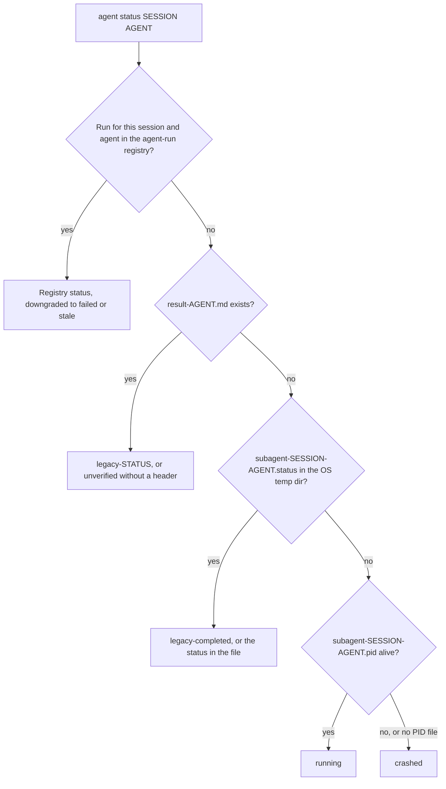

# CLI 옵션

## 빠른 참조 {#quick-reference}

| 하고 싶은 일 | 사용할 것 |
|:-------------|:----|
| 프롬프트 없이 실행 | `-y` / `--yes` (`OMA_YES=1`, `CI=true`도 인식). 일반 텍스트 비대화형 출력이 필요하면 `oma update --ci` |
| JSON 받기 | `--json`, `--output json`, 또는 `OH_MY_AG_OUTPUT_FORMAT=json`. 예외는 [출력 옵션](#output-options) 참조 |
| 글로벌 설치를 대상으로 지정 | `-g` / `--global`, 또는 `OMA_INSTALL_GLOBAL=1`. `OMA_HOME`으로 글로벌 저장소 루트를 옮길 수 있음 |
| 변경 전에 미리보기 | 명령이 제공하는 경우 `--dry-run`. [JSON을 지원하는 명령](#commands-supporting-json-output) 참조 |
| 명령의 플래그 확인 | `oma <command> --help`, `oma describe "<command>"`, 또는 이 페이지 끝의 [레지스트리](#complete-public-option-registry) |
| 업그레이드 후 깨진 스크립트 고치기 | [이름이 바뀐 명령과 옵션](#renamed-commands-and-options) |
| 스크립트에서 실패 유형별로 분기 | [종료 코드](#exit-codes) |

---

## 전역 옵션 {#global-options}

이 옵션은 루트 `oma` / `oh-my-agent` 명령에서 사용할 수 있습니다:

| 플래그 | 설명 |
|:-------|:-----|
| `-g, --global` | `<cwd>/.agents/` 대신 OMA 글로벌 설치(`~/.oma/.agents/` 또는 `$OMA_HOME/.agents/`)를 대상으로 동작 |
| `-y, --yes` | 선택한 명령이 확인을 지원하는 경우 프롬프트를 건너뜁니다. 명령별 안전 검사는 계속 적용됩니다. `OMA_YES=1`과 `CI=true`도 인식합니다 |
| `-V, --version` | 버전 번호를 출력하고 종료 |
| `-h, --help` | 명령에 대한 도움말 표시 |

모든 서브커맨드도 `-h, --help`를 지원하여 해당 명령의 도움말 텍스트를 표시합니다.

`--global`은 프로세스 전체의 설치 루트를 정하므로, `install`, `update`, `link`, `uninstall`은 현재 디렉토리와 관계없이 글로벌 설치를 대상으로 합니다:

| 모드 | 선택 방법 | `.agents/` 위치 |
|:-----|:-----------------|:--------------------|
| 프로젝트 (기본값) | 지정하지 않음 | `<cwd>/.agents/` |
| 글로벌 | `--global` 또는 `OMA_INSTALL_GLOBAL=1` | `$OMA_HOME/.agents/` (기본값 `~/.oma/.agents/`) |

`OMA_HOME=<abs-path>`는 글로벌 저장소 루트를 바꾸며, 절대 경로여야 합니다. 프로젝트 설치는 여전히 cwd를 사용합니다. 해석된 위치를 보려면 `oma home --json`을, 레거시 데이터 마이그레이션을 미리 보려면 `oma home migrate --dry-run`을 실행하세요. [글로벌 설치](../guide/global-install.md)를 참고하세요.

---

## 이름이 바뀐 명령과 옵션 {#renamed-commands-and-options}

명령 경로는 콜론이 아니라 공백으로 구분하며, 여러 명령과 옵션의 이름이 바뀌었습니다. 예전 표기는 별칭으로 처리되지 않고 거부됩니다:

- 예전 명령은 `Unknown command: ... Use oma --help.` 또는 `Unexpected argument for oma <group>. Use --help.`로 실패합니다.
- 그룹 이름만 쓴 `dashboard`, `state`, `stats`는 이제 실행되지 않고 해당 그룹의 도움말을 출력합니다.
- 예전 옵션은 `Removed option <old>. Use <new>.`로 실패합니다. 제거된 `state`와 `stats`의 동작 플래그는 `Removed option <old>. Use an explicit action; see oma --help.`로 실패합니다.

`schedule:run`과 `serena daemon:gc`만 계속 해석되므로, 이전 버전이 작성한 OS 스케줄러 항목은 그대로 동작합니다.

| 예전 명령 | 현재 사용할 것 |
|:------------|:--------|
| 모든 `a:b` 콜론 경로 (`agent:spawn`, `state:emit`, ...) | 공백으로 구분한 경로 (`agent spawn`, `state emit`) |
| `dashboard`, `dashboard:web` | `dashboard terminal`, `dashboard web` |
| `hook --vendor ...` | `hook run --vendor ...` |
| `intel run` | `intel suggest` |
| `state`, `state:get <id>` | `state list`, `state get <id>` |
| `state --activate` / `--archive` / `--purge` | `state activate` / `state archive` / `state purge` |
| `state:required-decisions` | `state decisions list` |
| `state:inject-log ... --entry <file>` | `state inject-log list`, `state inject-log get <session-id> <file>` |
| `stats`, `stats --reset` | `stats get`, `stats reset` |
| `memory:retry-drain` | `memory retry drain` |
| `vault rm` | `vault delete` |
| `search api <url>`, `search rss <url>` | `search api fetch <url>`, `search rss fetch <url>` |
| `search api:search`, `search rss:google` | `search api search`, `search rss google` |
| `skills audit` / `lint` / `eval` / `promotions` / `rollback` / `procedure` / `meta-optimize` / `evolution-stats` | `skill ...` (단수형. `skills matrix`만 복수형 유지) |
| `skills opt` | `skill optimize` |
| `slide new`, `slide viewer` | `slide create`, `slide preview` |
| `slide pdf` / `png` / `pptx` | `slide export pdf` / `png` / `pptx` |
| `slide import-pptx`, `slide fetch-video`, `slide styles ...` | `slide import pptx`, `slide asset fetch-video`, `slide style ...` |
| `image list-vendors`, `video list-providers` | `image vendor list`, `video provider list` |
| `schedule:add`, `schedule:remove` | `schedule create`, `schedule delete` |
| `verify <agent-type>` | `verify agent <agent-type>` |

| 예전 옵션 | 현재 사용할 것 |
|:-----------|:--------|
| `-m, --model <vendor>` | `--vendor <vendor>` |
| `-r, --root <path>` | `--project-root <path>` |
| `--sid`, `--session` | `--session-id <id>` |
| `--format <fmt>` | `--output <format>` (`search media --format`은 바뀌지 않음) |
| `--out <dir>`, `--out-dir` | `--output-dir <path>` |
| `--out <file>`, `--out-file` | `--output-file <path>`. `slide validate`와 `explain validate`에서는 `--report-file <path>` |
| `--dir` | `slide` 명령에서는 `--workspace <path>`, `slide create`에서는 `--output-dir <path>`, `explain validate`에서는 `--input-dir <path>` |
| `--max` | `scholar search`에서 `--limit <n>` |
| `--allow-external-out` | `--allow-external-output` |
| `--timeout <seconds>`, `--timeout <ms>`, `--timeout-minutes` | `--timeout <duration>` (`30s`, `2m`). 예전 값이 밀리초나 분 단위였던 곳에서는 단위가 필수 |
| `--max-age-days` | `--max-age <duration>`. `schedule create`에서는 `--expires-after <duration>` |

---

## 출력 옵션 {#output-options}

많은 명령이 CI/CD 파이프라인과 자동화를 위한 기계 판독 가능한 출력을 지원합니다. JSON 출력을 요청하는 방법은 세 가지입니다.

### 1. --json 플래그

```bash
oma stats get --json
oma doctor --json
oma cleanup --json
```

`--json` 플래그는 해당 플래그를 제공하는 경로에서만 사용할 수 있습니다. 명령 계열만 보고 지원 여부를 추정하지 마세요. 예를 들어 `image`, `video`, `slide`의 leaf 경로는 레지스트리에 등록된 곳에서 `--output`을 제공하고, `search`는 항상 JSON을 출력합니다.

### 2. --output 플래그

```bash
oma stats get --output json
oma doctor --output text
```

대부분의 명령에서 `--output`은 `text` 또는 `json`을 받습니다. `--json`과 동일한 기능을 제공하지만 텍스트 출력도 명시적으로 요청할 수 있어, 환경 변수가 `json`으로 설정되어 있을 때 유용합니다.

**유효성 검사:** 잘못된 형식이 제공되면 CLI가 다음 오류를 발생시킵니다: `Invalid output format: {value}. Expected one of text, json`.

### 3. OH_MY_AG_OUTPUT_FORMAT 환경 변수

```bash
export OH_MY_AG_OUTPUT_FORMAT=json
oma stats get # outputs JSON
oma doctor # outputs JSON
oma retro # outputs JSON
```

이 환경 변수를 `json`으로 설정하면 이를 지원하는 명령에서 JSON이 기본 출력이 됩니다. `json`만 인식되며, 다른 값은 무시되고 출력은 텍스트로 유지됩니다.

### 형식 결정 방식

명령줄 플래그가 환경 변수보다 우선합니다. `--json`과 JSON이 아닌 `--output`을 함께 전달하면 우선순위로 처리되지 않고 오류가 됩니다.

| 전달한 값 | 변수 미설정 | `OH_MY_AG_OUTPUT_FORMAT=json` |
|:---------|:---------------|:------------------------------|
| 없음 | text | JSON |
| `--json` 또는 `--output json` | JSON | JSON |
| `--output text` | text | text |
| `--json --output text` | 오류: `--json conflicts with --output. Choose one output format.` | 같은 오류 |

일부 명령은 고유한 형식 값을 사용합니다:

| 명령 | 형식 제어 |
|:---------|:---------------|
| `search ...` | 항상 JSON. `--pretty`는 들여쓰기만 바꿈. `search providers`와 `search web`은 `--json`도 받음 |
| `describe` | 항상 JSON |
| `image ...`, `video ...` | `--output text\|json` (기본값 `text`) |
| `slide validate` | `--output json\|concise` (기본값 `concise`) |
| `explain validate` | `--output concise\|json` (기본값 `concise`) 또는 `--json` |
| `hook probe` | `--output text\|md\|json` |

### JSON을 지원하는 명령 {#commands-supporting-json-output}

`--json`이나 `--output`을 받는 모든 명령은 `oma describe`에서 `supportsJsonOutput: true`로 표시되며, 이 페이지 끝의 [레지스트리](#complete-public-option-registry)에 경로별 플래그가 나열되어 있습니다. 플래그 없이 항상 JSON을 출력하는 명령(`describe`와 대부분의 `search` 서브커맨드)은 표시되지 않습니다. CLI에서 해당 경로를 나열하려면:

```bash
oma describe | jq -r '.. | objects | select(.supportsJsonOutput? == true) | .path'
```

`--dry-run`을 지원하는 명령을 찾을 때도 같은 방식으로 `select(.supportsDryRun? == true)`를 사용하세요.

---

## 명령별 옵션

### install

```text
oma install [--web-search <provider>] [--code-intelligence <provider>] [--semantic-memory <provider>] [--honcho-url <url>] [--honcho-workspace <id>]
```

대화형 설치기는 선택한 프로바이더 설정을 `.agents/oma-config.yaml`에 기록합니다. 프로바이더 플래그는 web-search, code-intelligence, semantic-memory 통합을 선택하며 `--honcho-url`과 `--honcho-workspace`는 해당 프로바이더를 선택했을 때 Honcho 메모리 서비스를 설정합니다. 설치 과정에서 확인을 요청하면 루트 `-y, --yes` 플래그가 적용됩니다.

### doctor

```text
oma doctor [--json] [--output <format>] [--profile] [--heal-check <agentType>]
```

| 플래그 | 설명 | 기본값 |
|:-------|:-----|:-------|
| `--json` | 형식이 지정된 텍스트 대신 JSON으로 출력합니다. | `false` |
| `--output <format>` | 출력 형식을 명시적으로 지정합니다 (`text` 또는 `json`). [출력 옵션](#output-options) 참조. | `text` |
| `--profile` | 프로필 헬스 매트릭스를 표시합니다. 활성화된 `model_preset`과 `agents:` 오버라이드를 기준으로 에이전트별 해석된 모델 슬러그, CLI, 인증 상태를 보여줍니다. [에이전트별 모델](../guide/per-agent-models.md) 참조. | `false` |
| `--heal-check <agentType>` | 에이전트의 self-healing 게이트 검사를 포함합니다. | |

`--json`을 사용하면 보고서에 최상위 `ok`와 `issues` 필드가 포함되며, `issues`가 0보다 크면 `doctor`는 `1`로 종료합니다.

### update

```text
oma update [-f | --force] [--with-new-skills] [--ci] [-y | --yes] [--all] [--vendor <vendors>]
oma update mcp [-y | --yes] [--ci] [--all] [--vendor <vendors>]
```

| 플래그 | 축약 | 설명 | 기본값 |
|:-------|:-----|:-----|:-------|
| `--force` | `-f` | 업데이트 중 사용자가 커스터마이즈한 설정 파일을 덮어씁니다. 대상: `oma-config.yaml`, `mcp.json`, `stack/` 디렉토리. 이 플래그가 없으면 해당 파일은 업데이트 전에 백업되었다가 이후 복원됩니다. | `false` |
| `--with-new-skills` | | 현재 설치 뒤 레지스트리에 추가된 스킬을 설치합니다. | `false` |
| `--ci` | | 비대화형 CI 모드로 실행합니다. 모든 확인 프롬프트를 건너뛰고, 스피너와 애니메이션 대신 일반 콘솔 출력을 사용합니다. stdin을 사용할 수 없는 CI/CD 파이프라인에 필요합니다. | `false` |
| `--yes` | `-y` | 프롬프트를 건너뜁니다. `--all`이나 `--vendor`와 함께 쓰지 않으면 없는 벤더 디렉토리를 만들지 않습니다. | `false` |
| `--all` | | 지원하는 모든 프로젝트 범위 벤더를 만들거나 업데이트합니다. | `false` |
| `--vendor <vendors>` | | 쉼표로 구분한 벤더 목록을 만들거나 업데이트합니다. 예: `claude,qwen`. | 이미 있는 벤더 디렉토리만 |

`oma update mcp`는 같은 `--yes`, `--ci`, `--all`, `--vendor` 제어를 사용해 브라우저 MCP 서버를 선택합니다. `--force`나 `--with-new-skills`는 사용하지 않습니다.

**--force 사용 시 동작:**
- `oma-config.yaml`이 레지스트리 기본값으로 대체됩니다.
- `mcp.json`이 레지스트리 기본값으로 대체됩니다.
- 백엔드 `stack/` 디렉토리(언어별 리소스)가 대체됩니다.
- 이 플래그에 관계없이 다른 모든 파일은 항상 업데이트됩니다.

**--ci 사용 시 동작:**
- 시작 시 `console.clear()` 없음.
- `@clack/prompts`가 일반 `console.log`로 대체됨.
- 경쟁 도구 감지 프롬프트 건너뛰기.
- `process.exit(1)` 호출 대신 오류를 throw.

**벤더 범위:**
- `oma update`는 이미 존재하는 벤더 디렉토리만 업데이트합니다.
- `oma update --yes`는 같은 벤더 범위를 쓰며 프롬프트만 건너뜁니다.
- `oma update --all`은 지원하는 모든 프로젝트 범위 벤더를 만들거나 업데이트합니다.
- `oma update --vendor claude,qwen`은 나열한 벤더만 만들거나 업데이트합니다.

### stats

```text
oma stats get [--json | --output <format>]
oma stats reset [--json | --output <format>]
```

| 플래그 | 설명 | 기본값 |
|:-------|:-----|:-------|
| `--json` | JSON으로 출력합니다. `stats get`은 메트릭 객체를, `stats reset`은 `{"reset":true}`를 출력합니다. | `false` |
| `--output <format>` | `text` 또는 `json`으로 출력합니다. | `text` |

`oma stats reset`이 reset 명령이며, `oma stats get --reset`은 `Removed option --reset`으로 실패합니다.

:::note
`stats get`은 읽기 전용이 아닙니다. 호출할 때마다 세션 하나로 집계되고 최근 10개 커밋의 diff가 `.agents/state/metrics.json`의 누적 파일·줄 카운터에 더해지므로, 폴링하지 마세요.
:::

### retro

```text
oma retro [window] [--json] [--output <format>] [--interactive] [--compare]
```

| 플래그 | 설명 | 기본값 |
|:-------|:-----|:-------|
| `--interactive` | 레거시 안내형 입력입니다. 달성한 일, 주요 배운 점, 다음 단계를 묻습니다. window, `--compare`, `--json`은 무시합니다. | `false` |
| `--compare` | 현재 시간 범위를 이전 동일 기간과 비교합니다. 변동 메트릭을 표시합니다 (예: 커밋 +12, 추가된 줄 -340). | `false` |

**window 인자 형식:** 숫자 뒤에 `h`, `d`, `w` 중 하나를 붙입니다.
- `24h`: 24시간
- `7d`: 7일
- `2w`: 2주
- 생략 시 기본값 (7일)

월 단위는 지원하지 않습니다. `oma retro 1m`은 `Invalid window: 1m. Use: 24h, 7d, 14d, 30d, 2w`로 실패합니다.

### cleanup

```text
oma cleanup [--dry-run] [-y | --yes] [--json] [--output <format>]
```

| 플래그 | 축약 | 설명 | 기본값 |
|:-------|:-----|:-----|:-------|
| `--dry-run` | | 미리보기 모드. 정리할 모든 항목을 나열하지만 변경하지 않습니다. 결과에 관계없이 종료 코드 0. | `false` |
| `--yes` | `-y` | 모든 확인 프롬프트를 건너뜁니다. 묻지 않고 모든 것을 정리합니다. 스크립트와 CI에 유용합니다. | `false` |

**정리 대상:**
1. 고아 PID 파일: 참조된 프로세스가 더 이상 실행되지 않는 `/tmp/subagent-*.pid`.
2. 고아 로그 파일: 죽은 PID에 매칭되는 `/tmp/subagent-*.log`.
3. Gemini Antigravity 디렉토리: `.gemini/antigravity/brain/`, `.gemini/antigravity/implicit/`, `.gemini/antigravity/knowledge/`. 이 디렉토리는 시간이 지남에 따라 상태가 누적되어 커질 수 있습니다.

### agent spawn

```text
oma agent spawn <agent-id> <prompt> <session-id> [options]
```

| 플래그 | 축약 | 설명 | 기본값 |
|:-------|:-----|:-----|:-------|
| `--resumed-from` | — | 재시도를 선행 run ID에 연결합니다. | |
| `--fallback-vendors` | — | 쉼표로 구분한, 순서가 있는 명시적 벤더 폴백 체인입니다. | |
| `--task-id` | — | 세션 계획의 태스크 ID입니다. | 에이전트 ID |
| `--vendor` | — | CLI 벤더 오버라이드. `--help`에는 `antigravity`, `claude`, `codex`, `cursor`, `opencode`, `qwen`, `grok`, `pi`가 나열됩니다. | 설정에서 해석 |
| `--workspace` | `-w` | 에이전트의 작업 디렉토리. 생략하거나 `.`로 설정하면 CLI가 모노레포 설정 파일(pnpm-workspace.yaml, package.json, lerna.json, nx.json, turbo.json, mise.toml)에서 워크스페이스를 자동 감지합니다. | 자동 감지 또는 `.` |
| `--isolation` | — | 격리 모드입니다. `worktree`는 스폰마다 git 워크트리를 만들며, 기본값은 `none`입니다. | `none` |
| `--read-only` | — | 스폰된 에이전트를 비파괴 도구로 제한하고 자동 승인 플래그를 억제합니다. | `false` |

**유효성 검사:**
- `agent-id`와 `session-id`는 `..`, `?`, `#`, `%`, 또는 제어 문자를 포함해서는 안 됩니다. `agent spawn`에는 고정된 에이전트 ID 목록이 없습니다. 모델과 벤더 라우팅은 `orchestrator`, `architecture`, `qa`, `pm`, `backend`, `frontend`, `mobile`, `db`, `debug`, `refactor`, `docs`, `tf-infra`, `explore`와 함께 `backend-engineer`, `qa-reviewer`, `research-explorer` 같은 별칭을 인식합니다.
- `--vendor`는 oma 벤더 ID여야 합니다: `antigravity`, `claude`, `codex`, `commandcode`, `copilot`, `cursor`, `grok`, `hermes`, `kimi`, `kiro`, `opencode`, `pi`, `qwen`, `zcode`. 아래 표는 `--help`에 나오는 8개 벤더를 다룹니다.

**벤더별 동작:**

| 벤더 | 명령 | 자동 승인 플래그 | 프롬프트 플래그 |
|:-----|:-----|:---------------|:-------------|
| antigravity | `agy` | `--dangerously-skip-permissions` | `-p` |
| claude | `claude` | (없음) | `-p` |
| codex | `codex` | `--sandbox workspace-write` | (없음, 프롬프트는 위치 인자) |
| cursor | `cursor-agent` | 벤더별 | `-p` |
| opencode | `opencode` | 벤더별 | `-p` |
| qwen | `qwen` | `--yolo` | `-p` |
| grok | `grok` | 벤더별 | `-p` |
| pi | `pi` | `--read-only` 모드에서는 억제 | 프롬프트는 위치 인자 |

이 기본값은 `.agents/skills/oma-orchestration/config/cli-config.yaml`에서 오버라이드할 수 있습니다.

Codex는 workspace-write 샌드박스를 유지합니다. oma는 네트워크 접근을 활성화하고, 프로젝트 루트, OMA 상태 홈(`~/.oma`), 기존 패키지 매니저 캐시를 쓰기 가능한 디렉토리로 추가합니다. `oma update`는 `cli-config.yaml`을 교체하므로 오래 유지할 모드는 `OMA_CODEX_SANDBOX`로 설정하세요. 값은 `read-only`, `workspace-write`(기본값), `danger-full-access`(샌드박스도 승인도 없음) 중 하나입니다.

### agent status

```text
oma agent status <session-id> [agent-ids...] [--project-root <path>]
```

| 플래그 | 설명 | 기본값 |
|:-------|:-----|:-------|
| `--project-root <path>` | agent-run 레지스트리와 `.agents/state/memories/result-{agent}.md` 파일을 읽을 프로젝트입니다. `-r`과 `--root`는 제거되었으며 `Removed option -r. Use --project-root.`로 실패합니다. | 현재 작업 디렉토리 |

이 명령은 요청한 에이전트마다 `{agent-id}:{status}` 한 줄을 출력합니다. 각 에이전트에 대해 존재하는 첫 번째 소스를 사용합니다:



| 상태 | 의미 |
|:-------|:--------|
| `running`, `completed`, `partial`, `blocked`, `failed` | agent-run 레지스트리에 기록된 상태 |
| `failed` | 등록된 실행이 `running`이지만 실행 프로세스가 사라진 경우에도 보고됨 |
| `stale` | 등록된 실행이 `completed`이지만 결과 증거가 더 이상 검증되지 않음 |
| `legacy-<status>` | 등록된 실행이 없고, `result-{agent}.md`에 `## Status: <status>` 헤더가 있음 |
| `unverified` | 등록된 실행이 없고, `result-{agent}.md`에 상태 헤더가 없음 |
| `legacy-completed` | 실행도 결과 파일도 없고, 세션의 `.status` 파일이 `completed`라고 기록함 (다른 값은 그대로 출력) |
| `crashed` | 아무것도 찾지 못했거나, 레거시 PID 파일이 죽은 프로세스를 가리킴 |

실행이 기록되는 방식은 [에이전트 결과 및 재개](../guide/agent-results-and-resume.md)를 참고하세요.

### agent parallel

```text
oma agent parallel [tasks...] [--session-id <id>] [--vendor <vendor>] [-i | --inline] [--no-wait]
```

| 플래그 | 축약 | 설명 | 기본값 |
|:-------|:-----|:-----|:-------|
| `--session-id <id>` | — | 스폰되는 모든 실행의 세션 ID입니다. `oma agent status`에도 같은 ID를 전달하세요. | 실행 디렉토리 이름, `parallel-<timestamp>-<suffix>` |
| `--vendor` | — | 모든 생성된 에이전트에 적용되는 CLI 벤더 오버라이드. | 설정에서 에이전트별로 해석 |
| `--inline` | `-i` | 태스크 인자를 파일 경로가 아닌 `agent:task[:workspace]` 문자열로 해석합니다. | `false` |
| `--no-wait` | | 백그라운드 모드. 모든 에이전트를 시작하고 완료를 기다리지 않고 즉시 반환합니다. PID 목록과 로그는 `.agents/results/parallel-<timestamp>-<suffix>/`에 저장됩니다. | `false` (완료 대기) |

**인라인 태스크 형식:** `agent:task` 또는 `agent:task:workspace`
- 콜론으로 구분된 마지막 세그먼트가 `./` 또는 `/`로 시작하거나 `.`인 경우 워크스페이스로 감지합니다.
- 예시: `backend:Implement auth API:./api` -- agent=backend, task="Implement auth API", workspace=./api.
- 예시: `frontend:Build login page` -- agent=frontend, task="Build login page", workspace=자동 감지.

**YAML 태스크 파일 형식:**

```yaml
tasks:
  - id: api            # optional; default <agent>-<index>
    agent: backend
    task: "Implement user API"
    workspace: ./api   # optional; auto-detected when omitted
  - agent: frontend
    task: "Build user dashboard"
```

### recap

```text
oma recap [--window <period>] [--date <date>] [--tool <tools>] [--top <n>] [--sort <metric>] [--mermaid] [--graph] [--json] [--output <format>]
```

| 플래그 | 설명 | 기본값 |
|:-------|:-----|:-------|
| `--window <period>` | `<n>h`, `<n>d`, `<n>w` 형식의 시간 범위입니다 (예: `1d`, `3d`, `7d`, `2w`, `30d`). 30일을 넘는 값은 경고와 함께 30일로 제한됩니다. `--date`가 설정되면 무시됩니다. | `1d` |
| `--date <date>` | 특정 날짜 (`YYYY-MM-DD`). `--window`보다 우선합니다. | |
| `--tool <tools>` | 도구별로 세션을 필터링합니다. 쉼표로 구분: `antigravity`, `claude`, `codex`, `cursor`, `gemini`, `grok`, `qwen`. | 모든 도구 |
| `--top <n>` | 요약에서 상위 N개의 프로젝트/주제만 표시합니다. | 무제한 |
| `--sort <metric>` | 세션을 `count` 또는 `duration` 기준으로 정렬합니다. | `count` |
| `--mermaid` | 기본 요약 대신 Mermaid Gantt 차트를 출력합니다. `--json`이 우선합니다. | `false` |
| `--graph` | 웹 대시보드(`/recap`)에서 인터랙티브 그래프를 엽니다. `--mermaid`와 `--json`보다 우선합니다. | `false` |

### search

```text
oma search <subcommand> [...]
```

모든 `search` 서브커맨드는 플래그 없이도 stdout에 JSON을 씁니다. `providers`와 `web`은 `--json`도 받습니다. `--output`을 받는 서브커맨드는 없습니다. `--pretty`는 들여쓰기만 바꿉니다.

| 서브커맨드 | 주요 옵션 |
|:-----------|:---------|
| `providers` | `--json`, `--pretty` |
| `web <query>` | `--provider <id>`, `--limit <n>` (기본값 `10`), `--timeout <duration>` (기본값 `15s`), `--json`, `--pretty` |
| `fetch <url>` | `--only`, `--skip`, `--include-archive`, `--timeout <duration>` (기본값 `15s`), `--locale`, `--pretty` |
| `meta <url>` / `archive <url>` / `api fetch <url>` / `rss fetch <url>` | `--timeout <duration>` (기본값 `15s`), `--locale` (기본값 `en-US,en;q=0.9`), `--pretty` |
| `api search <query>` | `--platforms <list>`, `--timeout <duration>`, `--locale`, `--pretty` |
| `rss google <query>` | `--locale` (기본값 `en-US`) |
| `media <url>` | `--subs`, `--sub-lang <list>` (기본값 `en`), `--format <spec>`, `--timeout <duration>` (기본값 `30s`), `--pretty` |
| `code <query>` | `--host <github\|gitlab>` (기본값 `github`), `--language`, `--repo`, `--limit` (기본값 `20`), `--pretty` |
| `trust <domain>` | `--pretty` |
| `doctor` | 없음 (Chrome / `python3 curl_cffi` / `yt-dlp` / `gh` 바이너리 점검을 실행) |

`search`는 공통 종료 코드 체계를 사용합니다. [종료 코드](#exit-codes)를 참고하세요.

### image

```text
oma image <subcommand> [...]
```

출력 형식은 서브커맨드별 `--output <text|json>`으로 제어합니다.

`image generate`가 받는 옵션입니다:

| 플래그 | 축약 | 설명 | 기본값 |
|:-------|:-----|:-----|:-------|
| `--vendor <name>` | | `auto` \| `pollinations` \| `codex` \| `antigravity` \| `all`. `auto`는 활성 `image:` 설정과 사용 가능한 인증에서 해석합니다. | `auto` |
| `--size <size>` | | 양쪽이 16으로 나누어지는 `WxH`, 각 변 16~3840, 종횡비 1:3~3:1 또는 `auto`. | 벤더 기본값 |
| `--quality <level>` | | `low` \| `medium` \| `high` \| `auto`. | 벤더 기본값 |
| `--count <n>` | `-n` | 이미지 개수, 1..5. | `1` |
| `--output-dir <dir>` | | 출력 디렉토리입니다. `--allow-external-output`이 없으면 `$PWD` 안에 있어야 합니다. | `.agents/results/images/{timestamp}/` |
| `--allow-external-output` | | `$PWD` 밖의 `--output-dir` 경로를 허용합니다. | `false` |
| `--model <name>` | | 벤더별 모델 오버라이드입니다. antigravity 모델은 `agy`가 선택합니다. | 벤더 기본값 |
| `--timeout <duration>` | | duration 값으로 지정하는 이미지당 타임아웃입니다. | 벤더 기본값 |
| `--reference <path>` | `-r` | 스타일/주제 전이를 위한 참조 이미지입니다. 반복 지정(`-r a.png -r b.png`) 또는 쉼표 구분이 가능합니다. 크기(≤5MB), 형식(매직 바이트로 PNG/JPEG/GIF/WebP), 개수(≤10)를 검증합니다. `codex`와 `antigravity`에서 지원하며 `pollinations`에서는 종료 코드 4로 거부됩니다. | |
| `--yes` | `-y` | 비용 확인 프롬프트를 건너뜁니다. | `false` |
| `--no-prompt-in-manifest` | | `manifest.json`에 원문 대신 프롬프트의 SHA256을 저장합니다. | `false` |
| `--dry-run` | | 계획과 비용 추정치만 출력하고 실행하지 않습니다. | `false` |
| `--output <format>` | | `text` \| `json`. | `text` |

`image doctor`와 `image vendor list`는 `--output <text|json>`을 받습니다. 벤더를 확인하려면 `image vendor list`를 사용하세요. 예전 표기인 `image list-vendors`는 실패합니다.

### video

```text
oma video generate <brief...> [options]
oma video doctor [--output <format>] [--install|--upgrade|--install-mpt|--install-strudel]
oma video compose <run-dir> [--output <format>] [--refresh] [--offline]
oma video render <run-dir> [--output <format>]
oma video provider list [--output <format>]
```

`video generate`는 계획 및 캡처 제어 옵션인 `--mode`, `--aspect`, `--locale`, `--captions`, `--visual`, `--voice`, `--music`, `--duration`, `--compositor`, `--capture`, `--source`, `--url`, `--device`, `--ready-selector`, `--show-cursor`, `--polish`, `--capture-timeout`, `--capture-stop`을 받습니다. 또한 `--output-dir`, `--allow-external-output`, `--max-usd`, `--seed`, `--timeout`, `--script`, `--dry-run`, `--yes`, `--output`, `--no-brief-in-manifest`를 받습니다. 브라우저 캡처에는 `--source web --url <url>`을 사용하고, 기본 source는 `file`입니다. 일반 렌더링에는 작성된 컴포지션과 동작하는 compositor가 필요하며 placeholder는 `OMA_VIDEO_MOCK=1` 테스트 경로에만 제한됩니다.

`video doctor`는 HyperFrames/MPT/Strudel 도구 체인을 보고하거나 준비합니다. `compose`는 실행의 컴포지션 계약을 준비하고 `render`는 lint, 렌더링, 출력 검사를 수행합니다. `provider list`는 프로바이더와 키 상태를 보고합니다. 실행 매니페스트와 복구 순서는 [영상 생성](../guide/video-generation.md)을 참고하세요.

### memory init

```text
oma memory init [--json] [--output <format>] [--force]
```

| 플래그 | 설명 | 기본값 |
|:-------|:-----|:-------|
| `--force` | `.agents/state/memories/`의 비어 있거나 기존 스키마 파일을 덮어씁니다. 이 플래그가 없으면 기존 파일은 수정되지 않습니다. | `false` |

### verify

```text
oma verify agent <agent-type> [-w <workspace>] [--session-id <id>] [--task-id <id>] [--run-id <id>] [--json] [--output <format>]
oma verify triggers [--corpus <path>] [--max-false-fire <pct>] [--max-missed-fire <pct>] [--json] [--output <format>]
```

| 플래그 | 축약 | 설명 | 기본값 |
|:-------|:-----|:-----|:-------|
| `--workspace` | `-w` | 검증할 워크스페이스 디렉토리 경로. | 현재 작업 디렉토리 |
| `--session-id <id>` | | 세션의 계획과 보고서를 선택합니다. 여러 계획이 있으면 실행 기록에서 세션을 확인할 수 있거나 이 옵션을 지정해야 합니다. | |
| `--task-id <id>` | | 태스크 하나의 범위와 보고서를 선택합니다. `--session-id` 또는 `--run-id`가 필요합니다. | |
| `--run-id <id>` | | 해당 실행의 보고서를 선택합니다. 로컬 실행 기록에서 세션·태스크 ID를 확인하며, 기록이 없으면 두 ID를 직접 지정해야 합니다. | |

**에이전트 타입:** `backend`, `frontend`, `mobile`, `qa`, `debug`, `pm`.

`verify triggers`는 라벨이 붙은 corpus에서 키워드 감지 정확도를 측정합니다. 백분율 임계값은 게이트이며 CI 작업에서 개별 결과를 확인하려면 JSON 출력을 사용합니다. 예전 `oma verify <agent-type>` 표기는 실패하므로 `verify agent <agent-type>`을 사용하세요.

---

## 종료 코드 {#exit-codes}

**공통 체계 (`image`, `video`, `search`):**

| 코드 | 의미 |
|:-----|:--------|
| `0` | 성공 |
| `1` | 일반 오류 |
| `2` | 차단됨, 또는 프로바이더의 안전 정책 거부 |
| `3` | 찾을 수 없음 |
| `4` | 잘못된 입력 |
| `5` | 인증 필요, 또는 프로바이더 바이너리가 설치되지 않음 |
| `6` | 타임아웃 |

**명령별:**

| 명령 | 코드 |
|:--------|:------|
| `doctor --json` | `0` 문제 없음, `1` 문제가 하나 이상 있음 |
| `verify agent` | `0` 모든 검사 통과, `1` 검사 실패 또는 잘못된 에이전트 타입, `2` 워크스페이스를 찾을 수 없음 |
| `verify triggers` | `0` 임계값 이내, `1` 임계값 초과 |
| `docs verify` | `1` 깨진 참조 발견 |
| `vault get` | `1` 잘못된 키 이름, `2` 해당 항목 없음 |

---

## 실전 예제

### CI 파이프라인: 업데이트 및 검증

```bash
# Update in CI mode, then fail the job when doctor reports any issue
oma update --ci
oma doctor --json | jq -e '.ok' > /dev/null
```

### 상태 모니터링을 활용한 배치 에이전트 실행

```bash
# Choose the session ID first and pass it to both commands
SESSION_ID="session-$(date +%Y%m%d-%H%M%S)"
oma agent parallel tasks.yaml --session-id "$SESSION_ID" --no-wait

# Check status every 5 seconds
watch -n 5 "oma agent status $SESSION_ID backend frontend mobile"
# Without `watch` (stock macOS), loop instead:
# while sleep 5; do oma agent status "$SESSION_ID" backend frontend mobile; done
```

### 테스트 후 CI에서 정리

```bash
# Clean up all orphaned processes without prompts
oma cleanup --yes --json
```

### 워크스페이스 인식 검증

```bash
# Verify each domain in its workspace
oma verify agent backend -w ./apps/api
oma verify agent frontend -w ./apps/web
oma verify agent mobile -w ./apps/mobile
```

### 스프린트 리뷰를 위한 비교 회고

```bash
# Two-week sprint retro with comparison to previous sprint
oma retro 2w --compare
```

### 전체 상태 검사 스크립트

```bash
#!/usr/bin/env bash
set -euo pipefail

echo "=== oh-my-agent Health Check ==="

report="$(mktemp)"
# doctor exits 1 when it finds issues; keep the report and continue
oma doctor --json > "$report" || true

# Check CLI installations
jq -r '.clis[] | "\(.name): \(if .installed then "OK (\(.version // "unknown"))" else "MISSING" end)"' "$report"
jq -r '"Issues: \(.issues)"' "$report"

# Check auth status (an object of booleans keyed by github and each vendor ID)
oma auth status --json | jq -r 'to_entries[] | "\(.key): \(if .value then "authenticated" else "not authenticated" end)"'

echo "=== Done ==="
```

### 에이전트 인트로스펙션을 위한 describe

```bash
# An AI agent can discover available commands
oma describe | jq '.command.subcommands[] | {name, description}'

# Get details about a specific command
oma describe "agent spawn" | jq '.command.options[] | {flags, description}'
```

---

## 전체 공개 옵션 레지스트리 {#complete-public-option-registry}

각 행은 단독으로 실행되는 명령 경로입니다. 도움말만 출력하는 그룹은 생략했으며, 공통 루트 플래그는 [전역 옵션](#global-options)에서 설명합니다. 기본값은 해당 옵션 옆에 표시됩니다. 경로 하나의 전체 JSON은 `oma describe "<path>"`로 확인하세요.

:::note
이 표는 `oma describe`에서 생성됩니다. 직접 편집하지 마세요. 다시 생성하려면 `node cli/scripts/generate-cli-reference.mjs`를 실행하고, 표가 오래되었을 때 실패하게 하려면 `--check`를 추가하세요.
:::

<!-- oma:generated cli-registry:start -->

| Command | Arguments | Options | Description |
|:--|:--|:--|:--|
| `agent begin` | `<agent-id> <task-id> <session-id>` | `--project-root <path>`, `-w, --workspace <path>` | Start an evidence-backed native agent run |
| `agent context` | `<agent-id>` | `--project-root <path>`, `--difficulty <level>` (default: `Medium`) | Load graph-selected context for a native dispatch prompt |
| `agent finish` | `<run-id> <result-file>` | `--project-root <path>` | Validate a native agent result against its verification receipts |
| `agent parallel` | `[tasks...]` | `--session-id <id>`, `--vendor <vendor>`, `-i, --inline`, `--no-wait` | Run multiple sub-agents in parallel |
| `agent parallel-supervisor` | `<manifest>` | — | — |
| `agent resume` | `<session-id>` | `--project-root <path>`, `--dry-run`, `--max-attempts <count>` (default: `3`) | Resume safe incomplete tasks, reusing current acceptance evidence |
| `agent review` | — | `--vendor <vendor>`, `-p, --prompt <prompt>`, `-w, --workspace <path>`, `--no-uncommitted` | Run code review using external CLI (codex/claude/qwen/grok) |
| `agent spawn` | `<agent-id> <prompt> <session-id>` | `--resumed-from <run-id>`, `--fallback-vendors <vendors>`, `--task-id <id>`, `--vendor <vendor>`, `-w, --workspace <path>`, `--isolation <mode>`, `--read-only` | Spawn a subagent (prompt can be inline text or a file path) |
| `agent status` | `<session-id> [agent-ids...]` | `--project-root <path>` (default: current directory) | Check status of subagents |
| `agent verify` | `<run-id> [command...]` | `--project-root <path>`, `--required`, `--affected <paths...>` | Execute verification argv after -- and record its real exit code |
| `auth status` | — | `--json`, `--output <format>` | Check authentication status of all supported CLIs |
| `bridge` | `[url]` | `--context <name>` (default: `ide`), `--oma-home <path>`, `--oma-state-home <path>` | Proxy MCP stdio to a shared per-project Serena server (started on demand) |
| `cleanup` | — | `--dry-run`, `-y, --yes`, `--json`, `--output <format>` | Clean up orphaned subagent processes and temp files |
| `dashboard terminal` | — | `--project-root <path>` | Start terminal dashboard (real-time agent monitoring) |
| `dashboard web` | — | `--project-root <path>` | Start web dashboard on http://127.0.0.1:9847 |
| `describe` | `[command-path]` | — | Describe CLI commands as JSON for runtime introspection |
| `diagram archify` | `[args...]` | — | Run the installed archify CLI (doctor \| guide \| validate \| deliver \| visual-check …) with update checks disabled |
| `diagram resolve` | — | `--engine <engine>`, `--refresh`, `--offline`, `--json`, `--output <format>` | Report which diagram engine workflows should use, and where archify lives |
| `diagram update` | — | `--json`, `--output <format>` | Download the latest archify release into oma's managed cache (~/.cache/oma-diagram/archify) |
| `docs i18n` | — | `--json`, `--min-severity <level>` (default: `MEDIUM`) | Detect drift between English source docs (web/docs) and i18n translations (web/i18n/{lang}/...). Emits structural signals (line count, heading count, last-commit timestamp) per pair so the host LLM can decide which translations need a diff-sync patch. The CLI never edits translations. |
| `docs lint` | — | `--json`, `--locales <list>` | Lint translated docs for content-level anti-patterns (em-dashes in CJK targets, etc.). Complements `oma docs i18n` (structural drift) with style/anti-pattern checks per oma-translation SKILL.md § Stage 4. The CLI never auto-fixes — it only reports issues for the host LLM to restructure. |
| `docs sync` | `[diff-range]` | `--json` | Given a git diff, list docs that reference changed files. The host LLM (skill runtime) is expected to read this list plus the diff and propose patches per the SKILL.md contract — the CLI never auto-edits docs. Default diff-range: --cached (staged changes), fallback to HEAD~1..HEAD. |
| `docs verify` | `[path]` | `--json`, `--report-file <path>`, `--no-urls`, `--urls-sync` | Extract L2 references from docs and report broken targets. Regenerates docs/generated/doc-refs.json as a side effect. Exit code: 0 = clean, 1 = broken refs found. URL link checking is delegated to `lychee` (install: brew install lychee). |
| `doctor` | — | `--profile`, `--heal-check <agentType>`, `--json`, `--output <format>` | Check CLI installations, MCP configs, and skill status |
| `emit` | — | `--target <target>` (default: `all`), `--output-dir <path>` (default: `.`), `--json`, `--output <format>` | Emit standards-conformant artifacts from the .agents/ SSOT (Agent Skills spec, Agent Plugins package, Claude Code plugin marketplace, AGENTS.md, cli/AGENTS.md) |
| `explain components` | `[name]` | `--json`, `--output <format>` | List the components a draft can use, or print one component's syntax |
| `explain lint` | `[file]` | `--style <level>`, `--lang <code>`, `--json`, `--output <format>` | Check the prose of a draft (file or stdin) without rendering |
| `explain patch` | `<html> [file]` | `--panel <id>`, `--open`, `--json`, `--output <format>` | Replace one panel of a rendered page from its embedded draft (new panel from file or stdin) |
| `explain render` | `[file]` | `--output-file <path>`, `--template <name>`, `--theme <name>`, `--mode <mode>`, `--style <level>`, `--lang <code>`, `--archify`, `--no-archify`, `--open`, `--json`, `--output <format>` | Render a Markdown draft (file or stdin) into one self-contained HTML explanation |
| `explain validate` | `[file]` | `--input-dir <path>`, `--output <format>` (default: `concise`), `--report-file <path>`, `--json` | Validate self-contained explain HTML report artifacts |
| `goal set` | — | `--workflow <name>`, `--session-id <id>`, `--gate <keyword>`, `--budget-minutes <n>`, `--description <text>`, `--json`, `--output <format>` | Attach a goal contract (deterministic stop gate / wall-clock budget) to an active persistent workflow |
| `harness eval` | — | `--suite <path>`, `--candidate <path>`, `--partition <name>` (default: `validation`), `--mock`, `--action <mode>`, `--transcript <path>`, `--live`, `--record`, `--record-file <path>`, `--yes`, `--timeout <duration>` (default: `15m`), `--require-coverage`, `--json`, `--output <format>` | Compare a candidate .agents overlay with the current baseline |
| `harness evolution disable` | — | `--json`, `--output <format>` | — |
| `harness evolution enable` | — | `--max-dispatches <n>`, `--cron <expr>` (default: `0 3 * * *`), `--mode <mode>` (default: `apply`), `--json`, `--output <format>` | — |
| `harness evolution run` | — | `--scheduled`, `--json`, `--output <format>` | — |
| `harness evolution status` | — | `--json`, `--output <format>` | — |
| `harness feedback` | — | `--live`, `--apply`, `--max-epochs <n>` (default: `1`), `--incident <ids...>`, `--scan-runs`, `--json`, `--output <format>` | Promote captured incidents to skill fixtures and optimize the affected skills |
| `harness incident capture` | — | `--spec <path>`, `--run <id>`, `--json`, `--output <format>` | — |
| `harness incident export` | `<id>` | `--json`, `--output <format>` | — |
| `harness incident promote` | `<id>` | `--skill <id>`, `--draft`, `--force`, `--json`, `--output <format>` | — |
| `harness incident reproduce` | `<id>` | `--candidate <path>`, `--action <mode>`, `--record-file <path>`, `--transcript <path>`, `--record`, `--yes`, `--timeout <duration>` (default: `15m`), `--json`, `--output <format>` | — |
| `harness incident scan` | — | `--limit <n>`, `--skeleton <run-id>`, `--json`, `--output <format>` | List failed, blocked, or partial agent runs that no captured incident references yet |
| `harness incident show` | `<id>` | `--json`, `--output <format>` | — |
| `help` | — | — | Show help information |
| `home` | — | `--json`, `--output <format>` | Inspect and migrate OMA global storage |
| `home migrate` | — | `--dry-run`, `--json`, `--output <format>` | Copy legacy OMA global files; preserve originals |
| `hook probe` | — | `--vendor <list>`, `--output <format>` (default: `text`), `--hooks-dir <dir>` | Probe per-vendor L1 hook compatibility and print a matrix (D63) |
| `hook run` | — | `--vendor <v>`, `--event <e>`, `--matcher <m>` | Dispatch a vendor hook event through the centralised oma hook router (design 019) |
| `hook script` | — | `--vendor <v>`, `--script <name>` | Run one installed hook handler through the CLI memory adapter |
| `image doctor` | — | `--output <format>` (default: `text`) | Check authentication and install status per vendor |
| `image generate` | `<prompt...>` | `--vendor <name>` (default: `auto`), `--size <size>`, `--quality <level>`, `-n, --count <n>`, `--output-dir <path>`, `--allow-external-output`, `--model <name>`, `--timeout <duration>`, `-r, --reference <path>`, `-y, --yes`, `--no-prompt-in-manifest`, `--dry-run`, `--output <format>` (default: `text`) | Generate images via pollinations (flux/zimage, free), codex (gpt-image-2, ChatGPT OAuth), or antigravity (gemini nano-banana via `agy` CLI, free with Gemini Code Assist sign-in) |
| `image vendor list` | — | `--output <format>` (default: `text`) | List registered vendors and supported models |
| `install` | — | `--web-search <provider>`, `--code-intelligence <provider>`, `--semantic-memory <provider>`, `--honcho-url <url>`, `--honcho-workspace <id>` | Install oh-my-agent skills and configurations |
| `intel suggest` | — | `--config <path>`, `--topic <topic>`, `--target <target>`, `--repos <repos>`, `--since <window>`, `--last-commits <n>`, `--output-dir <path>`, `--dry-run`, `--fixture <path>`, `--create-issue`, `--base-repo <owner/name>`, `--yes`, `--json`, `--output <format>` | Suggest high-value product work from market/code intelligence |
| `link` | `[vendors...]` | `--dry-run` | Regenerate vendor files (.claude/, .cursor/, etc.) from .agents/ SSOT |
| `market detect-trap` | `<topic>` | `--force` | Preflight check that refuses keyword-trap queries |
| `market resolve` | — | `--refresh`, `--offline`, `--json`, `--output <format>` | Report the last30days engine oma will run (managed latest, pin, or local copy) and the Python it uses |
| `market run` | `[args...]` | — | Run the last30days engine (scripts/last30days.py) with the given arguments; --save-dir defaults to market.save_dir |
| `market update` | — | `--json`, `--output <format>` | Download the latest last30days release into oma's managed cache (~/.cache/oma-market/last30days) |
| `memory daemon restart` | — | `--port <port>` (default: `3111`), `--dry-run`, `--json`, `--output <format>` | Restart the OMA-owned AgentMemory daemon |
| `memory daemon start` | — | `--port <port>` (default: `3111`), `--dry-run`, `--json`, `--output <format>` | Start AgentMemory in the background |
| `memory daemon status` | — | `--json`, `--output <format>` | Show daemon status |
| `memory daemon stop` | — | `--dry-run`, `--json`, `--output <format>` | Stop the OMA-owned AgentMemory daemon |
| `memory gc` | — | `--scope <scope>` (default: `all`), `--keep <count>`, `--max-age <duration>`, `--dry-run`, `--json`, `--output <format>` | Garbage-collect project-local memory: prune old L1 sessions and ephemeral Serena files |
| `memory import` | — | `--source <source>` (default: `all`), `--since <since>` (default: `30d`), `--dry-run`, `--force-partial`, `--json`, `--output <format>` | Import vendor conversation history into AgentMemory |
| `memory init` | — | `--force`, `--json`, `--output <format>` | Initialize the coordination store in .agents/state/memories |
| `memory keys` | — | `--kind <kind>` (default: `connection`), `--profile <name>` (default: `oma`), `--key-env <name>` (default: `LLM_OPENAI_API_KEY`), `--from-env <name>`, `--dry-run`, `--json`, `--output <format>` | Configure Honcho connection or local embedding credentials |
| `memory maintain` | `<action>` | `--keep <count>` (default: `5`), `--dry-run`, `--json`, `--output <format>` | Maintain AgentMemory local storage: backup, prune, vacuum |
| `memory maintain backup` | — | `--keep <count>` (default: `5`), `--dry-run`, `--json`, `--output <format>` | Maintain AgentMemory local storage: backup, prune, vacuum |
| `memory maintain prune` | — | `--keep <count>` (default: `5`), `--dry-run`, `--json`, `--output <format>` | Maintain AgentMemory local storage: backup, prune, vacuum |
| `memory maintain vacuum` | — | `--keep <count>` (default: `5`), `--dry-run`, `--json`, `--output <format>` | Maintain AgentMemory local storage: backup, prune, vacuum |
| `memory retry drain` | — | `--dry-run`, `--json`, `--output <format>` | Drain queued semantic-memory deliveries |
| `memory service install` | — | `--port <port>` (default: `3111`), `--dry-run`, `--json`, `--output <format>` | Install AgentMemory launchd/systemd service integration |
| `memory service uninstall` | — | `--dry-run`, `--json`, `--output <format>` | Uninstall AgentMemory launchd/systemd service integration |
| `memory setup` | — | `--endpoint <url>`, `--port <port>`, `--install`, `--start`, `--dry-run`, `--json`, `--output <format>` | Prepare AgentMemory endpoint configuration |
| `memory status` | — | `--json`, `--output <format>` | Show selected semantic-memory provider health |
| `memory upgrade` | — | `--port <port>`, `--dry-run`, `--json`, `--output <format>` | Stop, backup, upgrade, restart, and health-check AgentMemory |
| `model check` | — | `--json`, `--fail-on-drift`, `--owner <name>`, `--probe` | Check model registry against live vendor model lists |
| `model probe` | `<slug>` | `--json`, `--timeout <duration>` | Probe a model slug against its vendor CLI to verify it is accepted |
| `model propose` | — | `--json`, `--owner <name>`, `--write`, `--timeout <duration>` | Run model:check --probe internally and generate an oma-config `models:` patch for accepted candidates |
| `profile create` | `<slot>` | `--json`, `--output <format>` | Create a local profile |
| `profile list` | — | `--json`, `--output <format>` | List local profiles |
| `profile run` | `<slot> <command> [args...]` | — | Run one command with OMA_PROFILE set for the child process |
| `profile show` | `[slot]` | `--json`, `--output <format>` | Show a local profile |
| `profile use` | `<slot>` | `--shell <shell>`, `--json`, `--output <format>` | Print shell code to activate an existing profile |
| `ralph verify` | — | `--session-id <id>`, `--newer-than <iso>`, `--no-emit`, `--json`, `--output <format>` | Verify ralph EXEC artifacts (anti-circumvention gate, ralph.md Step 1.3) |
| `recap` | — | `--window <period>` (default: `1d`), `--date <date>`, `--tool <tools>`, `--top <n>`, `--sort <metric>` (default: `count`), `--mermaid`, `--graph`, `--json`, `--output <format>` | Recap AI tool conversation history |
| `retro` | `[window]` | `--interactive`, `--compare`, `--json`, `--output <format>` | Engineering retrospective with metrics & trends |
| `schedule builtin-evolution-add` | `<workspace>` | `--cron <expr>` | — |
| `schedule create` | `<agent-id> <prompt>` | `--cron <expr>`, `--every <phrase>`, `--vendor <vendor>`, `-w, --workspace <path>`, `--once`, `--expires-after <duration>`, `--env <keys>`, `--dry-run`, `--accept-rounded` | Register a scheduled agent job |
| `schedule delete` | `<id>` | — | Remove a scheduled job from manifest and OS scheduler |
| `schedule inspect` | `<id>` | — | Inspect one scheduler manifest entry for internal callers |
| `schedule list` | — | `--json`, `--output <format>` | List scheduled jobs with OS drift state (synced/stale/missing-in-os/orphan-in-os), grouped by project |
| `schedule run` | `<id>` | `--oma-home <path>`, `--oma-state-home <path>`, `--registration <identity>` | Execute a scheduled job by id (invoked by OS scheduler; not normally called directly) |
| `schedule sync` | — | `--prune` | Re-sync manifest → OS scheduler (registers missing jobs, rewrites stale commands). Use --prune to remove orphan OS jobs. |
| `scholar get` | `<id>` | `--section <name>` | Fetch a sidecar (knows record_id) or work metadata (W-id, DOI, arXiv:&lt;id&gt;, CorpusId:&lt;n&gt;, S2 paperId) |
| `scholar lint` | `<file>` | `--lenient`, `--fail-on-warning` | Validate a .knows.yaml or .knows.json sidecar (v0.9.0) |
| `scholar resolve` | `<query...>` | — | Find best paper match across knows.academy, OpenAlex, Semantic Scholar |
| `scholar search` | `<query...>` | `--limit <n>` (default: `10`), `--year-min <year>`, `--always-fallback` | Search papers (knows.academy → OpenAlex → Semantic Scholar) |
| `search api fetch` | `<url>` | `--timeout <duration>` (default: `15s`), `--locale <value>` (default: `en-US,en;q=0.9`), `--pretty` | Fetch via matched platform API (Phase 0) |
| `search api search` | `<query>` | `--platforms <list>`, `--timeout <duration>` (default: `15s`), `--locale <value>` (default: `en-US,en;q=0.9`), `--pretty` | Fan-out keyword search across platforms that support it |
| `search archive` | `<url>` | `--timeout <duration>` (default: `15s`), `--locale <value>` (default: `en-US,en;q=0.9`), `--pretty` | Fetch via AMP / archive.today / Wayback |
| `search code` | `<query>` | `--host <github\|gitlab>` (default: `github`), `--language <lang>`, `--repo <owner/repo>`, `--limit <n>` (default: `20`), `--pretty` | Search code via gh / glab |
| `search doctor` | — | — | Check dependencies (Chrome, python3 curl_cffi, yt-dlp, gh) |
| `search fetch` | `<url>` | `--only <strategies>`, `--skip <strategies>`, `--include-archive`, `--timeout <duration>` (default: `15s`), `--locale <value>` (default: `en-US,en;q=0.9`), `--pretty` | Fetch URL via auto-escalating strategy pipeline |
| `search media` | `<url>` | `--subs`, `--sub-lang <list>` (default: `en`), `--format <spec>`, `--timeout <duration>` (default: `30s`), `--pretty` | Extract media metadata via yt-dlp (1858 sites) |
| `search meta` | `<url>` | `--timeout <duration>` (default: `15s`), `--locale <value>` (default: `en-US,en;q=0.9`), `--pretty` | Extract OGP / JSON-LD / Schema.org from URL |
| `search providers` | — | `--json`, `--pretty` | List registered search providers and inspect selection without network calls |
| `search rss fetch` | `<url>` | `--timeout <duration>` (default: `15s`), `--locale <value>` (default: `en-US,en;q=0.9`), `--pretty` | Discover and parse RSS/Atom feed for a URL |
| `search rss google` | `<query>` | `--locale <value>` (default: `en-US`) | Build Google News RSS URL for a query |
| `search trust` | `<domain>` | `--pretty` | Resolve trust level / score for a domain |
| `search web` | `<query>` | `--provider <id>`, `--limit <n>` (default: `10`), `--timeout <duration>` (default: `15s`), `--json`, `--pretty` | Search with the selected web provider (Brave has a CLI adapter) |
| `serena check` | — | `--project <path>` (default: `apps/mobile`), `--dart-sdk <path>`, `--timeout <duration>` (default: `60s`), `--staged` | Analyze a Dart package using the managed shared Serena LSP |
| `serena daemon gc` | — | `--quiet` | Stop shared Serena daemons with no clients after the idle grace period |
| `serena reap` | — | `--dry-run`, `--quiet` | Kill idle Serena LSP children to reclaim memory (Serena self-heals on next tool call) |
| `serena reaper disable` | — | `--dry-run` | Uninstall the periodic Serena Reaper scheduled task |
| `serena reaper enable` | — | `--dry-run` | Install the periodic Serena Reaper scheduled task (runs every 5 minutes) |
| `serena setup` | — | — | Repair the managed adapter and install the oma-dart-check compatibility launcher |
| `skill audit` | — | `--json`, `--output <format>` | Check frontmatter description similarity between installed skills |
| `skill eval` | — | `--skill <id>`, `--mock`, `--live`, `--record`, `--yes`, `--task-dir <path>`, `--max-tasks <n>`, `--trials <n>`, `--require-coverage`, `--neg-transfer`, `--routing`, `--json`, `--output <format>` | Measure per-skill utility lift (treatment vs baseline on held-out tasks) |
| `skill evolution-stats` | — | `--skill <id>`, `--json`, `--output <format>` | Aggregate recorded optimization runs: proposals, acceptance, verified improvements, rollbacks, by memory mode and procedure |
| `skill lint` | — | `--skill <id>`, `--json`, `--output <format>` | Detect per-skill authoring smells (frontmatter, structure, broken refs) |
| `skill meta-optimize` | — | `--target <part>` (default: `optimizer`), `--skill <ids...>`, `--anchor <ids...>`, `--repeats <n>` (default: `3`), `--candidates <n>` (default: `2`), `--max-epochs <n>` (default: `1`), `--edits-per-epoch <k>` (default: `4`), `--live`, `--apply`, `--memory <mode>` (default: `none`), `--yes`, `--json`, `--output <format>` | Propose and score changes to the evolution procedure itself on held-out skills; promote only with a paired bootstrap interval above zero |
| `skill optimize` | — | `--skill <id>`, `--dry-run`, `--apply`, `--mock`, `--live`, `--max-epochs <n>` (default: `8`), `--edits-per-epoch <k>` (default: `4`), `--lr <chars>` (default: `600`), `--yes`, `--memory <mode>` (default: `recall`), `--json`, `--output <format>` | Optimize a skill's SKILL.md to maximize measured held-out utility lift |
| `skill procedure` | — | `--export`, `--json`, `--output <format>` | Show the evolution procedure (optimizer/maintainer prompts, constitution) and its hashes; --export writes editable defaults |
| `skill promotions` | — | `--skill <id>`, `--all`, `--json`, `--output <format>` | List recorded SKILL.md promotions and rollbacks for a skill, or every skill and the procedure with --all |
| `skill rollback` | — | `--skill <id>`, `--json`, `--output <format>` | Restore the SKILL.md body replaced by the most recent recorded promotion |
| `skills matrix` | — | `--suite <path>`, `--project-root <path>`, `--skills <names>`, `--delivery <mode>` (default: `native`), `--vendors <ids>` (default: `claude,codex`), `--cases <ids>`, `--live`, `--yes`, `--timeout-seconds <n>` (default: `120`), `--claude-model <model>`, `--codex-model <model>`, `--report <path>`, `--json`, `--output <format>` | Test native skill discovery, references and output contracts across CLI vendors |
| `slide asset fetch-video` | `<url>` | `--workspace <path>`, `--output-name <name>` | Download video via yt-dlp into ./assets/ and print local ref |
| `slide bundle` | — | `--workspace <path>`, `--output-file <path>`, `--inline-fonts` | Merge per-slide files into a single self-contained .html deliverable |
| `slide create` | — | `--output-dir <path>` (default: `my-deck`), `--force` | Scaffold a new slide working directory with starter HTML, assets/, and meta.json |
| `slide doctor` | — | — | Probe required deps (chrome, puppeteer-core) and optional deps (yt-dlp, pptxgenjs) |
| `slide edit` | — | `--workspace <path>`, `--port <n>` (default: `0`) | Open browser bbox editor (node:http server at 127.0.0.1, dispatches to oma agent runner) |
| `slide export pdf` | — | `--workspace <path>`, `--output-file <path>`, `--mode <mode>` (default: `capture`) | Export slides to PDF via puppeteer-core |
| `slide export png` | — | `--workspace <path>`, `--output-dir <path>`, `--resolution <res>` (default: `1080p`) | Export each slide as a PNG image via puppeteer-core |
| `slide export pptx` | — | `--workspace <path>`, `--output-file <path>` | [EXPERIMENTAL] Export to PPTX via pptxgenjs (raster-backed, gradients rasterized) |
| `slide import pptx` | `<file>` | `--workspace <path>` | Import a .pptx file into slide fragments via officeparser (bunx, best-effort) |
| `slide preview` | — | `--workspace <path>` | Build viewer.html (deck-stage web component + speaker-notes panel, toggle with `n`) |
| `slide style get` | `<slug>` | `--refresh` | Fetch a bold template design.md (always-latest main; cached for offline fallback) |
| `slide style list` | — | — | List available style presets (vendored + bold-template index) |
| `slide style preview` | `<slug>` | — | Preview a style preset in the terminal |
| `slide validate` | — | `--workspace <path>`, `--output <format>` (default: `concise`), `--slide <file>`, `--report-file <path>` | Geometric quality gate — renders slides via puppeteer-core and checks overflow/overlap/font-size |
| `star` | — | — | Star oh-my-agent on GitHub |
| `state activate` | `<session-id>` | `--category <category>` (default: `main`), `--archived`, `--all-projects`, `--project <project>`, `--search <text>`, `--older-than <duration>` (default: `90ds`), `--dry-run`, `--json`, `--output <format>` | Inspect OMA L1 workflow state |
| `state archive` | — | `--category <category>` (default: `main`), `--archived`, `--all-projects`, `--project <project>`, `--search <text>`, `--older-than <duration>` (default: `90ds`), `--dry-run`, `--json`, `--output <format>` | Inspect OMA L1 workflow state |
| `state decisions list` | `[workflow]` | `--agent <id>`, `--json`, `--output <format>` | List workflow checkpoints or available agent decision subjects |
| `state emit` | `<kind> [payload]` | `--session-id <id>`, `--category <category>` (default: `main`), `--vendor <vendor>`, `--vendor-sid <vendorSid>`, `--parent-event-id <eventId>`, `--causality-key <key>`, `--ts <iso>`, `--no-mirror`, `--json`, `--output <format>` | Append an OMA L1 workflow event |
| `state get` | `<sid>` | `--json`, `--output <format>` | Inspect one OMA L1 session by ID |
| `state heal-check` | — | `--agent <agentType>`, `--json`, `--output <format>` | Check whether self-healing is allowed for an agent |
| `state inject-log get` | `<session-id> <file>` | `--json`, `--output <format>` | List or view per-boundary inject audit logs (D52) |
| `state inject-log list` | `<sid>` | `--entry <file>`, `--json`, `--output <format>` | List or view per-boundary inject audit logs (D52) |
| `state list` | — | `--category <category>` (default: `main`), `--archived`, `--all-projects`, `--project <project>`, `--search <text>`, `--older-than <duration>` (default: `90ds`), `--dry-run`, `--json`, `--output <format>` | Inspect OMA L1 workflow state |
| `state migrate` | — | `--runtime`, `--include-active`, `--dry-run`, `--json`, `--output <format>` | Migrate project state to the home profile |
| `state purge` | — | `--category <category>` (default: `main`), `--archived`, `--all-projects`, `--project <project>`, `--search <text>`, `--older-than <duration>` (default: `90ds`), `--dry-run`, `--json`, `--output <format>` | Inspect OMA L1 workflow state |
| `state repair` | — | `--dry-run`, `--json`, `--output <format>` | Repair OMA L1 workflow state files |
| `state summary` | `[sid]` | `--category <category>` (default: `main`), `--json`, `--output <format>` | Export a session summary to the coordination store |
| `state trajectory` | `[sid]` | `--category <category>` (default: `main`), `--open`, `--width <columns>`, `--sequence`, `--ascii`, `--json`, `--output <format>` | Show a session trajectory: L1 events joined with vendor transcripts |
| `state verify` | — | `--workflow <workflow>`, `--checkpoint <checkpoint>`, `--instance <id>`, `--session-id <id>`, `--category <category>` (default: `main`), `--no-emit-missing`, `--json`, `--output <format>` | Verify required L1 events for a workflow checkpoint |
| `stats get` | — | `--json`, `--output <format>` | View productivity metrics |
| `stats reset` | — | `--json`, `--output <format>` | View productivity metrics |
| `uninstall` | — | `--dry-run`, `-y, --yes` | Remove oh-my-agent's owned files (preserves oma-config.yaml, mcp.json, and user-authored skills) |
| `update` | — | `-f, --force`, `--with-new-skills`, `--ci`, `-y, --yes`, `--all`, `--vendor <vendors>` | Update skills to latest version from registry |
| `update mcp` | — | `-y, --yes`, `--ci`, `--all`, `--vendor <vendors>` | Choose browser MCP servers (Aside, Chrome DevTools, Firefox DevTools) |
| `vault delete` | `<name>` | — | Remove a secret from the keychain and the index |
| `vault get` | `<name>` | — | Print stored value to stdout (for: export KEY=$(oma vault get &lt;name&gt;)) |
| `vault list` | — | `--json` | List stored secret names (values never displayed) |
| `vault store` | `<name>` | `--value <value>` | Store a secret under &lt;name&gt; (interactive password prompt) |
| `verify agent` | `<agent-type>` | `-w, --workspace <path>` (default: current directory), `--session-id <id>`, `--task-id <id>`, `--run-id <id>`, `--json`, `--output <format>` | — |
| `verify triggers` | — | `--corpus <path>`, `--max-false-fire <pct>`, `--max-missed-fire <pct>`, `--json`, `--output <format>` | Measure keyword-detector trigger accuracy against a labeled prompt corpus |
| `version` | — | — | Show version number |
| `video compose` | `<runDir>` | `--output <format>` (default: `text`), `--refresh`, `--offline` | Scaffold the run's Hyperframes project on the latest toolchain + heygen-com/hyperframes; prints the authoring contract |
| `video doctor` | — | `--output <format>` (default: `text`), `--install`, `--upgrade`, `--install-mpt`, `--install-strudel` | Check video provider and compositor readiness |
| `video generate` | `<brief...>` | `--mode <mode>`, `--aspect <aspect>`, `--locale <lang>`, `--captions <style>`, `--visual <mode>`, `--voice <profile>`, `--music <mode>`, `--duration <sec>`, `--compositor <name>`, `--capture <path>`, `--source <kind>` (default: `file`), `--url <url>`, `--device <name>`, `--ready-selector <css>`, `--show-cursor`, `--polish`, `--capture-timeout <sec>`, `--capture-stop <mode>`, `--output-dir <path>`, `--allow-external-output`, `--max-usd <n>`, `--seed <n>`, `--timeout <duration>`, `-y, --yes`, `--dry-run`, `--script <path>`, `--output <format>` (default: `text`), `--no-brief-in-manifest` | Generate a video run directory from a brief |
| `video provider list` | — | `--output <format>` (default: `text`) | List video providers and availability |
| `video render` | `<runDir>` | `--output <format>` (default: `text`) | Re-render a run directory from render-spec.json |
| `visualize` | — | `--focus <node-or-path>`, `--affected <paths...>`, `--json`, `--output <format>` | Visualize project structure as a dependency graph |

<!-- oma:generated cli-registry:end -->

---

## 함께 보기

- [CLI 명령어](./commands.md): 명령별 동작과 예제.
- 벤더 규칙 파일(`.cursor/rules`, ...)은 별도의 `export` 명령이 아니라 [`oma link <vendor>`](./commands.md#link)로 재생성됩니다.
- [설정 레퍼런스](../guide/configuration-reference.md): 이 플래그들이 오버라이드하는 설정 키.
- [자동 업데이트](../guide/automated-updates.md): GitHub Action에서 `oma update` 실행하기.
- [대시보드 모니터링](../guide/dashboard-monitoring.md): `agent status`와 대시보드.
- [글로벌 설치](../guide/global-install.md): 프로젝트 및 글로벌 설치 루트.
- [문제 해결](../guide/troubleshooting.md)
