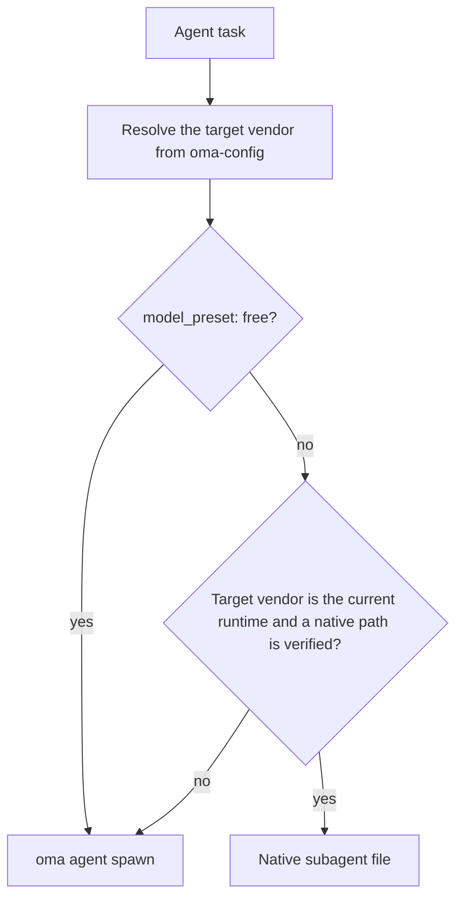
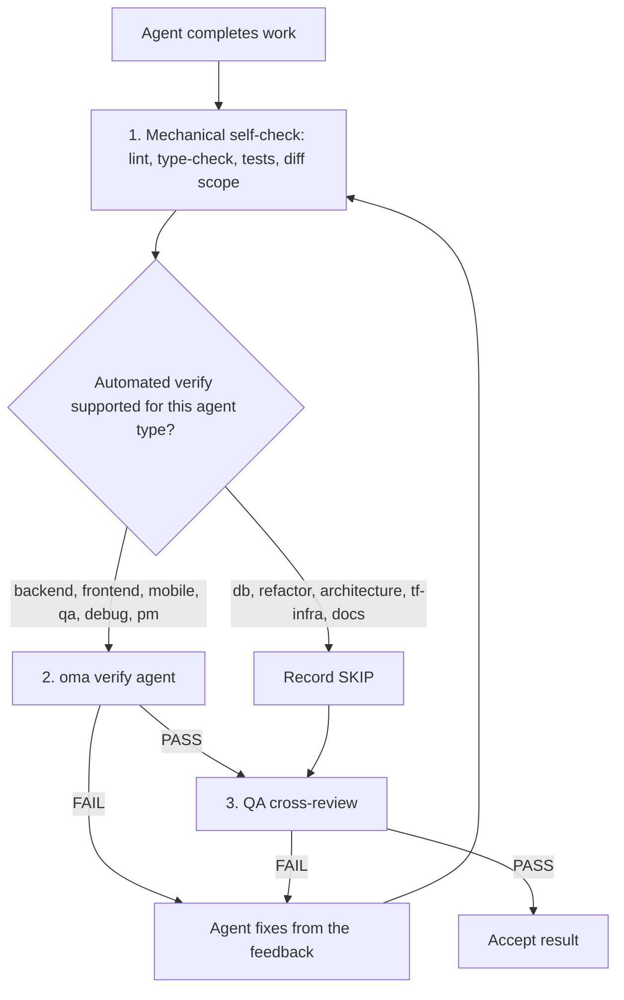

# 에이전트

OMA는 [스킬](../getting-started/glossary.md#skill), 디스패치 역할, [에이전트 정의](../getting-started/glossary.md#agent-definition)를 분리합니다. 스킬은 도메인 지침을 라우팅하고 로드하며, 표준 역할은 디스패치에 사용하는 런타임 정체성이고, 체크인 정의는 서브에이전트에 벤더 네이티브 페르소나를 제공합니다. 이 계층들은 의도적으로 겹치므로 하나의 스킬로 충분한지는 태스크 범위와 인수 기준으로 판단합니다.

---

## 스킬 카탈로그 {#skill-catalog}

이 표는 설치된 스킬의 공식 목록입니다. `cli/scripts/generate-skill-catalog.mjs`가 각 `.agents/skills/<name>/SKILL.md`의 프론트매터에서 생성하며, 스크립트를 `--check`와 함께 실행하면 드리프트를 감지할 수 있습니다. 각 스킬의 리소스 파일과 그 파일을 읽어야 하는 시점은 해당 SKILL.md의 `## References` 섹션에 나와 있습니다.

<!-- oma:generated skill-catalog:start -->
<!-- Generated from SKILL.md frontmatter under .agents/skills by cli/scripts/generate-skill-catalog.mjs. Do not edit this block by hand. -->

| Skill | Use it for |
|---|---|
| [`oma-academic-writing`](https://github.com/first-fluke/oh-my-agent/blob/main/.agents/skills/oma-academic-writing/SKILL.md) | Draft and revise academic prose against a rubric, evidence, and citation requirements. Use for essays, reports, literature reviews, or academic style audits. |
| [`oma-architecture`](https://github.com/first-fluke/oh-my-agent/blob/main/.agents/skills/oma-architecture/SKILL.md) | Evaluate system boundaries and architectural tradeoffs. Use for architecture decisions, design reviews, and ADRs. |
| [`oma-backend`](https://github.com/first-fluke/oh-my-agent/blob/main/.agents/skills/oma-backend/SKILL.md) | Implement server APIs, authentication, and application data access. Schema modeling and query tuning use oma-db. |
| [`oma-brainstorm`](https://github.com/first-fluke/oh-my-agent/blob/main/.agents/skills/oma-brainstorm/SKILL.md) | Explore goals, constraints, and alternative approaches before choosing a design. Use when the user requests ideation or design exploration. |
| [`oma-coordination`](https://github.com/first-fluke/oh-my-agent/blob/main/.agents/skills/oma-coordination/SKILL.md) | Coordinate assigned specialist tasks and handoffs manually. Use when supervising a multi-agent project step by step. |
| [`oma-db`](https://github.com/first-fluke/oh-my-agent/blob/main/.agents/skills/oma-db/SKILL.md) | Design schemas and migrations, tune queries, or plan vector retrieval and database operations. Application API implementation uses oma-backend. |
| [`oma-debug`](https://github.com/first-fluke/oh-my-agent/blob/main/.agents/skills/oma-debug/SKILL.md) | Diagnose a reproducible failure, fix its cause, and verify the regression. Use for crashes, incorrect behavior, and failing tests. |
| [`oma-design`](https://github.com/first-fluke/oh-my-agent/blob/main/.agents/skills/oma-design/SKILL.md) | Define or review a visual system, DESIGN.md, or redesign direction. Use for typography, layout, color, motion, and interaction design decisions. |
| [`oma-dev-workflow`](https://github.com/first-fluke/oh-my-agent/blob/main/.agents/skills/oma-dev-workflow/SKILL.md) | Configure development tasks, git hooks, CI/CD, or release automation. Use when creating or fixing a repository development workflow. |
| [`oma-docs`](https://github.com/first-fluke/oh-my-agent/blob/main/.agents/skills/oma-docs/SKILL.md) | Check documentation references, sync docs to code changes, and detect translation drift. Use for documentation maintenance in a repository. |
| [`oma-explanation`](https://github.com/first-fluke/oh-my-agent/blob/main/.agents/skills/oma-explanation/SKILL.md) | Create an offline HTML explanation of a code change (diff, PR, branch) or of a topic, system, or question. Use when a visual walkthrough document is requested. |
| [`oma-frontend`](https://github.com/first-fluke/oh-my-agent/blob/main/.agents/skills/oma-frontend/SKILL.md) | Implement or modify web UI in React, Next.js, or Angular. Use for components, pages, styles, forms, and frontend state or data flows. |
| [`oma-hwp`](https://github.com/first-fluke/oh-my-agent/blob/main/.agents/skills/oma-hwp/SKILL.md) | Convert Hangul HWP, HWPX, or HWPML documents to Markdown with kordoc. Use for text, table, and image extraction from these formats. |
| [`oma-image`](https://github.com/first-fluke/oh-my-agent/blob/main/.agents/skills/oma-image/SKILL.md) | Generate raster images or reference-guided variations through the OMA image CLI. Use for image assets or explicit vendor comparisons; pixel editing uses an editor. |
| [`oma-market`](https://github.com/first-fluke/oh-my-agent/blob/main/.agents/skills/oma-market/SKILL.md) | Research customer pain points, trends, and competitors through the OMA market engine. Use for market discovery or voice-of-customer analysis. |
| [`oma-mobile`](https://github.com/first-fluke/oh-my-agent/blob/main/.agents/skills/oma-mobile/SKILL.md) | Implement Flutter, React Native, native Swift, or native Kotlin Android apps. Use for mobile screens, widgets, platform integrations, and application data flows. |
| [`oma-observability`](https://github.com/first-fluke/oh-my-agent/blob/main/.agents/skills/oma-observability/SKILL.md) | Design or troubleshoot telemetry, SLOs, and incident diagnostics. Route to the relevant signal, system boundary, or vendor guide. |
| [`oma-orchestration`](https://github.com/first-fluke/oh-my-agent/blob/main/.agents/skills/oma-orchestration/SKILL.md) | Dispatch and supervise parallel specialist agents with durable task state. Use when automated multi-agent execution is requested. |
| [`oma-pdf`](https://github.com/first-fluke/oh-my-agent/blob/main/.agents/skills/oma-pdf/SKILL.md) | Extract PDF text, headings, tables, and images into Markdown using opendataloader-pdf. Use for PDF parsing, not PDF layout creation. |
| [`oma-pm`](https://github.com/first-fluke/oh-my-agent/blob/main/.agents/skills/oma-pm/SKILL.md) | Turn product requirements into scoped tasks with dependencies and acceptance criteria. Use for implementation planning and prioritization. |
| [`oma-qa`](https://github.com/first-fluke/oh-my-agent/blob/main/.agents/skills/oma-qa/SKILL.md) | Review changes for correctness, security, accessibility, and performance. Use for scoped quality reviews or verification plans; bug fixes use oma-debug. |
| [`oma-recap`](https://github.com/first-fluke/oh-my-agent/blob/main/.agents/skills/oma-recap/SKILL.md) | Summarize AI conversation histories for a specified date or period. Use for daily work recaps and cross-tool activity summaries. |
| [`oma-refactor`](https://github.com/first-fluke/oh-my-agent/blob/main/.agents/skills/oma-refactor/SKILL.md) | Restructure existing code while preserving observable behavior. Use for targeted technical debt or hotspot work with characterization tests. |
| [`oma-scholar`](https://github.com/first-fluke/oh-my-agent/blob/main/.agents/skills/oma-scholar/SKILL.md) | Search academic literature and generate, validate, or compare Knows paper sidecars. Use for claim/evidence analysis and literature synthesis. |
| [`oma-scm`](https://github.com/first-fluke/oh-my-agent/blob/main/.agents/skills/oma-scm/SKILL.md) | Manage Git branches, merges, conflicts, commits, and release baselines. Use for repository history and change-management operations. |
| [`oma-search`](https://github.com/first-fluke/oh-my-agent/blob/main/.agents/skills/oma-search/SKILL.md) | Find external documentation, web sources, or remote code with citations. Local code navigation uses the configured code tools. |
| [`oma-security`](https://github.com/first-fluke/oh-my-agent/blob/main/.agents/skills/oma-security/SKILL.md) | Scan application source, agent skills, and MCP components; run penetration tests against scoped web test deployments, validate findings, and configure scan gates. Use oma-qa for broad quality reviews and domain skills for remediation. |
| [`oma-skill-creation`](https://github.com/first-fluke/oh-my-agent/blob/main/.agents/skills/oma-skill-creation/SKILL.md) | Create or revise OMA skills and their references. Use for skill routing, execution contracts, conditional loading, and authoring validation. |
| [`oma-slide`](https://github.com/first-fluke/oh-my-agent/blob/main/.agents/skills/oma-slide/SKILL.md) | Create, import, revise, or export presentation decks through the OMA slide CLI. Use for HTML slides and PDF, PNG, or PPTX deck delivery. |
| [`oma-tf-infra`](https://github.com/first-fluke/oh-my-agent/blob/main/.agents/skills/oma-tf-infra/SKILL.md) | Create or review Terraform infrastructure and plans. Use for cloud resources, IAM, networking, state management, and infrastructure changes. |
| [`oma-translation`](https://github.com/first-fluke/oh-my-agent/blob/main/.agents/skills/oma-translation/SKILL.md) | Translate or revise localized UI strings and prose while preserving meaning, terminology, placeholders, and structure. |
| [`oma-video`](https://github.com/first-fluke/oh-my-agent/blob/main/.agents/skills/oma-video/SKILL.md) | Create videos through the OMA video CLI, or analyze and edit existing clips with media tools. Use for frame extraction, visual analysis, silence cuts, dubbing assembly, scripts, and composition; audio-only work uses oma-voice. |
| [`oma-voice`](https://github.com/first-fluke/oh-my-agent/blob/main/.agents/skills/oma-voice/SKILL.md) | Generate or transcribe speech with Voicebox, or process existing audio locally. Use for narration, transcripts, timed speech, and loudness conversion; video editing uses oma-video. |
<!-- oma:generated skill-catalog:end -->

---

## 디스패치 역할 {#dispatch-roles}

런타임은 표준 역할 단위로 디스패치합니다. `orchestrator`를 제외한 각 역할에는 `.agents/agents/` 아래에 체크인된 정의가 하나씩 있으며, 그 정의의 `skills:` 프론트매터가 로드할 스킬을 지정합니다. 처음 나열된 스킬이 태스크를 담당합니다.

| 역할 | 정의 파일 | 함께 허용되는 이름 | 스킬 |
|------|-----------------|---------------|--------|
| `orchestrator` | 없음 (런타임 조율 역할) | | |
| `pm` | `pm-planner.md` | `pm-planner` | oma-pm |
| `architecture` | `architecture-reviewer.md` | `architecture-reviewer` | oma-architecture |
| `qa` | `qa-reviewer.md` | `qa-reviewer` | oma-qa |
| `backend` | `backend-engineer.md` | `backend-engineer` | oma-backend |
| `frontend` | `frontend-engineer.md` | `frontend-engineer` | oma-frontend, oma-design |
| `mobile` | `mobile-engineer.md` | `mobile-engineer` | oma-mobile |
| `db` | `db-engineer.md` | `db-engineer` | oma-db |
| `debug` | `debug-investigator.md` | `debug-investigator` | oma-debug |
| `refactor` | `refactor-engineer.md` | `refactor-engineer` | oma-refactor |
| `docs` | `docs-curator.md` | `docs-curator` | oma-docs |
| `tf-infra` | `tf-infra-engineer.md` | `tf-infra-engineer` | oma-tf-infra |
| `explore` | `research-explorer.md` | `research-explorer`, `explorer` | oma-search, oma-market, oma-scholar |

끝에 붙은 `-agent` 접미사도 허용됩니다(`qa-agent`는 `qa`로 해석됩니다).

### 네이티브 에이전트 파일 {#native-agent-files}

`.agents/agents/` 아래의 에이전트 정의가 원본입니다. OMA는 커스텀 서브에이전트를 지원하는 런타임을 위해 이 정의를 벤더 네이티브 파일로 투사합니다.

| 런타임 | 네이티브 에이전트 파일 |
|---------|--------------------|
| Claude Code | `.claude/agents/<name>.md` |
| Codex CLI | `.codex/agents/<name>.toml` |
| Cursor | `.cursor/agents/` |
| OpenCode | `.opencode/agents/` |
| Kiro | `.kiro/agents/` |
| Grok | `.grok/agents/` |
| CommandCode | `.commandcode/agents/` |
| Qwen Code | `.qwen/agents/` |

pi에는 에이전트 파일 체계가 없으므로 `oma agent spawn`이 정의의 페르소나를 프롬프트에 인라인으로 넣습니다. 생성된 파일은 `oma link`, `oma install`, `oma update`가 갱신합니다.

### 역할 디스패치 방식 {#how-a-role-is-dispatched}

워크플로우가 어떤 에이전트를 현재 런타임과 같은 벤더로 매핑하면, 그 런타임의 네이티브 에이전트 파일을 먼저 사용합니다. 다른 벤더로 가는 태스크는 `oma agent spawn`으로 폴백합니다.



> **에이전트별 모델 디스패치:** 각 역할의 벤더, 모델, 추론 강도는 `.agents/oma-config.yaml`(또는 선택적인 `.local` 오버레이를 포함한 `.agents/oma-config.cue`)에서 정해집니다. 새 설치의 기본값인 `model_preset: auto`에서는 `agents:` 오버라이드가 없는 역할이 현재 런타임의 네이티브 에이전트와 모델 설정을 따르고, `model_preset: free`는 항상 `oma agent spawn`으로 디스패치합니다. 설정 방법은 [에이전트별 모델](../guide/per-agent-models.md)을, 실제 매트릭스 확인은 [`oma doctor --profile`](../cli-interfaces/commands.md#doctor)을 참고하세요.

---

## 스킬 카테고리 {#agent-categories}

| 카테고리 | 스킬 | 책임 |
|----------|--------|---------------|
| **아이디에이션** | oma-brainstorm | 아이디어 탐색, 접근 방식 제안, 설계 문서 작성 |
| **아키텍처** | oma-architecture | 시스템/모듈/서비스 경계, ADR/ATAM/CBAM 방식의 분석, 트레이드오프 기록 |
| **기획** | oma-pm | 요구사항 분해, 태스크 분해, API 컨트랙트, 우선순위 할당 |
| **구현** | oma-frontend, oma-backend, oma-mobile, oma-db | 각 도메인에서 코드 작성 |
| **디자인** | oma-design | 디자인 시스템, DESIGN.md, 토큰, 타이포그래피, 컬러, 모션, 접근성 |
| **인프라** | oma-tf-infra | 멀티 클라우드 Terraform 프로비저닝, IAM, 비용 최적화, Policy-as-code |
| **DevOps** | oma-dev-workflow | mise task runner, CI/CD, 마이그레이션, 릴리스 조율, 모노레포 자동화 |
| **관측성** | oma-observability | 관측성 파이프라인, 추적 라우팅, MELT+P 시그널(metrics/logs/traces/profiles/cost/audit/privacy), SLO 관리, 인시던트 포렌식, 전송 계층 튜닝 |
| **품질** | oma-qa | 보안 감사 (OWASP), 성능, 접근성 (WCAG), 코드 품질 리뷰 |
| **디버깅** | oma-debug | 버그 재현, 근본 원인 분석, 최소 수정, 회귀 테스트 |
| **현지화** | oma-translation | 톤, 레지스터, 도메인 용어를 유지하는 컨텍스트 인식 번역 |
| **조율** | oma-orchestration, oma-coordination | 자동화 및 수동 멀티 에이전트 오케스트레이션 |
| **Git** | oma-scm | Conventional Commits 생성, 기능별 커밋 분할 |
| **검색 및 탐색** | oma-search | 신뢰도 점수가 있는 의도 기반 검색 라우터 (Context7 문서, 웹, `gh`/`glab` 코드, 로컬 코드 인텔리전스) |
| **회고** | oma-recap | 크로스 도구 대화 이력 분석 및 주제별 작업 요약 |
| **문서 처리** | oma-hwp, oma-pdf | LLM/RAG 수집을 위한 HWP/HWPX/HWPML 및 PDF → Markdown 변환 |
| **문서화** | oma-docs | 문서 유지보수: 깨진 참조, diff의 영향을 받는 문서, 번역 드리프트, 번역 문서 린트 |
| **설명** | oma-explanation | 코드 변경(diff, PR, 브랜치, 커밋 범위)이나 주제·시스템·질문을 다루는 오프라인 HTML 설명서 |
| **학술 글쓰기** | oma-academic-writing, oma-scholar | 출판 수준 학술 산문 작성과 감사, Knows 사이드카 기반 학술 연구·검색·동료 검토 |
| **보안** | oma-security | 애플리케이션 소스, 에이전트 스킬 패키지, MCP 컴포넌트, 승인된 웹 테스트 배포 스캔(Deepsec, Cisco 스캐너, ARTEX). 발견 사항의 독립 검증과 CI 게이트 포함 |
| **리팩터링** | oma-refactor | 동작을 보존하는 점진적 구조 개선. 핫스팟 타기팅, 특성화 테스트 안전망, 리팩터링만 담는 커밋 |
| **시장 조사** | oma-market | 커뮤니티 신호 기반 페인·트렌드·경쟁·발견 조사. 의도에 따라 SWOT / Porter's 5F / PESTEL 자동 선택 |
| **스킬 작성** | oma-skill-creation | SSL-lite 형식으로 OMA 스킬을 만들고 검증 |
| **미디어 생성** | oma-image, oma-slide, oma-video, oma-voice | AI 이미지 생성, HTML 발표 덱, 숏폼·설명·데모 영상, 로컬 TTS/STT |

---

## 상세 에이전트 레퍼런스 {#detailed-agent-reference}

이 요약은 각 스킬의 도메인과 핵심 규칙을 설명합니다. 원본은 스킬 자체의 SKILL.md입니다. 그 `## References` 섹션에 리소스 파일과 각 파일을 읽는 조건이 나와 있으므로, 이 페이지는 그 목록을 옮겨 적지 않습니다.

### oma-brainstorm

**도메인:** 기획이나 구현 전의 디자인 우선 아이디어 탐색.

**사용 시기:** 새로운 기능 아이디어를 탐색하거나, 사용자 의도를 이해하거나, 접근 방식을 비교할 때. 복잡하거나 모호한 요청에 대해 `/plan` 전에 사용합니다.

**사용하지 말아야 할 때:** 명확한 요구사항(oma-pm으로), 구현(도메인 에이전트로), 코드 리뷰(oma-qa로).

**핵심 규칙:**
- 설계 승인 전 구현이나 기획 금지
- 한 번에 하나의 명확화 질문 (묶음 질문 금지)
- 대안이 결정에 도움이 되면 실행 가능한 접근 방식 두세 가지를 비교하고, 제약 때문에 그보다 적다면 선택지를 지어내지 말고 이유를 설명
- 설계를 섹션별로 제시하되, 아직 열려 있는 중요한 선택만 확정
- YAGNI: 필요한 것만 설계

**워크플로우:** 7단계: 컨텍스트, 질문, 접근 방식(선택적으로 TRIZ-lite로 시작점 마련), 설계, 블라인드 리뷰, 문서화(`docs/plans/designs/`에 저장), `/plan`으로 전환.

---

### oma-architecture

**도메인:** 소프트웨어/시스템 아키텍처 (모듈·서비스 경계, 트레이드오프 분석, 이해관계자 종합, 의사결정 기록).

**사용 시기:** 시스템 아키텍처 선택 또는 검토, 모듈/서비스/오너십 경계 정의, 명시적 트레이드오프와 함께 아키텍처 대안 비교, 아키텍처적 문제(변경 증폭, 숨은 의존성, 어색한 API) 진단, 아키텍처 투자 또는 리팩토링 우선순위 결정, 아키텍처 권고안 또는 ADR 작성.

**사용하지 말아야 할 때:** 시각/디자인 시스템(oma-design 사용), 기능 계획 및 태스크 분해(oma-pm 사용), Terraform 구현(oma-tf-infra 사용), 버그 진단(oma-debug 사용), 보안/성능/접근성 리뷰(oma-qa 사용).

**방법론:** 진단 라우팅, design-twice 비교, ATAM 방식 리스크 분석, CBAM 방식 우선순위화, ADR 방식 의사결정 기록.

**핵심 규칙:**
- 방법을 선택하기 전에 아키텍처 문제를 진단
- 현재 의사결정에 가장 가볍고 충분한 방법론을 사용
- 아키텍처 설계를 UI/시각 디자인 및 Terraform 전달과 구분
- 의사결정이 비용을 정당화할 만큼 교차적일 때만 이해관계자 에이전트에 자문
- 형식적인 합의보다 권고의 품질이 중요: 폭넓게 자문하되 명시적으로 결정
- 모든 권고는 가정, 트레이드오프, 리스크, 검증 단계를 명시
- 기본적으로 비용을 고려: 구현 비용, 운영 비용, 팀 복잡도, 향후 변경 비용

---

### oma-pm

**도메인:** 프로덕트 관리 (요구사항 분석, 태스크 분해, API 컨트랙트).

**사용 시기:** 복잡한 기능 분해, 실현 가능성 판단, 우선순위 결정, API 컨트랙트 정의.

**핵심 규칙:**
- API 우선 설계: 구현 태스크 전에 컨트랙트 정의
- 모든 태스크에: 에이전트, 제목, 인수 기준, 우선순위, 의존성 포함
- 최대 병렬 실행을 위해 의존성 최소화
- 보안과 테스팅은 모든 태스크의 일부 (별도 단계가 아님)
- 태스크는 단일 에이전트가 완료 가능해야 함
- 오케스트레이터 호환성을 위한 JSON 계획과 세션 범위 태스크 보드 출력

**출력:** 숫자 우선순위 티어(`1` = 독립, 낮은 티어가 먼저 실행)가 담긴 `.agents/results/plan-{sessionId}.json`, 그리고 설정된 메모리 저장소에 기록되는 실행 범위 보고서 `result-{agentId}-{taskId}-{runId}-{sessionId}.md`.

---

### oma-frontend

**도메인:** React/Next.js 또는 Angular와 TypeScript로 만드는 웹 UI. React 프로젝트는 FSD-lite를 사용하고, Angular 프로젝트는 `resources/angular-rules.md`를 따릅니다.

**사용 시기:** 사용자 인터페이스, 컴포넌트, 클라이언트 사이드 로직, 스타일링, 폼 유효성 검사, API 통합을 구축할 때.

**기술 스택:**
- React + Next.js (기본 Server Components, 인터랙티브용 Client Components)
- TypeScript (strict)
- TailwindCSS v4 + shadcn/ui (읽기 전용 프리미티브, cva/wrapper로 확장)
- FSD-lite: root `src/` + feature `src/features/*/` (크로스 피처 임포트 금지)

**라이브러리 (React/Next.js 프로젝트):**
| 용도 | 라이브러리 |
|---------|---------|
| 날짜 | luxon |
| 스타일링 | TailwindCSS v4 + shadcn/ui |
| 훅 | ahooks 또는 @mantine/hooks |
| 유틸리티 | es-toolkit |
| 타입 | type-fest |
| URL 상태 | nuqs |
| 서버 상태 | TanStack Query (OpenAPI 스펙이 있으면 orval로 생성한 훅) |
| 클라이언트 상태 | Jotai 또는 Zustand. 기본값 없이 의도에 따라 선택 (최소한으로 사용) |
| 폼 | @tanstack/react-form + Zod |
| 인증 | better-auth |
| 애니메이션 | 신규 프로젝트에는 motion (`motion/react`) |

**핵심 규칙:**
- shadcn/ui 우선, cva로 확장, `components/ui/*`를 직접 수정하지 않음
- 디자인 토큰 1:1 매핑 (컬러 하드코딩 금지)
- 요청 프록시: 기존 Next.js 16+ `proxy.ts` 관례를 유지하고, `middleware.ts`로 이름을 바꾸자고 제안하기 전에 설치된 버전과 라우팅을 확인
- 3단계를 넘는 prop drilling 금지. 프로젝트의 클라이언트 상태 라이브러리(Jotai 아톰 또는 Zustand 스토어) 사용
- `@/` 절대 임포트 필수
- FCP 목표 < 1초
- 반응형 브레이크포인트: 320px, 768px, 1024px, 1440px

**품질 게이트 체크리스트:**
- 접근성: ARIA 레이블, 시맨틱 헤딩, 키보드 네비게이션
- 모바일: 모바일 뷰포트에서 검증
- 성능: CLS 없음, 빠른 로딩
- 복원력: Error Boundaries와 Loading Skeletons
- 테스트: Vitest로 로직 커버
- 품질: typecheck와 lint 통과

---

### oma-backend

**도메인:** API, 서버 사이드 로직, 인증, 데이터베이스 연산.

**사용 시기:** REST/GraphQL API, 데이터베이스 마이그레이션, 인증, 서버 비즈니스 로직, 백그라운드 작업.

**아키텍처:** Router (HTTP) -> Service (비즈니스 로직) -> Repository (데이터 접근) -> Models.

**스택 감지:** 프로젝트 매니페스트(pyproject.toml, package.json, Cargo.toml, go.mod 등)를 읽어 언어와 프레임워크를 결정합니다. 프로젝트별 관례가 없으면 사용자에게 `/stack-set` 실행을 요청하며, 이 명령이 제공된 스키마와 템플릿에서 해석된 `stack/` 레퍼런스를 실체화합니다.

**핵심 규칙:**
- 클린 아키텍처: 라우트 핸들러에 비즈니스 로직 금지
- 프로젝트의 유효성 검사 라이브러리로 모든 입력 검증
- 파라미터화된 쿼리만 사용 (SQL에서 문자열 보간 금지)
- 인증에 JWT + Argon2id (레거시 호환을 위해 bcrypt 허용); 인증 엔드포인트 속도 제한
- 지원되는 곳에서 비동기; 모든 시그니처에 타입 어노테이션
- 중앙 집중식 에러 모듈을 통한 커스텀 예외
- 명시적 ORM 로딩 전략, 트랜잭션 경계, 안전한 라이프사이클

<!-- oma-docs:ignore-start -->
필요할 때 `/stack-set`이 프로젝트별 `stack/stack.yaml`, `stack/tech-stack.md`, 스니펫, API 템플릿을 생성합니다. 스택을 실체화하기 전에는 이 파일들이 존재하지 않습니다.
<!-- oma-docs:ignore-end -->

---

### oma-mobile

**도메인:** 크로스 플랫폼 및 네이티브 모바일 앱 (Flutter, React Native, Swift 네이티브 iOS).

**사용 시기:** 네이티브 모바일 앱(iOS + Android), 모바일 특화 UI 패턴, 플랫폼 기능(카메라, GPS, 푸시 알림), 오프라인 우선 아키텍처; SwiftUI와 `swift-openapi-generator`를 사용하는 Swift 네이티브 iOS 앱.

**아키텍처:** 클린 아키텍처: domain -> data -> presentation. Swift iOS의 경우: `App/Core/Features/Shared` 프로젝트 레이아웃.

**기술 스택:**
- Flutter/Dart: Riverpod/Bloc (상태 관리), 인터셉터를 붙인 Dio (API), GoRouter (네비게이션), Material Design 3 (Android) + iOS HIG.
- Swift 네이티브 iOS (iOS 17+): SwiftUI + `@Observable` (Observation framework), API 클라이언트용 Apple `swift-openapi-generator`, `App/Core/Features/Shared` 레이아웃.

**핵심 규칙:**
- 상태 관리에 Riverpod/Bloc (복잡한 로직에 raw setState 금지)
- 모든 컨트롤러를 `dispose()` 메서드에서 해제
- API 호출에 interceptors가 있는 Dio; 오프라인을 우아하게 처리
- 60fps 목표; 양 플랫폼에서 테스트
- Swift: iOS 17+에서는 `ObservableObject` 대신 `@Observable` 사용; `swift-openapi-generator`로 OpenAPI 스펙에서 API 클라이언트 생성

**플랫폼 시드:** `variants/`에는 `flutter/`, `react-native/`, `swift-ios/`가 들어 있고, 각각 `stack.yaml`, `tech-stack.md`, `snippets.md`, API 템플릿을 담으며 공유 `stack.schema.json`도 함께 제공됩니다. 이들은 `/stack-set`용 시작 자료이며, 기존 코드를 수정할 때 반드시 읽어야 하는 자료는 아닙니다.

---

### oma-db

**도메인:** 데이터베이스 아키텍처 (SQL, NoSQL, 벡터 데이터베이스).

**사용 시기:** 스키마 설계, ERD, 정규화, 인덱싱, 트랜잭션, 용량 계획, 백업 전략, 마이그레이션 설계, 벡터 DB/RAG 아키텍처, 안티 패턴 리뷰, 컴플라이언스 인식 설계(ISO 27001/27002/22301).

**기본 워크플로우:** 탐색(엔티티, 접근 패턴, 볼륨 식별) -> 설계(스키마, 제약, 트랜잭션) -> 최적화(인덱스, 파티셔닝, 아카이빙, 안티 패턴).

**핵심 규칙:**
- 먼저 모델을 선택한 다음 엔진 선택
- 관계형은 기본 3NF; 분산형은 BASE 트레이드오프 문서화
- 세 가지 스키마 레이어 모두 문서화: 외부, 개념, 내부
- 무결성이 최우선: 엔티티, 도메인, 참조, 비즈니스 규칙
- 동시성은 암시적이지 않음: 트랜잭션 경계와 격리 수준 정의
- 벡터 DB는 검색 인프라이지 진실의 원천이 아님
- 벡터 검색을 어휘 검색의 대체품으로 취급하지 않음

**필수 산출물:** 외부 스키마 요약, 개념 스키마, 내부 스키마, 데이터 표준 테이블, 용어집, 용량 추정, 백업/복구 전략. 벡터/RAG의 경우: 임베딩 버전 정책, 청킹 정책, 하이브리드 검색 전략.

---

### oma-design

**도메인:** 디자인 시스템, UI/UX, DESIGN.md 관리.

**사용 시기:** 디자인 시스템과 DESIGN.md를 만들거나 수정할 때, 기존 사이트나 앱을 리디자인할 때(보존 또는 전면 개편), 랜딩 페이지, 디자인 토큰, 컬러 팔레트, 타이포그래피, 반응형 레이아웃, 접근성 리뷰.

**워크플로우:** 7단계: Setup (컨텍스트 수집) -> Extract (선택적, 참조 URL에서) -> Enhance (모호한 프롬프트 증강) -> Propose (2-3가지 디자인 방향) -> Generate (DESIGN.md + 토큰) -> Audit (반응형, WCAG, Nielsen, AI slop 검사) -> Handoff.

**안티 패턴 적용 ("no AI slop"):**
- 타이포그래피: 기본 시스템 폰트 스택; 정당화 없이 기본 Google Fonts 사용 금지
- 컬러: 보라-파랑 그라디언트 금지, 그라디언트 오브/블롭 금지, 순수 검정 위에 순수 흰색 금지
- 레이아웃: 중첩 카드 금지, 데스크탑 전용 레이아웃 금지, 틀에 박힌 3-메트릭 통계 레이아웃 금지
- 모션: 모든 곳에 bounce easing 금지, 800ms 초과 애니메이션 금지, prefers-reduced-motion 반드시 존중
- 컴포넌트: 모든 곳에 glassmorphism 금지, 모든 인터랙티브 요소에 키보드/터치 대안 필요

**핵심 규칙:**
- `.design-context.md`와 `DESIGN.md`가 있으면 재사용하고, 실질적인 탐색 과정이 결정에 영향을 줄 때만 `.design-context.md`를 생성
- 기존 사이트나 앱은 `resources/redesign-protocol.md`를 따르고, 제안하기 전에 Preserve와 Overhaul 중 어느 쪽인지 분류
- 기본 시스템 폰트 스택 (ko/ja/zh용 CJK 지원 폰트)
- 모든 디자인에 WCAG AA 최소 준수
- 반응형 우선 (모바일이 기본)
- 2-3가지 방향 제시 후 확인 받기

---

### oma-tf-infra

**도메인:** Terraform으로 Infrastructure-as-code, 멀티 클라우드.

**사용 시기:** AWS/GCP/Azure/Oracle Cloud 프로비저닝, Terraform 설정, CI/CD 인증(OIDC), CDN/로드 밸런서/스토리지/네트워킹, 상태 관리, ISO 컴플라이언스 인프라.

**클라우드 감지:** Terraform 프로바이더와 리소스 접두사를 읽습니다(`google_*` = GCP, `aws_*` = AWS, `azurerm_*` = Azure, `oci_*` = Oracle Cloud). 전체 멀티 클라우드 리소스 매핑 테이블이 포함됩니다.

**핵심 규칙:**
- 프로바이더 불문: 프로젝트 컨텍스트에서 클라우드 감지
- 버전 관리와 잠금이 있는 원격 상태
- CI/CD 인증에 OIDC 우선
- 항상 적용 전 계획
- 최소 권한 IAM
- 모든 것에 태그 (Environment, Project, Owner, CostCenter)
- 코드에 시크릿 금지
- 모든 프로바이더와 모듈 버전 고정
- 프로덕션에서 자동 승인 금지

---

### oma-dev-workflow

**도메인:** 모노레포 태스크 자동화와 CI/CD.

**사용 시기:** 개발 서버 실행, 앱 전체에서 lint/format/typecheck 실행, 데이터베이스 마이그레이션, API 생성, i18n 빌드, 프로덕션 빌드, CI/CD 최적화, pre-commit 검증.

**핵심 규칙:**
- 직접적인 패키지 매니저 명령 대신 항상 `mise run` 태스크 사용
- 변경된 앱에서만 lint/test 실행
- commitlint로 커밋 메시지 검증
- CI에서 변경되지 않은 앱 건너뛰기
- mise 태스크가 있으면 직접 패키지 매니저 명령 사용 금지

---

### oma-observability

**도메인:** 계층, 경계, 시그널을 아우르는 의도 기반 관측성 및 추적 라우터.

**사용 시기:**
- 파이프라인 구축: OTel SDK + Collector + 벤더 백엔드
- 서비스 및 도메인 경계를 아우르는 추적성: W3C propagator, baggage, 멀티테넌트, 멀티 클라우드
- 전송 계층 튜닝: UDP/MTU 임계값, OTLP gRPC vs HTTP, Collector DaemonSet vs 사이드카 토폴로지, 샘플링 레시피
- 인시던트 포렌식: 6차원 국소화(code / service / layer / host / region / infra)
- 벤더 카테고리 선택: OSS 풀스택 vs 상용 SaaS vs 고 카디널리티 전문 vs 프로파일링 전문
- Observability-as-code: Grafana Jsonnet 대시보드, PrometheusRule CRD, OpenSLO YAML, SLO burn-rate 알람
- 메타 관측성: 파이프라인 자체 건강성, 클록 스큐, 카디널리티 가드레일, 보관 매트릭스
- MELT+P 시그널 커버리지: metrics, logs, traces, profiles, cost, audit, privacy
- 현재 업스트림 지원 상황과 프로젝트 요구 사항을 기준으로 평가하는 로그 파이프라인 마이그레이션

**사용하지 말아야 할 때:** LLM ops / gen_ai 관측성(Langfuse, Arize Phoenix, LangSmith, Braintrust 사용), 데이터 파이프라인 lineage(OpenLineage + Marquez, dbt test, Airflow lineage), IoT / 데이터센터 물리 계층 텔레메트리(Nlyte, Sunbird, Device42), 카오스 엔지니어링 오케스트레이션(Chaos Mesh, Litmus, Gremlin, ChaosToolkit), GPU / TPU 인프라(NVIDIA DCGM Exporter), 소프트웨어 공급망(sigstore, in-toto, SLSA), 인시던트 대응 워크플로우 / 페이징(PagerDuty, OpsGenie, Grafana OnCall), 해당 벤더의 고유 스킬로 이미 다루는 단일 벤더 셋업.

**핵심 규칙:**
- 라우팅 전에 의도 분류: setup | migrate | investigate | alert | trace | tune | route
- 벤더 레지스트리가 아닌 카테고리 우선: `resources/vendor-categories.md`를 통해 벤더 소유 스킬에 위임하고 벤더 문서를 중복 작성하지 않음
- 전송 계층 튜닝이 차별점: UDP/MTU 임계값, OTLP 프로토콜 선택, Collector 토폴로지, 샘플링 레시피는 다른 스킬이 다루지 않는 깊이
- 메타 관측성은 타협 불가: 셋업 완료를 선언하기 전에 파이프라인 자체 건강성, 클록 동기화(< 100 ms 드리프트), 카디널리티, 보관을 검증
- CNCF 우선 선호: Prometheus, Jaeger, Thanos, Fluent Bit, OpenTelemetry, Cortex, OpenCost, OpenFeature, Flagger, Falco
- Fluentd는 여전히 CNCF Graduated 프로젝트이며, Fluentd에서 Fluent Bit로 넘어가는 CNCF 2025-10 가이드는 마이그레이션 가이드이지 사용 중단 공지가 아님. 워크로드, 플러그인, 운영 요구 사항에 따라 Fluentd, Fluent Bit, OTel Collector 중에서 선택
- W3C Trace Context가 기본 propagator; 클라우드별 변환(AWS X-Ray `X-Amzn-Trace-Id`, GCP Cloud Trace, Datadog, Cloudflare, Linkerd)
- 기능보다 프라이버시 우선: PII 마스킹, 샘플링 인식 baggage 규칙, SOC2/ISO 불변 감사 + GDPR/PIPA 삭제권은 저장이 아닌 수집 시점에 적용

---

### oma-qa

**도메인:** 품질 보증 (보안, 성능, 접근성, 코드 품질).

**사용 시기:** 배포 전 최종 리뷰, 보안 감사, 성능 분석, 접근성 준수, 테스트 커버리지 분석.

**리뷰 우선순위:** 보안 > 성능 > 접근성 > 코드 품질.

**심각도 수준:**
- **CRITICAL**: 보안 침해, 데이터 손실 위험
- **HIGH**: 출시 차단
- **MEDIUM**: 이번 스프린트에서 수정
- **LOW**: 백로그

**핵심 규칙:**
- 모든 발견 사항에 파일:라인, 설명, 수정 방안 포함 필수
- 먼저 자동화 도구 실행 (npm audit, bandit, lighthouse)
- 오탐 금지 (모든 발견 사항은 재현 가능해야 함)
- 설명만이 아닌 수정 코드 제공

---

### oma-debug

**도메인:** 버그 진단 및 수정.

**사용 시기:** 사용자 보고 버그, 크래시, 성능 문제, 간헐적 장애, 레이스 컨디션, 회귀 버그.

**방법론:** 먼저 재현, 그다음 진단. 수정을 넘겨짚지 않음.

**핵심 규칙:**
- 증상이 아닌 근본 원인 식별
- 최소 수정: 필요한 것만 변경
- 모든 수정에 회귀 테스트
- 다른 곳에서 유사한 패턴 검색
- `.agents/results/`에 문서화

**사용하는 코드 인텔리전스 도구 (Gortex 또는 Serena):**
- `find_symbol("functionName")` 또는 Gortex 심볼 탐색: 함수 위치 찾기
- `find_referencing_symbols("Component")` 또는 Gortex 영향 분석: 모든 사용처 찾기
- `search_for_pattern("error pattern")` 또는 Gortex 검색: 유사한 문제 찾기

---

### oma-translation

**도메인:** 컨텍스트 인식 다국어 번역.

**사용 시기:** UI 문자열, 문서, 마케팅 카피 번역, 기존 번역 검토, 용어집 생성.

**6장면 흐름:** Prepare, Acquire, Reason, Act, Verify, Finalize입니다. 번역 방법은 보호해야 할 구문과 의미를 읽고, 레지스터를 선택하고, 대상 언어로 재구성하고, 필요한 경우 저자의 문체를 보존하는 네 단계입니다.

**핵심 규칙:**
- 먼저 기존 로케일 파일을 스캔해 프로젝트 관례에 맞추기
- 단어가 아닌 의미를 번역
- 감정적 함의 유지
- 직역 금지
- 하나의 글 내에서 레지스터 혼합 금지
- 도메인 특정 용어는 원문 그대로 유지

---

### oma-orchestration

**도메인:** CLI 스폰을 통한 자동화된 멀티 에이전트 조율.

**사용 시기:** 여러 에이전트가 병렬로 필요한 복잡한 기능, 자동화된 실행, 풀스택 구현.

**설정 기본값:**

| 설정 | 기본값 | 설명 |
|---------|---------|-------------|
| MAX_PARALLEL | 3 | 최대 동시 서브에이전트 수 |
| MAX_RECOVERY_ATTEMPTS | 3 | 원래 시도를 포함한, 태스크당 재시도와 탐색 가설의 총 횟수 |
| POLL_INTERVAL | 30초 | `oma agent spawn` 실행의 상태 확인 간격 (Claude Code 네이티브 서브에이전트는 동기적으로 반환) |

**워크플로우 단계:** Plan → References (태스크별 레퍼런스 선택) → Setup (세션과 태스크 보드 산출물) → Execute (MAX_PARALLEL 안에서 준비된 태스크 디스패치) → Monitor → Verify (리뷰 루프) → Collect (클레임과 실행 범위 보고서).

**에이전트 간 리뷰 루프:** 다이어그램과 루프 한도는 [오케스트레이션 흐름](#orchestration-flow)을 참고하세요.

**세션 증거:** 필요할 때 중요한 수정과 판정을 거친 리뷰 발견 사항을 원인, 영향, 검증과 함께 기록합니다. 페널티 점수도, 점수에 따른 일시 중지도 적용되지 않습니다.

---

### oma-scm

**도메인:** 브랜치, 머지, 워크트리, 베이스라인, 감사 준비, Conventional Commits를 다루는 소프트웨어 형상관리(SCM)와 Git.

**사용 시기:** 코드 변경 후(`/scm`), 머지 충돌, 브랜치 전략, 릴리스/태그, 또는 저장소 형상관리에 관한 모든 질문.

**커밋 유형:** feat, fix, docs, style, refactor, perf, test, chore, build, ci, revert.

**워크플로우(커밋):** 변경사항 분석 → 필요하면 기능별 분할 → 유형 → 범위 → 설명(명령문, 72자 미만, 소문자, 마침표 없음) → 경로를 명시해 커밋.

**규칙:**
- 명시적 승인 없이 `git add -A`나 `git add .` 사용 금지
- 시크릿 파일 커밋 금지
- 스테이징 시 항상 파일 지정
- 메시지를 파일에 쓰고 `git commit -F <message-file>`로 커밋
- 명시적 승인 없이 공유 이력을 다시 쓰지 않음. `--force-with-lease`를 쓰고 일반 `--force`는 절대 쓰지 않음
- 유효한 `scm.co_author` 설정이 활성화되어 이름과 이메일을 제공할 때만 co-author trailer를 포함합니다.

---

### oma-coordination

**도메인:** 수동 단계별 멀티 에이전트 조율 가이드.

**사용 시기:** 완전 자동 오케스트레이션 대신 스폰, 모니터링, 컨트랙트 정렬, QA를 단계별로 직접 감독하고 싶은 멀티 도메인 작업.

**사용하지 말아야 할 때:** 완전 자동 병렬 실행(oma-orchestration 사용), 단일 도메인 작업(해당 도메인 에이전트 직접 사용).

**핵심 규칙:**
- 유효한 계획은 재사용하고, 분해나 컨트랙트를 바꿔야 할 때만 oma-pm 호출
- 같은 우선순위 티어의 독립 태스크는 병렬로 스폰하되, 각각 별도 워크스페이스에서 실행하거나 `--isolation worktree` 사용
- 의존하는 프론트엔드·모바일 작업 전에 변경된 API 경계의 컨트랙트를 갱신
- QA 리뷰는 항상 마지막 단계
- 차단성 QA 결함과 필수 검증 공백은 담당 에이전트에게 돌려보낸 뒤 영향받는 검사를 다시 실행

**워크플로우:** 계획(재사용 또는 PM) → 우선순위 티어별 스폰 → 모니터링 → QA 리뷰 → 이슈 수정 → 배포.

**oma-orchestration와 차이:** coordination은 수동 가이드(사용자가 속도 제어), orchestrator는 자동(최소 사용자 개입으로 에이전트가 스폰·실행).

---

### oma-search

**도메인:** 도메인 신뢰도 점수를 사용하는 의도 기반 검색 라우터입니다. 쿼리를 Context7(문서), 네이티브 웹 검색, `gh`/`glab`(코드), 로컬 코드 인텔리전스(Gortex 또는 Serena)로 라우팅합니다.

**사용 시기:** 공식 라이브러리/프레임워크 문서 찾기, 튜토리얼/예제/비교/솔루션을 위한 웹 리서치, 구현 패턴을 위한 GitHub/GitLab 코드 검색, 검색 채널이 불명확한 쿼리(자동 라우팅), 검색 인프라가 필요한 다른 스킬(공유 호출).

**사용하지 말아야 할 때:** 로컬 전용 코드베이스 탐색(코드 인텔리전스 MCP를 직접 사용), Git 이력 또는 blame 분석(oma-scm 사용), 전체 아키텍처 리서치(이 스킬을 내부적으로 호출할 수 있는 oma-architecture 사용).

**핵심 규칙:**
- 명시적인 `--docs`, `--code`, `--web`이 경로를 선택하며, 그렇지 않으면 `resources/intent-rules.md`로 의도를 분류
- 하나의 쿼리, 하나의 최적 경로 (의도가 모호하지 않은 한 중복 멀티 라우팅을 피함)
- 모든 결과에 신뢰도 점수 (모든 비로컬 결과는 레지스트리의 도메인 신뢰도 레이블을 받음)
- 그 밖의 플래그: `--strict`는 점수를 매긴 뒤 신뢰도로 결과를 거르고, `--wide`는 레이블이 붙은 낮은 신뢰도 결과도 유지하며, `--gitlab`은 GitLab을 코드 호스트로 선택
- Fail forward: 주 경로가 실패하면 우아하게 폴백(docs→web, web→`oma search fetch` 전략)
- 추가 MCP 불필요: 문서는 Context7, 웹은 런타임 네이티브, 코드는 CLI, 로컬은 설정된 프로바이더(Gortex 또는 Serena)
- 벤더 중립 웹 검색: 현재 런타임이 제공하는 것을 그대로 사용(WebSearch, Google, Bing)
- 도메인 수준 신뢰도만 사용 (하위 경로 또는 페이지 수준 점수 없음)

---

### oma-recap

**도메인:** 여러 AI 도구(Claude, Codex, Gemini, Antigravity, Qwen, Cursor, Grok)의 대화 이력 분석 및 주제별 일/기간 작업 요약.

**사용 시기:** 하루 또는 기간의 작업 활동 요약, 여러 AI 도구에 걸친 작업 흐름 파악, 세션 간 도구 전환 패턴 분석, 데일리 스탠드업/주간 회고/작업 로그 준비.

**사용하지 말아야 할 때:** Git 커밋 기반의 코드 변경 회고(`oma retro` 사용), 실시간 에이전트 모니터링(`oma dashboard terminal` 사용), 생산성 지표(`oma stats get` 사용).

**프로세스:**
1. 자연어 입력(today, yesterday, last Monday, 명시적 날짜)에서 날짜 또는 시간 범위 해석
2. 달력 기준 하루는 `oma recap --date YYYY-MM-DD --json`, 이동 구간은 `oma recap --window 7d --json`(`1d`, `3d`, `7d`, `2w`, `30d`)으로 대화 데이터를 가져오고, `--tool`로 범위를 좁힘
3. 도구가 아니라 내용(프로젝트와 테마)별로 그룹핑. 3일 이상 구간은 날짜가 아니라 프로젝트별로 그룹핑
4. 테마 추출(작업한 기능, 수정한 버그, 탐색한 도구)
5. 주제별 일/기간 요약 렌더링

---

### oma-hwp

**도메인:** `kordoc`을 사용한 HWP / HWPX / HWPML(한글 워드프로세서) → Markdown 변환.

**사용 시기:** 한국어 HWP 문서(`.hwp`, `.hwpx`, `.hwpml`)를 Markdown으로 변환, LLM 컨텍스트 또는 RAG용 한국 정부/기업 문서 준비, HWP에서 구조화된 콘텐츠(표, 헤딩, 목록, 이미지, 각주, 하이퍼링크) 추출.

**사용하지 말아야 할 때:** PDF 파일(oma-pdf 사용), XLSX/DOCX(범위 외), HWP 생성/편집(범위 외), 이미 텍스트인 파일(Read 도구 직접 사용).

**핵심 규칙:**
- 실행에 `bunx kordoc@latest` 사용 (설치 불필요. 항상 `@latest` 또는 고정 버전 전달)
- 기본 출력 형식은 Markdown
- 출력 디렉토리가 지정되지 않으면 입력과 동일한 디렉토리에 출력
- kordoc이 구조 보존 처리(헤딩, 표, 중첩 표, 각주, 하이퍼링크, 이미지)
- 보안 방어(ZIP bomb, XXE, SSRF, XSS)는 kordoc이 제공 (커스텀 방어 추가 금지)
- 암호화된 또는 DRM 잠금 HWP의 경우 제한 사항을 사용자에게 명확히 보고
- HTML `<table>` 블록을 GFM 파이프 테이블로 변환하고 Hancom 폰트 Private Use Area 문자를 제거하기 위해 `resources/flatten-tables.ts`로 후처리

---

### oma-pdf

**도메인:** `opendataloader-pdf`를 사용한 PDF → Markdown 변환.

**사용 시기:** LLM 컨텍스트 또는 RAG용 PDF 문서를 Markdown으로 변환, PDF에서 구조화된 콘텐츠(표, 헤딩, 목록) 추출, AI가 바로 쓸 수 있는 PDF 데이터 준비.

**사용하지 말아야 할 때:** PDF 생성/작성(적절한 문서 도구 사용), 기존 PDF 편집(범위 외), 이미 텍스트인 파일의 단순 읽기(Read 도구 직접 사용).

**핵심 규칙:**
- 실행에 `uvx opendataloader-pdf` 사용 (설치 불필요)
- 기본 출력 형식은 Markdown
- 출력 디렉토리가 지정되지 않으면 입력 PDF와 동일한 디렉토리에 출력
- 문서 구조 보존(헤딩, 표, 목록, 이미지)
- 스캔된 PDF의 경우 OCR을 포함한 하이브리드 모드 사용
- Markdown 포매팅 정규화를 위해 항상 출력에 `uvx mdformat` 실행
- 출력 Markdown이 읽을 수 있고 구조적으로 양호한지 검증
- 변환 문제(누락된 표, 깨진 텍스트)를 사용자에게 보고

---

### oma-academic-writing

**도메인:** 출판 수준의 학술 영어 산문. 에세이, 보고서, 분석 절, 요약문, 결론, 문헌 검토를 작성하고 수정하고 감사합니다.

**사용 시기:** 학술 보고서·에세이·분석 절을 작성하거나 수정할 때, 요약문이나 결론이나 문헌 검토를 쓸 때, AI 티가 나는 산문을 자연스러운 학술 영어로 다시 쓸 때, 초안을 최상위 루브릭 수준(HD, A, top-band)까지 다듬을 때, 문장 다양성·동사 품질·헤징·안티 AI 준수를 기준으로 산문을 검토할 때.

**사용하지 말아야 할 때:** 번역(oma-translation 사용), 출처 발굴·인용 수집·문헌 검색(oma-scholar 사용), 루브릭 해석과 태스크 분해(oma-pm 사용), 코드 문서·README·API 레퍼런스 텍스트(해당 도메인 스킬 사용), 비격식 문체나 마케팅 카피, 영어가 아닌 학술 글쓰기(영어로 먼저 쓰고 oma-translation에 넘기기).

**모드:** `draft`(헤딩 + 산문 + Writing Notes + 주장-근거 맵), `revise`(원문 + 수정본 + 변경 목록), `review`(문장 구조, 동사 품질, 안티 AI, 구체성, 헤징, 문단 명료성, 리듬, 주장-근거 정합성에 대한 PASS/FAIL 준수 보고서).

**핵심 규칙:**
- 판단에 앞선 인용: 규칙을 적용하기 전에 루브릭이나 제약의 원문을 그대로 인용
- 모든 문장은 검증 가능해야 하며, 데이터·통계·인용을 절대 지어내지 않음
- 금지된 일반 동사(`show`, `have`, `make`, `do`, `get`, `use` 등)를 본동사로 쓰지 않음
- 문장 유형·길이·도입부를 변화시키고, 같은 유형을 3개 이상 연달아 쓰지 않음
- 헤지의 강도를 근거의 강도에 맞추고, `I think` / `I believe` 같은 1인칭을 쓰지 않음
- 모든 주장을 주장-근거 맵의 근거와 연결하고, 근거 없는 주장은 약화하거나 삭제

**워크플로우:** 6단계입니다. 루브릭과 초안을 READ하며 제약을 인용, 문단을 Topic-Support-Conclude로 PLAN, 네 프로토콜을 모두 지키며 DRAFT, 안티 AI 체크리스트로 AUDIT, 역방향 아웃라인과 주장-근거 맵 작성, 소리 내어 읽기·응집성·구체성·분량·리듬을 POLISH.

---

### oma-security

**도메인:** 애플리케이션 소스, 에이전트 스킬 패키지, MCP 컴포넌트, 승인된 웹 테스트 배포를 대상으로 하는 보안 스캔과 검증.

**사용 시기:** 저장소나 소스 diff를 스캔할 때, 스킬 패키지나 MCP 서버 또는 설정을 점검할 때, 구체적으로 승인된 테스트 배포를 대상으로 범위를 제한한 침투 테스트를 실행할 때, 스캐너 후보를 검증할 때, 엔진별 CI 게이트를 구성할 때, 스캐너의 자격 증명·커버리지·매처·쿼터·재개 가능 상태 문제를 해결할 때.

**사용하지 말아야 할 때:** 광범위한 정확성·성능·접근성·품질 리뷰(oma-qa 사용), 실행 없이 하는 도구 비교나 조사(oma-search 사용), 보안 아키텍처 결정(oma-architecture 사용), 제품 코드의 수정(oma-debug 또는 담당 backend/frontend/mobile/infrastructure 스킬 사용).

**대상별 기본 엔진:**

| 대상 | 기본 엔진 |
|--------|----------------|
| 애플리케이션 소스 또는 소스 diff | Deepsec (명시적으로 선택하면 Cisco AI Deep SAST) |
| 에이전트 스킬 디렉토리 또는 패키지 | Cisco Skill Scanner |
| MCP 소스, 설정, 서버 | Cisco MCP Scanner |
| 웹 테스트 배포 | ARTEX |
| 범위를 제한한 로컬 재현 | Cloudflare 검증 방식 (외부 네트워크 없음) |

**핵심 규칙:**
- 일반 저장소 스캔은 소스만 선택하며, 스킬·MCP·런타임 스캔을 암묵적으로 추가하지 않음
- 실패하거나 비어 있는 결과가 다른 엔진, 모델, 유료 분석기를 자동으로 선택하지 않음
- 기존 `.deepsec/` 상태를 보존하고 재개하며, 실패했거나 노이즈가 많은 실행을 지우려고 다시 초기화하지 않음
- 키나 도구가 설치되어 있다고 해서 유료 호출이나 더 넓은 범위가 승인된 것은 아님. 공유 실행 정책에 따라 기존 승인을 재사용
- 고유한 후보는 각각 그것을 발견하지 않은 새 검증자에게 넘기며, `confirmed`에는 독립적으로 관찰한 증거가 필요
- 어떤 결과도 대상이 안전하다는 것을 입증하지 않으며, 필수 검사가 끝나지 않은 동안에는 게이트를 통과시킬 수 없음

**출력:** 호출마다 `.agents/results/security/<run-id>/` 하나에 `run.json`, `findings.json`, `report.md`를 기록합니다(웹 런타임은 `runtime.json`, CI는 `gate.json`이 추가됨).

---

### oma-docs

**도메인:** 네 가지 모드의 문서 유지보수: `verify`(깨진 참조. `docs/generated/doc-refs.json` 재생성), `sync`(diff에서 변경된 파일을 참조하는 문서), `i18n`(번역 드리프트), `lint`(번역 문서의 스타일 문제).

**사용 시기:** 리팩터링·이름 변경·파일 삭제 후 문서에 남은 낡은 참조를 찾을 때, 릴리스 전에 CLI 명령·파일 경로·설정 키가 아직 존재하는지 확인할 때, 큰 git diff 후 어떤 문서가 변경된 파일을 참조하는지 찾을 때, 정기적으로 번역 드리프트를 점검할 때.

**사용하지 말아야 할 때:** 일반 소스 조사(oma-search 사용), 애플리케이션 구현(담당 전문 스킬 사용), 이미 정해진 텍스트의 번역(oma-translation 사용).

**핵심 규칙:**
- 리뷰만 요청하면 제안을 내놓고, 범위가 정해진 수정 요청이 이미 있으면 파일마다 다시 승인받지 않고 그 수정을 적용
- CLI는 구조화된 데이터를 내보내고, 종합과 패치 작성은 호스트 LLM이 함. CLI 결과를 지어내거나 docs CLI에서 벤더 LLM API를 호출하지 않음
- 시크릿이 담긴 파일(`.env*`, 개인 키, 자격 증명)은 diff 보고서나 패치에 절대 등장하지 않음
- ignore 블록, `oma-docs: skip`, 설정된 제외 항목을 따름
- URL 검사는 `lychee`(선택 사항)에 위임하며, 워크플로우 훅은 `docs.auto_verify`가 활성화된 경우에만 실행되고 경고만 함

**워크플로우:** `oma docs verify --json`, `oma docs sync <range> --json`, `oma docs i18n --json`, 또는 `oma docs lint --json` → 구조화된 결과 검토 → 각 수정 사항을 현재 코드와 대조해 검증 → 승인된 수정 적용 → 영향받는 검사 재실행. `verify`는 문제가 없으면 0, 깨진 참조가 있으면 1로 종료합니다.

---

### oma-explanation

**도메인:** 두 가지 모드의 오프라인 자체 완결형 HTML 설명서. 변경 모드는 diff, PR, 브랜치, 커밋 범위를 배경, 직관, 코드 워크스루, 다섯 문항 퀴즈로 설명하고, 주제 모드는 개념, 시스템, 질문을 한 페이지짜리 시각 자료로 정리합니다.

**사용 시기:** diff, pull request, 브랜치, 커밋 범위, 또는 주제·시스템·질문을 오프라인에서도 볼 수 있는 HTML 페이지 하나로 설명할 때.

**워크플로우:** 모델이 Markdown 초안을 쓰면 `oma explain render`가 이를 `.agents/results/explain/{YYYY-MM-DD}-{slug}.html` HTML 파일 하나로 만들고, `oma explain validate`가 검사합니다. 이 스킬은 `/explain`, 스킬 이름 지정, 위임으로만 활성화되며 키워드 힌트에서는 제외됩니다.

**사용하지 말아야 할 때:** 일반 문서 페이지, 실제 기능 구현, 발표 덱 작성에는 사용하지 않습니다(발표에는 `oma-slide` 사용).

---

### oma-image

**도메인:** 인증 상태를 인지해 병렬로 디스패치하는 멀티 벤더 AI 이미지 생성(Codex `gpt-image-2`, `agy`를 통한 Antigravity Gemini 계열 “nano-banana” 모델. 정확한 모델은 내부에서 선택, Pollinations flux/zimage).

**사용 시기:** 이미지, 비주얼 에셋, 일러스트, 제품 사진, 콘셉트 아트, 목업을 생성할 때, 같은 프롬프트로 여러 이미지 모델의 결과를 비교할 때, 에디터 워크플로우 안에서 프롬프트로 이미지를 만들 때.

**사용하지 말아야 할 때:** 기존 이미지를 편집하거나 사진을 보정할 때, 비디오나 오디오를 생성할 때(oma-video / oma-voice 사용), 구조화된 데이터로 인라인 벡터나 SVG를 합성할 때, 단순 에셋 리사이즈나 포맷 변환.

**핵심 규칙:**
- 호출 전에 명확화: 피사체·스타일·구도·용도가 모호하면 먼저 묻거나, 프롬프트를 보강해 확장본을 사용자에게 보여주기
- 인증을 인지한 디스패치: 인증된 벤더만 실행하고, `--vendor all`에서는 요청한 모든 벤더가 사용 가능해야 함
- 비용 가드레일: 추정 비용이 0.20달러 이상이면 확인(`--yes` / `OMA_IMAGE_YES=1`로 우회). 기본값인 `pollinations`와 `antigravity`는 무료
- 경로 안전성: `$PWD` 밖으로 출력하려면 `--allow-external-output`이 필요하고 최대 `n`은 5
- 기록된 출력: 모든 실행이 프롬프트, 벤더/모델, 입력, 산출물 메타데이터가 담긴 `manifest.json`을 이미지 옆에 작성합니다. 재현성 데이터를 기록하지만 픽셀이 동일한 이미지를 보장하지는 않습니다.
- 첨부된 참조 이미지를 `--reference <path>`로 자동 전달(codex, antigravity)

**워크플로우:** PREPARE(프롬프트 명확화와 보강, 벤더 선택) → ACQUIRE(인증, 참조, 출력 경로 검증) → ACT(`oma image generate`) → VERIFY(매니페스트, 파일, 종료 코드) → FINALIZE(출력 경로와 경고).

---

### oma-market

**도메인:** 커뮤니티 신호 기반 시장 조사: 페인 포인트 추출, 트렌드 감지, 경쟁 포지셔닝, 발견. 조사는 업스트림 [`last30days`](https://github.com/mvanhorn/last30days-skill) 엔진(Reddit, X, YouTube, TikTok, Instagram, HN, Polymarket, GitHub, arXiv, Techmeme, Digg, LinkedIn, StockTwits, Bluesky, 웹 등)에서 실행되며, oma가 이 엔진을 자동으로 최신 릴리스로 유지합니다.

**사용 시기:** 커뮤니티 게시물에서 실제 사용자 페인 포인트를 뽑을 때, 7일·30일·90일·180일 구간에서 카테고리 트렌드를 감지할 때, 경쟁사 정서 분석과 SWOT / Porter's 5F 포지셔닝, 개방형 발견 조사(`--discover`), 인물·회사·티커 조사, 채용 신호, 후속 심층 조사.

**사용하지 말아야 할 때:** 시장 프레이밍 없이 일반 웹 리서치를 할 때(oma-search 직접 사용), 학술 문헌(oma-scholar 사용), 실시간 대시보드나 예약 모니터링(`oma schedule <action>`으로 이 스킬을 감싸기).

**핵심 규칙:**
- detect-trap 먼저: 사전 점검 없이 엔진을 절대 실행하지 않음(`--force`는 사용자가 명시적으로 재확인한 경우에만)
- 엔진 하나, 항상 최신: `oma market resolve`가 사용 전에 관리 사본(`~/.cache/oma-market/last30days/<tag>/`)을 갱신하며, 사용자가 설치한 오래된 사본은 오프라인에서 캐시가 전혀 없을 때만 쓰는 폴백
- 해석된 엔진의 `SKILL.md`를 그대로 따름. 유일한 대체는 원시 `python3 scripts/last30days.py` 호출 대신 `oma market run <args>`를 쓰는 것
- WebSearch만으로 대신하지 않음: 엔진이 없거나, Python 3.12+가 없거나, 0이 아닌 종료 코드가 나오면 중단하고 보고
- 키가 필요한 소스는 사용자 동의를 받아 업스트림 설정 마법사로만 활성화하며, 건너뛴 소스는 푸터에 계속 표시
- 프레임워크는 엔진 클러스터만 인용하며, 파일을 쓰기 전에 배지를 첫 줄에 두고 업스트림 LAW를 적용
- 실행 한 번에 브리프 하나를 `.agents/results/market/{topic-slug}-{YYYYMMDD}.md`에 작성. 프레임워크는 의도에 따라 자동 선택(pain·trend는 SWOT, competitor는 SWOT + Porter's 5F, discovery는 SWOT + PESTEL)

**워크플로우:** detect-trap → `oma market resolve` → 업스트림 SKILL.md 읽기 → 업스트림 사전 조사 단계(설정 마법사, 핸들·서브레딧 해석, 쿼리 계획) → `oma market run … --emit=compact` → 업스트림 OUTPUT CONTRACT에 따라 종합 → 프레임워크 추가 → 자체 점검 → 작성.

---

### oma-refactor

**도메인:** 동작을 보존하는 리팩터링. 코드 스멜·SATD·핫스팟을 겨냥해 특성화 테스트 안전망 위에서 안전하게 점진적으로 구조를 개선하고, 리팩터링만 담은 커밋을 만듭니다.

**사용 시기:** 특정 파일이나 모듈에 리팩터링을 실행할 때(추출, 이동, 이름 변경, 분해, 관용구 정렬), 기능 개발 전 준비 리팩터링을 할 때, 레거시나 브라운필드를 구조할 때(seam 발굴과 특성화 테스트), 핫스팟(변경 빈도 × 복잡도)으로 리팩터링 대상을 고를 때, 지금 리팩터링해도 안전한지 감사할 때.

**사용하지 말아야 할 때:** 보고된 버그나 잘못된 동작을 고칠 때(oma-debug 사용. 리팩터링은 동작을 바꾸면 안 됩니다), 보안·성능·접근성 감사(oma-qa 사용), 시스템 설계·모듈 경계·ADR(oma-architecture 사용), DB 스키마 설계나 마이그레이션 절차(oma-db 사용), 커밋 분할과 스테이징(oma-scm 사용), 성능 최적화 자체를 목표로 삼을 때.

**핵심 규칙:**
- 동작 보존: 소비자 컨트랙트(Hyrum의 법칙을 의식한)는 불가침이며, 성능 개선은 부수 효과일 뿐 목표가 아님
- 검증 가능성: 안전망 없이 구조를 바꾸지 않음. 안전망이 없거나 약하면 특성화(골든 마스터) 테스트를 먼저 별도 커밋으로 작성
- 점진성: 커밋 하나에 이름 붙은 변환 하나. 반복해서 실패하면 미카도 방식으로 선행 조건을 기록하고 완전히 되돌린 뒤 재귀
- 분리(두 모자): 리팩터링 커밋에 동작 변경을 절대 섞지 않음(`refactor:` 타입만)
- 경제성: 가독성이 가장 큰 목표이며, 삭제 예정 코드나 변경이 드문 차가운 코드는 리팩터링하지 않음
- 관례에서 벗어나려면 로컬 수정이 아니라 oma-architecture의 ADR 경로를 거쳐야 하고, 모든 지표는 대리 지표입니다(굿하트의 법칙)

**워크플로우:** PREPARE(그린필드·브라운필드 분류, 크기 게이트, 핫스팟 순위) → ACQUIRE(심볼 도구로 코드 읽기, 지표와 git 신호 수집) → REASON(원자적 변환 순서 또는 expand-contract 계획) → ACT(엔진 우선 변환 하나) → VERIFY(테스트를 그대로 다시 돌려 통과하면 커밋, 실패하면 미카도 되돌리기) → FINALIZE(지표 변화와 가독성 판정).

---

### oma-scholar

**도메인:** Knows `.knows.yaml` 사이드카 스펙을 쓰는 학술 연구 도우미. 구조화된 논문 사이드카를 생성하고, 검증하고, 리뷰하고, 조회하고, 비교하며, knows.academy에서 가져옵니다.

**사용 시기:** 사이드카로 논문을 토큰 효율적으로 읽을 때(주장만 볼 때 약 700토큰, 전체 PDF는 약 10K), 초안·LaTeX·노트에서 `.knows.yaml`을 생성할 때, 공유 전에 사이드카 구조를 검증할 때, 동료 검토를 사이드카로 작성할 때, 기존 사이드카를 조회하거나 요약할 때, 두 논문을 구조적으로 비교할 때, knows.academy에서 검색하거나 가져올 때.

**사용하지 말아야 할 때:** 일반 웹 검색이나 비학술 콘텐츠(oma-search 사용), 논문 번역(oma-translation 사용), 사이드카 없이 PDF만 파싱할 때(oma-pdf 사용), 편집 시스템까지 포함한 전체 동료 검토 워크플로우.

**모드:** Generate, Validate, Review, Analyze, Compare, Remote(검색·가져오기).

**핵심 규칙:**
- 목표 스펙은 v0.9.0 / `paper@1` 프로파일이며, 사이드카는 호스트 LLM이 생성합니다(외부 LLM SDK를 셸로 호출하지 않습니다)
- 날조 방지: DOI·게재지·연도가 원문에서 보이지 않으면 키 자체를 생략하고, `doi: TODO`를 쓰거나 추측하지 않음
- 필드 이름은 정확하게, `provenance.actor`는 객체 하나로, 열거형은 닫힌 집합으로, 숫자는 따옴표 없이
- 근거가 있는 주장은 `supported_by`를 쓰고, 정의와 열린 질문은 원문에 고정된 채로 둘 수 있음. `oma scholar lint`는 진술당 관계가 1.5 미만이면 경고하지만, 이 비율은 진단 지표이지 할당량이 아님
- 공유 전에 검증(`oma scholar lint`). 서드파티 사이드카에는 `--lenient` 사용
- 오래되었거나 2026년 이전 논문은 knows.academy에서 OpenAlex로 폴백하며, 공개 프록시 API는 인증이 필요 없음

**워크플로우:** PREPARE(모드와 원본) → ACQUIRE(메타데이터, 절, 또는 로컬 텍스트) → REASON(주장·근거·관계 추출) → ACT(생성·검증·리뷰·분석·비교·가져오기) → VERIFY(스키마, 열거형, ID, 관계) → FINALIZE(사이드카·보고서·요약과 유의 사항).

---

### oma-skill-creation

**도메인:** SSL-lite 마크다운 형식(Scheduling / Structural Flow / Logical Operations / References)으로 OMA 스킬을 작성하고 검증합니다.

**사용 시기:** `.agents/skills/{name}/SKILL.md`에 새 스킬을 만들 때, 기존 스킬을 SSL-lite 형식으로 갱신할 때, 실행 비중이 큰 스킬에 정규 명령이나 워크플로우 경로를 넣을 때, 스킬에 라우팅·실행·검증·복구 정보가 충분한지 감사할 때, 예시를 본문에 둘지 `resources/`로 뺄지 정할 때.

**사용하지 말아야 할 때:** 서드파티 스킬을 `$CODEX_HOME/skills`에 설치할 때(외부 영역), Codex 플러그인 번들을 만들 때(외부 영역), 스킬 작성과 무관한 일반 프로젝트 계획을 세울 때(oma-pm 사용), 제품·인프라·프론트엔드·백엔드·모바일 코드를 직접 고칠 때(해당 전문 스킬 사용).

**핵심 규칙:**
- 최상위 네 섹션을 그대로 유지: Scheduling, Structural Flow, Logical Operations, References
- YAML 프론트매터에 명확한 `name`과 `description`을 두고, description을 수정한 뒤에는 `oma skill audit`을 실행(TF-IDF 코사인 60% 이상 경고, 75% 이상 실패)
- 인접 스킬로 연결되는 구체적인 `When NOT to use` 경계를 포함
- 인라인 정규 경로를 정확히 하나만 추가(깨지기 쉽고 반복되는 명령에는 `Canonical command path`, 판단과 조사 흐름에는 `Canonical workflow path`)
- 변형별 긴 설명은 본문이 아니라 `resources/`에 두고, 스킬 안에 README·체인지로그·설치 문서를 만들지 않음

**워크플로우:** PREPARE(목적, 트리거, 경계, 입출력, 의존성) → ACQUIRE(비슷한 스킬 1~3개와 관례 읽기) → REASON(본문에 둘지 `resources/`로 뺄지) → ACT(SSL-lite 템플릿으로 초안 작성) → VERIFY(구조·라우팅·실행·형식 검사) → FINALIZE(변경 파일과 검증 보고서).

---

### oma-slide

**도메인:** 1920×1080 고정 스테이지에서 애니메이션이 풍부한 HTML 발표 덱을 생성하고, `oma slide` CLI로 결정론적으로 검증·번들·내보내기(PDF/PNG/PPTX)를 수행합니다.

**사용 시기:** 주제나 개요로 새 발표 자료를 만들 때, 기존 덱을 개선하거나 형식을 바꿀 때, 애니메이션과 디자인 원칙을 적용한 슬라이드별 HTML을 생성할 때, 덱을 PDF/PNG/PPTX로 내보낼 때, 이름 붙은 스타일 프리셋을 적용할 때, Canva로 내보내거나 가져올 때.

**사용하지 말아야 할 때:** 슬라이드가 없는 일반 문서를 만들 때, 이미지 생성만 필요할 때(oma-image 직접 사용), 브랜드나 디자인 시스템을 정의할 때(oma-design 사용), 생성 없이 결정론적 CLI 작업만 할 때(`oma slide` CLI를 직접 호출).

**핵심 규칙:**
- 스킬은 HTML만 작성하고, 나머지(스캐폴드, 검증, 번들, 내보내기)는 전부 CLI가 담당
- 로컬 에셋만 사용: ``와 `<video src>`에 원격 URL을 쓰지 않고 `./assets/<file>`만 씀
- 한국어·일본어·중국어 슬라이드에는 Pretendard 폰트 필수
- 모든 슬라이드에 `prefers-reduced-motion` 래퍼, 눈에 보이는 포커스 상태, `data-om-validate` 필수
- 검증 자동 수정은 최대 3회까지 돌리고, 그 뒤에는 diff를 사용자에게 보여줌
- 이미지 생성은 oma-image에 위임하며, Canva MCP는 선택 사항이고 사용자가 명시적으로 동의할 때만 자동 프로비저닝

**워크플로우:** 7단계입니다. DETECT(모드) → DISCOVER(명확화와 에셋 평가) → STYLE(라이브 미리보기 3개를 보여주고 사용자가 선택) → GENERATE(1920×1080 `slide-NN.html`) → VALIDATE(`oma slide validate`, 자동 수정 3회 이하) → REVIEW(뷰어와 선택적 bbox 편집기) → DELIVER(`bundle`과 선택적 PDF/PNG/PPTX 내보내기).

---

### oma-video

**도메인:** `oma video` CLI로 영상을 생성하고, 로컬 미디어 도구로 기존 영상을 분석·편집합니다.

**사용 시기:** 숏폼·설명 영상을 만들 때, 사람이 녹화한 `--capture` 파일로 데모를 만들 때, 기존 실행을 다시 렌더링할 때, 프레임 추출·영상 객체 분석·무음 구간 제거·더빙 영상 조립을 할 때.

**사용하지 말아야 할 때:** 정지 이미지(oma-image), 슬라이드 덱(oma-slide), 오디오만 처리하거나 음성을 생성·전사할 때(oma-voice), 발화 내용을 번역할 때(oma-translation), 라이브 스트리밍.

**핵심 규칙:**
- 기존 영상 요청은 생성 모드·프로바이더를 선택하기 전에 미디어 처리 참고자료로 분기합니다. 설치된 도구를 사용하며 새 CLI 생성 모드를 추가한 것은 아닙니다
- 지원되는 에셋 폴백에는 키를 선택적으로 설정할 수 있습니다. 유료 프로바이더(Pexels, Pixelle)는 환경 키가 있을 때만 자동 활성화되며, 컴포지터 실패를 폴백 영상으로 대체하지 않음
- 새 영상 생성에는 `$0.20` 이상 비용 가드레일과 180초·40장면 제한이 적용됩니다. `--yes` / `OMA_VIDEO_YES=1`은 이미 허용된 유료 작업에만 사용합니다
- `render-spec.json`, 에셋, 시드, 임베드된 Pretendard에 렌더 입력을 기록합니다. `OMA_VIDEO_MOCK=1`은 골든 픽스처를 위한 테스트 하네스이며 사용자 산출물이 아닙니다.
- 데모는 사람이 녹화합니다. `--source web --url`은 맥락만 제공하며 녹화나 로그인을 자동화하지 않습니다. URL 토큰은 로그와 매니페스트에서 마스킹합니다
- 경로 안전성(`$PWD` 밖으로 출력하려면 `--allow-external-output`)

**워크플로우:** PREPARE(모드·화면비·로케일, 브리프 명확화와 보강) → ACQUIRE(프로바이더 가용성 확인, 캡처 경로 검증, 비용 확인) → ACT(스크립트 → 음성과 비주얼과 자막 → render-spec → 렌더) → VERIFY(스키마, 매니페스트 해시, 종료 코드, mp4) → FINALIZE(실행 디렉토리, mp4 경로, 커버리지 경고).

기존 영상은 원본 스트림·PTS를 확인하고, 프레임 선택·구간 제거 기준을 정한 뒤 공통 A/V 편집 타임라인을 적용합니다. 음성·음량 검출기가 다르게 판단한 구간은 요청된 내용을 기준으로 처리합니다. 더 많이 자르는 것을 목표로 삼지 않습니다. 더빙은 원본 영상의 인코딩 스트림을 복사하고 음성을 교체할 수 있습니다.

---

### oma-voice

**도메인:** Voicebox를 통한 로컬 음성 생성·전사와 FFmpeg를 통한 기존 음성의 형식 변환·길이 조정·음량 처리를 담당합니다.

**사용 시기:** 에이전트 작업 완료나 차단 상황을 알리는 짧은 알림 오디오를 만들 때, 보이스오버·내레이션·오디오 에셋(mp3 또는 wav)을 만들 때, 로컬 오디오 파일(mp3, wav, m4a, webm, flac)을 Markdown으로 전사할 때, 같은 텍스트를 다른 프로필 id로 다시 돌려 음성 프로필을 비교할 때.

기존 음성을 지정된 시간에 맞추거나 샘플레이트·채널·음량을 변환할 때도 사용합니다. 영상 안의 배치는 oma-video가 담당합니다.

**사용하지 말아야 할 때:** 클라우드 TTS나 고품질 다국어 클라우드 음성이 필요할 때, 터미널에서 실시간 마이크 받아쓰기를 할 때(Voicebox의 핫키 딕테이션 사용), 음성 복제 샘플 업로드나 프로필 생성(Voicebox 데스크톱 앱 UI에서 처리), 영상·음악·사운드 디자인.

**핵심 규칙:**
- 음성 생성·전사에는 Voicebox가 필요합니다. 기존 파일 처리는 Voicebox 상태·프로필·모델 검사를 거치지 않습니다
- 프로필은 TTS에만 필요합니다. 전사와 로컬 파일 처리에는 필요하지 않습니다
- 길이 제한: TTS는 호출당 5000자(2000자에서 경고), STT는 30분입니다. v1은 자동 분할하지 않습니다
- 자동 호출의 투명성: 알림은 작업이 `auto_notify_after_sec`(기본 60초)를 넘을 때만 발동하며, 항상 한 줄로 의도를 밝힙니다
- 사용자가 명시한 출력 경로에는 저장할 수 있습니다. 관련 없는 파일을 덮어쓸지 모호할 때만 확인합니다. SIGINT 시 부분 출력을 남기지 않습니다
- 저장한 음성·전사에는 매니페스트를 남깁니다. 파일 처리는 실제 원본·작업 정보를 기록하며 생성 id를 만들어내지 않습니다

**워크플로우:** PREPARE(텍스트·오디오·언어·경로·프로필 검증) → ACQUIRE(신호가 빠졌으면 한 번만 명확화) → ACT(MCP `voicebox_speak` 또는 `voicebox_transcribe`) → VERIFY(오디오·전사 존재 여부와 매니페스트 필드) → FINALIZE(`manifest.json` 작성, 경로 보고).

기존 파일은 이 Voicebox 흐름보다 먼저 로컬 처리로 분기합니다. 원본 음성을 보존하고 요청된 출력 조건에서 속도·음량 목표를 정합니다. 기술적 측정값과 아직 평가하지 못한 음성 자연스러움을 구분합니다.

---

## 승인과 명확화 {#charter-preflight-charter_check}

에이전트는 고정된 사전 점검 블록을 출력하지 않습니다. `.agents/agents/`의 모든 정의는 `.agents/skills/_shared/core/execution-policy.md`를 따르며, `oma agent spawn`은 이 파일을 `.agents/skills/_shared/runtime/result-contract.md`와 함께 각 서브에이전트 프롬프트에 주입합니다.

| 상황 | 에이전트의 행동 |
|-----------|---------------------|
| 목표와 승인이 명확하고 일상적인 세부 사항만 남음 | 저장소 관례를 따르고, 결과에 영향을 주는 가정을 밝힌 뒤 진행 |
| 선호를 알면 결과가 나아질 수 있음 | 간결한 선택 질문을 하나 하고, 독립적인 작업은 계속 진행 |
| 빠진 정보가 정확성이나 범위를 크게 바꿈 | 구체적인 질문을 하고, 그 정보에 의존하는 작업만 멈춤 |
| 아직 받지 않은 승인이 필요한 작업 | 검토 가능한 결과를 준비하고, 작업을 설명한 뒤 승인을 요청 |

스폰된 서브에이전트는 사용자에게 직접 질문할 수 없습니다. 빠진 사실과 완료한 독립 작업을 구조화된 `blocked` 또는 `partial` 결과로 정확히 보고하면, 코디네이터가 기존 컨텍스트에서 답하거나 사용자에게 묻습니다. `.agents/skills/_shared/core/clarification-protocol.md`를 참고하세요.

---

## 스킬 로딩 {#two-layer-skill-loading}

에이전트는 담당 SKILL.md를 전부 읽고, `resources/` 파일은 태스크가 각 파일에 명시된 트리거를 충족할 때만 하나씩 읽습니다. 체크리스트 섹션은 검증이 끝나지 않았을 때, 에러 플레이북은 실패가 관찰된 뒤에만, `common-checklist.md`는 광범위한 크로스 도메인 리뷰일 때만 읽습니다. 난이도는 소프트 크기 예산을 정할 뿐, 스킬이나 전체 체크리스트를 추가하지 않습니다. 로딩 모델은 [스킬](./skills.md)을, 태스크별 로딩은 [태스크별 리소스 로딩](./skills.md#resource-loading-by-task)을 참고하세요.

---

## 범위 제한 실행 {#scoped-execution}

에이전트는 엄격한 도메인 경계 내에서 작동합니다:

- 프론트엔드 에이전트는 백엔드 코드를 수정하지 않음
- 백엔드 에이전트는 UI 컴포넌트를 건드리지 않음
- DB 에이전트는 API 엔드포인트를 구현하지 않음
- 에이전트는 다른 에이전트를 위한 범위 외 의존성을 문서화

실행 중 다른 도메인에 속하는 태스크가 발견되면, 에이전트는 직접 처리하려 하지 않고 결과 파일에 에스컬레이션 항목으로 문서화합니다.

---

## 워크스페이스 전략 {#workspace-strategy}

멀티 에이전트 프로젝트에서 별도의 워크스페이스는 파일 충돌을 방지합니다:

```text
./apps/api → 백엔드 에이전트 워크스페이스
./apps/web → 프론트엔드 에이전트 워크스페이스
./apps/mobile → 모바일 에이전트 워크스페이스
```

워크스페이스는 에이전트를 스폰할 때 `-w` 플래그로 지정합니다:

```bash
oma agent spawn backend "Implement auth API" session-01 -w ./apps/api
oma agent spawn frontend "Build login form" session-01 -w ./apps/web
```

`-w`는 선택 사항이며, 생략하면 워크스페이스를 자동으로 감지합니다. 각 실행을 계획의 태스크와 맞추려면 `--task-id`를, 스폰마다 별도의 git 워크트리를 주려면 `--isolation worktree`를, 리뷰 단계를 비파괴적 도구로 제한하려면 `--read-only`를 사용합니다:

```bash
oma agent spawn backend prompts/auth-api.md session-01 --task-id task-2 --isolation worktree
oma agent spawn qa prompts/review.md session-01 --task-id task-5 --read-only
```

---

## 오케스트레이션 흐름 {#orchestration-flow}

멀티 에이전트 워크플로우(`/orchestrate` 또는 `/work`) 실행 시:

1. **PM 에이전트**가 요청을 숫자 우선순위 티어(`1` = 의존성 없음, 낮은 티어가 먼저 실행), 의존성, 인수 기준이 있는 태스크로 분해. 유효한 기존 계획이 있으면 재사용
2. **세션 초기화**: 세션 ID를 생성하고 설정된 메모리 저장소에 `orchestrator-session-{sessionId}.md`와 `task-board-{sessionId}.md`를 생성
3. **티어 1 태스크**를 병렬로 시작 (최대 MAX_PARALLEL 동시 에이전트)
4. **진행 상황 모니터링**: `oma agent spawn` 실행이라면 오케스트레이터가 매 POLL_INTERVAL마다 실행 범위의 `progress-{agentId}-{taskId}-{runId}-{sessionId}.md` 파일을 폴링하며, Claude Code 네이티브 서브에이전트는 동기적으로 반환
5. **이후 티어**는 의존성이 완료되면 시작
6. **리뷰 루프**: 완료된 에이전트마다 실행 (아래 참고)
7. **결과 수집**: 실행 범위가 지정된 결과 파일과 구조화된 클레임에서 결과를 모음
8. **최종 보고서**: 세션 요약, 변경된 파일, 남은 이슈 포함

### 에이전트 간 리뷰 루프 {#agent-to-agent-review-loop}

출처: `.agents/skills/oma-orchestration/SKILL.md` (PHASE 4.5).



자체 점검은 기계적인 검사만 합니다. 에이전트는 자기 결과물을 과대평가하는 경향이 있으므로, 설계 품질과 인수 기준은 QA 크로스 리뷰에서 판단합니다.

| 카운터 | 최대 | 초과 시 |
|---------|-----|-------------|
| 자체 점검과 수정 사이클 | 3 | 결과와 상관없이 크로스 리뷰로 넘김 |
| 크로스 리뷰 거부 | 2 | 리뷰 이력과 함께 사용자에게 보고 |
| 전체 루프 반복 | 5 | 복구를 중단하고, 실패한 검사를 보존한 채 `partial` 또는 `failed` 반환 |

---

## 에이전트 정의 {#agent-definitions}

`.agents/agents/`에는 체크인된 원본 서브에이전트 정의 12개가 [디스패치 역할](#dispatch-roles) 표의 역할마다 하나씩 있습니다. 각 파일은 에이전트의 정체성과 `skills:`, 공유 실행 정책과 결과 컨트랙트를 가리키는 실행 프로토콜 섹션, 도메인 규칙을 정하며, 일부는 아키텍처나 프로세스 요약을 덧붙입니다. Task/Agent 도구(Claude Code)나 CLI로 서브에이전트를 스폰할 때 사용되며, OMA는 이를 런타임별 [네이티브 에이전트 파일](#native-agent-files)로 투사합니다.

---

## 런타임 상태 (프로젝트 메모리 저장소) {#runtime-state-project-memory-store}

오케스트레이션 세션 중 에이전트는 `.agents/state/memories/`의 공유 메모리 파일을 통해 조율합니다(예전 프로젝트는 레거시 `.serena/memories/` 경로로 폴백합니다). 경로나 도구 이름을 바꾸려면 Claude Code MCP 서버 목록인 저장소 루트의 `.mcp.json`이 아니라 `.agents/mcp.json`의 `memoryConfig`를 수정합니다:

| 파일 | 소유자 | 목적 | 다른 에이전트 |
|------|-------|---------|--------|
| `orchestrator-session-{sessionId}.md` | 오케스트레이터 | 세션 ID, 상태, 시작 시간, 단계 추적 | 읽기 전용 |
| `task-board-{sessionId}.md` | 오케스트레이터 | 태스크 할당, 우선순위, 상태 업데이트 | 읽기 전용 |
| `progress-{agentId}-{taskId}-{runId}-{sessionId}.md` | 해당 실행 | 턴별 진행 상황: 수행한 작업, 읽기/수정한 파일, 현재 상태 | 오케스트레이터가 읽음 |
| `result-{agentId}-{taskId}-{runId}-{sessionId}.md` | 해당 실행 | 최종 출력: 상태(완료/실패), 요약, 변경된 파일, 인수 기준 체크리스트 | 오케스트레이터가 읽음 |
| `session-metrics-{sessionId}.md` | 오케스트레이터 | 선택적 세션 증거: 중요한 수정, 재작업, 판정을 거친 리뷰 발견 사항 | QA가 읽음 |
| `lessons-{sessionId}.md` | 오케스트레이터 | 증거로 뒷받침되는 세션 교훈 | 모두 읽음 |
| `experiment-ledger-{sessionId}.md` | 오케스트레이터/QA | 실제 실험의 증거 | 모두 읽음 |

메모리 도구는 설정 가능합니다. 기본적으로 에이전트는 네이티브 파일 도구(`Read`, `Write`, `Edit`)로 조율 파일을 직접 읽고 쓰지만, 사용자 지정 도구와 기본 경로를 `.agents/mcp.json`에서 설정할 수 있습니다:

```json
{
  "memoryConfig": {
    "provider": "file",
    "basePath": ".agents/state/memories",
    "tools": {
      "read": "Read",
      "write": "Write",
      "edit": "Edit"
    }
  }
}
```

대시보드(`oma dashboard terminal` 및 `oma dashboard web`)는 실시간 모니터링을 위해 이 메모리 파일을 감시합니다.

---

## 관련 문서 {#related}

- [스킬](./skills.md): 스킬이 선택되는 방식과 리소스가 로딩되는 방식
- [워크플로우](./workflows.md): 스킬을 읽는 슬래시 워크플로우
- [병렬 실행](./parallel-execution.md)
- [에이전트 결과 및 재개](../guide/agent-results-and-resume.md): `oma agent begin` → `oma agent verify` → `oma agent finish` 라이프사이클
- [에이전트별 모델](../guide/per-agent-models.md)
- [대시보드 모니터링](../guide/dashboard-monitoring.md)
