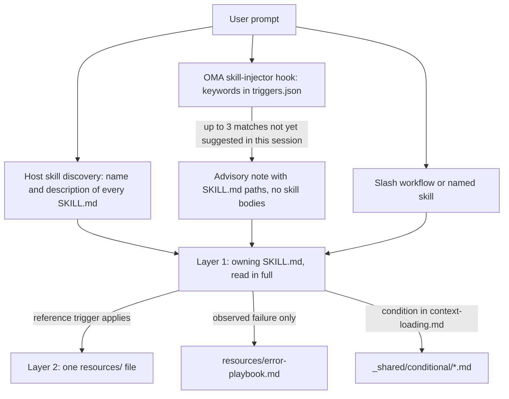
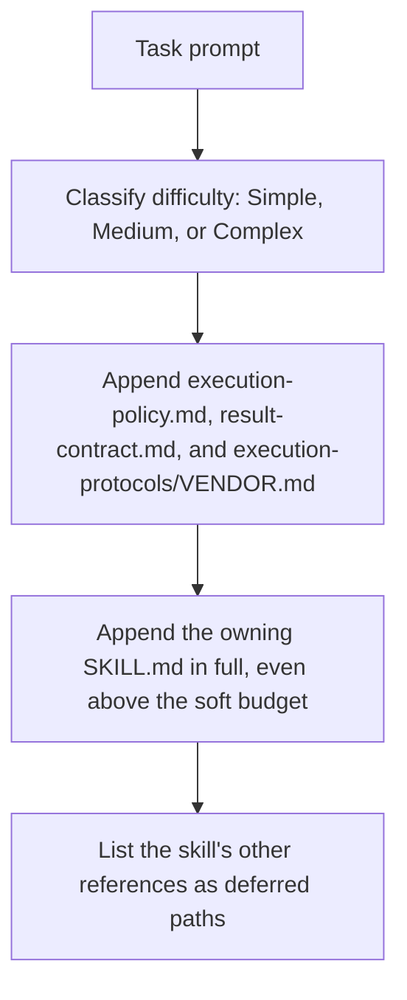

# 스킬

[스킬](../getting-started/glossary.md#skill)은 디스패치 역할에 도메인 지침을 제공하는 구조화된 지식 패키지입니다. 실행 프로토콜, 기술 스택 레퍼런스, 코드 템플릿, 에러 플레이북, 품질 체크리스트, 그리고 스킬이 제공하는 경우 예제를 담으며, 토큰 효율성을 위해 설계된 2계층 아키텍처로 구성됩니다. 설치된 스킬 목록은 [스킬 카탈로그](./agents.md#skill-catalog)를 참고하세요.

---

## 2계층 설계 {#the-two-layer-design}

스킬은 단계적으로 컨텍스트에 들어옵니다. 선택 단계에서는 경로나 설명만 모델 앞에 놓이고, 스킬이 선택되면 담당 SKILL.md를 전부 읽으며, 보조 파일은 각자의 트리거가 해당할 때 하나씩 읽습니다.



출처: `.agents/hooks/core/skill-injector.ts`, `.agents/skills/_shared/core/skill-routing.md`, `.agents/skills/_shared/core/context-loading.md`.

### Layer 1: SKILL.md (스킬이 선택될 때 읽음)

모든 스킬의 루트에는 `SKILL.md` 파일이 있습니다. 주입 훅은 본문이 아니라 **경로 참조**를 전달하므로, 선택되지 않은 스킬은 `description` 말고는 비용이 들지 않습니다. 모든 `SKILL.md`에는 YAML 프론트매터와 동일한 최상위 네 섹션이 있으며, `oma skill lint`는 섹션이 하나라도 빠졌거나 본문이 500줄을 넘는 스킬을 보고합니다.

| 구성 | 내용 |
|------|----------|
| 프론트매터 | `name`과 라우팅용 `description`(스킬이 하는 일과 사용 시기) |
| `## Scheduling` | 목표, 의도 시그니처, 사용 시기, 사용하지 말아야 할 때, 예상 입출력, 의존성 |
| `## Structural Flow` | 전환, 실패와 복구, 종료 상태 |
| `## Logical Operations` | 정규 명령 또는 워크플로우 경로, 리소스 범위, 가드레일 |
| `## References` | Layer 2 파일과 각 파일을 읽어야 하는 조건 |

현재 `oma-frontend` 프론트매터:

```yaml
---
name: oma-frontend
description: "Implement or modify web UI in React, Next.js, or Angular. Use for components, pages, styles, forms, and frontend state or data flows."
---
```

호스트 런타임은 각 스킬의 `description`을 모델에 보여주므로, description은 라우팅 문장으로 작성합니다. OMA의 키워드 훅은 이 필드를 읽지 않으며, 훅의 키워드는 `.agents/hooks/core/triggers.json`에 있습니다.

### Layer 2: resources/ (필요 시 로딩)

`resources/` 디렉토리에는 심층적인 실행 지식이 포함됩니다. 다음 조건에서만 로딩됩니다:
1. 호스트 또는 워크플로우가 스킬을 선택했을 때 (예: 네이티브 스킬 매칭 또는 명시적 명령)
2. 현재 태스크가 해당 레퍼런스의 로딩 조건을 충족할 때

이 필요 시 로딩은 컨텍스트 로딩 가이드(`.agents/skills/_shared/core/context-loading.md`)가 관리하며, 엔트리 지침과 태스크에 따라 선택되는 레퍼런스를 구분합니다.

### `oma agent spawn`이 주입하는 내용

CLI 디스패치는 서브에이전트 프롬프트를 직접 조립하므로, 서브에이전트는 컨트랙트와 담당 스킬이 이미 컨텍스트에 들어 있는 상태로 시작합니다:



출처: `cli/commands/agent/spawn-status.ts`, `cli/platform/agent-config/loaders.ts`, `cli/platform/context-loader.ts`. 네이티브 서브에이전트는 `oma agent context <agent-id>`로 같은 태스크 컨텍스트를 받고, 런타임이 정책과 결과 컨트랙트를 제공하지 않았다면 직접 읽습니다.

---

## 파일 구조 예시 {#file-structure-example}

```text
.agents/skills/oma-frontend/
├── SKILL.md                          ← Layer 1: read when selected
└── resources/
    ├── execution-protocol.md         ← Layer 2: step-by-step workflow
    ├── tech-stack.md                 ← Layer 2: detailed technology specs
    ├── tailwind-rules.md             ← Layer 2: Tailwind conventions
    ├── angular-rules.md              ← Layer 2: Angular-specific conventions
    ├── snippets.md                   ← Layer 2: copy-paste code patterns
    ├── error-playbook.md             ← Layer 2: error recovery procedures
    └── checklist.md                  ← Layer 2: quality verification checklist

.agents/skills/oma-backend/
├── SKILL.md
├── resources/
│   ├── execution-protocol.md
│   ├── orm-reference.md              ← Domain-specific (ORM queries, N+1, transactions)
│   ├── checklist.md
│   └── error-playbook.md
└── variants/                          ← Starter seeds for /stack-set
    ├── stack.schema.json
    ├── node/
    ├── python/
    └── rust/

.agents/skills/oma-mobile/
├── SKILL.md
├── resources/
│   ├── execution-protocol.md
│   ├── tech-stack.md
│   ├── screen-template.dart
│   ├── screen-template.swift         ← Swift native iOS screen template
│   ├── screen-template.tsx            ← React Native screen template
│   ├── checklist.md
│   └── error-playbook.md
└── variants/                          ← Platform seeds for /stack-set
    ├── README.md
    ├── stack.schema.json
    ├── flutter/                       ← stack.yaml, tech-stack.md, snippets.md, api-template.dart
    ├── react-native/                  ← stack.yaml, tech-stack.md, snippets.md, api-template.ts
    └── swift-ios/                     ← stack.yaml, tech-stack.md, snippets.md, api-template.swift

.agents/skills/oma-design/
├── SKILL.md
├── resources/
│   ├── execution-protocol.md
│   ├── anti-patterns.md
│   ├── asset-strategy.md
│   ├── checklist.md
│   ├── design-md-spec.md
│   ├── design-tokens.md
│   ├── getdesign-fetcher.md
│   ├── prompt-enhancement.md
│   ├── redesign-protocol.md
│   ├── stitch-integration.md
│   └── error-playbook.md
└── reference/                         ← Deep reference material
    ├── typography.md
    ├── color-and-contrast.md
    ├── spatial-design.md
    ├── motion-design.md
    ├── responsive-design.md
    ├── component-patterns.md
    ├── accessibility.md
    ├── visual-hierarchy.md
    └── shader-and-3d.md
```

---

## 스킬별 리소스 유형 {#per-skill-resource-types}

| 리소스 유형 | 파일명 패턴 | 목적 | 로딩 시점 |
|--------------|-----------------|---------|-------------|
| **실행 프로토콜** | `execution-protocol.md` | 단계별 워크플로우: 분석 -> 계획 -> 구현 -> 검증 | 선택한 작업에 명령이나 계약 세부 사항이 필요할 때 |
| **기술 스택** | `tech-stack.md` | 상세 기술 사양, 버전, 설정 | 선택한 프레임워크 또는 스택 결정 |
| **에러 플레이북** | `error-playbook.md` | 증상별 복구 단계. 정보나 권한이 부족하면 그에 의존하는 작업만 멈춤 | 실패가 관찰된 뒤에만 |
| **체크리스트** | `checklist.md` | 도메인별 품질 검증 | 검증이 끝나지 않았을 때 관련 섹션만 |
| **스니펫** | `snippets.md` | 복사-붙여넣기 가능한 코드 패턴 | 익숙하지 않은 구현 또는 출력 형태 |
| **예제** | `examples.md` | 실제 입출력 예제 (oma-pm, oma-db, oma-tf-infra, oma-observability, oma-search) | 익숙하지 않은 구현 또는 출력 형태 |
| **변형** | `variants/` 디렉토리 | 언어/프레임워크별 시작 시드. backend는 `node`, `python`, `rust`를, mobile은 `flutter`, `react-native`, `swift-ios`를 제공합니다. `/stack-set`이 이를 사용해 프로젝트의 `stack/`을 생성합니다. | 일치하는 스택을 설정할 때 |
| **템플릿** | `screen-template.{dart,swift,tsx}` (oma-mobile), `variants/*/api-template.*` | 새 화면이나 API 모듈의 보일러플레이트 | 해당 파일을 만들 때 |
| **도메인 레퍼런스** | `orm-reference.md`, `anti-patterns.md` 등 | 특정 서브태스크를 위한 심층 도메인 지식 | 태스크 유형별 |

---

## 공유 리소스 (_shared/)

모든 에이전트는 `.agents/skills/_shared/`의 공통 기반을 공유합니다. 세 가지 카테고리로 구성됩니다:

### 핵심 리소스 (`.agents/skills/_shared/core/`)

| 리소스 | 목적 | 로딩 시점 |
|----------|---------|-------------|
| **`execution-policy.md`** | 모든 스킬과 워크플로우에 적용되는 승인, 명확화, 검증, 완료 규칙. | 모든 `oma agent spawn` 프롬프트에 주입되며, 네이티브 에이전트는 제공되지 않았으면 직접 읽음 |
| **`skill-routing.md`** | 태스크 결과, 담당 영역, 실제 의존성에 따라 라우팅하며, 반드시 거쳐야 하는 에이전트 체인이나 턴 할당량은 없습니다. | 오케스트레이터와 코디네이션 스킬에서 참조 |
| **`context-loading.md`** | 담당 스킬의 엔트리, 조건부 레퍼런스, 런타임 로딩 경계. | 컨텍스트를 구성할 때 |
| **`prompt-structure.md`** | 익숙하지 않은 태스크를 인계할 때 목표, 컨텍스트, 실제 제약 조건, 인수 증거를 담도록 안내하며, 직접 처리하는 태스크에는 필수 템플릿이 없습니다. | 익숙하지 않은 인계를 구성할 때. 필수 사전 로딩 대상은 아님 |
| **`clarification-protocol.md`** | 일상적인 세부 사항은 컨텍스트에서 해결하고, 중요한 정보가 빠졌거나 승인이 필요할 때만 질문합니다. | 요구사항이 모호할 때 |
| **`code-intelligence.md`** | 코드 검색, 탐색, 영향 분석에 설정된 코드 인텔리전스 기능을 사용합니다. | 코드 검색 또는 탐색 |
| **`test-approach.md`** | PM 계획에서 정하는 태스크별 `test_approach`와 `tdd` 태스크용 `TDD_EVIDENCE` 블록. | 계획에 `test_approach`가 지정된 태스크 |
| **`context-budget.md`** | 파일 크기 추정, 실제 프롬프트 측정, 범위를 좁힌 읽기, 체크포인트. | 긴 태스크 또는 컨텍스트 오버헤드 진단 |
| **`difficulty-guide.md`** | 의존성과 검증 요구 사항에 따라 계획의 깊이와 산출물을 정합니다. | 태스크 분해에 난이도 추정이 필요할 때 |
| **`quality-principles.md`** | 범위, 유지보수성, 증거, 적정 수준의 검증을 다루는 지침. | 품질 중심 워크플로우(ultrawork) 시작 시 |
| **`vendor-detection.md`** | 설정에서 각 에이전트의 대상 벤더를 해석하고, 네이티브 디스패치와 `oma agent spawn` 중 하나를 선택합니다. | 디스패치 세부 사항이 정해지지 않았을 때 |
| **`session-metrics.md`** | 대화 페널티 점수나 평가자 페널티 점수가 없는 선택적 세션 증거. | 요청된 회고 또는 중요한 수정 |
| **`common-checklist.md`** | 해당하는 크로스 도메인 검사 항목이며, 전역 줄 수 제한이나 일괄적인 catch 요구는 없습니다. | 관련이 있을 때의 크로스 도메인 리뷰 |
| **`lessons-learned.md`** | 증거로 뒷받침되는 교훈을 버전/트리거 조건과 함께 기록하고 적용하며, 자동 RCA 임계값은 없습니다. | 에러 후 및 세션 종료 시 참조 |
| **`anti-ai-prose.md`** | 공유 산문 진단. | 학술 산문 감사와 번역 문체 리뷰 |
| **`stack-verify.schema.json`** | backend와 mobile 스택 스키마가 재사용하는 공유 `verify:` 정의. | 스택 스키마 검증 |
| **`api-contracts/`** | 선택적으로 쓰는 컨트랙트 템플릿입니다. 프로젝트 스키마를 재사용하세요. 생성된 컨트랙트는 스킬 소스 밖에 있습니다. | 크로스 바운더리 작업 계획 시 |

### 런타임 리소스 (`.agents/skills/_shared/runtime/`)

| 리소스 | 목적 |
|----------|---------|
| **`result-contract.md`** | 에이전트 결과의 실행 식별자, 클레임 경로, 완료 컨트랙트. 모든 `oma agent spawn` 프롬프트에 주입되며, 네이티브 에이전트는 `oma agent begin`, `oma agent verify`, `oma agent finish`로 이를 따릅니다. |
| **`memory-protocol.md`** | CLI 서브에이전트용 메모리 파일 형식과 연산. On Start, During Execution, On Completion 프로토콜을 설정 가능한 메모리 도구(read/write/edit)로 정의합니다. 실험 추적 확장 포함. |
| **`event-spec.md`** | 영속 워크플로우 이벤트 컨트랙트. OMA 홈 프로필 아래 `events.jsonl`에 추가되며, `oma state get` 또는 `oma state list`로 확인합니다. |
| **`execution-protocols/claude.md`** | Claude Code 전용 실행 패턴. 벤더가 claude일 때 `oma agent spawn`이 주입합니다. |
| **`execution-protocols/antigravity.md`** | Antigravity CLI(`agy`) 실행 패턴. |
| **`execution-protocols/codex.md`** | Codex CLI 전용 실행 패턴. |
| **`execution-protocols/commandcode.md`** | CommandCode 실행 패턴. |
| **`execution-protocols/grok.md`** | Grok 실행 패턴. |
| **`execution-protocols/kimi.md`** | Kimi Code 실행 패턴. |
| **`execution-protocols/kiro.md`** | Kiro 실행 패턴. |
| **`execution-protocols/opencode.md`** | OpenCode 확장 실행 패턴. |
| **`execution-protocols/pi.md`** | pi 확장 실행 패턴. |
| **`execution-protocols/qwen.md`** | Qwen CLI 전용 실행 패턴. |

벤더별 실행 프로토콜은 CLI로 스폰된 에이전트에 `oma agent spawn`이 자동으로 주입합니다. 네이티브 서브에이전트는 선택된 벤더의 통합 규칙을 사용합니다.

### 조건부 리소스 (`.agents/skills/_shared/conditional/`)

실행 중 특정 조건이 충족될 때만 로딩됩니다:

| 리소스 | 트리거 조건 | 로딩 주체 |
|----------|-------------------|-----------|
| **`quality-score.md`** | 정의된 기준선이나 실험 비교가 필요할 때 | 오케스트레이터 (QA 에이전트 프롬프트에 전달) |
| **`experiment-ledger.md`** | 실제 가설을 기준선이나 다른 접근 방식과 비교할 때 | 코디네이터 (공유 원장을 관리하며, 병렬 에이전트가 태스크/실행 범위 결과를 기록하면 코디네이터가 병합) |
| **`exploration-loop.md`** | 복구가 반복해서 실패했고, 예산 범위에서 대안을 시험해 볼 가치가 있을 때 | 오케스트레이터 (인라인, 가설 에이전트 스폰 전) |
| **`diagram-engine.md`** | 워크플로우가 구조 다이어그램(아키텍처, 시퀀스, 데이터 흐름, 라이프사이클)을 출력하려 할 때 | 다이어그램을 출력하는 워크플로우 |

이 리소스는 각자의 트리거 조건에 해당할 때까지 로딩이 보류됩니다. 난이도만으로는 주입되지 않습니다.

---

## 스킬이 선택되는 방식 {#how-skills-route-via-skill-routingmd}

스킬이 컨텍스트에 들어오는 경로는 세 가지입니다. 어느 경로도 그 자체로 워크플로우를 시작하거나 위임을 승인하지 않습니다.

1. **호스트 네이티브 탐색.** 스킬을 지원하는 런타임은 모든 스킬의 `name`과 `description`을 나열하고, 모델은 요청한 결과에 맞는 description을 가진 SKILL.md를 읽습니다.
2. **OMA 키워드 힌트.** OMA가 프롬프트 훅을 설치한 곳에서는 `skill-injector`가 프롬프트를 `.agents/hooks/core/triggers.json`의 다국어 키워드와 대조하고, 최대 세 개의 SKILL.md 경로를 나열한 권고성 `[OMA SKILLS DETECTED: ...]` 노트를 추가합니다. "Build a login form with Tailwind CSS"라는 프롬프트에서는 `tailwind` 키워드만 매칭되므로 노트가 `oma-frontend`를 제안합니다.
3. **명시적 호출.** `/plan`, `/review`, `/debug` 같은 슬래시 워크플로우를 쓰거나 프롬프트에서 스킬 이름을 지정하는 경우입니다.

### 결과 기준 담당

범위가 정해진 태스크는 담당 스킬 하나가 처리하며, 다른 스킬이 별개의 역량을 제공할 때만 인계를 추가합니다. 이 표는 `.agents/skills/_shared/core/skill-routing.md`를 그대로 반영합니다. 그 밖의 도메인은 [스킬 카탈로그](./agents.md#skill-catalog)에 있는 설치된 스킬의 설명을 보고 고르세요.

| 요청한 결과 | 담당 스킬 |
|-------------------|--------------|
| 애플리케이션 API, 서버 인증, 서비스/데이터 접근 로직 | oma-backend |
| 스키마, 마이그레이션 설계, 인덱싱, 쿼리 튜닝, 데이터베이스 운영 | oma-db |
| 웹 컴포넌트, 페이지, 폼, 클라이언트 상태 | oma-frontend |
| 모바일 화면, 위젯, 플랫폼 통합 | oma-mobile |
| 시스템 경계, 아키텍처 트레이드오프, ADR | oma-architecture |
| 잘못된 동작의 진단과 수정 | oma-debug |
| 정확성, 보안, 접근성, 성능 리뷰 | oma-qa |
| 시각 시스템, DESIGN.md, 리디자인 방향 | oma-design |
| 요청된 아이디어 탐색 또는 대안 탐색 | oma-brainstorm |
| 요구사항, 의존성, 인수 기준 | oma-pm |
| 요청된 병렬 전문가 실행 | oma-orchestration |
| 요청된 수동 멀티 에이전트 조율 | oma-coordination |
| Git 브랜치, 커밋, 머지, 저장소 이력 | oma-scm |

### 스킬 간 의존성

고정된 실행 체인은 없습니다. 실제 의존성에 따라 작업 순서를 정합니다:

- 확정되지 않은 아키텍처나 제품 결정은 그에 의존하는 작업보다 먼저 해결합니다. 이미 내린 결정을 아키텍처, 브레인스토밍, PM 단계에 다시 통과시킬 필요는 없습니다.
- 공유 API 컨트랙트를 쓸 수 있으면 백엔드와 클라이언트 작업은 독립적으로 진행할 수 있습니다. 컨트랙트가 없으면 관련 담당자와 그 경계를 먼저 정합니다.
- 독립적인 구현이 계속되는 동안에도, 완료되어 리뷰할 수 있는 부분부터 리뷰를 시작할 수 있습니다. 불안정한 산출물을 최종 증거로 리뷰하지 마세요.
- 구현 중 발견한 버그는 담당자가 고칠 수 있습니다. 진단이 필요하면 debug 지원을 추가하며, 구현에서 debug로 반드시 넘어가야 하는 체인은 없습니다.
- 여러 도메인에 걸친 결함은 증거를 바탕으로 실패한 컨트랙트와 책임 있는 담당자를 식별합니다. API 불일치가 있다고 해서 반드시 백엔드를 고쳐야 하는 것은 아닙니다.

### 스킬 힌트가 나타나지 않을 때

아래 동작은 모두 `.agents/hooks/core/skill-injector.ts`에서 나옵니다.

| 증상 | 원인 | 조치 |
|---------|-------|------------|
| `[OMA SKILLS DETECTED]` 노트가 아예 없음 | 프롬프트가 `/`로 시작하거나, 세션에서 [지속 워크플로우](../getting-started/glossary.md#persistent-workflow)가 활성 상태이거나, 메시지가 중계된 에이전트 메시지임 | 정상 동작입니다. 워크플로우가 컨텍스트를 관리합니다. 스킬이 필요하면 이름을 지정하세요 |
| 기대한 스킬이 노트에 없음 | 상위 3개 매칭만 표시됨 (매칭된 키워드당 10점) | 더 구체적인 용어를 쓰거나 스킬 이름을 지정하세요 |
| 앞서 제안된 스킬이 다시 제안되지 않음 | SKILL.md 경로는 세션당 한 번만 제안되며, `.agents/state/skill-sessions.json`의 기록은 새 제안 없이 한 시간이 지나면 만료됨 | 앞선 제안이 여전히 유효합니다 |
| 키워드가 무시됨 | 코드 펜스, 백틱, 큰따옴표 안의 텍스트는 매칭 전에 제거됨 | 용어를 일반 텍스트로 언급하세요 |
| oma-academic-writing, oma-docs, oma-explanation, oma-scholar, oma-skill-creation이 전혀 제안되지 않음 | 이 스킬들은 `triggers.json`에 키워드가 없음 | `/docs`나 `/explain`을 쓰거나 스킬 이름을 지정하세요. 호스트 탐색은 여전히 이 스킬들의 description을 봅니다 |
| 힌트가 관련 없는 스킬을 가리킴 | 매칭은 키워드 기반이며 권고일 뿐임 | 원하는 결과를 명시하세요. 노트는 모델에게 판단해서 적용하라고 안내합니다 |

---

## 토큰 절약 계산 {#token-savings-math}

절약을 주장하기 전에 컨텍스트 비용을 측정하세요. simple, medium, complex라는 단어는 서로 다른 두 가지 대상에 쓰입니다:

- **스크립트 시나리오**(`routed`, `simple`, `medium`, `complex`, `all`)는 `scripts/measure-skill-context.ts`가 출력하는 누적 파일 크기 비교입니다. 로딩 정책이 아니며, `all`은 상한일 뿐입니다.
- **로더 난이도**(Simple, Medium, Complex)는 CLI 디스패치가 주입하는 컨텍스트의 소프트 예산을 정합니다. [태스크별 리소스 로딩](#resource-loading-by-task)을 참고하세요.

```bash
bun scripts/measure-skill-context.ts
bun scripts/measure-skill-context.ts --skills oma-pm,oma-backend,oma-frontend --json
oma agent context backend --difficulty Medium
```

이 스크립트는 UTF-8 바이트를 4로 나눈 추정치를 보고합니다. `routed`는 엔트리만 포함하고, `simple`, `medium`, `complex`는 비교를 위해 가상의 프로토콜, 예제, 스택 파일을 더합니다. 이 이름은 스크립트 호환성을 위해 유지한 것이며, 미리 로딩하라는 지시가 아닙니다. 새로 받은 체크아웃에서는 플랫폼 시드 하나를 크기 대리 지표로 쓸 수도 있으며, 모든 플랫폼을 로딩하지는 않습니다.

컨텍스트 명령은 실제로 주입되는 태스크 컨텍스트를 출력합니다. `## Task context (graph-selected, approximately N tokens)` 헤더, 담당 SKILL.md, 보류된 레퍼런스 목록이 포함됩니다. 대화의 나머지 부분이나 호스트/런타임 지침 전체는 포함하지 않으며, `oma agent spawn`은 실행 정책, 결과 컨트랙트, 벤더 프로토콜도 추가하므로 스폰된 프롬프트는 이보다 큽니다. 지정한 모델에서 전체 입력 토큰, 지연 시간, 비용을 측정하려면 조립된 프롬프트나 사용량 텔레메트리를 사용하세요. 저장소 크기나 생성된 미러 개수로 이 값을 추정하지 마세요.

## 태스크별 리소스 로딩 {#resource-loading-by-task}

어떤 난이도든 담당 스킬에서 시작합니다. 그래프는 레퍼런스 인덱스이며, 인접해 있다고 해서 다른 전문 스킬, 에러 플레이북, 조건부 실험 워크플로우를 로딩해도 되는 것은 아닙니다.

로더는 Simple / Medium / Complex에 각각 추정 토큰 1,500 / 4,000 / 8,000의 소프트 예산을 적용합니다. 예산을 초과하는 엔트리는 그대로 유지하고 초과분을 보고합니다. 보조 레퍼런스는 태스크 트리거가 확정된 뒤 명시적으로 선택하지 않는 한 계속 보류됩니다. 필수 엔트리를 관련 없는 더 작은 문서로 대체하는 일은 없습니다.

검증은 태스크의 위험도와 프로젝트 요구 사항에 맞춰 수행합니다. 난이도 레이블이 있다고 해서 전체 테스트 스위트나 고정된 사전 점검 응답이 필요한 것은 아니며, 이미 승인된 작업을 다시 승인받아야 하는 것도 아닙니다.

## 컨텍스트 로딩 태스크 맵 (에이전트별)

다음은 태스크에 필요할 때 찾아볼 레퍼런스의 예시입니다. 담당 스킬의 최신 인덱스를 사용해 해당하는 섹션만 선택하세요:

### Backend 에이전트

<!-- oma-docs:ignore-start -->

| 태스크 유형 | 필수 리소스 |
|-----------|-------------------|
| CRUD API 생성 | 있으면 프로젝트의 `stack/snippets.md`와 `stack/api-template.*`(`/stack-set`이 생성), 없으면 기존 프로젝트 코드 |
| 인증 | 있을 때 `stack/snippets.md` + `stack/tech-stack.md` |
| DB 마이그레이션 | 있을 때 `stack/snippets.md`. 스키마 설계는 oma-db가 담당 |
| 성능 최적화 | `orm-reference.md`와 스킬이 제공하는 일치하는 예제 |
| 기존 코드 수정 | 프로젝트 코드 인텔리전스 프로바이더와 관련 실행 리소스 |

<!-- oma-docs:ignore-end -->

`variants/node`, `variants/python`, `variants/rust`는 `/stack-set`용 시작 시드이며, 에이전트는 기존 코드를 수정할 때 이를 읽지 않습니다.

### Frontend 에이전트

| 태스크 유형 | 필수 리소스 |
|-----------|-------------------|
| 컴포넌트 생성 | snippets.md + 프로젝트의 기존 컴포넌트 패턴 |
| 폼 구현 | snippets.md (form + Zod) |
| API 통합 | snippets.md (TanStack Query) |
| 스타일링 | tailwind-rules.md |
| 페이지 레이아웃 | snippets.md (grid) |

### Design 에이전트

| 태스크 유형 | 필수 리소스 |
|-----------|-------------------|
| 디자인 시스템 생성 | reference/typography.md + reference/color-and-contrast.md + reference/spatial-design.md + design-md-spec.md |
| 랜딩 페이지 디자인 | reference/component-patterns.md + reference/motion-design.md + prompt-enhancement.md |
| 디자인 감사 | checklist.md + anti-patterns.md |
| 디자인 토큰 내보내기 | design-tokens.md |
| 3D / 셰이더 효과 | reference/shader-and-3d.md + reference/motion-design.md |
| 접근성 리뷰 | reference/accessibility.md + checklist.md |

### QA 에이전트

| 태스크 유형 | 필수 리소스 |
|-----------|-------------------|
| 보안 리뷰 | checklist.md (Security 섹션) |
| 성능 리뷰 | checklist.md (Performance 섹션) |
| 접근성 리뷰 | checklist.md (Accessibility 섹션) |
| 전체 감사 | checklist.md (전체 섹션). 표준 기반 리뷰를 요청하면 iso-quality.md 추가 |
| 정의된 지표 비교 | quality-score.md (조건부) |

---

## 오케스트레이터 프롬프트 구성

오케스트레이터가 서브에이전트 프롬프트(`oma-orchestration/resources/subagent-prompt-template.md`)를 작성할 때는 태스크 데이터만 제공합니다. 에이전트 역할, 태스크 ID, 워크스페이스, 허용 경로, 태스크 설명, 인수 기준, 로딩 조건이 붙은 태스크 레퍼런스, 중요한 제약 조건이 여기에 해당합니다.

- CLI 디스패치에서는 `oma agent spawn`이 이미 `execution-policy.md`, `result-contract.md`, 벤더 실행 프로토콜, 담당 SKILL.md를 주입하므로 프롬프트에서 반복하지 않습니다.
- 네이티브 디스패치에서는 런타임이 제공하지 않았다면 이 파일들과 담당 스킬의 경로를 전달합니다.
- 에러 플레이북 섹션은 실패가 관찰된 뒤에만, `runtime/memory-protocol.md`는 에이전트가 영속 태스크 상태를 조율하거나 재개할 때만 추가합니다.

이렇게 대상을 좁힌 구성은 불필요한 리소스 로딩을 방지하여, 실제 작업에 사용할 수 있는 서브에이전트의 컨텍스트를 극대화합니다.

---

## 세션 증거와 회고 리뷰

세션 기록은 중요한 수정, 스코프 변경, 재작업, 판정을 거친 리뷰 발견 사항을 증거와 함께 남깁니다. 필요한 명확화에는 페널티가 없습니다. 이전의 CD와 EA 가중 점수, 그리고 임계값을 넘으면 RCA를 요구하던 규칙은 제거되었습니다. 이들은 CLI가 계산하는 지표가 아니라 프롬프트 지침이었습니다.

가능하면 기존 태스크 결과를 사용하세요. 설정된 코디네이션 저장소 아래에 두는 별도의 `session-metrics-{sessionId}.md`는 선택 사항입니다. 반복된 실패나 요청된 회고는 교훈을 남길 근거가 될 수 있지만, 일반적인 검사 실패나 이의가 제기된 발견 사항이 자동으로 교훈이 되는 것은 아닙니다. 과거 로그는 보존하고, 새 형식으로 다시 쓰지 마세요.

`oma stats`는 생산성과 기록된 사용량/비용 요약을 보고합니다. `oma retro`는 실제로 발생한 게이트, 블로커, 결정 누락 이벤트를 묶어 제안으로 정리합니다. 둘 다 이 Markdown 산출물에서 CD/EA 점수를 계산하지 않습니다.

## 태스크 분해와 컨텍스트 복구

의존성, 그리고 독립적으로 검증 가능한 동작을 중심으로 계획하세요. 고정된 스프린트 수, 파일 수, 턴 추정치가 리뷰 깊이나 완료 여부를 결정하지는 않습니다. 테스트와 에러 처리는 검증 대상 동작과 함께 두세요.

정체나 유용한 컨텍스트 손실이 관찰되면, 재개하거나 다시 디스패치하기 전에 완료한 작업, 남은 기준, 관련 경로, 검증 증거를 저장하세요. 기존 작업은 보존하고, 진행 중인 시도를 중복해서 실행하지 마세요. 턴/진행 비율만으로는 리셋이 필요하지 않습니다.

## 조건부 측정과 탐색

정의된 기준선이나 실험 비교가 있으면 측정 지침이 활성화되지만, 테스트나 린트가 있다는 것만으로는 활성화되지 않습니다. 비교 가능한 지표는 단위, 방법, 리비전, 증거와 함께 기록하세요. 필수 정확성 검사와 보안 검사는 독립적으로 유지됩니다. OMA에는 기본 종합 공식도, 문자 등급 게이트도, 점수에 따라 시작되는 롤백도 없습니다.

실제 실험은 가설, 기준선과 후보의 증거, 필수 검사, 결정, 소유한 파일을 기록합니다. 반복된 실패는 기존 복구 예산 안에서 다른 메커니즘을 시험해 볼 근거가 될 수 있습니다. 실험 변경은 격리하고, 관련 없는 수정은 보존하며, 게이트를 재개하기 전에 통합된 후보를 검증하세요.

---

## 관련 문서 {#related}

- [에이전트](./agents.md): 스킬 카탈로그, 디스패치 역할, 정의, 네이티브 에이전트 파일
- [워크플로우](./workflows.md): 스킬을 읽는 슬래시 워크플로우
- [프로젝트 구조](./project-structure.md): 설치 후 `.agents/skills/`가 놓이는 위치
- [에이전트 결과 및 재개](../guide/agent-results-and-resume.md): 네이티브 `oma agent begin` → `oma agent finish` 라이프사이클
- [스킬 평가](../guide/skill-eval.md)와 [스킬 최적화](../guide/skill-opt.md)
- 작성: `oma-skill-creation` 스킬을 사용한 뒤 `oma skill lint`와 `oma skill audit`을 실행
