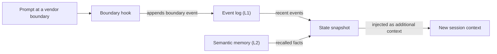

# 용어집

## 구성 요소

### 스킬 {#skill}

스킬은 `.agents/skills/oma-<name>/`에 있는 도메인 지식 패키지입니다. 스킬이 라우팅되면 `SKILL.md`가 컨텍스트에 들어오고, `resources/`의 파일은 태스크에 필요할 때만 로드됩니다. 스킬은 한 도메인에서 에이전트가 일하는 방식을 안내할 뿐, 다단계 프로세스를 정의하지는 않습니다. [스킬](../core-concepts/skills.md)을 참고하세요.

### 워크플로우 {#workflow}

워크플로우는 `.agents/workflows/<name>.md`에 정의된 다단계 프로세스입니다. `/plan`이나 `/orchestrate` 같은 슬래시 명령으로 시작하며, 키워드 감지 훅이 활성화된 환경에서는 일치하는 트리거 문구로도 주입될 수 있습니다. 워크플로우는 하나 이상의 스킬과 에이전트를 조율합니다. [워크플로우](../core-concepts/workflows.md)와 [스킬과 워크플로우 선택 기준](../core-concepts/workflows.md#choosing-a-skill-or-workflow)을 참고하세요.

### 에이전트 정의 {#agent-definition}

에이전트 정의는 `.agents/agents/`에 체크인된 서브에이전트 파일로, `backend-engineer.md`나 `qa-reviewer.md` 같은 파일입니다. 에이전트의 정체성, 로드할 스킬(`skills:` 프론트매터), 실행 프로토콜 섹션, 도메인 규칙을 정합니다. OMA는 이 파일을 `.claude/agents/*.md`, `.codex/agents/*.toml` 같은 벤더 네이티브 형식으로 변환합니다. 문서에서는 디스패치 역할(`backend`, `qa`, `explore`)이나 `oma-backend` 같은 스킬을 가리킬 때도 "에이전트"라는 말을 씁니다. [에이전트 정의](../core-concepts/agents.md#agent-definitions)를 참고하세요.

## 프리셋

### 스킬 프리셋 {#skill-preset}

스킬 프리셋은 설치 프로그램이 프로젝트에 추가하는 스킬 묶음으로, `all`, `fullstack`, `backend`, `research` 등이 있습니다. 공용 `_shared/` 리소스는 어떤 프리셋을 고르든 함께 설치됩니다. 스킬 프리셋은 에이전트를 실행하는 모델에 영향을 주지 않습니다. [프리셋](./installation.md#presets)을 참고하세요.

### 모델 프리셋 {#model-preset}

모델 프리셋은 `.agents/oma-config.yaml`(또는 `.cue`)의 `model_preset` 값입니다. 각 에이전트가 어떤 벤더와 모델을 사용할지 결정합니다. 새 설치의 기본값인 `auto`는 현재 런타임 자체의 에이전트 및 모델 설정을 따르고, `claude`, `codex`, `mixed` 같은 고정 프리셋은 이를 고정합니다. `agents.<id>` 오버라이드가 프리셋보다 우선하지만, `free`에서는 `free.model`이 에이전트별 모델 고정을 대체합니다. [빌트인 프리셋](../guide/per-agent-models.md#built-in-presets)을 참고하세요.

## 워크플로우 실행

### 지속 워크플로우 {#persistent-workflow}

지속 워크플로우는 작업이 끝나거나 사용자가 비활성화할 때까지 여러 턴에 걸쳐 계속 실행됩니다. 지속 워크플로우는 `/orchestrate`, `/work`, `/ultrawork`, `/ralph`이며, 명시적으로 호출했을 때만 지속 모드가 활성화됩니다. 지속 워크플로우가 활성인 동안에는 훅이 프롬프트마다 `[OMA PERSISTENT MODE: ...]`를 다시 주입하고, Stop 훅은 강화 한도나 상태 만료(staleness) 타임아웃에 도달할 때까지 세션 종료를 막습니다. 비활성화하려면 `workflow done`이라고 말하세요. [지속 모드 메커니즘](../core-concepts/workflows.md#persistent-mode-mechanics)을 참고하세요.

### 정지 게이트 {#stop-gate}

정지 게이트는 `oma goal set --gate typecheck|test|lint`로 활성 지속 워크플로우에 붙이는 선택적 완료 검사입니다. 게이트를 붙이면 Stop 훅은 같은 이름의 `package.json` 스크립트가 통과할 때만 워크플로우 종료를 허용합니다. 게이트 실패는 강화 한도에 반영되므로, 실패하는 게이트가 종료를 영원히 막을 수는 없습니다. [`goal set`](../cli-interfaces/commands.md#goal-set)을 참고하세요.

## 세션과 상태

OMA에서 "세션"은 두 가지 뜻으로 쓰입니다. OMA가 직접 추적하는 세션과, 사용 중인 AI CLI나 IDE의 대화 세션입니다. 상태 파일이나 명령 옵션을 읽을 때는 둘을 구분하세요.

### OMA 세션 {#oma-session}

OMA 세션은 벤더 대화와 무관하게 OMA가 자체 세션 ID로 추적하는 작업입니다. 오케스트레이션은 이 ID로 계획, 태스크 보드, 진행·결과 파일, 에이전트 실행 기록의 이름을 정하며, 오케스트레이터는 ID를 `session-YYYYMMDD-HHMMSS` 형식으로 생성합니다. 워크플로우 상태는 OMA 세션 ID(`sid`)를 키로 [이벤트 로그](#event-log)를 관리하며, `oma state list`와 `oma state get <sid>`로 이를 확인할 수 있습니다. [세션 ID 전략](../guide/multi-agent-project.md#session-id-strategy)을 참고하세요.

### 벤더 세션 ID {#vendor-session-id}

벤더 세션 ID는 Claude Code나 Codex 세션 ID처럼 AI CLI나 IDE가 부여하는 대화 ID입니다. OMA는 이벤트에 이 값을 `vendorSid`로 기록하며, 지속 모드 상태 파일도 이 값을 키로 사용합니다(`.agents/state/<workflow>-state-<vendor-session-id>.json`). OMA 세션이 활성인 상태에서 다른 벤더 세션, 다른 벤더, 또는 방금 압축된 세션에서 프롬프트가 들어오면, 훅이 `boundary` 이벤트를 기록하고 상태 스냅샷을 주입해 새 컨텍스트에서도 작업이 이어지게 합니다. [`state`](../cli-interfaces/commands.md#state)를 참고하세요.

시맨틱 메모리를 사용할 수 없으면 스냅샷은 로컬 이벤트만 사용합니다.

### 이벤트 로그 {#event-log}

이벤트 로그는 OMA 세션의 추가 전용(append-only) 기록으로, `${OMA_STATE_HOME:-~/.oma}/u/<profile>/sessions/<sid>/` 아래에 `events.jsonl`로 저장됩니다. 각 줄은 `session.created`, `workflow.phase`, `gate.passed`, `decision.made`, `session.ended` 같은 이벤트 하나입니다. 워크플로우는 필수 결정을 `oma state emit`으로 추가하고 `oma state verify`로 확인합니다. 로그는 파일을 직접 열지 말고 `oma state get`이나 `oma state trajectory`로 읽으세요. [`state`](../cli-interfaces/commands.md#state)를 참고하세요.

## 리뷰와 증거

### Judge {#judge}

"judge"에는 두 가지 뜻이 있습니다. `/ralph`에서 judge는 매 ultrawork 반복 뒤에 오는 단계로, 모든 완료 기준을 실제 프로젝트 상태와 대조해 PASS, FAIL, REGRESSED, BLOCKED를 기록합니다. 새 컨텍스트로 별도 스폰된 에이전트가 이 단계를 실행하므로 오케스트레이터가 자기 작업을 스스로 채점하지 않습니다. 스킬 평가와 최적화에서 `judge`는 기본 체커 유형으로, 모델이 루브릭에 따라 각 arm의 출력을 채점하고 PASS 또는 FAIL을 반환합니다. [/ralph](../core-concepts/workflows.md#ralph)와 [judge 체커](../guide/skill-eval.md#judge-default)를 참고하세요.

### 교차 컨텍스트 리뷰 (CCR) {#cross-context-review-ccr}

교차 컨텍스트 리뷰는 `/ultrawork`의 각 리뷰 스텝을 컨텍스트가 격리된 새 리뷰어 서브에이전트에서 실행한다는 규칙입니다. 리뷰어는 경로로 참조되는 리뷰 대상 산출물(diff, 변경된 파일, 계획, 이전 결과, 테스트 출력)과 해당 리뷰의 가이드만 받으며, 메인 세션의 이력이나 구현자의 추론은 보지 않습니다. 각 리뷰어는 구조화된 판정을 작성하고, 단계 코디네이터가 이를 수집합니다. [/ultrawork](../core-concepts/workflows.md#ultrawork)를 참고하세요.

### 차터 {#charter}

차터는 구현 에이전트가 예전에 코드를 작성하기 전에 쓰던 `CHARTER_CHECK` 사전 점검 블록입니다. 현재 에이전트 정의는 고정된 사전 점검 출력을 요구하지 않습니다. 대신 에이전트는 공용 실행 정책을 따릅니다. 중요한 가정을 밝히고, 빠진 정보가 정확성이나 범위를 바꿀 때만 질문하며, 답에 의존하는 작업만 멈춥니다. 스폰된 서브에이전트는 사용자에게 직접 질문할 수 없으므로 빠진 정보를 `blocked` 또는 `partial` 결과로 보고합니다. [승인과 명확화](../core-concepts/agents.md#charter-preflight-charter_check)를 참고하세요.

### 실행 기록과 클레임 {#run-record-and-claim}

실행 기록은 에이전트 시도 한 번에 대한 기계 판독용 기록으로, 프로필의 프로젝트별 상태 디렉토리인 `~/.oma/u/<profile>/projects/<project-hash>/agent-runs/`에 저장됩니다(이전 버전은 `.agents/state/agent-runs/`를 사용했습니다). `oma agent begin`이 실행 기록을 만들고 태스크 계약의 스냅샷을 남깁니다. 클레임은 대응하는 `.claim.json` 경로에 에이전트가 직접 작성하는 보고서로, `completed`, `partial`, `blocked`, `failed` 중 하나의 상태와 함께 변경된 파일, 미해결 작업, 산출물을 담습니다. `oma agent finish`는 클레임을 현재 계약, 검증 기록, 산출물 해시와 대조하므로, 근거가 오래된 클레임은 완료 상태로 남지 않습니다. [에이전트 결과 및 재개](../guide/agent-results-and-resume.md)를 참고하세요.

## 메모리와 프로바이더

### L1·L2 메모리 {#l1-and-l2-memory}

L1은 [이벤트 로그](#event-log)로, `oma state verify`와 경계 스냅샷이 읽는 로컬 추가 전용 워크플로우 상태입니다. L2는 시맨틱 메모리로, 선택된 `providers.semantic_memory` 프로바이더(`agentmemory`(기본값), `honcho`, `none`)가 제공하는 회상된 사실입니다. 필수 결정은 L1에 남으므로 L2 없이도 세션 경계를 넘어 유지됩니다. "L1"과 "L2"는 다른 뜻으로도 쓰입니다. 스킬의 Layer 1과 Layer 2는 각각 `SKILL.md`와 온디맨드 `resources/` 디렉토리를 가리키며, `oma docs verify`가 보고하는 "L2 references"는 문서에서 추출한 파일, URL, CLI, 스크립트, 환경 변수, 설정 참조를 뜻합니다. [`memory`](../cli-interfaces/commands.md#memory)와 [Honcho 시맨틱 메모리](../guide/configuration-reference.md#honcho-semantic-memory)를 참고하세요.

### 기능 프로바이더 {#capability-provider}

기능 프로바이더는 OMA가 한 가지 기능에 사용하는 외부 도구나 서비스로, `.agents/oma-config.yaml`의 `providers` 아래에서 선택합니다. 기능은 문서(`docs`, 기본값 `context7`), 웹 검색(`web`, 기본값 `native`), 코드 인텔리전스(`code_intelligence`, 기본값 `serena`), 시맨틱 메모리(`semantic_memory`, 기본값 `agentmemory`)입니다. 프로바이더를 바꾼 뒤에는 `oma link`를 실행하세요. [최상위 키](../guide/configuration-reference.md#top-level-keys)와 [중요한 기본값](./important-defaults.md)을 참고하세요.

## 계획과 소스 파일

### 계획 {#plan}

계획은 `.agents/results/plan-<sessionId>.json`에 있는 기계 판독용 태스크 분해로, `/plan`이 작성하고 `/orchestrate`와 `/work`가 사용합니다. 사용할 수 있는 계획이 없으면 `/orchestrate`가 직접 만듭니다. 각 태스크는 담당 에이전트, 워크스페이스, 의존성, 인수 기준, 필수 검사를 명시하며, 실행 기록은 이 계약의 스냅샷을 남깁니다. 일부 페이지에서 상속된 계획(inherited plan)이라고 부르는, `oma doctor --profile`이 보여 주는 에이전트별 모델 해석과는 관련이 없습니다. [/plan](../core-concepts/workflows.md#plan)과 [네이티브 실행 시작](../guide/agent-results-and-resume.md#start-a-native-run)을 참고하세요.

### SSOT {#ssot}

단일 진실 원천(SSOT)은 `.agents/` 디렉토리입니다. 프로젝트 설치에서는 `<project>/.agents/`, 글로벌 설치에서는 `~/.oma/.agents/`입니다. 스킬, 워크플로우, 에이전트 정의, 규칙, 설정이 이곳에 있으며, `oma install`, `oma update`, `oma link`가 여기서 벤더 네이티브 파일(`.claude/`, `.codex/` 등)을 생성합니다. 생성된 파일을 편집하지 말고 `.agents/`를 편집한 뒤 `oma link`를 실행하세요. 일부 페이지에서는 예약 에이전트 매니페스트처럼 더 좁은 범위의 원천을 SSOT라고 부르기도 합니다. [.agents/: 진실의 원천](../core-concepts/project-structure.md#agents-the-source-of-truth)을 참고하세요.
