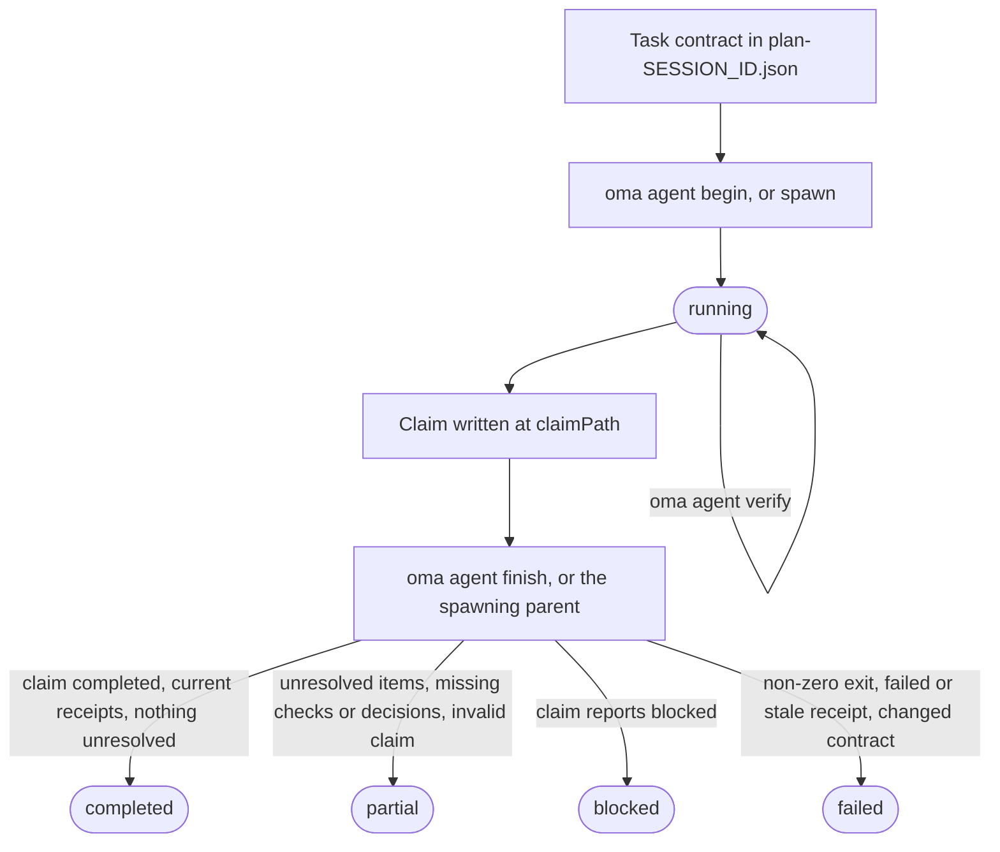
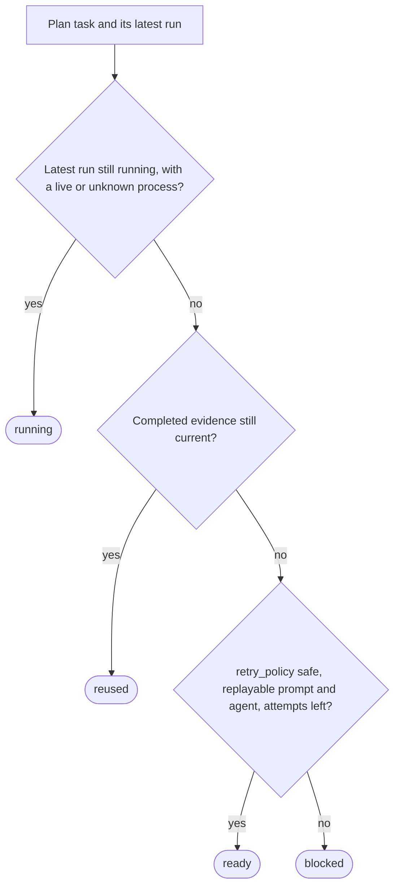

# 에이전트 결과 및 재개

OMA는 에이전트 결과를 단순한 프로세스 종료 코드가 아니라 작은 증거 기록으로 취급합니다. 실행 기록에는 작업 및 세션 ID, 워크스페이스 지문(`fingerprint`), 검증 기록(`receipt`), 변경 파일, 미해결 작업, 산출물 해시가 포함됩니다. 따라서 작업 완료 조건과 입력이 여전히 일치하는 동안에만 조정자가 완료된 작업을 재사용할 수 있습니다.

네이티브 에이전트를 직접 실행할 때는 이 생명주기를 사용하세요. 워크플로우와 `oma agent spawn`은 같은 기록을 자동으로 만들고, 관리되는 실행의 최종 처리는 상위 조정자가 담당합니다. 여기서 쓰는 용어는 용어집의 [실행 기록과 클레임](../getting-started/glossary.md#run-record-and-claim)과 [계획](../getting-started/glossary.md#plan)을 참고하세요.

## 생명주기 한눈에 보기

| 단계 | 명령 | 기록되는 것 | 보관할 것 |
| --- | --- | --- | --- |
| 1. 계약 | `.agents/results/plan-SESSION_ID.json` 편집 | 작업의 `acceptance_criteria`와 `required_checks` | 세션 ID, 작업 ID |
| 2. 시작 | `oma agent begin AGENT TASK SESSION_ID --workspace .` | 상태가 `running`인 실행 기록 | `runId`, `claimPath` |
| 3. 컨텍스트(선택) | `oma agent context AGENT --difficulty Medium` | 없음 | 프롬프트 컨텍스트 |
| 4. 검증 | `oma agent verify RUN_ID --required` | 검사마다 검증 기록 하나 | 종료 코드 |
| 5. 클레임 | `claimPath`에 JSON 작성 | 클레임 파일 | 없음 |
| 6. 종료 | `oma agent finish RUN_ID CLAIM_PATH` | 최종 상태 | `status` |
| 7. 복구 | `oma agent resume SESSION_ID --dry-run` 실행 후 `--dry-run` 없이 실행 | 복구 체크포인트와 세션 잠금 | 작업별 상태 |

`oma agent spawn`과 `oma agent parallel`은 2단계와 6단계를 대신 수행합니다. 상위 프로세스가 실행을 시작하고, 자식이 종료되면 실행을 마무리합니다.



클레임이 직접 `partial`이나 `failed`를 보고할 수도 있습니다. `finish`는 클레임을 절대 상향하지 않습니다. 증거가 성립하지 않는 `completed` 클레임은 하향하고, 종료 코드가 0이 아니면 어떤 실행이든 `failed`가 됩니다.

## 네이티브 실행 시작 {#start-a-native-run}

먼저 `.agents/results/plan-SESSION_ID.json`의 계획에 작업의 `acceptance_criteria`와 `required_checks`를 정의합니다. 작은 일반 프로젝트 검사라면 다음처럼 하나의 작업을 둘 수 있습니다.

```json
{
  "tasks": [
    {
      "id": "docs",
      "agent": "docs",
      "task": "Review README.md and report any documentation issues",
      "workspace": ".",
      "acceptance_criteria": [
        { "id": "diff-clean", "description": "The current Git diff has no whitespace errors" }
      ],
      "required_checks": [
        { "id": "whitespace", "criteria": ["diff-clean"], "command": ["git", "diff", "--check"], "cwd": "." }
      ],
      "retry_policy": "manual"
    }
  ]
}
```

이 검사는 Git diff에 공백 오류가 없는지만 증명합니다. 작업, 기준, 검사를 프로젝트의 실제 작업 완료 조건으로 바꾸세요. 프로젝트 루트에서 실행을 시작합니다.

```bash
oma agent begin docs docs SESSION_ID --workspace .
```

`SESSION_ID`는 계획에서 사용한 세션 ID로 바꾸세요. 명령은 생성된 UUID인 `runId`와 `claimPath`를 포함한 JSON을 출력합니다. 예시는 다음과 같습니다.

```json
{
  "runId": "<generated-run-id>",
  "taskId": "docs",
  "sessionId": "<your-session-id>",
  "status": "running",
  "claimPath": ".agents/state/agent-runs/<generated-run-id>.claim.json"
}
```

꺾쇠괄호 값은 자리표시자이므로 실제 실행에서 출력된 값을 사용하세요. 성공한 `begin`은 `.agents/state/agent-runs/` 아래에 실행 기록을 만들고 작업 계약의 스냅샷을 저장합니다. `claimPath`는 실행 기록 경로의 `.json`을 `.claim.json`으로 바꾼 경로입니다.

## 컨텍스트 불러오기 및 작업 실행

편집하기 전에 그래프가 선택한 참조를 불러옵니다.

```bash
oma agent context docs --difficulty Medium
```

난이도는 `Simple`, `Medium`, `Complex` 중 하나여야 합니다. 명령은 선택한 에이전트를 위해 조합한 컨텍스트를 출력합니다. 그래프 기반 컨텍스트가 없으면 작업 정의를 고치거나 프로젝트에 문서화된 네이티브 검색 경로를 계속 사용하세요. 컨텍스트 기록(`receipt`)을 만들어내지 마세요.

`begin`에 기록된 워크스페이스에서 작업을 실행합니다. 실행 중에는 세션 계획을 고정하세요. 작업이 `acceptance_criteria` 또는 `required_checks`를 바꾸면 계획을 업데이트한 뒤 새 실행을 시작합니다.

## 검증 기록

작업 완료 조건에 고정된 모든 검사를 실행합니다.

```bash
oma agent verify RUN_ID --required
```

`RUN_ID`는 `begin`이 반환한 UUID로 바꾸세요. 명령은 선언된 argv를 실행하고 실제 종료 코드와 검사 전후 워크스페이스 지문(`fingerprint`)을 기록합니다. 작업 계약에 해당 검사가 포함된다면 하나의 정확한 명령도 기록할 수 있습니다.

```bash
oma agent verify RUN_ID -- git diff --check
```

정확한 명령 형식은 작업 계약에 포함된 검사에만 사용하세요. 그렇지 않으면 계획의 `required_checks`를 유지하고 `--required`를 사용하여 검증 기록(`receipt`)이 선언된 완료 기준을 증명하게 하세요.

그래프에 완전한 테스트 선택 정보가 있을 때만 `--affected PATH...`를 사용하세요. 한 실행 안의 검사는 직렬로 실행됩니다. 0이 아닌 종료 코드 또는 검사 중 워크스페이스 변경은 해당 검증 기록을 무효화합니다.

## 클레임 작성 및 종료

API 계약, 인증 정책, 데이터 모델, 마이그레이션 전략, 상태 소유자, 인프라 접근 범위처럼
이후 작업이 의존하는 결정을 내리는 작업이라면, 디스패치 전에 작업에 `required_decisions`를
선언하세요.

```json
"required_decisions": [
  {
    "subject": "db.migration-strategy",
    "description": "Choose the compatibility window and rollback strategy for the account migration."
  }
]
```

기존 결정을 따르는 작업에는 이 필드를 생략합니다. 요구 사항은 작업 계약과 함께
고정되므로 디스패치 뒤에는 제거하거나 바꿀 수 없습니다. 에이전트에 제안되는 주제 목록은
`oma state decisions list --agent db-engineer --json`으로 확인하세요. 이 주제는 관련이 있을 때
쓰는 선택지이며, 카탈로그에 있다고 해서 모든 결정이 필수가 되지는 않습니다.

`begin`이 출력한 정확한 경로에 클레임 파일을 씁니다.

```json
{
  "status": "completed",
  "changedFiles": [],
  "unresolved": [],
  "artifacts": []
}
```

`status`는 `completed`, `partial`, `blocked`, `failed` 중 하나입니다. 경로는 프로젝트 루트를 기준으로 하며 모든 artifact는 워크스페이스 안의 일반 파일이어야 합니다. 실행 가능한 검사가 없는 특정 검토에는 `verificationSkipped`를 사용할 수 있지만, 실패한 검사를 성공으로 바꾸지는 않습니다.

실질적인 결정은 클레임의 선택 필드인 `decisions` 배열에 넣으세요.

```json
"decisions": [
  {
    "subject": "db.migration-strategy",
    "decision": "Use an expand-and-contract migration; retain the old column for one release.",
    "rationale": "Both deployed app versions must work during the rollout; rollback switches reads to the retained column.",
    "alternatives": ["Replace the column during a maintenance window"],
    "evidence": ["docs/account-migration.md"]
  }
]
```

상위 프로세스는 각 결정을 실행 세션에 `decision.made` 이벤트로 저장하고,
실제 에이전트, 작업, 실행 ID를 붙입니다. 필수 결정이 빠지면 실행 가능한 검사가 통과하더라도
결과는 `partial`로 남습니다. 다른 작업이나 다른 시도에서 나온 결정으로는 요구 사항을
충족할 수 없습니다. 검증 기록(`receipt`)은 결정 이벤트 ID와 내용 해시를 고정하며, 재사용할 때는
그 이벤트가 여전히 존재하고 유효하며 내용이 바뀌지 않았는지 확인합니다.
선택적인 결정도 기록됩니다. 읽기 전용 에이전트는 상위 프로세스가 저장할 수 있도록
`OMA_RESULT_JSON` 클레임에 같은 배열을 담아 반환합니다.

클레임을 작성한 뒤 네이티브 실행을 종료합니다.

```bash
oma agent finish RUN_ID CLAIM_PATH
```

두 값 모두 `begin` JSON에 표시된 값을 넣으세요. `CLAIM_PATH`는 생성된 `.claim.json` 경로입니다. 새 파일명을 임의로 만들지 마세요.

`finish` 명령은 `claim`, 현재 계약, 현재 검증 기록(`receipt`), 산출물 해시를 검증합니다. 완료된 `claim`에 오래된 증거가 있으면 실행은 `failed` 또는 `partial`이 됩니다. 상위 프로세스가 생명주기를 소유하는 관리 실행은 `finish`로 종료할 수 없습니다.

## 스폰 및 네이티브 동작

`oma agent spawn`과 `oma agent parallel`은 실행을 만들고, 실행 식별자와 결과 지시를 자식 프롬프트에 주입한 뒤, 상위 프로세스가 자식 종료 코드를 수집하게 합니다. 자식은 `claim`과 artifact를 작성하고 상위 프로세스가 관리되는 실행 기록(`receipt`)을 마무리합니다. 읽기 전용 자식은 `OMA_RESULT_JSON: {...}` 한 줄을 반환하며, 상위 프로세스가 이를 저장합니다. `verificationSkipped` 설명은 실행 가능한 검증과 별도로 유지됩니다.

사람이 읽는 `.agents/results/` 결과 파일과 `.agents/state/memories/` 메모는 진행 상황을 파악하는 데 도움이 됩니다. 재사용과 재개에 사용되는 증거는 `.agents/state/agent-runs/`의 기계 판독용 실행 기록(`receipt`)입니다.

## 재시도 전 복구 상태 확인

먼저 OMA가 어떻게 처리할지 확인합니다.

```bash
oma agent resume SESSION_ID --dry-run
```

보고서는 각 작업을 `reused`, `ready`, `running`, `blocked`로 분류하고 이유를 포함합니다.



`reused`가 아닌 종속성이 있으면 그에 의존하는 `reused` 작업은 다시 `ready`가 되며(재실행할 수 없으면 `blocked`), 종속성이 `blocked`나 `running`인 `ready` 작업은 `blocked`가 됩니다. 유효한 완료 실행 기록(`receipt`)은 계약, 입력, 산출물 해시, 종속성 증거가 여전히 최신일 때만 재사용됩니다. 관리되는 실행 중 프로세스 또는 활성 상태 증거가 없는 네이티브 실행은 중복 실행하지 않습니다.

실행해도 안전하다는 보고서가 나오면 종속성 순서에 따라 `ready` 작업을 재개합니다.

```bash
oma agent resume SESSION_ID
```

자동 재실행에는 계획 또는 저장된 디스패치에 `retry_policy: "safe"`와 재실행 가능한 프롬프트 및 에이전트가 필요합니다. 기본값은 `manual`입니다. `--max-attempts`의 기본값은 원래 시도를 포함해 `3`입니다.

```bash
oma agent resume SESSION_ID --max-attempts 2
```

OMA는 `.agents/state/agent-resume/`에 복구 체크포인트를 쓰고 세션 잠금을 사용하여 두 조정자가 같은 세션을 재시도하지 못하게 합니다. 복구 중에는 계획을 고정합니다. 계획이나 종속성이 바뀌거나 이후 재시도가 이전 입력을 바꾸면 해당 작업은 `blocked`가 되며 새 검증 실행이 필요합니다.

재개(`resume`)는 새 시도를 시작하며 중단된 모델 대화를 복원하지 않습니다. 중단된 네이티브 실행을 재개하기 전에 실제 결과와 미해결 작업을 반영하여 기존 실행을 `partial` 또는 `failed`로 표시하세요. 그런 다음 `dry-run` 보고서를 확인하고 안전한 재실행 경로가 있는 작업만 재시도합니다.

## 복구 예시

| 상황 | 조치 | 예상 결과 |
| --- | --- | --- |
| 필수 검사가 실패함 | 작업을 수정하고 `oma agent verify RUN_ID --required`를 다시 실행한 뒤 새 `claim`으로 `finish`합니다. | 워크스페이스 지문이 최신이면 최신 실행 기록이 실패 결과를 대체합니다. |
| `claim` 전에 프로세스가 종료됨 | 실행을 `partial` 또는 `failed`로 표시한 뒤 `oma agent resume SESSION_ID --dry-run`을 실행합니다. | 이전 시도는 보존되고, `safe` 작업은 `ready`, `manual` 작업은 `blocked`가 됩니다. |
| 종속성이 변경됨 | 종속성을 다시 실행하고 보고서를 다시 확인합니다. | 자체 파일이 바뀌지 않았어도 종속 작업의 재사용이 무효화됩니다. |
| 계획 또는 입력이 변경됨 | 계획이 안정된 뒤 새 실행을 시작합니다. | 새 실행은 새 계약의 스냅샷을 생성하며 이전 증거는 재사용하지 않습니다. |
| 작업에 결정이 필요함 | 설명과 함께 `blocked`로 기록합니다. | 결정과 프롬프트가 준비될 때까지 `resume`도 `blocked` 상태로 둡니다. |

## 다음 단계

- `begin`, `verify`, `finish`, `resume`의 오류 메시지: [문제 해결](./troubleshooting.md#find-your-error)
- 구문 분석 오류, 벤더 도구 누락, 대시보드 상태, 스케줄, 오래된 평가 데이터: [문제 해결](./troubleshooting.md)
- 관리되는 실행이 작업하는 동안 지켜보기: [대시보드 모니터링](./dashboard-monitoring.md)
- 작업 계약이 담긴 계획 정의하기: [멀티 에이전트 프로젝트](./multi-agent-project.md)
