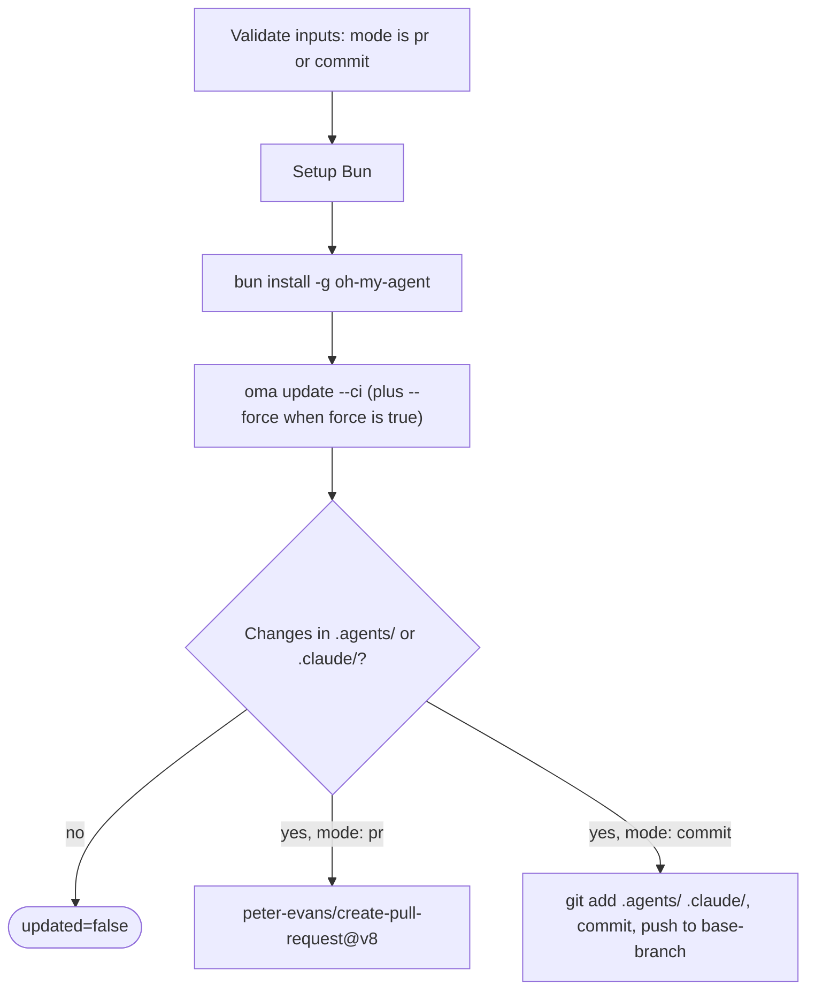

# 가이드: 자동 업데이트

## 개요

oh-my-agent GitHub Action(`first-fluke/oma-update-action@v1`)은 CI에서 `oma update`를 실행하여 프로젝트의 에이전트 스킬을 자동으로 업데이트합니다. 두 가지 모드를 지원합니다: 검토를 위한 풀 리퀘스트 생성, 또는 브랜치에 직접 커밋.

---

## 빠른 설정

<!-- oma-docs:ignore-start -->
이 파일을 프로젝트에 `.github/workflows/update-oh-my-agent.yml`로 추가합니다:
<!-- oma-docs:ignore-end -->

```yaml
name: Update oh-my-agent

on:
  schedule:
    - cron: '0 9 * * 1'  # Every Monday at 9am UTC
  workflow_dispatch:        # Allow manual trigger

permissions:
  contents: write
  pull-requests: write

jobs:
  update:
    runs-on: ubuntu-latest
    steps:
      - uses: actions/checkout@v4

      - uses: first-fluke/oma-update-action@v1
```

이 구성이 최소 설정입니다. 설치된 구성 요소가 변경되면 action은 `updated=true`와 버전 출력을 남기고 PR을 생성합니다. 파일이 변경되지 않으면 `updated=false`로 종료하며 PR을 만들지 않습니다.

---

## 모든 Action 입력

| 입력 | 타입 | 필수 | 기본값 | 설명 |
|:-----|:-----|:-----|:-------|:-----|
| `mode` | string | 아니요 | `"pr"` | 변경 적용 방법. `"pr"`은 풀 리퀘스트를 생성합니다. `"commit"`은 베이스 브랜치에 직접 푸시합니다. |
| `base-branch` | string | 아니요 | `"main"` | PR의 베이스 브랜치(`pr` 모드) 또는 직접 커밋의 대상 브랜치(`commit` 모드). 체크아웃 대상은 바꾸지 않으므로 `actions/checkout`의 `ref:`를 같은 브랜치로 설정하세요. |
| `force` | string | 아니요 | `"false"` | `oma update`에 `--force`를 전달합니다. `"true"`이면 사용자가 커스터마이즈한 설정 파일(`oma-config.yaml`, `mcp.json`)과 `stack/` 디렉토리를 덮어씁니다. 평소에는 그대로 보존합니다. |
| `pr-title` | string | 아니요 | `"chore(deps): update oh-my-agent skills"` | 풀 리퀘스트의 커스텀 제목. `pr` 모드에서만 사용됩니다. |
| `pr-labels` | string | 아니요 | `"dependencies,automated"` | PR에 추가할 쉼표로 구분된 라벨. `pr` 모드에서만 사용됩니다. |
| `commit-message` | string | 아니요 | `"chore(deps): update oh-my-agent skills"` | 커스텀 커밋 메시지. 두 모드 모두에서 사용됩니다(PR 커밋 메시지 또는 직접 커밋 메시지). |
| `token` | string | 아니요 | `${{ github.token }}` | PR 생성용 GitHub 토큰. PR이 다른 워크플로우를 트리거해야 하는 경우 Personal Access Token(PAT)을 사용하세요 (기본 `GITHUB_TOKEN`은 자신이 생성한 PR에서 워크플로우 실행을 트리거하지 않습니다). |

---

## 모든 Action 출력

| 출력 | 타입 | 설명 | 사용 가능 시점 |
|:-----|:-----|:-----|:-------------|
| `updated` | string | `oma update` 실행 후 변경이 감지되면 `"true"`. 이미 최신이면 `"false"`. | 항상 |
| `version` | string | 업데이트 후 oh-my-agent 버전. `.agents/skills/_version.json`에서 읽음. | `updated`가 `"true"`일 때 |
| `pr-number` | string | 풀 리퀘스트 번호. | `pr` 모드에서 PR이 생성될 때만 |
| `pr-url` | string | 생성된 풀 리퀘스트의 전체 URL. | `pr` 모드에서 PR이 생성될 때만 |

---

## 상세 예제

### 예제 1: 기본 PR 모드

가장 일반적인 설정입니다. 매주 월요일 업데이트가 있으면 PR을 생성합니다.

```yaml
name: Update oh-my-agent

on:
  schedule:
    - cron: '0 9 * * 1'
  workflow_dispatch:

permissions:
  contents: write
  pull-requests: write

jobs:
  update:
    runs-on: ubuntu-latest
    steps:
      - uses: actions/checkout@v4

      - uses: first-fluke/oma-update-action@v1
        id: update

      - name: Summary
        if: steps.update.outputs.updated == 'true'
        run: |
          echo "Updated to version ${{ steps.update.outputs.version }}"
          echo "PR: ${{ steps.update.outputs.pr-url }}"
```

**수행 과정:**
- 리포지토리를 체크아웃합니다.
- Bun을 설치한 후 oh-my-agent을 전역으로 설치합니다.
- `oma update --ci`를 실행합니다.
- `.agents/` 또는 `.claude/`에 변경이 있는지 확인합니다.
- 변경이 있으면 `peter-evans/create-pull-request@v8`을 사용하여 `chore/update-oh-my-agent` 브랜치에 PR을 생성합니다.
- PR에 `dependencies,automated` 라벨이 지정되고 본문에 새 버전 번호가 포함됩니다.

### 예제 2: PAT를 사용한 직접 커밋 모드

PR 검토 단계 없이 업데이트를 즉시 적용하려는 팀용입니다. 커밋이 다운스트림 워크플로우를 트리거할 수 있도록 PAT를 사용합니다.

```yaml
name: Update oh-my-agent (Direct)

on:
  schedule:
    - cron: '0 6 * * *'  # Daily at 6am UTC
  workflow_dispatch:

permissions:
  contents: write

jobs:
  update:
    runs-on: ubuntu-latest
    steps:
      - uses: actions/checkout@v4
        with:
          ref: develop
          token: ${{ secrets.OH_MY_AGENT_PAT }}

      - uses: first-fluke/oma-update-action@v1
        with:
          mode: commit
          token: ${{ secrets.OH_MY_AGENT_PAT }}
          commit-message: "chore: auto-update oh-my-agent skills"
          base-branch: develop
```

**수행 과정:**
- PAT를 사용하여 `develop`을 체크아웃합니다. `ref: develop`은 필수입니다. `base-branch`는 푸시 대상만 정하며, action은 체크아웃으로 만들어진 `HEAD`를 그대로 푸시합니다.
- `oma update --ci`를 실행합니다.
- 변경이 있으면 `github-actions[bot]`으로 git을 설정하고 `develop`에 직접 커밋합니다.
- PAT를 사용하면 커밋이 `develop` 브랜치의 푸시 이벤트를 감지하는 모든 워크플로우를 트리거할 수 있습니다.

**중요:** `github.token` 대신 `secrets.OH_MY_AGENT_PAT`(Contents: Write 권한이 있는 Fine-Grained PAT)를 사용하세요. 기본 `GITHUB_TOKEN`은 다른 워크플로우를 트리거하지 않는 커밋을 생성하므로, 푸시 이벤트를 기대하는 CI 파이프라인이 중단될 수 있습니다.

### 예제 3: 조건부 알림

새 버전이 사용 가능할 때 Slack 알림과 함께 업데이트합니다.

```yaml
name: Update oh-my-agent

on:
  schedule:
    - cron: '0 9 * * 1'
  workflow_dispatch:

permissions:
  contents: write
  pull-requests: write

jobs:
  update:
    runs-on: ubuntu-latest
    steps:
      - uses: actions/checkout@v4

      - uses: first-fluke/oma-update-action@v1
        id: update

      - name: Notify Slack
        if: steps.update.outputs.updated == 'true'
        uses: slackapi/slack-github-action@v2
        with:
          webhook: ${{ secrets.SLACK_WEBHOOK }}
          webhook-type: incoming-webhook
          payload: |
            {
              "text": "oh-my-agent updated to v${{ steps.update.outputs.version }}. PR: ${{ steps.update.outputs.pr-url }}"
            }

      - name: Skip notification
        if: steps.update.outputs.updated == 'false'
        run: echo "Already up to date, no notification needed."
```

**핵심 패턴:** `steps.update.outputs.updated == 'true'`를 사용하여 실제 업데이트가 발생했을 때만 이후 단계를 실행합니다. 변경이 없는 실행에서 불필요한 알림이 발생하는 것을 방지합니다.

### 예제 4: 커스텀 라벨이 있는 강제 모드

업데이트 시 모든 설정 파일을 기본값으로 리셋하려는 프로젝트용입니다.

```yaml
name: Update oh-my-agent (Force)

on:
  workflow_dispatch:  # Manual trigger only for force updates

permissions:
  contents: write
  pull-requests: write

jobs:
  update:
    runs-on: ubuntu-latest
    steps:
      - uses: actions/checkout@v4

      - uses: first-fluke/oma-update-action@v1
        with:
          force: 'true'
          pr-title: "chore(deps): force-update oh-my-agent skills (reset configs)"
          pr-labels: "dependencies,automated,force-update"
          commit-message: "chore(deps): force-update oh-my-agent skills"
```

**경고:** 강제 모드는 `oma-config.yaml`, `mcp.json`, `stack/` 디렉토리를 덮어씁니다. 모든 커스터마이징을 기본값으로 리셋하려는 경우에만 사용하세요. 일반 업데이트에서는 `force` 입력을 생략하세요.

---

## 내부 동작 원리

이 action은 `action/action.yml`에 정의된 [composite action](https://docs.github.com/en/actions/creating-actions/creating-a-composite-action)입니다. 먼저 `mode`가 `pr` 또는 `commit`인지 검증한 뒤, 아래 단계를 실행하고 풀 리퀘스트나 직접 커밋으로 마무리합니다.



### 1단계: Bun 설정

```yaml
- uses: oven-sh/setup-bun@v2
```

oh-my-agent CLI를 실행하는 데 필요한 Bun 런타임을 설치합니다.

### 2단계: oh-my-agent 설치

```bash
bun install -g oh-my-agent
```

npm 레지스트리에서 CLI를 전역으로 설치합니다. `oma` 명령에 접근할 수 있게 됩니다.

### 3단계: oma update 실행

```yaml
- name: Run oma update
  shell: bash
  env:
    FORCE: ${{ inputs.force }}
  run: |
    FLAGS="--ci"
    if [ "$FORCE" = "true" ]; then
      FLAGS="$FLAGS --force"
    fi
    oma update $FLAGS
```

입력은 `run:` 안의 `${{ }}` 보간이 아니라 `env:`를 거쳐 스크립트에 전달되므로, 입력 값이 셸 코드로 실행되지 않습니다.

`--ci` 플래그는 비대화형 모드로 업데이트를 실행합니다(모든 프롬프트를 건너뛰고, 스피너 애니메이션 대신 일반 텍스트를 출력합니다). `--force` 플래그가 활성화되면 사용자가 커스터마이즈한 설정 파일을 덮어씁니다.

`oma update --ci`가 내부적으로 수행하는 작업:

1. 최신 버전 번호를 얻기 위해 메인 브랜치에서 `prompt-manifest.json`을 가져옵니다.
2. `.agents/skills/_version.json`의 로컬 버전과 비교합니다.
3. 버전이 일치하면 "Already up to date."로 종료합니다.
4. 새 버전이 사용 가능하면 최신 tarball을 다운로드하고 추출합니다.
5. 사용자가 커스터마이즈한 파일을 보존합니다(`--force` 제외): `oma-config.yaml`, `mcp.json`, stack 디렉토리.
6. 기존 `.agents/` 디렉토리 위에 새 파일을 복사합니다.
7. 보존된 파일을 복원합니다.
8. 설정의 `vendors:` 목록에 있는 벤더의 벤더 적응(훅, 설정, 에이전트 정의)을 업데이트합니다(빈 목록이면 아무 벤더도 업데이트하지 않습니다). `vendors:` 목록이 없으면 프로젝트 디렉토리가 이미 있는 벤더만 업데이트합니다.
9. CLI 심볼릭 링크를 갱신합니다.

이 action은 `--with-new-skills` 없이 `oma update --ci`를 실행합니다. 설치된 스킬을 갱신하고 새로 제공되는 스킬을 보고하지만, 프로젝트에 새 스킬을 추가하려면 `oma update --with-new-skills`를 명시적으로 실행해야 합니다.

### 4단계: 변경 확인

```bash
if [ -n "$(git status --porcelain .agents/ .claude/ 2>/dev/null)" ]; then
  echo "updated=true" >> "$GITHUB_OUTPUT"
  if [ -f ".agents/skills/_version.json" ]; then
    VERSION=$(jq -r '.version' .agents/skills/_version.json)
    echo "version=$VERSION" >> "$GITHUB_OUTPUT"
  fi
else
  echo "updated=false" >> "$GITHUB_OUTPUT"
fi
```

`oma update`가 `.agents/` 또는 `.claude/`의 파일을 실제로 변경했는지 확인합니다. 그에 따라 `updated`와 `version` 출력을 설정합니다. 이 두 디렉토리 밖의 변경(예: `.codex/`나 `AGENTS.md`)은 `updated=true`를 설정하지 않습니다.

이후 `mode` 입력에 따라:

- **`pr` 모드:** `peter-evans/create-pull-request@v8`을 사용하여 `chore/update-oh-my-agent` 브랜치에 PR을 생성합니다. PR에는 새 버전 번호, oh-my-agent 리포 링크, 설정된 라벨이 포함됩니다. 브랜치가 이미 존재하면(이전에 닫지 않은 PR에서) 기존 PR을 업데이트합니다.

- **`commit` 모드:** `github-actions[bot]`으로 git을 설정하고, `.agents/`와 `.claude/`를 스테이징하고, 설정된 메시지로 커밋하고, 베이스 브랜치에 푸시합니다.

---

## 함께 보기

- [글로벌 설치](./global-install.md): `oma update --global`과 사용자 전체 설치에서의 CI 주의 사항
- [설정 레퍼런스](./configuration-reference.md#update-and-ownership-rules): `oma update`가 보존하는 설정 파일
- [기존 프로젝트 통합](./integration.md): `oma update`가 프로젝트에서 갱신하는 파일
