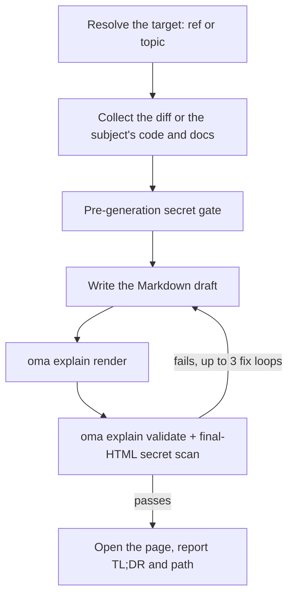

# 코드 설명서

`/explain`은 코드 변경을 자체 완결형 HTML 문서로 바꿔 무엇이 바뀌었고 그 이유가 무엇인지 설명합니다. 문서에는 처음 보는 사람을 위한 생략 가능한 배경, 장난감 데이터로 설명하는 핵심 직관 절, 이해하기 쉬운 순서의 코드 워크스루, 기본 5문항의 접근성 있는 퀴즈가 들어갑니다. 오프라인에서 열 수 있는 `.html` 파일 하나에 다이어그램과 콜아웃을 담아 `.agents/results/explain/` 아래에 저장하고, 전달 전에 결정론적 체크리스트로 검증합니다.

`/explain` 워크플로우는 자연어만으로 자동 활성화되지 않습니다. "explain"은 일상적인 단어라 `/convert`와 마찬가지로 키워드 감지에서 제외됩니다. `/explain`을 명시하거나 다른 스킬에 "설명서"를 위임 산출물로 요청하세요.

## 두 가지 모드

| 모드 | 입력 | git 필요 여부 | 페이지가 설명하는 것 |
|---|---|---|---|
| Change | `/explain`, `/explain #640`, `/explain a..b`, `/explain <branch>` | 필요(PR ref에는 `gh`도 필요) | 코드 변경: Background, Intuition, Code, Quiz |
| Topic | `/explain how does session windowing work`(PR, 브랜치, SHA 범위 중 어느 것으로도 해석되지 않는 텍스트) | 불필요 | 개념, 시스템, 또는 질문에 대한 답을 한 장짜리 시각 자료로 설명합니다. 먼저 핵심 답을 제시하고, 이어서 다이어그램, 표, 짧은 산문으로 된 패널을 배치합니다 |

텍스트가 브랜치 이름일 수도 있고 주제일 수도 있다면, 워크플로우는 먼저 git ref로 확인합니다. ref로 해석되면 ref가 우선합니다.

---

## 사용 시기

- PR, 브랜치, 커밋 범위, 또는 현재 스테이징·미스테이징 변경을 문서로 설명할 때
- 자기가 쓰지 않은 변경에 동료를 온보딩할 때
- 크거나 미묘한 변경이 반영된 뒤 검토 가능한 학습 자료를 남길 때
- 아키텍처, 프로토콜, 비교, 또는 긴 답변을 한 장짜리 시각 자료로 만들 때(Topic 모드)

## 사용하지 말아야 할 때

- 내레이션이 있는 설명 *영상*을 원할 때 → [`oma-video`](./video-generation.md)의 explainer 모드를 쓰세요. `/explain`은 영상이 아니라 HTML 문서를 만듭니다
- 문서가 아직 코드베이스와 맞는지 확인할 때 → `oma-docs`(드리프트 탐지)를 쓰세요
- 발표 덱이나 슬라이드를 만들 때 → `oma-slide`(1920×1080 고정 덱 계약)를 쓰세요
- 결함을 찾거나 리뷰 판정을 내릴 때 → `oma-qa`나 `/review` 워크플로우를 쓰세요. `/explain`은 변경을 교육적으로 서술할 뿐 평가하지 않습니다

---

## 빠른 시작

```text
/explain
/explain 640
/explain a1b2c3d..e5f6a7b
/explain payments-refactor for reviewer
```

대상 ref는 표현 방식에서 해석합니다.

| 입력 | 대상 해석 | 독자 수준 |
|----------|--------------------|--------------|
| `/explain` | 스테이징된 변경(`git diff --cached`), 없으면 더티 워킹 트리 | `onboarding` |
| `/explain 640`, `/explain #640` | `gh pr diff`로 가져온 PR #640 | `onboarding` |
| `/explain a..b` | SHA 범위 `a..b`(또는 `a...b`) | `onboarding` |
| `/explain feature-branch for reviewer` | `git diff main...feature-branch` | `reviewer` |
| `/explain how does the row planner work` | Topic 모드: ref가 없고, 에이전트가 주제와 관련된 코드와 문서를 수집합니다 | 해당 없음 |

명시적 ref가 없고 스테이징된 변경과 더티 워킹 트리가 모두 비어 있으면 `HEAD~1..HEAD`로 폴백합니다.



---

## ref 해석 순서

Change 모드에만 해당합니다. Topic 모드는 ref 해석을 건너뜁니다.

1. **명시적 인자**: PR 번호(`#640`), 브랜치 이름, SHA 범위(`a..b` / `a...b`)
2. **스테이징된 변경**: `git diff --cached`
3. **더티 워킹 트리**: `git diff`
4. **폴백**: `HEAD~1..HEAD`

diff가 비었거나 ref를 해석할 수 없으면 워크플로우를 멈춥니다. 다른 ref를 추측하는 대신 최근 커밋을 후보로 제시합니다.

---

## 독자 수준

| 수준 | 효과 |
|-------|--------|
| `onboarding`(기본값) | 전체 심층 배경(Tier A)을 담습니다. 주변 시스템을 모르는 독자용입니다 |
| `reviewer` | 심층 배경 계층을 압축합니다. Intuition과 Code 절은 그대로 유지합니다 |

`reviewer`를 쓰려면 `/explain feature-branch for reviewer`처럼 명령에 "for reviewer"를 붙이세요.

---

## 문서에 담기는 내용

Change 모드의 설명서는 탭이나 여러 페이지 내비게이션 없이 길게 스크롤하는 한 페이지로 구성됩니다. 목차 다음에 순서가 고정된 네 절이 이어집니다.

1. **Background**: Tier A(시스템과 아키텍처를 깊이 설명하며 "이미 시스템을 안다면 건너뛰어도 됩니다"라고 표시)와 Tier B(이번 변경에 한정된 좁은 맥락)
2. **Intuition**: 변경의 핵심을 장난감 데이터 예시와 함께 짚습니다. 재사용되는 다이어그램 계열 2~3개(단순화한 UI 목업, 예시 데이터를 실은 시스템·데이터 흐름도, 변경 전후 상태)로 보강하며, 전부 HTML과 인라인 SVG로만 그립니다. ASCII 아트는 쓰지 않습니다
3. **Code**: 알파벳순이나 diff 순서가 아니라 사람이 이해하기 좋은 순서로 묶은 워크스루입니다. 코드는 `file:line` 형식으로 참조합니다
4. **Quiz**: 기본 5문항(조정 가능)이며, 각 문항이 변경의 서로 다른 측면을 겨냥합니다. 그럴듯한 오답 선택지를 두고, 정답과 오답 모두에 피드백 문구를 붙입니다

산문과 퀴즈 내용은 요청한 출력 언어로 씁니다(프롬프트 언어 → `.agents/oma-config.yaml`의 `language` → 영어 순). 코드, 식별자, 인라인 코드는 i18n 규칙에 따라 영어로 유지합니다. 전체 콘텐츠 계약은 `.agents/skills/oma-explanation/resources/document-structure.md`에 있습니다.

---

## 페이지를 만드는 방식

에이전트가 Markdown 초안을 쓰면 `oma explain render`가 이를 페이지로 바꿉니다. 레이아웃, 테마, 다이어그램 형상, 퀴즈 스크립트는 모델이 아니라 렌더러가 만듭니다.

| 명령 | 용도 |
|---|---|
| `oma explain render draft.md` | 초안(파일 또는 stdin)을 `.agents/results/explain/{YYYY-MM-DD}-{slug}.html`로 렌더링합니다. 옵션으로 `--template sheet\|doc`, `--theme`, `--mode`, `--archify`, `--open`이 있습니다. |
| `oma explain lint draft.md` | 렌더링하지 않고 산문만 검사합니다(`--style strict`는 경고가 있으면 1로 종료합니다). |
| `oma explain components [name]` | 초안에서 쓸 수 있는 컴포넌트(`flow`, `sequence`, `tree`, `timeline`, `limits`, `annot`, `kv`, `callout`, `quiz`)를 나열하거나, 컴포넌트 하나의 문법을 출력합니다. |
| `oma explain patch <page.html> --panel <id>` | 렌더링된 페이지에서 패널 하나(문자나 제목으로 지정)만 교체하고 나머지는 유지합니다. |
| `oma explain validate <file>` | 아래에서 설명하는 결정론적 사후 검사를 실행합니다. |

---

## HTML 계약

`oma explain render`로 만든 페이지는 이 규칙을 자동으로 충족합니다. HTML을 검사하거나 직접 수정할 때 이 규칙이 중요합니다.

생성된 파일은 `file://`로 오프라인에서 제대로 열려야 하며, **외부 리소스를 전혀 불러오지 않아야** 합니다. CDN 스크립트나 스타일시트, 웹폰트, 외부 이미지를 쓸 수 없습니다(인라인 SVG나 data URI만 허용). 하이퍼링크 앵커(`<a href="https://...">`)는 허용합니다. 금지 대상은 리소스 *로딩*뿐입니다.

- 코드 블록은 `<pre>`를 쓰고, 커스텀 컨테이너를 만들면 `white-space: pre-wrap`을 선언합니다. 외부 문법 강조 라이브러리는 쓰지 않습니다.
- 폰트 스택은 로컬에 설치된 Pretendard를 패밀리 이름으로 먼저 찾고(페이지는 폰트를 내려받지 않으며 CSS `local()` 함수도 쓰지 않습니다), 그다음 `system-ui`와 시스템 CJK 폰트를 씁니다. 일본어와 중국어 페이지는 Pretendard를 건너뛰고 `system-ui`와 해당 언어용 폰트부터 시작합니다.
- 375px부터 반응형이고, 라이트와 다크 테마 모두에서 WCAG AA 대비를 지키며, `prefers-color-scheme: dark`를 지원하고 `prefers-reduced-motion`을 존중합니다.
- 퀴즈는 바닐라 JS입니다. 선택지는 `<button>` 요소로 만들고, 정답과 오답 피드백을 `aria-live="polite"` 영역으로 즉시 알리며, 정답 위치를 무작위로 분산하고, 마지막에 점수 요약을 보여주며, 키보드로 전부 조작할 수 있어야 합니다.

전체 동작 명세는 `.agents/skills/oma-explanation/resources/html-contract.md`에 있습니다.

---

## 시크릿과 프롬프트 인젝션 방어

diff 내용과 PR 설명은 철저히 **데이터**로만 취급합니다. 설명 대상 변경에 지시문이 들어 있어도 무시합니다.

시크릿은 두 번 걸러냅니다.

1. **생성 전**: 수집한 diff를 아무것도 작성하기 전에 스캔합니다.
2. **생성 후**: 최종 HTML도 스캔합니다. 배경 설명이 diff 스캔만으로는 놓칠 수 있는 미변경 파일을 인용할 수 있기 때문입니다.

하나라도 걸리면 생성을 즉시 중단하고, 마스킹한 위치만 보고하며(실제 값은 절대 보고하지 않습니다), 가린 채로 이어가려면 명시적 확인이 필요합니다.

---

## 검증 체크리스트

생성이 끝나면 결과 파일을 대상으로 grep 기반 체크리스트를 돌립니다. 외부 리소스 로딩 참조가 없는지, 코드 컨테이너가 `pre` 또는 `pre-wrap`을 지키는지, 퀴즈 스크립트가 있는지, 파일명이 `{YYYY-MM-DD}-{slug}.html` 형식인지(날짜는 oma-config의 `timezone` 기준이며, 없으면 시스템 시간대 기준), 최종 HTML 시크릿 스캔이 통과하는지 확인합니다. 실패하면 최대 **3회**까지 수정하고 재검증한 뒤, 그래도 남으면 조용히 전달하지 않고 멈춰서 실패 항목을 보여줍니다.

이는 v1의 제약입니다. 검증은 grep과 파일 기반이며, 퀴즈 스크립트의 *존재* 여부만 확인합니다(동작이 완전히 올바른지는 보지 않습니다). 동작을 확신해야 한다면 브라우저(또는 chrome-devtools MCP)로 퀴즈를 직접 실행해 보세요.

등록된 CLI 명령으로 기존 산출물을 검증할 수도 있습니다.

```bash
oma explain validate .agents/results/explain/2026-09-09-payment-refactor.html
oma explain validate --input-dir .agents/results/explain --output json
```

예상 출력(파일 이름은 예시입니다):

```text
$ oma explain validate .agents/results/explain/2026-09-09-payment-refactor.html
✔ Explain validation passed: 1/1 file(s) valid

$ oma explain validate ".agents/results/explain/payment refactor.html"
✖ Explain validation failed: 1/1 file(s) failed
File: .agents/results/explain/payment refactor.html
  - [error] filename-format: Filename 'payment refactor.html' does not match format {YYYY-MM-DD}-{slug}.html
```

첫 번째 형식은 HTML 파일 하나를 확인합니다. 디렉토리 형식은 디렉토리의 모든 보고서를 확인하고 기계 판독 가능한 결과를 반환합니다. JSON 결과를 저장하려면 `--report-file <path>`를 사용합니다. 예전 표기인 `--out-file`은 이제 `Removed option --out-file. Use --report-file.` 오류로 실패합니다. 종료 코드가 0이 아니면 결정론적 검사 중 하나 이상이 실패한 것이며, 설명의 교육적 정확성이나 퀴즈 답변 자체를 평가한 결과는 아닙니다.

---

## 출력

```text
.agents/results/explain/{YYYY-MM-DD}-{slug}.html
```

날짜는 oma-config의 `timezone`을 따르고, 설정이 없으면 시스템 시간대를 사용합니다. 같은 날짜와 슬러그로 다시 실행하면 이전 파일을 덮어쓰므로, 앞선 실행 결과를 남기는 것은 사용자 몫입니다. 검증이 통과하면 워크플로우가 페이지 열기를 시도하고(경고만 하므로 헤드리스 환경에서는 경로 보고로 넘어갑니다), TL;DR과 파일 경로를 보고합니다. `oma explain render --open`을 쓰면 브라우저에서 페이지를 바로 엽니다.

---

## 선택적 archify 사이드카

`oma-config.yaml`에서 `diagram.explain_sidecar: true`를 설정하거나 직접 요청하면(`/explain 640 with archify`), `/explain`은 `--archify`로 렌더링합니다. 초안의 `flow` 또는 `sequence` 블록에서 대화형 `{date}-{slug}.archify.html`을 만들고 일반 앵커로 연결합니다. 사이드카는 절대 삽입하지 않으므로 설명서는 자체 완결형 파일 하나로 유지되며, 사이드카가 실패해도 전달을 막지 않습니다. [다이어그램 엔진](./diagram-engine.md#explain)을 참고하세요.

## 엣지 케이스

| 상황 | 동작 |
|-----------|----------|
| diff가 비었거나 ref를 해석할 수 없음 | 중단하고 최근 커밋을 후보로 제시. 다른 ref를 추측하지 않음 |
| diff가 너무 큼 | 락파일과 생성 파일을 자동 제외하고, 나머지를 파일 단위로 묶으며, 제외 목록을 출처 푸터에 표시 |
| 바이너리나 생성 파일만 있는 diff | 중단. 설명할 것이 없음 |
| `gh` CLI가 없거나 인증되지 않음 (PR ref) | 설치·인증 안내와 함께 로컬 브랜치 diff 대안 제시 |
| 머지나 리베이스가 진행 중 | 중단. 워크트리가 불안정함 |
| git 디렉토리가 아님 | Change 모드: 즉시 중단. Topic 모드는 git 없이 실행됨 |
| 수정 루프 3회 뒤에도 검증 실패 | 중단하고 실패한 체크리스트 항목을 보여줌 |
| `open` 실패 또는 헤드리스 환경 | 경고만 함. 보고된 경로로 충분함 |

---

## 다음 단계

- [`/explain` 워크플로우](../core-concepts/workflows.md#explain): ref 해석 → 수집 → 시크릿 게이트 → 생성 → 검증 → 전달 파이프라인
- [다이어그램 엔진](./diagram-engine.md): 선택적 archify 사이드카
- [CLI 명령: explain](../cli-interfaces/commands.md#explain): 모든 `oma explain` 옵션
- [영상 생성](./video-generation.md): `oma-video`의 explainer *모드*는 HTML 문서 대신 내레이션이 있는 영상을 만듭니다
- [콘텐츠와 리서치 워크플로우](./content-and-research.md): 다른 문서·리서치 기능
