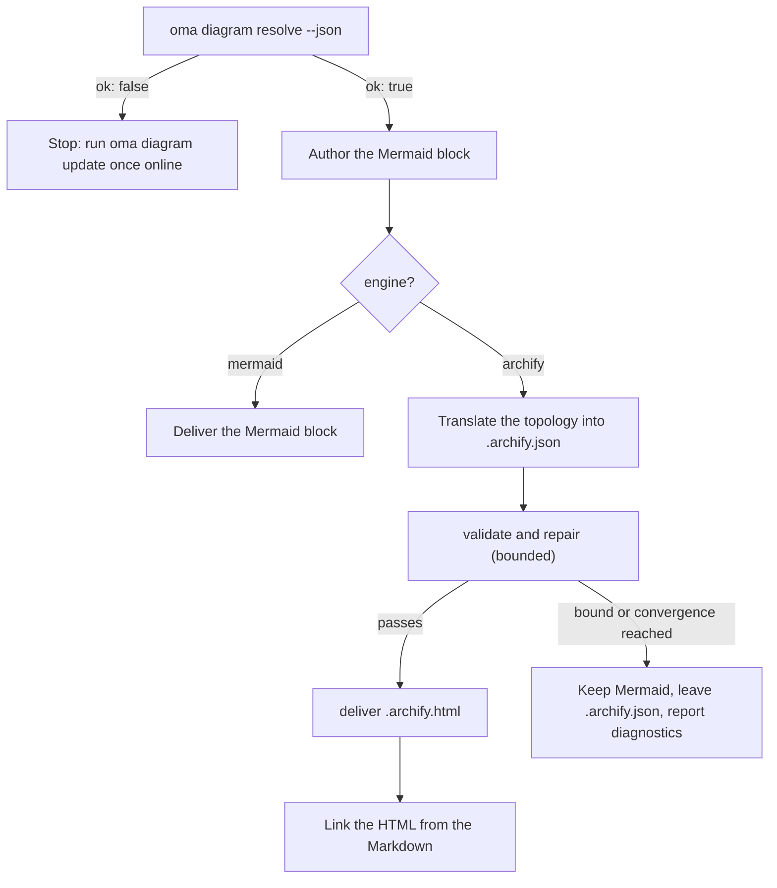

# 다이어그램 엔진 {#diagram-engine}

`/architecture`(ADR, 권장 사항, 검토)와 `/explain`(코드 변경 설명)은 구조 다이어그램을 만듭니다. `/architecture` 산출물에는 **Mermaid** 블록이 항상 포함되며, `/explain` 워크플로우는 인라인 SVG 다이어그램을 그립니다. [archify](https://github.com/tt-a1i/archify)를 해석할 수 있으면 아키텍처 워크플로우는 산출물 옆에 **대화형 검증 HTML 다이어그램**도 생성합니다. 다이어그램은 타입이 있는 JSON 사양에서 렌더링되며 다크/라이트 테마, 이동·확대/축소, 검색, 관계 추적, PNG/SVG/WebM 내보내기를 지원합니다.

Mermaid는 사라지지 않습니다. Markdown과 git diff에 남는 텍스트 SSOT입니다. archify는 파생 산출물입니다.

---

<a id="always-the-latest-archify--nothing-to-install"></a>
## 최신 archify 관리 사본

archify는 MIT 라이선스의 에이전트 스킬입니다(Node ≥ 18, 런타임 의존성 0개). oh-my-agent는 사용자가 한 번 설치한 사본에 의존하지 않습니다. **자체 관리 사본**을 유지하고 최신 릴리스를 추적합니다.

- 캐시: `~/.cache/oma-diagram/archify/<tag>/` 및 포인터를 담은 `state.json`
- 사용하기 전에 `oma diagram resolve`가 GitHub에서 최신 릴리스 태그를 확인합니다. 확인은 `check_interval_min`(기본 60분)마다 한 번으로 제한됩니다. 새 태그가 있으면 소스 tarball을 내려받고(태그별 디렉토리를 원자적으로 만들며 오래된 태그는 정리합니다), 새 태그가 없으면 캐시 사본을 재사용합니다.
- 네트워크 실패는 치명적이지 않습니다. 캐시 사본을 사용하고 이유와 함께 `stale`로 보고합니다. 네트워크와 캐시가 모두 없는 첫 실행에서만 사용자 설치 스킬 사본으로 폴백하고, 그것도 없으면 Mermaid를 사용합니다.

```bash
# Illustrative output; the release tag, cache path, and quality can vary.
oma diagram update          # force a check / download now
oma diagram resolve
# engine:   archify  (requested: auto)
# reason:   archify 2.15.0 via managed:v2.15.0 (current)
# root:     /Users/you/.cache/oma-diagram/archify/v2.15.0
# bin:      /Users/you/.cache/oma-diagram/archify/v2.15.0/bin/archify.mjs
# version:  2.15.0
# quality:  showcase
# sidecar:  off (explain)
oma diagram resolve --offline   # never touch the network
```

해석 순서는 다음과 같습니다. 먼저 찾은 항목을 사용하며, 모든 벤더 런타임에서 동일합니다.

1. `oma-config.yaml`의 `diagram.archify.path`: 명시적 고정이며 자동 최신 추적을 사용하지 않습니다
2. `ARCHIFY_HOME` 환경 변수: 명시적 고정입니다
3. **관리되는 최신 사본**(`~/.cache/oma-diagram/archify`)
4. 사용자 설치 스킬 디렉토리: 프로젝트의 `.agents` / `.claude` / `.codex` / `.cursor` / `.qwen` / `.kiro` `/skills/archify`, 그다음 `~` 아래의 같은 경로, 그리고 `~/.raven/workspace/skills/archify`

<!-- oma-docs:ignore-start -->
관리되는 설치 또는 고정된 archify 설치 안에 `bin/archify.mjs`가 있어야 찾은 것으로 인정합니다.
<!-- oma-docs:ignore-end -->

---

## 설정 {#configuration}

`.agents/oma-config.yaml`에 필요한 항목만 작성합니다. 없는 키는 아래 기본값을 사용합니다.

```yaml
diagram:
  engine: auto                # auto | archify | mermaid
  explain_sidecar: false      # /explain also writes an archify sidecar
  archify:
    managed: true             # false = never download; use pins / skill dirs only
    channel: stable           # stable (latest GitHub Release) | main (HEAD of main)
    check_interval_min: 60    # minutes between remote checks; 0 = every call
    path: null                # explicit install dir (pin)
    quality: showcase         # showcase | standard  → --quality
    open: false               # pass --open to deliver
```

### 어떤 엔진이 실행되나 {#which-engine-runs}

설정 값, archify가 해석되는지 여부, 워크플로우가 전달하는 결과를 한 번에 결정합니다. "해석된다"는 것은 [해석 순서](#always-the-latest-archify--nothing-to-install)의 어느 단계에서든 설치본을 찾았다는 뜻입니다. 고정 경로, 관리되는 최신 사본, 사용자 설치 스킬 디렉토리가 모두 해당합니다.

| `diagram.engine` | archify 해석 여부 | `oma diagram resolve --json` | `/architecture` 결과 |
|---|---|---|---|
| `auto`(기본값) | 예 | `engine: archify`, `ok: true` | Mermaid 블록 + 연결된 `.archify.html` |
| `auto` | 아니요(예: 첫 실행이 오프라인이거나, `managed: false`이고 스킬 디렉토리가 없음) | `engine: mermaid`, `ok: true` | Mermaid만 사용. 온라인에서 `oma diagram update`를 한 번 실행하라고 보고합니다 |
| `archify` | 예 | `engine: archify`, `ok: true` | Mermaid 블록 + 연결된 `.archify.html` |
| `archify` | 아니요 | `engine: mermaid`, `ok: false`, 종료 코드 1 | 조용히 하위 엔진으로 낮추지 않고 `oma diagram update` 힌트와 함께 워크플로우를 멈춥니다 |
| `mermaid` | 확인하지 않음 | `engine: mermaid`, `ok: true` | Mermaid만 사용. archify를 호출하지 않습니다 |

`oma diagram resolve --engine <auto|archify|mermaid>`는 호출 한 번에 한해 설정을 덮어쓰며, 프롬프트로도 실행 한 번에 한해 같은 효과를 낼 수 있습니다(`/explain 640 with archify`).

---

## CLI {#cli}

```bash
oma diagram resolve [--engine auto|archify|mermaid] [--refresh] [--offline] [--json]
oma diagram update  [--json]
oma diagram archify <archify args…>
```

`oma diagram update`는 강제로 새로 확인하며, 해석할 수 있는 archify 설치본이 없으면 종료 코드 1로 끝납니다.

`oma diagram archify`는 해석된 archify 실행 파일을 `ARCHIFY_UPDATE_CHECK_DISABLED=1`로 실행합니다(네트워크 없음). 종료 코드를 그대로 전달하므로 `validate` / `deliver` / `visual-check`의 동작은 archify 문서와 같습니다.

```bash
oma diagram archify guide "show the auth request lifecycle" --json
oma diagram archify validate architecture adr-auth.archify.json --quality showcase --json
oma diagram archify deliver  architecture adr-auth.archify.json adr-auth.archify.html --quality showcase --json
oma diagram archify visual-check adr-auth.archify.html --json   # exit 2 = no Chrome (skipped), or archify itself could not be resolved
```

`resolve`의 `--json`은 `{ ok, requested, engine, quality, open, explainSidecar, archify?: { root, bin, version, source, status?, note? }, reason, probed }`를 반환합니다. `source`는 `managed:<tag>`, `config:…`, `env:…`, 스킬 디렉토리 레이블 중 하나입니다. 관리 사본에는 `status`(`fresh` / `current` / `stale`)와 `note`가 설정됩니다.

---

## 워크플로우에서의 사용 방식 {#how-the-workflows-use-it}

공유 프로토콜은 `.agents/skills/_shared/conditional/diagram-engine.md`에 있습니다. `/architecture`는 다음 순서를 따릅니다.

1. `oma diagram resolve --json`
2. 먼저 Mermaid 블록을 작성합니다(항상).
3. `engine: archify`이면 Mermaid 토폴로지를 archify JSON IR(`architecture` / `sequence` / `dataflow` / `lifecycle` / `workflow`)로 변환합니다. 설치된 사본에서 해당 스키마와 예시 하나만 읽습니다.
4. `validate` → 수정 → `deliver` 순서로 진행하되 횟수를 제한합니다. 사양이 통과하거나, archify의 수렴 규칙이 발동하거나, 수정을 3회 시도했거나, 전체 10분이 지났거나, 같은 진단이 반복되면 멈춥니다. 통과만을 위해 의미 레이블을 삭제하지 않습니다.
5. HTML을 링크합니다. HTML을 삽입하지 않습니다.



### `/architecture` {#architecture}

경계, 의존성, 데이터 흐름 같은 구조적 결정에만 사용합니다. Markdown 산출물 옆의 `.agents/results/architecture/`에 다음을 출력합니다.

```text
adr-notification-service.md            # Mermaid 블록 + "Interactive:" 링크
adr-notification-service.archify.json  # 고정된 사양(실패해도 보존)
adr-notification-service.archify.html  # 전달된 뷰어
```

### `/explain` {#explain}

설명서 자체의 계약(자체 완결형 단일 파일, CSS 변수 테마)이 두 번째 완전한 HTML 문서를 삽입하는 것을 허용하지 않으므로 선택 사항입니다. `diagram.explain_sidecar: true`를 설정하거나, `oma explain render --archify`를 쓰거나, 프롬프트에서 요청하면("with archify") 사용합니다. Mermaid 블록도 직접 쓴 JSON도 없습니다. 렌더러가 초안의 `flow` 또는 `sequence` 블록(`{archify}`로 표시한 패널)에서 archify 사양을 만들고, `deliver`를 실행하며(`showcase` 품질에서 `standard`로 한 번 폴백), `{date}-{slug}.archify.html`을 일반 `<a href>`로 연결합니다. 명령은 `linked`, `skipped`(사유 포함), `failed`(첫 진단 포함) 중 하나를 보고합니다. 워크플로우는 실패한 사이드카를 두고 반복하지 않으며, 사이드카 실패가 설명서 전달을 막지는 않습니다.

---

## 실패 상황 {#failure-modes}

archify를 해석할 수 없는 경우는 [엔진 결정 표](#which-engine-runs)에서 다룹니다. 나머지 경우는 다음과 같습니다.

| 상황 | 결과 |
|---|---|
| 업데이트 확인 실패(오프라인, 속도 제한) | 캐시 사본을 이유와 함께 `stale`로 보고하며 사용합니다 |
| `validate`가 수렴하지 않음 | Mermaid가 전달되는 다이어그램으로 남고, 마지막 `.archify.json`은 사람이 검토할 수 있도록 보존됩니다. 진단은 원문 그대로 보고합니다 |
| `visual-check`에 Chrome 없음 | 통과가 아니라 `skipped`로 보고합니다 |
| `oma diagram archify …`가 종료 코드 2로 끝남 | Chrome이 없거나(`visual-check`) archify를 해석할 수 없는 경우입니다. 먼저 `oma diagram resolve --json`을 확인하세요 |

---

## 다음 단계 {#related}

- [코드 설명서](./code-explainer.md): `/explain` 워크플로우와 선택적 archify 사이드카
- [`/architecture` 워크플로우](../core-concepts/workflows.md#architecture): Mermaid 블록을 담는 ADR과 리뷰
- [oma-config.yaml 시맨틱](./oma-config-semantics.md): `diagram:` 섹션이 병합되는 방식
- [CLI 명령: diagram](../cli-interfaces/commands.md#diagram): 전체 옵션 목록
- [시장 조사](./market-research.md): last30days 엔진에 쓰는 같은 관리형 최신 사본 패턴
- archify upstream: [tt-a1i/archify](https://github.com/tt-a1i/archify)
