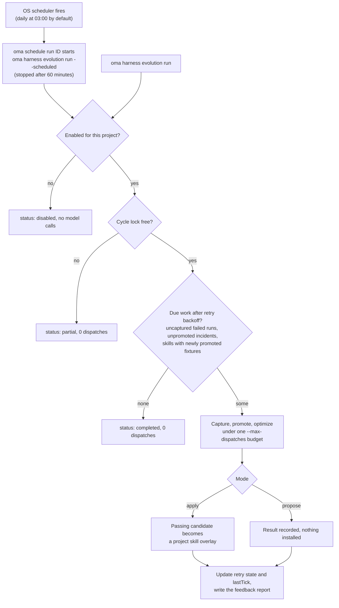

# 프로젝트 하네스 진화

OMA는 추적 중인 에이전트 실행에서 증거를 모으고, 예약된 피드백 사이클에서 실패를 처리할 수 있습니다. 자동 스킬 변경은 **프로젝트에서 직접 활성화하기 전까지 꺼져 있습니다**. 사이클마다 모델 호출 예산이 유한하게 정해지며, 적용되는 변경은 기존 스킬 평가 게이트를 모두 통과해야 합니다.

자동 경로는 평가를 통과한 변경을 스킬 문서에 적용합니다. 최적화기나 유지 관리 절차 자체를 바꾸려면 별도로 [메타 최적화](./skill-opt.md#meta-optimization-the-procedure-as-the-candidate)를 수동 실행해야 합니다.

## 프로젝트 활성화

프로젝트 루트에서 실행합니다.

```bash
# Example allowance: at most 300 model dispatches per scheduled cycle
oma harness evolution enable --max-dispatches 300

# Evaluate proposals without applying them
oma harness evolution enable --max-dispatches 300 --mode propose

# Choose a schedule in the operating system's local time
oma harness evolution enable --max-dispatches 300 --cron "0 3 * * *"

oma harness evolution status --json
```

`enable`은 저장된 설정과 스케줄러 작업 ID를 출력합니다.

```json
{
  "enabled": true,
  "scheduleId": "sch_abcdefgh2345",
  "mode": "apply",
  "maxDispatches": 300
}
```

`status --json`은 `config`, `schedule`(스케줄러 항목 또는 `exists: false`), `pending`(완료되지 않은 재시도 수), `conflicts`(스킬별 오버레이 충돌), `state`(재시도와 `lastTick`)를 반환합니다.

기본 스케줄은 매일 현지 시각 03:00이고, 기본 모드는 `apply`입니다. 활성화할 때 `--max-dispatches`는 필수이며 양의 정수여야 합니다. 예시의 값은 호출 한도일 뿐, 비용 추정치도 아니고 사이클이 끝난다는 보장도 아닙니다. 픽스처 스위트가 크거나 채점이 반복되면 호출을 더 많이 소비합니다.

<!-- oma-docs:ignore-start -->
설정은 `.agents/evolution/harness-evolution.json`에 저장됩니다. 생성된 증거, 재시도 상태, 사이클 잠금은 `.agents/state/harness-evolution/` 아래에 있습니다.
<!-- oma-docs:ignore-end -->

활성화하면 OMA의 기존 [OS 스케줄러](./scheduled-agents.md)에 내장 작업이 등록되며, 이 작업은 `oma schedule list`에 에이전트 `__builtin__`으로 표시됩니다. 실행 시각이 되면 `oma schedule run <id>`가 이 프로젝트에서 `oma harness evolution run --scheduled`를 시작하고 60분 뒤에 중지합니다. 따라서 `--max-dispatches`는 한 시간 안에 끝나는 사이클에 맞춰 정하세요. 다시 활성화하면 새 작업을 만드는 대신 프로젝트의 기존 작업을 갱신합니다. 저장된 설정이 일관되게 유지되도록 스케줄은 `oma schedule delete`가 아니라 `oma harness evolution disable`로 중지하세요.

```bash
# Run one cycle now under the saved mode and budget
oma harness evolution run --json

# Stop future cycles; retain evidence and applied improvements
oma harness evolution disable
```

`run --json`은 `status`(`completed`, `partial`, `disabled`), `dispatchesUsed`, `maxDispatches`를 반환합니다. 다른 사이클이 잠금을 쥐고 있으면 `run`은 디스패치 0회로 `partial`을 반환합니다. 한도 소진 같은 오류로 중단된 사이클은 해당 오류와 함께 종료되며 `state.lastTick`에 `partial` 또는 `failed`를 기록합니다.

비활성화된 프로젝트는 뒤늦게 도착한 예약 호출을 포함해 evolution 명령을 통한 모델 작업을 실행하지 않습니다. 비활성화해도 이미 적용된 변경은 되돌리지 않습니다.

## 자동으로 일어나는 일

예약 또는 수동 실행으로 사이클을 시작할 수 있습니다.



1. **완료 증거를 기록합니다.** OMA가 추적하는 실행은 결과와 검증 증거에 대한 로컬 참조를 남깁니다. 이 완료 단계는 추가 모델 호출을 하지 않습니다. 같은 실행이 반복해서 완료되어도 증거가 중복 생성되지 않습니다.
2. **예약된 시점에 실패를 수집합니다.** 사이클은 대상이 되는 실패 실행을 훑고, 기록된 작업 계약에서 기대 동작을 도출한 뒤, 제안된 회귀 픽스처가 보존된 실패 출력을 실제로 거부하는지 확인합니다.
3. **영향받은 스킬을 최적화합니다.** 인시던트는 스킬별로 묶입니다. 각 스킬은 기존의 학습, 검증, 최종 테스트, 격리, 음의 전이 검사 아래에서 최적화됩니다.
4. **적용하거나 보고합니다.** `apply` 모드에서는 통과한 후보가 프로젝트 스킬 오버레이가 됩니다. `propose` 모드에서는 결과를 설치하지 않고 기록만 합니다.
5. **변경을 보고합니다.** 결과는 status와 기존 승격 이력으로 확인합니다. 적용된 변경은 다음 세션의 진화 알림에도 반영됩니다.

OMA가 모든 네이티브 대화나 사용자의 모든 교정을 자동으로 관찰하지는 않습니다. 입력은 OMA가 실제로 추적하는 실행 증거입니다. 보존된 출력이나 수락 계약이 없는 실행에는 수동으로 작성한 [인시던트 사양](./harness-incidents.md#capture-an-incident)이 필요할 수 있습니다.

## 예산과 재시도

사이클은 캡처, 루브릭 초안 작성, 라우팅, 채점, 스킬 최적화, 인접 태스크, 최종 평가에 걸쳐 하나의 호출 한도를 공유합니다. 모델 호출은 디스패치 전에 한도에서 차감됩니다. 실행 계층이 재시도한 호출도 집계됩니다. 스킬에 더 엄격한 constitution 한도가 있으면 그 한도도 그대로 적용됩니다.

한도가 소진되면 평가는 미완료로 남고 해당 후보는 적용될 수 없습니다. 보고서에는 사용량과 남은 작업이 기록됩니다. 프로젝트 사이클은 한 번에 하나만 실행됩니다.

픽스처를 만들었다고 해서 그 인시던트의 최적화가 완료된 것으로 표시되지는 않습니다. 중단되거나 실패한 최적화는 미완료로 남으며, 백오프 후 픽스처를 중복 생성하지 않고 재개할 수 있습니다. 백오프는 실패할 때마다 2배로 늘어나 2, 4, 8, … 분이 되며 최대 1024분(약 17시간)까지 늘어납니다. 완전히 평가했으나 수용할 만한 변경이 없는 결과는 처리 완료로 기록되므로, 같은 증거가 최적화를 무한히 반복 유발하지 않습니다. 새 증거가 들어오면 다시 시도할 수 있습니다.

제안 모드에서 적용 모드로 전환하면 아직 적용되지 않은 제안이 처리 대상이 됩니다. 적용에는 여전히 현재 시점의 평가와 변경되지 않은 원본 내용이 필요합니다. 오래된 제안이 무조건적인 쓰기 지시가 되지는 않습니다.

## 지속되는 스킬 오버레이

자동 변경은 관리되는 스킬 정의와 분리되어 프로젝트의 사용자 소유 evolution 영역인 `.agents/evolution/skills/<skill>/`(`overlay.json` 기록 포함)에 저장됩니다. 평가와 프로젝트 로컬 벤더 스킬 링크는 관리되는 기본 본문과 그에 적용 가능한 오버레이 중에서 선택된 유효 본문을 사용합니다. HOME 범위의 벤더 설치는 프로젝트 오버레이로 다시 향하지 않습니다. 프로젝트 벤더 디렉토리에 관리되지 않는 사본이 있으면 자동 적용 전에 먼저 해소해야 합니다. 스킬 리소스는 상대 경로 그대로 사용할 수 있습니다.

오버레이는 자신이 평가된 기준 본문을 기록합니다. `oma update` 이후에는 다음과 같이 동작합니다.

- 기준 본문이 바뀌지 않았으면 오버레이를 계속 사용합니다.
- 기준 본문이 바뀌었으면 오버레이는 보존하되 충돌로 표시하고, 갱신된 기준 본문을 사용합니다. 예전 평가로는 새 기준 본문에서 오버레이가 안전하다고 확인할 수 없기 때문입니다.

최적화가 실행되는 동안 편집이 있었다면 후보가 그 변경된 내용을 덮어쓰지 못합니다. status는 검토가 필요한 충돌을 보고합니다.

## 확인과 되돌리기

```bash
oma harness evolution status --json
oma skill promotions --all
oma skill rollback --skill oma-docs
```

승격 기록은 후보와 부모의 해시, 평가 증거, 검토 가능한 패치를 보관합니다. 첫 오버레이를 롤백하면 관리되는 기본 본문을 다시 사용하고, 이후 오버레이를 롤백하면 직전 오버레이로 돌아갑니다. 알 수 없는 편집은 보존됩니다. 기록된 후보와 더 이상 일치하지 않는 내용은 롤백이 버리지 않습니다.

수동 `oma skill optimize --apply`는 여전히 관리되는 `SKILL.md`에 기록하지만, 해당 스킬에 프로젝트 오버레이가 활성화되어 있으면 실행을 거부합니다(`[oma skill opt] an active project overlay owns this skill; ...`). 먼저 `oma skill rollback --skill <id>`로 오버레이를 롤백하거나, 진화 사이클이 변경을 적용하도록 두세요. 예약된 진화는 오버레이 적용 경로를 명시적으로 선택합니다.

## 증거의 범위

통과한 소프트웨어 테스트는 배선과 평가 규칙이 맞다는 것을 확인해 줄 뿐입니다. 반복되는 자동 변경이 시간이 지나면서 프로젝트의 실제 작업을 개선한다는 것까지 입증하지는 않습니다. 한도를 늘리거나 자동화를 넓히기 전에 실제 승격, 비용, 회귀, 롤백 이력을 확인하세요. 이 예약 피드백 루프는 L5 절차 승격을 호출하지 않습니다.

## 함께 보기

- [인시던트 회귀 사례](./harness-incidents.md): 이 사이클이 처리하는 인시던트를 캡처하고, 승격하고, 재현합니다.
- [스킬 최적화](./skill-opt.md): 적용되는 모든 변경이 통과하는 게이트입니다.
- [에이전트 예약 실행](./scheduled-agents.md): 사이클을 실행하는 OS 스케줄러입니다.
